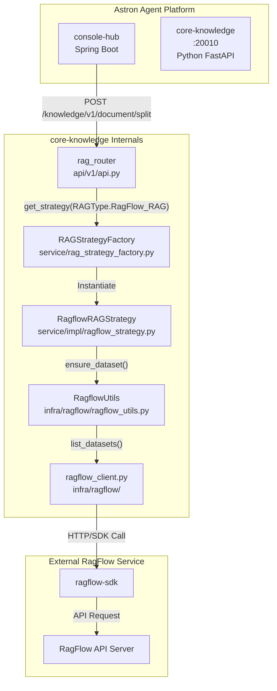
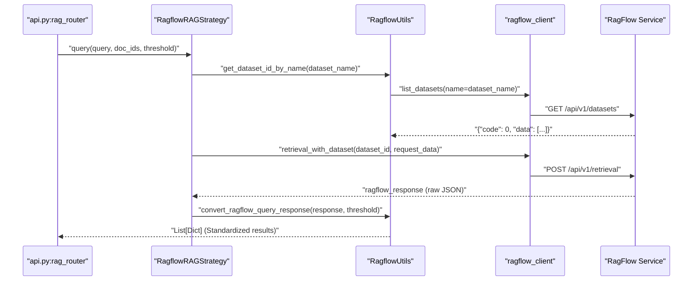

<!-- source: DeepWiki mcp.deepwiki.com · repo iflytek/astron-agent · page 13.2 RagFlow Knowledge Base Integration · fetched 2026-10-27 -->

# RagFlow Knowledge Base Integration

Relevant source files

The following files were used as context for generating this wiki page:

- [core/knowledge/Dockerfile](core/knowledge/Dockerfile)
- [core/knowledge/README.md](core/knowledge/README.md)
- [core/knowledge/api/v1/api.py](core/knowledge/api/v1/api.py)
- [core/knowledge/config.env](core/knowledge/config.env)
- [core/knowledge/consts/error_code.py](core/knowledge/consts/error_code.py)
- [core/knowledge/domain/entity/chunk_dto.py](core/knowledge/domain/entity/chunk_dto.py)
- [core/knowledge/domain/entity/rag_do.py](core/knowledge/domain/entity/rag_do.py)
- [core/knowledge/domain/response.py](core/knowledge/domain/response.py)
- [core/knowledge/infra/aiui/aiui.py](core/knowledge/infra/aiui/aiui.py)
- [core/knowledge/infra/desk/sparkdesk.py](core/knowledge/infra/desk/sparkdesk.py)
- [core/knowledge/infra/ragflow/__init__.py](core/knowledge/infra/ragflow/__init__.py)
- [core/knowledge/infra/ragflow/ragflow_client.py](core/knowledge/infra/ragflow/ragflow_client.py)
- [core/knowledge/infra/ragflow/ragflow_utils.py](core/knowledge/infra/ragflow/ragflow_utils.py)
- [core/knowledge/infra/xinghuo/xinghuo.py](core/knowledge/infra/xinghuo/xinghuo.py)
- [core/knowledge/main.py](core/knowledge/main.py)
- [core/knowledge/service/impl/aiui_strategy.py](core/knowledge/service/impl/aiui_strategy.py)
- [core/knowledge/service/impl/cbg_strategy.py](core/knowledge/service/impl/cbg_strategy.py)
- [core/knowledge/service/impl/ragflow_strategy.py](core/knowledge/service/impl/ragflow_strategy.py)
- [core/knowledge/service/impl/sparkdesk_strategy.py](core/knowledge/service/impl/sparkdesk_strategy.py)
- [core/knowledge/service/rag_strategy.py](core/knowledge/service/rag_strategy.py)
- [core/knowledge/tests/infra/ragflow/ragflow_client_error_propagation_test.py](core/knowledge/tests/infra/ragflow/ragflow_client_error_propagation_test.py)
- [core/knowledge/tests/infra/ragflow/ragflow_client_pagination_test.py](core/knowledge/tests/infra/ragflow/ragflow_client_pagination_test.py)
- [core/knowledge/tests/infra/ragflow/ragflow_utils_test.py](core/knowledge/tests/infra/ragflow/ragflow_utils_test.py)
- [core/knowledge/tests/service/impl/ragflow_strategy_error_propagation_test.py](core/knowledge/tests/service/impl/ragflow_strategy_error_propagation_test.py)
- [core/knowledge/tests/service/impl/ragflow_strategy_pagination_test.py](core/knowledge/tests/service/impl/ragflow_strategy_pagination_test.py)
- [core/knowledge/tests/service/impl/ragflow_strategy_upsert_test.py](core/knowledge/tests/service/impl/ragflow_strategy_upsert_test.py)

RagFlow is an optional external RAG (Retrieval-Augmented Generation) engine that provides enhanced knowledge base capabilities through deep document understanding. This integration enables the Astron Agent platform to use RagFlow as an alternative to the built-in Xinghuo RAG service for knowledge retrieval and document processing.

The integration is implemented within the `core-knowledge` service using a strategy pattern, allowing for seamless switching between different RAG providers.

## Integration Architecture

### System Overview

The `core-knowledge` service acts as a gateway, providing a unified REST API for various RAG implementations. When a request specifies `ragType: Ragflow-RAG`, the system routes the operation through the RagFlow-specific infrastructure.

**Diagram: RagFlow Integration Component Map**

The `core-knowledge` service exposes a unified interface for document splitting, chunk management, and retrieval. When `RAGType.RagFlow_RAG` is selected, the `RAGStrategyFactory` returns an instance of `RagflowRAGStrategy`.

**Sources:** [core/knowledge/api/v1/api.py:38-44](), [core/knowledge/service/impl/ragflow_strategy.py:24-31](), [core/knowledge/domain/entity/chunk_dto.py:20-28]()

## Deployment Configuration

### Service Configuration

The connection to RagFlow is configured via environment variables. These are loaded and cached during the initialization of the `core-knowledge` service infrastructure.

| Variable | Purpose | Code Reference |
|----------|---------|----------------|
| `RAGFLOW_BASE_URL` | Endpoint for the RagFlow service | [core/knowledge/infra/ragflow/ragflow_client.py:54-54]() |
| `RAGFLOW_API_TOKEN` | Bearer token for authentication | [core/knowledge/infra/ragflow/ragflow_client.py:55-55]() |
| `RAGFLOW_TIMEOUT` | Request timeout in seconds (default: 30) | [core/knowledge/infra/ragflow/ragflow_client.py:82-90]() |
| `RAGFLOW_DEFAULT_GROUP` | Default dataset name ("Stellar Knowledge Base") | [core/knowledge/infra/ragflow/ragflow_utils.py:31-44]() |

### Dependency Management

The integration utilizes the `ragflow-sdk` for high-level operations while maintaining an internal `aiohttp` session for direct API calls. The `get_rag_object` function handles the initialization of the SDK client.

**Sources:** [core/knowledge/infra/ragflow/ragflow_client.py:19-24](), [core/knowledge/infra/ragflow/ragflow_client.py:44-67]()

## Implementation Details

### RagflowRAGStrategy

The `RagflowRAGStrategy` class implements the `RAGStrategy` abstract interface. It manages the lifecycle of knowledge within RagFlow, from document upload to retrieval.

**Key Functions:**
- `query()`: Executes a retrieval request. It resolves the dataset ID via `RagflowUtils.get_dataset_id_by_name` and calls `ragflow_client.retrieval_with_dataset`. It uses a default `top_k` of 6 and a `vector_similarity_weight` of 0.2. [core/knowledge/service/impl/ragflow_strategy.py:32-104]()
- `_process_document_upload()`: Handles the binary transfer of documents. It uses `RagflowUtils.process_file` to handle `UploadFile` or URL inputs before calling `ragflow_client.upload_document_to_dataset`. [core/knowledge/service/impl/ragflow_strategy.py:156-175]()
- `_handle_document_parsing()`: Triggers parsing via the client and utilizes `RagflowUtils.wait_for_parsing` with a 300-second timeout to poll for completion. [core/knowledge/service/impl/ragflow_strategy.py:177-190]()
- `_upsert_document()`: Implements a "blue-green" update pattern. It uploads a new document, waits for parsing, fetches chunks, and only deletes the `old_doc_id` upon successful completion. [core/knowledge/tests/service/impl/ragflow_strategy_upsert_test.py:77-128]()

**Sources:** [core/knowledge/service/impl/ragflow_strategy.py:24-190](), [core/knowledge/tests/service/impl/ragflow_strategy_upsert_test.py:77-128]()

### Client and Utility Layer

The infrastructure layer manages low-level communication and dataset consistency.

- **Session Management**: `_get_session()` in `ragflow_client.py` implements a singleton pattern for `aiohttp.ClientSession` with a `TCPConnector` to optimize connection pooling (limit 100, 30 per host). [core/knowledge/infra/ragflow/ragflow_client.py:112-150]()
- **Dataset Synchronization**: `RagflowUtils.ensure_dataset()` uses per-dataset `asyncio.Lock` (stored in `_dataset_locks`) to prevent race conditions when multiple concurrent requests attempt to create the same knowledge base group. [core/knowledge/infra/ragflow/ragflow_utils.py:109-163]()
- **Pagination and Retrieval**: The client includes `fetch_all_document_chunks()` to handle multi-page chunk retrieval, ensuring a "fail-closed" approach where partial results are not returned to prevent data corruption. [core/knowledge/tests/infra/ragflow/ragflow_client_pagination_test.py:34-103]()

**Sources:** [core/knowledge/infra/ragflow/ragflow_client.py:112-150](), [core/knowledge/infra/ragflow/ragflow_utils.py:109-163](), [core/knowledge/tests/infra/ragflow/ragflow_client_pagination_test.py:34-103]()

## Data Flow: Knowledge Retrieval

The following sequence illustrates how a natural language query is transformed into retrieved knowledge chunks using the RagFlow infrastructure.

**Diagram: RagFlow Retrieval Sequence**

**Sources:** [core/knowledge/service/impl/ragflow_strategy.py:32-104](), [core/knowledge/infra/ragflow/ragflow_utils.py:71-106](), [core/knowledge/infra/ragflow/ragflow_client.py:200-234]()

## Error Handling and Observability

The integration is wrapped in a unified exception handling block in the API layer to ensure stability and traceability.

1. **Exception Mapping**: `handle_rag_operation` catches `ThirdPartyException` (for RagFlow API errors) and `ProtocolParamException` (for invalid request data), returning standardized `ErrorResponse` objects. [core/knowledge/api/v1/api.py:60-142]()
2. **Tracing**: Every operation is associated with an `OtlpSpanService` span. The `usr_output` (the result of the RAG operation) is recorded as an info event on the span. [core/knowledge/api/v1/api.py:84-106]()
3. **Safe Deletion**: `_safe_delete_document` provides a configurable `log_only` parameter to either silently log failures (e.g., during cleanup) or raise `CustomException(CodeEnum.ChunkDeleteFailed)`. [core/knowledge/tests/service/impl/ragflow_strategy_upsert_test.py:27-53]()

**Sources:** [core/knowledge/api/v1/api.py:60-142](), [core/knowledge/tests/service/impl/ragflow_strategy_upsert_test.py:27-53]()

## Comparison with Other Strategies

The platform supports multiple RAG backends, each with its own implementation strategy:

| Feature | RagFlow (`ragflow_strategy.py`) | Xinghuo (`cbg_strategy.py`) | AIUI (`aiui_strategy.py`) |
|---------|--------------------------------|-----------------------------|---------------------------|
| **Primary Infra** | `ragflow_client.py` | `xinghuo.py` | `aiui.py` |
| **Search Method** | `retrieval_with_dataset` | `new_topk_search` | `chunk_query` |
| **Parsing** | Server-side parsing + `wait_for_parsing` | `file/split` API | `document_parse` + `chunk_split` |
| **Similarity** | `vector_similarity_weight: 0.2` | `score` threshold | `score` threshold |

**Sources:** [core/knowledge/service/impl/ragflow_strategy.py:69-75](), [core/knowledge/service/impl/cbg_strategy.py:68-70](), [core/knowledge/service/impl/aiui_strategy.py:41-43](), [core/knowledge/infra/xinghuo/xinghuo.py:72-143]()

---

