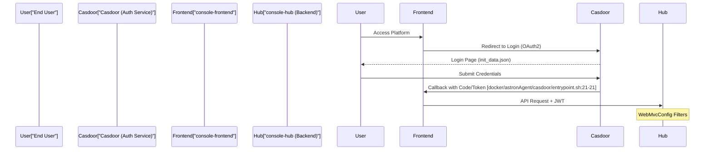
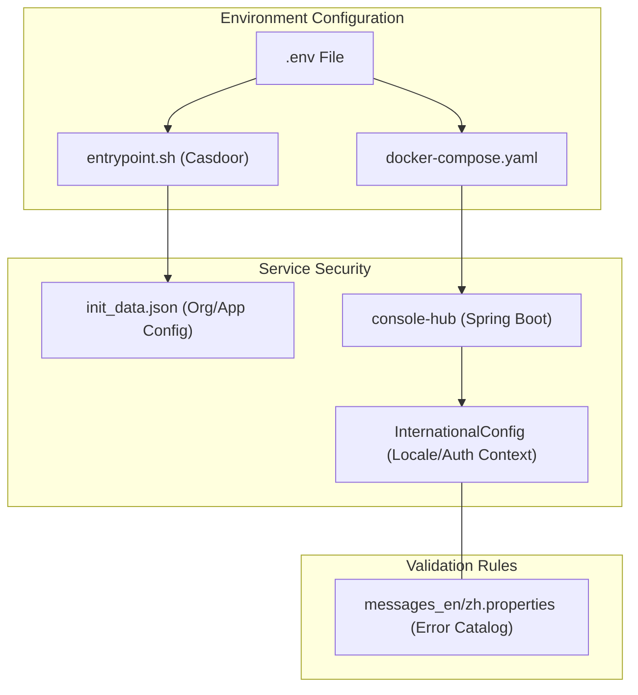

<!-- source: DeepWiki mcp.deepwiki.com · repo iflytek/astron-agent · page 14 Security and Configuration · fetched 2026-10-27 -->

# Security and Configuration

Relevant source files

The following files were used as context for generating this wiki page:

- [console/backend/commons/src/main/java/com/iflytek/astron/console/commons/constant/ResponseEnum.java](console/backend/commons/src/main/java/com/iflytek/astron/console/commons/constant/ResponseEnum.java)
- [console/backend/commons/src/main/java/com/iflytek/astron/console/commons/enums/bot/ReleaseTypeEnum.java](console/backend/commons/src/main/java/com/iflytek/astron/console/commons/enums/bot/ReleaseTypeEnum.java)
- [console/backend/commons/src/main/java/com/iflytek/astron/console/commons/util/BotFileParamUtil.java](console/backend/commons/src/main/java/com/iflytek/astron/console/commons/util/BotFileParamUtil.java)
- [console/backend/commons/src/main/resources/messages_en.properties](console/backend/commons/src/main/resources/messages_en.properties)
- [console/backend/commons/src/main/resources/messages_zh.properties](console/backend/commons/src/main/resources/messages_zh.properties)
- [console/backend/hub/src/main/java/com/iflytek/astron/console/hub/aspect/DistributedLockAspect.java](console/backend/hub/src/main/java/com/iflytek/astron/console/hub/aspect/DistributedLockAspect.java)
- [console/backend/hub/src/main/java/com/iflytek/astron/console/hub/config/InternationalConfig.java](console/backend/hub/src/main/java/com/iflytek/astron/console/hub/config/InternationalConfig.java)
- [console/backend/hub/src/main/java/com/iflytek/astron/console/hub/dto/publish/prepare/WechatPrepareDto.java](console/backend/hub/src/main/java/com/iflytek/astron/console/hub/dto/publish/prepare/WechatPrepareDto.java)
- [console/backend/hub/src/main/java/com/iflytek/astron/console/hub/dto/user/UserInfoResultExcelDTO.java](console/backend/hub/src/main/java/com/iflytek/astron/console/hub/dto/user/UserInfoResultExcelDTO.java)
- [console/backend/hub/src/main/java/com/iflytek/astron/console/hub/properties/InviteMessageTempProperties.java](console/backend/hub/src/main/java/com/iflytek/astron/console/hub/properties/InviteMessageTempProperties.java)
- [console/backend/hub/src/main/java/com/iflytek/astron/console/hub/service/space/impl/InviteRecordBizServiceImpl.java](console/backend/hub/src/main/java/com/iflytek/astron/console/hub/service/space/impl/InviteRecordBizServiceImpl.java)
- [docker/astronAgent/casdoor/conf/app.conf](docker/astronAgent/casdoor/conf/app.conf)
- [docker/astronAgent/casdoor/conf/init_data.json](docker/astronAgent/casdoor/conf/init_data.json)
- [docker/astronAgent/casdoor/conf/init_data.json.template](docker/astronAgent/casdoor/conf/init_data.json.template)
- [docker/astronAgent/casdoor/entrypoint.sh](docker/astronAgent/casdoor/entrypoint.sh)
- [docker/astronAgent/docker-compose-auth.yml](docker/astronAgent/docker-compose-auth.yml)
- [docker/astronAgent/docker-compose-with-auth.yaml](docker/astronAgent/docker-compose-with-auth.yaml)
- [docker/ragflow/docker-compose.yml](docker/ragflow/docker-compose.yml)
- [docs/DEPLOYMENT_GUIDE_WITH_AUTH.md](docs/DEPLOYMENT_GUIDE_WITH_AUTH.md)
- [docs/DEPLOYMENT_GUIDE_WITH_AUTH_RPA.md](docs/DEPLOYMENT_GUIDE_WITH_AUTH_RPA.md)
- [docs/DEPLOYMENT_GUIDE_WITH_AUTH_RPA_zh.md](docs/DEPLOYMENT_GUIDE_WITH_AUTH_RPA_zh.md)
- [docs/DEPLOYMENT_GUIDE_WITH_AUTH_zh.md](docs/DEPLOYMENT_GUIDE_WITH_AUTH_zh.md)

This page provides a comprehensive guide to security mechanisms and configuration management patterns in the Astron Agent platform. It covers authentication and authorization with Casdoor OAuth2/OIDC, service-to-service API security, multi-tenant database isolation, and hierarchical environment configuration.

For details on specific implementations, see the child pages:
- [Authentication and Authorization](#14.1) — Casdoor OAuth2/OIDC setup, organization and application configuration, token management, and SSO integration.
- [API Security and Validation](#14.2) — API key management, service-to-service authentication, distributed locking, SSRF protection, and URL blacklisting.
- [Configuration Management Systems](#14.3) — Environment variable hierarchy, Polaris remote configuration, runtime vs build-time config, and service-specific configurations.
- [Security Best Practices](#14.4) — SQL injection prevention, identifier validation, reserved keyword blocking, AST-based SQL reconstruction, and security patterns.

---

## Authentication Architecture

The platform utilizes **Casdoor** as the primary identity provider for OAuth 2.0 and OIDC [docs/DEPLOYMENT_GUIDE_WITH_AUTH.md:9-9](). The deployment includes an initialization script `entrypoint.sh` that generates `init_data.json` from a template, setting up default organizations and applications while injecting the `CONSOLE_DOMAIN` and `HOST_BASE_ADDRESS` for redirect URIs [docker/astronAgent/casdoor/entrypoint.sh:14-21]().

### Identity Provider Configuration
The system uses `init_data.json.template` to define the baseline security posture, including password complexity requirements (e.g., "AtLeast6") and default user types [docker/astronAgent/casdoor/conf/init_data.json.template:13-17](). The platform supports multiple deployment flavors, including RPA-integrated stacks that bundle Casdoor via `docker-compose-with-auth-rpa.yaml` [docs/DEPLOYMENT_GUIDE_WITH_AUTH_RPA.md:176-186]().

**Authentication Entity Mapping**

Sources: [docker/astronAgent/casdoor/entrypoint.sh:1-25](), [docker/astronAgent/casdoor/conf/init_data.json.template:1-30](), [docs/DEPLOYMENT_GUIDE_WITH_AUTH.md:175-185](), [docker/astronAgent/docker-compose-auth.yml:2-14]().

---

## API Security and Validation

API security is enforced through strict request filtering and response management. The platform uses a standardized `ResponseEnum` to categorize security and business errors, such as `UNAUTHORIZED (40001)`, `FORBIDDEN (40003)`, and `INSUFFICIENT_PERMISSIONS (60004)` [console/backend/commons/src/main/java/com/iflytek/astron/console/commons/constant/ResponseEnum.java:15-38]().

### Distributed Locking and Validation
The system implements distributed locking for critical operations (e.g., bot publishing) to prevent race conditions and unauthorized concurrent modifications. Error codes like `lock.error.acquire_timeout` are used to manage these states [console/backend/commons/src/main/resources/messages_zh.properties:136-141](). Furthermore, `BotFileParamUtil` provides validation for multi-file parameters to ensure only supported schemas are processed [console/backend/commons/src/main/java/com/iflytek/astron/console/commons/util/BotFileParamUtil.java:25-40]().

**Security Validation Entity Mapping**
| Code Entity | Responsibility | Source |
|:---|:---|:---|
| `ResponseEnum` | Centralized catalog of HTTP and business security status codes | [console/backend/commons/src/main/java/com/iflytek/astron/console/commons/constant/ResponseEnum.java:8-45]() |
| `InviteRecordBizServiceImpl` | Enforces space capacity limits and invitation validation | [console/backend/hub/src/main/java/com/iflytek/astron/console/hub/service/space/impl/InviteRecordBizServiceImpl.java:102-136]() |
| `BotFileParamUtil` | Validates input schemas for bot execution and publishing | [console/backend/commons/src/main/java/com/iflytek/astron/console/commons/util/BotFileParamUtil.java:115-133]() |

For details, see [API Security and Validation](#14.2).

---

## Configuration Management Systems

The platform uses a hierarchical configuration system driven by `.env` files. External integrations, such as **RagFlow** and **iFLYTEK Spark**, are configured via environment variables like `RAGFLOW_API_TOKEN` and `SPARK_API_PASSWORD` [docs/DEPLOYMENT_GUIDE_WITH_AUTH.md:88-120]().

### Internationalization and Localization
Configuration also extends to the user experience through `InternationalConfig`, which defines the `LocaleResolver` (defaulting to `Locale.CHINA`) and a `LocaleChangeInterceptor` that allows switching languages via the `lang` request parameter [console/backend/hub/src/main/java/com/iflytek/astron/console/hub/config/InternationalConfig.java:19-35](). Message sources are loaded from `messages.properties` and `speaker.properties` [console/backend/hub/src/main/java/com/iflytek/astron/console/hub/config/InternationalConfig.java:44-55]().

**Configuration Categories**
*   **Identity Service**: Casdoor is configured with MySQL as its backend, utilizing variables like `MYSQL_ROOT_PASSWORD` and `MYSQL_DATABASE` for isolation [docker/astronAgent/docker-compose-auth.yml:28-32]().
*   **Infrastructure Secrets**: API keys for Spark LLM, Speech (RTASR), and Image generation are managed as secrets in `.env` [docs/DEPLOYMENT_GUIDE_WITH_AUTH.md:113-120]().
*   **Business Rules**: Space limits for different tiers (Free, Pro, Team) are injected via `SpaceLimitProperties` [console/backend/hub/src/main/java/com/iflytek/astron/console/hub/service/space/impl/InviteRecordBizServiceImpl.java:107-127]().

For details, see [Configuration Management Systems](#14.3).

---

## Security Best Practices

The platform implements multi-layered security practices to protect data and service integrity:

*   **Credential Management**: Default credentials (e.g., `admin/123` for Casdoor) are documented for initial setup but are intended to be rotated via the management UI [docs/DEPLOYMENT_GUIDE_WITH_AUTH.md:188-192]().
*   **Service Isolation**: Docker networks (`astron-agent-network`) isolate core services from direct external exposure [docker/astronAgent/docker-compose-auth.yml:19-20]().
*   **Signature Generation**: Integration with iFLYTEK Spark RAG services uses HMAC-SHA1 and MD5-based signatures to verify request authenticity [docs/DEPLOYMENT_GUIDE_WITH_AUTH.md:150-150]().
*   **Data Validation**: Strict validation of invitation records and space membership prevents unauthorized access to tenant environments [console/backend/hub/src/main/java/com/iflytek/astron/console/hub/service/space/impl/InviteRecordBizServiceImpl.java:128-136]().

**Security Configuration Flow**

For details, see [Security Best Practices](#14.4).

Sources: [docker/astronAgent/casdoor/entrypoint.sh:1-25](), [console/backend/commons/src/main/java/com/iflytek/astron/console/commons/constant/ResponseEnum.java:8-45](), [docs/DEPLOYMENT_GUIDE_WITH_AUTH.md:142-152](), [console/backend/hub/src/main/java/com/iflytek/astron/console/hub/config/InternationalConfig.java:14-56]().

---

