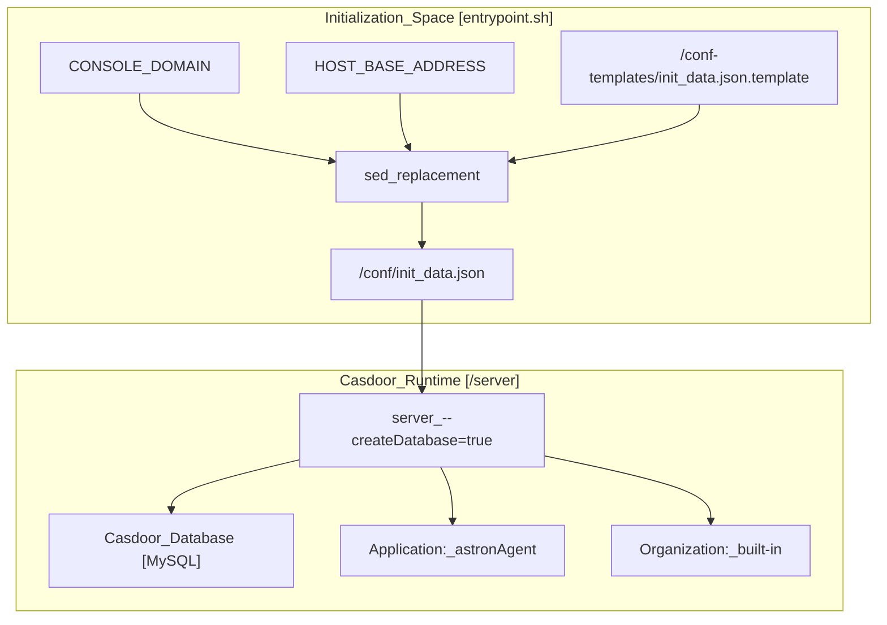
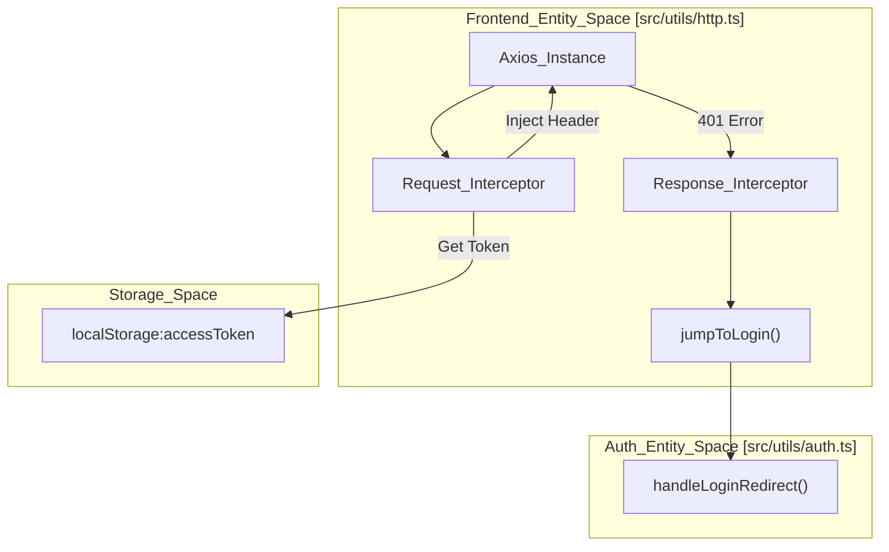
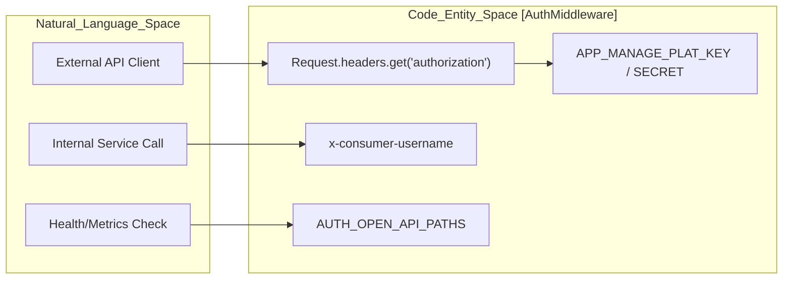

<!-- source: DeepWiki mcp.deepwiki.com · repo iflytek/astron-agent · page 14.1 Authentication and Authorization · fetched 2026-10-27 -->

# Authentication and Authorization

Relevant source files

The following files were used as context for generating this wiki page:

- [console/backend/hub/src/main/java/com/iflytek/astron/console/hub/service/bot/impl/TalkAgentServiceImpl.java](console/backend/hub/src/main/java/com/iflytek/astron/console/hub/service/bot/impl/TalkAgentServiceImpl.java)
- [console/frontend/.env.development](console/frontend/.env.development)
- [console/frontend/.env.production](console/frontend/.env.production)
- [console/frontend/.env.test](console/frontend/.env.test)
- [console/frontend/Dockerfile](console/frontend/Dockerfile)
- [console/frontend/docker-entrypoint.sh](console/frontend/docker-entrypoint.sh)
- [console/frontend/src/components/create-application-modal/index.tsx](console/frontend/src/components/create-application-modal/index.tsx)
- [console/frontend/src/components/sidebar/create-button.tsx](console/frontend/src/components/sidebar/create-button.tsx)
- [console/frontend/src/components/virtual-config-modal/index.module.scss](console/frontend/src/components/virtual-config-modal/index.module.scss)
- [console/frontend/src/components/vms-interaction-cmp/index.tsx](console/frontend/src/components/vms-interaction-cmp/index.tsx)
- [console/frontend/src/components/workflow/drawer/chat-debugger/index.scss](console/frontend/src/components/workflow/drawer/chat-debugger/index.scss)
- [console/frontend/src/config/casdoor.ts](console/frontend/src/config/casdoor.ts)
- [console/frontend/src/utils/http.ts](console/frontend/src/utils/http.ts)
- [console/frontend/vite-env.d.ts](console/frontend/vite-env.d.ts)
- [console/frontend/vite.config.js](console/frontend/vite.config.js)
- [core/workflow/api/v1/flow/__init__.py](core/workflow/api/v1/flow/__init__.py)
- [core/workflow/api/v1/flow/auth.py](core/workflow/api/v1/flow/auth.py)
- [core/workflow/api/v1/router.py](core/workflow/api/v1/router.py)
- [core/workflow/extensions/fastapi/base.py](core/workflow/extensions/fastapi/base.py)
- [core/workflow/tests/engine/dsl/test_engine_builder.py](core/workflow/tests/engine/dsl/test_engine_builder.py)
- [core/workflow/tests/engine/dsl/test_error_handler.py](core/workflow/tests/engine/dsl/test_error_handler.py)
- [core/workflow/tests/extensions/fastapi/test_auth.py](core/workflow/tests/extensions/fastapi/test_auth.py)
- [docker/astronAgent/casdoor/conf/app.conf](docker/astronAgent/casdoor/conf/app.conf)
- [docker/astronAgent/casdoor/conf/init_data.json](docker/astronAgent/casdoor/conf/init_data.json)
- [docker/astronAgent/casdoor/conf/init_data.json.template](docker/astronAgent/casdoor/conf/init_data.json.template)
- [docker/astronAgent/casdoor/entrypoint.sh](docker/astronAgent/casdoor/entrypoint.sh)
- [docker/astronAgent/docker-compose-auth.yml](docker/astronAgent/docker-compose-auth.yml)
- [docker/astronAgent/docker-compose-with-auth.yaml](docker/astronAgent/docker-compose-with-auth.yaml)
- [docker/ragflow/docker-compose.yml](docker/ragflow/docker-compose.yml)
- [docs/DEPLOYMENT_GUIDE_WITH_AUTH.md](docs/DEPLOYMENT_GUIDE_WITH_AUTH.md)
- [docs/DEPLOYMENT_GUIDE_WITH_AUTH_RPA.md](docs/DEPLOYMENT_GUIDE_WITH_AUTH_RPA.md)
- [docs/DEPLOYMENT_GUIDE_WITH_AUTH_RPA_zh.md](docs/DEPLOYMENT_GUIDE_WITH_AUTH_RPA_zh.md)
- [docs/DEPLOYMENT_GUIDE_WITH_AUTH_zh.md](docs/DEPLOYMENT_GUIDE_WITH_AUTH_zh.md)

## Purpose and Scope

The Astron Agent platform implements a multi-layered authentication and authorization strategy to secure user access and service-to-service communication. The primary identity provider is **Casdoor**, an open-source OAuth2/OIDC framework. 

Key technical components include:
- **Single Sign-On (SSO)**: Managed via Casdoor for the Console frontend and backend [docs/DEPLOYMENT_GUIDE_WITH_AUTH.md:9-9]().
- **Token Management**: JWT-based access tokens handled by frontend Axios interceptors [console/frontend/src/utils/http.ts:90-93]() and stored in local storage.
- **Service-to-Service Auth**: Middleware-based verification of API keys and secrets for internal communication [core/workflow/tests/extensions/fastapi/test_auth.py:90-98]().
- **Automated Provisioning**: Docker-based initialization of Casdoor organizations and applications using templates [docker/astronAgent/casdoor/entrypoint.sh:11-18]().

---

## Casdoor Infrastructure and Setup

Casdoor acts as the centralized authentication hub. It is integrated into the deployment lifecycle using automated scripts to ensure consistent configuration across environments.

### Automated Initialization Data Flow

When the platform starts via `docker-compose-with-auth.yaml`, a specialized entrypoint script configures the Casdoor instance by generating configuration from templates.

**Casdoor Configuration Flow**

**Sources**: [docker/astronAgent/casdoor/entrypoint.sh:4-25](), [docker/astronAgent/casdoor/entrypoint.sh:15-18](), [console/frontend/.env.test:10-13]()

The script [docker/astronAgent/casdoor/entrypoint.sh:15-18]() dynamically replaces `${CONSOLE_DOMAIN}` and `${HOST_BASE_ADDRESS}` in the template to set valid OAuth2 `redirectUris` (e.g., `http://localhost/callback`) [docker/astronAgent/casdoor/entrypoint.sh:21-21](). The backend storage for Casdoor is provided by a dedicated MySQL instance `astron-agent-casdoor-mysql` [docker/astronAgent/docker-compose-auth.yml:25-32]().

### Environment Configuration and Runtime Injection

The frontend utilizes a hybrid approach for configuration. While build-time variables are prefixed with `CONSOLE_` or `VITE_` [console/frontend/vite.config.js:11-11](), the system also supports a runtime configuration injection via `runtime-config.js` [console/frontend/docker-entrypoint.sh:26-37]().

| Variable | Description | Source |
|:---|:---|:---|
| `CONSOLE_CASDOOR_URL` | The endpoint where Casdoor is hosted | [console/frontend/.env.test:10-10]() |
| `CONSOLE_CASDOOR_ID` | Client ID for the OIDC application | [console/frontend/.env.test:11-11]() |
| `CONSOLE_CASDOOR_APP` | Name of the application in Casdoor | [console/frontend/.env.test:12-12]() |
| `CONSOLE_CASDOOR_ORG` | Organization name in Casdoor | [console/frontend/.env.test:13-13]() |

The `docker-entrypoint.sh` script [console/frontend/docker-entrypoint.sh:6-9]() reads these environment variables and populates `window.__APP_CONFIG__` [console/frontend/docker-entrypoint.sh:27-34](), which is then consumed by the application [console/frontend/src/utils/http.ts:58-58]().

---

## Frontend Token Management and SSO Integration

The frontend uses `axios` for HTTP requests, with interceptors to manage authentication headers and handle session expiration.

### Authentication Data Flow

**Sources**: [console/frontend/src/utils/http.ts:90-93](), [console/frontend/src/utils/http.ts:167-173](), [console/frontend/src/utils/http.ts:144-147]()

### Key Frontend Functions
- **`jumpToLogin`**: Triggers the login flow via `handleLoginRedirect` when a `401 Unauthorized` response is received [console/frontend/src/utils/http.ts:167-173]().
- **`downloadFileWithHeaders`**: A specialized utility to perform authenticated file downloads using `XMLHttpRequest`, manually injecting the `Authorization` bearer token and `space-id` headers [console/frontend/src/utils/http.ts:76-103]().
- **Business Error Handling**: The `initBusinessError` function checks for specific error codes (e.g., `80000`, `90000`) to detect login anomalies and force a redirect to the login page [console/frontend/src/utils/http.ts:199-211]().

---

## Core Service Authentication (FastAPI)

For internal service communication and API-based access to the `core-workflow` and other backend services, the platform uses an `AuthMiddleware`.

### AuthMiddleware Logic

The `AuthMiddleware` handles the validation of incoming requests by checking for either a valid user session or platform-level API credentials.

**Backend Authentication Entity Mapping**

**Sources**: [core/workflow/tests/extensions/fastapi/test_auth.py:89-98](), [core/workflow/tests/extensions/fastapi/test_auth.py:108-116](), [core/workflow/tests/extensions/fastapi/test_auth.py:127-133]()

### Key Behaviors

1.  **Excluded Paths**: Routes defined in `AUTH_OPEN_API_PATHS` or health checks are bypassed to allow infrastructure monitoring without credentials [core/workflow/tests/extensions/fastapi/test_auth.py:114-116](), [core/workflow/extensions/fastapi/base.py:19-19]().
2.  **API Key Verification**: The middleware extracts credentials from the `Authorization` header (formatted as `Bearer key:secret`) and validates them against environment variables `APP_MANAGE_PLAT_KEY` and `APP_MANAGE_PLAT_SECRET` [core/workflow/tests/extensions/fastapi/test_auth.py:89-98](), [core/workflow/tests/extensions/fastapi/test_auth.py:179-180]().
3.  **Consumer Identification**: If an `x-consumer-username` header is present, the middleware bypasses standard auth, assuming requests were validated by an upstream gateway [core/workflow/tests/extensions/fastapi/test_auth.py:133-135]().

---

## Deployment and Integration Patterns

The platform supports integrated authentication across its services using Docker Compose:

1.  **Casdoor Service**: Defined in `docker-compose-auth.yml`, it depends on `casdoor-mysql` and runs an initialization entrypoint [docker/astronAgent/docker-compose-auth.yml:2-23]().
2.  **Frontend Runtime**: The Nginx-based frontend image [console/frontend/Dockerfile:25-25]() executes `docker-entrypoint.sh` to inject the Casdoor client configuration into the static assets [console/frontend/Dockerfile:85-85]().

**Integration Summary Table**

| Component | Role | Implementation |
|:---|:---|:---|
| **Casdoor** | Identity Provider | OAuth2 / OIDC Server [docker/astronAgent/docker-compose-auth.yml:2-8]() |
| **AuthMiddleware** | Service Protection | FastAPI middleware for API validation [core/workflow/tests/extensions/fastapi/test_auth.py:20-20]() |
| **Axios Interceptor** | Client Auth | Injects Bearer tokens into outgoing requests [console/frontend/src/utils/http.ts:286-290]() |
| **Init Data** | Bootstrapping | `init_data.json` template for pre-configured organizations [docker/astronAgent/casdoor/entrypoint.sh:15-18]() |

**Sources**: [console/frontend/src/utils/http.ts:90-93](), [docker/astronAgent/casdoor/entrypoint.sh:15-18](), [core/workflow/tests/extensions/fastapi/test_auth.py:59-70](), [console/frontend/Dockerfile:82-85]()

---

