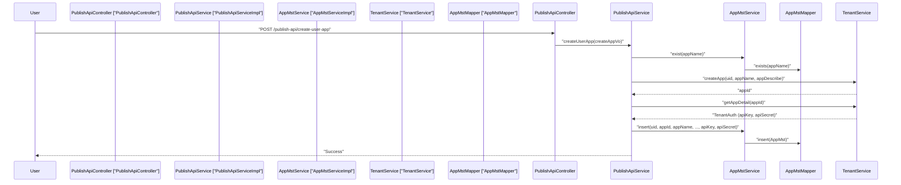
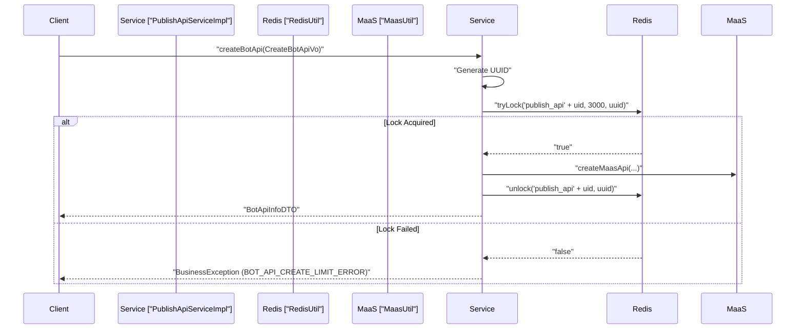

<!-- source: DeepWiki mcp.deepwiki.com · repo iflytek/astron-agent · page 14.2 API Security and Validation · fetched 2026-10-27 -->

# API Security and Validation

Relevant source files

The following files were used as context for generating this wiki page:

- [console/backend/commons/src/main/java/com/iflytek/astron/console/commons/entity/user/AppMst.java](console/backend/commons/src/main/java/com/iflytek/astron/console/commons/entity/user/AppMst.java)
- [console/backend/commons/src/main/java/com/iflytek/astron/console/commons/mapper/user/AppMstMapper.java](console/backend/commons/src/main/java/com/iflytek/astron/console/commons/mapper/user/AppMstMapper.java)
- [console/backend/commons/src/main/java/com/iflytek/astron/console/commons/service/user/AppMstService.java](console/backend/commons/src/main/java/com/iflytek/astron/console/commons/service/user/AppMstService.java)
- [console/backend/commons/src/main/java/com/iflytek/astron/console/commons/service/user/Impl/AppMstServiceImpl.java](console/backend/commons/src/main/java/com/iflytek/astron/console/commons/service/user/Impl/AppMstServiceImpl.java)
- [console/backend/commons/src/main/resources/mapper/BotDatasetMaasMapper.xml](console/backend/commons/src/main/resources/mapper/BotDatasetMaasMapper.xml)
- [console/backend/hub/src/main/java/com/iflytek/astron/console/hub/controller/publish/PublishApiController.java](console/backend/hub/src/main/java/com/iflytek/astron/console/hub/controller/publish/PublishApiController.java)
- [console/backend/hub/src/main/java/com/iflytek/astron/console/hub/dto/publish/AppListDTO.java](console/backend/hub/src/main/java/com/iflytek/astron/console/hub/dto/publish/AppListDTO.java)
- [console/backend/hub/src/main/java/com/iflytek/astron/console/hub/dto/publish/BotApiInfoDTO.java](console/backend/hub/src/main/java/com/iflytek/astron/console/hub/dto/publish/BotApiInfoDTO.java)
- [console/backend/hub/src/main/java/com/iflytek/astron/console/hub/dto/publish/BotApiRealTimeUsageDTO.java](console/backend/hub/src/main/java/com/iflytek/astron/console/hub/dto/publish/BotApiRealTimeUsageDTO.java)
- [console/backend/hub/src/main/java/com/iflytek/astron/console/hub/dto/publish/CreateAppVo.java](console/backend/hub/src/main/java/com/iflytek/astron/console/hub/dto/publish/CreateAppVo.java)
- [console/backend/hub/src/main/java/com/iflytek/astron/console/hub/service/publish/PublishApiService.java](console/backend/hub/src/main/java/com/iflytek/astron/console/hub/service/publish/PublishApiService.java)
- [console/backend/hub/src/main/java/com/iflytek/astron/console/hub/service/publish/impl/PublishApiServiceImpl.java](console/backend/hub/src/main/java/com/iflytek/astron/console/hub/service/publish/impl/PublishApiServiceImpl.java)
- [console/backend/toolkit/src/main/java/com/iflytek/astron/console/toolkit/handler/McpServerHandler.java](console/backend/toolkit/src/main/java/com/iflytek/astron/console/toolkit/handler/McpServerHandler.java)
- [console/backend/toolkit/src/main/java/com/iflytek/astron/console/toolkit/service/model/ModelService.java](console/backend/toolkit/src/main/java/com/iflytek/astron/console/toolkit/service/model/ModelService.java)
- [console/backend/toolkit/src/main/java/com/iflytek/astron/console/toolkit/service/repo/FileInfoV2Service.java](console/backend/toolkit/src/main/java/com/iflytek/astron/console/toolkit/service/repo/FileInfoV2Service.java)
- [console/backend/toolkit/src/main/java/com/iflytek/astron/console/toolkit/service/workflow/WorkflowService.java](console/backend/toolkit/src/main/java/com/iflytek/astron/console/toolkit/service/workflow/WorkflowService.java)
- [console/backend/toolkit/src/main/java/com/iflytek/astron/console/toolkit/tool/UrlCheckTool.java](console/backend/toolkit/src/main/java/com/iflytek/astron/console/toolkit/tool/UrlCheckTool.java)

This document describes the API security and validation mechanisms in the Astron Agent platform, including API key management, service-to-service authentication, distributed locking, SSRF protection, and secure object storage handling.

## Overview

The Astron Agent platform implements multiple layers of API security to ensure data integrity and prevent unauthorized access or resource abuse:

- **API Key Management**: Application credential generation and storage for bot API publishing via `AppMstService` [console/backend/commons/src/main/java/com/iflytek/astron/console/commons/service/user/AppMstService.java:1-18]().
- **Distributed Locking**: Redis-based locks to prevent concurrent operations and race conditions in `PublishApiServiceImpl` [console/backend/hub/src/main/java/com/iflytek/astron/console/hub/service/publish/impl/PublishApiServiceImpl.java:132-147]().
- **SSRF Protection**: URL blacklisting and network access prevention via `SsrfValidators` and `UrlCheckTool` used in `ModelService` [console/backend/toolkit/src/main/java/com/iflytek/astron/console/toolkit/service/model/ModelService.java:45-47]() and `WorkflowService` [console/backend/toolkit/src/main/java/com/iflytek/astron/console/toolkit/service/workflow/WorkflowService.java:101-103]().
- **Rate Limiting**: Controller-level protection using the `@RateLimit` annotation to prevent API abuse [console/backend/hub/src/main/java/com/iflytek/astron/console/hub/controller/publish/PublishApiController.java:36-59]().
- **Data Permission Validation**: Verification of resource ownership (e.g., repository or bot) before sensitive operations [console/backend/toolkit/src/main/java/com/iflytek/astron/console/toolkit/service/repo/FileInfoV2Service.java:174-175]().

## API Key Management for Bot API Publishing

### App and API Key Creation

The platform implements a two-tier system for bot API publishing. Users create applications which serve as containers for API credentials. These credentials (`appKey` and `appSecret`) are generated by the `TenantService` and persisted locally in the `app_mst` table [console/backend/hub/src/main/java/com/iflytek/astron/console/hub/service/publish/impl/PublishApiServiceImpl.java:94-102]().

**Diagram: App Creation and API Key Generation Flow**

Sources: [console/backend/hub/src/main/java/com/iflytek/astron/console/hub/service/publish/impl/PublishApiServiceImpl.java:87-105](), [console/backend/commons/src/main/java/com/iflytek/astron/console/commons/service/user/Impl/AppMstServiceImpl.java:33-46](), [console/backend/hub/src/main/java/com/iflytek/astron/console/hub/controller/publish/PublishApiController.java:35-40]()

**App Master Table (app_mst)**
The `AppMst` entity stores application credentials associated with a user [console/backend/commons/src/main/java/com/iflytek/astron/console/commons/entity/user/AppMst.java:19-58]().

| Column | Description |
|--------|-------------|
| `uid` | User identifier (owner) [console/backend/commons/src/main/java/com/iflytek/astron/console/commons/entity/user/AppMst.java:28]() |
| `app_id` | Unique application identifier from tenant service [console/backend/commons/src/main/java/com/iflytek/astron/console/commons/entity/user/AppMst.java:37]() |
| `app_key` | API key for authentication [console/backend/commons/src/main/java/com/iflytek/astron/console/commons/entity/user/AppMst.java:40]() |
| `app_secret` | API secret for request signing [console/backend/commons/src/main/java/com/iflytek/astron/console/commons/entity/user/AppMst.java:43]() |

### Bot API Publishing with Distributed Locking

When publishing a bot as an API, the platform uses Redis-based distributed locking to prevent concurrent operations and race conditions. The lock key is formed using the prefix `publish_api` and the user's `uid` [console/backend/hub/src/main/java/com/iflytek/astron/console/hub/service/publish/impl/PublishApiServiceImpl.java:132-147]().

**Diagram: Distributed Locking in Bot API Creation**

Sources: [console/backend/hub/src/main/java/com/iflytek/astron/console/hub/service/publish/impl/PublishApiServiceImpl.java:118-149]()

## SSRF Protection and URL Validation

The platform implements Server-Side Request Forgery (SSRF) protection, primarily within the `ModelService` and `WorkflowService` when interacting with external LLM endpoints or webhooks.

### Blacklist Validation
The system checks URLs against a network segment blacklist stored in the configuration. The `ModelService` uses `SsrfValidators` to ensure that model endpoints do not point to restricted internal networks [console/backend/toolkit/src/main/java/com/iflytek/astron/console/toolkit/service/model/ModelService.java:136-150]().

**Key Protection Logic:**
- **URL Check**: The `UrlCheckTool` (imported in `WorkflowService`) provides core logic for identifying malicious or internal-only URLs [console/backend/toolkit/src/main/java/com/iflytek/astron/console/toolkit/service/workflow/WorkflowService.java:103]().
- **Blacklist Lookup**: Configuration category `NETWORK_SEGMENT_BLACK_LIST` is retrieved from `ConfigInfoMapper` to filter forbidden IP ranges [console/backend/toolkit/src/main/java/com/iflytek/astron/console/toolkit/service/model/ModelService.java:90-107]().
- **Credential Protection**: When validating models, the `apiKey` is decrypted using `RSAUtil` only at the point of request, and masked values are handled to prevent leakage [console/backend/toolkit/src/main/java/com/iflytek/astron/console/toolkit/service/model/ModelService.java:133-144]().

Sources: [console/backend/toolkit/src/main/java/com/iflytek/astron/console/toolkit/service/model/ModelService.java:83-150](), [console/backend/toolkit/src/main/java/com/iflytek/astron/console/toolkit/service/workflow/WorkflowService.java:101-103]()

## File and Knowledge Security

### Data Permission Checks
Before processing file uploads or knowledge base operations, the system verifies that the target repository belongs to the current user via `DataPermissionCheckTool` [console/backend/toolkit/src/main/java/com/iflytek/astron/console/toolkit/service/repo/FileInfoV2Service.java:174-175]().

### File Type Validation
To prevent the upload of malicious scripts or unsupported formats, `FileInfoV2Service` enforces a strict file type validation [console/backend/toolkit/src/main/java/com/iflytek/astron/console/toolkit/service/repo/FileInfoV2Service.java:166]().

Sources: [console/backend/toolkit/src/main/java/com/iflytek/astron/console/toolkit/service/repo/FileInfoV2Service.java:161-175]()

## API Validation and Rate Limiting

### Rate Limiting
API endpoints are protected by the `@RateLimit` annotation. For example, the `PublishApiController` limits application and bot API creation to 30 requests per 60-second window per user [console/backend/hub/src/main/java/com/iflytek/astron/console/hub/controller/publish/PublishApiController.java:36-59]().

### Security Utility Classes

| Class | Purpose | Key Functions |
|-------|---------|---------------|
| `RedisUtil` | Distributed locking and caching | `tryLock()`, `unlock()` [console/backend/hub/src/main/java/com/iflytek/astron/console/hub/service/publish/impl/PublishApiServiceImpl.java:132]() |
| `RSAUtil` | Cryptographic operations for API keys | Decryption of sensitive model credentials [console/backend/toolkit/src/main/java/com/iflytek/astron/console/toolkit/service/model/ModelService.java:44]() |
| `RequestContextUtil` | User context management | `getUID()` for multi-tenant isolation [console/backend/hub/src/main/java/com/iflytek/astron/console/hub/service/publish/impl/PublishApiServiceImpl.java:88]() |
| `SsrfValidators` | SSRF protection | Used in `ModelService` for URL validation [console/backend/toolkit/src/main/java/com/iflytek/astron/console/toolkit/service/model/ModelService.java:47]() |

Sources: [console/backend/hub/src/main/java/com/iflytek/astron/console/hub/service/publish/impl/PublishApiServiceImpl.java:88-132](), [console/backend/toolkit/src/main/java/com/iflytek/astron/console/toolkit/service/model/ModelService.java:44-144]()

---

