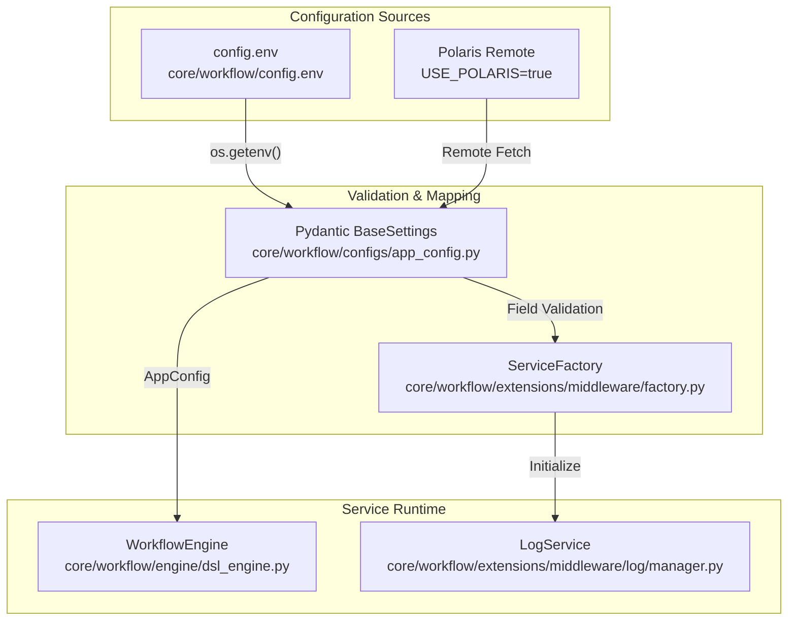
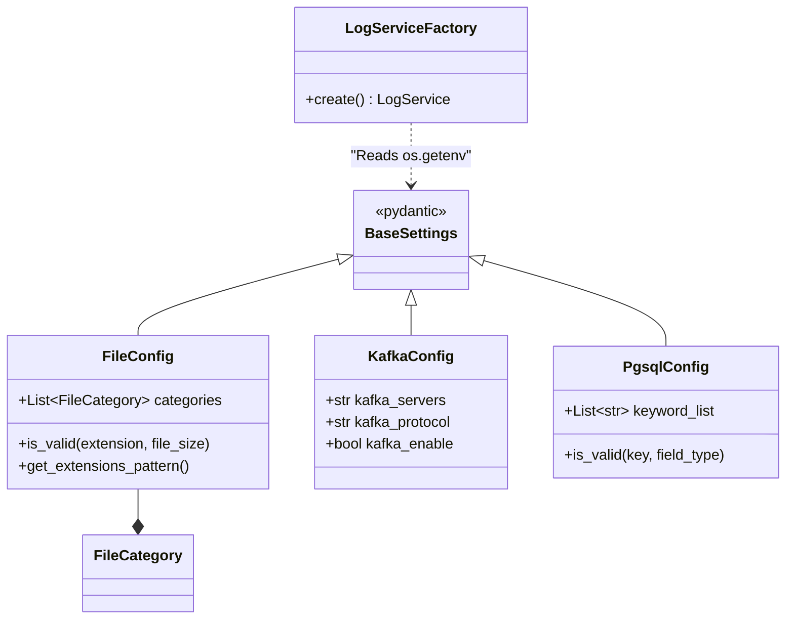

<!-- source: DeepWiki mcp.deepwiki.com · repo iflytek/astron-agent · page 14.3 Configuration Management Systems · fetched 2026-10-27 -->

# Configuration Management Systems

Relevant source files

The following files were used as context for generating this wiki page:

- [console/backend/hub/src/main/resources/db/migration/V1.24__add_multi_mode_to_model_table.sql](console/backend/hub/src/main/resources/db/migration/V1.24__add_multi_mode_to_model_table.sql)
- [core/workflow/api/v1/chat/open.py](core/workflow/api/v1/chat/open.py)
- [core/workflow/config.env](core/workflow/config.env)
- [core/workflow/configs/app_config.py](core/workflow/configs/app_config.py)
- [core/workflow/consts/database.py](core/workflow/consts/database.py)
- [core/workflow/domain/entities/flow.py](core/workflow/domain/entities/flow.py)
- [core/workflow/domain/entities/response.py](core/workflow/domain/entities/response.py)
- [core/workflow/engine/nodes/code/executor/ifly/ifly_executor.py](core/workflow/engine/nodes/code/executor/ifly/ifly_executor.py)
- [core/workflow/engine/nodes/code/executor/ifly/ifly_executor_v2.py](core/workflow/engine/nodes/code/executor/ifly/ifly_executor_v2.py)
- [core/workflow/engine/nodes/decision/decision_node.py](core/workflow/engine/nodes/decision/decision_node.py)
- [core/workflow/engine/nodes/knowledge_pro/knowledge_pro_node.py](core/workflow/engine/nodes/knowledge_pro/knowledge_pro_node.py)
- [core/workflow/exception/errors/err_code.py](core/workflow/exception/errors/err_code.py)
- [core/workflow/extensions/fastapi/middleware/otlp.py](core/workflow/extensions/fastapi/middleware/otlp.py)
- [core/workflow/extensions/middleware/cache/manager.py](core/workflow/extensions/middleware/cache/manager.py)
- [core/workflow/extensions/middleware/database/factory.py](core/workflow/extensions/middleware/database/factory.py)
- [core/workflow/extensions/middleware/database/manager.py](core/workflow/extensions/middleware/database/manager.py)
- [core/workflow/extensions/middleware/log/factory.py](core/workflow/extensions/middleware/log/factory.py)
- [core/workflow/extensions/middleware/manager.py](core/workflow/extensions/middleware/manager.py)
- [core/workflow/extensions/middleware/oss/factory.py](core/workflow/extensions/middleware/oss/factory.py)
- [core/workflow/extensions/otlp/log_trace/workflow_log.py](core/workflow/extensions/otlp/log_trace/workflow_log.py)
- [core/workflow/extensions/otlp/metric/meter.py](core/workflow/extensions/otlp/metric/meter.py)
- [core/workflow/extensions/otlp/metric/metric.py](core/workflow/extensions/otlp/metric/metric.py)
- [core/workflow/extensions/otlp/trace/span.py](core/workflow/extensions/otlp/trace/span.py)
- [core/workflow/extensions/otlp/trace/trace.py](core/workflow/extensions/otlp/trace/trace.py)
- [core/workflow/infra/providers/llm/chat_ai.py](core/workflow/infra/providers/llm/chat_ai.py)
- [core/workflow/infra/providers/llm/iflytek_spark/spark_chat_llm.py](core/workflow/infra/providers/llm/iflytek_spark/spark_chat_llm.py)
- [core/workflow/infra/providers/llm/iflytek_spark/spark_fc_llm.py](core/workflow/infra/providers/llm/iflytek_spark/spark_fc_llm.py)
- [core/workflow/infra/providers/llm/openai/openai_chat_llm.py](core/workflow/infra/providers/llm/openai/openai_chat_llm.py)
- [core/workflow/repository/flow_dao.py](core/workflow/repository/flow_dao.py)
- [core/workflow/repository/license_dao.py](core/workflow/repository/license_dao.py)
- [core/workflow/service/publish_service.py](core/workflow/service/publish_service.py)
- [docker/astronAgent/config/agent/config.env](docker/astronAgent/config/agent/config.env)
- [docker/astronAgent/config/aitools/config.env](docker/astronAgent/config/aitools/config.env)
- [docker/astronAgent/config/knowledge/config.env](docker/astronAgent/config/knowledge/config.env)
- [docker/astronAgent/config/link/config.env](docker/astronAgent/config/link/config.env)
- [docker/astronAgent/config/tenant/config.toml](docker/astronAgent/config/tenant/config.toml)
- [docker/astronAgent/config/workflow/config.env](docker/astronAgent/config/workflow/config.env)
- [helm/astron-agent/files/config/database/config.env](helm/astron-agent/files/config/database/config.env)
- [helm/astron-agent/files/config/knowledge/config.env](helm/astron-agent/files/config/knowledge/config.env)
- [helm/astron-agent/files/config/link/config.env](helm/astron-agent/files/config/link/config.env)
- [helm/astron-agent/files/config/rpa/config.env](helm/astron-agent/files/config/rpa/config.env)

This page documents the multi-tier configuration management architecture used across the Astron Agent platform, including environment variable hierarchies, service-specific configurations, remote configuration systems (Polaris), and runtime configuration injection patterns.

---

## Configuration Architecture Overview

The Astron Agent platform implements a multi-tier configuration system that supports both local and centralized management. Configuration flows from environment variables through Docker Compose to individual services, with support for runtime overrides and optional remote configuration management via Polaris.

**Configuration Tiers:**

| Tier | Scope | Priority | Purpose |
|------|-------|----------|---------|
| Environment Variables | Platform-wide | Lowest | Default values and container orchestration [docker/astronAgent/config/workflow/config.env:1-10]() |
| Service `config.env` | Per-service | Medium | Service-specific settings (MySQL, Redis, OTLP) [core/workflow/config.env:1-60]() |
| Polaris Remote Config | Dynamic | High | Remote centralized configuration (Optional) [docker/astronAgent/config/link/config.env:94-99]() |
| Pydantic Settings | Runtime | Highest | Type-safe validation and runtime access [core/workflow/configs/app_config.py:54-63]() |

**Sources:** [docker/astronAgent/config/workflow/config.env:1-10](), [core/workflow/config.env:1-60](), [docker/astronAgent/config/link/config.env:94-99](), [core/workflow/configs/app_config.py:54-63]()

---

## Configuration Hierarchy and Precedence

### Natural Language to Code Entity Space: Configuration Flow

**Precedence Rules:**

1.  **Pydantic Settings**: Provides the final validated state used by the application code through classes like `FileConfig` and `KafkaConfig` [core/workflow/configs/app_config.py:54-63]().
2.  **Polaris Remote Config**: If `USE_POLARIS` is enabled, remote values fetched from the Polaris cluster override local environment variables [docker/astronAgent/config/link/config.env:94-99]().
3.  **Service config.env**: Mounted as a volume to provide service-specific settings such as `SERVICE_PORT` and `LOG_LEVEL` [docker/astronAgent/config/workflow/config.env:1-10]().

**Sources:** [core/workflow/configs/app_config.py:54-63](), [docker/astronAgent/config/link/config.env:94-99](), [core/workflow/extensions/middleware/log/factory.py:40-46]()

---

## Service-Specific Configuration Files

Each core service utilizes a dedicated `config.env` file. These files define infrastructure endpoints, credentials, and behavioral flags.

### Workflow Service Configuration
The Workflow service manages complex execution environments including LLM providers and object storage.
- **Database**: Configures MySQL and Redis connectivity [core/workflow/config.env:40-58](). Redis supports both `REDIS_CLUSTER_ADDR` and standalone `REDIS_ADDR` [core/workflow/config.env:52-54]().
- **Observability**: Detailed OTLP settings for traces and metrics, including `OTLP_TRACE_MAX_QUEUE_SIZE` and `OTLP_METRIC_EXPORT_INTERVAL_MILLIS` [core/workflow/config.env:60-90]().
- **External Services**: Endpoints for Knowledge (`KNOWLEDGE_BASE_URL`), RPA (`RPA_BASE_URL`), and MCP services [core/workflow/config.env:138-179]().

### Knowledge Service Configuration
Focuses on RAG (Retrieval-Augmented Generation) engine integrations.
- **Provider Settings**: Specific configurations for Xinghuo (Spark) via `XINGHUO_APP_ID` [docker/astronAgent/config/knowledge/config.env:78](), AIUI [docker/astronAgent/config/knowledge/config.env:62](), and RAGFlow via `RAGFLOW_API_TOKEN` [docker/astronAgent/config/knowledge/config.env:106]().

### Link Service Configuration
Manages tool execution and security.
- **Security**: Contains `SEGMENT_BLACK_LIST` and `DOMAIN_BLACK_LIST` for SSRF protection during tool execution [docker/astronAgent/config/link/config.env:101-103]().
- **Polaris**: Configuration for remote management via `POLARIS_URL` and `POLARIS_CLUSTER` [docker/astronAgent/config/link/config.env:96-97]().

### AI Tools Service Configuration
Manages specific AI capability endpoints.
- **Model Endpoints**: Defines URLs for OCR (`OCR_LLM_WS_URL`), Image Generation (`IMAGE_GENERATE_URL`), TTS, and Translation services [docker/astronAgent/config/aitools/config.env:129-152]().

**Sources:** [core/workflow/config.env:40-180](), [docker/astronAgent/config/knowledge/config.env:62-106](), [docker/astronAgent/config/link/config.env:96-103](), [docker/astronAgent/config/aitools/config.env:129-152]()

---

## Runtime Configuration and Validation

The platform uses Pydantic's `BaseSettings` to ensure configuration validity at runtime. This prevents services from starting with malformed parameters.

### Code Entity Space: Type-Safe Configuration

**Key Validation Logic:**
- **File Policy**: The `FileConfig` class validates uploaded files against `FILE_POLICY`. It includes a custom `parse_size` validator to handle string expressions like `1024*1024*50` [core/workflow/configs/app_config.py:27-51]().
- **Logging**: `LogServiceFactory` dynamically configures the `loguru` logger, setting rotation to `100 MB` and retention to `10 days` based on environment variables [core/workflow/extensions/middleware/log/factory.py:38-63]().
- **PostgreSQL Safety**: `PgsqlConfig` maintains a `keyword_list` (aliased from `KEYWORD_LIST`) to validate that user-provided keys do not conflict with reserved database keywords [core/workflow/configs/app_config.py:153-170]().

**Sources:** [core/workflow/configs/app_config.py:27-51](), [core/workflow/extensions/middleware/log/factory.py:38-63](), [core/workflow/configs/app_config.py:153-170]()

---

## Remote Configuration (Polaris)

For enterprise deployments, the platform supports **Polaris**, a centralized configuration and service discovery framework.

- **Enablement**: Controlled via `USE_POLARIS=true` [docker/astronAgent/config/link/config.env:95]().
- **Connectivity**: Requires `POLARIS_URL`, `POLARIS_USERNAME`, and `POLARIS_PASSWORD` [docker/astronAgent/config/link/config.env:96-99]().
- **Environment Tagging**: Services identify themselves to the cluster using `SERVICE_SUB`, `SERVICE_NAME`, and `SERVICE_LOCATION` [core/workflow/config.env:7-10]().
- **Hot Reload**: Support for dynamic configuration updates in the `AITools` service is managed via `HOT_RELOAD_ENABLE` and `CONFIG_WATCH_INTERVAL` [docker/astronAgent/config/aitools/config.env:16-17]().

**Sources:** [docker/astronAgent/config/link/config.env:95-99](), [core/workflow/config.env:7-10](), [docker/astronAgent/config/aitools/config.env:16-17]()

---

## Application Lifecycle Configuration

Configuration also dictates how services handle shutdown and concurrency.
- **Graceful Shutdown**: Controlled by `SHUTDOWN_INTERVAL` and `SHUTDOWN_TIMEOUT` (default 180s) to ensure active tasks complete before exit [core/workflow/config.env:33-34]().
- **HTTP Client Performance**: `HTTP_CLIENT_CONNECTION_POOL_SIZE` and `HTTP_CLIENT_DNS_CACHE_TIME` (default 300s) optimize outbound service-to-service communication [core/workflow/config.env:21-23]().
- **Kafka Connectivity**: Configured via `KafkaConfig` which supports `KAFKA_SECURITY_PROTOCOL` (default `SASL_PLAINTEXT` via environment variable) and `KAFKA_SASL_MECHANISM` [core/workflow/configs/app_config.py:198-204]().

**Sources:** [core/workflow/config.env:33-34](), [core/workflow/config.env:21-23](), [core/workflow/configs/app_config.py:198-204]()

---

