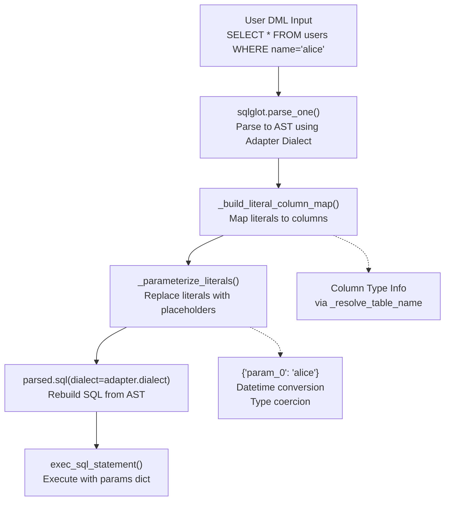
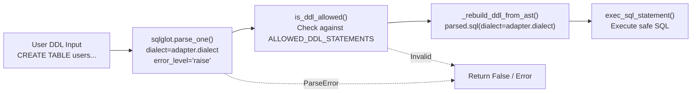
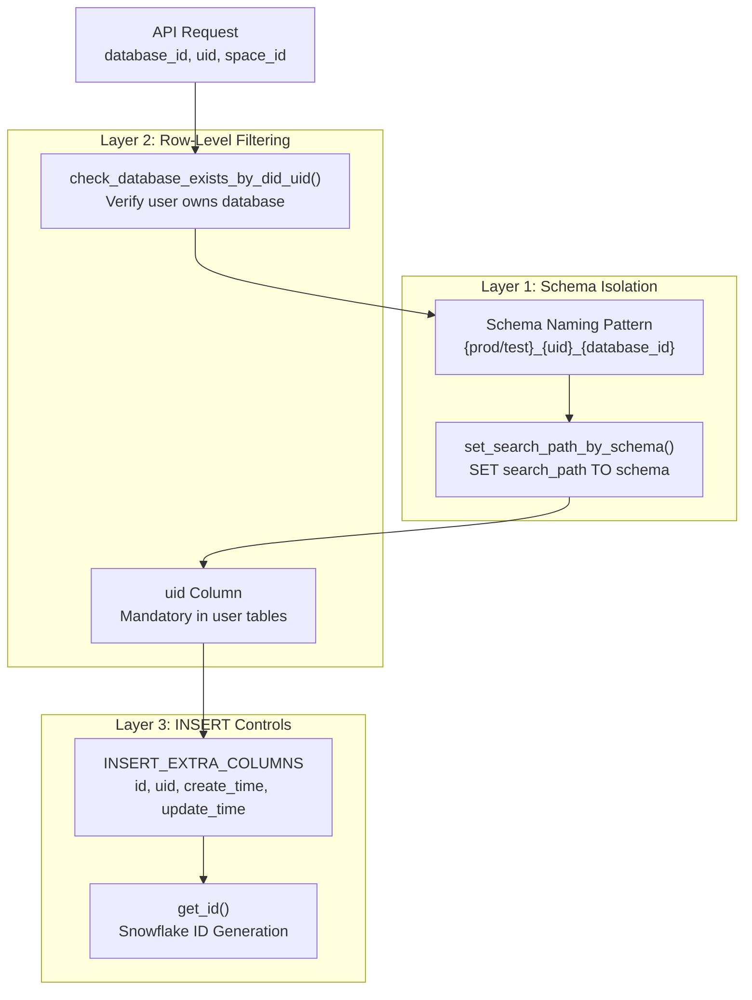

<!-- source: DeepWiki mcp.deepwiki.com · repo iflytek/astron-agent · page 14.4 Security Best Practices · fetched 2026-10-27 -->

# Security Best Practices

Relevant source files

The following files were used as context for generating this wiki page:

- [console/backend/commons/src/main/resources/mapper/BotDatasetMaasMapper.xml](console/backend/commons/src/main/resources/mapper/BotDatasetMaasMapper.xml)
- [console/backend/toolkit/src/main/java/com/iflytek/astron/console/toolkit/handler/McpServerHandler.java](console/backend/toolkit/src/main/java/com/iflytek/astron/console/toolkit/handler/McpServerHandler.java)
- [console/backend/toolkit/src/main/java/com/iflytek/astron/console/toolkit/service/model/ModelService.java](console/backend/toolkit/src/main/java/com/iflytek/astron/console/toolkit/service/model/ModelService.java)
- [console/backend/toolkit/src/main/java/com/iflytek/astron/console/toolkit/service/repo/FileInfoV2Service.java](console/backend/toolkit/src/main/java/com/iflytek/astron/console/toolkit/service/repo/FileInfoV2Service.java)
- [console/backend/toolkit/src/main/java/com/iflytek/astron/console/toolkit/service/workflow/WorkflowService.java](console/backend/toolkit/src/main/java/com/iflytek/astron/console/toolkit/service/workflow/WorkflowService.java)
- [console/backend/toolkit/src/main/java/com/iflytek/astron/console/toolkit/tool/UrlCheckTool.java](console/backend/toolkit/src/main/java/com/iflytek/astron/console/toolkit/tool/UrlCheckTool.java)
- [core/memory/database/api/router.py](core/memory/database/api/router.py)
- [core/memory/database/api/v1/__init__.py](core/memory/database/api/v1/__init__.py)
- [core/memory/database/api/v1/common.py](core/memory/database/api/v1/common.py)
- [core/memory/database/api/v1/db_operator.py](core/memory/database/api/v1/db_operator.py)
- [core/memory/database/api/v1/exec_ddl.py](core/memory/database/api/v1/exec_ddl.py)
- [core/memory/database/api/v1/exec_dml.py](core/memory/database/api/v1/exec_dml.py)
- [core/memory/database/main.py](core/memory/database/main.py)
- [core/memory/database/repository/middleware/database/db_factory.py](core/memory/database/repository/middleware/database/db_factory.py)
- [core/memory/database/repository/middleware/mid_utils.py](core/memory/database/repository/middleware/mid_utils.py)

## Purpose and Scope

This document covers security best practices implemented in the Astron Agent platform, with a focus on the Memory Database Service (`core-database`), Tool Execution Service (`core-link`), and Model Management. It details SQL injection prevention, identifier validation, multi-tenant data isolation, SSRF protection, and security patterns used in the Java and Python codebases. The platform employs a defense-in-depth strategy using Abstract Syntax Tree (AST) reconstruction, strict identifier enforcement, and URL blacklisting.

---

## SQL Injection Prevention

The platform implements multiple layers of defense against SQL injection attacks through AST-based reconstruction, literal parameterization, and strict validation. By using `sqlglot` to parse and rebuild SQL, the system ensures that only valid structures are executed.

### DML Parameterization Pipeline

The `exec_dml` module processes incoming Data Manipulation Language (DML) statements by converting them into an AST and mapping literals to specific columns to prevent injection.

**DML Execution Flow**

Sources: [core/memory/database/api/v1/exec_dml.py:11-32](), [core/memory/database/api/v1/exec_dml.py:41-102](), [core/memory/database/api/v1/exec_dml.py:142-175]()

### Key Security Functions

| Function | Purpose | Security Mechanism |
|----------|---------|-------------------|
| `_parameterize_literals()` | Replace all string literals with placeholders | Prevents injection via string concatenation by using bound parameters. |
| `_build_insert_literal_map()` | Map literal nodes to their column contexts in INSERT | Enables type-aware parameterization for new rows [core/memory/database/api/v1/exec_dml.py:41-67](). |
| `_build_update_literal_map()` | Map literal nodes to columns in UPDATE | Ensures values match column types during updates [core/memory/database/api/v1/exec_dml.py:69-102](). |
| `validate_reserved_keywords()` | Block restricted SQL keywords | Checks against `adapter.get_reserved_keywords()` [core/memory/database/api/v1/common.py:122-135](). |
| `validate_reserved_functions()` | Block dangerous SQL functions | Checks against `adapter.get_dangerous_functions()` [core/memory/database/api/v1/common.py:138-151](). |

The parameterization process walks the parsed AST and identifies all `Literal` nodes. For non-numeric literals, it maps each literal to its corresponding column using the AST structure via functions like `_build_insert_literal_map` and `_build_update_literal_map` [core/memory/database/api/v1/exec_dml.py:41-102]().

Sources: [core/memory/database/api/v1/exec_dml.py:41-102](), [core/memory/database/api/v1/common.py:122-151]()

### DDL AST Reconstruction

Data Definition Language (DDL) statements are strictly whitelisted and reconstructed from AST to ensure no malicious commands are hidden in comments or non-standard syntax.

**DDL Validation Logic**

DDL statements are validated using `is_ddl_allowed()` which checks the statement type against a whitelist: `CREATE TABLE`, `ALTER TABLE`, `DROP TABLE`, `DROP DATABASE`, `COMMENT`, and `RENAME` [core/memory/database/api/v1/exec_ddl.py:34-41](). The system uses `sqlglot` to parse the statement and determine the `full_type` (e.g., `CREATE TABLE`) before allowing execution [core/memory/database/api/v1/exec_ddl.py:55-80]().

Sources: [core/memory/database/api/v1/exec_ddl.py:34-80]()

---

## Identifier Validation and Naming Rules

The platform enforces strict identifier validation rules that are **intentionally more restrictive than standard SQL** to ensure consistency and prevent security issues.

### Business Rule: Letters and Underscores Only

Identifiers (table names, column names) are collected from the AST using `_collect_ddl_identifiers` [core/memory/database/api/v1/exec_ddl.py:180-215](). These are then validated against a pattern consisting only of `string.ascii_letters` and `_`.

**IMPORTANT**: This validation **does NOT allow digits**, even after the first character. Standard SQL identifiers like `users_v2` or `table_1` are **rejected** because they contain digits [core/memory/database/api/v1/exec_ddl.py:3-4]().

Sources: [core/memory/database/api/v1/exec_ddl.py:3-4](), [core/memory/database/api/v1/exec_ddl.py:180-215]()

### Validation Logic

| Function | Context | Logic |
|----------|---------|-------|
| `validate_reserved_keywords` | DML/DDL | Fetches reserved words from the database adapter [core/memory/database/api/v1/common.py:124-125](). |
| `validate_reserved_functions` | DML/DDL | Fetches dangerous functions from the adapter [core/memory/database/api/v1/common.py:140-141](). |
| `_collect_functions_names` | DDL | Extracts function names from AST nodes of type `exp.Func` [core/memory/database/api/v1/exec_ddl.py:144-177](). |

Sources: [core/memory/database/api/v1/common.py:122-151](), [core/memory/database/api/v1/exec_ddl.py:144-177]()

---

## Multi-Tenant Data Isolation

The platform implements defense-in-depth for multi-tenant isolation using both schema-level and row-level security controls within the `core-database` service.

### Three-Layer Isolation Architecture

**Isolation Tiers**

Sources: [core/memory/database/api/v1/db_operator.py:83-84](), [core/memory/database/api/v1/exec_dml.py:25-38](), [core/memory/database/api/v1/common.py:22-47]()

### Schema Isolation
Each database created via `exec_generate_schema` results in two distinct schemas: `prod_{uid}_{database_id}` and `test_{uid}_{database_id}` [core/memory/database/api/v1/db_operator.py:83-84](). These are physically isolated namespaces. The system uses `set_search_path_by_schema` to scope every query to the correct tenant schema [core/memory/database/api/v1/exec_dml.py:25]().

### Row-Level Security
Every DML execution verifies the association between the user (`uid`) and the database (`database_id`) using `check_database_exists_by_did_uid` [core/memory/database/api/v1/common.py:22-25]().

---

## Tool Execution and SSRF Protection

The platform implements strict Server-Side Request Forgery (SSRF) protection across various services, particularly when handling external URLs for tools or model validation.

### URL Validation and Blacklisting

The `UrlCheckTool` class in the console toolkit provides comprehensive validation for any external URL.

| Security Check | Implementation Detail |
|----------------|-----------------------|
| **Protocol Restriction** | Only `http` and `https` are permitted [console/backend/toolkit/src/main/java/com/iflytek/astron/console/toolkit/tool/UrlCheckTool.java:58](). |
| **IPv6 Blocking** | `checkUrlForIPv6` rejects any URL resolving to an IPv6 address [console/backend/toolkit/src/main/java/com/iflytek/astron/console/toolkit/tool/UrlCheckTool.java:119-130](). |
| **IPv4-Mapped Check** | `IPv4MappedCheck` prevents evasion via `[::ffff:192.168.1.1]` format [console/backend/toolkit/src/main/java/com/iflytek/astron/console/toolkit/tool/UrlCheckTool.java:144-149](). |
| **Redirect Handling** | `getRedirectUrl` follows at most one redirect and re-validates the final destination [console/backend/toolkit/src/main/java/com/iflytek/astron/console/toolkit/tool/UrlCheckTool.java:76-110](). |
| **Blacklist Sources** | Reads `IP_BLACK_LIST` and `NETWORK_SEGMENT_BLACK_LIST` from `ConfigInfo` table [console/backend/toolkit/src/main/java/com/iflytek/astron/console/toolkit/tool/UrlCheckTool.java:51-53](). |

### Model Validation Security

The `ModelService` uses `SsrfValidators` and `SsrfParamGuard` to ensure that model provider URLs are safe before validation [console/backend/toolkit/src/main/java/com/iflytek/astron/console/toolkit/service/model/ModelService.java:45-47](). It specifically blocks network segments defined in the `NETWORK_SEGMENT_BLACK_LIST` configuration category [console/backend/toolkit/src/main/java/com/iflytek/astron/console/toolkit/service/model/ModelService.java:90-107]().

Sources: [console/backend/toolkit/src/main/java/com/iflytek/astron/console/toolkit/tool/UrlCheckTool.java:46-175](), [console/backend/toolkit/src/main/java/com/iflytek/astron/console/toolkit/service/model/ModelService.java:77-115]()

---

## Static Analysis and API Security

The platform utilizes automated tools and interceptors to enforce security and quality standards during development and runtime.

### API Authentication
Public endpoints are explicitly managed. In the console backend, services like `WorkflowService` and `FileInfoV2Service` rely on `DataPermissionCheckTool` to verify that the requesting user has rights to the specific resource (e.g., repository or workflow) before processing [console/backend/toolkit/src/main/java/com/iflytek/astron/console/toolkit/service/repo/FileInfoV2Service.java:174]().

### Global Exception Handling
The platform uses a global exception handler in `main.py` (FastAPI) to prevent leaking sensitive stack traces to users. All errors are caught and returned as formatted `JSONResponse` objects with specific error codes from `CodeEnum` [core/memory/database/main.py:152-167]().

Sources: [console/backend/toolkit/src/main/java/com/iflytek/astron/console/toolkit/service/repo/FileInfoV2Service.java:121-174](), [core/memory/database/main.py:128-188]()

---

