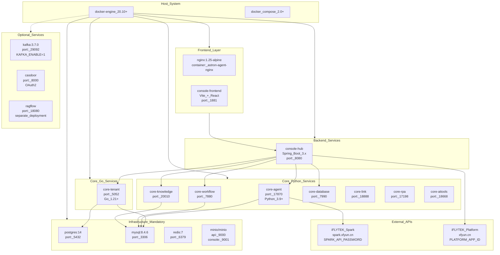
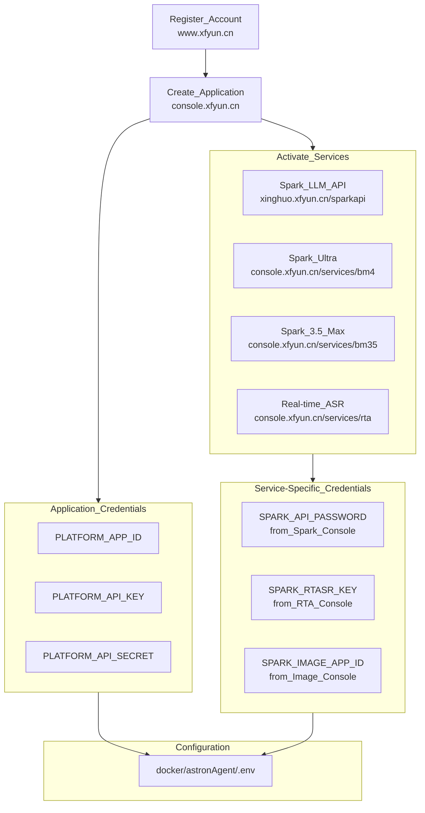

<!-- source: DeepWiki mcp.deepwiki.com · repo iflytek/astron-agent · page 2.1 Prerequisites and Requirements · fetched 2026-10-27 -->

# Prerequisites and Requirements

Relevant source files

The following files were used as context for generating this wiki page:

- [README.md](README.md)
- [console/backend/hub/src/main/resources/application.yml](console/backend/hub/src/main/resources/application.yml)
- [console/frontend/index.html](console/frontend/index.html)
- [console/frontend/public/runtime-config.js](console/frontend/public/runtime-config.js)
- [docker/astronAgent/.env.example](docker/astronAgent/.env.example)
- [docker/astronAgent/docker-compose.yaml](docker/astronAgent/docker-compose.yaml)
- [docker/astronAgent/nginx/nginx.conf](docker/astronAgent/nginx/nginx.conf)
- [docker/ragflow/docker-compose-macos.yml](docker/ragflow/docker-compose-macos.yml)
- [docs/CONFIGURATION.md](docs/CONFIGURATION.md)
- [docs/CONFIGURATION_zh.md](docs/CONFIGURATION_zh.md)
- [docs/CONTRIBUTING_CN.md](docs/CONTRIBUTING_CN.md)
- [docs/DEPLOYMENT_GUIDE.md](docs/DEPLOYMENT_GUIDE.md)
- [docs/DEPLOYMENT_GUIDE_zh.md](docs/DEPLOYMENT_GUIDE_zh.md)
- [docs/README-zh.md](docs/README-zh.md)

This document specifies the hardware, software, and external service prerequisites required to deploy and operate the Astron Agent platform. Requirements are categorized as mandatory (core platform), conditional (optional services), and recommended (production deployments).

**Related Documentation:**
- Deployment procedures: [2.2 Quick Start with Docker Compose]()
- Configuration reference: [2.3 Environment Configuration]()
- Authentication setup: [2.4 Authentication Setup with Casdoor]()

**Sources:** [README.md:49-71](), [docs/DEPLOYMENT_GUIDE.md:1-26](), [docs/DEPLOYMENT_GUIDE_zh.md:1-26]()

## Deployment Architecture Overview

The Astron Agent platform utilizes a microservices architecture orchestrated via Docker Compose. The following diagram maps the high-level system components to their respective code entities and infrastructure dependencies.

**Deployment Architecture - Service Dependencies**

**Service Image and Component Mapping:**

| Service | Image/Base | Source Location | Deployment File |
|---------|-----------|-----------------|-----------------|
| `nginx` | `nginx:1.25-alpine` | [docker/astronAgent/nginx/nginx.conf:1-187]() | `docker/astronAgent/docker-compose.yaml` |
| `console-frontend` | `ghcr.io/iflytek/astron-agent/console-frontend` | [console/frontend/index.html:1-81]() | `docker/astronAgent/docker-compose.yaml` |
| `console-hub` | `ghcr.io/iflytek/astron-agent/console-hub` | [console/backend/hub/src/main/resources/application.yml:1-194]() | `docker/astronAgent/docker-compose.yaml` |
| `core-tenant` | `ghcr.io/iflytek/astron-agent/core-tenant` | [docker/astronAgent/docker-compose.yaml:165-194]() | `docker/astronAgent/docker-compose.yaml` |
| `core-agent` | `ghcr.io/iflytek/astron-agent/core-agent` | [docker/astronAgent/docker-compose.yaml:1-200]() | `docker/astronAgent/docker-compose.yaml` |
| `core-workflow` | `ghcr.io/iflytek/astron-agent/core-workflow` | [docker/astronAgent/docker-compose.yaml:1-200]() | `docker/astronAgent/docker-compose.yaml` |
| `postgres` | `postgres:14` | [docker/astronAgent/docker-compose.yaml:7-26]() | `docker/astronAgent/docker-compose.yaml` |
| `mysql` | `mysql:8.4.6` | [docker/astronAgent/docker-compose.yaml:28-43]() | `docker/astronAgent/docker-compose.yaml` |
| `redis` | `redis:7` | [docker/astronAgent/docker-compose.yaml:46-59]() | `docker/astronAgent/docker-compose.yaml` |
| `minio` | `minio/minio:RELEASE.2025-07-23T15-54-02Z` | [docker/astronAgent/docker-compose.yaml:126-146]() | `docker/astronAgent/docker-compose.yaml` |
| `casdoor` | `casbin/casdoor:latest` | [docs/DEPLOYMENT_GUIDE.md:31-39]() | `docker/astronAgent/docker-compose-auth.yml` |
| `ragflow` | Custom RagFlow | [docs/DEPLOYMENT_GUIDE.md:50-61]() | `docker/ragflow/docker-compose.yml` |

**Sources:** [docker/astronAgent/docker-compose.yaml:1-200](), [docs/DEPLOYMENT_GUIDE.md:5-11]()

## Hardware Requirements

### Core Platform Requirements (Mandatory)

| Resource | Minimum | Recommended | Notes |
|----------|---------|-------------|-------|
| **CPU** | 2 cores | 4+ cores | Orchestrates 8+ microservices [docs/DEPLOYMENT_GUIDE.md:18-18]() |
| **RAM** | 4 GiB | 8+ GiB | Hub (Java) and Python services overhead [docs/DEPLOYMENT_GUIDE.md:19-19]() |
| **Disk** | 50 GB | 100+ GB | Images, DB volumes, and MinIO storage [docs/DEPLOYMENT_GUIDE.md:20-20]() |

**Disk Space Breakdown:**
- **Docker images**: Significant storage for 8+ core service images.
- **Database storage**: PostgreSQL (`sparkdb_manager`) and MySQL (`astron_console`, `tenant`, `agent`, etc.) [docker/astronAgent/docker-compose.yaml:11-33]().
- **MinIO object storage**: User uploads and console assets via `minio_data` volume [docker/astronAgent/docker-compose.yaml:137-137]().

### RagFlow Knowledge Base Requirements (Optional)

| Resource | Minimum | Recommended | Notes |
|----------|---------|-------------|-------|
| **CPU** | 4 cores | 8+ cores | Intensive document processing [docs/DEPLOYMENT_GUIDE.md:23-23]() |
| **RAM** | 16 GB | 32+ GB | Vector DB and embedding models [docs/DEPLOYMENT_GUIDE.md:24-24]() |
| **Disk** | 50 GB | 200+ GB | Document storage and indices [docs/DEPLOYMENT_GUIDE.md:25-25]() |
| **GPU** | None | NVIDIA GPU | Accelerated embeddings via `docker-compose-gpu.yml` [docs/DEPLOYMENT_GUIDE.md:73-73]() |

**Sources:** [docs/DEPLOYMENT_GUIDE.md:17-26](), [docker/astronAgent/docker-compose.yaml:1-200]()

## Software Prerequisites

### Required Software

| Software | Minimum Version | Verification | Installation Check |
|----------|----------------|--------------|-------------------|
| **Docker Engine** | 20.10.0 | `docker --version` | Mandatory for containerized services [docs/DEPLOYMENT_GUIDE.md:31-31]() |
| **Docker Compose** | 2.0.0 | `docker compose version` | Required for orchestration [docs/DEPLOYMENT_GUIDE.md:31-31]() |
| **Git** | 2.0.0 | `git --version` | Required for repository cloning [README.md:53-53]() |

### Operating System Compatibility

| OS Family | Tested Versions | Docker Installation Method |
|-----------|----------------|---------------------------|
| **Linux** | Ubuntu 20.04+, CentOS 7+ | Native Docker Engine |
| **macOS** | macOS 11.0+ | Docker Desktop (uses `docker-compose-macos.yml` for RagFlow) [docs/DEPLOYMENT_GUIDE.md:50-50]() |
| **Windows** | Windows 10/11 | Docker Desktop + WSL2 backend |

**Sources:** [README.md:53-57](), [docs/DEPLOYMENT_GUIDE.md:31-39]()

## Required External Services

### iFLYTEK Platform Account (Mandatory)

The platform integrates deeply with iFLYTEK Spark and AI capabilities. Registration is required at [xfyun.cn](https://www.xfyun.cn).

**Credential Acquisition Workflow**

**Required Environment Variables (Application Layer):**

| Variable | Source | Used By |
|----------|--------|---------|
| `PLATFORM_APP_ID` | iFLYTEK Console | [docs/DEPLOYMENT_GUIDE_zh.md:180-180]() |
| `PLATFORM_API_KEY` | iFLYTEK Console | [docs/DEPLOYMENT_GUIDE_zh.md:181-181]() |
| `PLATFORM_API_SECRET` | iFLYTEK Console | [docs/DEPLOYMENT_GUIDE_zh.md:182-182]() |
| `SPARK_API_PASSWORD` | Spark Console | [docs/DEPLOYMENT_GUIDE_zh.md:184-184]() |
| `AI_ABILITY_CHAT_BASE_URL` | OpenAI-compatible endpoint | [console/backend/hub/src/main/resources/application.yml:147-147]() |

**Sources:** [docs/DEPLOYMENT_GUIDE_zh.md:161-194](), [console/backend/hub/src/main/resources/application.yml:127-150]()

## Network Port Configuration

### Exposed Ports (Host → Container)

| Port | Service | Configuration Variable | Access Level |
|------|---------|------------------------|--------------|
| 80 | `astron-agent-nginx` | `EXPOSE_NGINX_PORT` | Public [docker/astronAgent/.env.example:83-83]() |
| 8000 | `casdoor` | `CASDOOR_PORT` | Public (Auth) [docker/astronAgent/.env.example:92-92]() |
| 18998 | `minio` API | `EXPOSE_MINIO_PORT` | Internal [docker/astronAgent/.env.example:57-57]() |
| 18999 | `minio` Console | `EXPOSE_MINIO_CONSOLE_PORT` | Admin [docker/astronAgent/.env.example:58-58]() |

### Internal Microservice Ports

| Port | Service | Purpose |
|------|---------|---------|
| 5052 | `core-tenant` | Tenant/Auth management [docker/astronAgent/.env.example:95-95]() |
| 7990 | `core-database` | Memory DB execution [docker/astronAgent/.env.example:96-96]() |
| 7880 | `core-workflow` | Workflow engine [docker/astronAgent/.env.example:102-102]() |
| 17870 | `core-agent` | Agent runtime [docker/astronAgent/.env.example:100-100]() |
| 20010 | `core-knowledge` | Knowledge/RAG retrieval [docker/astronAgent/.env.example:101-101]() |
| 8080 | `console-hub` | Backend API [console/backend/hub/src/main/resources/application.yml:2-2]() |

**Sources:** [docker/astronAgent/.env.example:91-102](), [docker/astronAgent/docker-compose.yaml:164-200]()

---

