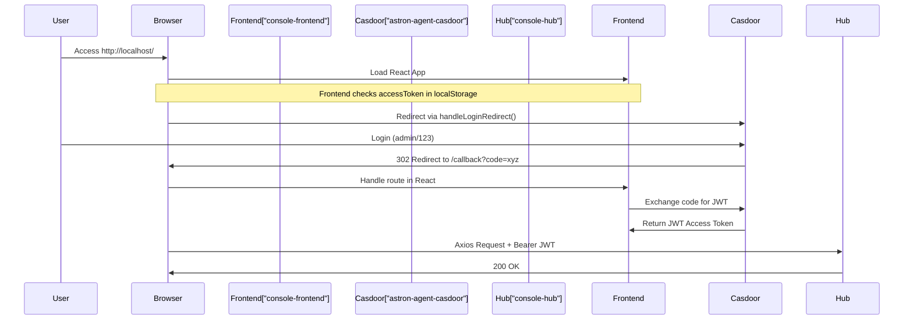

<!-- source: DeepWiki mcp.deepwiki.com · repo iflytek/astron-agent · page 2.4 Authentication Setup with Casdoor · fetched 2026-10-27 -->

# Authentication Setup with Casdoor

<details>
<summary>Relevant source files</summary>

The following files were used as context for generating this wiki page:

- [console/backend/hub/src/main/java/com/iflytek/astron/console/hub/service/bot/impl/TalkAgentServiceImpl.java](console/backend/hub/src/main/java/com/iflytek/astron/console/hub/service/bot/impl/TalkAgentServiceImpl.java)
- [console/frontend/.env.development](console/frontend/.env.development)
- [console/frontend/.env.production](console/frontend/.env.production)
- [console/frontend/.env.test](console/frontend/.env.test)
- [console/frontend/Dockerfile](console/frontend/Dockerfile)
- [console/frontend/docker-entrypoint.sh](console/frontend/docker-entrypoint.sh)
- [console/frontend/src/components/create-application-modal/index.tsx](console/frontend/src/components/create-application-modal/index.tsx)
- [console/frontend/src/components/sidebar/create-button.tsx](console/frontend/src/components/sidebar/create-button.tsx)
- [console/frontend/src/components/virtual-config-modal/index.module.scss](console/frontend/src/components/virtual-config-modal/index.module.scss)
- [console/frontend/src/components/vms-interaction-cmp/index.tsx](console/frontend/src/components/vms-interaction-cmp/index.tsx)
- [console/frontend/src/components/workflow/drawer/chat-debugger/index.scss](console/frontend/src/components/workflow/drawer/chat-debugger/index.scss)
- [console/frontend/src/config/casdoor.ts](console/frontend/src/config/casdoor.ts)
- [console/frontend/src/utils/http.ts](console/frontend/src/utils/http.ts)
- [console/frontend/vite-env.d.ts](console/frontend/vite-env.d.ts)
- [console/frontend/vite.config.js](console/frontend/vite.config.js)
- [docker/astronAgent/casdoor/conf/app.conf](docker/astronAgent/casdoor/conf/app.conf)
- [docker/astronAgent/casdoor/conf/init_data.json](docker/astronAgent/casdoor/conf/init_data.json)
- [docker/astronAgent/casdoor/conf/init_data.json.template](docker/astronAgent/casdoor/conf/init_data.json.template)
- [docker/astronAgent/casdoor/entrypoint.sh](docker/astronAgent/casdoor/entrypoint.sh)
- [docker/astronAgent/docker-compose-auth.yml](docker/astronAgent/docker-compose-auth.yml)
- [docker/astronAgent/docker-compose-with-auth.yaml](docker/astronAgent/docker-compose-with-auth.yaml)
- [docker/ragflow/docker-compose.yml](docker/ragflow/docker-compose.yml)
- [docs/DEPLOYMENT_GUIDE_WITH_AUTH.md](docs/DEPLOYMENT_GUIDE_WITH_AUTH.md)
- [docs/DEPLOYMENT_GUIDE_WITH_AUTH_RPA.md](docs/DEPLOYMENT_GUIDE_WITH_AUTH_RPA.md)
- [docs/DEPLOYMENT_GUIDE_WITH_AUTH_RPA_zh.md](docs/DEPLOYMENT_GUIDE_WITH_AUTH_RPA_zh.md)
- [docs/DEPLOYMENT_GUIDE_WITH_AUTH_zh.md](docs/DEPLOYMENT_GUIDE_WITH_AUTH_zh.md)

</details>


This document provides detailed instructions for configuring Casdoor as the OAuth2/OIDC authentication provider for the Astron Agent platform. Casdoor is a required component that provides single sign-on (SSO) and identity management for all console services.

---

## Overview

Casdoor is an open-source identity and access management (IAM) platform that provides:

- **OAuth 2.0 and OIDC protocols** for authentication.
- **Organization-based multi-tenancy** for user isolation.
- **Application management** for client registration.
- **JWT token issuance** for stateless authentication.

The Astron Agent platform uses Casdoor as the centralized authentication gateway for both the React frontend (`console-frontend`) and Spring Boot backend (`console-hub`).

**Sources**: [docs/DEPLOYMENT_GUIDE_WITH_AUTH.md:9-11](), [console/frontend/src/utils/http.ts:10-10]()

---

## Deployment Architecture

### Casdoor Service Integration

The Casdoor service is deployed via the `docker-compose-auth.yml` or `docker-compose-with-auth.yaml` file, which uses Docker Compose's `include` mechanism to bundle Casdoor with the core Astron Agent services.

| Component | Container Name | Port | Database |
|-----------|---------------|------|----------|
| Casdoor Server | `astron-agent-casdoor` | 8000 | MySQL `casdoor` schema |
| Casdoor Admin UI | Same as server | 8000 | Same |
| Console Frontend | `console-frontend` | 1881 (internal) | N/A |
| Console Hub | `console-hub` | 8080 (internal) | MySQL `astron_console` |

### Deployment Data Flow

Title: "Authentication Service Topology"
```mermaid
graph TB
    subgraph "Docker_Compose_Deployment"
        ["docker-compose-auth.yml"]
    end
    
    subgraph "Authentication_Layer"
        ["astron-agent-casdoor"] -- "Port: 8000" --> ["casdoor_service"]
        ["casdoor_service"] --> ["astron-agent-casdoor-mysql"]
    end
    
    subgraph "Console_Services"
        ["console-frontend"] -- "React_SPA" --> ["Nginx_Container"]
        ["console-hub"] -- "Spring_Boot" --> ["Nginx_Container"]
        ["Nginx_Container"] -- "Port: 1881" --> ["External_Access"]
    end
    
    subgraph "Configuration"
        [".env_file"] -- "CONSOLE_CASDOOR_*" --> ["console-frontend"]
        ["docker-entrypoint.sh"] -- "Injects" --> ["runtime-config.js"]
    end
    
    ["docker-compose-auth.yml"] --> ["astron-agent-casdoor"]
    ["astron-agent-casdoor"] --> ["astron-agent-casdoor-mysql"]
```

**Sources**: [docker/astronAgent/docker-compose-auth.yml:2-32](), [console/frontend/Dockerfile:38-38](), [console/frontend/docker-entrypoint.sh:4-9]()

---

## Initial Setup

### Step 1: Start Casdoor Service

Casdoor is automatically started when using the recommended deployment method. The system includes an initialization script `entrypoint.sh` that prepares the configuration from templates.

```bash
cd docker/astronAgent
docker compose -f docker-compose-auth.yml up -d
```

**Initialization Logic:**
The Casdoor container uses `docker/astronAgent/casdoor/entrypoint.sh` to generate `init_data.json` from `init_data.json.template` by replacing placeholders like `${CONSOLE_DOMAIN}` and `${HOST_BASE_ADDRESS}` using `sed` [docker/astronAgent/casdoor/entrypoint.sh:14-18](). This ensures that the `redirectUris` are dynamically set based on the deployment environment [docker/astronAgent/casdoor/entrypoint.sh:21]().

**Default Credentials:**
- Username: `admin`
- Password: `123`
- Access URL: `http://localhost:8000`

**Sources**: [docker/astronAgent/casdoor/entrypoint.sh:1-25](), [docker/astronAgent/docker-compose-auth.yml:23-23](), [docker/astronAgent/casdoor/conf/init_data.json.template:1-5]()

---

## Organization and Application Configuration

### Casdoor Entity Hierarchy

Title: "Casdoor Configuration Entities"
```mermaid
graph TB
    ["Casdoor_Instance"] -- "localhost:8000" --> ["Organization"]
    
    ["Organization"] -- "CONSOLE_CASDOOR_ORG" --> ["Application"]
    
    ["Organization"] --> ["Users"]
    
    ["Application"] -- "Redirect_URL" --> ["Callback_Route"]
    
    ["Application"] -- "Generates" --> ["CONSOLE_CASDOOR_ID"]
    
    ["Application"] -- "Named" --> ["CONSOLE_CASDOOR_APP"]
    
    ["Organization"] -- "Named" --> ["CONSOLE_CASDOOR_ORG"]
    
    ["Callback_Route"] -- "Target" --> ["http://localhost/callback"]
```

**Sources**: [console/frontend/.env.test:10-13](), [docker/astronAgent/casdoor/entrypoint.sh:21-21]()

### Step 2: Create Organization and Application

1. **Organization**: Navigate to `http://localhost:8000/organizations`. Create a new organization. The platform defaults to `built-in` in development [console/frontend/.env.development:4-4]().
2. **Application**: Navigate to `http://localhost:8000/applications`. 
   - **Name**: Map this to `CONSOLE_CASDOOR_APP` (e.g., `astronAgent`) [console/frontend/.env.test:12-12]().
   - **Organization**: Select the organization created above.
   - **Redirect URL**: Set to `${CONSOLE_DOMAIN}/callback`. The `entrypoint.sh` script handles this during container initialization [docker/astronAgent/casdoor/entrypoint.sh:21-21]().
   - **Client ID**: Record this for `CONSOLE_CASDOOR_ID` [console/frontend/.env.test:11-11]().

**Sources**: [console/frontend/.env.test:10-13](), [docker/astronAgent/casdoor/entrypoint.sh:21-21]()

---

## Environment Variable Configuration

### Configuration Mapping

Title: "Environment Variable Mapping"
```mermaid
graph LR
    subgraph "Casdoor_Admin_UI"
        ["Service_URL"]
        ["Client_ID"]
        ["App_Name"]
        ["Org_Name"]
    end
    
    subgraph ".env_Configuration"
        ["CONSOLE_CASDOOR_URL"]
        ["CONSOLE_CASDOOR_ID"]
        ["CONSOLE_CASDOOR_APP"]
        ["CONSOLE_CASDOOR_ORG"]
    end
    
    ["Service_URL"] -->|"maps_to"| ["CONSOLE_CASDOOR_URL"]
    ["Client_ID"] -->|"maps_to"| ["CONSOLE_CASDOOR_ID"]
    ["App_Name"] -->|"maps_to"| ["CONSOLE_CASDOOR_APP"]
    ["Org_Name"] -->|"maps_to"| ["CONSOLE_CASDOOR_ORG"]
```

### Step 3: Configure .env File

Edit your environment configuration (e.g., `.env.production` or `.env.development`). These variables are prefixed with `CONSOLE_` or `VITE_` to be picked up by the Vite build system [console/frontend/vite.config.js:11-11]().

```env
# Casdoor Configuration
CONSOLE_CASDOOR_URL=http://your-casdoor-server:8000
CONSOLE_CASDOOR_ID=your-casdoor-client-id
CONSOLE_CASDOOR_APP=astronAgent
CONSOLE_CASDOOR_ORG=built-in
```

**Sources**: [console/frontend/.env.test:10-13](), [console/frontend/vite.config.js:11-11]()

---

## Service Integration Details

### Authentication Sequence

The authentication flow follows the standard OAuth2 Authorization Code grant.

Title: "OAuth2 Authentication Sequence"


### Integration Points

1. **Frontend Runtime Injection**: The `docker-entrypoint.sh` script in the frontend container reads `CONSOLE_CASDOOR_*` variables and writes them to `window.__APP_CONFIG__` in `runtime-config.js` [console/frontend/docker-entrypoint.sh:26-37](). This allows changing Casdoor settings without rebuilding the Docker image.
2. **HTTP Interceptor**: The `http.ts` utility automatically injects the `accessToken` from `localStorage` into the `Authorization` header for all outgoing requests [console/frontend/src/utils/http.ts:90-93]().
3. **Error Handling**: If a service returns a `401` or specific business codes (e.g., `80000`, `90000`), the frontend triggers `jumpToLogin()` which calls `handleLoginRedirect()` to restart the Casdoor flow [console/frontend/src/utils/http.ts:167-173](), [console/frontend/src/utils/http.ts:199-204]().
4. **Space Management**: Headers such as `space-id` and `enterprise-id` are also attached to requests to maintain multi-tenant context alongside the Casdoor identity [console/frontend/src/utils/http.ts:85-102]().

**Sources**: [console/frontend/docker-entrypoint.sh:26-37](), [console/frontend/src/utils/http.ts:90-102](), [console/frontend/src/utils/http.ts:167-173]()

---

## Summary of Configuration Values

| Variable | Description | Typical Value |
|----------|-------------|---------------|
| `CONSOLE_CASDOOR_URL` | The URL of the Casdoor server | `http://localhost:8000` |
| `CONSOLE_CASDOOR_ID` | Client ID from Casdoor Application | `client-id` |
| `CONSOLE_CASDOOR_APP` | Name of the Casdoor Application | `astronAgent` |
| `CONSOLE_CASDOOR_ORG` | Name of the Casdoor Organization | `built-in` |

**Sources**: [console/frontend/.env.test:10-13](), [console/frontend/vite-env.d.ts:8-11]()

---

