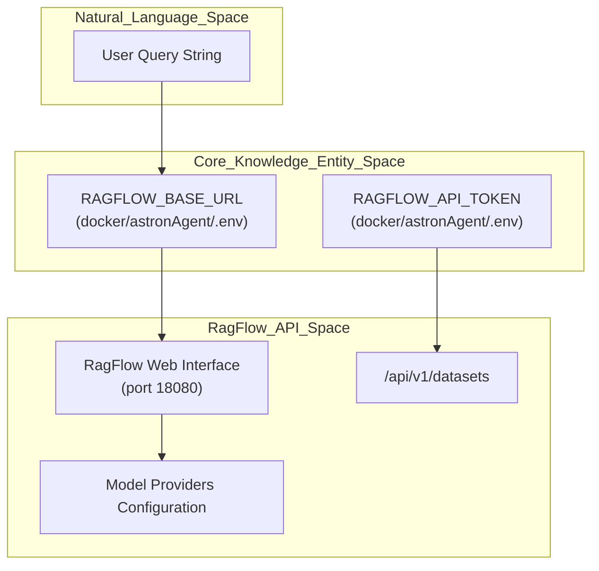
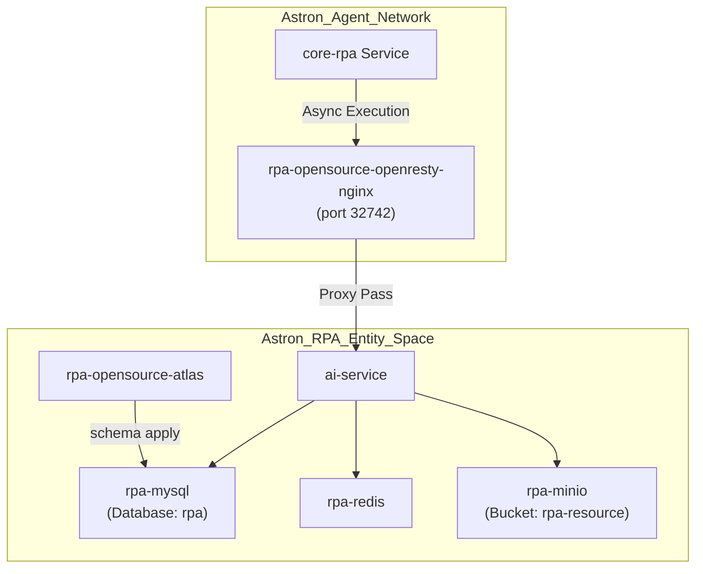
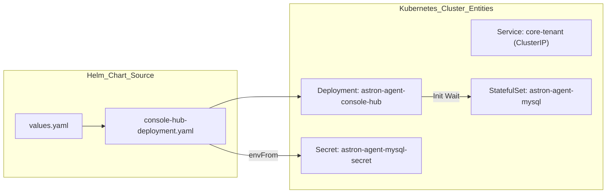

<!-- source: DeepWiki mcp.deepwiki.com · repo iflytek/astron-agent · page 2.5 Optional Services Configuration · fetched 2026-10-27 -->

# Optional Services Configuration

<details>
<summary>Relevant source files</summary>

The following files were used as context for generating this wiki page:

- [docker/astronAgent/.env.with-rpa](docker/astronAgent/.env.with-rpa)
- [docker/astronAgent/astronRPA/.env](docker/astronAgent/astronRPA/.env)
- [docker/astronAgent/astronRPA/docker-compose.yml](docker/astronAgent/astronRPA/docker-compose.yml)
- [docker/astronAgent/astronRPA/volumes/atlas/atlas.hcl](docker/astronAgent/astronRPA/volumes/atlas/atlas.hcl)
- [docker/astronAgent/astronRPA/volumes/atlas/schema.hcl](docker/astronAgent/astronRPA/volumes/atlas/schema.hcl)
- [docker/astronAgent/astronRPA/volumes/mysql/init_app_market_dict_data.sql](docker/astronAgent/astronRPA/volumes/mysql/init_app_market_dict_data.sql)
- [docker/astronAgent/astronRPA/volumes/mysql/init_c_atom_meta_data.sql](docker/astronAgent/astronRPA/volumes/mysql/init_c_atom_meta_data.sql)
- [docker/astronAgent/astronRPA/volumes/mysql/init_c_atom_meta_new_data.sql](docker/astronAgent/astronRPA/volumes/mysql/init_c_atom_meta_new_data.sql)
- [docker/astronAgent/astronRPA/volumes/mysql/init_his_data_enum_data.sql](docker/astronAgent/astronRPA/volumes/mysql/init_his_data_enum_data.sql)
- [docker/astronAgent/astronRPA/volumes/mysql/init_sample_template_data.sql](docker/astronAgent/astronRPA/volumes/mysql/init_sample_template_data.sql)
- [docker/astronAgent/astronRPA/volumes/mysql/schema.sql](docker/astronAgent/astronRPA/volumes/mysql/schema.sql)
- [docker/astronAgent/astronRPA/volumes/nginx/default.conf](docker/astronAgent/astronRPA/volumes/nginx/default.conf)
- [docker/astronAgent/astronRPA/volumes/nginx/lua/auth_handler.lua](docker/astronAgent/astronRPA/volumes/nginx/lua/auth_handler.lua)
- [docker/astronAgent/docker-compose-with-auth-rpa.yaml](docker/astronAgent/docker-compose-with-auth-rpa.yaml)
- [helm/README.md](helm/README.md)
- [helm/astron-agent/.helmignore](helm/astron-agent/.helmignore)
- [helm/astron-agent/Chart.yaml](helm/astron-agent/Chart.yaml)
- [helm/astron-agent/files/casdoor/conf/app.conf](helm/astron-agent/files/casdoor/conf/app.conf)
- [helm/astron-agent/files/casdoor/conf/init_data.json](helm/astron-agent/files/casdoor/conf/init_data.json)
- [helm/astron-agent/files/casdoor/conf/init_data.json.template](helm/astron-agent/files/casdoor/conf/init_data.json.template)
- [helm/astron-agent/files/casdoor/entrypoint.sh](helm/astron-agent/files/casdoor/entrypoint.sh)
- [helm/astron-agent/files/config/agent/config.env](helm/astron-agent/files/config/agent/config.env)
- [helm/astron-agent/files/config/workflow/config.env](helm/astron-agent/files/config/workflow/config.env)
- [helm/astron-agent/files/mysql/agent.sql](helm/astron-agent/files/mysql/agent.sql)
- [helm/astron-agent/files/mysql/link.sql](helm/astron-agent/files/mysql/link.sql)
- [helm/astron-agent/files/mysql/tenant.sql](helm/astron-agent/files/mysql/tenant.sql)
- [helm/astron-agent/files/mysql/workflow.sql](helm/astron-agent/files/mysql/workflow.sql)
- [helm/astron-agent/files/pgsql/memory.sql](helm/astron-agent/files/pgsql/memory.sql)
- [helm/astron-agent/templates/auth/casdoor-deployment.yaml](helm/astron-agent/templates/auth/casdoor-deployment.yaml)
- [helm/astron-agent/templates/configmaps.yaml](helm/astron-agent/templates/configmaps.yaml)
- [helm/astron-agent/templates/console/console-hub-deployment.yaml](helm/astron-agent/templates/console/console-hub-deployment.yaml)
- [helm/astron-agent/templates/core/core-services.yaml](helm/astron-agent/templates/core/core-services.yaml)
- [helm/astron-agent/templates/infrastructure/mysql-statefulset.yaml](helm/astron-agent/templates/infrastructure/mysql-statefulset.yaml)
- [helm/astron-agent/templates/ingress.yaml](helm/astron-agent/templates/ingress.yaml)
- [helm/astron-agent/values.yaml](helm/astron-agent/values.yaml)

</details>


This page provides a technical setup guide for integrating optional platform extensions into the Astron Agent ecosystem. This includes RagFlow knowledge base integration, the Astron RPA open-source studio, and Helm/Kubernetes deployment strategies.

## Overview

The Astron Agent platform is designed with a modular architecture where several high-value services are optional. These services enhance the platform's RAG (Retrieval-Augmented Generation) capabilities, automation power, and enterprise scalability.

| Service | Purpose | Implementation Class/Service | Default State |
|---------|---------|------------------------------|---------------|
| **RagFlow** | Deep document understanding & RAG | `RagflowRAGStrategy` | Disabled |
| **Astron RPA** | Open-source RPA studio & execution | `rpa-opensource-studio` | Optional |
| **Helm/K8s** | Enterprise orchestration | Kubernetes Manifests | Manual |
| **Kafka** | Event streaming & Telemetry | `spark-agent-builder` topic | Disabled |
| **OTLP** | Distributed Tracing | OpenTelemetry SDKs | Disabled |

Sources: [helm/astron-agent/values.yaml:228-232](), [docker/astronAgent/docker-compose-with-auth-rpa.yaml:1-27]()

---

## RagFlow Knowledge Base Integration

RagFlow is an optional open-source RAG (Retrieval-Augmented Generation) engine that provides accurate question-answering using deep document understanding. The integration is managed via the `core-knowledge` service.

### Integration Architecture

The integration layer communicates with the RagFlow API to manage datasets and perform retrieval. The following diagram illustrates how the system bridges the Natural Language Space (queries) to the Code Entity Space (RagFlow API).

**Diagram: Knowledge Retrieval Data Flow**



### Key Implementation Details

*   **API Token Acquisition**: Users must generate an API KEY from the RagFlow Web Interface (User Settings -> API) and map it to `RAGFLOW_API_TOKEN` in the `.env` file.
*   **Model Defaults**: Within RagFlow, users must configure both a **Chat model** and an **Embedding model** as defaults for the integration to function correctly.
*   **Deployment Options**: RagFlow can be deployed using `docker-compose.yml` (standard) or `docker-compose-gpu.yml` for hardware acceleration.

---

## Astron RPA Studio Integration

The platform supports integration with the **Astron RPA Open-Source Studio**, enabling agents to achieve a complete loop "from decision to action" through cross-system process automation.

### RPA Service Stack

The RPA extension introduces a dedicated stack of services including its own database, cache, and API gateway.

**Diagram: RPA Service Topology**



Sources: [docker/astronAgent/astronRPA/docker-compose.yml:3-214](), [docker/astronAgent/astronRPA/volumes/mysql/schema.sql:13-29](), [docker/astronAgent/astronRPA/docker-compose.yml:68-88]()

### Configuration Steps

1.  **Integrated Deployment**: Launch the combined stack using the specialized compose file which includes Casdoor, Astron Agent core, and Astron RPA services [docker/astronAgent/docker-compose-with-auth-rpa.yaml:7-27]().
    ```bash
    docker compose -f docker-compose-with-auth-rpa.yaml up -d
    ```

2.  **External RPA Configuration**: If using the iFLYTEK Cloud RPA instead of the open-source studio, configure the external endpoints in the `coreRpa` environment [helm/astron-agent/values.yaml:230-231]().
    *   `xiaowuRpaTaskCreateUrl`: `https://newapi.iflyrpa.com/api/rpa-openapi/workflows/execute-async`
    *   `xiaowuRpaTaskQueryUrl`: `https://newapi.iflyrpa.com/api/rpa-openapi/executions`

3.  **Database Initialization**: The RPA suite uses `rpa-mysql` (port 3306) and `rpa-atlas` for schema management. It initializes a database named `rpa` with tables such as `agent_table` and `app_application` [docker/astronAgent/astronRPA/volumes/mysql/schema.sql:13-93]().

---

## Kubernetes Deployment with Helm

For production environments, Astron Agent provides Helm charts to manage the microservice cluster on Kubernetes.

### Resource Orchestration

The Helm chart organizes core services and infrastructure. It uses `initContainers` to ensure infrastructure readiness (MySQL, Redis, MinIO) before starting backend services like `console-hub` [helm/astron-agent/templates/console/console-hub-deployment.yaml:25-39]().

**Diagram: Helm Resource Mapping**



Sources: [helm/astron-agent/values.yaml:1-29](), [helm/astron-agent/templates/console/console-hub-deployment.yaml:41-109](), [helm/README.md:25-41]()

### Key Helm Parameters

The `values.yaml` file centralizes configuration for the entire cluster.

| Parameter | Default | Description |
|-----------|---------|-------------|
| `global.hostBaseAddress` | `http://astron-agent.example.com` | Root URL for MinIO and Casdoor callbacks [helm/astron-agent/values.yaml:9]() |
| `global.platformAppId` | `your-app-id` | iFLYTEK Platform Application ID [helm/astron-agent/values.yaml:14]() |
| `mysql.auth.rootPassword` | `root123` | Root password for the primary MySQL instance [helm/astron-agent/values.yaml:77]() |
| `coreTenant.env.databaseUrl` | `(astron-agent-mysql:3306)/tenant` | Internal connection string for tenant service [helm/astron-agent/values.yaml:181]() |

Sources: [helm/astron-agent/values.yaml:9-181](), [helm/README.md:25-41]()

---

## Telemetry and Event Streaming

The platform supports optional observability through Kafka and OpenTelemetry (OTLP).

### Kafka Configuration
Kafka is used for high-throughput event streaming. It is disabled by default but can be activated via the `KAFKA_ENABLE` environment variable in services like `core-link`, `core-rpa`, and `core-aitools` [helm/astron-agent/values.yaml:228-229](), [helm/astron-agent/values.yaml:260-261](), [helm/astron-agent/values.yaml:289-290]().

### OpenTelemetry (OTLP)
Distributed tracing is supported across the microservice mesh. Each core service (e.g., `core-database`, `core-rpa`, `core-link`) includes configuration for an OTLP collector [helm/astron-agent/values.yaml:207-208](), [helm/astron-agent/values.yaml:226-227](), [helm/astron-agent/values.yaml:258-259]().
*   `OTLP_ENDPOINT`: Defaults to `127.0.0.1:4317`.
*   `OTLP_ENABLE`: Set to `"1"` to enable tracing.

---

## FAQ and Troubleshooting

### Common Deployment Issues

| Symptom | Probable Cause | Resolution |
|---------|----------------|------------|
| `RagFlow API error` | API Key mismatch or default models not set | Verify `RAGFLOW_API_TOKEN` and check default models in RagFlow UI. |
| `RPA Task failure` | Openresty Nginx not reachable | Check port `32742` accessibility and service health [docker/astronAgent/astronRPA/docker-compose.yml:183-184](). |
| `Helm Pods Pending` | StorageClass or Resources unavailable | Check `global.storageClass` in `values.yaml` and cluster resource quotas [helm/astron-agent/values.yaml:5](). |
| `Casdoor Login Fail` | Redirect URL mismatch | Ensure `CONSOLE_CASDOOR_URL` matches the app configuration in Casdoor. |

Sources: [helm/README.md:64-89](), [helm/astron-agent/values.yaml:5-10]()

---

