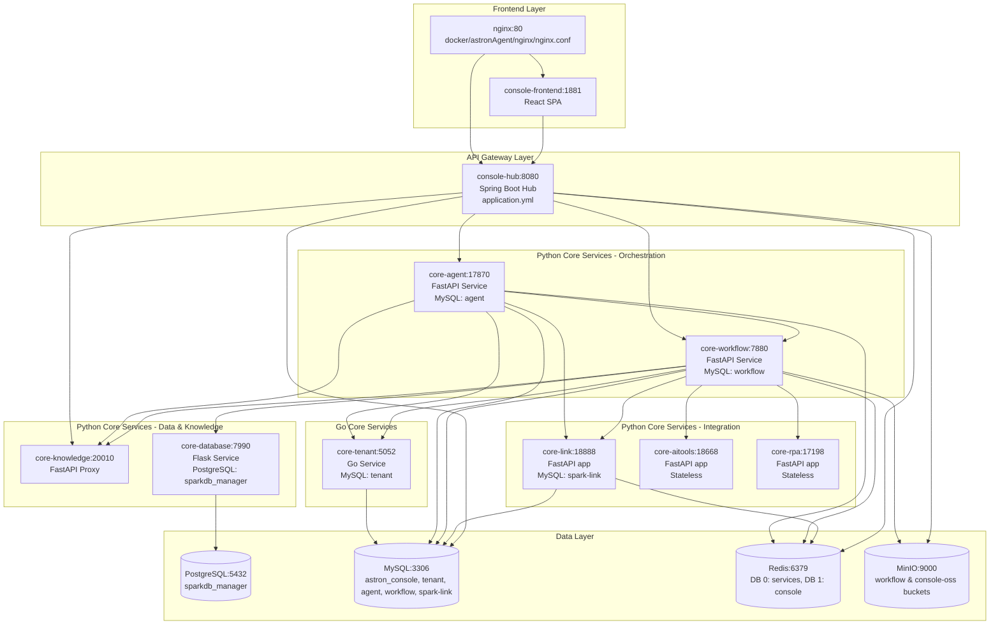

<!-- source: DeepWiki mcp.deepwiki.com · repo iflytek/astron-agent · page 3 Core Services Architecture · fetched 2026-10-27 -->

# Core Services Architecture

Relevant source files

The following files were used as context for generating this wiki page:

- [README.md](README.md)
- [console/backend/hub/src/main/resources/application.yml](console/backend/hub/src/main/resources/application.yml)
- [console/frontend/index.html](console/frontend/index.html)
- [console/frontend/public/runtime-config.js](console/frontend/public/runtime-config.js)
- [core/tenant/config.toml](core/tenant/config.toml)
- [core/tenant/config/config.go](core/tenant/config/config.go)
- [core/tenant/config/config_test.go](core/tenant/config/config_test.go)
- [core/tenant/config/env_loader.go](core/tenant/config/env_loader.go)
- [core/tenant/config/env_loader_test.go](core/tenant/config/env_loader_test.go)
- [core/tenant/config/loader_test.go](core/tenant/config/loader_test.go)
- [core/tenant/config/local_loader_test.go](core/tenant/config/local_loader_test.go)
- [core/tenant/internal/dao/app_dao_test.go](core/tenant/internal/dao/app_dao_test.go)
- [core/tenant/internal/dao/auth_dao_test.go](core/tenant/internal/dao/auth_dao_test.go)
- [core/tenant/internal/dao/base_test.go](core/tenant/internal/dao/base_test.go)
- [core/tenant/internal/handler/app_handler_test.go](core/tenant/internal/handler/app_handler_test.go)
- [core/tenant/internal/handler/auth_handler_test.go](core/tenant/internal/handler/auth_handler_test.go)
- [core/tenant/internal/handler/resp_test.go](core/tenant/internal/handler/resp_test.go)
- [core/tenant/internal/handler/router_test.go](core/tenant/internal/handler/router_test.go)
- [core/tenant/tools/generator/sid_test.go](core/tenant/tools/generator/sid_test.go)
- [docker/astronAgent/.env.example](docker/astronAgent/.env.example)
- [docker/astronAgent/docker-compose.yaml](docker/astronAgent/docker-compose.yaml)
- [docker/astronAgent/nginx/nginx.conf](docker/astronAgent/nginx/nginx.conf)
- [docker/ragflow/docker-compose-macos.yml](docker/ragflow/docker-compose-macos.yml)
- [docs/CONFIGURATION.md](docs/CONFIGURATION.md)
- [docs/CONFIGURATION_zh.md](docs/CONFIGURATION_zh.md)
- [docs/CONTRIBUTING_CN.md](docs/CONTRIBUTING_CN.md)
- [docs/DEPLOYMENT_GUIDE.md](docs/DEPLOYMENT_GUIDE.md)
- [docs/DEPLOYMENT_GUIDE_zh.md](docs/DEPLOYMENT_GUIDE_zh.md)
- [docs/README-zh.md](docs/README-zh.md)

## Purpose and Scope

This page provides an architectural overview of the eight core microservices that power the Astron Agent platform backend. These services handle agent runtime execution, workflow orchestration, knowledge retrieval, plugin management, and multi-tenant data operations. The document covers service responsibilities, communication patterns, initialization lifecycle, configuration management, and deployment topology.

For detailed information about specific services and subsystems, see the child pages:
- [Service Communication and Dependencies](#3.1) — Inter-service communication patterns and health checks.
- [Tenant and Multi-Tenancy Management](#3.2) — How `core-tenant` service manages multi-tenancy and app provisioning.
- [Agent Runtime Service](#3.3) — Architecture of `core-agent` service and workflow execution.
- [Knowledge Service and RAG](#3.4) — Knowledge base operations and RAG integration with RagFlow and Xinghuo.
- [RPA and Automation Service](#3.5) — `core-rpa` service architecture and task execution.
- [AI Tools Service](#3.6) — `core-aitools` service for AI capability integration (TTS, OCR, Translation).

---

## Service Inventory and Responsibilities

The Astron Agent platform comprises eight core microservices, each with distinct responsibilities:

| Service | Technology Stack | Port | Primary Responsibility | Database |
|---------|-----------------|------|----------------------|----------|
| `core-tenant` | Go + Gin | 5052 | Multi-tenant app provisioning, API key generation, auth validation | MySQL (`tenant`) |
| `core-agent` | Python + FastAPI | 17870 | Agent runtime orchestration, chat coordination, tool invocation | MySQL (`agent`) |
| `core-workflow` | Python + FastAPI | 7880 | Workflow DSL execution, node orchestration, SSE streaming | MySQL (`workflow`) |
| `core-knowledge` | Python + FastAPI | 20010 | Knowledge chunk retrieval, RagFlow/Xinghuo RAG integration | Stateless Proxy |
| `core-link` | Python + FastAPI | 18888 | HTTP tool execution, OpenAPI validation, MCP server proxy | MySQL (`spark-link`) |
| `core-aitools` | Python + FastAPI | 18668 | iFLYTEK AI API integration (Translation, TTS, OCR, Image Gen) | Stateless Proxy |
| `core-rpa` | Python + FastAPI | 17198 | RPA task creation/polling via external RPA cloud platforms | Stateless Proxy |
| `core-database` | Python + Flask | 7990 | Multi-tenant PostgreSQL schema management, DML/DDL execution | PostgreSQL (`sparkdb_manager`) |

**Key Dependencies by Service:**
- **`core-agent`**: Orchestrates calls to `core-link` (tools), `core-workflow` (workflows), and `core-knowledge` (RAG) [docker/astronAgent/.env.example:161-171]().
- **`core-workflow`**: Central execution engine, provides SSE endpoints for real-time chat and progress tracking [docker/astronAgent/nginx/nginx.conf:81-122]().
- **`core-tenant`**: Provides authentication validation for all services via `APP_AUTH_HOST` [docker/astronAgent/.env.example:173]().
- **`core-database`**: Manages isolated PostgreSQL schemas for user data storage, specifically using the `sparkdb_manager` database [docker/astronAgent/.env.example:134]().

**Sources:** [docker/astronAgent/docker-compose.yaml:164-480](), [docker/astronAgent/.env.example:91-102](), [docker/astronAgent/nginx/nginx.conf:81-122]()

---

## Service Architecture Overview

**Service Layer Architecture Diagram**

**Service Communication Patterns:**

1. **Console Hub** (`console-hub:8080`) — Spring Boot API gateway serving the frontend and routing requests to core services. It manages connections to MySQL, Redis, and MinIO [console/backend/hub/src/main/resources/application.yml:14-52]().
2. **Agent Service** (`core-agent:17870`) — Runtime orchestrator that coordinates tool execution via `core-link` and knowledge retrieval via `core-knowledge` [docker/astronAgent/.env.example:161-171]().
3. **Workflow Service** (`core-workflow:7880`) — Central DSL execution engine. It uses Kafka for event streaming and MinIO for object storage [docker/astronAgent/.env.example:187](), [docker/astronAgent/.env.example:62-67]().
4. **Tenant Service** (`core-tenant:5052`) — Written in Go, it manages application authentication and database connection pools for multi-tenancy [core/tenant/config/config.go:1-50](), [core/tenant/config/env_loader.go:20-30]().

**Sources:** [docker/astronAgent/docker-compose.yaml:164-631](), [console/backend/hub/src/main/resources/application.yml:1-194](), [docker/astronAgent/.env.example:146-177]()

---

## Service Initialization and Lifecycle

The services use a mix of configuration loaders to initialize runtime environments.

### Go Service Initialization (`core-tenant`)
The Go-based tenant service utilizes an `EnvLoader` to map environment variables like `SERVICE_PORT` and `DATABASE_URL` to its internal `Config` struct [core/tenant/config/env_loader.go:20-30](). It performs validation to ensure critical parameters like database credentials and server ports are present before starting [core/tenant/config/config_test.go:73-109]().

### Infrastructure Health Checks
The platform relies on Docker Compose health checks to ensure the dependency chain is respected during startup:
- **PostgreSQL**: Verified via `pg_isready` [docker/astronAgent/docker-compose.yaml:22]().
- **MySQL**: Verified via `mysqladmin ping` [docker/astronAgent/docker-compose.yaml:40]().
- **Redis**: Verified via `redis-cli ping` [docker/astronAgent/docker-compose.yaml:56]().
- **MinIO**: Verified via `/minio/health/live` [docker/astronAgent/docker-compose.yaml:143]().

**Sources:** [docker/astronAgent/docker-compose.yaml:21-146](), [core/tenant/config/env_loader.go:19-41](), [core/tenant/config/config_test.go:73-228]()

---

## Observability and Telemetry

All core services integrate with OpenTelemetry Protocol (OTLP) for distributed tracing and metrics collection, enabling enterprise-grade monitoring.

**Telemetry Configuration:**
The following variables in `.env.example` control the telemetry behavior across the cluster [docker/astronAgent/.env.example:70-80]():
- `OTLP_ENABLE`: Global toggle for telemetry.
- `OTLP_ENDPOINT`: Target collector address (e.g., Jaeger or Tempo).
- `OTLP_METRIC_EXPORT_INTERVAL_MILLIS`: Frequency of metric pushes.
- `OTLP_TRACE_MAX_QUEUE_SIZE`: Buffer size for spans before export.

**Sources:** [docker/astronAgent/.env.example:70-80](), [docker/astronAgent/docker-compose.yaml:164-480]()

---

