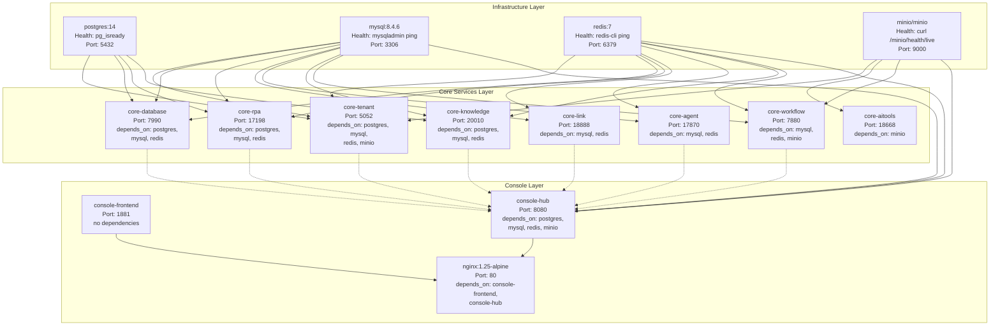
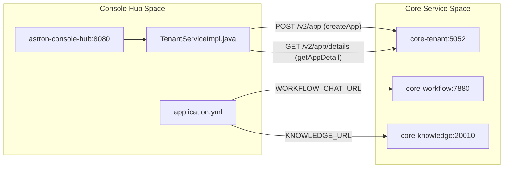
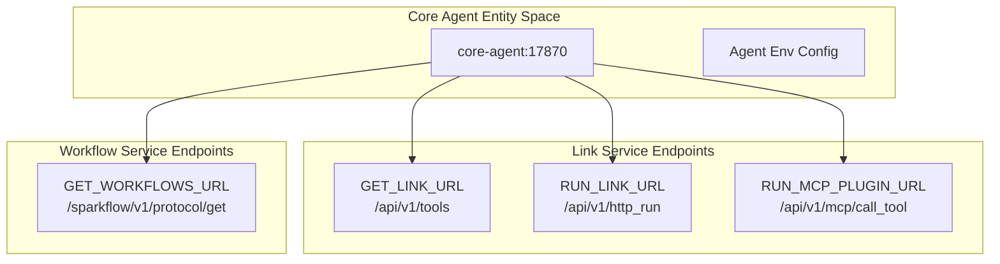

<!-- source: DeepWiki mcp.deepwiki.com · repo iflytek/astron-agent · page 3.1 Service Communication and Dependencies · fetched 2026-10-27 -->

# Service Communication and Dependencies

<details>
<summary>Relevant source files</summary>

The following files were used as context for generating this wiki page:

- [README.md](README.md)
- [console/backend/commons/src/main/java/com/iflytek/astron/console/commons/dto/bot/ChatBotApi.java](console/backend/commons/src/main/java/com/iflytek/astron/console/commons/dto/bot/ChatBotApi.java)
- [console/backend/hub/pom.xml](console/backend/hub/pom.xml)
- [console/backend/hub/src/main/java/com/iflytek/astron/console/hub/dto/publish/cbm/AssistantInfo.java](console/backend/hub/src/main/java/com/iflytek/astron/console/hub/dto/publish/cbm/AssistantInfo.java)
- [console/backend/hub/src/main/java/com/iflytek/astron/console/hub/dto/publish/cbm/CbmBody.java](console/backend/hub/src/main/java/com/iflytek/astron/console/hub/dto/publish/cbm/CbmBody.java)
- [console/backend/hub/src/main/java/com/iflytek/astron/console/hub/dto/publish/cbm/CbmForm.java](console/backend/hub/src/main/java/com/iflytek/astron/console/hub/dto/publish/cbm/CbmForm.java)
- [console/backend/hub/src/main/java/com/iflytek/astron/console/hub/dto/publish/cbm/CbmResponse.java](console/backend/hub/src/main/java/com/iflytek/astron/console/hub/dto/publish/cbm/CbmResponse.java)
- [console/backend/hub/src/main/java/com/iflytek/astron/console/hub/dto/publish/cbm/Options.java](console/backend/hub/src/main/java/com/iflytek/astron/console/hub/dto/publish/cbm/Options.java)
- [console/backend/hub/src/main/java/com/iflytek/astron/console/hub/dto/user/TenantAuth.java](console/backend/hub/src/main/java/com/iflytek/astron/console/hub/dto/user/TenantAuth.java)
- [console/backend/hub/src/main/java/com/iflytek/astron/console/hub/service/chat/ChatBotApiService.java](console/backend/hub/src/main/java/com/iflytek/astron/console/hub/service/chat/ChatBotApiService.java)
- [console/backend/hub/src/main/java/com/iflytek/astron/console/hub/service/chat/impl/ChatBotApiServiceImpl.java](console/backend/hub/src/main/java/com/iflytek/astron/console/hub/service/chat/impl/ChatBotApiServiceImpl.java)
- [console/backend/hub/src/main/java/com/iflytek/astron/console/hub/service/publish/TenantService.java](console/backend/hub/src/main/java/com/iflytek/astron/console/hub/service/publish/TenantService.java)
- [console/backend/hub/src/main/java/com/iflytek/astron/console/hub/service/publish/impl/TenantServiceImpl.java](console/backend/hub/src/main/java/com/iflytek/astron/console/hub/service/publish/impl/TenantServiceImpl.java)
- [console/backend/hub/src/main/resources/application.yml](console/backend/hub/src/main/resources/application.yml)
- [console/frontend/index.html](console/frontend/index.html)
- [console/frontend/public/runtime-config.js](console/frontend/public/runtime-config.js)
- [docker/astronAgent/.env.example](docker/astronAgent/.env.example)
- [docker/astronAgent/docker-compose.yaml](docker/astronAgent/docker-compose.yaml)
- [docker/astronAgent/nginx/nginx.conf](docker/astronAgent/nginx/nginx.conf)
- [docker/ragflow/docker-compose-macos.yml](docker/ragflow/docker-compose-macos.yml)
- [docs/CONFIGURATION.md](docs/CONFIGURATION.md)
- [docs/CONFIGURATION_zh.md](docs/CONFIGURATION_zh.md)
- [docs/CONTRIBUTING_CN.md](docs/CONTRIBUTING_CN.md)
- [docs/DEPLOYMENT_GUIDE.md](docs/DEPLOYMENT_GUIDE.md)
- [docs/DEPLOYMENT_GUIDE_zh.md](docs/DEPLOYMENT_GUIDE_zh.md)
- [docs/README-zh.md](docs/README-zh.md)

</details>


## Purpose and Scope

This document describes the communication patterns and dependency relationships between services in the Astron Agent platform. It covers the service startup sequence, health check mechanisms, inter-service API endpoints, network topology, and configuration management for service URLs.

The platform utilizes a microservices architecture where eight core services (`tenant`, `database`, `agent`, `workflow`, `knowledge`, `link`, `rpa`, `aitools`) interact with infrastructure components and a console layer.

---

## Service Dependency Graph

The platform enforces a strict dependency chain via `depends_on` in `docker-compose.yaml` to ensure services start in the correct order. Infrastructure services (databases, caching, storage) start first, followed by core services, and finally the console layer.

Title: System Service Dependency and Network Topology


Sources: [docker/astronAgent/docker-compose.yaml:1-504]()

---

## Health Check Configuration

All infrastructure and core services implement health checks that must pass before dependent services start. The health check configuration uses parameters defined in the environment.

| Parameter | Default Value | Description |
|-----------|--------------|-------------|
| `HEALTH_CHECK_INTERVAL` | `30s` | Time between health checks |
| `HEALTH_CHECK_TIMEOUT` | `10s` | Maximum time for health check to complete |
| `HEALTH_CHECK_RETRIES` | `60` | Number of retries before marking unhealthy |

### Health Check Commands by Service

| Service | Health Check Command | Configuration |
|---------|---------------------|---------------|
| `postgres` | `pg_isready -U ${POSTGRES_USER:-spark} -d sparkdb_manager` | [docker/astronAgent/docker-compose.yaml:22-25]() |
| `mysql` | `mysqladmin ping -h localhost` | [docker/astronAgent/docker-compose.yaml:40-43]() |
| `redis` | `redis-cli ${REDIS_PASSWORD:+-a "$REDIS_PASSWORD"} ping \| grep PONG` | [docker/astronAgent/docker-compose.yaml:56-59]() |
| `minio` | `curl -f http://localhost:9000/minio/health/live` | [docker/astronAgent/docker-compose.yaml:143-146]() |
| `nginx` | `curl -f http://localhost/nginx-health` | [docker/astronAgent/docker-compose.yaml:506-509]() |

Sources: [docker/astronAgent/docker-compose.yaml:21-59](), [docker/astronAgent/docker-compose.yaml:142-146](), [docker/astronAgent/docker-compose.yaml:505-509]()

---

## Inter-Service Communication Patterns

Services communicate exclusively over HTTP using container DNS names within the `astron-agent-network` bridge network. Service URLs are configured via environment variables.

### Core Service URL Configuration

The following table maps environment variables to their default service endpoints as defined in the global `.env` configuration:

| Service | Environment Variable | Default Value | Configured In |
|---------|---------------------|---------------|---------------|
| core-tenant | `APP_URL` | `http://core-tenant:5052/v2/app` | [docker/astronAgent/.env.example:269]() |
| core-database | `SPARK_DB_URL` | `http://core-database:7990` | [docker/astronAgent/.env.example:274]() |
| core-knowledge | `KNOWLEDGE_URL` | `http://core-knowledge:20010/knowledge` | [docker/astronAgent/.env.example:270]() |
| core-link | `TOOL_URL` | `http://core-link:18888` | [docker/astronAgent/.env.example:271]() |
| core-rpa | `TOOL_RPA_URL` | `http://core-rpa:17198` | [docker/astronAgent/.env.example:272]() |
| core-workflow | `WORKFLOW_URL` | `http://core-workflow:7880` | [docker/astronAgent/.env.example:273]() |

### Console Hub Service Integration

The `console-hub` service (Java Spring Boot) acts as the primary orchestrator for user-facing actions. It integrates with core services via its application configuration and the `TenantServiceImpl` class.

Title: Console Hub to Core Service Mapping


**Key environment variables** ([console/backend/hub/src/main/resources/application.yml:153-194](), [docker/astronAgent/.env.example:251-274]()):

- `WORKFLOW_CHAT_URL`: `http://core-workflow:7880/workflow/v1/chat/completions`
- `WORKFLOW_DEBUG_URL`: `http://core-workflow:7880/workflow/v1/debug/chat/completions`
- `WORKFLOW_RESUME_URL`: `http://core-workflow:7880/workflow/v1/resume`
- `TENANT_CREATE_APP`: Configured via `@Value("${tenant.create-app}")` in `TenantServiceImpl` [console/backend/hub/src/main/java/com/iflytek/astron/console/hub/service/publish/impl/TenantServiceImpl.java:24-25]()
- `TENANT_GET_APP_DETAIL`: Configured via `@Value("${tenant.get-app-detail}")` in `TenantServiceImpl` [console/backend/hub/src/main/java/com/iflytek/astron/console/hub/service/publish/impl/TenantServiceImpl.java:27-28]()

Sources: [docker/astronAgent/.env.example:251-303](), [console/backend/hub/src/main/resources/application.yml:153-194](), [console/backend/hub/src/main/java/com/iflytek/astron/console/hub/service/publish/impl/TenantServiceImpl.java:1-101]()

---

## Core Agent Service Dependencies

The `core-agent` service coordinates workflow and plugin execution, requiring direct access to link, workflow, and knowledge services.

Title: Agent Service Runtime Dependencies


**Environment variable configuration for Agent service** ([docker/astronAgent/.env.example:161-176]()):

| Variable | Default Value | Purpose |
|----------|--------------|---------|
| `GET_LINK_URL` | `http://core-link:18888/api/v1/tools` | Retrieve tool definitions |
| `VERSIONS_LINK_URL` | `http://core-link:18888/api/v1/tools/versions` | Get tool versions |
| `RUN_LINK_URL` | `http://core-link:18888/api/v1/tools/http_run` | Execute HTTP tools |
| `LIST_MCP_PLUGIN_URL` | `http://core-link:18888/api/v1/mcp/tool_list` | List MCP plugins |
| `RUN_MCP_PLUGIN_URL` | `http://core-link:18888/api/v1/mcp/call_tool` | Execute MCP tools |
| `GET_WORKFLOWS_URL` | `http://core-workflow:7880/sparkflow/v1/protocol/get` | Retrieve workflow definitions |
| `CHUNK_QUERY_URL` | `http://core-knowledge:20010/knowledge/v1/chunk/query` | Query knowledge chunks |
| `APP_AUTH_HOST` | `core-tenant:5052` | App authentication service |

Sources: [docker/astronAgent/.env.example:160-176]()

---

## Network Architecture and Reverse Proxy

### Docker Bridge Network

All services communicate over a single bridge network named `astron-agent-network` ([docker/astronAgent/docker-compose.yaml:636-638]()):

```yaml
networks:
  astron-agent-network:
    driver: bridge
```

### Nginx Reverse Proxy Routing

The `nginx` service provides a unified HTTP entry point on port 80, routing requests to backend services based on path prefixes. It is specifically configured to handle standard API requests as well as Server-Sent Events (SSE) for real-time streaming.

**Key routing rules** ([docker/astronAgent/nginx/nginx.conf]()):

| Path Prefix | Destination | Special Handling |
|------|------------|------------------|
| `/runtime-config.js` | `console-frontend:1881` | No cache, dynamic config injection ([nginx.conf:55-66]()) |
| `/workflow/v1/chat/completions` | `core-workflow:7880` | SSE with `proxy_buffering off` ([nginx.conf:81-106]()) |
| `/console-api/chat-message/` | `console-hub:8080` | SSE for chat history/messages ([nginx.conf:125-150]()) |
| `/console-api/` | `console-hub:8080` | Standard backend API proxy ([nginx.conf:153-164]()) |
| `/` | `console-frontend:1881` | Default frontend React application ([nginx.conf:167-178]()) |

**SSE Configuration for Streaming Endpoints:**

Streaming endpoints use specific settings to prevent Nginx from buffering the response, ensuring low latency for AI responses ([docker/astronAgent/nginx/nginx.conf:89-105]()):

```nginx
proxy_buffering off;
proxy_cache off;
proxy_set_header Connection '';
proxy_http_version 1.1;
chunked_transfer_encoding on;
proxy_set_header X-Accel-Buffering no;
proxy_read_timeout 1800s;
```

Sources: [docker/astronAgent/nginx/nginx.conf:1-187]()

---

## Service-Specific Configuration Management

Core services utilize `config.env` or `config.toml` files for internal configuration, mounted as volumes in Docker.

| Service | Config File Path | Volume Mount |
|---------|-----------------|--------------|
| core-tenant | `config/tenant/config.toml` | `/opt/tenant/config/config.toml` |
| core-database | `config/database/config.env` | `/opt/core/memory/database/config.env` |
| core-knowledge | `config/knowledge/config.env` | `/opt/core/knowledge/config.env` |
| core-link | `config/link/config.env` | `/opt/core/link/config.env` |
| core-aitools | `config/aitools/config.env` | `/opt/core/aitools/config.env` |

Sources: [docker/astronAgent/docker-compose.yaml:188-189](), [docker/astronAgent/docker-compose.yaml:212-213](), [docker/astronAgent/docker-compose.yaml:262-263]()

---

## Service Authentication and Security

### Tenant Service App Authentication

Internal core services authenticate against `core-tenant` using pre-shared API keys and secrets configured in the environment ([docker/astronAgent/.env.example:173-176]()):
- `APP_AUTH_HOST`: `core-tenant:5052`
- `APP_AUTH_API_KEY`: `7b709739e8da44536127a333c7603a83`
- `APP_AUTH_SECRET`: `NjhmY2NmM2NkZDE4MDFlNmM5ZjcyZjMy`

### Console Hub OAuth2 Configuration

The `console-hub` service validates JWTs issued by Casdoor for user authentication ([console/backend/hub/src/main/resources/application.yml:53-60]()):

```yaml
spring:
  security:
    oauth2:
      resourceserver:
        jwt:
          issuer-uri: ${OAUTH2_ISSUER_URI:http://auth-server:8000}
          jwk-set-uri: ${OAUTH2_JWK_SET_URI:http://auth-server:8000/.well-known/jwks}
```

Sources: [docker/astronAgent/.env.example:173-176](), [console/backend/hub/src/main/resources/application.yml:53-60]()

---

## Observability and Telemetry Communication

### OTLP Configuration

Services report traces and metrics via the OpenTelemetry Protocol (OTLP) to a collector ([docker/astronAgent/.env.example:69-80]()):

```env
OTLP_ENABLE=0
OTLP_ENDPOINT=127.0.0.1:4317
OTLP_METRIC_EXPORT_INTERVAL_MILLIS=3000
```

### Kafka Event Streaming

Kafka is used for asynchronous event-driven communication, specifically for agent and workflow updates ([docker/astronAgent/.env.example:159, 187]()):

- `AGENT_KAFKA_TOPIC`: `spark-agent-builder`
- `WORKFLOW_KAFKA_TOPIC`: `spark-agent-builder`

Sources: [docker/astronAgent/.env.example:47-80](), [docker/astronAgent/.env.example:159-187]()

---

## External Service Integration Points

### MaaS Platform Integration

The platform integrates with an external MaaS provider for workflow execution and publishing synchronization ([console/backend/hub/src/main/resources/application.yml:176-193]()):

- `MAAS_PUBLISH_API`: `http://localhost:7880/workflow/v1/publish`
- `MAAS_AUTH_API`: `http://localhost:7880/workflow/v1/auth`
- `MAAS_MCP_HOST`: `https://xingchen-api.xf-yun.com/mcp/xingchen/flow/%s/sse`

### RPA Cloud Platform

RPA tasks are delegated to an external cloud platform via the `core-rpa` service ([docker/astronAgent/.env.example:136-141]()):

- `RPA_URL`: `https://newapi.iflyrpa.com`
- `XIAOWU_RPA_TASK_CREATE_URL`: `${RPA_URL}/api/rpa-openapi/workflows/execute-async`

Sources: [console/backend/hub/src/main/resources/application.yml:176-193](), [docker/astronAgent/.env.example:136-141]()

---

