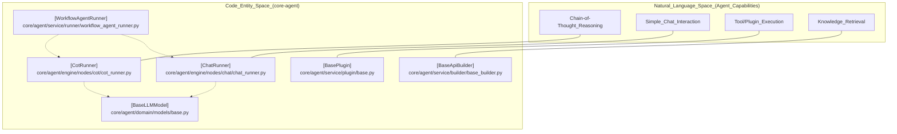
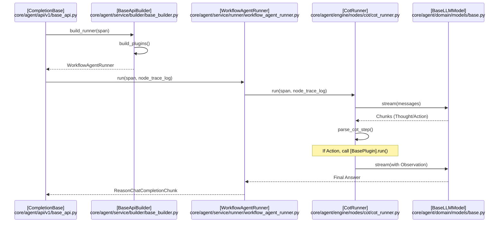

<!-- source: DeepWiki mcp.deepwiki.com · repo iflytek/astron-agent · page 3.3 Agent Runtime Service · fetched 2026-10-27 -->

# Agent Runtime Service

Relevant source files

The following files were used as context for generating this wiki page:

- [core/agent/Dockerfile](core/agent/Dockerfile)
- [core/agent/api/schemas/base_inputs.py](core/agent/api/schemas/base_inputs.py)
- [core/agent/api/schemas/completion_chunk.py](core/agent/api/schemas/completion_chunk.py)
- [core/agent/api/v1/base_api.py](core/agent/api/v1/base_api.py)
- [core/agent/config.env](core/agent/config.env)
- [core/agent/domain/models/base.py](core/agent/domain/models/base.py)
- [core/agent/engine/nodes/base.py](core/agent/engine/nodes/base.py)
- [core/agent/engine/nodes/chat/chat_runner.py](core/agent/engine/nodes/chat/chat_runner.py)
- [core/agent/engine/nodes/cot/cot_runner.py](core/agent/engine/nodes/cot/cot_runner.py)
- [core/agent/engine/nodes/cot_process/cot_process_runner.py](core/agent/engine/nodes/cot_process/cot_process_runner.py)
- [core/agent/main.py](core/agent/main.py)
- [core/agent/pyproject.toml](core/agent/pyproject.toml)
- [core/agent/service/builder/base_builder.py](core/agent/service/builder/base_builder.py)
- [core/agent/service/plugin/knowledge.py](core/agent/service/plugin/knowledge.py)
- [core/agent/service/plugin/link.py](core/agent/service/plugin/link.py)
- [core/agent/service/plugin/mcp.py](core/agent/service/plugin/mcp.py)
- [core/agent/service/plugin/workflow.py](core/agent/service/plugin/workflow.py)
- [core/agent/service/runner/workflow_agent_runner.py](core/agent/service/runner/workflow_agent_runner.py)
- [core/agent/tests/test_base_builder.py](core/agent/tests/test_base_builder.py)
- [core/agent/tests/test_base_llm_model.py](core/agent/tests/test_base_llm_model.py)
- [core/agent/tests/test_runner_base_and_chat_cot.py](core/agent/tests/test_runner_base_and_chat_cot.py)
- [core/agent/uv.lock](core/agent/uv.lock)
- [core/common/service/oss/s3_service.py](core/common/service/oss/s3_service.py)
- [core/plugin/aitools/pyproject.toml](core/plugin/aitools/pyproject.toml)
- [core/plugin/aitools/uv.lock](core/plugin/aitools/uv.lock)

The Agent Runtime Service (`core-agent`) is the execution engine for AI agents in the Astron Agent platform. It orchestrates agent workflows, manages tool invocations, integrates knowledge retrieval, and coordinates with other core services to execute agent tasks in real-time. This service runs as a Python FastAPI application and serves as the runtime layer between bot configurations (managed by console-hub) and actual execution capabilities (tools, workflows, knowledge bases).

For bot lifecycle management and configuration, see [5.1 Bot Creation and Configuration](). For workflow orchestration details, see [4.1 Workflow Architecture and MaaS Integration](). For tool execution mechanisms, see [6.2 Tool Execution Service]().

---

## Service Overview

### Architecture Components

The agent service implements a microservice architecture pattern with clear separation between execution, integration, and observability layers. It is built using FastAPI and managed with the `uv` package manager [core/agent/main.py:47-68]().

**Astron Agent Service Component Bridge**

**Sources**: [core/agent/domain/models/base.py:15-118](), [core/agent/service/builder/base_builder.py:43-209](), [core/agent/engine/nodes/base.py:19-137](), [core/agent/engine/nodes/cot/cot_runner.py:33-42](), [core/agent/service/runner/workflow_agent_runner.py:23-31]()

---

## Agent Execution Framework

### The Builder Pattern

The service uses a builder pattern to construct agent runners based on incoming request parameters. The `BaseApiBuilder` class [core/agent/service/builder/base_builder.py:43]() provides the foundation for creating LLM models, building plugins, and initializing runners.

*   **Plugin Construction**: `build_plugins` [core/agent/service/builder/base_builder.py:80-137]() orchestrates the creation of `LinkPlugin`, `McpPlugin`, and `WorkflowPlugin` instances by calling their respective factories [core/agent/service/builder/base_builder.py:93-119]().
*   **Runner Initialization**: It supports creating `ChatRunner` for standard conversational tasks [core/agent/service/builder/base_builder.py:139-165]() and `CotRunner` for complex reasoning tasks requiring tool use [core/agent/service/builder/base_builder.py:166-205]().
*   **HTTP Client Management**: The builder provides a centralized `_create_http_client` [core/agent/service/builder/base_builder.py:61-78]() that handles SSL verification settings (configurable via `SKIP_SSL_VERIFY`) and connection pooling for external LLM requests.
*   **Workflow Specifics**: `WorkflowAgentRunnerBuilder` [core/agent/service/builder/workflow_agent_builder.py:32]() extends the base builder to handle specialized knowledge queries [core/agent/service/builder/workflow_agent_builder.py:91-112]() and complex instruction mapping for reasoning and answering [core/agent/service/builder/workflow_agent_builder.py:56-82]().

**Sources**: [core/agent/service/builder/base_builder.py:43-209](), [core/agent/service/builder/workflow_agent_builder.py:32-89](), [core/agent/service/plugin/link.py:1-20]()

### Runner Execution Logic

Runners inherit from `RunnerBase` [core/agent/engine/nodes/base.py:19](). The execution flow generally involves:
1.  **Prompt Construction**: Building system and user prompts using templates like `COT_SYSTEM_TEMPLATE` and `COT_USER_TEMPLATE` [core/agent/engine/nodes/cot/cot_runner.py:44-69]().
2.  **LLM Streaming**: Invoking the LLM via `model.stream` and processing the response stream [core/agent/engine/nodes/base.py:36-137]().
3.  **Chain of Thought (CoT)**: For `CotRunner`, a loop of "Thought -> Action -> Observation" is executed [core/agent/engine/nodes/cot/cot_runner.py:149-210]().
4.  **Action Parsing**: `_parse_action_and_input` [core/agent/engine/nodes/cot/cot_runner.py:80-99]() extracts the tool name and arguments from the LLM's reasoning output.

**Workflow Execution Sequence**

**Sources**: [core/agent/api/v1/base_api.py:105-187](), [core/agent/engine/nodes/cot/cot_runner.py:149-210](), [core/agent/service/runner/workflow_agent_runner.py:35-54](), [core/agent/engine/nodes/base.py:36-137]()

---

## Plugin and Tool Integration

The agent service integrates external capabilities as "Plugins". These are dynamically built during the runner construction phase.

| Plugin Type | Class | Backend Service | Purpose |
| :--- | :--- | :--- | :--- |
| **Link** | `LinkPlugin` | `core-link` | Standard HTTP tool execution [core/agent/service/plugin/link.py]() |
| **MCP** | `McpPlugin` | `core-link` | Model Context Protocol tools [core/agent/service/plugin/mcp.py:15-19]() |
| **Workflow** | `WorkflowPlugin` | `core-workflow` | Complex multi-step workflow execution [core/agent/service/plugin/workflow.py]() |
| **Knowledge** | `KnowledgePlugin` | `core-knowledge` | RAG-based document retrieval [core/agent/service/plugin/knowledge.py]() |

The `BaseApiBuilder.build_plugins` method [core/agent/service/builder/base_builder.py:80-137]() handles the instantiation of these plugins. For knowledge integration in workflows, `WorkflowAgentRunnerBuilder` performs a parallel query across multiple repositories (AIUI, CBG, Ragflow) using `asyncio.gather` [core/agent/service/builder/workflow_agent_builder.py:91-112]().

**Sources**: [core/agent/service/builder/base_builder.py:80-123](), [core/agent/service/builder/workflow_agent_builder.py:114-164](), [core/agent/service/plugin/mcp.py:15-140]()

---

## LLM Provider Abstraction

The `BaseLLMModel` [core/agent/domain/models/base.py:15]() provides a unified interface for different LLM providers. It handles:
*   **Request Configuration**: Timeouts and max token limits via environment variables `DEFAULT_LLM_TIMEOUT` and `DEFAULT_LLM_MAX_TOKEN` [core/agent/domain/models/base.py:21-37]().
*   **Streaming**: Standardized `stream` method that yields chunks and logs events to OpenTelemetry spans [core/agent/domain/models/base.py:94-118]().
*   **Normalization**: `ProviderLLMModel` [core/agent/domain/models/base.py:141]() uses `CompatChunk` to normalize disparate API responses (like Anthropic or OpenAI) into a unified internal format [core/agent/domain/models/base.py:155-166]().
*   **Error Handling**: Specialized handling for timeouts (`APITimeoutError`), API errors (`APIError`), and SSL/connection issues [core/agent/domain/models/base.py:47-92]().

**Sources**: [core/agent/domain/models/base.py:15-118](), [core/agent/domain/models/base.py:141-193](), [core/agent/service/builder/base_builder.py:12-16]()

---

## Observability and Tracing

The service utilizes a sophisticated tracing system. Every execution step is wrapped in a `Span` [core/agent/api/v1/base_api.py:109]().

*   **Node Tracing**: `NodeTraceLog` [core/agent/api/v1/base_api.py:41]() records the execution details of each "node" (e.g., LLM call, tool invocation).
*   **Token Usage**: Token consumption is tracked across chunks via `Usage` objects [core/agent/engine/nodes/base.py:57-73](). The `CompletionBase.run_runner` method aggregates these usages from the `node_trace_log` into the final response chunk [core/agent/api/v1/base_api.py:147-171]().
*   **Metrics**: `Meter` [core/agent/api/v1/base_api.py:80]() tracks application-level metrics such as error counts [core/agent/api/v1/base_api.py:181]().
*   **Detailed Logging**: Prompt inputs, model outputs, and plugin parameters are logged as info events in the OTLP spans [core/agent/service/builder/base_builder.py:143-209]().

**Sources**: [core/agent/api/v1/base_api.py:11-13](), [core/agent/api/v1/base_api.py:105-187](), [core/agent/engine/nodes/base.py:57-127](), [core/agent/service/builder/base_builder.py:143-209]()

---

