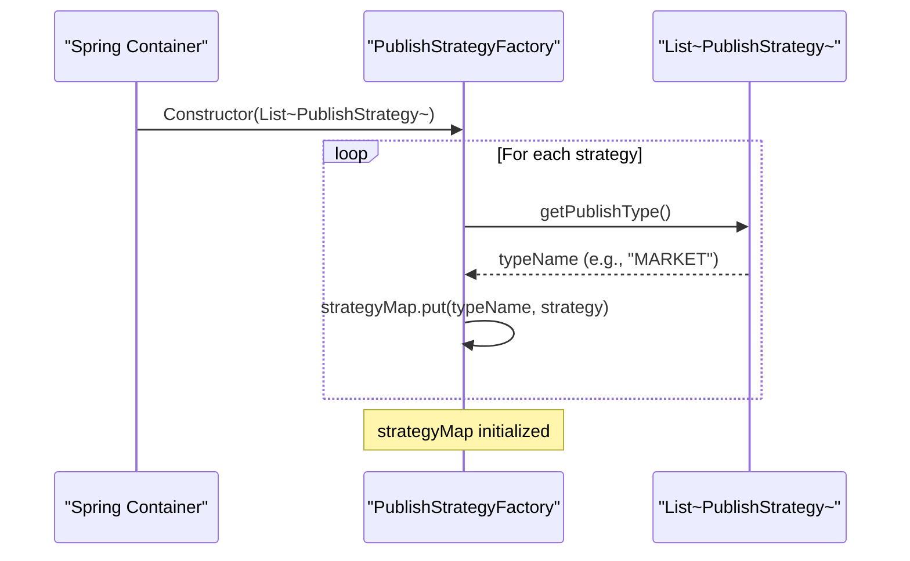
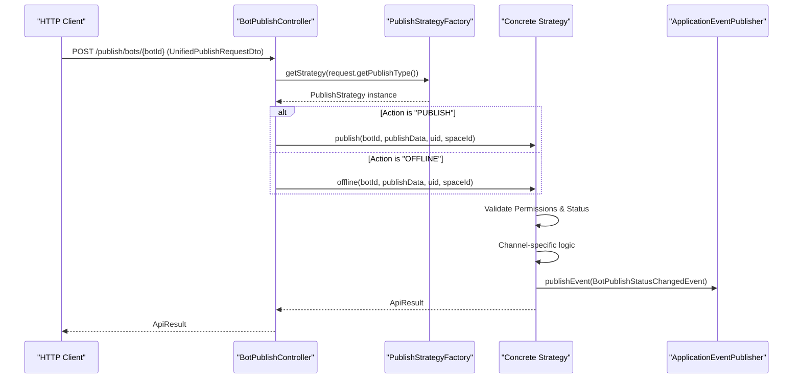

<!-- source: DeepWiki mcp.deepwiki.com · repo iflytek/astron-agent · page 4.3 Multi-Channel Publishing Strategy · fetched 2026-10-27 -->

# Multi-Channel Publishing Strategy

<details>
<summary>Relevant source files</summary>

The following files were used as context for generating this wiki page:

- [console/backend/commons/src/main/java/com/iflytek/astron/console/commons/util/MaasUtil.java](console/backend/commons/src/main/java/com/iflytek/astron/console/commons/util/MaasUtil.java)
- [console/backend/hub/src/main/java/com/iflytek/astron/console/hub/controller/publish/BotPublishController.java](console/backend/hub/src/main/java/com/iflytek/astron/console/hub/controller/publish/BotPublishController.java)
- [console/backend/hub/src/main/java/com/iflytek/astron/console/hub/controller/wechat/WechatCallbackController.java](console/backend/hub/src/main/java/com/iflytek/astron/console/hub/controller/wechat/WechatCallbackController.java)
- [console/backend/hub/src/main/java/com/iflytek/astron/console/hub/dto/publish/UnifiedPrepareDto.java](console/backend/hub/src/main/java/com/iflytek/astron/console/hub/dto/publish/UnifiedPrepareDto.java)
- [console/backend/hub/src/main/java/com/iflytek/astron/console/hub/dto/publish/prepare/ApiPrepareDto.java](console/backend/hub/src/main/java/com/iflytek/astron/console/hub/dto/publish/prepare/ApiPrepareDto.java)
- [console/backend/hub/src/main/java/com/iflytek/astron/console/hub/dto/publish/prepare/BasePrepareDto.java](console/backend/hub/src/main/java/com/iflytek/astron/console/hub/dto/publish/prepare/BasePrepareDto.java)
- [console/backend/hub/src/main/java/com/iflytek/astron/console/hub/dto/publish/prepare/FeishuPrepareDto.java](console/backend/hub/src/main/java/com/iflytek/astron/console/hub/dto/publish/prepare/FeishuPrepareDto.java)
- [console/backend/hub/src/main/java/com/iflytek/astron/console/hub/dto/publish/prepare/MarketPrepareDto.java](console/backend/hub/src/main/java/com/iflytek/astron/console/hub/dto/publish/prepare/MarketPrepareDto.java)
- [console/backend/hub/src/main/java/com/iflytek/astron/console/hub/dto/publish/prepare/McpPrepareDto.java](console/backend/hub/src/main/java/com/iflytek/astron/console/hub/dto/publish/prepare/McpPrepareDto.java)
- [console/backend/hub/src/main/java/com/iflytek/astron/console/hub/entity/BotConversationStats.java](console/backend/hub/src/main/java/com/iflytek/astron/console/hub/entity/BotConversationStats.java)
- [console/backend/hub/src/main/java/com/iflytek/astron/console/hub/listener/WorkflowBotPublishListener.java](console/backend/hub/src/main/java/com/iflytek/astron/console/hub/listener/WorkflowBotPublishListener.java)
- [console/backend/hub/src/main/java/com/iflytek/astron/console/hub/mapper/BotConversationStatsMapper.java](console/backend/hub/src/main/java/com/iflytek/astron/console/hub/mapper/BotConversationStatsMapper.java)
- [console/backend/hub/src/main/java/com/iflytek/astron/console/hub/service/publish/BotPublishService.java](console/backend/hub/src/main/java/com/iflytek/astron/console/hub/service/publish/BotPublishService.java)
- [console/backend/hub/src/main/java/com/iflytek/astron/console/hub/service/publish/McpService.java](console/backend/hub/src/main/java/com/iflytek/astron/console/hub/service/publish/McpService.java)
- [console/backend/hub/src/main/java/com/iflytek/astron/console/hub/service/publish/impl/BotPublishServiceImpl.java](console/backend/hub/src/main/java/com/iflytek/astron/console/hub/service/publish/impl/BotPublishServiceImpl.java)
- [console/backend/hub/src/main/java/com/iflytek/astron/console/hub/service/publish/impl/McpServiceImpl.java](console/backend/hub/src/main/java/com/iflytek/astron/console/hub/service/publish/impl/McpServiceImpl.java)
- [console/backend/hub/src/main/java/com/iflytek/astron/console/hub/service/wechat/WechatThirdpartyService.java](console/backend/hub/src/main/java/com/iflytek/astron/console/hub/service/wechat/WechatThirdpartyService.java)
- [console/backend/hub/src/main/java/com/iflytek/astron/console/hub/service/wechat/impl/WechatThirdpartyServiceImpl.java](console/backend/hub/src/main/java/com/iflytek/astron/console/hub/service/wechat/impl/WechatThirdpartyServiceImpl.java)
- [console/backend/hub/src/main/java/com/iflytek/astron/console/hub/service/workflow/WorkflowReleaseService.java](console/backend/hub/src/main/java/com/iflytek/astron/console/hub/service/workflow/WorkflowReleaseService.java)
- [console/backend/hub/src/main/java/com/iflytek/astron/console/hub/service/workflow/impl/WorkflowReleaseServiceImpl.java](console/backend/hub/src/main/java/com/iflytek/astron/console/hub/service/workflow/impl/WorkflowReleaseServiceImpl.java)
- [console/backend/hub/src/main/java/com/iflytek/astron/console/hub/strategy/publish/PublishStrategy.java](console/backend/hub/src/main/java/com/iflytek/astron/console/hub/strategy/publish/PublishStrategy.java)
- [console/backend/hub/src/main/java/com/iflytek/astron/console/hub/strategy/publish/PublishStrategyFactory.java](console/backend/hub/src/main/java/com/iflytek/astron/console/hub/strategy/publish/PublishStrategyFactory.java)
- [console/backend/hub/src/main/java/com/iflytek/astron/console/hub/strategy/publish/impl/ApiPublishStrategy.java](console/backend/hub/src/main/java/com/iflytek/astron/console/hub/strategy/publish/impl/ApiPublishStrategy.java)
- [console/backend/hub/src/main/java/com/iflytek/astron/console/hub/strategy/publish/impl/FeishuPublishStrategy.java](console/backend/hub/src/main/java/com/iflytek/astron/console/hub/strategy/publish/impl/FeishuPublishStrategy.java)
- [console/backend/hub/src/main/java/com/iflytek/astron/console/hub/strategy/publish/impl/MarketPublishStrategy.java](console/backend/hub/src/main/java/com/iflytek/astron/console/hub/strategy/publish/impl/MarketPublishStrategy.java)
- [console/backend/hub/src/main/java/com/iflytek/astron/console/hub/strategy/publish/impl/McpPublishStrategy.java](console/backend/hub/src/main/java/com/iflytek/astron/console/hub/strategy/publish/impl/McpPublishStrategy.java)
- [console/backend/hub/src/main/java/com/iflytek/astron/console/hub/strategy/publish/impl/WechatPublishStrategy.java](console/backend/hub/src/main/java/com/iflytek/astron/console/hub/strategy/publish/impl/WechatPublishStrategy.java)
- [console/backend/hub/src/main/java/com/iflytek/astron/console/hub/util/wechat/WXBizMsgCrypt.java](console/backend/hub/src/main/java/com/iflytek/astron/console/hub/util/wechat/WXBizMsgCrypt.java)
- [console/backend/hub/src/main/java/com/iflytek/astron/console/hub/util/wechat/XMLParse.java](console/backend/hub/src/main/java/com/iflytek/astron/console/hub/util/wechat/XMLParse.java)
- [console/backend/hub/src/main/resources/mapper/BotConversationStatsMapper.xml](console/backend/hub/src/main/resources/mapper/BotConversationStatsMapper.xml)

</details>


This document describes the strategy pattern implementation used for publishing bots to multiple channels in the Astron Agent platform. The system uses the Strategy design pattern to support publishing bots to different channels (Market, API, WeChat, MCP, Feishu) through a unified interface, with each channel having its own specialized publishing logic.

## System Architecture and Design Pattern

The multi-channel publishing system implements the **Strategy Pattern** to encapsulate channel-specific publishing logic. The pattern consists of:

- **Strategy Interface**: `PublishStrategy` defines the contract for all publishing strategies [console/backend/hub/src/main/java/com/iflytek/astron/console/hub/strategy/publish/PublishStrategy.java:9-40]().
- **Concrete Strategies**: One implementation per channel (Market, API, WeChat, MCP, Feishu).
- **Strategy Factory**: `PublishStrategyFactory` manages and provides strategy instances [console/backend/hub/src/main/java/com/iflytek/astron/console/hub/strategy/publish/PublishStrategyFactory.java:16-62]().
- **Context**: `BotPublishController` uses the factory to select and execute strategies [console/backend/hub/src/main/java/com/iflytek/astron/console/hub/controller/publish/BotPublishController.java:149-166]().

### Strategy Pattern Class Structure

```mermaid
classDiagram
    class "PublishStrategy" {
        <<interface>>
        +publish(botId, publishData, uid, spaceId) ApiResult
        +offline(botId, publishData, uid, spaceId) ApiResult
        +getPublishType() String
    }
    
    class "PublishStrategyFactory" {
        -Map~String,PublishStrategy~ strategyMap
        +getStrategy(publishType) PublishStrategy
        +isSupported(publishType) boolean
        +getSupportedTypes() Set~String~
    }
    
    class "MarketPublishStrategy" {
        -ChatBotBaseMapper chatBotBaseMapper
        -ChatBotMarketMapper chatBotMarketMapper
        -PublishChannelService publishChannelService
        -ApplicationEventPublisher eventPublisher
        +publish() ApiResult
        +offline() ApiResult
        +getPublishType() String
    }
    
    class "ApiPublishStrategy" {
        +publish() ApiResult
        +offline() ApiResult
        +getPublishType() String
    }
    
    class "WechatPublishStrategy" {
        -BotPublishService botPublishService
        +publish() ApiResult
        +offline() ApiResult
        +getPublishType() String
    }
    
    class "McpPublishStrategy" {
        +publish() ApiResult
        +offline() ApiResult
        +getPublishType() String
    }
    
    class "FeishuPublishStrategy" {
        +publish() ApiResult
        +offline() ApiResult
        +getPublishType() String
    }
    
    class "BotPublishController" {
        -BotPublishService botPublishService
        -PublishStrategyFactory publishStrategyFactory
        +unifiedPublish(botId, request) ApiResult
    }
    
    "PublishStrategy" <|.. "MarketPublishStrategy"
    "PublishStrategy" <|.. "ApiPublishStrategy"
    "PublishStrategy" <|.. "WechatPublishStrategy"
    "PublishStrategy" <|.. "McpPublishStrategy"
    "PublishStrategy" <|.. "FeishuPublishStrategy"
    
    "PublishStrategyFactory" o-- "PublishStrategy"
    "BotPublishController" --> "PublishStrategyFactory"
```

**Sources:** 
- [console/backend/hub/src/main/java/com/iflytek/astron/console/hub/strategy/publish/PublishStrategy.java:9-40]()
- [console/backend/hub/src/main/java/com/iflytek/astron/console/hub/strategy/publish/PublishStrategyFactory.java:16-62]()
- [console/backend/hub/src/main/java/com/iflytek/astron/console/hub/controller/publish/BotPublishController.java:50-55]()

## Strategy Interface Contract

The `PublishStrategy` interface defines a consistent contract for all publishing channels. Each strategy must implement two primary operations and declare its channel type.

| Method | Parameters | Return Type | Purpose |
|--------|------------|-------------|---------|
| `publish()` | `botId`, `publishData`, `currentUid`, `spaceId` | `ApiResult<Object>` | Publish bot to specific channel |
| `offline()` | `botId`, `publishData`, `currentUid`, `spaceId` | `ApiResult<Object>` | Take bot offline from channel |
| `getPublishType()` | None | `String` | Return channel identifier |

The `publishData` parameter is channel-specific. For example, `WechatPublishStrategy` parses this into a `WechatPublishData` object containing `appId` and `redirectUrl` [console/backend/hub/src/main/java/com/iflytek/astron/console/hub/strategy/publish/impl/WechatPublishStrategy.java:80-121]().

**Sources:**
- [console/backend/hub/src/main/java/com/iflytek/astron/console/hub/strategy/publish/PublishStrategy.java:9-40]()

## Channel Types and Strategy Mapping

The system maps strategy implementations to types defined in `ReleaseTypeEnum`:

- `MARKET` → `MarketPublishStrategy` [console/backend/hub/src/main/java/com/iflytek/astron/console/hub/strategy/publish/impl/MarketPublishStrategy.java:138-140]()
- `BOT_API` → `ApiPublishStrategy` [console/backend/hub/src/main/java/com/iflytek/astron/console/hub/strategy/publish/impl/ApiPublishStrategy.java:49-51]()
- `WECHAT` → `WechatPublishStrategy` [console/backend/hub/src/main/java/com/iflytek/astron/console/hub/strategy/publish/impl/WechatPublishStrategy.java:72-75]()
- `MCP` → `McpPublishStrategy` [console/backend/hub/src/main/java/com/iflytek/astron/console/hub/strategy/publish/impl/McpPublishStrategy.java:35-38]()
- `FEISHU` → `FeishuPublishStrategy` [console/backend/hub/src/main/java/com/iflytek/astron/console/hub/strategy/publish/impl/FeishuPublishStrategy.java:49-52]()

## Strategy Factory Implementation

The `PublishStrategyFactory` uses Spring's dependency injection to automatically collect all `PublishStrategy` implementations at startup via the constructor [console/backend/hub/src/main/java/com/iflytek/astron/console/hub/strategy/publish/PublishStrategyFactory.java:20-27]().

### Factory Initialization Sequence



**Sources:**
- [console/backend/hub/src/main/java/com/iflytek/astron/console/hub/strategy/publish/PublishStrategyFactory.java:16-62]()

## Unified Publishing Request Flow

The `BotPublishController` provides a `unifiedPublish` endpoint [console/backend/hub/src/main/java/com/iflytek/astron/console/hub/controller/publish/BotPublishController.java:135-145]().

### Complete Publishing Sequence



**Sources:**
- [console/backend/hub/src/main/java/com/iflytek/astron/console/hub/controller/publish/BotPublishController.java:135-178]()
- [console/backend/hub/src/main/java/com/iflytek/astron/console/hub/strategy/publish/impl/MarketPublishStrategy.java:40-93]()

## Market Publishing Strategy

`MarketPublishStrategy` handles publishing to the platform's internal bot marketplace.

**Key Logic:**
1. **Permission Check**: Uses `chatBotBaseMapper.checkBotPermission` [console/backend/hub/src/main/java/com/iflytek/astron/console/hub/strategy/publish/impl/MarketPublishStrategy.java:45-48]().
2. **Channel Management**: Updates the bot's channel bitmask via `publishChannelService.updatePublishChannels` [console/backend/hub/src/main/java/com/iflytek/astron/console/hub/strategy/publish/impl/MarketPublishStrategy.java:68-69]().
3. **Data Sync**: Synchronizes base bot configuration to the marketplace table via `handleBotMarketSync` [console/backend/hub/src/main/java/com/iflytek/astron/console/hub/strategy/publish/impl/MarketPublishStrategy.java:79-79]().
4. **Events**: Publishes `BotPublishStatusChangedEvent` to trigger downstream workflow versioning [console/backend/hub/src/main/java/com/iflytek/astron/console/hub/strategy/publish/impl/MarketPublishStrategy.java:82-84]().

**Sources:**
- [console/backend/hub/src/main/java/com/iflytek/astron/console/hub/strategy/publish/impl/MarketPublishStrategy.java:32-157]()

## WeChat Publishing Strategy

`WechatPublishStrategy` manages integration with WeChat Official Accounts.

**Logic Highlights:**
- **Auth URL Generation**: Instead of direct publishing, it returns a `WechatAuthUrlResponseDto` which the frontend uses to redirect the user to WeChat for account binding [console/backend/hub/src/main/java/com/iflytek/astron/console/hub/strategy/publish/impl/WechatPublishStrategy.java:35-42]().
- **Channel Update**: When taking a bot offline, it explicitly removes the WeChat channel from the bot's metadata [console/backend/hub/src/main/java/com/iflytek/astron/console/hub/strategy/publish/impl/WechatPublishStrategy.java:61-61]().
- **Callback Handling**: System events (verify tickets, authorization updates) are handled by `WechatCallbackController`.

**Sources:**
- [console/backend/hub/src/main/java/com/iflytek/astron/console/hub/strategy/publish/impl/WechatPublishStrategy.java:20-121]()
- [console/backend/hub/src/main/java/com/iflytek/astron/console/hub/service/publish/BotPublishService.java:127-128]()

## MCP Publishing Strategy

`McpPublishStrategy` implements the Model Context Protocol server publishing. While the strategy itself currently serves as a bridge [console/backend/hub/src/main/java/com/iflytek/astron/console/hub/strategy/publish/impl/McpPublishStrategy.java:18-38](), the underlying orchestration involves `McpService` and `MaasUtil`.

**Logic Highlights:**
- **Workflow Versioning**: For workflow-based bots, it generates a specific version frozen at the time of publication [console/backend/hub/src/main/java/com/iflytek/astron/console/hub/service/workflow/impl/WorkflowReleaseServiceImpl.java:76-137]().
- **Server Registration**: Interacts with external MaaS systems via `MaasUtil` to register the MCP host and release URL [console/backend/hub/src/main/java/com/iflytek/astron/console/commons/util/MaasUtil.java:81-85]().

**Sources:**
- [console/backend/hub/src/main/java/com/iflytek/astron/console/hub/strategy/publish/impl/McpPublishStrategy.java:15-38]()
- [console/backend/hub/src/main/java/com/iflytek/astron/console/commons/util/MaasUtil.java:43-167]()

## Workflow Versioning Integration

When a bot is published to any channel, the system often needs to freeze the current workflow state into a version. This is handled by `WorkflowReleaseServiceImpl`.

- **Event Listener**: `WorkflowBotPublishListener` listens for `BotPublishStatusChangedEvent` and triggers workflow release if the bot type is workflow or talk [console/backend/hub/src/main/java/com/iflytek/astron/console/hub/listener/WorkflowBotPublishListener.java:35-57]().
- **Version Generation**: The system retrieves the next version name using `getNextVersionName` which calls the MaaS platform [console/backend/hub/src/main/java/com/iflytek/astron/console/hub/service/workflow/impl/WorkflowReleaseServiceImpl.java:89-93]().
- **API Synchronization**: Once a version is created, it is synchronized to the API system via `syncToApiSystem` [console/backend/hub/src/main/java/com/iflytek/astron/console/hub/service/workflow/impl/WorkflowReleaseServiceImpl.java:123-123]().
- **Audit Update**: The audit result is automatically updated to "Success" in this simplified implementation [console/backend/hub/src/main/java/com/iflytek/astron/console/hub/service/workflow/impl/WorkflowReleaseServiceImpl.java:126-126]().

**Sources:**
- [console/backend/hub/src/main/java/com/iflytek/astron/console/hub/listener/WorkflowBotPublishListener.java:24-87]()
- [console/backend/hub/src/main/java/com/iflytek/astron/console/hub/service/workflow/impl/WorkflowReleaseServiceImpl.java:76-137]()

## Data Flow and Statistics

The publishing system is integrated with a statistics engine to track bot usage across channels.

- **Conversation Stats**: Every interaction is recorded in `bot_conversation_stats` via `recordDashboardCountLog` [console/backend/hub/src/main/java/com/iflytek/astron/console/hub/service/publish/BotPublishService.java:98-100]().
- **Summary Analytics**: The `BotConversationStatsMapper` provides aggregated views including total tokens, chats, and unique users [console/backend/hub/src/main/resources/mapper/BotConversationStatsMapper.xml:6-21]().
- **Time Series**: Daily usage trends are calculated for the dashboard [console/backend/hub/src/main/resources/mapper/BotConversationStatsMapper.xml:24-45]().

**Sources:**
- [console/backend/hub/src/main/java/com/iflytek/astron/console/hub/entity/BotConversationStats.java:18-139]()
- [console/backend/hub/src/main/resources/mapper/BotConversationStatsMapper.xml:1-47]()

## Implementation Status by Channel

| Channel | Strategy Class | Status | Core Logic |
|---------|---------------|--------|------------|
| **MARKET** | `MarketPublishStrategy` | ✅ Active | DB sync to `chat_bot_market` [console/backend/hub/src/main/java/com/iflytek/astron/console/hub/strategy/publish/impl/MarketPublishStrategy.java:32-38]() |
| **WECHAT** | `WechatPublishStrategy` | ✅ Active | OAuth URL generation & channel management [console/backend/hub/src/main/java/com/iflytek/astron/console/hub/strategy/publish/impl/WechatPublishStrategy.java:20-21]() |
| **MCP** | `McpPublishStrategy` | ⚠️ Stub | Logic placeholder [console/backend/hub/src/main/java/com/iflytek/astron/console/hub/strategy/publish/impl/McpPublishStrategy.java:18-32]() |
| **BOT_API** | `ApiPublishStrategy` | ⚠️ Stub | Logic placeholder [console/backend/hub/src/main/java/com/iflytek/astron/console/hub/strategy/publish/impl/ApiPublishStrategy.java:22-28]() |
| **FEISHU** | `FeishuPublishStrategy` | ⚠️ Stub | Logic placeholder [console/backend/hub/src/main/java/com/iflytek/astron/console/hub/strategy/publish/impl/FeishuPublishStrategy.java:22-28]() |

**Sources:**
- [console/backend/hub/src/main/java/com/iflytek/astron/console/hub/strategy/publish/impl/MarketPublishStrategy.java:32-38]()
- [console/backend/hub/src/main/java/com/iflytek/astron/console/hub/strategy/publish/impl/ApiPublishStrategy.java:16-17]()
- [console/backend/hub/src/main/java/com/iflytek/astron/console/hub/strategy/publish/impl/WechatPublishStrategy.java:20-21]()
- [console/backend/hub/src/main/java/com/iflytek/astron/console/hub/strategy/publish/impl/McpPublishStrategy.java:15-16]()
- [console/backend/hub/src/main/java/com/iflytek/astron/console/hub/strategy/publish/impl/FeishuPublishStrategy.java:16-17]()

---

