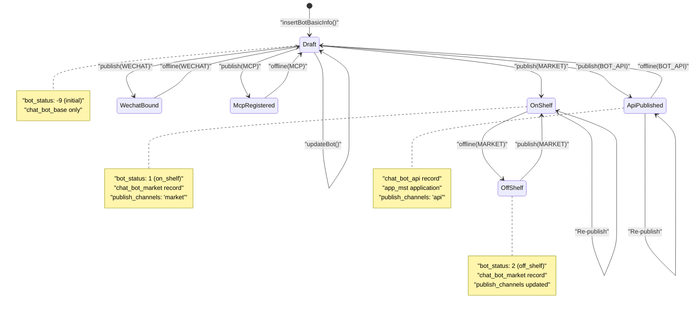
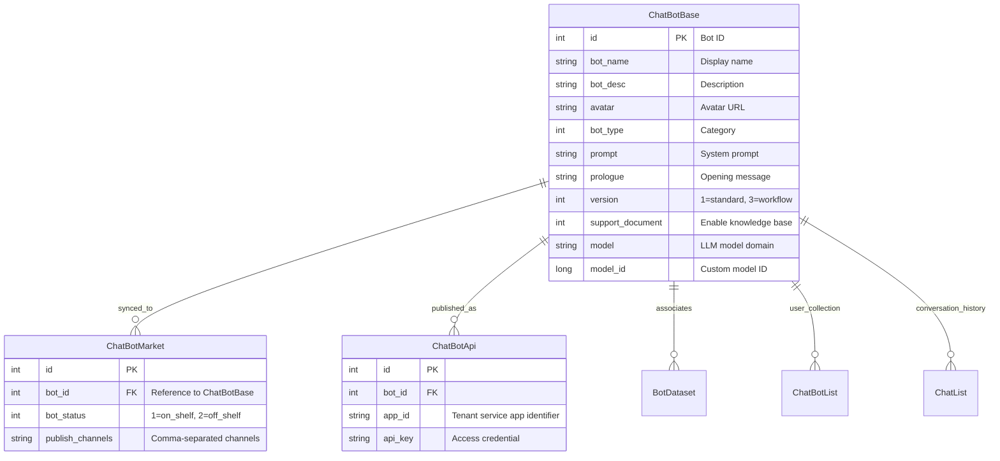
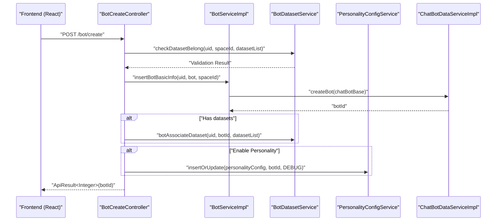

<!-- source: DeepWiki mcp.deepwiki.com · repo iflytek/astron-agent · page 5 Bot Lifecycle Management · fetched 2026-10-27 -->

# Bot Lifecycle Management

Relevant source files

The following files were used as context for generating this wiki page:

- [console/backend/commons/src/main/java/com/iflytek/astron/console/commons/constant/RedisKeyConstant.java](console/backend/commons/src/main/java/com/iflytek/astron/console/commons/constant/RedisKeyConstant.java)
- [console/backend/commons/src/main/java/com/iflytek/astron/console/commons/dto/bot/BotCreateForm.java](console/backend/commons/src/main/java/com/iflytek/astron/console/commons/dto/bot/BotCreateForm.java)
- [console/backend/commons/src/main/java/com/iflytek/astron/console/commons/entity/bot/BotTemplate.java](console/backend/commons/src/main/java/com/iflytek/astron/console/commons/entity/bot/BotTemplate.java)
- [console/backend/commons/src/main/java/com/iflytek/astron/console/commons/entity/bot/ChatBotBase.java](console/backend/commons/src/main/java/com/iflytek/astron/console/commons/entity/bot/ChatBotBase.java)
- [console/backend/commons/src/main/java/com/iflytek/astron/console/commons/enums/bot/DefaultBotModelEnum.java](console/backend/commons/src/main/java/com/iflytek/astron/console/commons/enums/bot/DefaultBotModelEnum.java)
- [console/backend/commons/src/main/java/com/iflytek/astron/console/commons/mapper/bot/BotTemplateMapper.java](console/backend/commons/src/main/java/com/iflytek/astron/console/commons/mapper/bot/BotTemplateMapper.java)
- [console/backend/commons/src/main/java/com/iflytek/astron/console/commons/service/bot/BotDatasetService.java](console/backend/commons/src/main/java/com/iflytek/astron/console/commons/service/bot/BotDatasetService.java)
- [console/backend/commons/src/main/java/com/iflytek/astron/console/commons/service/bot/BotService.java](console/backend/commons/src/main/java/com/iflytek/astron/console/commons/service/bot/BotService.java)
- [console/backend/commons/src/main/java/com/iflytek/astron/console/commons/service/bot/ChatBotDataService.java](console/backend/commons/src/main/java/com/iflytek/astron/console/commons/service/bot/ChatBotDataService.java)
- [console/backend/commons/src/main/java/com/iflytek/astron/console/commons/service/bot/impl/BotServiceImpl.java](console/backend/commons/src/main/java/com/iflytek/astron/console/commons/service/bot/impl/BotServiceImpl.java)
- [console/backend/commons/src/main/java/com/iflytek/astron/console/commons/service/bot/impl/ChatBotDataServiceImpl.java](console/backend/commons/src/main/java/com/iflytek/astron/console/commons/service/bot/impl/ChatBotDataServiceImpl.java)
- [console/backend/commons/src/main/java/com/iflytek/astron/console/commons/service/data/impl/ChatListDataServiceImpl.java](console/backend/commons/src/main/java/com/iflytek/astron/console/commons/service/data/impl/ChatListDataServiceImpl.java)
- [console/backend/commons/src/main/java/com/iflytek/astron/console/commons/service/workflow/WorkflowBotService.java](console/backend/commons/src/main/java/com/iflytek/astron/console/commons/service/workflow/WorkflowBotService.java)
- [console/backend/commons/src/main/java/com/iflytek/astron/console/commons/util/BotUtil.java](console/backend/commons/src/main/java/com/iflytek/astron/console/commons/util/BotUtil.java)
- [console/backend/commons/src/test/java/com/iflytek/astron/console/commons/service/bot/impl/ChatBotDataServiceImplTest.java](console/backend/commons/src/test/java/com/iflytek/astron/console/commons/service/bot/impl/ChatBotDataServiceImplTest.java)
- [console/backend/hub/src/main/java/com/iflytek/astron/console/hub/controller/bot/BotController.java](console/backend/hub/src/main/java/com/iflytek/astron/console/hub/controller/bot/BotController.java)
- [console/backend/hub/src/main/java/com/iflytek/astron/console/hub/controller/bot/BotCreateController.java](console/backend/hub/src/main/java/com/iflytek/astron/console/hub/controller/bot/BotCreateController.java)
- [console/backend/hub/src/main/java/com/iflytek/astron/console/hub/controller/user/MyBotController.java](console/backend/hub/src/main/java/com/iflytek/astron/console/hub/controller/user/MyBotController.java)
- [console/backend/hub/src/main/java/com/iflytek/astron/console/hub/dto/publish/CreateBotApiVo.java](console/backend/hub/src/main/java/com/iflytek/astron/console/hub/dto/publish/CreateBotApiVo.java)
- [console/backend/hub/src/main/java/com/iflytek/astron/console/hub/service/bot/BotAIService.java](console/backend/hub/src/main/java/com/iflytek/astron/console/hub/service/bot/BotAIService.java)
- [console/backend/hub/src/main/java/com/iflytek/astron/console/hub/service/bot/BotTransactionalService.java](console/backend/hub/src/main/java/com/iflytek/astron/console/hub/service/bot/BotTransactionalService.java)
- [console/backend/hub/src/main/java/com/iflytek/astron/console/hub/service/bot/impl/BotAIServiceImpl.java](console/backend/hub/src/main/java/com/iflytek/astron/console/hub/service/bot/impl/BotAIServiceImpl.java)
- [console/backend/hub/src/main/java/com/iflytek/astron/console/hub/service/workflow/BotChainService.java](console/backend/hub/src/main/java/com/iflytek/astron/console/hub/service/workflow/BotChainService.java)
- [console/backend/hub/src/main/java/com/iflytek/astron/console/hub/util/BotAIServiceClient.java](console/backend/hub/src/main/java/com/iflytek/astron/console/hub/util/BotAIServiceClient.java)
- [console/backend/hub/src/test/java/com/iflytek/astron/console/hub/data/impl/ChatDataServiceImplTest.java](console/backend/hub/src/test/java/com/iflytek/astron/console/hub/data/impl/ChatDataServiceImplTest.java)
- [console/backend/hub/src/test/java/com/iflytek/astron/console/hub/data/impl/ReqKnowledgeRecordsDataServiceImplTest.java](console/backend/hub/src/test/java/com/iflytek/astron/console/hub/data/impl/ReqKnowledgeRecordsDataServiceImplTest.java)
- [console/backend/hub/src/test/java/com/iflytek/astron/console/hub/data/impl/ShareDataServiceImplTest.java](console/backend/hub/src/test/java/com/iflytek/astron/console/hub/data/impl/ShareDataServiceImplTest.java)
- [console/backend/toolkit/src/main/java/com/iflytek/astron/console/toolkit/service/repo/MassDatasetInfoService.java](console/backend/toolkit/src/main/java/com/iflytek/astron/console/toolkit/service/repo/MassDatasetInfoService.java)

This document provides a comprehensive guide to bot creation, configuration, publishing, and version management across multiple channels. A bot in the Astron Agent platform progresses through several lifecycle stages: creation (draft), configuration, AI-assisted generation, publishing to various channels (marketplace, API, WeChat, MCP, Feishu), and version management for workflow bots.

---

## Bot Lifecycle Overview

### Lifecycle States and Transitions

Bots in the system exist in different states tracked by the `bot_status` field and progress through a structured lifecycle from creation to multi-channel publishing. The `BotService` and `ChatBotDataService` interfaces define the operations that drive these transitions.

**Bot Lifecycle State Machine**

**Status Code Mapping**

| Status Code | Name | Description | Table |
|------------|------|-------------|-------|
| -9 | Initial Draft | Bot created, not published | `chat_bot_base` |
| 1 | On Shelf | Published to marketplace | `chat_bot_market` |
| 2 | Off Shelf | Removed from marketplace | `chat_bot_market` |
| 4 | Published | Multi-channel published | `chat_bot_market` |

Sources: [console/backend/commons/src/main/java/com/iflytek/astron/console/commons/enums/ShelfStatusEnum.java:1-15](), [console/backend/commons/src/main/java/com/iflytek/astron/console/commons/enums/bot/BotStatusEnum.java:1-20](), [console/backend/commons/src/main/java/com/iflytek/astron/console/commons/service/bot/impl/ChatBotDataServiceImpl.java:21-22]()

### Database Schema Architecture

The platform uses a distributed data model where core bot definitions are stored in `chat_bot_base`, while publication-specific metadata resides in specialized tables like `chat_bot_market` and `chat_bot_api`.

**Bot Data Distribution Across Tables**

Sources: [console/backend/commons/src/main/java/com/iflytek/astron/console/commons/service/bot/impl/ChatBotDataServiceImpl.java:46-81](), [console/backend/commons/src/main/java/com/iflytek/astron/console/commons/entity/bot/ChatBotBase.java:1-100](), [console/backend/hub/src/main/java/com/iflytek/astron/console/hub/dto/publish/CreateBotApiVo.java:1-25]()

---

## Bot Creation and Configuration

### Creation Flow

Bot creation involves validating dataset ownership, setting basic info, and optionally configuring personality settings. The `BotService` handles the core logic while `BotCreateController` manages the API interface, ensuring multi-tenant isolation via `SpaceInfoUtil`.

**Bot Creation Request Flow**

For details on configuration options, model selection (e.g., Spark 4.0), and dataset associations, see [Bot Creation and Configuration](#5.1).

Sources: [console/backend/hub/src/main/java/com/iflytek/astron/console/hub/controller/bot/BotCreateController.java:82-122](), [console/backend/commons/src/main/java/com/iflytek/astron/console/commons/service/bot/impl/BotServiceImpl.java:189-210](), [console/backend/commons/src/main/java/com/iflytek/astron/console/commons/enums/bot/DefaultBotModelEnum.java:8-10]()

---

## AI-Assisted Bot Generation

The platform leverages iFLYTEK Spark APIs to assist users in creating bots through natural language or automated asset generation via the `BotAIService`.

### AI Generation Capabilities

- **One-Sentence Creation**: Generates a full bot profile (name, description, prompt, category) from a single user sentence using `BotAIService.sentenceBot` [console/backend/hub/src/main/java/com/iflytek/astron/console/hub/service/bot/impl/BotAIServiceImpl.java:283-343]().
- **Avatar Generation**: Uses Spark image generation APIs (`tti` endpoint) to create custom avatars based on the bot's persona [console/backend/hub/src/main/java/com/iflytek/astron/console/hub/util/BotAIServiceClient.java:127-187]().
- **Prologue & Examples**: Automatically generates opening messages and user input examples using formatted prompt templates retrieved via `AiPromptTemplateMapper` [console/backend/hub/src/main/java/com/iflytek/astron/console/hub/service/bot/impl/BotAIServiceImpl.java:62-102]().

**AI Generation Pipeline**

```mermaid
graph LR
    User["User Sentence"] --> BAI["BotAIServiceImpl.sentenceBot()"]
    BAI --> Prompt["BotAIServiceImpl.formatPrompt()"]
    Prompt --> Spark["BotAIServiceClient.generateText()"]
    Spark --> Parse["JSON Parsing"]
    Parse --> DTO["BotGenerationDTO"]
    DTO --> Avatar["BotAIServiceClient.generateImage()"]
    Avatar --> Final["Complete Bot Profile"]
```

For details on AI prompts, Spark API authentication, and input example generation logic, see [AI-Assisted Bot Generation](#5.2).

Sources: [console/backend/hub/src/main/java/com/iflytek/astron/console/hub/service/bot/impl/BotAIServiceImpl.java:283-343](), [console/backend/hub/src/main/java/com/iflytek/astron/console/hub/util/BotAIServiceClient.java:127-187](), [console/backend/hub/src/main/java/com/iflytek/astron/console/hub/service/bot/impl/BotAIServiceImpl.java:62-102]()

---

## Bot Templates and Personalities

The platform provides a template system and fine-grained personality configuration to standardize bot behavior and simplify the creation process for common use cases.

### Template and Personality Services

- **Template System**: `BotTemplateMapper` provides access to `BotTemplate` entities which define pre-configured bot structures, including structured prompts and input examples [console/backend/commons/src/main/java/com/iflytek/astron/console/commons/mapper/bot/BotTemplateMapper.java:14-22]().
- **Personality Config**: `PersonalityConfigService` manages advanced behavioral settings (tone, language style) stored in a separate configuration layer [console/backend/hub/src/main/java/com/iflytek/astron/console/hub/controller/bot/BotCreateController.java:72-73]().
- **Bot Types**: `BotTypeListService` categorizes bots (e.g., Assistant, Tool, Knowledge) for marketplace organization [console/backend/commons/src/main/java/com/iflytek/astron/console/commons/service/bot/impl/BotServiceImpl.java:121-135]().

For details on the `BotTemplate` entity structure and template-based bot creation, see [Bot Templates and Personalities](#5.3).

Sources: [console/backend/commons/src/main/java/com/iflytek/astron/console/commons/entity/bot/BotTemplate.java:19-59](), [console/backend/commons/src/main/java/com/iflytek/astron/console/commons/mapper/bot/BotTemplateMapper.java:14-22](), [console/backend/hub/src/main/java/com/iflytek/astron/console/hub/controller/bot/BotCreateController.java:72-73]()

---

## Bot Data Models and Schema

The bot system relies on a set of core database entities managed primarily through MyBatis Plus mappers in the `commons` module.

### Core Entities

- **ChatBotBase**: The primary record for any bot, containing its core definition and configuration [console/backend/commons/src/main/java/com/iflytek/astron/console/commons/service/bot/impl/ChatBotDataServiceImpl.java:161-180]().
- **ChatBotMarket**: Tracks bots published to the marketplace, including popularity metrics and shelf status [console/backend/commons/src/main/java/com/iflytek/astron/console/commons/service/bot/ChatBotDataService.java:120-133]().
- **ChatBotList**: Manages the "My Bots" collection for individual users [console/backend/commons/src/main/java/com/iflytek/astron/console/commons/service/bot/impl/ChatBotDataServiceImpl.java:141-153]().
- **BotDataset**: Manages the associations between bots and knowledge base datasets [console/backend/commons/src/main/java/com/iflytek/astron/console/commons/service/bot/impl/ChatBotDataServiceImpl.java:56-57]().

For a detailed breakdown of the database schema, field mappings, and relationships between these entities, see [Bot Data Models and Schema](#5.4).

Sources: [console/backend/commons/src/main/java/com/iflytek/astron/console/commons/service/bot/impl/ChatBotDataServiceImpl.java:46-81](), [console/backend/commons/src/main/java/com/iflytek/astron/console/commons/service/data/impl/ChatListDataServiceImpl.java:32-36]()

---

