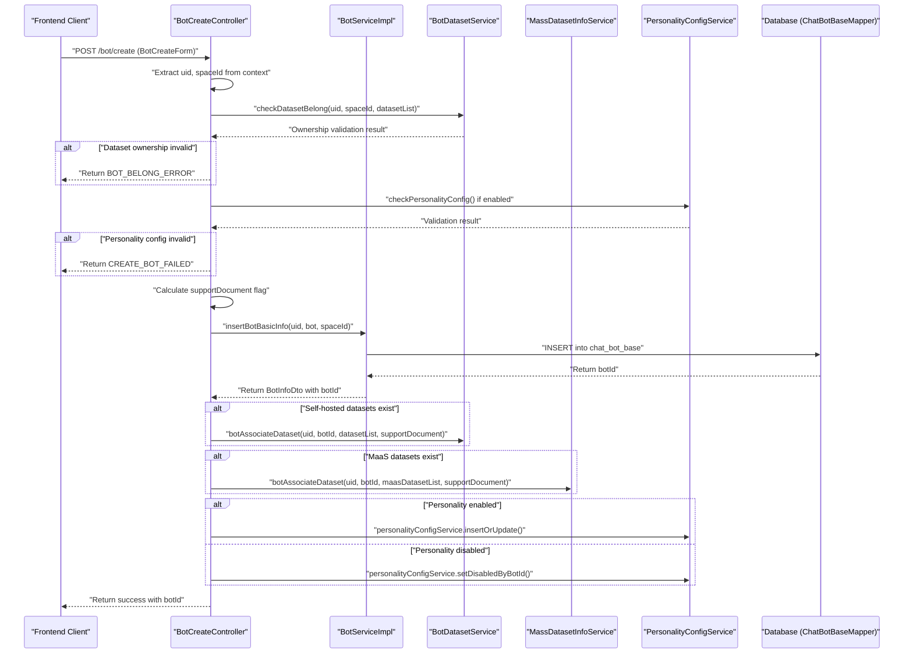
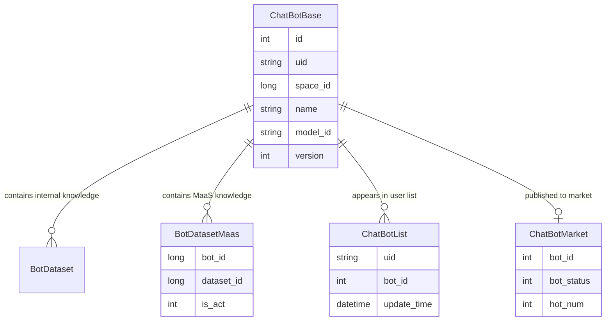

<!-- source: DeepWiki mcp.deepwiki.com · repo iflytek/astron-agent · page 5.1 Bot Creation and Configuration · fetched 2026-10-27 -->

# Bot Creation and Configuration

<details>
<summary>Relevant source files</summary>

The following files were used as context for generating this wiki page:

- [console/backend/commons/src/main/java/com/iflytek/astron/console/commons/constant/RedisKeyConstant.java](console/backend/commons/src/main/java/com/iflytek/astron/console/commons/constant/RedisKeyConstant.java)
- [console/backend/commons/src/main/java/com/iflytek/astron/console/commons/dto/bot/BotCreateForm.java](console/backend/commons/src/main/java/com/iflytek/astron/console/commons/dto/bot/BotCreateForm.java)
- [console/backend/commons/src/main/java/com/iflytek/astron/console/commons/entity/bot/BotTemplate.java](console/backend/commons/src/main/java/com/iflytek/astron/console/commons/entity/bot/BotTemplate.java)
- [console/backend/commons/src/main/java/com/iflytek/astron/console/commons/entity/bot/ChatBotBase.java](console/backend/commons/src/main/java/com/iflytek/astron/console/commons/entity/bot/ChatBotBase.java)
- [console/backend/commons/src/main/java/com/iflytek/astron/console/commons/enums/bot/DefaultBotModelEnum.java](console/backend/commons/src/main/java/com/iflytek/astron/console/commons/enums/bot/DefaultBotModelEnum.java)
- [console/backend/commons/src/main/java/com/iflytek/astron/console/commons/mapper/bot/BotTemplateMapper.java](console/backend/commons/src/main/java/com/iflytek/astron/console/commons/mapper/bot/BotTemplateMapper.java)
- [console/backend/commons/src/main/java/com/iflytek/astron/console/commons/service/bot/BotDatasetService.java](console/backend/commons/src/main/java/com/iflytek/astron/console/commons/service/bot/BotDatasetService.java)
- [console/backend/commons/src/main/java/com/iflytek/astron/console/commons/service/bot/BotService.java](console/backend/commons/src/main/java/com/iflytek/astron/console/commons/service/bot/BotService.java)
- [console/backend/commons/src/main/java/com/iflytek/astron/console/commons/service/bot/ChatBotDataService.java](console/backend/commons/src/main/java/com/iflytek/astron/console/commons/service/bot/ChatBotDataService.java)
- [console/backend/commons/src/main/java/com/iflytek/astron/console/commons/service/bot/impl/BotServiceImpl.java](console/backend/commons/src/main/java/com/iflytek/astron/console/commons/service/bot/impl/BotServiceImpl.java)
- [console/backend/commons/src/main/java/com/iflytek/astron/console/commons/service/bot/impl/ChatBotDataServiceImpl.java](console/backend/commons/src/main/java/com/iflytek/astron/console/commons/service/bot/impl/ChatBotDataServiceImpl.java)
- [console/backend/commons/src/main/java/com/iflytek/astron/console/commons/service/data/impl/ChatListDataServiceImpl.java](console/backend/commons/src/main/java/com/iflytek/astron/console/commons/service/data/impl/ChatListDataServiceImpl.java)
- [console/backend/commons/src/main/java/com/iflytek/astron/console/commons/service/workflow/WorkflowBotService.java](console/backend/commons/src/main/java/com/iflytek/astron/console/commons/service/workflow/WorkflowBotService.java)
- [console/backend/commons/src/main/java/com/iflytek/astron/console/commons/util/BotUtil.java](console/backend/commons/src/main/java/com/iflytek/astron/console/commons/util/BotUtil.java)
- [console/backend/commons/src/test/java/com/iflytek/astron/console/commons/service/bot/impl/ChatBotDataServiceImplTest.java](console/backend/commons/src/test/java/com/iflytek/astron/console/commons/service/bot/impl/ChatBotDataServiceImplTest.java)
- [console/backend/hub/src/main/java/com/iflytek/astron/console/hub/controller/bot/BotController.java](console/backend/hub/src/main/java/com/iflytek/astron/console/hub/controller/bot/BotController.java)
- [console/backend/hub/src/main/java/com/iflytek/astron/console/hub/controller/bot/BotCreateController.java](console/backend/hub/src/main/java/com/iflytek/astron/console/hub/controller/bot/BotCreateController.java)
- [console/backend/hub/src/main/java/com/iflytek/astron/console/hub/controller/user/MyBotController.java](console/backend/hub/src/main/java/com/iflytek/astron/console/hub/controller/user/MyBotController.java)
- [console/backend/hub/src/main/java/com/iflytek/astron/console/hub/dto/publish/CreateBotApiVo.java](console/backend/hub/src/main/java/com/iflytek/astron/console/hub/dto/publish/CreateBotApiVo.java)
- [console/backend/hub/src/main/java/com/iflytek/astron/console/hub/service/bot/BotAIService.java](console/backend/hub/src/main/java/com/iflytek/astron/console/hub/service/bot/BotAIService.java)
- [console/backend/hub/src/main/java/com/iflytek/astron/console/hub/service/bot/BotTransactionalService.java](console/backend/hub/src/main/java/com/iflytek/astron/console/hub/service/bot/BotTransactionalService.java)
- [console/backend/hub/src/main/java/com/iflytek/astron/console/hub/service/bot/impl/BotAIServiceImpl.java](console/backend/hub/src/main/java/com/iflytek/astron/console/hub/service/bot/impl/BotAIServiceImpl.java)
- [console/backend/hub/src/main/java/com/iflytek/astron/console/hub/service/workflow/BotChainService.java](console/backend/hub/src/main/java/com/iflytek/astron/console/hub/service/workflow/BotChainService.java)
- [console/backend/hub/src/main/java/com/iflytek/astron/console/hub/util/BotAIServiceClient.java](console/backend/hub/src/main/java/com/iflytek/astron/console/hub/util/BotAIServiceClient.java)
- [console/backend/hub/src/test/java/com/iflytek/astron/console/hub/data/impl/ChatDataServiceImplTest.java](console/backend/hub/src/test/java/com/iflytek/astron/console/hub/data/impl/ChatDataServiceImplTest.java)
- [console/backend/hub/src/test/java/com/iflytek/astron/console/hub/data/impl/ReqKnowledgeRecordsDataServiceImplTest.java](console/backend/hub/src/test/java/com/iflytek/astron/console/hub/data/impl/ReqKnowledgeRecordsDataServiceImplTest.java)
- [console/backend/hub/src/test/java/com/iflytek/astron/console/hub/data/impl/ShareDataServiceImplTest.java](console/backend/hub/src/test/java/com/iflytek/astron/console/hub/data/impl/ShareDataServiceImplTest.java)
- [console/backend/toolkit/src/main/java/com/iflytek/astron/console/toolkit/service/repo/MassDatasetInfoService.java](console/backend/toolkit/src/main/java/com/iflytek/astron/console/toolkit/service/repo/MassDatasetInfoService.java)

</details>


This page documents the core workflow for creating and configuring bots in the Astron Agent platform. It covers the basic creation endpoints, configuration options, model selection, dataset associations, and validation logic. For AI-powered generation features (one-sentence bot creation, avatar generation), see **5.2 AI-Assisted Bot Generation**. For template-based creation and personality systems, see **5.3 Bot Templates and Personalities**. For detailed database schema, see **5.4 Bot Data Models and Schema**.

## Overview

Bot creation in the Astron Agent platform is handled primarily by the `BotCreateController` and `BotServiceImpl` classes. These provide REST endpoints for creating, updating, and configuring workflow assistants. The system supports both manual configuration and template-based creation, with extensive validation for dataset ownership, personality configuration, and model selection.

## Bot Creation Workflow

The bot creation process involves multiple service layers and validation steps to ensure data integrity and proper multi-tenant isolation.

Title: "Bot Creation Sequence"

Sources: [console/backend/hub/src/main/java/com/iflytek/astron/console/hub/controller/bot/BotCreateController.java:81-122](), [console/backend/commons/src/main/java/com/iflytek/astron/console/commons/service/bot/impl/BotServiceImpl.java:189-210]()

## Core API Endpoints

### POST /bot/create
Creates a new workflow assistant with the provided configuration.

**Key Implementation Details**:
- **Rate Limiting**: Limited to 1 request per second per user via `@RateLimit` [console/backend/hub/src/main/java/com/iflytek/astron/console/hub/controller/bot/BotCreateController.java:83]().
- **Authorization**: Requires space-level authentication via `@SpacePreAuth` [console/backend/hub/src/main/java/com/iflytek/astron/console/hub/controller/bot/BotCreateController.java:81]().
- **Transactional**: Operations are wrapped in a database transaction to ensure atomicity [console/backend/hub/src/main/java/com/iflytek/astron/console/hub/controller/bot/BotCreateController.java:84]().
- **Dataset Validation**: Validates dataset ownership via `botDatasetService.checkDatasetBelong` before proceeding with creation [console/backend/hub/src/main/java/com/iflytek/astron/console/hub/controller/bot/BotCreateController.java:92]().

Sources: [console/backend/hub/src/main/java/com/iflytek/astron/console/hub/controller/bot/BotCreateController.java:81-122]()

### POST /workflow/base-save
Saves or updates the basic information of a workflow assistant and synchronizes it with the MaaS platform.

**Key Implementation Details**:
- **Workflow Sync**: Calls `maasUtil.synchronizeWorkFlow` to sync the bot definition to the underlying workflow engine [console/backend/hub/src/main/java/com/iflytek/astron/console/hub/controller/bot/BotController.java:103]().
- **Model Sync**: Calls `syncWorkflowRuntimeModel` to ensure the selected LLM configuration is propagated to the workflow runtime [console/backend/hub/src/main/java/com/iflytek/astron/console/hub/controller/bot/BotController.java:95]().
- **MaaS Info Storage**: Uses `botService.addMaasInfo` to store external `flowId` and MaaS internal IDs [console/backend/hub/src/main/java/com/iflytek/astron/console/hub/controller/bot/BotController.java:106]().

Sources: [console/backend/hub/src/main/java/com/iflytek/astron/console/hub/controller/bot/BotController.java:86-111]()

### Model Selection and Configuration
The platform integrates with iFLYTEK Spark and other LLM providers. Model selection is defined by `DefaultBotModelEnum`.

Title: "Model Resolution and Configuration"
```mermaid
graph TB
    subgraph "Natural Language Space"
        "UI_Model_Selection"["UI Model Selection"]
    end

    subgraph "Code Entity Space"
        Enum["DefaultBotModelEnum"]
        Service["BotServiceImpl.insertBotBasicInfo"]
        DataService["ChatBotDataServiceImpl.updateBot"]
        Mapper["ChatBotBaseMapper"]
        WorkflowSync["BotController.syncWorkflowRuntimeModel"]
    end

    "UI_Model_Selection" --> Enum
    Enum --> Service
    Service --> DataService
    DataService --> Mapper
    Mapper --> WorkflowSync
```
Sources: [console/backend/commons/src/main/java/com/iflytek/astron/console/commons/enums/bot/DefaultBotModelEnum.java:8-10](), [console/backend/commons/src/main/java/com/iflytek/astron/console/commons/service/bot/impl/ChatBotDataServiceImpl.java:171-180](), [console/backend/hub/src/main/java/com/iflytek/astron/console/hub/controller/bot/BotController.java:113-130]()

## Configuration Options

### Dataset Associations
Bots can associate with multiple datasets to enhance their knowledge base:
- **Internal Datasets**: Managed via `botDatasetService.botAssociateDataset` [console/backend/hub/src/main/java/com/iflytek/astron/console/hub/controller/bot/BotCreateController.java:108]().
- **MaaS Datasets**: Managed via `MassDatasetInfoService.botAssociateDataset` which creates records in the `bot_dataset_maas` table [console/backend/toolkit/src/main/java/com/iflytek/astron/console/toolkit/service/repo/MassDatasetInfoService.java:62-88]().
- **Logic**: The `supportDocument` flag is set to `1` if any dataset list is non-empty [console/backend/hub/src/main/java/com/iflytek/astron/console/hub/controller/bot/BotCreateController.java:100]().

### Personality Configuration
Managed by `PersonalityConfigService`, this allows fine-tuning the bot's behavior:
- **Persistence**: Config is stored using `ConfigTypeEnum.DEBUG` during the creation phase [console/backend/hub/src/main/java/com/iflytek/astron/console/hub/controller/bot/BotCreateController.java:116]().
- **Disabling**: If `enablePersonality` is false, existing configs for that bot are disabled [console/backend/hub/src/main/java/com/iflytek/astron/console/hub/controller/bot/BotCreateController.java:118]().

### Prompt Configuration
The bot's personality and instructions are stored in structured formats:
- **Prompt Structure**: Managed via `ChatBotPromptStructMapper` [console/backend/commons/src/main/java/com/iflytek/astron/console/commons/mapper/bot/ChatBotPromptStructMapper.java]() which is used in `BotServiceImpl` [console/backend/commons/src/main/java/com/iflytek/astron/console/commons/service/bot/impl/BotServiceImpl.java:103]().
- **Input Examples**: Multiple examples are stored as a single string joined by the `%%split%%` constant [console/backend/commons/src/main/java/com/iflytek/astron/console/commons/service/bot/impl/BotServiceImpl.java:111]().

## Multi-Tenancy and Space Isolation

Bot management enforces strict space-level isolation.

| Feature | Implementation Logic | Source |
| :--- | :--- | :--- |
| **Space Filtering** | Queries use `spaceId` to filter bots within a workspace. | [console/backend/commons/src/main/java/com/iflytek/astron/console/commons/service/bot/impl/ChatBotDataServiceImpl.java:112-118]() |
| **Name Validation** | `checkRepeatBotName` ensures name uniqueness within a space. | [console/backend/commons/src/main/java/com/iflytek/astron/console/commons/service/bot/impl/ChatBotDataServiceImpl.java:156-170]() |
| **Bot Retrieval** | `findByIdAndSpaceId` ensures users only access bots in their current space context. | [console/backend/commons/src/main/java/com/iflytek/astron/console/commons/service/bot/impl/ChatBotDataServiceImpl.java:95-102]() |

Title: "Bot Entity Relationships"

Sources: [console/backend/commons/src/main/java/com/iflytek/astron/console/commons/service/bot/impl/ChatBotDataServiceImpl.java:47-81](), [console/backend/toolkit/src/main/java/com/iflytek/astron/console/toolkit/service/repo/MassDatasetInfoService.java:62-88](), [console/backend/commons/src/main/java/com/iflytek/astron/console/commons/service/bot/ChatBotDataService.java:12-187]()

## Bot Retrieval and Detail Assembly

The `BotServiceImpl.getBotInfo` method provides a comprehensive view of a bot by aggregating data from multiple sources:
1. **Basic Info**: Name, avatar, description from `ChatBotBase` via `createBasicBotInfo` [console/backend/commons/src/main/java/com/iflytek/astron/console/commons/service/bot/impl/BotServiceImpl.java:165]().
2. **Market Stats**: Setup market-specific information and favorite status via `setupMarketInfo` [console/backend/commons/src/main/java/com/iflytek/astron/console/commons/service/bot/impl/BotServiceImpl.java:167]().
3. **Dataset Info**: Associated knowledge bases through `setupDatasetInfo` [console/backend/commons/src/main/java/com/iflytek/astron/console/commons/service/bot/impl/BotServiceImpl.java:171]().
4. **Workflow Info**: Versioning and MaaS synchronization status via `setupWorkflowInfo` [console/backend/commons/src/main/java/com/iflytek/astron/console/commons/service/bot/impl/BotServiceImpl.java:173]().

Sources: [console/backend/commons/src/main/java/com/iflytek/astron/console/commons/service/bot/impl/BotServiceImpl.java:156-176]()

---

