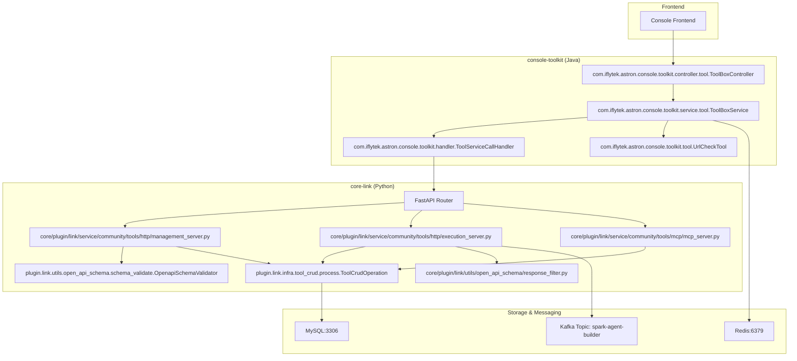
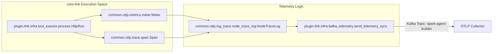

<!-- source: DeepWiki mcp.deepwiki.com · repo iflytek/astron-agent · page 6 Tool and Plugin Management System · fetched 2026-10-27 -->

# Tool and Plugin Management System

Relevant source files

The following files were used as context for generating this wiki page:

- [console/backend/hub/src/main/java/com/iflytek/astron/console/hub/controller/share/ShareController.java](console/backend/hub/src/main/java/com/iflytek/astron/console/hub/controller/share/ShareController.java)
- [console/backend/toolkit/src/main/java/com/iflytek/astron/console/toolkit/controller/knowledge/FileController.java](console/backend/toolkit/src/main/java/com/iflytek/astron/console/toolkit/controller/knowledge/FileController.java)
- [console/backend/toolkit/src/main/java/com/iflytek/astron/console/toolkit/controller/knowledge/RepoController.java](console/backend/toolkit/src/main/java/com/iflytek/astron/console/toolkit/controller/knowledge/RepoController.java)
- [console/backend/toolkit/src/main/java/com/iflytek/astron/console/toolkit/controller/model/ModelController.java](console/backend/toolkit/src/main/java/com/iflytek/astron/console/toolkit/controller/model/ModelController.java)
- [console/backend/toolkit/src/main/java/com/iflytek/astron/console/toolkit/controller/tool/ToolBoxController.java](console/backend/toolkit/src/main/java/com/iflytek/astron/console/toolkit/controller/tool/ToolBoxController.java)
- [console/backend/toolkit/src/main/java/com/iflytek/astron/console/toolkit/entity/core/openapi/SecurityScheme.java](console/backend/toolkit/src/main/java/com/iflytek/astron/console/toolkit/entity/core/openapi/SecurityScheme.java)
- [console/backend/toolkit/src/main/java/com/iflytek/astron/console/toolkit/entity/vo/ToolBoxExportVo.java](console/backend/toolkit/src/main/java/com/iflytek/astron/console/toolkit/entity/vo/ToolBoxExportVo.java)
- [console/backend/toolkit/src/main/java/com/iflytek/astron/console/toolkit/handler/MySqlJsonHandler.java](console/backend/toolkit/src/main/java/com/iflytek/astron/console/toolkit/handler/MySqlJsonHandler.java)
- [console/backend/toolkit/src/main/java/com/iflytek/astron/console/toolkit/service/database/DBExcelReadListener.java](console/backend/toolkit/src/main/java/com/iflytek/astron/console/toolkit/service/database/DBExcelReadListener.java)
- [console/backend/toolkit/src/main/java/com/iflytek/astron/console/toolkit/service/tool/ToolBoxService.java](console/backend/toolkit/src/main/java/com/iflytek/astron/console/toolkit/service/tool/ToolBoxService.java)
- [console/backend/toolkit/src/main/java/com/iflytek/astron/console/toolkit/sse/WorkflowSseEventSourceListener.java](console/backend/toolkit/src/main/java/com/iflytek/astron/console/toolkit/sse/WorkflowSseEventSourceListener.java)
- [core/plugin/link/.gitignore](core/plugin/link/.gitignore)
- [core/plugin/link/config.env](core/plugin/link/config.env)
- [core/plugin/link/consts/const.py](core/plugin/link/consts/const.py)
- [core/plugin/link/consts/keys/xc_utils_keys.py](core/plugin/link/consts/keys/xc_utils_keys.py)
- [core/plugin/link/infra/kafka_telemetry.py](core/plugin/link/infra/kafka_telemetry.py)
- [core/plugin/link/service/community/deprecated/management_server.py](core/plugin/link/service/community/deprecated/management_server.py)
- [core/plugin/link/service/community/tools/http/execution_server.py](core/plugin/link/service/community/tools/http/execution_server.py)
- [core/plugin/link/service/community/tools/http/management_server.py](core/plugin/link/service/community/tools/http/management_server.py)
- [core/plugin/link/service/community/tools/mcp/mcp_server.py](core/plugin/link/service/community/tools/mcp/mcp_server.py)
- [core/plugin/link/service/enterprise/extension.py](core/plugin/link/service/enterprise/extension.py)
- [core/plugin/link/tests/unit/test_response_filter.py](core/plugin/link/tests/unit/test_response_filter.py)
- [core/plugin/link/tests/unit/test_services.py](core/plugin/link/tests/unit/test_services.py)
- [core/plugin/link/utils/open_api_schema/response_filter.py](core/plugin/link/utils/open_api_schema/response_filter.py)

## Purpose and Scope

This document describes the Tool and Plugin Management System within the Astron Agent platform, which enables users to create, manage, and execute custom tools and plugins. The system supports two primary tool types: **HTTP Tools** (custom API integrations) and **MCP Tools** (Model Context Protocol integrations). It handles the complete tool lifecycle including creation, versioning, authentication, execution, and debugging.

This document covers:
- Tool lifecycle management (create, read, update, delete operations)
- HTTP tool execution with OpenAPI schema validation and visibility filtering
- MCP protocol integration for advanced tool interactions
- Tool validation, security, and authentication mechanisms
- Tool marketplace features and AI-assisted tool generation

For detailed technical implementation, see the following child pages:
- [Tool Management Architecture](#6.1) — ToolBoxService architecture and lifecycle
- [Tool Execution Service](#6.2) — HTTP execution server and parameter validation
- [MCP Protocol Integration](#6.3) — SSE client for MCP servers and tool calling
- [Tool Validation and Security](#6.4) — OpenAPI schema validation and URL blacklisting
- [Tool Marketplace and Sharing](#6.5) — Plugin square, favorites, and history

---

## System Architecture Overview

The tool management system is split between two primary services: `console-toolkit` (Java) for management and `core-link` (Python) for execution and protocol handling.

**Title: Tool Management System Architecture**

**Sources:**
- [console/backend/toolkit/src/main/java/com/iflytek/astron/console/toolkit/service/tool/ToolBoxService.java:82-150]()
- [core/plugin/link/service/community/tools/http/execution_server.py:1-45]()
- [core/plugin/link/service/community/tools/http/management_server.py:1-15]()
- [core/plugin/link/service/community/tools/mcp/mcp_server.py:1-6]()
- [core/plugin/link/utils/open_api_schema/response_filter.py:1-15]()

---

## Core Components

### Tool Management Architecture (#6.1)
The `ToolBoxService` handles the high-level lifecycle of tools. It manages transitions between **Draft** (temporary storage via `temporaryTool`) and **Formal** (published via `createTool`) states [console/backend/toolkit/src/main/java/com/iflytek/astron/console/toolkit/service/tool/ToolBoxService.java:160-183](). It also handles the conversion of simplified web schemas into full OpenAPI specifications before calling the `core-link` service via `ToolServiceCallHandler` [console/backend/toolkit/src/main/java/com/iflytek/astron/console/toolkit/service/tool/ToolBoxService.java:181-182](). For details, see [Tool Management Architecture](#6.1).

**Sources:**
- [console/backend/toolkit/src/main/java/com/iflytek/astron/console/toolkit/service/tool/ToolBoxService.java:159-183]()
- [console/backend/toolkit/src/main/java/com/iflytek/astron/console/toolkit/controller/tool/ToolBoxController.java:29-50]()

### Tool Execution Service (#6.2)
The `execution_server.py` in `core-link` provides the runtime for HTTP tools. It handles parameter validation via `api_validate` [core/plugin/link/service/community/tools/http/execution_server.py:38](), injects authentication [core/plugin/link/service/community/tools/http/execution_server.py:202-218](), and performs HTTP calls. A key feature is the `x-display` visibility filtering, which removes fields from the response based on the OpenAPI schema to prevent sensitive data exposure to the LLM [core/plugin/link/utils/open_api_schema/response_filter.py:6-12](). For details, see [Tool Execution Service](#6.2).

**Sources:**
- [core/plugin/link/service/community/tools/http/execution_server.py:5-45]()
- [core/plugin/link/utils/open_api_schema/response_filter.py:6-12]()
- [core/plugin/link/tests/unit/test_response_filter.py:43-63]()

### MCP Protocol Integration (#6.3)
The system supports the **Model Context Protocol (MCP)** for advanced tool discovery and execution. It uses an SSE (Server-Sent Events) client via `sse_client` [core/plugin/link/service/community/tools/mcp/mcp_server.py:17]() to connect to external MCP servers, list available tools [core/plugin/link/service/community/tools/mcp/mcp_server.py:160-165](), and call them using standardized JSON-RPC over SSE. Registration is handled via `register_mcp` in the enterprise extension module [core/plugin/link/service/enterprise/extension.py:34-50](). For details, see [MCP Protocol Integration](#6.3).

**Sources:**
- [core/plugin/link/service/community/tools/mcp/mcp_server.py:89-158]()
- [core/plugin/link/service/enterprise/extension.py:34-50]()

### Tool Validation and Security (#6.4)
Security is enforced through multiple layers:
- **OpenAPI Validation**: `OpenapiSchemaValidator` ensures definitions are compliant before creation or update [core/plugin/link/service/community/tools/http/management_server.py:218-235]().
- **SSRF Protection**: `UrlCheckTool` [console/backend/toolkit/src/main/java/com/iflytek/astron/console/toolkit/service/tool/ToolBoxService.java:176]() and `is_in_blacklist` [core/plugin/link/service/community/tools/mcp/mcp_server.py:37]() verify that tool endpoints do not point to internal or restricted networks.
- **Data Permission**: `dataPermissionCheckTool` ensures tools belong to the correct space and user during modification [console/backend/toolkit/src/main/java/com/iflytek/astron/console/toolkit/service/tool/ToolBoxService.java:167]().
For details, see [Tool Validation and Security](#6.4).

**Sources:**
- [console/backend/toolkit/src/main/java/com/iflytek/astron/console/toolkit/service/tool/ToolBoxService.java:175-177]()
- [core/plugin/link/service/community/tools/http/management_server.py:218-235]()

### Tool Marketplace and Sharing (#6.5)
The **Plugin Square** allows discovery and sharing. The system tracks tool "heat" (usage frequency) using Redis [console/backend/toolkit/src/main/java/com/iflytek/astron/console/toolkit/service/tool/ToolBoxService.java:155]() and allows users to favorite tools via `UserFavoriteToolMapper` [console/backend/toolkit/src/main/java/com/iflytek/astron/console/toolkit/service/tool/ToolBoxService.java:134](). Operation history is tracked in `tool_box_operate_history` [console/backend/toolkit/src/main/java/com/iflytek/astron/console/toolkit/service/tool/ToolBoxService.java:144](). For details, see [Tool Marketplace and Sharing](#6.5).

**Sources:**
- [console/backend/toolkit/src/main/java/com/iflytek/astron/console/toolkit/service/tool/ToolBoxService.java:152-156]()
- [console/backend/toolkit/src/main/java/com/iflytek/astron/console/toolkit/controller/tool/ToolBoxController.java:97-111]()

---

## Telemetry and Observability

The tool system integrates with the platform's telemetry pipeline via `KafkaTelemetry` [core/plugin/link/infra/kafka_telemetry.py:30]() to track execution performance and errors.

**Title: Tool Execution Telemetry Flow**

**Sources:**
- [core/plugin/link/service/community/tools/http/execution_server.py:109-124]()
- [core/plugin/link/infra/kafka_telemetry.py:13-30]()
- [core/plugin/link/config.env:43-75]()

---

