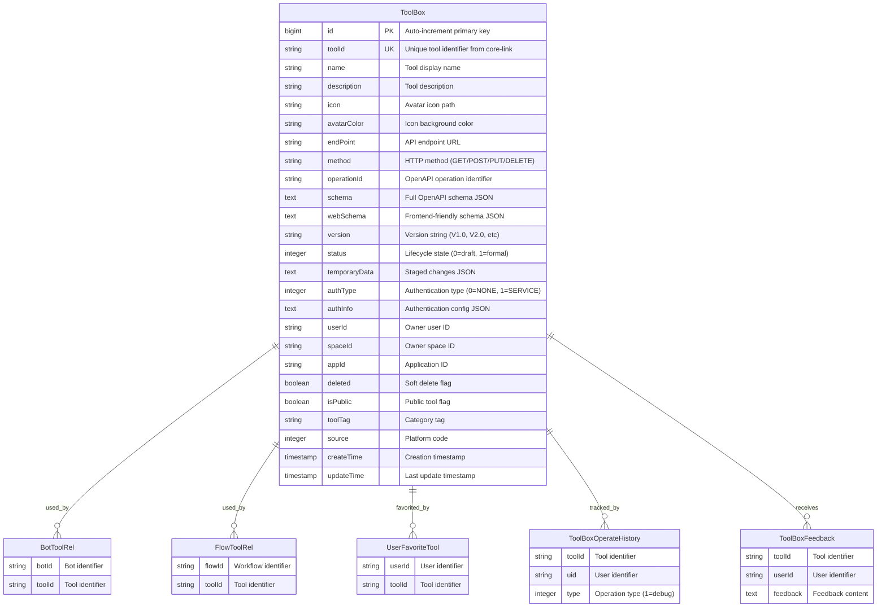
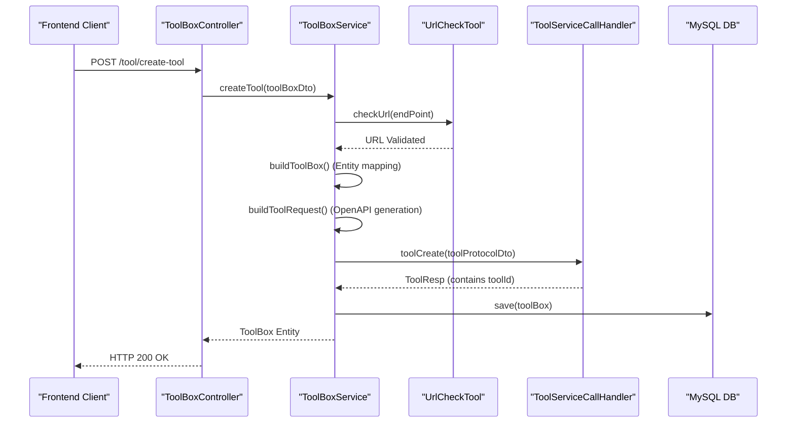
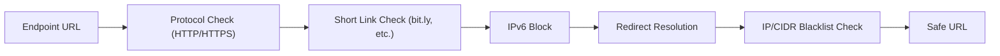

<!-- source: DeepWiki mcp.deepwiki.com · repo iflytek/astron-agent · page 6.1 Tool Management Architecture · fetched 2026-10-27 -->

# Tool Management Architecture

<details>
<summary>Relevant source files</summary>

The following files were used as context for generating this wiki page:

- [console/backend/commons/src/main/resources/mapper/BotDatasetMaasMapper.xml](console/backend/commons/src/main/resources/mapper/BotDatasetMaasMapper.xml)
- [console/backend/hub/src/main/java/com/iflytek/astron/console/hub/controller/share/ShareController.java](console/backend/hub/src/main/java/com/iflytek/astron/console/hub/controller/share/ShareController.java)
- [console/backend/toolkit/src/main/java/com/iflytek/astron/console/toolkit/controller/knowledge/FileController.java](console/backend/toolkit/src/main/java/com/iflytek/astron/console/toolkit/controller/knowledge/FileController.java)
- [console/backend/toolkit/src/main/java/com/iflytek/astron/console/toolkit/controller/knowledge/RepoController.java](console/backend/toolkit/src/main/java/com/iflytek/astron/console/toolkit/controller/knowledge/RepoController.java)
- [console/backend/toolkit/src/main/java/com/iflytek/astron/console/toolkit/controller/model/ModelController.java](console/backend/toolkit/src/main/java/com/iflytek/astron/console/toolkit/controller/model/ModelController.java)
- [console/backend/toolkit/src/main/java/com/iflytek/astron/console/toolkit/controller/tool/ToolBoxController.java](console/backend/toolkit/src/main/java/com/iflytek/astron/console/toolkit/controller/tool/ToolBoxController.java)
- [console/backend/toolkit/src/main/java/com/iflytek/astron/console/toolkit/entity/core/openapi/SecurityScheme.java](console/backend/toolkit/src/main/java/com/iflytek/astron/console/toolkit/entity/core/openapi/SecurityScheme.java)
- [console/backend/toolkit/src/main/java/com/iflytek/astron/console/toolkit/entity/vo/ToolBoxExportVo.java](console/backend/toolkit/src/main/java/com/iflytek/astron/console/toolkit/entity/vo/ToolBoxExportVo.java)
- [console/backend/toolkit/src/main/java/com/iflytek/astron/console/toolkit/handler/McpServerHandler.java](console/backend/toolkit/src/main/java/com/iflytek/astron/console/toolkit/handler/McpServerHandler.java)
- [console/backend/toolkit/src/main/java/com/iflytek/astron/console/toolkit/handler/MySqlJsonHandler.java](console/backend/toolkit/src/main/java/com/iflytek/astron/console/toolkit/handler/MySqlJsonHandler.java)
- [console/backend/toolkit/src/main/java/com/iflytek/astron/console/toolkit/service/database/DBExcelReadListener.java](console/backend/toolkit/src/main/java/com/iflytek/astron/console/toolkit/service/database/DBExcelReadListener.java)
- [console/backend/toolkit/src/main/java/com/iflytek/astron/console/toolkit/service/model/ModelService.java](console/backend/toolkit/src/main/java/com/iflytek/astron/console/toolkit/service/model/ModelService.java)
- [console/backend/toolkit/src/main/java/com/iflytek/astron/console/toolkit/service/repo/FileInfoV2Service.java](console/backend/toolkit/src/main/java/com/iflytek/astron/console/toolkit/service/repo/FileInfoV2Service.java)
- [console/backend/toolkit/src/main/java/com/iflytek/astron/console/toolkit/service/tool/ToolBoxService.java](console/backend/toolkit/src/main/java/com/iflytek/astron/console/toolkit/service/tool/ToolBoxService.java)
- [console/backend/toolkit/src/main/java/com/iflytek/astron/console/toolkit/service/workflow/WorkflowService.java](console/backend/toolkit/src/main/java/com/iflytek/astron/console/toolkit/service/workflow/WorkflowService.java)
- [console/backend/toolkit/src/main/java/com/iflytek/astron/console/toolkit/sse/WorkflowSseEventSourceListener.java](console/backend/toolkit/src/main/java/com/iflytek/astron/console/toolkit/sse/WorkflowSseEventSourceListener.java)
- [console/backend/toolkit/src/main/java/com/iflytek/astron/console/toolkit/tool/UrlCheckTool.java](console/backend/toolkit/src/main/java/com/iflytek/astron/console/toolkit/tool/UrlCheckTool.java)

</details>


## Purpose and Scope

This document describes the tool management architecture in the Astron Agent platform, specifically the tool catalog and lifecycle management system implemented in the `console-backend/toolkit` module and its interaction with the `core-link` service. Tools are reusable API integrations that can be invoked by bots and workflows to extend platform capabilities.

This page covers:
- Database schema and entity model for tool storage
- Tool lifecycle states (draft/formal) and versioning system
- Tool creation, registration, and validation flows
- Authentication mechanisms and multi-tenancy isolation
- Tool debugging, import/export, and integration patterns

For HTTP tool execution details, see [6.2](). For MCP protocol integration, see [6.3](). For tool CRUD operations, see [6.4](). For import/export functionality, see [6.5]().

## Database Schema and Entity Model

The tool management system uses a MySQL database with the primary table `tool_box` storing tool definitions. Each tool has a unique `tool_id` (assigned by the core-link service) and may have multiple versions.

### ToolBox Entity Structure



**Key Fields:**

| Field | Purpose |
|-------|---------|
| `toolId` | Unique identifier assigned by core-link service, used for cross-references [console/backend/toolkit/src/main/java/com/iflytek/astron/console/toolkit/service/tool/ToolBoxService.java:183-184]() |
| `version` | Version string (V1.0, V2.0, etc.) incremented on schema changes [console/backend/toolkit/src/main/java/com/iflytek/astron/console/toolkit/service/tool/ToolBoxService.java:369-384]() |
| `status` | Lifecycle state: `0` (draft/temporary), `1` (formal/published) [console/backend/toolkit/src/main/java/com/iflytek/astron/console/toolkit/service/tool/ToolBoxService.java:237-237]() |
| `temporaryData` | JSON cache for staging changes to formal tools without creating new version [console/backend/toolkit/src/main/java/com/iflytek/astron/console/toolkit/service/tool/ToolBoxService.java:444-445]() |
| `schema` | Complete OpenAPI 3.0 specification for the tool [console/backend/toolkit/src/main/java/com/iflytek/astron/console/toolkit/service/tool/ToolBoxService.java:180-180]() |
| `webSchema` | Simplified schema format for frontend display and debugging [console/backend/toolkit/src/main/java/com/iflytek/astron/console/toolkit/service/tool/ToolBoxService.java:543-543]() |
| `operationId` | Unique operation identifier extracted from OpenAPI schema [console/backend/toolkit/src/main/java/com/iflytek/astron/console/toolkit/service/tool/ToolBoxService.java:188-188]() |

**Sources:** [console/backend/toolkit/src/main/java/com/iflytek/astron/console/toolkit/service/tool/ToolBoxService.java:84-157]()

## Tool Lifecycle States

Tools transition through distinct lifecycle states managed by the `status` field and `temporaryData` mechanism.

### State Transition Diagram

```mermaid
stateDiagram-v2
    [*] --> Draft : "temporaryTool()"
    Draft --> Formal : "createTool() with validation"
    Formal --> Formal_with_Temp : "temporaryTool() on formal tool"
    Formal_with_Temp --> Formal : "createTool() publish changes"
    Formal --> New_Version : "updateTool() when schema changed"
    New_Version --> Formal : "automatic registration"
    Draft --> [*] : "deleteTool()"
    Formal --> [*] : "deleteTool() with usage check"
    
    state Draft {
        direction L
        "status: 0"
        "Not yet a Formal release"
    }
    
    state Formal {
        direction L
        "status: 1"
        "Registered with core-link"
    }
    
    state Formal_with_Temp {
        direction L
        "status: 1"
        "temporary_data is not null"
        "Staging changes for preview"
    }
```

**Draft State (status=0):**
- Created by `temporaryTool()` [console/backend/toolkit/src/main/java/com/iflytek/astron/console/toolkit/service/tool/ToolBoxService.java:423-457]().
- Used for staging initial tool creation or saving work-in-progress.
- Does not assign a `tool_id` until a formal creation occurs.

**Formal State (status=1):**
- Created by `createTool()` [console/backend/toolkit/src/main/java/com/iflytek/astron/console/toolkit/service/tool/ToolBoxService.java:160-198]().
- Requires registration with the core-link service via `toolServiceCallHandler.toolCreate()` [console/backend/toolkit/src/main/java/com/iflytek/astron/console/toolkit/service/tool/ToolBoxService.java:181-182]().
- Used by bots and workflows via `BotToolRel` and `FlowToolRel` tables.

**Temporary Data Mechanism:**
- For formal tools, changes can be staged in `temporaryData` [console/backend/toolkit/src/main/java/com/iflytek/astron/console/toolkit/service/tool/ToolBoxService.java:444-445]().
- Allows preview/debugging without affecting the active tool used by bots.
- Published by calling `createTool()` which clears `temporaryData` [console/backend/toolkit/src/main/java/com/iflytek/astron/console/toolkit/service/tool/ToolBoxService.java:187-187]().

**Sources:** [console/backend/toolkit/src/main/java/com/iflytek/astron/console/toolkit/service/tool/ToolBoxService.java:160-198](), [console/backend/toolkit/src/main/java/com/iflytek/astron/console/toolkit/service/tool/ToolBoxService.java:423-457]()

## Tool Versioning System

The platform implements versioning for tools, automatically incrementing major versions when the tool schema changes during an update.

### Version Comparison Logic

The `isEqual()` method compares `ToolBoxDto` fields while ignoring metadata like `version` or `temporaryData` [console/backend/toolkit/src/main/java/com/iflytek/astron/console/toolkit/service/tool/ToolBoxService.java:386-421](). If a substantive change is detected, `buildVersion()` parses the current version string (e.g., "V1.0") and increments the major number [console/backend/toolkit/src/main/java/com/iflytek/astron/console/toolkit/service/tool/ToolBoxService.java:369-384]().

**Sources:** [console/backend/toolkit/src/main/java/com/iflytek/astron/console/toolkit/service/tool/ToolBoxService.java:308-367](), [console/backend/toolkit/src/main/java/com/iflytek/astron/console/toolkit/service/tool/ToolBoxService.java:369-384](), [console/backend/toolkit/src/main/java/com/iflytek/astron/console/toolkit/service/tool/ToolBoxService.java:386-421]()

## Tool Creation and Registration Flow

Tool creation involves converting user-provided tool definitions into OpenAPI 3.0 schemas and registering them with the core-link service.

### Tool Creation Flow Diagram



**Step-by-Step Process:**
1. **URL Validation:** `urlCheckTool.checkUrl()` ensures the endpoint is not blacklisted or an internal network range [console/backend/toolkit/src/main/java/com/iflytek/astron/console/toolkit/service/tool/ToolBoxService.java:176-176]().
2. **Schema Generation:** The tool definition is converted into an OpenAPI schema string [console/backend/toolkit/src/main/java/com/iflytek/astron/console/toolkit/service/tool/ToolBoxService.java:179-180]().
3. **Core-Link Sync:** The schema is sent to `core-link` via `toolServiceCallHandler.toolCreate()`. The service returns a globally unique `tool_id` [console/backend/toolkit/src/main/java/com/iflytek/astron/console/toolkit/service/tool/ToolBoxService.java:181-184]().
4. **Persistence:** The `toolId`, `schema`, and metadata are saved to the `tool_box` table [console/backend/toolkit/src/main/java/com/iflytek/astron/console/toolkit/service/tool/ToolBoxService.java:196-196]().

**Sources:** [console/backend/toolkit/src/main/java/com/iflytek/astron/console/toolkit/service/tool/ToolBoxService.java:160-198](), [console/backend/toolkit/src/main/java/com/iflytek/astron/console/toolkit/tool/UrlCheckTool.java:167-200]()

## Authentication Mechanisms

Tools support authentication schemes to secure API access, primarily `SERVICE` (API Key) authentication.

### Authentication Types and Storage

| Auth Type | Description | Configuration |
|-----------|-------------|---------------|
| `NONE` (0) | No authentication required | N/A |
| `SERVICE` (1) | API Key based authentication | `authInfo` JSON containing parameter name, token, and location (header/query) |

**Auth Storage in Redis:**
For runtime access by the agent, authentication info is written to Redis using the key prefix `spark_bot:tool_config:` followed by the `tool_id` and `version` [console/backend/toolkit/src/main/java/com/iflytek/astron/console/toolkit/service/tool/ToolBoxService.java:154-154]().

```java
// Logic in writeAuthInfoToRedis [console/backend/toolkit/src/main/java/com/iflytek/astron/console/toolkit/service/tool/ToolBoxService.java:299-306]
JSONObject jsonObject = new JSONObject();
jsonObject.put("apiKey", new JSONObject().fluentPut(serviceAuthInfo.getParameterName(), serviceAuthInfo.getServiceToken()));
redisTemplate.opsForValue().set(CONFIG_KEY_PREFIX.concat(toolId).concat(":").concat(version), 
    new JSONObject().fluentPut("authentication", jsonObject));
```

**Sources:** [console/backend/toolkit/src/main/java/com/iflytek/astron/console/toolkit/service/tool/ToolBoxService.java:299-306](), [console/backend/toolkit/src/main/java/com/iflytek/astron/console/toolkit/entity/core/openapi/SecurityScheme.java:7-13]()

## Multi-Tenancy and Access Control

The tool management system enforces isolation through `spaceId` and `userId` fields.

### Access Control Logic
- **Ownership:** When creating or updating tools, `dataPermissionCheckTool.checkToolBelong(toolBox)` ensures the user has permission for that specific tool [console/backend/toolkit/src/main/java/com/iflytek/astron/console/toolkit/service/tool/ToolBoxService.java:167-167]().
- **Space Isolation:** Tools are filtered by `space_id` in list operations [console/backend/toolkit/src/main/java/com/iflytek/astron/console/toolkit/service/tool/ToolBoxService.java:632-674]().
- **Public Visibility:** Tools can be marked as `isPublic`. For public tools not owned by the user, sensitive schema details (like `authInfo`) are redacted in the details view [console/backend/toolkit/src/main/java/com/iflytek/astron/console/toolkit/service/tool/ToolBoxService.java:605-611]().

**Sources:** [console/backend/toolkit/src/main/java/com/iflytek/astron/console/toolkit/service/tool/ToolBoxService.java:632-674](), [console/backend/toolkit/src/main/java/com/iflytek/astron/console/toolkit/service/tool/ToolBoxService.java:605-611]()

## Tool Validation and Security Checks

The platform implements comprehensive validation to prevent malicious tool configurations, particularly SSRF.

### Security Validation Flow



**URL Security:**
The `UrlCheckTool` resolves redirects and checks the final IP against blacklists configured in the `ConfigInfo` table under categories `IP_BLACK_LIST` and `NETWORK_SEGMENT_BLACK_LIST` [console/backend/toolkit/src/main/java/com/iflytek/astron/console/toolkit/tool/UrlCheckTool.java:51-53]().

**Parameter Validation:**
The system checks parameter types (String, Number, Integer, Boolean, Array, Object) to ensure input data conforms to the OpenAPI schema [console/backend/toolkit/src/main/java/com/iflytek/astron/console/toolkit/service/tool/ToolBoxService.java:95-101]().

**Sources:** [console/backend/toolkit/src/main/java/com/iflytek/astron/console/toolkit/tool/UrlCheckTool.java:167-200](), [console/backend/toolkit/src/main/java/com/iflytek/astron/console/toolkit/service/tool/ToolBoxService.java:95-101]()

## Tool Debugging and Testing

The `debugToolV2` endpoint allows users to test tools without persistence.

### Debug Execution Flow
1. **Schema Generation:** Converts the current UI configuration into a temporary OpenAPI schema [console/backend/toolkit/src/main/java/com/iflytek/astron/console/toolkit/service/tool/ToolBoxService.java:539-540]().
2. **Parameter Mapping:** Maps input values to their locations (header, query, body, path) as defined in the `webSchema` [console/backend/toolkit/src/main/java/com/iflytek/astron/console/toolkit/service/tool/ToolBoxService.java:543-553]().
3. **Execution:** Calls `toolServiceCallHandler.toolDebug()` to invoke the `core-link` debug endpoint [console/backend/toolkit/src/main/java/com/iflytek/astron/console/toolkit/service/tool/ToolBoxService.java:572-572]().
4. **History:** Records the debug attempt in `ToolBoxOperateHistoryMapper` [console/backend/toolkit/src/main/java/com/iflytek/astron/console/toolkit/service/tool/ToolBoxService.java:527-531]().

**Sources:** [console/backend/toolkit/src/main/java/com/iflytek/astron/console/toolkit/service/tool/ToolBoxService.java:511-582]()

## Tool Import and Export System

Tools can be exported to JSON/YAML and imported back, facilitating portability.

### Export/Import Mechanism
- **Export:** Serializes tool metadata and schema into a `ToolBoxExportVo` [console/backend/toolkit/src/main/java/com/iflytek/astron/console/toolkit/entity/vo/ToolBoxExportVo.java:11-64](). It supports JSON and YAML formats using `ObjectMapper` and `YAMLFactory` [console/backend/toolkit/src/main/java/com/iflytek/astron/console/toolkit/service/tool/ToolBoxService.java:763-774]().
- **Import:** Accepts a file via `MultipartFile`, parses it based on extension, and populates a `ToolBoxDto` [console/backend/toolkit/src/main/java/com/iflytek/astron/console/toolkit/service/tool/ToolBoxService.java:792-805](). The imported tool is initially saved as a temporary tool [console/backend/toolkit/src/main/java/com/iflytek/astron/console/toolkit/service/tool/ToolBoxService.java:809-809]().

**Sources:** [console/backend/toolkit/src/main/java/com/iflytek/astron/console/toolkit/service/tool/ToolBoxService.java:750-781](), [console/backend/toolkit/src/main/java/com/iflytek/astron/console/toolkit/service/tool/ToolBoxService.java:783-810]()

## Toolbox Controller

The `ToolBoxController` exposes the RESTful interface for the management system.

| Endpoint | Method | Description |
|----------|--------|-------------|
| `/tool/create-tool` | `POST` | Create and publish a formal tool [console/backend/toolkit/src/main/java/com/iflytek/astron/console/toolkit/controller/tool/ToolBoxController.java:29-40]() |
| `/tool/temporary-tool` | `POST` | Save a draft or temporary changes [console/backend/toolkit/src/main/java/com/iflytek/astron/console/toolkit/controller/tool/ToolBoxController.java:42-50]() |
| `/tool/update-tool` | `PUT` | Update an existing tool (triggers versioning) [console/backend/toolkit/src/main/java/com/iflytek/astron/console/toolkit/controller/tool/ToolBoxController.java:52-57]() |
| `/tool/debug-tool` | `POST` | Test tool execution [console/backend/toolkit/src/main/java/com/iflytek/astron/console/toolkit/controller/tool/ToolBoxController.java:90-95]() |
| `/tool/export` | `GET` | Export tool to JSON/YAML [console/backend/toolkit/src/main/java/com/iflytek/astron/console/toolkit/controller/tool/ToolBoxController.java:145-152]() |
| `/tool/import` | `POST` | Import tool from file [console/backend/toolkit/src/main/java/com/iflytek/astron/console/toolkit/controller/tool/ToolBoxController.java:154-159]() |

**Sources:** [console/backend/toolkit/src/main/java/com/iflytek/astron/console/toolkit/controller/tool/ToolBoxController.java:20-161]()

---

