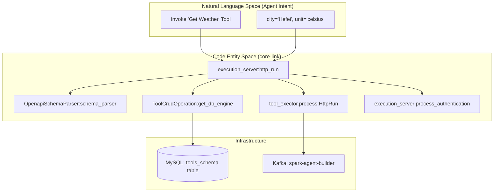
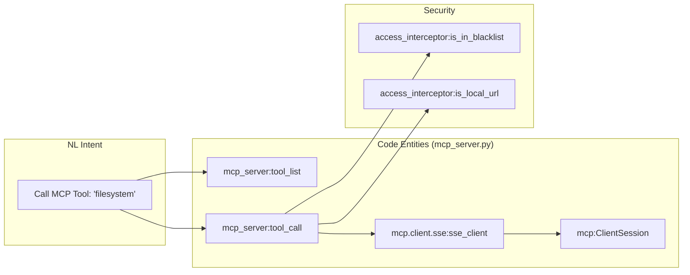

<!-- source: DeepWiki mcp.deepwiki.com · repo iflytek/astron-agent · page 6.2 Tool Execution Service · fetched 2026-10-27 -->

# Tool Execution Service

Relevant source files

The following files were used as context for generating this wiki page:

- [core/plugin/link/.gitignore](core/plugin/link/.gitignore)
- [core/plugin/link/alembic.ini](core/plugin/link/alembic.ini)
- [core/plugin/link/alembic/README](core/plugin/link/alembic/README)
- [core/plugin/link/alembic/default_tools.py](core/plugin/link/alembic/default_tools.py)
- [core/plugin/link/alembic/env.py](core/plugin/link/alembic/env.py)
- [core/plugin/link/alembic/script.py.mako](core/plugin/link/alembic/script.py.mako)
- [core/plugin/link/alembic/versions/2026_03_06_0257-5c4f1b5ab83d_init.py](core/plugin/link/alembic/versions/2026_03_06_0257-5c4f1b5ab83d_init.py)
- [core/plugin/link/config.env](core/plugin/link/config.env)
- [core/plugin/link/consts/const.py](core/plugin/link/consts/const.py)
- [core/plugin/link/consts/keys/xc_utils_keys.py](core/plugin/link/consts/keys/xc_utils_keys.py)
- [core/plugin/link/domain/models/manager.py](core/plugin/link/domain/models/manager.py)
- [core/plugin/link/domain/models/utils.py](core/plugin/link/domain/models/utils.py)
- [core/plugin/link/extensions/__init__.py](core/plugin/link/extensions/__init__.py)
- [core/plugin/link/extensions/database_migration.py](core/plugin/link/extensions/database_migration.py)
- [core/plugin/link/infra/kafka_telemetry.py](core/plugin/link/infra/kafka_telemetry.py)
- [core/plugin/link/pyproject.toml](core/plugin/link/pyproject.toml)
- [core/plugin/link/service/community/deprecated/management_server.py](core/plugin/link/service/community/deprecated/management_server.py)
- [core/plugin/link/service/community/tools/http/execution_server.py](core/plugin/link/service/community/tools/http/execution_server.py)
- [core/plugin/link/service/community/tools/http/management_server.py](core/plugin/link/service/community/tools/http/management_server.py)
- [core/plugin/link/service/community/tools/mcp/mcp_server.py](core/plugin/link/service/community/tools/mcp/mcp_server.py)
- [core/plugin/link/service/enterprise/extension.py](core/plugin/link/service/enterprise/extension.py)
- [core/plugin/link/tests/unit/test_alembic_migration.py](core/plugin/link/tests/unit/test_alembic_migration.py)
- [core/plugin/link/tests/unit/test_domain_models.py](core/plugin/link/tests/unit/test_domain_models.py)
- [core/plugin/link/tests/unit/test_response_filter.py](core/plugin/link/tests/unit/test_response_filter.py)
- [core/plugin/link/tests/unit/test_services.py](core/plugin/link/tests/unit/test_services.py)
- [core/plugin/link/utils/open_api_schema/response_filter.py](core/plugin/link/utils/open_api_schema/response_filter.py)
- [core/plugin/link/uv.lock](core/plugin/link/uv.lock)
- [core/plugin/rpa/pyproject.toml](core/plugin/rpa/pyproject.toml)
- [core/plugin/rpa/uv.lock](core/plugin/rpa/uv.lock)
- [core/tenant/tools/database/database.go](core/tenant/tools/database/database.go)
- [core/tenant/tools/database/migrations.go](core/tenant/tools/database/migrations.go)
- [core/tenant/tools/database/tenant_schema.go](core/tenant/tools/database/tenant_schema.go)

The Tool Execution Service, implemented within the `core-link` microservice, provides a high-performance HTTP execution engine for community-contributed tools and Model Context Protocol (MCP) servers. It handles the complete lifecycle of a tool invocation: from parameter validation and authentication injection to secure HTTP execution, response validation, and visibility filtering.

## Tool Execution Architecture

The service architecture bridges Natural Language Space (where agents operate) to Code Entity Space (where REST APIs and MCP servers reside). It utilizes a FastAPI-based server that orchestrates database lookups, schema parsing, and telemetry.

### Natural Language to Code Entity Mapping (HTTP)

The following diagram maps high-level execution concepts to specific code entities within the `core-link` service.

**Sources**: [core/plugin/link/service/community/tools/http/execution_server.py:1-20](), [core/plugin/link/service/community/tools/http/execution_server.py:31-32](), [core/plugin/link/service/community/tools/http/execution_server.py:202-207](), [core/plugin/link/alembic/versions/2026_03_06_0257-5c4f1b5ab83d_init.py:24-25](), [core/plugin/link/config.env:83-86]()

## Core Execution Flow: http_run

The execution engine transforms a structured `HttpRunRequest` into a live API call while maintaining strict security and observability.

### Execution Sequence

1.  **Parameter Extraction**: The service extracts `app_id`, `uid`, and `caller` from the request header using `extract_request_params`. If missing, it defaults to values defined in `config.env` via `os.getenv(const.DEFAULT_APPID_KEY)` [core/plugin/link/service/community/tools/http/execution_server.py:56-75]().
2.  **Schema Validation**: Incoming requests are validated against pre-loaded JSON schemas (retrieved via `get_http_run_schema`) using `api_validate` to ensure protocol compliance [core/plugin/link/service/community/tools/http/execution_server.py:34-38]().
3.  **Tool Retrieval**: The system queries the database via `ToolCrudOperation` to fetch the tool definition and OpenAPI schema from the `tools_schema` table [core/plugin/link/service/community/tools/http/execution_server.py:31-32](), [core/plugin/link/alembic/versions/2026_03_06_0257-5c4f1b5ab83d_init.py:24-81]().
4.  **Authentication Injection**: If the tool requires security (e.g., API Keys), `process_authentication` injects stored credentials into headers or query parameters based on the `security_type` defined in the schema [core/plugin/link/service/community/tools/http/execution_server.py:202-229]().
5.  **HTTP Invocation**: The `HttpRun` class constructs the final request and performs the execution [core/plugin/link/service/community/tools/http/execution_server.py:32-32]().

**Sources**: [core/plugin/link/service/community/tools/http/execution_server.py:56-75](), [core/plugin/link/service/community/tools/http/execution_server.py:202-229](), [core/plugin/link/service/community/tools/http/execution_server.py:31-38]()

## MCP Protocol Integration

The service supports the Model Context Protocol (MCP) for dynamic tool discovery and execution. Unlike static HTTP tools, MCP tools are discovered at runtime by connecting to an MCP server via Server-Sent Events (SSE).

### MCP Execution Mapping

**Key MCP Functions**:
- `tool_list`: Connects to one or more MCP servers via `sse_client` to retrieve available tool definitions including names, descriptions, and input schemas [core/plugin/link/service/community/tools/mcp/mcp_server.py:160-195]().
- `_connect_and_get_tools`: Handles the underlying SSE session and initializes the `ClientSession` to fetch tools [core/plugin/link/service/community/tools/mcp/mcp_server.py:89-158]().
- **Security Interceptors**: Before connecting, the service validates URLs using `is_local_url` and `is_in_blacklist` to prevent SSRF attacks [core/plugin/link/service/community/tools/mcp/mcp_server.py:37-38]().

**Sources**: [core/plugin/link/service/community/tools/mcp/mcp_server.py:37-38](), [core/plugin/link/service/community/tools/mcp/mcp_server.py:89-158](), [core/plugin/link/service/community/tools/mcp/mcp_server.py:160-195]()

## Response Validation and Visibility Filtering

The service ensures that external tool outputs conform to the expected schema and respects visibility constraints defined in the OpenAPI specification using the `x-display` extension.

### Response Processing Logic

| Step | Function/Class | Description |
| :--- | :--- | :--- |
| **Schema Extraction** | `extract_response_schema` | Extracts the 200 OK JSON schema from the OpenAPI definition [core/plugin/link/utils/open_api_schema/response_filter.py:15-38](). |
| **Visibility Filtering** | `filter_response_by_x_display` | Recursively removes fields marked with `x-display: false` to hide internal data from agents [core/plugin/link/utils/open_api_schema/response_filter.py:6-12](). |
| **Validation Error Handling** | `should_ignore_validation_error_by_x_display` | Suppresses validation errors if the missing field was intentionally hidden via `x-display` [core/plugin/link/utils/open_api_schema/response_filter.py:8-9](). |
| **Default Values** | `default_value` | Patches missing required fields with type-appropriate defaults (e.g., `""` for strings, `0` for numbers) [core/plugin/link/service/community/tools/http/execution_server.py:46-53](). |

**Sources**: [core/plugin/link/utils/open_api_schema/response_filter.py:15-38](), [core/plugin/link/service/community/tools/http/execution_server.py:46-53]()

## Telemetry and Observability

The service integrates with OpenTelemetry and Kafka to provide deep visibility into tool execution performance and errors.

- **Tracing**: Every execution generates a `NodeTraceLog` containing a unique `sid` (Session ID) and span context [core/plugin/link/service/community/tools/http/execution_server.py:13-15](), [core/plugin/link/service/community/tools/http/execution_server.py:91-96]().
- **Metrics**: The `Meter` class tracks success and error counts, categorized by specific error codes like `ErrCode.JSON_PROTOCOL_PARSER_ERR` [core/plugin/link/service/community/tools/http/execution_server.py:83-83](), [core/plugin/link/service/community/tools/http/execution_server.py:147-147]().
- **Kafka Export**: Telemetry data is pushed to the Kafka topic defined by `KAFKA_TOPIC` (default: `spark-agent-builder`) via `send_telemetry_sync` [core/plugin/link/config.env:83-86](), [core/plugin/link/infra/kafka_telemetry.py:30-30]().

**Sources**: [core/plugin/link/service/community/tools/http/execution_server.py:78-98](), [core/plugin/link/config.env:43-75](), [core/plugin/link/infra/kafka_telemetry.py:30-30]()

## Database Migration and Initialization

The service uses Alembic for schema management and includes a distributed locking mechanism to prevent concurrent migrations during scale-out.

- **Migration Lock**: Uses Redis `setnx` with a `LOCK_KEY` ("link_database_migration_lock") to ensure only one instance runs migrations [core/plugin/link/extensions/database_migration.py:23-24](), [core/plugin/link/extensions/database_migration.py:178-184]().
- **Seed Data**: After migration, `seed_default_tools` inserts built-in tools into the `tools_schema` table using idempotent `INSERT IGNORE` statements [core/plugin/link/extensions/database_migration.py:132-139](), [core/plugin/link/extensions/database_migration.py:142-170]().
- **Schema Definition**: The `tools_schema` table stores `app_id`, `tool_id`, `open_api_schema`, and `mcp_server_url` [core/plugin/link/alembic/versions/2026_03_06_0257-5c4f1b5ab83d_init.py:24-81]().

**Sources**: [core/plugin/link/extensions/database_migration.py:171-188](), [core/plugin/link/alembic/versions/2026_03_06_0257-5c4f1b5ab83d_init.py:24-81](), [core/plugin/link/extensions/database_migration.py:23-24]()

---

