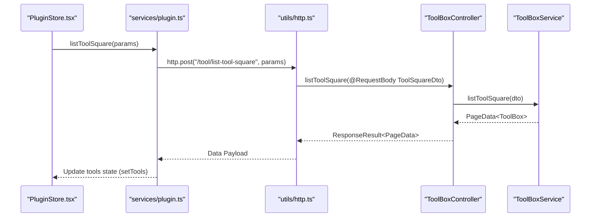
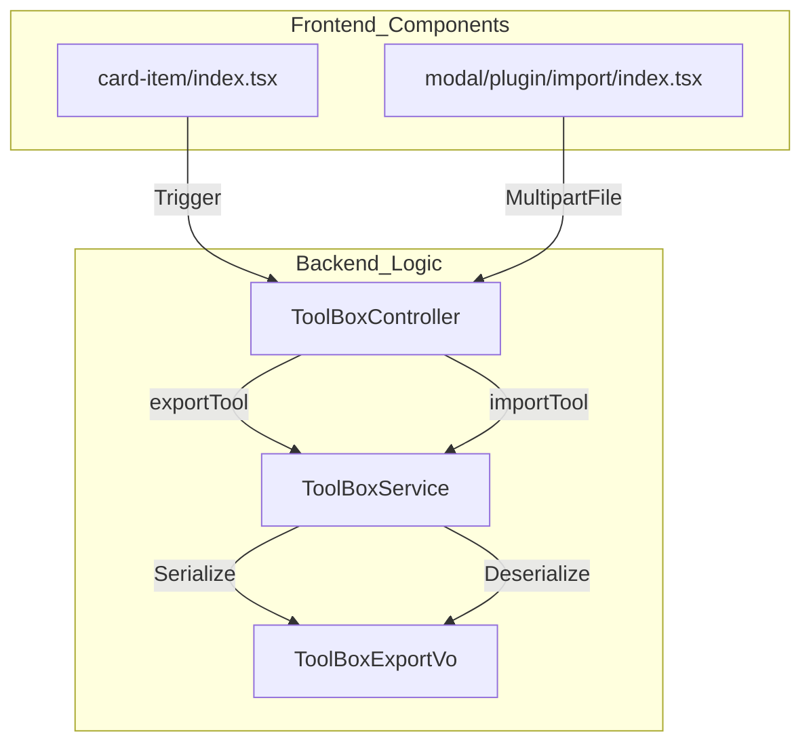

<!-- source: DeepWiki mcp.deepwiki.com · repo iflytek/astron-agent · page 6.5 Tool Marketplace and Sharing · fetched 2026-10-27 -->

# Tool Marketplace and Sharing

Relevant source files

The following files were used as context for generating this wiki page:

- [console/backend/hub/src/main/java/com/iflytek/astron/console/hub/controller/share/ShareController.java](console/backend/hub/src/main/java/com/iflytek/astron/console/hub/controller/share/ShareController.java)
- [console/backend/toolkit/src/main/java/com/iflytek/astron/console/toolkit/controller/knowledge/FileController.java](console/backend/toolkit/src/main/java/com/iflytek/astron/console/toolkit/controller/knowledge/FileController.java)
- [console/backend/toolkit/src/main/java/com/iflytek/astron/console/toolkit/controller/knowledge/RepoController.java](console/backend/toolkit/src/main/java/com/iflytek/astron/console/toolkit/controller/knowledge/RepoController.java)
- [console/backend/toolkit/src/main/java/com/iflytek/astron/console/toolkit/controller/model/ModelController.java](console/backend/toolkit/src/main/java/com/iflytek/astron/console/toolkit/controller/model/ModelController.java)
- [console/backend/toolkit/src/main/java/com/iflytek/astron/console/toolkit/controller/tool/ToolBoxController.java](console/backend/toolkit/src/main/java/com/iflytek/astron/console/toolkit/controller/tool/ToolBoxController.java)
- [console/backend/toolkit/src/main/java/com/iflytek/astron/console/toolkit/entity/core/openapi/SecurityScheme.java](console/backend/toolkit/src/main/java/com/iflytek/astron/console/toolkit/entity/core/openapi/SecurityScheme.java)
- [console/backend/toolkit/src/main/java/com/iflytek/astron/console/toolkit/entity/vo/ToolBoxExportVo.java](console/backend/toolkit/src/main/java/com/iflytek/astron/console/toolkit/entity/vo/ToolBoxExportVo.java)
- [console/backend/toolkit/src/main/java/com/iflytek/astron/console/toolkit/handler/MySqlJsonHandler.java](console/backend/toolkit/src/main/java/com/iflytek/astron/console/toolkit/handler/MySqlJsonHandler.java)
- [console/backend/toolkit/src/main/java/com/iflytek/astron/console/toolkit/service/database/DBExcelReadListener.java](console/backend/toolkit/src/main/java/com/iflytek/astron/console/toolkit/service/database/DBExcelReadListener.java)
- [console/backend/toolkit/src/main/java/com/iflytek/astron/console/toolkit/service/tool/ToolBoxService.java](console/backend/toolkit/src/main/java/com/iflytek/astron/console/toolkit/service/tool/ToolBoxService.java)
- [console/backend/toolkit/src/main/java/com/iflytek/astron/console/toolkit/sse/WorkflowSseEventSourceListener.java](console/backend/toolkit/src/main/java/com/iflytek/astron/console/toolkit/sse/WorkflowSseEventSourceListener.java)
- [console/frontend/src/assets/imgs/plugin/icon_export.png](console/frontend/src/assets/imgs/plugin/icon_export.png)
- [console/frontend/src/components/modal/plugin/hooks/use-create-tool.tsx](console/frontend/src/components/modal/plugin/hooks/use-create-tool.tsx)
- [console/frontend/src/components/modal/plugin/import/index.tsx](console/frontend/src/components/modal/plugin/import/index.tsx)
- [console/frontend/src/components/modal/plugin/index.tsx](console/frontend/src/components/modal/plugin/index.tsx)
- [console/frontend/src/components/workflow/nodes/agent/components/add-tool/components/mcp-detail.tsx](console/frontend/src/components/workflow/nodes/agent/components/add-tool/components/mcp-detail.tsx)
- [console/frontend/src/components/workflow/nodes/agent/components/add-tool/index.tsx](console/frontend/src/components/workflow/nodes/agent/components/add-tool/index.tsx)
- [console/frontend/src/components/workflow/types/modal/add-mcp.ts](console/frontend/src/components/workflow/types/modal/add-mcp.ts)
- [console/frontend/src/locales/en-En/plugin.ts](console/frontend/src/locales/en-En/plugin.ts)
- [console/frontend/src/locales/zh-ZH/plugin.ts](console/frontend/src/locales/zh-ZH/plugin.ts)
- [console/frontend/src/pages/plugin-store/detail/index.tsx](console/frontend/src/pages/plugin-store/detail/index.tsx)
- [console/frontend/src/pages/plugin-store/index.tsx](console/frontend/src/pages/plugin-store/index.tsx)
- [console/frontend/src/pages/resource-management/plugin-page/components/card-item/index.module.scss](console/frontend/src/pages/resource-management/plugin-page/components/card-item/index.module.scss)
- [console/frontend/src/pages/resource-management/plugin-page/components/card-item/index.tsx](console/frontend/src/pages/resource-management/plugin-page/components/card-item/index.tsx)
- [console/frontend/src/services/plugin.ts](console/frontend/src/services/plugin.ts)
- [console/frontend/src/types/global.d.ts](console/frontend/src/types/global.d.ts)

## Purpose and Scope

This document describes the Tool Marketplace (Plugin Square) and the sharing ecosystem within the Astron Agent platform. This system allows users to discover, favorite, provide feedback on, and manage the lifecycle of tools through import/export and versioning. It bridges the gap between private tool development and platform-wide tool distribution.

**Key Capabilities:**
- **Plugin Square**: A marketplace for discovering and installing public tools [console/frontend/src/pages/plugin-store/index.tsx:36-64]().
- **Favorite System**: User-specific bookmarking for frequently used tools with persistence in `user_favorite_tool` [console/backend/toolkit/src/main/java/com/iflytek/astron/console/toolkit/service/tool/ToolBoxService.java:134-152]().
- **Import/Export**: Portability of tool definitions via JSON/YAML files and multipart uploads [console/frontend/src/services/plugin.ts:151-163]().
- **Feedback & History**: User interaction tracking and quality reporting [console/frontend/src/services/plugin.ts:124-138]().
- **Versioning**: Management of tool iterations and latest version tracking [console/frontend/src/services/plugin.ts:107-122]().
- **MCP Integration**: Discovery and debugging of Model Context Protocol (MCP) servers within the tool ecosystem [console/frontend/src/components/workflow/nodes/agent/components/add-tool/components/mcp-detail.tsx:29-74]().

---

## Tool Marketplace (Plugin Square)

The Plugin Square is a centralized repository where tools published by different users or the platform itself are made available for discovery.

### Data Flow and Service Interaction

The marketplace logic is primarily handled by `listToolSquare`, which queries the tool repository for tools marked with a formal status.

Title: Tool Square Data Retrieval Flow

**Key Implementation Details:**
- **Status Filter**: Only tools with a formal status (typically status 1) are visible. The frontend triggers this via `listToolSquare` [console/frontend/src/services/plugin.ts:76-82]().
- **Search & Sort**: Supports searching by content and filtering by tags or categories using `ToolSquareDto` [console/backend/toolkit/src/main/java/com/iflytek/astron/console/toolkit/controller/tool/ToolBoxController.java:100-102]().
- **Categorization**: Tools are categorized using tags fetched via `getTags('tool_v2')` [console/frontend/src/pages/plugin-store/index.tsx:156-163]().

Sources: [console/frontend/src/services/plugin.ts:76-82](), [console/backend/toolkit/src/main/java/com/iflytek/astron/console/toolkit/controller/tool/ToolBoxController.java:98-102](), [console/frontend/src/pages/plugin-store/index.tsx:156-163]()

---

## Favorite and Feedback System

To enhance user engagement, the platform provides a favorite system and a feedback mechanism for reporting issues.

### Favorite System Implementation

Favorites allow users to bookmark tools for quick access. The backend manages this via `UserFavoriteToolMapper`.

- **Toggle Logic**: The `favorite` endpoint in `ToolBoxController` handles adding or removing tools from a user's collection [console/backend/toolkit/src/main/java/com/iflytek/astron/console/toolkit/controller/tool/ToolBoxController.java:105-111]().
- **Cache Integration**: The service uses Redis with a prefix `new:user:favorite:tool:` to optimize favorite lookups [console/backend/toolkit/src/main/java/com/iflytek/astron/console/toolkit/service/tool/ToolBoxService.java:152-154]().
- **UI Feedback**: `PluginStoreDetail` component tracks the favorite status and allows toggling via the favorite icon asset [console/frontend/src/pages/plugin-store/detail/index.tsx:25-26]().

### Feedback and Operation History

- **Feedback Submission**: Users submit remarks via the `toolFeedback` function, which sends a POST request to `/tool/feedback` [console/frontend/src/services/plugin.ts:124-138](). The backend stores this in `ToolBoxFeedbackMapper` [console/backend/toolkit/src/main/java/com/iflytek/astron/console/toolkit/service/tool/ToolBoxService.java:146-147]().
- **Operation Tracking**: `addToolOperateHistory` logs user interactions with tools to `ToolBoxOperateHistoryMapper` [console/backend/toolkit/src/main/java/com/iflytek/astron/console/toolkit/controller/tool/ToolBoxController.java:128-131]().

Sources: [console/backend/toolkit/src/main/java/com/iflytek/astron/console/toolkit/service/tool/ToolBoxService.java:134-154](), [console/backend/toolkit/src/main/java/com/iflytek/astron/console/toolkit/controller/tool/ToolBoxController.java:105-138](), [console/frontend/src/pages/plugin-store/detail/index.tsx:25-26]()

---

## Tool Import and Export

The platform supports portability through structured file formats, allowing tools to be migrated between different spaces or environments.

### Import/Export Implementation

Title: Tool Portability Architecture

**Implementation Details:**
- **Export**: The `exportTool` method in `ToolBoxService` serializes tool metadata into a `ToolBoxExportVo` which includes the `webSchema`, `authInfo`, and `icon` [console/backend/toolkit/src/main/java/com/iflytek/astron/console/toolkit/entity/vo/ToolBoxExportVo.java:11-64]().
- **Import**: The `importTool` method accepts a `MultipartFile` and reconstructs the tool entity [console/backend/toolkit/src/main/java/com/iflytek/astron/console/toolkit/controller/tool/ToolBoxController.java:155-159]().
- **Validation**: The `ImportModal` enforces a 20MB size limit and restricts file extensions to `.json` and `.yaml` [console/frontend/src/components/modal/plugin/import/index.tsx:16-30]().

Sources: [console/backend/toolkit/src/main/java/com/iflytek/astron/console/toolkit/entity/vo/ToolBoxExportVo.java:11-64](), [console/backend/toolkit/src/main/java/com/iflytek/astron/console/toolkit/service/tool/ToolBoxService.java:151-158](), [console/frontend/src/services/plugin.ts:151-163]()

---

## Tool Creation and Verification Lifecycle

Before a tool is shared in the marketplace, it must pass through a multi-step creation and debugging process managed by the `useCreateTool` hook.

### The Creation Wizard
The `StepIndicator` component defines three mandatory phases:
1. **Step 1: Fill Basic Info**: Captures name, description, and icons [console/frontend/src/components/modal/plugin/index.tsx:41-79]().
2. **Step 2: Add Plugin**: Configures endpoints, methods (GET/POST/PUT/DELETE), and parameters [console/frontend/src/components/modal/plugin/index.tsx:81-112]().
3. **Step 3: Debug and Verify**: Required step to ensure the tool is functional before publishing [console/frontend/src/components/modal/plugin/index.tsx:114-145]().

### Debugging Logic
- **Execution**: `debugTool(params)` sends the current configuration and test parameters to the backend for trial execution [console/frontend/src/services/plugin.ts:53-61]().
- **Validation**: The frontend validates that required parameters are filled using `validateDebuggerTransformedData` before allowing a debug run [console/frontend/src/pages/plugin-store/detail/index.tsx:98-129]().
- **Security**: The backend performs URL legality checks via `urlCheckTool.checkUrl` during the creation and debug process [console/backend/toolkit/src/main/java/com/iflytek/astron/console/toolkit/service/tool/ToolBoxService.java:175-177]().

Sources: [console/frontend/src/components/modal/plugin/index.tsx:41-147](), [console/backend/toolkit/src/main/java/com/iflytek/astron/console/toolkit/service/tool/ToolBoxService.java:160-185](), [console/frontend/src/pages/plugin-store/detail/index.tsx:98-129]()

---

## MCP Tool Integration

The platform integrates the Model Context Protocol (MCP), allowing external MCP servers to contribute tools to the marketplace ecosystem.

### Discovery and Detail
- **Server Listing**: `getMcpServerList` retrieves locally configured MCP servers [console/frontend/src/services/plugin.ts:84-86]().
- **Tool Inspection**: `getServerToolDetailAPI(serverId)` fetches the schema for tools provided by a specific MCP server [console/frontend/src/services/plugin.ts:88-94]().
- **MCP Debugging**: The `debugServerToolAPI` allows testing MCP tools by passing `mcpServerUrl`, `toolName`, and `toolArgs` [console/frontend/src/services/plugin.ts:96-104]().

### MCP UI Rendering
The `MCPDetail` component handles the rendering of MCP-specific tool information. It uses the `useMCPDetail` hook to manage input parameter changes and debug execution. It supports various parameter types including `string`, `boolean`, `integer`, and `number` [console/frontend/src/components/workflow/nodes/agent/components/add-tool/components/mcp-detail.tsx:153-220]().

Sources: [console/frontend/src/services/plugin.ts:84-104](), [console/frontend/src/components/workflow/nodes/agent/components/add-tool/components/mcp-detail.tsx:153-220](), [console/frontend/src/components/workflow/types/modal/add-mcp.ts:7-14]()

---

