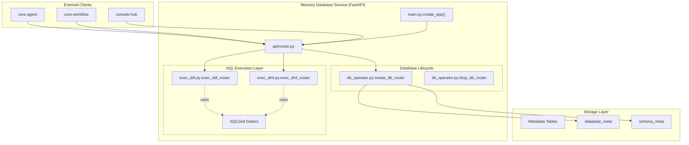
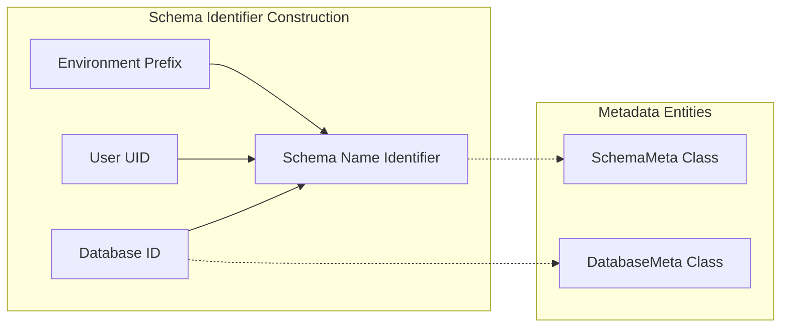

<!-- source: DeepWiki mcp.deepwiki.com · repo iflytek/astron-agent · page 7 Memory Database Service · fetched 2026-10-27 -->

# Memory Database Service

Relevant source files

The following files were used as context for generating this wiki page:

- [core/memory/database/alembic/README.md](core/memory/database/alembic/README.md)
- [core/memory/database/alembic/alembic.ini](core/memory/database/alembic/alembic.ini)
- [core/memory/database/alembic/env.py](core/memory/database/alembic/env.py)
- [core/memory/database/alembic/script.py.mako](core/memory/database/alembic/script.py.mako)
- [core/memory/database/alembic/versions/2026_02_11_1801-f2a4ce6e3198_init.py](core/memory/database/alembic/versions/2026_02_11_1801-f2a4ce6e3198_init.py)
- [core/memory/database/api/router.py](core/memory/database/api/router.py)
- [core/memory/database/api/v1/__init__.py](core/memory/database/api/v1/__init__.py)
- [core/memory/database/api/v1/common.py](core/memory/database/api/v1/common.py)
- [core/memory/database/api/v1/db_operator.py](core/memory/database/api/v1/db_operator.py)
- [core/memory/database/api/v1/exec_ddl.py](core/memory/database/api/v1/exec_ddl.py)
- [core/memory/database/api/v1/exec_dml.py](core/memory/database/api/v1/exec_dml.py)
- [core/memory/database/config.env](core/memory/database/config.env)
- [core/memory/database/domain/entity/general.py](core/memory/database/domain/entity/general.py)
- [core/memory/database/domain/entity/schema.py](core/memory/database/domain/entity/schema.py)
- [core/memory/database/domain/models/database_meta.py](core/memory/database/domain/models/database_meta.py)
- [core/memory/database/domain/models/schema_meta.py](core/memory/database/domain/models/schema_meta.py)
- [core/memory/database/exceptions/e.py](core/memory/database/exceptions/e.py)
- [core/memory/database/exceptions/error_code.py](core/memory/database/exceptions/error_code.py)
- [core/memory/database/main.py](core/memory/database/main.py)
- [core/memory/database/pyproject.toml](core/memory/database/pyproject.toml)
- [core/memory/database/repository/middleware/database/db_factory.py](core/memory/database/repository/middleware/database/db_factory.py)
- [core/memory/database/repository/middleware/database/db_manager.py](core/memory/database/repository/middleware/database/db_manager.py)
- [core/memory/database/repository/middleware/mid_utils.py](core/memory/database/repository/middleware/mid_utils.py)
- [core/memory/database/utils/retry.py](core/memory/database/utils/retry.py)
- [core/memory/database/uv.lock](core/memory/database/uv.lock)

The Memory Database Service (`core-database`) is a secure SQL execution layer running on port 7990 that provides multi-tenant isolated database management (PostgreSQL or MySQL) for AI agents and workflows. This Python FastAPI service enables dynamic database creation, schema management, and SQL execution with automatic security rewriting to enforce data isolation.

## Overview

The service implements a three-tier isolation strategy: schema-level namespacing (`{env}_{uid}_{database_id}`), row-level security through automatic UID filtering, and API-level access control. All DML statements are rewritten to inject `uid` conditions, and DDL statements are reconstructed from validated AST nodes to prevent SQL injection.

Key capabilities include:
- **Database Lifecycle:** Create, modify, and drop databases with production and test schemas. For details, see [Database Lifecycle Operations](#7.1).
- **DML Operations:** Execute SELECT/INSERT/UPDATE/DELETE with automatic security rewriting and parameterization. For details, see [DML Execution and SQL Rewriting](#7.2).
- **DDL Operations:** Execute CREATE/ALTER/DROP TABLE with AST validation and reconstruction. For details, see [DDL Execution and Security](#7.3).
- **Multi-Tenancy:** Schema-level isolation and row-level filtering via search path management. For details, see [Multi-Tenancy and Data Isolation](#7.4).

**Sources:** [core/memory/database/api/router.py:1-31](), [core/memory/database/api/v1/exec_dml.py:1-36](), [core/memory/database/api/v1/exec_ddl.py:1-32](), [core/memory/database/main.py:107-125]()

---

## Service Architecture Overview

The Memory Database Service exposes REST endpoints and organizes functionality into distinct routers. It bridges the Natural Language Space (agent queries) to the Code Entity Space (SQL execution) via secure transformation layers.

### System Components and Code Entities

**Key Components:**

| Component | File Path | Function | Purpose |
|-----------|-----------|----------|---------|
| `create_db_router` | [core/memory/database/api/v1/db_operator.py:35]() | `create_db()` | Entry point for DB creation |
| `exec_ddl_router` | [core/memory/database/api/v1/exec_ddl.py:32]() | `exec_ddl()` | Validates and executes DDL |
| `exec_dml_router` | [core/memory/database/api/v1/exec_dml.py:36]() | `exec_dml()` | Secure DML execution endpoint |
| `database_meta` | [core/memory/database/alembic/versions/2026_02_11_1801-f2a4ce6e3198_init.py:39-52]() | `op.create_table()` | Stores database ownership info |

**Sources:** [core/memory/database/api/router.py:1-31](), [core/memory/database/api/v1/db_operator.py:35-37](), [core/memory/database/api/v1/exec_dml.py:36](), [core/memory/database/main.py:107-125]()

---

## Schema Naming and Metadata

The service uses a strict naming convention to ensure that even if a user bypasses row-level filtering, they are restricted to their own schema/database.

**Naming Convention:**
- Production schema: `prod_{uid}_{database_id}` [core/memory/database/api/v1/db_operator.py:83]()
- Test schema: `test_{uid}_{database_id}` [core/memory/database/api/v1/db_operator.py:84]()
- Metadata Tables: `database_meta` and `schema_meta` track ownership and mapping. [core/memory/database/alembic/versions/2026_02_11_1801-f2a4ce6e3198_init.py:39-97]()

**Sources:** [core/memory/database/api/v1/db_operator.py:83-84](), [core/memory/database/alembic/versions/2026_02_11_1801-f2a4ce6e3198_init.py:39-108]()

---

## Database Lifecycle Operations

The service manages the full lifecycle of memory databases, ensuring that production and test environments are initialized with correct permissions.

- **Creation:** Generates a unique Snowflake ID via `get_id()` and creates two physical schemas (prod/test) using the configured adapter. [core/memory/database/api/v1/db_operator.py:74-94]()
- **Metadata Management:** Persists ownership and schema mapping into `DatabaseMeta` and `SchemaMeta` models. [core/memory/database/api/v1/db_operator.py:96-114]()
- **Modification:** Allows updating database descriptions via `modify_db_description_router`. [core/memory/database/api/v1/db_operator.py:37]()

For details, see [Database Lifecycle Operations](#7.1).

**Sources:** [core/memory/database/api/v1/db_operator.py:70-117](), [core/memory/database/api/v1/db_operator.py:122-184]()

---

## DML Execution and SQL Rewriting

The `exec_dml` endpoint implements a sophisticated rewriter using `sqlglot` to prevent SQL injection and enforce multi-tenancy.

- **Literal Mapping:** The service builds a map of literals to columns for safe parameterization during `INSERT`, `UPDATE`, and `SELECT` operations. [core/memory/database/api/v1/exec_dml.py:41-101]()
- **Recursive Resolution:** Handles complex WHERE clauses by recursively mapping literals to their corresponding table columns. [core/memory/database/api/v1/exec_dml.py:125-140]()
- **Dialect Awareness:** Uses `get_adapter().get_sqlglot_dialect()` to ensure SQL is parsed correctly for either MySQL or PostgreSQL environments. [core/memory/database/api/v1/exec_ddl.py:58-59]()

For details, see [DML Execution and SQL Rewriting](#7.2).

**Sources:** [core/memory/database/api/v1/exec_dml.py:41-140](), [core/memory/database/api/v1/exec_ddl.py:58-59]()

---

## DDL Execution and Security

DDL operations are restricted to a safe whitelist of operations to prevent destructive actions or privilege escalation.

- **Whitelisted Operations:** Only `CREATE TABLE`, `ALTER TABLE`, `DROP TABLE`, `DROP DATABASE`, `COMMENT`, and `RENAME` are permitted. [core/memory/database/api/v1/exec_ddl.py:34-41]()
- **AST Validation:** Uses `sqlglot` to parse the statement and verify the `full_type` matches the whitelist. [core/memory/database/api/v1/exec_ddl.py:59-80]()
- **Identifier Protection:** Validates that new column or table names do not use reserved keywords or dangerous functions. [core/memory/database/api/v1/exec_ddl.py:180-200]()

For details, see [DDL Execution and Security](#7.3).

**Sources:** [core/memory/database/api/v1/exec_ddl.py:34-80](), [core/memory/database/api/v1/exec_ddl.py:180-209]()

---

## Multi-Tenancy and Data Isolation

Isolation is achieved through schema namespacing and session-level path management.

- **Schema Search Path:** The service dynamically sets the search path before execution via `set_search_path_by_schema` to isolate tenant data. [core/memory/database/domain/entity/schema.py:10-21]()
- **Ownership Verification:** Functions like `check_database_exists_by_did_uid` ensure that the requesting `uid` actually owns the target `database_id`. [core/memory/database/api/v1/common.py:22-47]()
- **Reserved Keyword Blocking:** Prevents tenants from using system-reserved keywords or functions that could leak platform information. [core/memory/database/api/v1/common.py:122-151]()

For details, see [Multi-Tenancy and Data Isolation](#7.4).

**Sources:** [core/memory/database/api/v1/common.py:22-47](), [core/memory/database/api/v1/common.py:122-151](), [core/memory/database/domain/entity/schema.py:10-21]()

---

