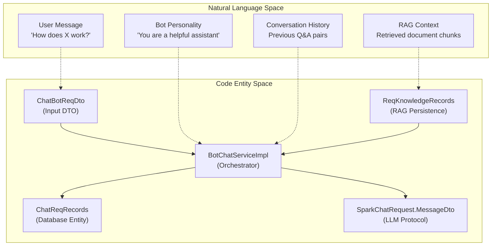
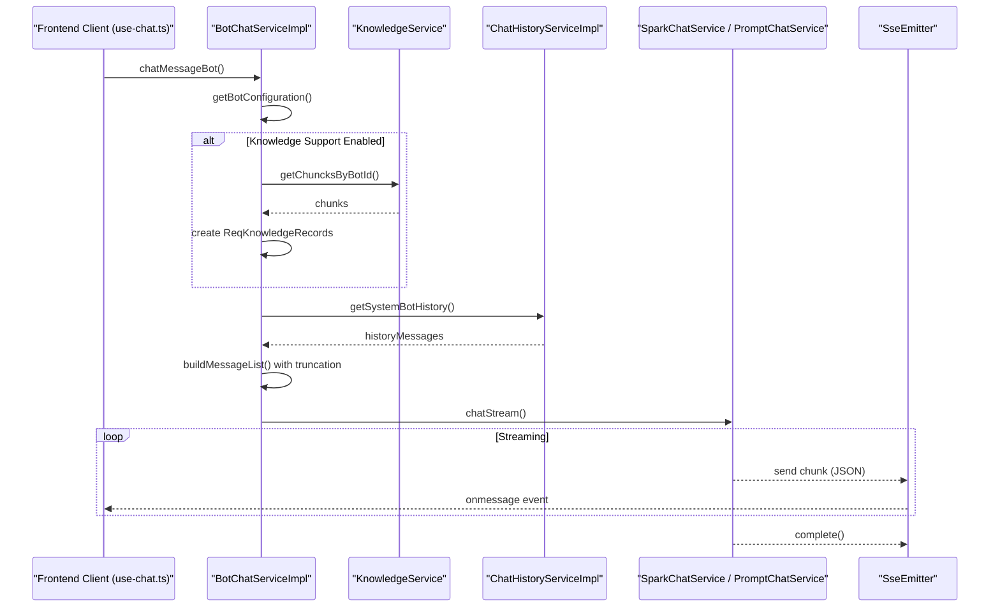
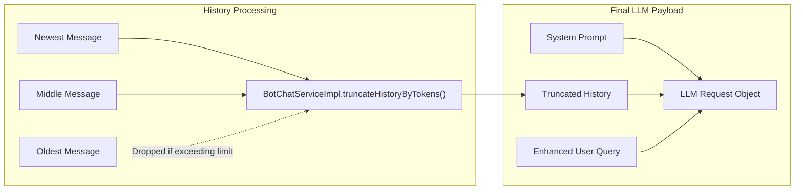

<!-- source: DeepWiki mcp.deepwiki.com · repo iflytek/astron-agent · page 8 Chat and Conversation System · fetched 2026-10-27 -->

# Chat and Conversation System

Relevant source files

The following files were used as context for generating this wiki page:

- [console/backend/commons/src/main/java/com/iflytek/astron/console/commons/entity/bot/ChatBotMarket.java](console/backend/commons/src/main/java/com/iflytek/astron/console/commons/entity/bot/ChatBotMarket.java)
- [console/backend/commons/src/main/java/com/iflytek/astron/console/commons/service/data/ChatHistoryService.java](console/backend/commons/src/main/java/com/iflytek/astron/console/commons/service/data/ChatHistoryService.java)
- [console/backend/hub/src/main/java/com/iflytek/astron/console/hub/service/bot/impl/BotTransactionalServiceImpl.java](console/backend/hub/src/main/java/com/iflytek/astron/console/hub/service/bot/impl/BotTransactionalServiceImpl.java)
- [console/backend/hub/src/main/java/com/iflytek/astron/console/hub/service/chat/impl/BotChatServiceImpl.java](console/backend/hub/src/main/java/com/iflytek/astron/console/hub/service/chat/impl/BotChatServiceImpl.java)
- [console/backend/hub/src/main/java/com/iflytek/astron/console/hub/service/chat/impl/ChatHistoryServiceImpl.java](console/backend/hub/src/main/java/com/iflytek/astron/console/hub/service/chat/impl/ChatHistoryServiceImpl.java)
- [console/backend/hub/src/main/java/com/iflytek/astron/console/hub/service/knowledge/impl/KnowledgeServiceImpl.java](console/backend/hub/src/main/java/com/iflytek/astron/console/hub/service/knowledge/impl/KnowledgeServiceImpl.java)
- [console/backend/hub/src/test/java/com/iflytek/astron/console/hub/service/knowledge/impl/KnowledgeServiceImplTest.java](console/backend/hub/src/test/java/com/iflytek/astron/console/hub/service/knowledge/impl/KnowledgeServiceImplTest.java)
- [console/backend/hub/src/test/java/com/iflytek/astron/console/hub/service/share/impl/ShareServiceImplTest.java](console/backend/hub/src/test/java/com/iflytek/astron/console/hub/service/share/impl/ShareServiceImplTest.java)
- [console/frontend/src/components/prompt-try/index.tsx](console/frontend/src/components/prompt-try/index.tsx)
- [console/frontend/src/components/prompt-try/input-box.tsx](console/frontend/src/components/prompt-try/input-box.tsx)
- [console/frontend/src/components/prompt-try/message-list.tsx](console/frontend/src/components/prompt-try/message-list.tsx)
- [console/frontend/src/hooks/use-chat.ts](console/frontend/src/hooks/use-chat.ts)
- [console/frontend/src/locales/en-En/openPlatform-En/chatPage.ts](console/frontend/src/locales/en-En/openPlatform-En/chatPage.ts)
- [console/frontend/src/locales/zh-ZH/openPlatform-ZH/chatPage.ts](console/frontend/src/locales/zh-ZH/openPlatform-ZH/chatPage.ts)
- [console/frontend/src/pages/chat-page/components/message-list.tsx](console/frontend/src/pages/chat-page/components/message-list.tsx)
- [console/frontend/src/pages/chat-page/components/resq-bottom-buttons.tsx](console/frontend/src/pages/chat-page/components/resq-bottom-buttons.tsx)
- [console/frontend/src/pages/chat-page/index.tsx](console/frontend/src/pages/chat-page/index.tsx)
- [console/frontend/src/store/chat-store.ts](console/frontend/src/store/chat-store.ts)
- [console/frontend/src/styles/classes.scss](console/frontend/src/styles/classes.scss)
- [console/frontend/src/utils/index.ts](console/frontend/src/utils/index.ts)

## Purpose and Scope

The Chat and Conversation System provides real-time conversational AI capabilities with knowledge base integration, context-aware history management, and streaming responses. It orchestrates message processing, bot configuration resolution, knowledge enhancement, token-based history truncation, and multi-provider LLM integration. [console/backend/hub/src/main/java/com/iflytek/astron/console/hub/service/chat/impl/BotChatServiceImpl.java:64-141]()

The system handles standard conversational bots, complex workflow-based agents, and supports both proprietary iFLYTEK Spark models and custom OpenAI-compatible providers. It also includes a managed web search capability and tool execution via a provider orchestrator. [console/backend/hub/src/main/java/com/iflytek/astron/console/hub/service/chat/impl/BotChatServiceImpl.java:138-141]()

For details on specific subsystems, see:
- [Chat Service Architecture](#8.1) — `BotChatServiceImpl` structure and delegation patterns.
- [Message Processing and Token Management](#8.2) — History truncation, token estimation, and message structure assembly.
- [Knowledge-Enhanced Chat Flow](#8.3) — RAG integration, chunk retrieval, and history enhancement.
- [LLM Provider Integration](#8.4) — Selection between Spark and custom models, and provider-specific services.
- [Streaming Responses with SSE](#8.5) — Server-Sent Events implementation and emitter management.

**Sources:** [console/backend/hub/src/main/java/com/iflytek/astron/console/hub/service/chat/impl/BotChatServiceImpl.java:64-141]()

---

## System Architecture

The chat system implements a layered service architecture with clear separation between message orchestration, history management, knowledge integration, and LLM communication.

### Chat System Entity Mapping

This diagram bridges the Natural Language concepts to the specific Code Entities that manage them.

**Sources:** [console/backend/hub/src/main/java/com/iflytek/astron/console/hub/service/chat/impl/BotChatServiceImpl.java:124-141](), [console/backend/hub/src/main/java/com/iflytek/astron/console/hub/service/chat/impl/ChatHistoryServiceImpl.java:67-90](), [console/backend/hub/src/main/java/com/iflytek/astron/console/hub/entity/ReqKnowledgeRecords.java:1-15]()

---

## Chat Message Flow

The primary chat flow begins with `chatMessageBot()` and proceeds through configuration resolution, knowledge enhancement, history retrieval, and provider routing. For workflow-based bots, it delegates to `WorkflowBotChatService`. [console/backend/hub/src/main/java/com/iflytek/astron/console/hub/service/chat/impl/BotChatServiceImpl.java:124-132]()

For details, see [Chat Service Architecture](#8.1) and [Streaming Responses with SSE](#8.5).

**Sources:** [console/backend/hub/src/main/java/com/iflytek/astron/console/hub/service/chat/impl/BotChatServiceImpl.java:124-145](), [console/frontend/src/hooks/use-chat.ts:131-142]()

---

## Knowledge Base Integration

When a bot has knowledge base support enabled, the system retrieves relevant chunks and injects them into the user's query. This process is handled by `KnowledgeService` and persisted via `ReqKnowledgeRecordsDataService`. [console/backend/hub/src/main/java/com/iflytek/astron/console/hub/service/chat/impl/BotChatServiceImpl.java:82-109]()

### Knowledge Enhancement Logic
The `ChatHistoryServiceImpl` enhances historical messages by wrapping them with knowledge records. If `supportDocument` is true, it calls `enhanceAskWithKnowledgeRecord()` to combine the original user message with retrieved context chunks using an i18n template. [console/backend/hub/src/main/java/com/iflytek/astron/console/hub/service/chat/impl/ChatHistoryServiceImpl.java:74-80]()

For details, see [Knowledge-Enhanced Chat Flow](#8.3).

**Sources:** [console/backend/hub/src/main/java/com/iflytek/astron/console/hub/service/chat/impl/ChatHistoryServiceImpl.java:44-92](), [console/backend/hub/src/main/java/com/iflytek/astron/console/hub/service/chat/impl/BotChatServiceImpl.java:137-143]()

---

## LLM Provider and Workflow Integration

The system supports multiple LLM backends and integrates deeply with a workflow engine for complex task execution. [console/backend/hub/src/main/java/com/iflytek/astron/console/hub/service/chat/impl/BotChatServiceImpl.java:129-131]()

### Provider Capability Matrix

| Feature | Handler Service | Implementation |
| :--- | :--- | :--- |
| **Spark Native** | `SparkChatService` | iFLYTEK Spark protocol [console/backend/hub/src/main/java/com/iflytek/astron/console/hub/service/chat/impl/BotChatServiceImpl.java:141]() |
| **Custom LLM** | `PromptChatService` | OpenAI-compatible/Custom models [console/backend/hub/src/main/java/com/iflytek/astron/console/hub/service/chat/impl/BotChatServiceImpl.java:146-150]() |
| **Workflow Bot** | `WorkflowBotChatService` | Orchestrated node execution [console/backend/hub/src/main/java/com/iflytek/astron/console/hub/service/chat/impl/BotChatServiceImpl.java:131]() |

### Workflow Model Sync
When a bot is updated or copied via `BotTransactionalServiceImpl.copyBot()`, the system ensures configuration and personality settings are preserved and synchronized to the appropriate workflow runtime. [console/backend/hub/src/main/java/com/iflytek/astron/console/hub/service/bot/impl/BotTransactionalServiceImpl.java:48-68]()

For details, see [LLM Provider Integration](#8.4).

**Sources:** [console/backend/hub/src/main/java/com/iflytek/astron/console/hub/service/chat/impl/BotChatServiceImpl.java:129-150](), [console/backend/hub/src/main/java/com/iflytek/astron/console/hub/service/bot/impl/BotTransactionalServiceImpl.java:48-68]()

---

## Token and History Management

To stay within model limits, the system manages context length using `maxInputTokens`. The history is retrieved and then truncated to fit within the model's allowed context window. [console/backend/hub/src/main/java/com/iflytek/astron/console/hub/service/chat/impl/BotChatServiceImpl.java:84-85]()

### Context Assembly Components

For details, see [Message Processing and Token Management](#8.2).

**Sources:** [console/backend/hub/src/main/java/com/iflytek/astron/console/hub/service/chat/impl/BotChatServiceImpl.java:137-143](), [console/backend/hub/src/main/java/com/iflytek/astron/console/hub/service/chat/impl/ChatHistoryServiceImpl.java:156-158]()

---

## Real-time Streaming (SSE)

Streaming responses are managed by `SparkChatService` and `PromptChatService` in the backend, while the frontend uses `fetchEventSource` to process the stream. [console/frontend/src/hooks/use-chat.ts:131-142]()

### Streaming Features
- **SSE Data Handling:** The frontend `useChat` hook parses `SSEData` objects containing `choices`, `reasoning_content` (thinking chain), and `tool_calls`. [console/frontend/src/hooks/use-chat.ts:10-35]()
- **Reasoning Content:** Support for "thinking" deltas in the stream is handled by checking `choices[0].delta.reasoning_content`. [console/frontend/src/hooks/use-chat.ts:181-186]()
- **Tool Tracing:** Model-returned tool calls are extracted and displayed as trace sources in the UI. [console/frontend/src/hooks/use-chat.ts:169-179]()
- **Interactive Elements:** The UI supports re-answering, audio playback via `TtsModule`, and multimodal content display. [console/frontend/src/pages/chat-page/components/resq-bottom-buttons.tsx:130-185](), [console/frontend/src/pages/chat-page/components/message-list.tsx:183-207]()

For details, see [Streaming Responses with SSE](#8.5).

**Sources:** [console/frontend/src/hooks/use-chat.ts:10-35](), [console/frontend/src/hooks/use-chat.ts:131-186](), [console/frontend/src/pages/chat-page/components/resq-bottom-buttons.tsx:130-185]()

---

