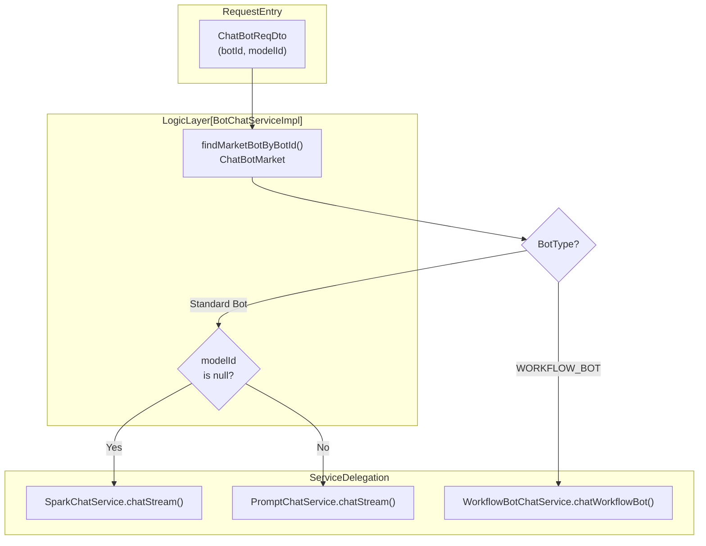
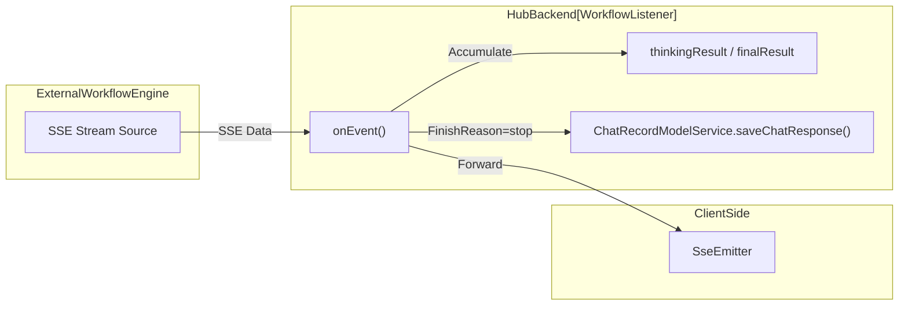

<!-- source: DeepWiki mcp.deepwiki.com · repo iflytek/astron-agent · page 8.4 LLM Provider Integration · fetched 2026-10-27 -->

# LLM Provider Integration

Relevant source files

The following files were used as context for generating this wiki page:

- [console/backend/commons/src/main/java/com/iflytek/astron/console/commons/util/S3ClientUtil.java](console/backend/commons/src/main/java/com/iflytek/astron/console/commons/util/S3ClientUtil.java)
- [console/backend/commons/src/main/java/com/iflytek/astron/console/commons/util/SseEmitterUtil.java](console/backend/commons/src/main/java/com/iflytek/astron/console/commons/util/SseEmitterUtil.java)
- [console/backend/commons/src/main/java/com/iflytek/astron/console/commons/util/space/SpaceInfoUtil.java](console/backend/commons/src/main/java/com/iflytek/astron/console/commons/util/space/SpaceInfoUtil.java)
- [console/backend/commons/src/main/java/com/iflytek/astron/console/commons/workflow/WorkflowClient.java](console/backend/commons/src/main/java/com/iflytek/astron/console/commons/workflow/WorkflowClient.java)
- [console/backend/commons/src/main/java/com/iflytek/astron/console/commons/workflow/WorkflowListener.java](console/backend/commons/src/main/java/com/iflytek/astron/console/commons/workflow/WorkflowListener.java)
- [console/backend/commons/src/test/java/com/iflytek/astron/console/commons/data/impl/UserInfoDataServiceImplUnitTest.java](console/backend/commons/src/test/java/com/iflytek/astron/console/commons/data/impl/UserInfoDataServiceImplUnitTest.java)
- [console/backend/commons/src/test/java/com/iflytek/astron/console/commons/service/data/impl/ChatListDataServiceImplTest.java](console/backend/commons/src/test/java/com/iflytek/astron/console/commons/service/data/impl/ChatListDataServiceImplTest.java)
- [console/backend/commons/src/test/java/com/iflytek/astron/console/commons/service/data/impl/UserLangChainInfoDataServiceImplTest.java](console/backend/commons/src/test/java/com/iflytek/astron/console/commons/service/data/impl/UserLangChainInfoDataServiceImplTest.java)
- [console/backend/commons/src/test/java/com/iflytek/astron/console/commons/service/space/impl/ApplyRecordServiceImplTest.java](console/backend/commons/src/test/java/com/iflytek/astron/console/commons/service/space/impl/ApplyRecordServiceImplTest.java)
- [console/backend/commons/src/test/java/com/iflytek/astron/console/commons/util/S3ClientUtilTest.java](console/backend/commons/src/test/java/com/iflytek/astron/console/commons/util/S3ClientUtilTest.java)
- [console/backend/hub/src/main/java/com/iflytek/astron/console/hub/controller/chat/ChatEnhanceController.java](console/backend/hub/src/main/java/com/iflytek/astron/console/hub/controller/chat/ChatEnhanceController.java)
- [console/backend/hub/src/main/java/com/iflytek/astron/console/hub/controller/chat/ChatListController.java](console/backend/hub/src/main/java/com/iflytek/astron/console/hub/controller/chat/ChatListController.java)
- [console/backend/hub/src/main/java/com/iflytek/astron/console/hub/controller/extra/RtasrController.java](console/backend/hub/src/main/java/com/iflytek/astron/console/hub/controller/extra/RtasrController.java)
- [console/backend/hub/src/main/java/com/iflytek/astron/console/hub/converter/BotPublishConverter.java](console/backend/hub/src/main/java/com/iflytek/astron/console/hub/converter/BotPublishConverter.java)
- [console/backend/hub/src/main/java/com/iflytek/astron/console/hub/service/ManagedWebSearchService.java](console/backend/hub/src/main/java/com/iflytek/astron/console/hub/service/ManagedWebSearchService.java)
- [console/backend/hub/src/main/java/com/iflytek/astron/console/hub/service/PromptChatService.java](console/backend/hub/src/main/java/com/iflytek/astron/console/hub/service/PromptChatService.java)
- [console/backend/hub/src/main/java/com/iflytek/astron/console/hub/service/SparkChatService.java](console/backend/hub/src/main/java/com/iflytek/astron/console/hub/service/SparkChatService.java)
- [console/backend/hub/src/main/java/com/iflytek/astron/console/hub/service/WorkflowChatService.java](console/backend/hub/src/main/java/com/iflytek/astron/console/hub/service/WorkflowChatService.java)
- [console/backend/hub/src/main/java/com/iflytek/astron/console/hub/service/chat/impl/ProviderToolOrchestrator.java](console/backend/hub/src/main/java/com/iflytek/astron/console/hub/service/chat/impl/ProviderToolOrchestrator.java)
- [console/backend/hub/src/test/java/com/iflytek/astron/console/hub/service/PromptChatServiceTest.java](console/backend/hub/src/test/java/com/iflytek/astron/console/hub/service/PromptChatServiceTest.java)
- [console/backend/hub/src/test/java/com/iflytek/astron/console/hub/service/chat/impl/BotChatServiceImplUnitTest.java](console/backend/hub/src/test/java/com/iflytek/astron/console/hub/service/chat/impl/BotChatServiceImplUnitTest.java)
- [console/backend/pom.xml](console/backend/pom.xml)
- [console/backend/toolkit/src/main/java/com/iflytek/astron/console/toolkit/service/model/LLMService.java](console/backend/toolkit/src/main/java/com/iflytek/astron/console/toolkit/service/model/LLMService.java)
- [console/backend/toolkit/src/main/java/com/iflytek/astron/console/toolkit/service/workflow/WorkflowExportService.java](console/backend/toolkit/src/main/java/com/iflytek/astron/console/toolkit/service/workflow/WorkflowExportService.java)

## Purpose and Scope

This document describes how the Astron Agent platform integrates with Large Language Model (LLM) providers, including the built-in iFLYTEK Spark provider and custom OpenAI-compatible model providers. It covers the provider selection logic, model configuration retrieval, context length parsing, and provider-specific chat services.

The integration layer spans across the **Console Backend (Hub)** for orchestration, the **Console Toolkit** for model metadata management, and the **Core Workflow** service for agent execution.

---

## Provider Selection Architecture

The system supports multiple integration paths, selected at runtime based on bot configuration or model metadata.

1.  **Spark Provider**: iFLYTEK's proprietary Spark LLM, integrated via `SparkChatService` [console/backend/hub/src/main/java/com/iflytek/astron/console/hub/service/SparkChatService.java:37]().
2.  **Custom Provider**: OpenAI-compatible API endpoints. Supported providers include `openai`, `anthropic`, `google`, `deepseek`, `minimax`, `zhipu`, `qwen`, `moonshot`, `chatgpt`, and `doubao` [console/backend/toolkit/src/main/java/com/iflytek/astron/console/toolkit/service/model/LLMService.java:61-71]().
3.  **Workflow LLM Providers**: The platform integrates with external workflow engines through `WorkflowBotChatService` [console/backend/hub/src/test/java/com/iflytek/astron/console/hub/service/chat/impl/BotChatServiceImplUnitTest.java:57]().

### Chat Provider Selection Flow

The `BotChatServiceImpl` determines the routing logic for chat requests based on the bot version and the presence of a `modelId`.

"Chat Provider Selection Flow"

**Sources:** [console/backend/hub/src/test/java/com/iflytek/astron/console/hub/service/chat/impl/BotChatServiceImplUnitTest.java:86-160](), [console/backend/hub/src/main/java/com/iflytek/astron/console/hub/service/chat/impl/ProviderToolOrchestrator.java:32-47]()

---

## Model Configuration and Management

The `LLMService` handles model authorization, filtering, and configuration retrieval. It manages model metadata stored in the `Model` and `ConfigInfo` tables [console/backend/toolkit/src/main/java/com/iflytek/astron/console/toolkit/service/model/LLMService.java:72-87]().

### Configuration Retrieval and Parsing

For custom models, the system retrieves metadata including provider type and model capabilities.

*   **Provider Normalization**: The `ProviderToolOrchestrator` normalizes provider strings to lowercase and defaults to `openai` if blank [console/backend/hub/src/main/java/com/iflytek/astron/console/hub/service/chat/impl/ProviderToolOrchestrator.java:74-79]().
*   **Authorization List**: `getLlmAuthList` filters available models based on scene (e.g., workflow) and node type (e.g., agent, plan, summary) [console/backend/toolkit/src/main/java/com/iflytek/astron/console/toolkit/service/model/LLMService.java:105-114]().
*   **Self-Models**: Users can integrate custom models which are categorized as "My Models" or "Custom Models" [console/backend/toolkit/src/main/java/com/iflytek/astron/console/toolkit/service/model/LLMService.java:128-134]().

---

## iFLYTEK Spark Integration

The Spark provider is the platform's native integration, supporting specialized features like web search and "thinking" capabilities.

### Backend Implementation (`SparkChatService`)

The backend uses `SparkChatClient` to communicate with the model via a signature-based HTTP protocol using `apiPassword` [console/backend/hub/src/main/java/com/iflytek/astron/console/hub/service/SparkChatService.java:39-41]().

*   **Model Mapping**: The `getSparkModel` function maps internal strings to `SparkModel` enums. "spark" maps to `SPARK_4_0_ULTRA`, while others default to `SPARK_X1` [console/backend/hub/src/main/java/com/iflytek/astron/console/hub/service/SparkChatService.java:129-138]().
*   **Web Search**: If `enableWebSearch` is true, the service configures a `WebSearch` object within `SparkChatParam` [console/backend/hub/src/main/java/com/iflytek/astron/console/hub/service/SparkChatService.java:159-167]().
*   **SSE Streaming**: Responses are processed as a stream and emitted via `SseEmitter` [console/backend/hub/src/main/java/com/iflytek/astron/console/hub/service/SparkChatService.java:110-115]().

---

## Custom Provider Integration

Custom models use OpenAI-compatible API endpoints, handled primarily by `PromptChatService`.

### Prompt Chat Service (`PromptChatService`)

The `PromptChatService` manages communication with non-Spark providers using an `OkHttpClient` [console/backend/hub/src/main/java/com/iflytek/astron/console/hub/service/PromptChatService.java:36]().

*   **Google Gemini**: Uses the `x-goog-api-key` header and appends `?alt=sse` to the URL for streaming [console/backend/hub/src/test/java/com/iflytek/astron/console/hub/service/PromptChatServiceTest.java:163-167]().
*   **Anthropic**: Requires a specific beta header (`web-search-2025-03-05`) for native search capabilities [console/backend/hub/src/main/java/com/iflytek/astron/console/hub/service/chat/impl/ProviderToolOrchestrator.java:61]().
*   **Managed Web Search**: For OpenAI-compatible providers without native search, the system injects an `ifly_search` function tool [console/backend/hub/src/main/java/com/iflytek/astron/console/hub/service/chat/impl/ProviderToolOrchestrator.java:110-130]().

### Tool Orchestration Matrix

The `ProviderToolOrchestrator` defines how search capabilities are mapped across providers [console/backend/hub/src/main/java/com/iflytek/astron/console/hub/service/chat/impl/ProviderToolOrchestrator.java:17-21]().

| Provider | Web Search Mode | Implementation |
| :--- | :--- | :--- |
| **Spark** | `SPARK_NATIVE` | `SparkChatRequest.enableWebSearch` |
| **Google** | `GOOGLE_NATIVE` | `tools.google_search` |
| **Anthropic** | `ANTHROPIC_NATIVE` | `web_search` tool + beta header |
| **Others** | `OPENAI_FUNCTION` | `ifly_search` function tool |

**Sources:** [console/backend/hub/src/main/java/com/iflytek/astron/console/hub/service/chat/impl/ProviderToolOrchestrator.java:32-46](), [console/backend/hub/src/main/java/com/iflytek/astron/console/hub/service/PromptChatService.java:81-91]()

---

## Workflow Integration and Streaming

The platform uses a listener pattern to handle streaming responses from workflow-based bots.

### Workflow Listener (`WorkflowListener`)

The `WorkflowListener` extends `EventSourceListener` to process Server-Sent Events (SSE) from the workflow execution engine [console/backend/commons/src/main/java/com/iflytek/astron/console/commons/workflow/WorkflowListener.java:32]().

*   **Interruption Handling**: Monitors `SseEmitterUtil.isStreamStopped` to handle client-side cancellations, ensuring generated "thinking" and "final" results are persisted even if the connection is severed [console/backend/commons/src/main/java/com/iflytek/astron/console/commons/workflow/WorkflowListener.java:66-77]().
*   **Result Accumulation**: Separately buffers `thinkingResult` (reasoning content) and `finalResult` (answer content) from the SSE chunks [console/backend/commons/src/main/java/com/iflytek/astron/console/commons/workflow/WorkflowListener.java:94-104]().
*   **Data Persistence**: Calls `ChatRecordModelService` to save results once the `finish_reason` is "stop" or "interrupt" [console/backend/commons/src/main/java/com/iflytek/astron/console/commons/workflow/WorkflowListener.java:116-132]().

"Workflow SSE Integration"

**Sources:** [console/backend/commons/src/main/java/com/iflytek/astron/console/commons/workflow/WorkflowListener.java:63-140](), [console/backend/hub/src/main/java/com/iflytek/astron/console/hub/service/chat/impl/BotChatServiceImpl.java:101]()

---

## Infrastructure and Storage

### Object Storage (MinIO)

The platform uses MinIO (S3 compatible) for storing assets, handled by `S3ClientUtil` [console/backend/commons/src/main/java/com/iflytek/astron/console/commons/util/S3ClientUtil.java:38]().

*   **Client Initialization**: Initializes a `MinioClient` and a `presignClient` (using `remoteEndpoint`) for generating temporary URLs [console/backend/commons/src/main/java/com/iflytek/astron/console/commons/util/S3ClientUtil.java:74-84]().
*   **Public Read**: Can be configured via `enablePublicRead` to set a bucket policy allowing anonymous `s3:GetObject` actions [console/backend/commons/src/main/java/com/iflytek/astron/console/commons/util/S3ClientUtil.java:98-106]().
*   **Presigned URLs**: Generates URLs with a configurable expiry (default 600s) for secure frontend access [console/backend/commons/src/main/java/com/iflytek/astron/console/commons/util/S3ClientUtil.java:56-57]().

**Sources:** [console/backend/commons/src/main/java/com/iflytek/astron/console/commons/util/S3ClientUtil.java:152-169](), [console/backend/commons/src/test/java/com/iflytek/astron/console/commons/util/S3ClientUtilTest.java:109-114]()

---

