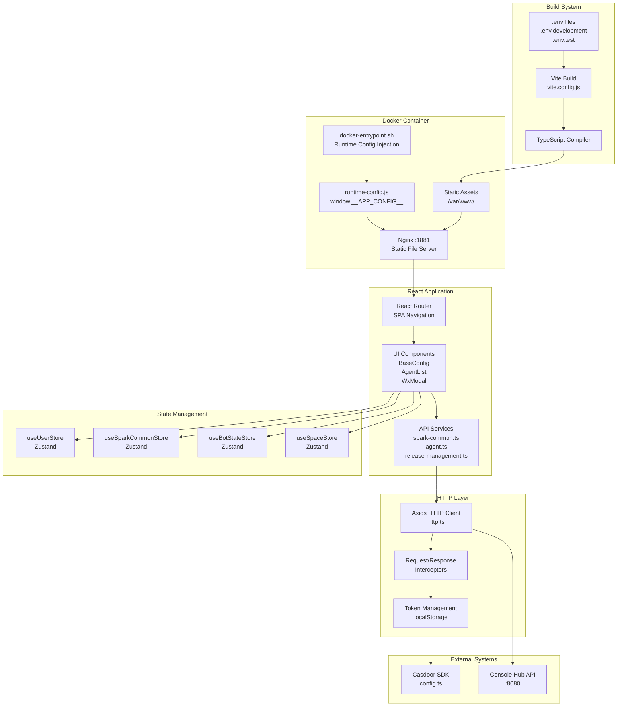
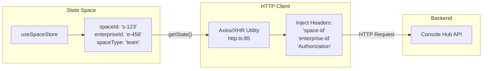

<!-- source: DeepWiki mcp.deepwiki.com · repo iflytek/astron-agent · page 9 Console Frontend Application · fetched 2026-10-27 -->

# Console Frontend Application

Relevant source files

The following files were used as context for generating this wiki page:

- [console/backend/hub/src/main/java/com/iflytek/astron/console/hub/service/bot/impl/TalkAgentServiceImpl.java](console/backend/hub/src/main/java/com/iflytek/astron/console/hub/service/bot/impl/TalkAgentServiceImpl.java)
- [console/frontend/.env.development](console/frontend/.env.development)
- [console/frontend/.env.production](console/frontend/.env.production)
- [console/frontend/.env.test](console/frontend/.env.test)
- [console/frontend/Dockerfile](console/frontend/Dockerfile)
- [console/frontend/docker-entrypoint.sh](console/frontend/docker-entrypoint.sh)
- [console/frontend/src/components/config-page-component/config-base/index.tsx](console/frontend/src/components/config-page-component/config-base/index.tsx)
- [console/frontend/src/components/create-application-modal/index.tsx](console/frontend/src/components/create-application-modal/index.tsx)
- [console/frontend/src/components/sidebar/create-button.tsx](console/frontend/src/components/sidebar/create-button.tsx)
- [console/frontend/src/components/virtual-config-modal/index.module.scss](console/frontend/src/components/virtual-config-modal/index.module.scss)
- [console/frontend/src/components/vms-interaction-cmp/index.tsx](console/frontend/src/components/vms-interaction-cmp/index.tsx)
- [console/frontend/src/components/workflow/drawer/chat-debugger/index.scss](console/frontend/src/components/workflow/drawer/chat-debugger/index.scss)
- [console/frontend/src/components/wx-modal/index.tsx](console/frontend/src/components/wx-modal/index.tsx)
- [console/frontend/src/config/casdoor.ts](console/frontend/src/config/casdoor.ts)
- [console/frontend/src/constants/index.ts](console/frontend/src/constants/index.ts)
- [console/frontend/src/locales/en-En/openPlatform-En/agentPage.ts](console/frontend/src/locales/en-En/openPlatform-En/agentPage.ts)
- [console/frontend/src/locales/en-En/openPlatform-En/createAgent.ts](console/frontend/src/locales/en-En/openPlatform-En/createAgent.ts)
- [console/frontend/src/locales/zh-ZH/openPlatform-ZH/agentPage.ts](console/frontend/src/locales/zh-ZH/openPlatform-ZH/agentPage.ts)
- [console/frontend/src/locales/zh-ZH/openPlatform-ZH/createAgent.ts](console/frontend/src/locales/zh-ZH/openPlatform-ZH/createAgent.ts)
- [console/frontend/src/pages/home-page/index.tsx](console/frontend/src/pages/home-page/index.tsx)
- [console/frontend/src/pages/release-management/agent-list/index.module.scss](console/frontend/src/pages/release-management/agent-list/index.module.scss)
- [console/frontend/src/pages/release-management/agent-list/index.tsx](console/frontend/src/pages/release-management/agent-list/index.tsx)
- [console/frontend/src/pages/release-management/detail-overview/index.tsx](console/frontend/src/pages/release-management/detail-overview/index.tsx)
- [console/frontend/src/pages/space-page/agent-page/components/delete-bot/index.tsx](console/frontend/src/pages/space-page/agent-page/components/delete-bot/index.tsx)
- [console/frontend/src/pages/space-page/agent-page/index.tsx](console/frontend/src/pages/space-page/agent-page/index.tsx)
- [console/frontend/src/pages/workflow/components/btn-groups/index.tsx](console/frontend/src/pages/workflow/components/btn-groups/index.tsx)
- [console/frontend/src/services/agent.ts](console/frontend/src/services/agent.ts)
- [console/frontend/src/services/release-management.ts](console/frontend/src/services/release-management.ts)
- [console/frontend/src/services/spark-common.ts](console/frontend/src/services/spark-common.ts)
- [console/frontend/src/types/agent-square.ts](console/frontend/src/types/agent-square.ts)
- [console/frontend/src/utils/http.ts](console/frontend/src/utils/http.ts)
- [console/frontend/vite-env.d.ts](console/frontend/vite-env.d.ts)
- [console/frontend/vite.config.js](console/frontend/vite.config.js)

The Console Frontend Application is a React-based single-page application (SPA) that provides the primary user interface for the Astron Agent platform. It enables users to create, configure, publish, and manage AI agents, workflows, and plugins through a web browser. The frontend communicates with the Console Hub backend API and integrates with Casdoor for OAuth2 authentication.

For details on the backend services, see [Console Backend Services](#10). For deployment infrastructure, see [Infrastructure and Deployment](#11).

---

## System Architecture Overview

The frontend follows a modern React architecture with clear separation between build-time and runtime configuration, enabling flexible deployment without rebuilds. The application is built using Vite and served via Nginx in a Docker container.

**Architecture Diagram: Frontend System Components**

**Sources**: [console/frontend/Dockerfile:1-85](), [console/frontend/docker-entrypoint.sh:1-40](), [console/frontend/src/utils/http.ts:8-25](), [console/frontend/vite.config.js:1-72]()

---

## Core Subsystems

The frontend application is divided into several specialized subsystems that handle specific aspects of the user experience and platform functionality.

### Build and Deployment System
The frontend uses a multi-stage Docker build process to optimize image size and enable multi-platform deployments [console/frontend/Dockerfile:1-85](). It features a unique runtime configuration injection mechanism via `docker-entrypoint.sh` [console/frontend/docker-entrypoint.sh:1-40]() that allows environment variables to be updated without rebuilding the container image by populating `window.__APP_CONFIG__` [console/frontend/src/utils/http.ts:58-59](). The build is powered by Vite, which manages environment prefixes like `CONSOLE_` and `VITE_` [console/frontend/vite.config.js:11]().

For details, see [Frontend Architecture and Build System](#9.1).

**Sources**: [console/frontend/Dockerfile:1-85](), [console/frontend/docker-entrypoint.sh:1-40](), [console/frontend/src/utils/http.ts:54-59](), [console/frontend/vite.config.js:7-11]()

### HTTP Client and Communication
The application uses a customized Axios instance for all backend communication [console/frontend/src/utils/http.ts:8-25](). This client implements automatic request deduplication via `generateReqKey` [console/frontend/src/utils/http.ts:277-280](), language header injection via `getLanguageCode` [console/frontend/src/utils/http.ts:32-43](), and standardized error handling for business logic exceptions like usage exhaustion (code 11120) or space non-existence (codes 80001, 80004) [console/frontend/src/utils/http.ts:194-224](). It also provides a `downloadFileWithHeaders` utility for authenticated file downloads that manually injects `space-id` and `enterprise-id` headers [console/frontend/src/utils/http.ts:76-139]().

For details, see [HTTP Client and Request Interceptors](#9.2).

**Sources**: [console/frontend/src/utils/http.ts:1-280]()

### Authentication and Security
Authentication is integrated with Casdoor. The frontend configuration supports multiple environments (development, test, production) with variables like `CONSOLE_CASDOOR_URL` and `CONSOLE_CASDOOR_ID` [console/frontend/.env.test:10-13](). The HTTP client automatically injects the `Authorization: Bearer` token from `localStorage` [console/frontend/src/utils/http.ts:90-93]() and handles 401 Unauthorized responses by redirecting to the login page via `jumpToLogin` [console/frontend/src/utils/http.ts:167-173]().

For details, see [Authentication and Token Management](#9.3).

**Sources**: [console/frontend/src/utils/http.ts:90-173](), [console/frontend/.env.test:1-30](), [console/frontend/vite-env.d.ts:8-17]()

### Bot Management UI Services
Bot creation and configuration are handled through components like `BaseConfig`, which manages model selection, prompt settings, and personality configurations [console/frontend/src/components/config-page-component/config-base/index.tsx:107-215](). It interacts with `spark-common.ts` to fetch model lists [console/frontend/src/services/spark-common.ts:64-66]() and update bot metadata [console/frontend/src/services/spark-common.ts:194-197](). The `HomePage` provides an "Agent Square" for discovering and collecting bots [console/frontend/src/pages/home-page/index.tsx:44-206]().

For details, see [Bot Management UI Services](#9.4).

**Sources**: [console/frontend/src/components/config-page-component/config-base/index.tsx:107-215](), [console/frontend/src/services/spark-common.ts:1-200](), [console/frontend/src/pages/home-page/index.tsx:44-206]()

### Release Management and Publishing UI
The release system allows publishing bots to various channels including Market, WeChat, and API [console/frontend/src/pages/release-management/agent-list/index.tsx:47-63](). The `WxModal` component handles the specific UI flow for channel selection and status tracking [console/frontend/src/components/wx-modal/index.tsx:51-236](). The `AgentList` component provides a comprehensive overview of all agents and their current publishing status [console/frontend/src/pages/release-management/agent-list/index.tsx:73-215]().

For details, see [Release Management and Publishing UI](#9.5).

**Sources**: [console/frontend/src/pages/release-management/agent-list/index.tsx:1-215](), [console/frontend/src/components/wx-modal/index.tsx:51-236](), [console/frontend/src/pages/workflow/components/btn-groups/index.tsx:116-153]()

---

## Global State Management

The frontend utilizes Zustand for lightweight, domain-separated state management.

| Store Name | Source Location | Primary Responsibility |
|------------|-----------|------------------------|
| `useSpaceStore` | [console/frontend/src/utils/http.ts:18]() | Manages multi-tenancy context (`spaceId`, `enterpriseId`, `spaceType`) |
| `useUserStore` | [console/frontend/src/pages/home-page/index.tsx:25]() | Manages user profile information and login status |
| `useBotStateStore` | [console/frontend/src/store/spark-store/bot-state]() | Centralizes bot details and configuration state during editing |
| `useSparkCommonStore` | [console/frontend/src/store/spark-store/spark-common]() | Manages global UI configuration and model options |

**State Flow Diagram: Multi-Tenancy Header Injection**

**Sources**: [console/frontend/src/utils/http.ts:18-103](), [console/frontend/src/pages/home-page/index.tsx:105-106](), [console/frontend/src/components/config-page-component/config-base/index.tsx:133]()

---

