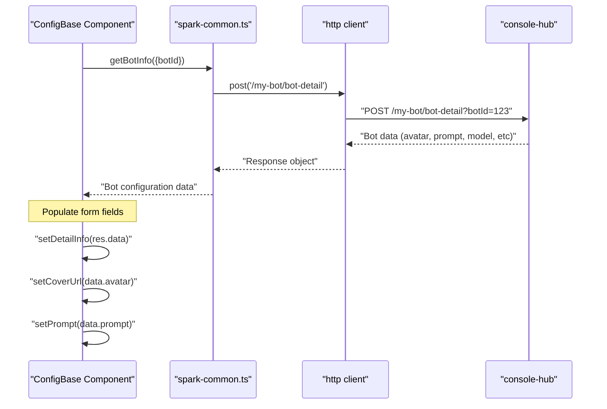
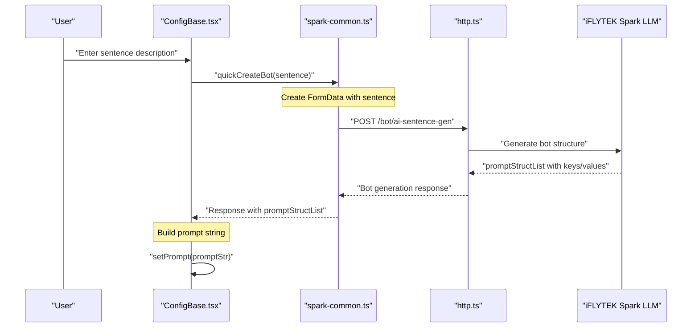

<!-- source: DeepWiki mcp.deepwiki.com · repo iflytek/astron-agent · page 9.4 Bot Management UI Services · fetched 2026-10-27 -->

# Bot Management UI Services

<details>
<summary>Relevant source files</summary>

The following files were used as context for generating this wiki page:

- [console/frontend/src/components/config-page-component/config-base/index.tsx](console/frontend/src/components/config-page-component/config-base/index.tsx)
- [console/frontend/src/components/language-switcher/index.tsx](console/frontend/src/components/language-switcher/index.tsx)
- [console/frontend/src/components/sidebar/control-modal/index.module.scss](console/frontend/src/components/sidebar/control-modal/index.module.scss)
- [console/frontend/src/components/sidebar/control-modal/index.tsx](console/frontend/src/components/sidebar/control-modal/index.tsx)
- [console/frontend/src/components/sidebar/menu-list/index.tsx](console/frontend/src/components/sidebar/menu-list/index.tsx)
- [console/frontend/src/components/sidebar/personal-center/index.tsx](console/frontend/src/components/sidebar/personal-center/index.tsx)
- [console/frontend/src/components/space/person-space/index.tsx](console/frontend/src/components/space/person-space/index.tsx)
- [console/frontend/src/components/upload-avatar/crop-modal.tsx](console/frontend/src/components/upload-avatar/crop-modal.tsx)
- [console/frontend/src/components/wx-modal/index.tsx](console/frontend/src/components/wx-modal/index.tsx)
- [console/frontend/src/constants/index.ts](console/frontend/src/constants/index.ts)
- [console/frontend/src/locales/en-En/openPlatform-En/agentPage.ts](console/frontend/src/locales/en-En/openPlatform-En/agentPage.ts)
- [console/frontend/src/locales/en-En/openPlatform-En/createAgent.ts](console/frontend/src/locales/en-En/openPlatform-En/createAgent.ts)
- [console/frontend/src/locales/zh-ZH/openPlatform-ZH/agentPage.ts](console/frontend/src/locales/zh-ZH/openPlatform-ZH/agentPage.ts)
- [console/frontend/src/locales/zh-ZH/openPlatform-ZH/createAgent.ts](console/frontend/src/locales/zh-ZH/openPlatform-ZH/createAgent.ts)
- [console/frontend/src/pages/chat-page/components/chat-header.tsx](console/frontend/src/pages/chat-page/components/chat-header.tsx)
- [console/frontend/src/pages/home-page/index.tsx](console/frontend/src/pages/home-page/index.tsx)
- [console/frontend/src/pages/release-management/agent-list/index.module.scss](console/frontend/src/pages/release-management/agent-list/index.module.scss)
- [console/frontend/src/pages/release-management/agent-list/index.tsx](console/frontend/src/pages/release-management/agent-list/index.tsx)
- [console/frontend/src/pages/release-management/detail-overview/index.tsx](console/frontend/src/pages/release-management/detail-overview/index.tsx)
- [console/frontend/src/pages/space-page/agent-page/components/delete-bot/index.tsx](console/frontend/src/pages/space-page/agent-page/components/delete-bot/index.tsx)
- [console/frontend/src/pages/space-page/agent-page/index.tsx](console/frontend/src/pages/space-page/agent-page/index.tsx)
- [console/frontend/src/pages/workflow/components/btn-groups/index.tsx](console/frontend/src/pages/workflow/components/btn-groups/index.tsx)
- [console/frontend/src/services/agent-square.ts](console/frontend/src/services/agent-square.ts)
- [console/frontend/src/services/agent.ts](console/frontend/src/services/agent.ts)
- [console/frontend/src/services/chat.ts](console/frontend/src/services/chat.ts)
- [console/frontend/src/services/release-management.ts](console/frontend/src/services/release-management.ts)
- [console/frontend/src/services/spark-common.ts](console/frontend/src/services/spark-common.ts)
- [console/frontend/src/types/agent-square.ts](console/frontend/src/types/agent-square.ts)
- [console/frontend/src/types/chat.ts](console/frontend/src/types/chat.ts)

</details>


## Purpose and Scope

This document describes the frontend services and UI components that handle bot management operations in the Astron Agent platform. It focuses on the service layer defined in `spark-common.ts`, the primary bot configuration UI component (`ConfigBase`), and the agent management interfaces. These services provide the bridge between user interactions and backend bot management APIs, handling bot creation, editing, AI-assisted generation, model selection, and lifecycle operations.

For detailed information about publishing workflows and multi-channel release management, see [9.5 Release Management and Publishing UI](). For core authentication and HTTP client configuration, see [9.2 HTTP Client and Request Interceptors]() and [9.3 Authentication and Token Management]().

---

## Service Layer Architecture

The bot management services are primarily defined in `spark-common.ts`, which provides a comprehensive suite of API endpoints organized into functional groups. This service layer uses the configured `http` client from the utils layer and handles all bot-related operations.

### Bot Management UI Service Architecture

Title: "Bot Management UI Service Architecture"
```mermaid
graph TB
    subgraph "UI_Components"
        ["ConfigBase<br/>components/config-page-component/config-base"]
        ["AgentList<br/>pages/release-management/agent-list"]
        ["AgentPage<br/>pages/space-page/agent-page"]
        ["DeleteBot<br/>components/delete-bot"]
        ["PublishHeader<br/>pages/workflow/components/btn-groups"]
    end
    
    subgraph "Service_Layer_spark-common.ts"
        ["Bot_CRUD_APIs<br/>insertBot()<br/>updateBot()<br/>getBotInfo()"]
        ["AIGen_APIs<br/>aiGenerateCover()<br/>quickCreateBot()"]
        ["Model_APIs<br/>getModelList()<br/>getBotType()"]
        ["Publishing_APIs<br/>sendApplyBot()<br/>publish()<br/>releasedBotWithChannel()"]
        ["Workflow_APIs<br/>submitBotBaseInfo()<br/>upgradeWorkflow()"]
    end
    
    subgraph "HTTP_Client_Layer"
        ["http<br/>from utils/http"]
    end
    
    subgraph "Backend_Services"
        ["console-hub_API<br/>/bot/*<br/>/workflow/*<br/>/publish/*"]
    end
    
    ["ConfigBase<br/>components/config-page-component/config-base"] --> ["Bot_CRUD_APIs<br/>insertBot()<br/>updateBot()<br/>getBotInfo()"]
    ["ConfigBase<br/>components/config-page-component/config-base"] --> ["AIGen_APIs<br/>aiGenerateCover()<br/>quickCreateBot()"]
    ["ConfigBase<br/>components/config-page-component/config-base"] --> ["Model_APIs<br/>getModelList()<br/>getBotType()"]
    
    ["PublishHeader<br/>pages/workflow/components/btn-groups"] --> ["Workflow_APIs<br/>submitBotBaseInfo()"]
    ["PublishHeader<br/>pages/workflow/components/btn-groups"] --> ["Publishing_APIs<br/>sendApplyBot()"]
    
    ["AgentList<br/>pages/release-management/agent-list"] --> ["Publishing_APIs<br/>releasedBotWithChannel()"]
    ["AgentList<br/>pages/release-management/agent-list"] --> ["Bot_CRUD_APIs<br/>getBotInfo()"]
    
    ["Bot_CRUD_APIs<br/>insertBot()<br/>updateBot()<br/>getBotInfo()"] --> ["http<br/>from utils/http"]
    ["AIGen_APIs<br/>aiGenerateCover()<br/>quickCreateBot()"] --> ["http<br/>from utils/http"]
    ["Model_APIs<br/>getModelList()<br/>getBotType()"] --> ["http<br/>from utils/http"]
    
    ["http<br/>from utils/http"] --> ["console-hub_API<br/>/bot/*<br/>/workflow/*<br/>/publish/*"]
```

**Sources**: [console/frontend/src/services/spark-common.ts:12-280](), [console/frontend/src/components/config-page-component/config-base/index.tsx:31-42](), [console/frontend/src/pages/workflow/components/btn-groups/index.tsx:12-14](), [console/frontend/src/pages/release-management/agent-list/index.tsx:12-23]()

---

## Core Bot CRUD Operations

The service layer provides fundamental bot lifecycle operations with specific endpoints for different bot states (draft, published, market).

### Bot CRUD Service Methods

| Function | Endpoint | Method | Purpose | Returns |
|----------|----------|--------|---------|---------|
| `insertBot` | `/bot/create` | POST | Create new bot | `Promise<any>` |
| `updateBot` | `/bot/update` | POST | Update existing bot | `Promise<any>` |
| `getBotInfo` | `/my-bot/bot-detail` | POST | Get bot details by ID | `Promise<any>` |
| `getMyCreateBotList` | `/bot/created-list` | POST | List user's created bots | `Promise<any>` |
| `submitBotBaseInfo` | `/workflow/base-save` | POST | Save base info for Workflow bots | `Promise<any>` |
| `deleteAgent` | `/bot/delete` | POST | Delete an agent | `Promise<any>` |
| `copyBot` | `/bot/copy` | POST | Clone an existing bot | `Promise<any>` |

### Bot Information Retrieval Flow

Title: "Bot Configuration Retrieval Sequence"


**Sources**: [console/frontend/src/services/spark-common.ts:175-177](), [console/frontend/src/services/spark-common.ts:194-197](), [console/frontend/src/components/config-page-component/config-base/index.tsx:32-42](), [console/frontend/src/services/agent.ts:11-14]()

---

## AI-Assisted Bot Generation Services

The platform provides multiple AI-powered services to assist users in bot creation and configuration, leveraging iFLYTEK Spark APIs for content generation.

### AI Generation Service Methods

| Function | Endpoint | Method | Purpose |
|----------|----------|--------|---------|
| `aiGenerateCover` | `/bot/ai-avatar-gen` | POST | Generate bot avatar image from description |
| `quickCreateBot` | `/bot/ai-sentence-gen` | POST | Create bot structure from one sentence |

### One-Sentence Bot Creation Flow

The `quickCreateBot` function enables users to create a complete bot configuration from a single sentence description. The `ConfigBase` component consumes this service to auto-populate the prompt and basic settings.

Title: "AI-Sentence Generation Flow"


**Sources**: [console/frontend/src/services/spark-common.ts:51-53](), [console/frontend/src/services/spark-common.ts:313-324](), [console/frontend/src/components/config-page-component/config-base/index.tsx:39]()

---

## Model and Space Management

These services provide bot model options and handle multi-tenant space isolation for bots.

### Model List Service

The `getModelList` function retrieves available LLM models with their metadata:

```typescript
export interface ModelListData {
  isCustom: boolean;
  modelDomain: string;
  modelName: string;
  modelId: string;
  modelIcon: string;
  model?: string;
}

export const getModelList = (): Promise<ModelListData[]> => {
  return http.get(`/bot/bot-model`);
};
```

### Space Isolation and Favorites
The `AgentPage` component uses `useSpaceStore` to filter bots by `spaceId`. Users can also mark bots as favorites via the `enableBotFavorite` and `cancelFavorite` services.

**Sources**: [console/frontend/src/services/spark-common.ts:55-66](), [console/frontend/src/pages/space-page/agent-page/index.tsx:7-14](), [console/frontend/src/pages/space-page/agent-page/index.tsx:75-101]()

---

## ConfigBase Component Architecture

The `ConfigBase` component is the primary UI for bot configuration, handling creation, editing, and publishing workflows. It integrates multiple services and manages complex state for bot properties.

### ConfigBase Component Structure

Title: "ConfigBase Component Dependency Map"
```mermaid
graph TB
    subgraph "ConfigBase_State"
        ["Bot_State<br/>baseinfo, detailInfo<br/>coverUrl, prompt"]
        ["UI_State<br/>fabuFlag, openWxmol<br/>globalLoading"]
        ["Model_State<br/>modelList<br/>model"]
        ["Tool_State<br/>choosedAlltool<br/>selectSource"]
    end
    
    subgraph "Service_Integration"
        ["getBotInfo()<br/>Load existing bot"]
        ["updateBot()<br/>Update bot"]
        ["getModelList()<br/>Load models"]
        ["handleAgentStatus()<br/>Publish bot"]
    end
    
    subgraph "Child_Components"
        ["ConfigHeader<br/>Save/Publish buttons"]
        ["CapabilityDevelopment<br/>Tools & knowledge"]
        ["UploadCover<br/>Avatar management"]
        ["WxModal<br/>Publishing options"]
        ["PromptTry<br/>Debug sandbox"]
    end
    
    ["ConfigBase_State"] --> ["getBotInfo()<br/>Load existing bot"]
    ["ConfigBase_State"] --> ["updateBot()<br/>Update bot"]
    ["ConfigBase_State"] --> ["getModelList()<br/>Load models"]
    ["ConfigBase_State"] --> ["handleAgentStatus()<br/>Publish bot"]
    
    ["ConfigBase_State"] --> ["ConfigHeader<br/>Save/Publish buttons"]
    ["ConfigBase_State"] --> ["CapabilityDevelopment<br/>Tools & knowledge"]
    ["ConfigBase_State"] --> ["UploadCover<br/>Avatar management"]
    ["ConfigBase_State"] --> ["WxModal<br/>Publishing options"]
    ["ConfigBase_State"] --> ["PromptTry<br/>Debug sandbox"]
```

**Sources**: [console/frontend/src/components/config-page-component/config-base/index.tsx:107-272](), [console/frontend/src/components/config-page-component/config-base/index.tsx:31-42]()

---

## Agent List Management

The `AgentList` component provides a table interface for viewing and managing bots across different states (unpublished, publishing, published, audit failed).

### AgentList Component Data Flow

Title: "Agent List Management Logic"
```mermaid
graph TB
    subgraph "AgentList_State"
        ["pageInfo<br/>{pageIndex, pageSize, botStatus}"]
        ["msg<br/>{version, searchValue}"]
        ["botList<br/>Array of BotData"]
    end
    
    subgraph "Service_Calls"
        ["getAgentList()<br/>from @/services/agent"]
        ["handleAgentStatus()<br/>Publish/Offline actions"]
        ["cancelBindWx()<br/>Unbind WeChat"]
    end
    
    subgraph "User_Actions"
        ["Publish_Button<br/>Opens WxModal"]
        ["Update_Button<br/>Navigate to config"]
        ["Take_Down<br/>Offline bot"]
    end
    
    ["pageInfo<br/>{pageIndex, pageSize, botStatus}"] --> ["getAgentList()<br/>from @/services/agent"]
    ["msg<br/>{version, searchValue}"] --> ["getAgentList()<br/>from @/services/agent"]
    ["getAgentList()<br/>from @/services/agent"] --> ["botList<br/>Array of BotData"]
    
    ["Publish_Button<br/>Opens WxModal"] --> ["handleAgentStatus()<br/>Publish/Offline actions"]
    ["Take_Down<br/>Offline bot"] --> ["handleAgentStatus()<br/>Publish/Offline actions"]
    ["Take_Down<br/>Offline bot"] --> ["cancelBindWx()<br/>Unbind WeChat"]
```

**Sources**: [console/frontend/src/pages/release-management/agent-list/index.tsx:60-68](), [console/frontend/src/pages/release-management/agent-list/index.tsx:146-176](), [console/frontend/src/services/agent.ts:6-10]()

---

## Service Method Reference

### Complete Bot Management API Catalog (spark-common.ts)

| Category | Method | Endpoint | Purpose |
|----------|--------|----------|---------|
| **Bot CRUD** | `insertBot` | `/bot/create` | Create new bot draft |
| | `updateBot` | `/bot/update` | Update bot metadata |
| | `getBotInfo` | `/my-bot/bot-detail` | Get bot details |
| **AI Generation** | `aiGenerateCover` | `/bot/ai-avatar-gen` | AI-generated avatar |
| | `quickCreateBot` | `/bot/ai-sentence-gen` | AI-generated bot prompt |
| **Models** | `getModelList` | `/bot/bot-model` | Get supported LLMs |
| **Workflow** | `submitBotBaseInfo` | `/workflow/base-save` | Save workflow bot info |
| | `getChainInfo` | `/u/bot/v2/info` | Get bot chain config |
| **Publishing** | `sendApplyBot` | `/bot/send-approval` | Submit for audit |
| | `publishMCP` | `/publishMCP` | Publish to MCP channel |
| | `cancelBindWx` | `/bot/offiaccount/unbind` | Unbind WeChat AppID |
| **User Info** | `updateUserInfo` | `/user-info/update` | Update profile |

**Sources**: [console/frontend/src/services/spark-common.ts:1-280](), [console/frontend/src/services/spark-common.ts:313-377]()

---

