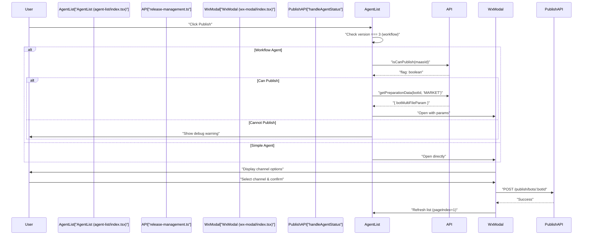
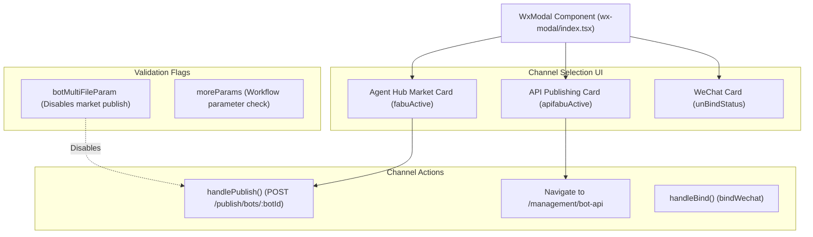
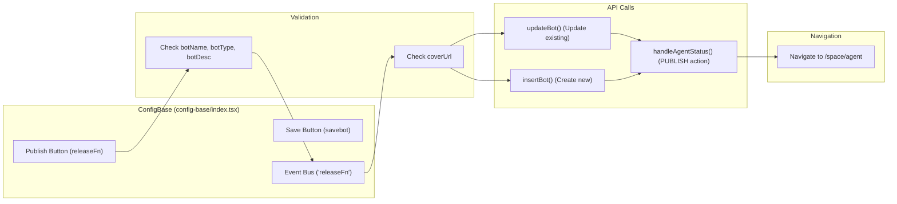
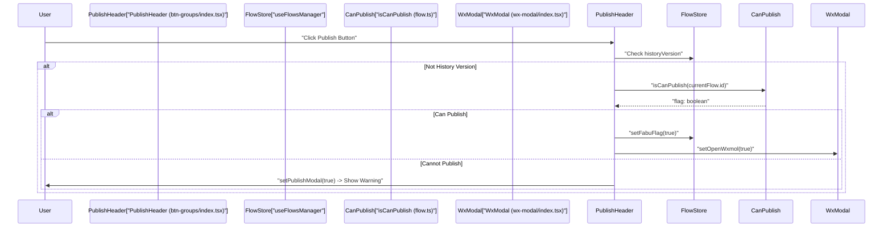

<!-- source: DeepWiki mcp.deepwiki.com · repo iflytek/astron-agent · page 9.5 Release Management and Publishing UI · fetched 2026-10-27 -->

# Release Management and Publishing UI

<details>
<summary>Relevant source files</summary>

The following files were used as context for generating this wiki page:

- [console/frontend/src/components/config-page-component/config-base/index.tsx](console/frontend/src/components/config-page-component/config-base/index.tsx)
- [console/frontend/src/components/workflow/drawer/debugger-check/index.tsx](console/frontend/src/components/workflow/drawer/debugger-check/index.tsx)
- [console/frontend/src/components/workflow/drawer/node-detail/index.tsx](console/frontend/src/components/workflow/drawer/node-detail/index.tsx)
- [console/frontend/src/components/workflow/ui/flow-template-editor.tsx](console/frontend/src/components/workflow/ui/flow-template-editor.tsx)
- [console/frontend/src/components/wx-modal/index.tsx](console/frontend/src/components/wx-modal/index.tsx)
- [console/frontend/src/constants/index.ts](console/frontend/src/constants/index.ts)
- [console/frontend/src/locales/en-En/openPlatform-En/agentPage.ts](console/frontend/src/locales/en-En/openPlatform-En/agentPage.ts)
- [console/frontend/src/locales/en-En/openPlatform-En/createAgent.ts](console/frontend/src/locales/en-En/openPlatform-En/createAgent.ts)
- [console/frontend/src/locales/zh-ZH/openPlatform-ZH/agentPage.ts](console/frontend/src/locales/zh-ZH/openPlatform-ZH/agentPage.ts)
- [console/frontend/src/locales/zh-ZH/openPlatform-ZH/createAgent.ts](console/frontend/src/locales/zh-ZH/openPlatform-ZH/createAgent.ts)
- [console/frontend/src/pages/bot-api/api.tsx](console/frontend/src/pages/bot-api/api.tsx)
- [console/frontend/src/pages/bot-api/app-list.tsx](console/frontend/src/pages/bot-api/app-list.tsx)
- [console/frontend/src/pages/home-page/index.tsx](console/frontend/src/pages/home-page/index.tsx)
- [console/frontend/src/pages/release-management/agent-list/index.module.scss](console/frontend/src/pages/release-management/agent-list/index.module.scss)
- [console/frontend/src/pages/release-management/agent-list/index.tsx](console/frontend/src/pages/release-management/agent-list/index.tsx)
- [console/frontend/src/pages/release-management/detail-overview/index.tsx](console/frontend/src/pages/release-management/detail-overview/index.tsx)
- [console/frontend/src/pages/space-page/agent-page/components/delete-bot/index.tsx](console/frontend/src/pages/space-page/agent-page/components/delete-bot/index.tsx)
- [console/frontend/src/pages/space-page/agent-page/index.tsx](console/frontend/src/pages/space-page/agent-page/index.tsx)
- [console/frontend/src/pages/workflow/components/btn-groups/index.tsx](console/frontend/src/pages/workflow/components/btn-groups/index.tsx)
- [console/frontend/src/router/index.tsx](console/frontend/src/router/index.tsx)
- [console/frontend/src/services/agent.ts](console/frontend/src/services/agent.ts)
- [console/frontend/src/services/release-management.ts](console/frontend/src/services/release-management.ts)
- [console/frontend/src/services/spark-common.ts](console/frontend/src/services/spark-common.ts)
- [console/frontend/src/types/agent-square.ts](console/frontend/src/types/agent-square.ts)

</details>


This document covers the frontend user interface components and services for managing agent releases and publishing to multiple channels. The Release Management UI allows users to view, filter, and manage their published agents across different platforms including Agent Hub Market, API endpoints, WeChat, and MCP servers.

For backend publishing logic and multi-channel strategies, see **4.3 Multi-Channel Publishing Strategy**. For bot lifecycle management prior to publishing, see **Section 5 Bot Lifecycle Management**.

---

## Agent List Component

The main release management interface is implemented in the `AgentList` component, which displays a paginated table of agents with filtering, search, and action capabilities.

### Component Structure

The `AgentList` component [console/frontend/src/pages/release-management/agent-list/index.tsx:73-73]() provides a comprehensive view of all agents with their publishing status:

**Key Features:**
- **Status Filtering**: Filter by all, unreleased (0), released (1, 2, 4), or audit failed (3) via `pageInfo.botStatus` [console/frontend/src/pages/release-management/agent-list/index.tsx:91-99]().
- **Agent Type Filtering**: Filter by agent type (agent=1, workflow=3, virtual=4, all='') via `msg.version` [console/frontend/src/pages/release-management/agent-list/index.tsx:104-116]().
- **Search**: Debounced search by agent name or description using `RetractableInput` [console/frontend/src/pages/release-management/agent-list/index.tsx:26-26]().
- **Pagination**: Server-side pagination with configurable page size [console/frontend/src/pages/release-management/agent-list/index.tsx:91-99]().
- **Multi-Action Support**: Publish, edit, view, and take down (offline) actions.

### Status Columns Configuration

The table columns are dynamically configured based on the current status filter. Agents are considered published if their status is in the `PUBLISHED_STATUSES` array (1, 2, 4) [console/frontend/src/pages/release-management/agent-list/index.tsx:47-50]().

| Status | Displayed Columns | Time Column | Special Features |
|--------|------------------|-------------|------------------|
| All (0) | ID, Name, Description, Platform, Create Time, Actions | `createTime` | Shows all agents |
| Unreleased (0) | ID, Name, Description, Platform, Create Time, Actions | `createTime` | Publish action available |
| Released (1, 2, 4) | ID, Name, Description, Platform, Release Time, Actions | `applyTime` | Shows release platforms, take down action |
| Audit Failed (3) | ID, Name, Description, Platform, Rejection Reason, Actions | N/A | Shows `blockReason` in popover |

### Platform Icon Rendering

Platform types are displayed as icons in the "Platform" column [console/frontend/src/pages/release-management/agent-list/index.tsx:289-343]().

```typescript
// Platform type codes (releaseType):
// 1 = Agent Hub Market (agentHubIcon)
// 2 = API (apiImg)
// 3 = WeChat (weixinghaoImg)
// 4 = MCP Server (mcpImg)
```

### Publishing Flow from Agent List

Title: Agent List Publishing Flow


**Sources:** [console/frontend/src/pages/release-management/agent-list/index.tsx:399-463](), [console/frontend/src/services/release-management.ts:16-17](), [console/frontend/src/services/flow.ts:23-23]()

---

## Publishing Modal Component

The `WxModal` component [console/frontend/src/components/wx-modal/index.tsx:51-70]() provides a unified interface for publishing agents to multiple channels.

### Modal Architecture

Title: WxModal Component Structure


**Sources:** [console/frontend/src/components/wx-modal/index.tsx:51-91]()

### Channel Publishing Logic

#### Agent Hub Market Publishing

The primary publishing channel uses the `handlePublish` function [console/frontend/src/components/wx-modal/index.tsx:220-241]():

```typescript
// Publishing flow:
// 1. Check botMultiFileParam (disables if multiple file params)
// 2. Call handleAgentStatus with:
//    - action: 'PUBLISH'
//    - publishType: 'MARKET'
//    - publishData: {}
// 3. Show success message
// 4. Refresh parent list via setPageInfo
```

**Disabled Conditions:**
- `botMultiFileParam === true`: Workflow has multiple file input parameters [console/frontend/src/components/wx-modal/index.tsx:225-227]().
- `promptbot` mode: Triggers event bus instead [console/frontend/src/components/wx-modal/index.tsx:221-224]().

#### API Publishing Navigation

API publishing navigates to a separate configuration page [console/frontend/src/pages/bot-api/api.tsx:27-31]():

```typescript
// Navigation pattern:
// navigate(`/management/bot-api?id=${botId}&version=${version}`)

// Conditions:
// - Available for workflow agents (version === 3)
// - Available for simple agents (version === 1)
```

**Sources:** [console/frontend/src/components/wx-modal/index.tsx:220-241](), [console/frontend/src/pages/bot-api/api.tsx:27-261]()

---

## Publishing from Bot Configuration

The `BaseConfig` component provides publishing functionality during bot creation and editing [console/frontend/src/components/config-page-component/config-base/index.tsx:107-112]().

### Publishing Trigger Points

Title: ConfigBase Publishing Logic


**Sources:** [console/frontend/src/components/config-page-component/config-base/index.tsx:481-587]()

### Publish Function Logic

The `releaseFn` function handles two scenarios [console/frontend/src/components/config-page-component/config-base/index.tsx:514-587]():

**Scenario 1: Updating Published Bot**
- Condition: `botStatus` is 1, 2, or 4.
- Logic: Builds request object with form values and calls `updateBot()`.

**Scenario 2: First-time Publishing**
- Condition: `botStatus` is not 1, 2, or 4.
- Logic: Calls `updateBot()` or `insertBot()`, followed by `handleAgentStatus` with `action: 'PUBLISH'`.

**Sources:** [console/frontend/src/components/config-page-component/config-base/index.tsx:514-587]()

---

## Publishing from Workflow Editor

The workflow editor provides publishing controls through the `PublishHeader` component [console/frontend/src/pages/workflow/components/btn-groups/index.tsx:155-158]().

### Workflow Publishing Flow

Title: Workflow Editor Publishing Flow


**Sources:** [console/frontend/src/pages/workflow/components/btn-groups/index.tsx:116-126]()

### Comparative Debugging Feature

The workflow editor conditionally shows a comparative debugging button [console/frontend/src/pages/workflow/components/btn-groups/index.tsx:71-89]():

**Display Conditions:**
```typescript
// Show when ALL conditions are met:
// 1. !historyVersion (not viewing history)
// 2. canPublish === true (workflow is publishable)
// 3. Nodes contain 'spark-llm' type
// 4. !multiParams (single or file-only params)
```

**Sources:** [console/frontend/src/pages/workflow/components/btn-groups/index.tsx:71-89]()

---

## API Service Layer

The release management API service provides typed interfaces for all publishing operations.

### Core API Functions

| Function | Method | Endpoint | Description |
|----------|--------|----------|-------------|
| `getAgentDetail` | GET | `/publish/bots/${botId}` | Get detailed agent info [console/frontend/src/services/release-management.ts:14-14]() |
| `handleAgentStatus` | POST | `/publish/bots/${botId}` | Core publish/offline action [console/frontend/src/services/release-management.ts:15-15]() |
| `getPreparationData` | GET | `/publish/bots/${botId}/prepare` | Check readiness for channel [console/frontend/src/services/release-management.ts:16-16]() |
| `getApiList` | GET | `/publish-api/app-list` | Get user applications [console/frontend/src/services/spark-common.ts:246-248]() |
| `createApi` | POST | `/publish-api/create-bot-api` | Bind bot to API application [console/frontend/src/services/spark-common.ts:266-268]() |

### Publishing Request Structure

The `handleAgentStatus` function takes a `botId` and a request object containing `action` and `publishType` [console/frontend/src/services/release-management.ts:15-15](). Actions include `PUBLISH` and `OFFLINE` [console/frontend/src/pages/release-management/agent-list/index.tsx:187-188]().

**Sources:** [console/frontend/src/services/release-management.ts:14-17](), [console/frontend/src/pages/release-management/agent-list/index.tsx:186-190]()

---

## Summary

The Release Management and Publishing UI provides a comprehensive frontend interface for managing agent publishing across multiple channels. Key characteristics:

- **Centralized Management**: Single `AgentList` component for viewing all agents with status-based filtering.
- **Multi-Channel Support**: Unified `WxModal` component supports Market and API publishing.
- **Context-Aware Publishing**: Publishing can be triggered from agent list, bot configuration, or workflow editor.
- **Type-Safe APIs**: Strongly typed service layer in `release-management.ts` and `spark-common.ts`.

**Sources:** [console/frontend/src/pages/release-management/agent-list/index.tsx](), [console/frontend/src/components/wx-modal/index.tsx](), [console/frontend/src/services/release-management.ts](), [console/frontend/src/components/config-page-component/config-base/index.tsx](), [console/frontend/src/pages/workflow/components/btn-groups/index.tsx]()

---

