# Page: Astron Agent Platform Overview

# Astron Agent Platform Overview

<details>
<summary>Relevant source files</summary>

The following files were used as context for generating this wiki page:

- [README.md](README.md)
- [console/backend/hub/src/main/resources/application.yml](console/backend/hub/src/main/resources/application.yml)
- [console/frontend/index.html](console/frontend/index.html)
- [console/frontend/public/runtime-config.js](console/frontend/public/runtime-config.js)
- [core/common/audit_system/audit_api/iflytek/ifly_audit_api.py](core/common/audit_system/audit_api/iflytek/ifly_audit_api.py)
- [core/common/audit_system/orchestrator.py](core/common/audit_system/orchestrator.py)
- [core/common/audit_system/strategy/base_strategy.py](core/common/audit_system/strategy/base_strategy.py)
- [core/common/audit_system/strategy/text_strategy.py](core/common/audit_system/strategy/text_strategy.py)
- [core/common/otlp/log_trace/node_log.py](core/common/otlp/log_trace/node_log.py)
- [core/common/otlp/log_trace/node_trace_log.py](core/common/otlp/log_trace/node_trace_log.py)
- [core/common/otlp/metrics/metric.py](core/common/otlp/metrics/metric.py)
- [core/common/otlp/trace/span.py](core/common/otlp/trace/span.py)
- [core/common/otlp/trace/trace.py](core/common/otlp/trace/trace.py)
- [core/common/service/__init__.py](core/common/service/__init__.py)
- [core/common/service/log/factory.py](core/common/service/log/factory.py)
- [docker/astronAgent/.env.example](docker/astronAgent/.env.example)
- [docker/astronAgent/docker-compose.yaml](docker/astronAgent/docker-compose.yaml)
- [docker/astronAgent/nginx/nginx.conf](docker/astronAgent/nginx/nginx.conf)
- [docker/ragflow/docker-compose-macos.yml](docker/ragflow/docker-compose-macos.yml)
- [docs/CONFIGURATION.md](docs/CONFIGURATION.md)
- [docs/CONFIGURATION_zh.md](docs/CONFIGURATION_zh.md)
- [docs/CONTRIBUTING_CN.md](docs/CONTRIBUTING_CN.md)
- [docs/DEPLOYMENT_GUIDE.md](docs/DEPLOYMENT_GUIDE.md)
- [docs/DEPLOYMENT_GUIDE_zh.md](docs/DEPLOYMENT_GUIDE_zh.md)
- [docs/README-zh.md](docs/README-zh.md)

</details>


## Purpose and Scope

This document provides a comprehensive overview of the Astron Agent platform, an enterprise-grade, commercial-friendly Agentic Workflow development platform. It covers the high-level architecture, core microservices, deployment infrastructure, and integration patterns that enable organizations to build scalable, production-ready intelligent agent applications. [README.md:13-28](), [docs/README-zh.md:13-28]()

The platform integrates AI workflow orchestration, model management, tool/plugin integration (including MCP protocol), RPA automation, and team collaboration features. It supports high-availability deployment through Docker Compose orchestration and offers flexible integration with external AI services like iFLYTEK Spark and RagFlow. [README.md:13-28](), [docs/DEPLOYMENT_GUIDE.md:6-11]()

For detailed information about specific subsystems:
- System architecture details: see [System Architecture](#1.1)
- Technology stack breakdown: see [Technology Stack](#1.2)
- Individual service documentation: see [Key Components and Services](#1.3)
- Deployment procedures: see [Getting Started](#2)

**Sources:** [README.md:13-28](), [docs/README-zh.md:13-28](), [docs/DEPLOYMENT_GUIDE.md:6-11]()

---

## Platform Architecture

The Astron Agent platform follows a multi-tier microservices architecture with clear separation between client-facing services, business logic orchestration, core domain services, and infrastructure components. [docker/astronAgent/docker-compose.yaml:1-658]()

### High-Level Service Topology

The following diagram illustrates the relationship between the major architectural layers and the specific code entities (containers and services) defined in the deployment configuration.

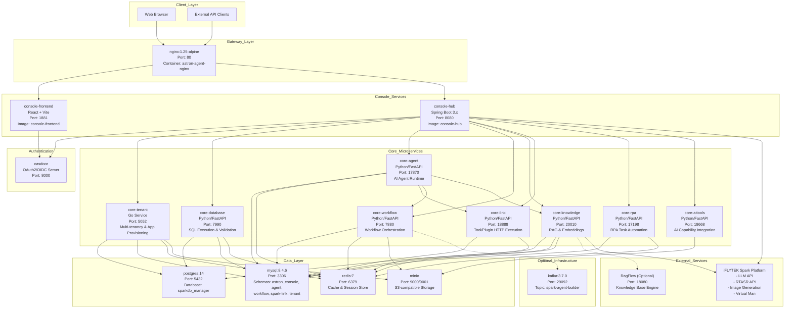

**Sources:** [docker/astronAgent/docker-compose.yaml:1-658](), [docker/astronAgent/.env.example:88-102](), [docker/astronAgent/nginx/nginx.conf:1-186]()

---

## Core Components Summary

The platform consists of several containerized services organized into functional layers. The backend services are primarily written in Java (Spring Boot), Python (FastAPI), and Go. [docker/astronAgent/docker-compose.yaml:1-658]()

### Core Service Matrix

| Service Name | Technology | Port | Primary Responsibilities | Database Dependencies |
|-------------|------------|------|-------------------------|---------------------|
| **nginx** | Nginx 1.25 | 80 | Reverse proxy, static assets, SSE support | None |
| **console-frontend** | React 18 + Vite | 1881 | Web UI, runtime config injection | None |
| **console-hub** | Spring Boot 3.x | 8080 | Business logic, bot management, publishing | MySQL, Redis, MinIO |
| **casdoor** | Go-based OAuth2 | 8000 | Authentication, SSO, user management | Built-in |
| **core-tenant** | Go 1.21+ | 5052 | Multi-tenancy, app provisioning, API keys | PostgreSQL, MySQL, Redis, MinIO |
| **core-database** | Python + FastAPI | 7990 | Memory DB, SQL execution with validation | PostgreSQL, MySQL, Redis |
| **core-agent** | Python + FastAPI | 17870 | Agent runtime, LLM orchestration, tool calling | MySQL, Redis |
| **core-workflow** | Python + FastAPI | 7880 | Workflow engine, node execution, SSE streaming | MySQL, Redis, MinIO, Kafka |
| **core-knowledge** | Python + FastAPI | 20010 | RAG, embeddings, chunk retrieval | PostgreSQL, MySQL, Redis |
| **core-link** | Python + FastAPI | 18888 | HTTP tool execution, MCP client | MySQL, Redis |
| **core-rpa** | Python + FastAPI | 17198 | RPA task creation and querying | MySQL, Redis |
| **core-aitools** | Python + FastAPI | 18668 | AI service integration (translation, TTS, etc.) | MinIO |

**Sources:** [docker/astronAgent/docker-compose.yaml:1-658](), [console/backend/hub/src/main/resources/application.yml:1-233](), [docker/astronAgent/.env.example:88-102]()

---

## Docker Compose Service Orchestration

The deployment architecture uses Docker Compose with explicit dependency chains and health checks to ensure proper startup sequencing of the infrastructure and application layers. [docker/astronAgent/docker-compose.yaml:1-658]()

### Service Dependency and Infrastructure Mapping

The following diagram maps the logical service dependencies to the specific health check commands and database entities used in the `docker-compose.yaml` configuration.

```mermaid
graph TB
    subgraph "Infrastructure_Tier"
        postgres["postgres<br/>Health: pg_isready -U spark -d sparkdb_manager"]
        mysql["mysql<br/>Health: mysqladmin ping"]
        redis["redis<br/>Health: redis-cli ping"]
        minio["minio<br/>Health: curl /minio/health/live"]
    end
    
    subgraph "Core_Service_Tier"
        core_tenant["core-tenant<br/>depends_on:<br/>postgres, mysql, redis, minio"]
        core_database["core-database<br/>depends_on:<br/>postgres, mysql, redis"]
        core_agent["core-agent<br/>depends_on:<br/>mysql, redis"]
        core_workflow["core-workflow<br/>depends_on:<br/>mysql, redis, minio"]
        core_knowledge["core-knowledge<br/>depends_on:<br/>postgres, mysql, redis"]
        core_link["core-link<br/>depends_on:<br/>mysql, redis"]
        core_rpa["core-rpa<br/>depends_on:<br/>mysql, redis"]
        core_aitools["core-aitools<br/>depends_on:<br/>minio"]
    end
    
    subgraph "Console_Tier"
        console_hub["console-hub<br/>depends_on:<br/>postgres, mysql, redis, minio"]
        console_frontend["console-frontend<br/>No dependencies"]
    end
    
    subgraph "Gateway_Tier"
        nginx_svc["nginx<br/>depends_on:<br/>console-frontend, console-hub"]
    end
    
    postgres -.->|"condition: service_healthy"| core_tenant
    mysql -.->|"condition: service_healthy"| core_tenant
    redis -.->|"condition: service_healthy"| core_tenant
    minio -.->|"condition: service_healthy"| core_tenant
    
    postgres -.->|"condition: service_healthy"| core_database
    mysql -.->|"condition: service_healthy"| core_database
    redis -.->|"condition: service_healthy"| core_database
    
    mysql -.->|"condition: service_healthy"| core_agent
    redis -.->|"condition: service_healthy"| core_agent
    
    mysql -.->|"condition: service_healthy"| core_workflow
    redis -.->|"condition: service_healthy"| core_workflow
    minio -.->|"condition: service_healthy"| core_workflow
    
    postgres -.->|"condition: service_healthy"| core_knowledge
    mysql -.->|"condition: service_healthy"| core_knowledge
    redis -.->|"condition: service_healthy"| core_knowledge
    
    mysql -.->|"condition: service_healthy"| core_link
    redis -.->|"condition: service_healthy"| core_link
    
    mysql -.->|"condition: service_healthy"| core_rpa
    redis -.->|"condition: service_healthy"| core_rpa
    
    minio -.->|"condition: service_healthy"| core_aitools
    
    postgres -.->|"condition: service_healthy"| console_hub
    mysql -.->|"condition: service_healthy"| console_hub
    redis -.->|"condition: service_healthy"| console_hub
    minio -.->|"condition: service_healthy"| console_hub
    
    console_frontend --> nginx_svc
    console_hub --> nginx_svc
```

**Key Configuration Details:**

- **Main Orchestration:** [docker/astronAgent/docker-compose.yaml]()
- **Environment Template:** [docker/astronAgent/.env.example:1-317]()
- **Health Check Settings:** Default interval is 30s with a timeout of 10s and 60 retries. [docker/astronAgent/docker-compose.yaml:21-25]()

**Service-Specific Configurations:**
Each core service utilizes a specific configuration environment file or toml:
- `core-tenant` configuration: [docker/astronAgent/config/tenant/config.toml:1-15]()
- Inter-service communication URLs (Link, Workflow, Knowledge) for the agent runtime: [docker/astronAgent/.env.example:146-177]()

**Sources:** [docker/astronAgent/docker-compose.yaml:1-658](), [docker/astronAgent/.env.example:1-317]()

---

## Technology Stack

The platform leverages a modern polyglot technology stack to handle various domain requirements:

### Backend Technologies
- **Console Hub:** Java 21 with Spring Boot 3.x, using MyBatis-Plus for ORM and Flyway for database migrations. [console/backend/hub/src/main/resources/application.yml:12-82]()
- **Core Microservices:** Primarily Python 3.11 with FastAPI for high-performance async API handling.
- **Tenant Service:** Written in Go for efficient multi-tenancy management.
- **Messaging:** Apache Kafka for telemetry and event streaming (e.g., `spark-agent-builder` topic). [docker/astronAgent/.env.example:46-52](), [docker/astronAgent/.env.example:159]()

### Frontend Technologies
- **Framework:** React with Vite as the build tool. [console/frontend/index.html:78-80]()
- **State & Config:** Uses a dynamic `runtime-config.js` injection pattern to handle environment variables at runtime without rebuilding the image. [console/frontend/index.html:17](), [docker/astronAgent/nginx/nginx.conf:55-66]()

### Data & Infrastructure
- **PostgreSQL:** Primary storage for metadata management (`sparkdb_manager`). [docker/astronAgent/docker-compose.yaml:11-13]()
- **MySQL:** Multi-schema storage for core service data (agent, workflow, link, etc.). [docker/astronAgent/.env.example:29](), [docker/astronAgent/.env.example:154]()
- **Redis:** Distributed caching and session management. [docker/astronAgent/docker-compose.yaml:46-60]()
- **MinIO:** S3-compatible object storage for files and workflow assets. [docker/astronAgent/docker-compose.yaml:126-147]()

**Sources:** [console/backend/hub/src/main/resources/application.yml:1-233](), [docker/astronAgent/docker-compose.yaml:1-658](), [docker/astronAgent/.env.example:1-317]()

---

## Summary

The Astron Agent platform provides a production-ready, enterprise-grade foundation for building agentic AI applications. Key architectural characteristics include:

1. **Microservices Architecture:** Specialized core services with clear domain boundaries.
2. **Polyglot Persistence:** Optimized use of PostgreSQL, MySQL, Redis, and MinIO.
3. **Flexible Deployment:** Robust Docker Compose orchestration with health checks.
4. **Centralized Authentication:** Integrated Casdoor OAuth2/OIDC support.
5. **External AI Integration:** Native support for iFLYTEK Spark and optional RagFlow integration.
6. **Runtime Configurability:** Environment-based configuration for both frontend and backend.

For detailed deployment procedures, see [Getting Started](#2). For individual service documentation, refer to the child pages under [Key Components and Services](#1.3).

**Sources:** [README.md:13-28](), [docker/astronAgent/docker-compose.yaml:1-658](), [docker/astronAgent/.env.example:1-317]()

---

# Page: System Architecture

# System Architecture

<details>
<summary>Relevant source files</summary>

The following files were used as context for generating this wiki page:

- [README.md](README.md)
- [console/backend/commons/src/main/java/com/iflytek/astron/console/commons/exception/BusinessException.java](console/backend/commons/src/main/java/com/iflytek/astron/console/commons/exception/BusinessException.java)
- [console/backend/commons/src/main/java/com/iflytek/astron/console/commons/response/ApiResult.java](console/backend/commons/src/main/java/com/iflytek/astron/console/commons/response/ApiResult.java)
- [console/backend/commons/src/main/java/com/iflytek/astron/console/commons/util/I18nUtil.java](console/backend/commons/src/main/java/com/iflytek/astron/console/commons/util/I18nUtil.java)
- [console/backend/hub/src/main/java/com/iflytek/astron/console/hub/config/space/EnterpriseSpaceConfig.java](console/backend/hub/src/main/java/com/iflytek/astron/console/hub/config/space/EnterpriseSpaceConfig.java)
- [console/backend/hub/src/main/resources/application.yml](console/backend/hub/src/main/resources/application.yml)
- [console/backend/toolkit/src/main/java/com/iflytek/astron/console/toolkit/tool/CommonTool.java](console/backend/toolkit/src/main/java/com/iflytek/astron/console/toolkit/tool/CommonTool.java)
- [console/backend/toolkit/src/test/java/com/iflytek/astron/console/toolkit/controller/workflow/WorkflowControllerTest.java](console/backend/toolkit/src/test/java/com/iflytek/astron/console/toolkit/controller/workflow/WorkflowControllerTest.java)
- [console/frontend/index.html](console/frontend/index.html)
- [console/frontend/public/runtime-config.js](console/frontend/public/runtime-config.js)
- [docker/astronAgent/.env.example](docker/astronAgent/.env.example)
- [docker/astronAgent/docker-compose.yaml](docker/astronAgent/docker-compose.yaml)
- [docker/astronAgent/nginx/nginx.conf](docker/astronAgent/nginx/nginx.conf)
- [docker/ragflow/docker-compose-macos.yml](docker/ragflow/docker-compose-macos.yml)
- [docs/CONFIGURATION.md](docs/CONFIGURATION.md)
- [docs/CONFIGURATION_zh.md](docs/CONFIGURATION_zh.md)
- [docs/CONTRIBUTING_CN.md](docs/CONTRIBUTING_CN.md)
- [docs/DEPLOYMENT_GUIDE.md](docs/DEPLOYMENT_GUIDE.md)
- [docs/DEPLOYMENT_GUIDE_zh.md](docs/DEPLOYMENT_GUIDE_zh.md)
- [docs/README-zh.md](docs/README-zh.md)

</details>


This document provides a detailed explanation of the Astron Agent platform's multi-tier microservices architecture, including the eight core services, infrastructure components, service dependencies, and inter-service communication patterns.

## Architectural Overview

The Astron Agent platform implements a containerized microservices architecture with clear separation of concerns across three primary tiers: infrastructure services, core application services, and console presentation services. The system is designed for Docker Compose orchestration with health-check-based startup sequencing to ensure proper initialization order.

### System Topology Diagram

The following diagram bridges the Natural Language functional requirements to the Code Entity Space by mapping system roles to specific container images and ports defined in the orchestration layer.

```mermaid
graph TB
    subgraph "Presentation Tier (Code: console/)"
        nginx["nginx:80<br/>docker/astronAgent/nginx/nginx.conf"]
        frontend["console-frontend:1881<br/>console/frontend/Dockerfile"]
        hub["console-hub:8080<br/>console/backend/hub/Dockerfile"]
    end
    
    subgraph "Core Services Tier (Code: core/)"
        tenant["core-tenant:5052<br/>core/tenant/Dockerfile"]
        database["core-database:7990<br/>core/memory/database/Dockerfile"]
        agent["core-agent:17870<br/>core/agent/Dockerfile"]
        workflow["core-workflow:7880<br/>core/workflow/Dockerfile"]
        knowledge["core-knowledge:20010<br/>core/knowledge/Dockerfile"]
        link["core-link:18888<br/>core/plugin/link/Dockerfile"]
        rpa["core-rpa:17198<br/>core/plugin/rpa/Dockerfile"]
        aitools["core-aitools:18668<br/>core/plugin/aitools/Dockerfile"]
    end
    
    subgraph "Infrastructure Tier (docker-compose.yaml)"
        postgres["postgres:5432<br/>sparkdb_manager"]
        mysql["mysql:3306<br/>Multiple Schemas"]
        redis["redis:6379<br/>Cache & Sessions"]
        minio["minio:9000<br/>S3 Storage"]
        kafka["kafka:29092<br/>(Optional)"]
    end
    
    subgraph "External Integration Space"
        casdoor["casdoor:8000<br/>OAuth2/OIDC"]
        spark["iFLYTEK Spark APIs<br/>LLM, ASR, Image"]
        ragflow["RagFlow:18080<br/>(Optional)"]
    end
    
    nginx --> frontend
    nginx --> hub
    frontend --> casdoor
    hub --> casdoor
    
    hub --> tenant
    hub --> database
    hub --> agent
    hub --> workflow
    hub --> knowledge
    hub --> link
    hub --> rpa
    hub --> aitools
    
    tenant --> postgres
    tenant --> mysql
    tenant --> redis
    tenant --> minio
    
    database --> postgres
    database --> redis
    
    agent --> mysql
    agent --> redis
    
    workflow --> mysql
    workflow --> redis
    workflow --> minio
    workflow -.-> kafka
    
    knowledge --> postgres
    knowledge --> mysql
    knowledge --> redis
    knowledge -.-> ragflow
    
    link --> mysql
    link --> redis
    
    rpa --> mysql
    rpa --> redis
    
    aitools --> minio
    
    hub --> spark
    knowledge --> spark
```

**Sources**: [docker/astronAgent/docker-compose.yaml:1-405](), [docker/astronAgent/.env.example:1-317](), [README.md:13-28]()

---

## Infrastructure Tier

The infrastructure tier provides foundational data storage, caching, and messaging services. All infrastructure services are configured with health checks that must pass before dependent services start.

### Database Systems

| Service | Image | Port | Primary Use | Health Check Command |
|---------|-------|------|-------------|----------------------|
| PostgreSQL | `postgres:14` | 5432 | `sparkdb_manager` database for structured data | `pg_isready -U spark -d sparkdb_manager` |
| MySQL | `mysql:8.4.6` | 3306 | Application data (`tenant`, `agent`, `workflow`, `spark-link`) | `mysqladmin ping -h localhost` |
| Redis | `redis:7` | 6379 | Caching, session management, distributed locking | `redis-cli ping` |

**PostgreSQL Configuration**:
- Database: `sparkdb_manager` (env: `POSTGRES_DB`) [docker/astronAgent/docker-compose.yaml:11-11]()
- User credentials: `POSTGRES_USER` and `POSTGRES_PASSWORD` [docker/astronAgent/docker-compose.yaml:12-13]()
- Data volume: `postgres_data:/var/lib/postgresql/data` [docker/astronAgent/docker-compose.yaml:16-16]()
- Initialization scripts: Mounted from `./pgsql/` directory [docker/astronAgent/docker-compose.yaml:17-17]()

**MySQL Configuration**:
- Root password: `MYSQL_ROOT_PASSWORD` [docker/astronAgent/docker-compose.yaml:32-32]()
- Connection URL pattern: `jdbc:mysql://mysql:3306/astron_console?useSSL=false&allowPublicKeyRetrieval=true&serverTimezone=Asia/Shanghai&characterEncoding=utf8&createDatabaseIfNotExist=true` [docker/astronAgent/.env.example:29-29]()
- Data volume: `mysql_data:/var/lib/mysql` [docker/astronAgent/docker-compose.yaml:34-34]()

**Redis Configuration**:
- Password-protected: `requirepass ${REDIS_PASSWORD}` (if set) [docker/astronAgent/docker-compose.yaml:54-54]()
- Supports cluster mode via `REDIS_IS_CLUSTER` flag [docker/astronAgent/.env.example:34-34]()
- Default expiration: `REDIS_EXPIRE` seconds (default: 3600) [docker/astronAgent/.env.example:36-36]()

**Sources**: [docker/astronAgent/docker-compose.yaml:6-59](), [docker/astronAgent/.env.example:15-41]()

### Object Storage and Messaging

**MinIO S3-Compatible Storage**:
- Internal endpoint: `http://minio:9000` [docker/astronAgent/.env.example:62-62]()
- Root credentials: `MINIO_ROOT_USER` / `MINIO_ROOT_PASSWORD` [docker/astronAgent/docker-compose.yaml:130-131]()
- Buckets: `workflow`, `console-oss` [docker/astronAgent/.env.example:65-65](), [docker/astronAgent/.env.example:198-198]()
- Health check: `curl -f http://localhost:9000/minio/health/live` [docker/astronAgent/docker-compose.yaml:143-143]()

**Kafka Message Queue** (Optional):
- Broker endpoint: `kafka:29092` [docker/astronAgent/.env.example:52-52]()
- Topic: `spark-agent-builder` [docker/astronAgent/.env.example:159-159]()
- Enabled via: `KAFKA_ENABLE=1` [docker/astronAgent/.env.example:47-47]()

**Sources**: [docker/astronAgent/docker-compose.yaml:125-147](), [docker/astronAgent/.env.example:54-68]()

---

## Core Services Tier

The core services tier implements business logic through eight specialized microservices.

### Service Dependency and API Mapping

This diagram maps internal environment variable names to the physical service dependencies they represent.

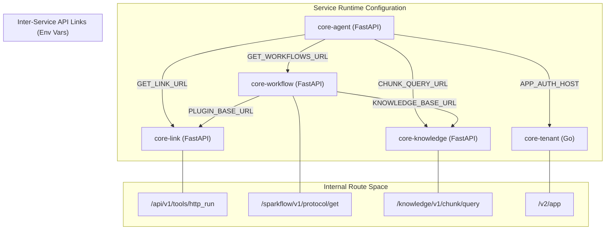

**Sources**: [docker/astronAgent/.env.example:161-176](), [docker/astronAgent/docker-compose.yaml:165-405]()

### Core Service Configuration Patterns

All core services follow a consistent configuration pattern:

**Common Environment Variables**:
- `SERVICE_PORT`: Listening port for the service [docker/astronAgent/.env.example:95-102]()
- `DATABASE_URL`: Connection string for the specific service database [docker/astronAgent/.env.example:125-125]()
- `LOG_PATH`: Path for service log files [docker/astronAgent/.env.example:131-131]()

**OpenTelemetry Configuration**:
- `OTLP_ENABLE`: Enable/disable telemetry [docker/astronAgent/.env.example:70-70]()
- `OTLP_ENDPOINT`: OTLP collector endpoint [docker/astronAgent/.env.example:71-71]()
- `OTLP_TRACE_MAX_QUEUE_SIZE`: Buffer size for traces [docker/astronAgent/.env.example:77-77]()

**Sources**: [docker/astronAgent/.env.example:70-131]()

### Service-Specific Roles

1.  **core-tenant**: Manages multi-tenancy, application isolation, and API key authentication. [docker/astronAgent/docker-compose.yaml:165-194]()
2.  **core-database**: A secure SQL execution layer (MemoryDB) providing schema-level isolation for tenant data. [docker/astronAgent/docker-compose.yaml:197-224]()
3.  **core-agent**: The primary runtime for intelligent agents, handling conversation flows and plugin orchestration. [docker/astronAgent/docker-compose.yaml:227-254]()
4.  **core-workflow**: Orchestrates complex Agentic Workflows using a graph-based execution engine. [docker/astronAgent/docker-compose.yaml:257-285]()
5.  **core-knowledge**: Manages RAG (Retrieval-Augmented Generation) capabilities, including embedding and chunk retrieval. [docker/astronAgent/docker-compose.yaml:288-315]()
6.  **core-link**: Executes HTTP-based tools and manages MCP (Model Context Protocol) integrations. [docker/astronAgent/docker-compose.yaml:318-345]()
7.  **core-rpa**: Bridges agents with Robotic Process Automation workflows. [docker/astronAgent/docker-compose.yaml:348-375]()
8.  **core-aitools**: Provides specialized AI utilities like translation and speech processing. [docker/astronAgent/docker-compose.yaml:378-405]()

---

## Console Services Tier

The console tier provides the user-facing web application and backend API hub.

### Nginx Reverse Proxy Configuration

The nginx container acts as the single entry point, routing to appropriate backends:

- **Static Assets**: Routes `.(js|css|png|...)` to `console-frontend:1881`. [docker/astronAgent/nginx/nginx.conf:69-78]()
- **Runtime Configuration**: `/runtime-config.js` is served without caching for dynamic env injection. [docker/astronAgent/nginx/nginx.conf:55-66]()
- **Backend API**: Routes `/console-api/` to `console-hub:8080`. [docker/astronAgent/nginx/nginx.conf:153-164]()
- **SSE Support**: Specialized handling for `/workflow/v1/chat/completions` and `/console-api/chat-message/` with `proxy_buffering off`. [docker/astronAgent/nginx/nginx.conf:81-150]()

### Console Hub (Spring Boot)

The `console-hub` service serves as the orchestration layer for the frontend.

- **Framework**: Spring Boot 3.x with MyBatis-Plus. [console/backend/hub/src/main/resources/application.yml:12-100]()
- **Security**: Acts as an OAuth2 Resource Server using Casdoor. [console/backend/hub/src/main/resources/application.yml:53-60]()
- **Database**: Connects to `astron_console` MySQL database via HikariCP. [console/backend/hub/src/main/resources/application.yml:14-35]()
- **MaaS Integration**: Communicates with the MaaS platform for workflow publishing and synchronization. [console/backend/hub/src/main/resources/application.yml:176-194]()

**Sources**: [docker/astronAgent/nginx/nginx.conf:1-188](), [console/backend/hub/src/main/resources/application.yml:1-233]()

---

## Multi-Tenancy and Data Isolation

The system implements a multi-tier isolation strategy:

1.  **Application Isolation**: `core-tenant` manages unique `app_id` and `api_key` pairs for each tenant. [docker/astronAgent/.env.example:175-176]()
2.  **Schema Isolation**: `core-database` creates separate schemas in PostgreSQL (e.g., `env_uid_dbid`) to prevent cross-tenant data leakage. [docker/astronAgent/.env.example:134-134]()
3.  **Space Isolation**: The console uses `space-id` and `enterprise-id` headers to partition user workspaces. [console/backend/hub/src/main/java/com/iflytek/astron/console/hub/config/space/EnterpriseSpaceConfig.java:16-19]()

**Sources**: [docker/astronAgent/.env.example:134-176](), [console/backend/hub/src/main/java/com/iflytek/astron/console/hub/config/space/EnterpriseSpaceConfig.java:1-31]()

---

# Page: Technology Stack

# Technology Stack

<details>
<summary>Relevant source files</summary>

The following files were used as context for generating this wiki page:

- [README.md](README.md)
- [console/backend/hub/src/main/resources/application.yml](console/backend/hub/src/main/resources/application.yml)
- [console/frontend/index.html](console/frontend/index.html)
- [console/frontend/public/runtime-config.js](console/frontend/public/runtime-config.js)
- [core/agent/Dockerfile](core/agent/Dockerfile)
- [core/agent/main.py](core/agent/main.py)
- [core/agent/pyproject.toml](core/agent/pyproject.toml)
- [core/agent/uv.lock](core/agent/uv.lock)
- [core/common/service/oss/s3_service.py](core/common/service/oss/s3_service.py)
- [core/plugin/aitools/pyproject.toml](core/plugin/aitools/pyproject.toml)
- [core/plugin/aitools/uv.lock](core/plugin/aitools/uv.lock)
- [core/workflow/alembic/README.md](core/workflow/alembic/README.md)
- [core/workflow/alembic/alembic.ini](core/workflow/alembic/alembic.ini)
- [core/workflow/alembic/env.py](core/workflow/alembic/env.py)
- [core/workflow/alembic/script.py.mako](core/workflow/alembic/script.py.mako)
- [core/workflow/alembic/versions/2026_01_23_0929-b13356244aea_init_tables.py](core/workflow/alembic/versions/2026_01_23_0929-b13356244aea_init_tables.py)
- [core/workflow/consts/engine/model_provider.py](core/workflow/consts/engine/model_provider.py)
- [core/workflow/engine/nodes/rpa/rpa_node.py](core/workflow/engine/nodes/rpa/rpa_node.py)
- [core/workflow/extensions/fastapi/lifespan/database_migration.py](core/workflow/extensions/fastapi/lifespan/database_migration.py)
- [core/workflow/extensions/fastapi/middleware/auth.py](core/workflow/extensions/fastapi/middleware/auth.py)
- [core/workflow/extensions/middleware/cache/base.py](core/workflow/extensions/middleware/cache/base.py)
- [core/workflow/infra/providers/llm/chat_ai_factory.py](core/workflow/infra/providers/llm/chat_ai_factory.py)
- [core/workflow/infra/providers/llm/google/google_chat_llm.py](core/workflow/infra/providers/llm/google/google_chat_llm.py)
- [core/workflow/main.py](core/workflow/main.py)
- [core/workflow/pyproject.toml](core/workflow/pyproject.toml)
- [core/workflow/uv.lock](core/workflow/uv.lock)
- [docker/astronAgent/.env.example](docker/astronAgent/.env.example)
- [docker/astronAgent/docker-compose.yaml](docker/astronAgent/docker-compose.yaml)
- [docker/astronAgent/nginx/nginx.conf](docker/astronAgent/nginx/nginx.conf)
- [docker/ragflow/docker-compose-macos.yml](docker/ragflow/docker-compose-macos.yml)
- [docs/CONFIGURATION.md](docs/CONFIGURATION.md)
- [docs/CONFIGURATION_zh.md](docs/CONFIGURATION_zh.md)
- [docs/CONTRIBUTING_CN.md](docs/CONTRIBUTING_CN.md)
- [docs/DEPLOYMENT_GUIDE.md](docs/DEPLOYMENT_GUIDE.md)
- [docs/DEPLOYMENT_GUIDE_zh.md](docs/DEPLOYMENT_GUIDE_zh.md)
- [docs/README-zh.md](docs/README-zh.md)

</details>


This document describes the complete technology stack used in the Astron Agent platform, including programming languages, frameworks, infrastructure components, and development tools. For information about the overall system architecture and service responsibilities, see [System Architecture]().

## Overview

Astron Agent employs a **polyglot microservices architecture** with services implemented in Java, Python, and Go, each chosen for their specific strengths. The frontend uses React/TypeScript, while infrastructure relies on Docker containerization with standard data stores (PostgreSQL, MySQL, Redis, Kafka, MinIO). The platform is designed for cloud-native deployment with comprehensive observability through OpenTelemetry.

---

## Programming Languages and Service Distribution

### Language-to-Service Mapping

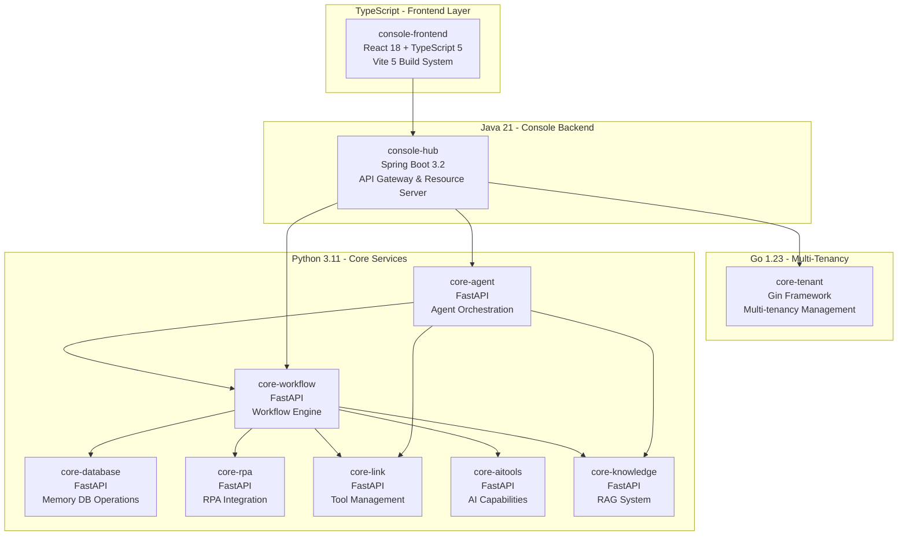

**Sources:** [docker/astronAgent/docker-compose.yaml:161-280](), [docker/astronAgent/docker-compose.yaml:165-194](), [docker/astronAgent/docker-compose.yaml:198-210]()

---

## Frontend Stack

### Core Technologies

| Component | Technology | Version | Purpose |
|-----------|-----------|---------|---------|
| **Framework** | React | 18.x | UI component library |
| **Language** | TypeScript | 5.x | Type-safe JavaScript |
| **Build Tool** | Vite | 5.x | Fast development and production builds |
| **Node Runtime** | Node.js | 20.x | JavaScript runtime |

### Frontend Technology Stack Diagram

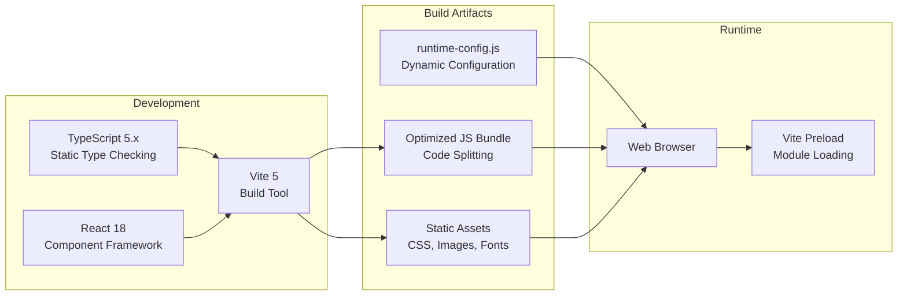

### Key Features

- **Runtime Configuration Injection**: Environment-specific configuration loaded via `window.__APP_CONFIG__` at runtime, allowing single-build deployment across environments [docker/astronAgent/nginx/nginx.conf:55-66]().
- **Nginx Proxying**: The frontend is served via Nginx, which also handles SSE (Server-Sent Events) proxying for real-time chat completions [docker/astronAgent/nginx/nginx.conf:81-106]().
- **Static Asset Optimization**: Gzip compression and immutable cache headers for static resources [docker/astronAgent/nginx/nginx.conf:33-43](), [docker/astronAgent/nginx/nginx.conf:69-78]().

**Sources:** [docker/astronAgent/nginx/nginx.conf:1-187](), [console/frontend/public/runtime-config.js:1-7]()

---

## Backend Stack - Java (Spring Boot)

### Core Technologies

| Component | Technology | Version | Purpose |
|-----------|-----------|---------|---------|
| **Framework** | Spring Boot | 3.2.x | Application framework |
| **Language** | Java | 21 (LTS) | Programming language |
| **Build Tool** | Maven | 3.9+ | Dependency management |
| **ORM** | MyBatis Plus | 3.5+ | Database persistence layer |
| **Connection Pool** | HikariCP | 5.0+ | High-performance JDBC pooling |
| **Security** | Spring Security OAuth2 | 6.x | OAuth2 resource server |
| **Database Migration** | Flyway | 9.x | Schema version control |

### Java Service Architecture

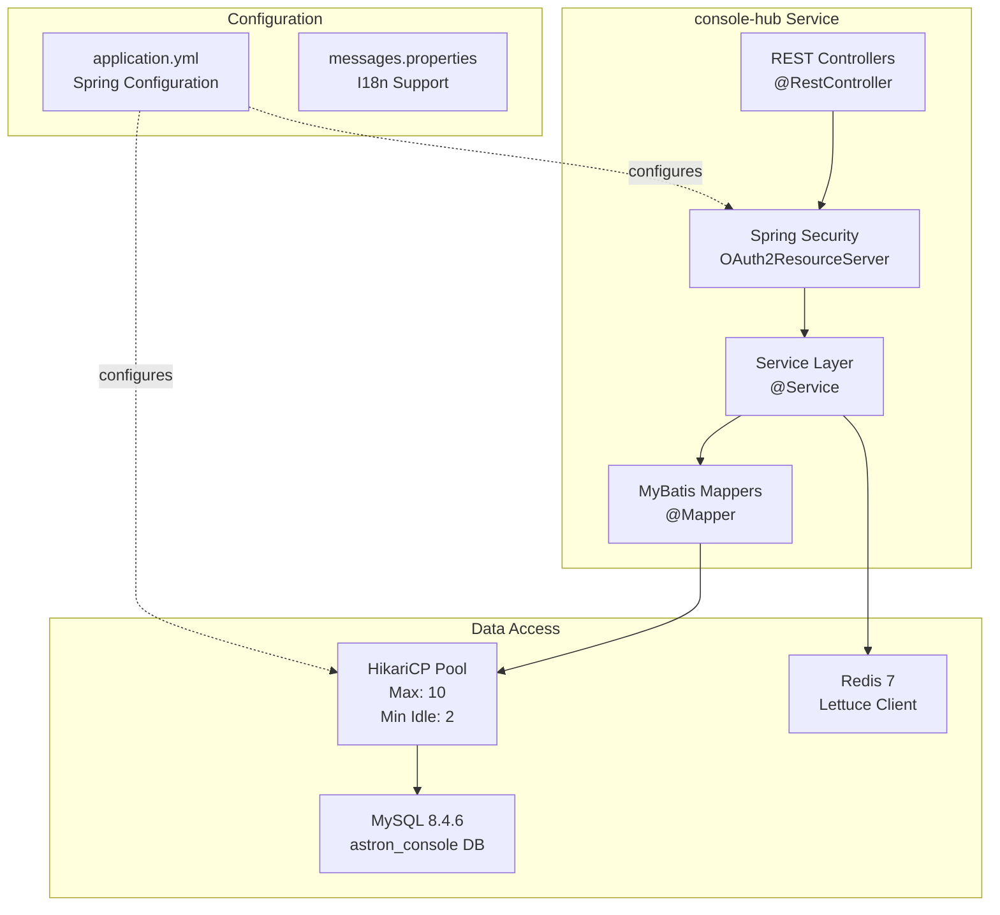

### Spring Boot Configuration Details

The `console-hub` uses `application.yml` for primary configuration, including HikariCP tuning (maximum pool size 10) and Flyway migration settings [console/backend/hub/src/main/resources/application.yml:19-39](), [console/backend/hub/src/main/resources/application.yml:67-80](). It also manages integration with iFLYTEK Spark LLM (via `SPARK_APP_ID`, `SPARK_API_KEY`) and S3 storage [console/backend/hub/src/main/resources/application.yml:117-140]().

**Sources:** [console/backend/hub/src/main/resources/application.yml:1-200]()

---

## Backend Stack - Python (FastAPI)

### Core Technologies

| Component | Technology | Purpose |
|-----------|-----------|---------|
| **Framework** | FastAPI | Async web framework [core/workflow/pyproject.toml:28-28]() |
| **Language** | Python | 3.11 [core/workflow/pyproject.toml:6-6]() |
| **Package Manager** | uv | Fast package installer and resolver [core/workflow/uv.lock:1-8]() |
| **Task Queue** | Celery | Distributed task processing [core/workflow/pyproject.toml:19-19]() |
| **LLM SDKs** | Google GenAI, OpenAI | Integration with diverse model providers [core/workflow/pyproject.toml:54-56]() |

### Python Service Structure

Python services (Workflow, Link, RPA, etc.) utilize `pyproject.toml` and `uv.lock` for strict dependency management. Key libraries include `pydantic` for data validation, `sqlalchemy` (via `alembic` for migrations), and `opentelemetry` for tracing [core/workflow/pyproject.toml:72-74](), [core/workflow/pyproject.toml:58-66](), [core/workflow/pyproject.toml:10-10]().

### LLM Integration Example (Google Gemini)

The `GoogleChatAI` class integrates with the official Google Generative AI SDK to connect with Gemini models. It handles message conversion from the internal format to the `Content` format expected by the SDK [core/workflow/infra/providers/llm/google/google_chat_llm.py:25-48](), [core/workflow/infra/providers/llm/google/google_chat_llm.py:168-185]().

**Sources:** [core/workflow/pyproject.toml:1-100](), [core/workflow/infra/providers/llm/google/google_chat_llm.py:1-200]()

---

## Infrastructure Layer

### Data Storage Technologies

| Component | Image | Health Check | Purpose |
|-----------|-------|--------------|---------|
| **PostgreSQL** | postgres:14 | `pg_isready -U spark` | Memory database with multi-tenant schemas [docker/astronAgent/docker-compose.yaml:7-26]() |
| **MySQL** | mysql:8.4.6 | `mysqladmin ping` | Relational data for tenant, agent, and console [docker/astronAgent/docker-compose.yaml:28-44]() |
| **Redis** | redis:7 | `redis-cli ping` | Caching and session management [docker/astronAgent/docker-compose.yaml:46-60]() |
| **MinIO** | minio/minio | `curl .../minio/health/live` | S3-compatible object storage [docker/astronAgent/docker-compose.yaml:126-147]() |

### Database-to-Code Mapping

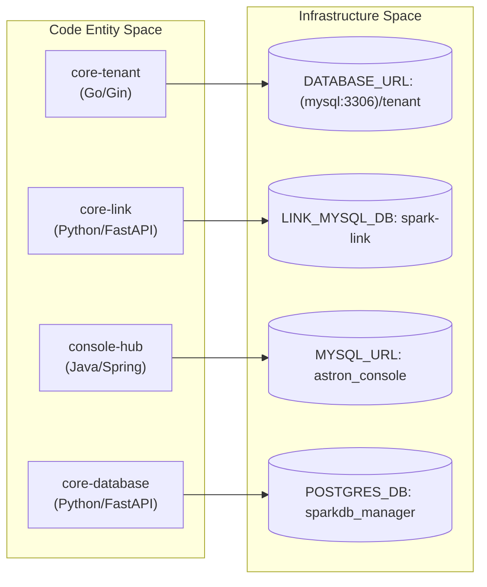

### Storage Services

The platform supports both S3-compatible storage (MinIO) and iFly proprietary gateway storage.
- **S3Service**: Implements standard file upload with public read ACLs using `boto3` [core/common/service/oss/s3_service.py:17-53](). It ensures bucket existence and applies public read policies [core/common/service/oss/s3_service.py:57-94]().
- **IFlyGatewayStorageClient**: Uses HMAC-based authentication for proprietary storage, providing temporary download links [core/common/service/oss/s3_service.py:123-181]().

**Sources:** [docker/astronAgent/.env.example:125-144](), [console/backend/hub/src/main/resources/application.yml:14-17](), [docker/astronAgent/docker-compose.yaml:11-13](), [core/common/service/oss/s3_service.py:17-198]()

---

# Page: Key Components and Services

# Key Components and Services

<details>
<summary>Relevant source files</summary>

The following files were used as context for generating this wiki page:

- [README.md](README.md)
- [console/backend/hub/src/main/resources/application.yml](console/backend/hub/src/main/resources/application.yml)
- [console/frontend/index.html](console/frontend/index.html)
- [console/frontend/public/runtime-config.js](console/frontend/public/runtime-config.js)
- [core/agent/api/schemas/base_inputs.py](core/agent/api/schemas/base_inputs.py)
- [core/agent/api/schemas/completion_chunk.py](core/agent/api/schemas/completion_chunk.py)
- [core/agent/api/v1/base_api.py](core/agent/api/v1/base_api.py)
- [core/agent/config.env](core/agent/config.env)
- [core/agent/domain/models/base.py](core/agent/domain/models/base.py)
- [core/agent/engine/nodes/base.py](core/agent/engine/nodes/base.py)
- [core/agent/engine/nodes/chat/chat_runner.py](core/agent/engine/nodes/chat/chat_runner.py)
- [core/agent/engine/nodes/cot/cot_runner.py](core/agent/engine/nodes/cot/cot_runner.py)
- [core/agent/engine/nodes/cot_process/cot_process_runner.py](core/agent/engine/nodes/cot_process/cot_process_runner.py)
- [core/agent/service/builder/base_builder.py](core/agent/service/builder/base_builder.py)
- [core/agent/service/plugin/knowledge.py](core/agent/service/plugin/knowledge.py)
- [core/agent/service/plugin/link.py](core/agent/service/plugin/link.py)
- [core/agent/service/plugin/mcp.py](core/agent/service/plugin/mcp.py)
- [core/agent/service/plugin/workflow.py](core/agent/service/plugin/workflow.py)
- [core/agent/service/runner/workflow_agent_runner.py](core/agent/service/runner/workflow_agent_runner.py)
- [core/agent/tests/test_base_builder.py](core/agent/tests/test_base_builder.py)
- [core/agent/tests/test_base_llm_model.py](core/agent/tests/test_base_llm_model.py)
- [core/agent/tests/test_runner_base_and_chat_cot.py](core/agent/tests/test_runner_base_and_chat_cot.py)
- [core/plugin/aitools/app/start_server.py](core/plugin/aitools/app/start_server.py)
- [core/plugin/aitools/common/clients/websockets_client.py](core/plugin/aitools/common/clients/websockets_client.py)
- [core/plugin/aitools/common/log/logger.py](core/plugin/aitools/common/log/logger.py)
- [core/plugin/aitools/config.env](core/plugin/aitools/config.env)
- [core/plugin/aitools/const/const.py](core/plugin/aitools/const/const.py)
- [core/plugin/aitools/main.py](core/plugin/aitools/main.py)
- [core/plugin/link/app/start_server.py](core/plugin/link/app/start_server.py)
- [core/plugin/link/main.py](core/plugin/link/main.py)
- [core/plugin/link/tests/unit/test_main.py](core/plugin/link/tests/unit/test_main.py)
- [core/plugin/rpa/tests/unit/api/test_app.py](core/plugin/rpa/tests/unit/api/test_app.py)
- [core/plugin/rpa/tests/unit/test_main.py](core/plugin/rpa/tests/unit/test_main.py)
- [docker/astronAgent/.env.example](docker/astronAgent/.env.example)
- [docker/astronAgent/docker-compose.yaml](docker/astronAgent/docker-compose.yaml)
- [docker/astronAgent/nginx/nginx.conf](docker/astronAgent/nginx/nginx.conf)
- [docker/ragflow/docker-compose-macos.yml](docker/ragflow/docker-compose-macos.yml)
- [docs/CONFIGURATION.md](docs/CONFIGURATION.md)
- [docs/CONFIGURATION_zh.md](docs/CONFIGURATION_zh.md)
- [docs/CONTRIBUTING_CN.md](docs/CONTRIBUTING_CN.md)
- [docs/DEPLOYMENT_GUIDE.md](docs/DEPLOYMENT_GUIDE.md)
- [docs/DEPLOYMENT_GUIDE_zh.md](docs/DEPLOYMENT_GUIDE_zh.md)
- [docs/README-zh.md](docs/README-zh.md)

</details>


This document provides a comprehensive overview of the Astron Agent platform's service architecture, including the eight core microservices, console application services, and infrastructure components. It explains each service's responsibility, configuration, inter-service communication, and deployment model.

---

## Service Overview

The Astron Agent platform consists of **8 core microservices**, **3 console services**, and **5 infrastructure services**. Each core service is a standalone microservice with specific domain responsibilities, deployed as independent Docker containers with health checks and dependency management defined in the orchestration layer [docker/astronAgent/docker-compose.yaml:1-350]().

### Core Services Summary

| Service | Port | Technology | Primary Responsibility | Database Dependencies |
|---------|------|------------|----------------------|---------------------|
| **core-tenant** | 5052 | Go | Multi-tenancy management, app provisioning, API key generation | PostgreSQL, MySQL, Redis, MinIO |
| **core-database** | 7990 | Python/FastAPI | SQL execution with multi-tenant isolation, DML/DDL validation | PostgreSQL, MySQL, Redis |
| **core-rpa** | 17198 | Python/FastAPI | RPA task orchestration, external RPA cloud integration | PostgreSQL, MySQL, Redis |
| **core-link** | 18888 | Python/FastAPI | HTTP tool execution, OpenAPI schema validation, MCP protocol | MySQL, Redis |
| **core-aitools** | 18668 | Python/FastAPI | AI capability integration (translation, speech, image gen) | MinIO |
| **core-agent** | 17870 | Python/FastAPI | Agent runtime, workflow execution, plugin integration | MySQL, Redis |
| **core-knowledge** | 20010 | Python/FastAPI | RAG knowledge base, embedding, chunk retrieval | PostgreSQL, MySQL, Redis |
| **core-workflow** | 7880 | Python/FastAPI | Workflow orchestration, node execution, SSE streaming | MySQL, Redis, MinIO, Kafka |

**Sources:** [docker/astronAgent/.env.example:95-102](), [docker/astronAgent/docker-compose.yaml:165-350](), [docs/DEPLOYMENT_GUIDE.md:5-11]()

### Console Services Summary

| Service | Port | Technology | Primary Responsibility |
|---------|------|------------|----------------------|
| **console-frontend** | 80 | React/Vite | Web UI, runtime config injection, Casdoor OAuth2 client |
| **console-hub** | 8080 | Spring Boot | REST API gateway, bot lifecycle, publishing, chat orchestration |
| **nginx** | 80 | Nginx | Reverse proxy, SSE support, static caching, API routing |

**Sources:** [docker/astronAgent/.env.example:83-85](), [console/backend/hub/src/main/resources/application.yml:1-12](), [docker/astronAgent/docker-compose.yaml:500-550](), [docker/astronAgent/nginx/nginx.conf:45-186]()

---

## Core Services Architecture

The following diagram illustrates the eight core microservices and their relationships to the underlying infrastructure and external providers.

Title: Platform Service Topology
```mermaid
graph TB
    subgraph "Core Microservices Layer"
        Tenant["core-tenant<br/>:5052<br/>Go Service<br/>Multi-tenancy & App Mgmt"]
        Database["core-database<br/>:7990<br/>FastAPI<br/>Memory DB / SQL Execution"]
        RPA["core-rpa<br/>:17198<br/>FastAPI<br/>RPA Task Orchestration"]
        Link["core-link<br/>:18888<br/>FastAPI<br/>Tool Execution / MCP"]
        AITools["core-aitools<br/>:18668<br/>FastAPI<br/>AI Capabilities"]
        Agent["core-agent<br/>:17870<br/>FastAPI<br/>Agent Runtime"]
        Knowledge["core-knowledge<br/>:20010<br/>FastAPI<br/>RAG / Knowledge Base"]
        Workflow["core-workflow<br/>:7880<br/>FastAPI<br/>Workflow Engine"]
    end
    
    subgraph "Infrastructure Dependencies"
        PG["PostgreSQL :5432<br/>sparkdb_manager"]
        MY["MySQL :3306<br/>astron_console"]
        RD["Redis :6379<br/>Cache & Sessions"]
        MN["MinIO :9000<br/>S3 Object Storage"]
        KF["Kafka :29092<br/>spark-agent-builder"]
    end
    
    subgraph "External Providers"
        Spark["iFLYTEK Spark API"]
        RagFlow["RagFlow (Optional)"]
        RPACloud["RPA Cloud Platforms"]
    end
    
    Tenant --> PG
    Tenant --> MY
    Tenant --> RD
    Tenant --> MN
    
    Database --> PG
    Database --> MY
    Database --> RD
    
    RPA --> PG
    RPA --> MY
    RPA --> RD
    RPA --> RPACloud
    
    Link --> MY
    Link --> RD
    
    AITools --> MN
    AITools --> Spark
    
    Agent --> MY
    Agent --> RD
    Agent --> Spark
    
    Knowledge --> PG
    Knowledge --> MY
    Knowledge --> RD
    Knowledge --> RagFlow
    
    Workflow --> MY
    Workflow --> RD
    Workflow --> MN
    Workflow -.-> KF
```

**Sources:** [docker/astronAgent/docker-compose.yaml:7-147](), [docker/astronAgent/.env.example:117-189](), [docs/DEPLOYMENT_GUIDE.md:5-11]()

---

## Core Service Details

### core-tenant (Multi-Tenancy Management)

The tenant service manages multi-tenancy isolation, application provisioning, and API credential generation. It is written in Go and provides REST APIs for creating applications and managing tenant resources.

**Key Responsibilities:**
- Application creation with unique app IDs.
- API key and secret generation for service-to-service authentication.
- Tenant metadata management in PostgreSQL and MySQL [docker/astronAgent/.env.example:125]().
- Resource provisioning across tenant schemas.

**Sources:** [docker/astronAgent/.env.example:117-132](), [docker/astronAgent/docker-compose.yaml:165-194]()

---

### core-database (Memory Database Service)

The database service provides secure SQL execution with multi-tenant isolation. It validates and rewrites DML/DDL queries, enforces row-level security, and manages tenant-specific PostgreSQL schemas.

**Key Responsibilities:**
- DML query execution with automatic `uid` filtering and `LIMIT` injection.
- DDL validation with allowed operation whitelists.
- SQL injection prevention via AST-based parameterization.
- Schema-level isolation: `prod_{uid}_{dbid}` and `test_{uid}_{dbid}` schemas.

**Sources:** [docker/astronAgent/.env.example:134](), [docker/astronAgent/docker-compose.yaml:197-225]()

---

### core-rpa (RPA Automation)

The RPA service integrates with external RPA cloud platforms for task execution and status monitoring. It provides APIs for creating and querying RPA workflow executions.

**Key Implementation:**
- Entry point: `RPAServer.start()` in the RPA service application layer.
- Integration: Connects to external endpoints defined by `XIAOWU_RPA_TASK_CREATE_URL` [docker/astronAgent/.env.example:140]().
- Uses `RPA_URL` as the base for public cloud interaction [docker/astronAgent/.env.example:138]().

**Sources:** [docker/astronAgent/.env.example:136-141](), [docker/astronAgent/docker-compose.yaml:227-255]()

---

### core-link (Tool/Plugin Execution)

The link service executes HTTP-based tools and plugins with parameter validation, authentication injection, and MCP (Model Context Protocol) support for SSE-based tool communication.

**Key Implementation:**
- Entry point: `SparkLinkServer.start()` in `core/plugin/link/app/start_server.py:27-40]().
- Schema Validation: Loads OpenAPI and MCP schemas on startup via `load_http_run_schema()` and `load_mcp_register_schema()` [core/plugin/link/app/start_server.py:158-160]().
- MCP Support: Handles tool listing and calling through dedicated endpoints like `LIST_MCP_PLUGIN_URL` [docker/astronAgent/.env.example:170]().
- Remote Config: Supports Polaris for dynamic environment variable overrides [core/plugin/link/app/start_server.py:42-78]().

**Sources:** [core/plugin/link/app/start_server.py:134-167](), [docker/astronAgent/.env.example:161-171]()

---

### core-aitools (AI Tool Integration)

The aitools service provides AI capabilities including translation, speech recognition/synthesis, and image generation through iFLYTEK Spark APIs.

**Key Responsibilities:**
- Integration with iFLYTEK AI services including Spark LLM, RTASR, and Image generation [console/backend/hub/src/main/resources/application.yml:127-140]().
- File storage integration using MinIO S3 buckets [docker/astronAgent/.env.example:62-65]().
- FastAPI server initialization with configurable worker counts (default 20) [core/plugin/aitools/app/start_server.py:71]().

**Sources:** [core/plugin/aitools/app/start_server.py:106-126](), [docker/astronAgent/.env.example:99]()

---

### core-agent (Agent Runtime)

The agent service executes AI agents with tool calling, workflow integration, knowledge base queries, and MCP plugin support.

**Key Responsibilities:**
- Agent runtime execution using `BaseLLMModel` for completion calls [core/agent/domain/models/base.py:15-37]().
- Orchestrates Reasoning/CoT (Chain of Thought) loops and plugin interactions.
- Communicates with `core-link` for tool execution using `RUN_LINK_URL` [docker/astronAgent/.env.example:163]().

**Sources:** [docker/astronAgent/.env.example:146-177](), [core/agent/domain/models/base.py:1-118]()

---

### core-knowledge (Knowledge Base)

The knowledge service manages RAG (Retrieval-Augmented Generation) knowledge bases with embedding, chunking, and retrieval. It supports both RagFlow and Xinghuo RAG backends.

**Key Responsibilities:**
- Knowledge base document management and chunk query via `CHUNK_QUERY_URL` [docker/astronAgent/.env.example:168]().
- Integration with RagFlow using `RAGFLOW_API_TOKEN` [docker/astronAgent/.env.example:180]().
- Support for Xinghuo dataset IDs [docker/astronAgent/.env.example:183]().

**Sources:** [docker/astronAgent/.env.example:179-184](), [docs/DEPLOYMENT_GUIDE.md:88-114]()

---

### core-workflow (Workflow Orchestration)

The workflow service executes workflow graphs with node orchestration, SSE streaming responses, and integration with external MaaS platforms for workflow versioning and publishing.

**Key Responsibilities:**
- Workflow graph execution with node-based processing [console/backend/hub/src/main/resources/application.yml:153-162]().
- SSE (Server-Sent Events) streaming for real-time progress via Nginx proxy [docker/astronAgent/nginx/nginx.conf:81-106]().
- Integration with MaaS platform for publishing via `MAAS_PUBLISH_API` [console/backend/hub/src/main/resources/application.yml:189]().

**Sources:** [docker/astronAgent/.env.example:186-189](), [console/backend/hub/src/main/resources/application.yml:153-194]()

---

## Service Communication and Entity Mapping

The following diagram bridges high-level service concepts to specific code-defined endpoints and database configurations found in the environment.

Title: Conceptual to Code Mapping
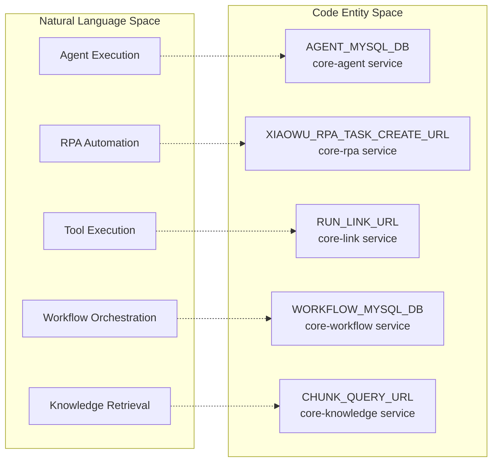

**Sources:** [docker/astronAgent/.env.example:138-186]()

---

## Infrastructure and Configuration

### Environment Configuration

The platform uses a tiered configuration approach, primarily driven by `.env` files and service-specific environment variables.

**Key Configuration Parameters:**
| Parameter | Description | Source |
|-----------|-------------|--------|
| `MYSQL_URL` | Connection string for console metadata | `console/.../application.yml` |
| `OSS_ENDPOINT` | Internal MinIO/S3 endpoint | `.env.example` |
| `KAFKA_SERVERS` | Kafka broker list for telemetry | `.env.example` |
| `CASDOOR_PORT` | Port for authentication service | `.env.example` |

**Sources:** [console/backend/hub/src/main/resources/application.yml:14](), [docker/astronAgent/.env.example:52-62]()

### Data Flow and Telemetry

Services utilize a unified pattern to set up observability, reporting to Kafka topics for tracing and metrics.

Title: Telemetry and Event Data Flow
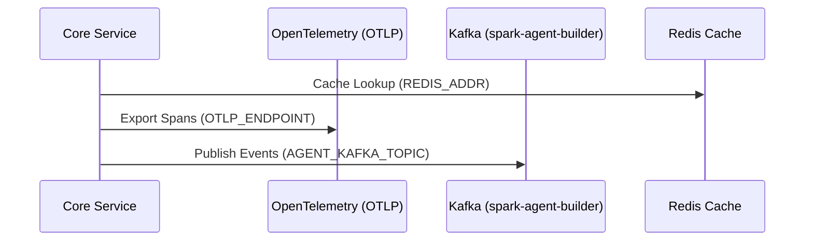

**Sources:** [docker/astronAgent/.env.example:71-159](), [core/plugin/aitools/app/start_server.py:96-100]()

---

# Page: Getting Started

# Getting Started

<details>
<summary>Relevant source files</summary>

The following files were used as context for generating this wiki page:

- [README.md](README.md)
- [console/backend/hub/src/main/resources/application.yml](console/backend/hub/src/main/resources/application.yml)
- [console/frontend/index.html](console/frontend/index.html)
- [console/frontend/public/runtime-config.js](console/frontend/public/runtime-config.js)
- [docker/astronAgent/.env.example](docker/astronAgent/.env.example)
- [docker/astronAgent/casdoor/conf/app.conf](docker/astronAgent/casdoor/conf/app.conf)
- [docker/astronAgent/casdoor/conf/init_data.json](docker/astronAgent/casdoor/conf/init_data.json)
- [docker/astronAgent/casdoor/conf/init_data.json.template](docker/astronAgent/casdoor/conf/init_data.json.template)
- [docker/astronAgent/casdoor/entrypoint.sh](docker/astronAgent/casdoor/entrypoint.sh)
- [docker/astronAgent/docker-compose-auth.yml](docker/astronAgent/docker-compose-auth.yml)
- [docker/astronAgent/docker-compose-with-auth.yaml](docker/astronAgent/docker-compose-with-auth.yaml)
- [docker/astronAgent/docker-compose.yaml](docker/astronAgent/docker-compose.yaml)
- [docker/astronAgent/nginx/nginx.conf](docker/astronAgent/nginx/nginx.conf)
- [docker/ragflow/docker-compose-macos.yml](docker/ragflow/docker-compose-macos.yml)
- [docker/ragflow/docker-compose.yml](docker/ragflow/docker-compose.yml)
- [docs/CONFIGURATION.md](docs/CONFIGURATION.md)
- [docs/CONFIGURATION_zh.md](docs/CONFIGURATION_zh.md)
- [docs/CONTRIBUTING_CN.md](docs/CONTRIBUTING_CN.md)
- [docs/DEPLOYMENT_GUIDE.md](docs/DEPLOYMENT_GUIDE.md)
- [docs/DEPLOYMENT_GUIDE_WITH_AUTH.md](docs/DEPLOYMENT_GUIDE_WITH_AUTH.md)
- [docs/DEPLOYMENT_GUIDE_WITH_AUTH_RPA.md](docs/DEPLOYMENT_GUIDE_WITH_AUTH_RPA.md)
- [docs/DEPLOYMENT_GUIDE_WITH_AUTH_RPA_zh.md](docs/DEPLOYMENT_GUIDE_WITH_AUTH_RPA_zh.md)
- [docs/DEPLOYMENT_GUIDE_WITH_AUTH_zh.md](docs/DEPLOYMENT_GUIDE_WITH_AUTH_zh.md)
- [docs/DEPLOYMENT_GUIDE_zh.md](docs/DEPLOYMENT_GUIDE_zh.md)
- [docs/README-zh.md](docs/README-zh.md)

</details>


This guide provides step-by-step instructions for deploying the Astron Agent platform for the first time. It covers the essential setup process, from system requirements through initial configuration to service startup. By the end of this guide, you will have a fully functional Astron Agent platform running on your local machine or server.

For detailed information about specific components, see:
- System architecture and component overview: [Astron Agent Platform Overview](#1)
- Individual service configurations: [Core Services Architecture](#3)
- Production deployment considerations: [Infrastructure and Deployment](#11)

---

## Deployment Overview

The Astron Agent platform can be deployed using two primary methods to meet different scenario requirements:

| Method | Use Case | Status | Complexity |
|--------|----------|--------|------------|
| **Docker Compose** | Quick start, development, testing | ✅ Available | Low |
| **Helm Charts** | Production Kubernetes deployments | 🚧 In Development | Medium |

This guide focuses on the Docker Compose deployment method, which is recommended for initial setup and evaluation.

**Sources**: [README.md:47-94]()

---

## System Requirements

Before beginning, ensure your system meets the following minimum requirements for a stable experience.

### Core Platform Requirements
The core agent system requires the following resources to manage service orchestration and database operations:

| Component | Minimum Specification |
|-----------|----------------------|
| **CPU** | 2 cores |
| **RAM** | 4 GiB |
| **Disk** | 50 GB |
| **OS** | Linux, macOS, or Windows with WSL2 |

### Optional RagFlow Knowledge Base Requirements
If you choose to deploy the optional RagFlow service for advanced RAG capabilities, additional resources are required:

| Component | Minimum Specification |
|-----------|----------------------|
| **CPU** | 4 cores |
| **RAM** | 16 GB |
| **Disk** | 50 GB (additional) |

### Required Software
- **Docker**: Version 20.10 or later
- **Docker Compose**: Version 2.0 or later
- **Git**: For cloning the repository

**Sources**: [docs/DEPLOYMENT_GUIDE_zh.md:17-26](), [docs/DEPLOYMENT_GUIDE.md:15-26]()

---

## Quick Start Process

### Step 1: Clone the Repository

```bash
# Clone the Astron Agent repository
git clone https://github.com/iflytek/astron-agent.git

# Navigate to the deployment directory
cd astron-agent/docker/astronAgent
```

**Sources**: [README.md:52-56]()

### Step 2: Configuration Files Setup

The deployment uses environment variables defined in a `.env` file for configuration. This file must be created from the provided template [docker/astronAgent/.env.example:1-3]():

```bash
# Copy the example environment file
cp .env.example .env

# Edit the configuration file
vim .env
```

#### Configuration Files Architecture

The following diagram illustrates how configuration flows from the `.env` file to individual services and the frontend runtime.

**Configuration Flow Diagram**
```mermaid
graph TB
    subgraph "Configuration_Files"
        [".env"] --> ["docker-compose.yaml"]
        [".env"] --> ["docker-compose-with-auth.yaml"]
    end
    
    ["docker-compose.yaml"] --> ["core-tenant"]
    ["docker-compose.yaml"] --> ["core-database"]
    ["docker-compose.yaml"] --> ["core-agent"]
    ["docker-compose.yaml"] --> ["core-workflow"]
    
    subgraph "Frontend_Runtime"
        ["entrypoint.sh"] --> ["runtime-config.js"]
        ["runtime-config.js"] --> ["window.__APP_CONFIG__"]
    end
    
    [".env"] --> ["entrypoint.sh"]
```

**Sources**: [docker/astronAgent/.env.example:1-2](), [docker/astronAgent/docker-compose.yaml:165-189](), [console/frontend/index.html:14-17]()

### Step 3: Essential Environment Variables

The `.env` file requires configuration of several key parameters. These variables are organized into functional groups in [docker/astronAgent/.env.example:4-205]():

#### Required iFLYTEK Platform Credentials
These credentials enable the platform's AI capabilities, including the Spark Large Language Model.

```env
# iFLYTEK Open Platform credentials
SPARK_APP_ID=your-app-id
SPARK_API_KEY=your-api-key
SPARK_API_SECRET=your-api-secret

# AI Ability configuration for prompt optimization and one-sentence bot creation
AI_ABILITY_CHAT_BASE_URL=https://spark-api-open.xf-yun.com/v1
AI_ABILITY_CHAT_MODEL=xxx
AI_ABILITY_CHAT_API_KEY=xxx
```

**Sources**: [console/backend/hub/src/main/resources/application.yml:127-149](), [docs/DEPLOYMENT_GUIDE.md:161-194]()

#### Required Casdoor Authentication Configuration
Casdoor provides the identity layer for the platform. Default settings are provided for a quick start.

```env
# Casdoor OAuth2 server configuration
CONSOLE_CASDOOR_URL=${HOST_BASE_ADDRESS}:${CASDOOR_PORT}
CONSOLE_CASDOOR_ID=astron-agent-client
CONSOLE_CASDOOR_APP=astron-agent-app
CONSOLE_CASDOOR_ORG=built-in
```

**Sources**: [docker/astronAgent/.env.example:108-111](), [docs/DEPLOYMENT_GUIDE.md:115-127]()

#### Required Host Configuration
Define where the platform is hosted to ensure proper routing by the Nginx proxy.

```env
# Base address for the platform
HOST_BASE_ADDRESS=http://localhost
# Nginx port
EXPOSE_NGINX_PORT=80
```

**Sources**: [docker/astronAgent/.env.example:83-85](), [docker/astronAgent/nginx/nginx.conf:46-47]()

### Step 4: Start the Platform

Once the `.env` file is configured, start all services using Docker Compose. The recommended command includes the authentication service:

```bash
# Start all services including Casdoor authentication
docker compose -f docker-compose-with-auth.yaml up -d

# Verify service status
docker compose ps
```

**Sources**: [docs/DEPLOYMENT_GUIDE.md:31-39](), [README.md:67-70]()

---

## Service Startup Sequence

The platform follows a strict dependency chain to ensure data availability before service logic starts.

**System Startup Dependencies**
```mermaid
graph TD
    subgraph "Infrastructure_Layer"
        ["astron-agent-postgres"]
        ["astron-agent-mysql"]
        ["astron-agent-redis"]
        ["astron-agent-minio"]
    end
    
    subgraph "Core_Services_Layer"
        ["core-tenant"]
        ["core-database"]
        ["core-agent"]
        ["core-workflow"]
    end
    
    subgraph "Console_Layer"
        ["console-hub"]
        ["console-frontend"]
        ["nginx"]
    end
    
    ["astron-agent-postgres"] --> ["core-tenant"]
    ["astron-agent-mysql"] --> ["core-tenant"]
    ["astron-agent-redis"] --> ["core-tenant"]
    ["astron-agent-minio"] --> ["core-tenant"]
    
    ["core-tenant"] --> ["console-hub"]
    ["core-database"] --> ["console-hub"]
    ["core-agent"] --> ["console-hub"]
    ["core-workflow"] --> ["console-hub"]
    
    ["console-hub"] --> ["nginx"]
    ["console-frontend"] --> ["nginx"]
```

**Sources**: [docker/astronAgent/docker-compose.yaml:7-186](), [docker/astronAgent/nginx/nginx.conf:152-178]()

---

## Service Access Points

After successful startup, the platform services are accessible at the following URLs:

### Primary Application Access

| Service | URL | Default Credentials | Purpose |
|---------|-----|---------------------|---------|
| **Astron Agent Console** | http://localhost/ | Via Casdoor SSO | Main application interface [docker/astronAgent/nginx/nginx.conf:167-168]() |
| **Casdoor Admin** | http://localhost:8000 | admin / 123 | OAuth2 management [README.md:77-84]() |

### Internal Service Ports

| Service | Port | Protocol | Source |
|---------|------|----------|--------|
| `core-tenant` | 5052 | HTTP | [docker/astronAgent/.env.example:95]() |
| `core-database` | 7990 | HTTP | [docker/astronAgent/.env.example:96]() |
| `core-workflow` | 7880 | HTTP | [docker/astronAgent/.env.example:102]() |
| `console-hub` | 8080 | HTTP | [console/backend/hub/src/main/resources/application.yml:2]() |

---

## Verification and Health Checks

Infrastructure services include built-in health checks to ensure they are ready to accept connections:

- **PostgreSQL**: `pg_isready -U ${POSTGRES_USER} -d sparkdb_manager` [docker/astronAgent/docker-compose.yaml:22]()
- **MySQL**: `mysqladmin ping -h localhost` [docker/astronAgent/docker-compose.yaml:40]()
- **Redis**: `redis-cli ping` [docker/astronAgent/docker-compose.yaml:56]()
- **MinIO**: `curl -f http://localhost:9000/minio/health/live` [docker/astronAgent/docker-compose.yaml:143]()

**Sources**: [docker/astronAgent/docker-compose.yaml:21-146]()

---

## Next Steps

This page is a high-level guide. For detailed configuration and advanced setup, refer to the child pages:

1. **[Prerequisites and Requirements](#2.1)** — Detailed hardware and software compatibility matrix.
2. **[Quick Start with Docker Compose](#2.2)** — Step-by-step deployment for standard and authenticated environments.
3. **[Environment Configuration](#2.3)** — Deep dive into the `.env` variables and service-specific overrides.
4. **[Authentication Setup with Casdoor](#2.4)** — How to configure OAuth2 applications, organizations, and redirect URLs.
5. **[Optional Services Configuration](#2.5)** — Setup for RagFlow knowledge bases and Spark RAG cloud services.

**Sources**: [README.md:107-115](), [docs/DEPLOYMENT_GUIDE.md:5-11]()

---

# Page: Prerequisites and Requirements

# Prerequisites and Requirements

<details>
<summary>Relevant source files</summary>

The following files were used as context for generating this wiki page:

- [README.md](README.md)
- [console/backend/hub/src/main/resources/application.yml](console/backend/hub/src/main/resources/application.yml)
- [console/frontend/index.html](console/frontend/index.html)
- [console/frontend/public/runtime-config.js](console/frontend/public/runtime-config.js)
- [docker/astronAgent/.env.example](docker/astronAgent/.env.example)
- [docker/astronAgent/docker-compose.yaml](docker/astronAgent/docker-compose.yaml)
- [docker/astronAgent/nginx/nginx.conf](docker/astronAgent/nginx/nginx.conf)
- [docker/ragflow/docker-compose-macos.yml](docker/ragflow/docker-compose-macos.yml)
- [docs/CONFIGURATION.md](docs/CONFIGURATION.md)
- [docs/CONFIGURATION_zh.md](docs/CONFIGURATION_zh.md)
- [docs/CONTRIBUTING_CN.md](docs/CONTRIBUTING_CN.md)
- [docs/DEPLOYMENT_GUIDE.md](docs/DEPLOYMENT_GUIDE.md)
- [docs/DEPLOYMENT_GUIDE_zh.md](docs/DEPLOYMENT_GUIDE_zh.md)
- [docs/README-zh.md](docs/README-zh.md)

</details>


This document specifies the hardware, software, and external service prerequisites required to deploy and operate the Astron Agent platform. Requirements are categorized as mandatory (core platform), conditional (optional services), and recommended (production deployments).

**Related Documentation:**
- Deployment procedures: [2.2 Quick Start with Docker Compose]()
- Configuration reference: [2.3 Environment Configuration]()
- Authentication setup: [2.4 Authentication Setup with Casdoor]()

**Sources:** [README.md:49-71](), [docs/DEPLOYMENT_GUIDE.md:1-26](), [docs/DEPLOYMENT_GUIDE_zh.md:1-26]()

## Deployment Architecture Overview

The Astron Agent platform utilizes a microservices architecture orchestrated via Docker Compose. The following diagram maps the high-level system components to their respective code entities and infrastructure dependencies.

**Deployment Architecture - Service Dependencies**

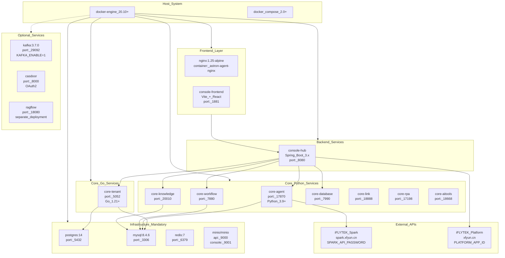

**Service Image and Component Mapping:**

| Service | Image/Base | Source Location | Deployment File |
|---------|-----------|-----------------|-----------------|
| `nginx` | `nginx:1.25-alpine` | [docker/astronAgent/nginx/nginx.conf:1-187]() | `docker/astronAgent/docker-compose.yaml` |
| `console-frontend` | `ghcr.io/iflytek/astron-agent/console-frontend` | [console/frontend/index.html:1-81]() | `docker/astronAgent/docker-compose.yaml` |
| `console-hub` | `ghcr.io/iflytek/astron-agent/console-hub` | [console/backend/hub/src/main/resources/application.yml:1-194]() | `docker/astronAgent/docker-compose.yaml` |
| `core-tenant` | `ghcr.io/iflytek/astron-agent/core-tenant` | [docker/astronAgent/docker-compose.yaml:165-194]() | `docker/astronAgent/docker-compose.yaml` |
| `core-agent` | `ghcr.io/iflytek/astron-agent/core-agent` | [docker/astronAgent/docker-compose.yaml:1-200]() | `docker/astronAgent/docker-compose.yaml` |
| `core-workflow` | `ghcr.io/iflytek/astron-agent/core-workflow` | [docker/astronAgent/docker-compose.yaml:1-200]() | `docker/astronAgent/docker-compose.yaml` |
| `postgres` | `postgres:14` | [docker/astronAgent/docker-compose.yaml:7-26]() | `docker/astronAgent/docker-compose.yaml` |
| `mysql` | `mysql:8.4.6` | [docker/astronAgent/docker-compose.yaml:28-43]() | `docker/astronAgent/docker-compose.yaml` |
| `redis` | `redis:7` | [docker/astronAgent/docker-compose.yaml:46-59]() | `docker/astronAgent/docker-compose.yaml` |
| `minio` | `minio/minio:RELEASE.2025-07-23T15-54-02Z` | [docker/astronAgent/docker-compose.yaml:126-146]() | `docker/astronAgent/docker-compose.yaml` |
| `casdoor` | `casbin/casdoor:latest` | [docs/DEPLOYMENT_GUIDE.md:31-39]() | `docker/astronAgent/docker-compose-auth.yml` |
| `ragflow` | Custom RagFlow | [docs/DEPLOYMENT_GUIDE.md:50-61]() | `docker/ragflow/docker-compose.yml` |

**Sources:** [docker/astronAgent/docker-compose.yaml:1-200](), [docs/DEPLOYMENT_GUIDE.md:5-11]()

## Hardware Requirements

### Core Platform Requirements (Mandatory)

| Resource | Minimum | Recommended | Notes |
|----------|---------|-------------|-------|
| **CPU** | 2 cores | 4+ cores | Orchestrates 8+ microservices [docs/DEPLOYMENT_GUIDE.md:18-18]() |
| **RAM** | 4 GiB | 8+ GiB | Hub (Java) and Python services overhead [docs/DEPLOYMENT_GUIDE.md:19-19]() |
| **Disk** | 50 GB | 100+ GB | Images, DB volumes, and MinIO storage [docs/DEPLOYMENT_GUIDE.md:20-20]() |

**Disk Space Breakdown:**
- **Docker images**: Significant storage for 8+ core service images.
- **Database storage**: PostgreSQL (`sparkdb_manager`) and MySQL (`astron_console`, `tenant`, `agent`, etc.) [docker/astronAgent/docker-compose.yaml:11-33]().
- **MinIO object storage**: User uploads and console assets via `minio_data` volume [docker/astronAgent/docker-compose.yaml:137-137]().

### RagFlow Knowledge Base Requirements (Optional)

| Resource | Minimum | Recommended | Notes |
|----------|---------|-------------|-------|
| **CPU** | 4 cores | 8+ cores | Intensive document processing [docs/DEPLOYMENT_GUIDE.md:23-23]() |
| **RAM** | 16 GB | 32+ GB | Vector DB and embedding models [docs/DEPLOYMENT_GUIDE.md:24-24]() |
| **Disk** | 50 GB | 200+ GB | Document storage and indices [docs/DEPLOYMENT_GUIDE.md:25-25]() |
| **GPU** | None | NVIDIA GPU | Accelerated embeddings via `docker-compose-gpu.yml` [docs/DEPLOYMENT_GUIDE.md:73-73]() |

**Sources:** [docs/DEPLOYMENT_GUIDE.md:17-26](), [docker/astronAgent/docker-compose.yaml:1-200]()

## Software Prerequisites

### Required Software

| Software | Minimum Version | Verification | Installation Check |
|----------|----------------|--------------|-------------------|
| **Docker Engine** | 20.10.0 | `docker --version` | Mandatory for containerized services [docs/DEPLOYMENT_GUIDE.md:31-31]() |
| **Docker Compose** | 2.0.0 | `docker compose version` | Required for orchestration [docs/DEPLOYMENT_GUIDE.md:31-31]() |
| **Git** | 2.0.0 | `git --version` | Required for repository cloning [README.md:53-53]() |

### Operating System Compatibility

| OS Family | Tested Versions | Docker Installation Method |
|-----------|----------------|---------------------------|
| **Linux** | Ubuntu 20.04+, CentOS 7+ | Native Docker Engine |
| **macOS** | macOS 11.0+ | Docker Desktop (uses `docker-compose-macos.yml` for RagFlow) [docs/DEPLOYMENT_GUIDE.md:50-50]() |
| **Windows** | Windows 10/11 | Docker Desktop + WSL2 backend |

**Sources:** [README.md:53-57](), [docs/DEPLOYMENT_GUIDE.md:31-39]()

## Required External Services

### iFLYTEK Platform Account (Mandatory)

The platform integrates deeply with iFLYTEK Spark and AI capabilities. Registration is required at [xfyun.cn](https://www.xfyun.cn).

**Credential Acquisition Workflow**

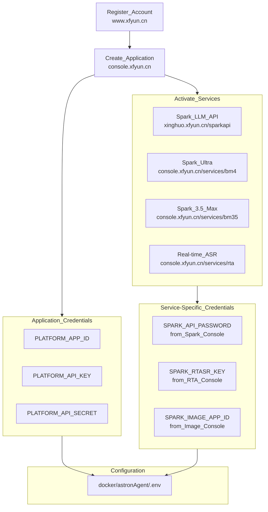

**Required Environment Variables (Application Layer):**

| Variable | Source | Used By |
|----------|--------|---------|
| `PLATFORM_APP_ID` | iFLYTEK Console | [docs/DEPLOYMENT_GUIDE_zh.md:180-180]() |
| `PLATFORM_API_KEY` | iFLYTEK Console | [docs/DEPLOYMENT_GUIDE_zh.md:181-181]() |
| `PLATFORM_API_SECRET` | iFLYTEK Console | [docs/DEPLOYMENT_GUIDE_zh.md:182-182]() |
| `SPARK_API_PASSWORD` | Spark Console | [docs/DEPLOYMENT_GUIDE_zh.md:184-184]() |
| `AI_ABILITY_CHAT_BASE_URL` | OpenAI-compatible endpoint | [console/backend/hub/src/main/resources/application.yml:147-147]() |

**Sources:** [docs/DEPLOYMENT_GUIDE_zh.md:161-194](), [console/backend/hub/src/main/resources/application.yml:127-150]()

## Network Port Configuration

### Exposed Ports (Host → Container)

| Port | Service | Configuration Variable | Access Level |
|------|---------|------------------------|--------------|
| 80 | `astron-agent-nginx` | `EXPOSE_NGINX_PORT` | Public [docker/astronAgent/.env.example:83-83]() |
| 8000 | `casdoor` | `CASDOOR_PORT` | Public (Auth) [docker/astronAgent/.env.example:92-92]() |
| 18998 | `minio` API | `EXPOSE_MINIO_PORT` | Internal [docker/astronAgent/.env.example:57-57]() |
| 18999 | `minio` Console | `EXPOSE_MINIO_CONSOLE_PORT` | Admin [docker/astronAgent/.env.example:58-58]() |

### Internal Microservice Ports

| Port | Service | Purpose |
|------|---------|---------|
| 5052 | `core-tenant` | Tenant/Auth management [docker/astronAgent/.env.example:95-95]() |
| 7990 | `core-database` | Memory DB execution [docker/astronAgent/.env.example:96-96]() |
| 7880 | `core-workflow` | Workflow engine [docker/astronAgent/.env.example:102-102]() |
| 17870 | `core-agent` | Agent runtime [docker/astronAgent/.env.example:100-100]() |
| 20010 | `core-knowledge` | Knowledge/RAG retrieval [docker/astronAgent/.env.example:101-101]() |
| 8080 | `console-hub` | Backend API [console/backend/hub/src/main/resources/application.yml:2-2]() |

**Sources:** [docker/astronAgent/.env.example:91-102](), [docker/astronAgent/docker-compose.yaml:164-200]()

---

# Page: Quick Start with Docker Compose

# Quick Start with Docker Compose

<details>
<summary>Relevant source files</summary>

The following files were used as context for generating this wiki page:

- [README.md](README.md)
- [console/backend/hub/src/main/resources/application.yml](console/backend/hub/src/main/resources/application.yml)
- [console/frontend/index.html](console/frontend/index.html)
- [console/frontend/public/runtime-config.js](console/frontend/public/runtime-config.js)
- [docker/astronAgent/.env.example](docker/astronAgent/.env.example)
- [docker/astronAgent/casdoor/conf/app.conf](docker/astronAgent/casdoor/conf/app.conf)
- [docker/astronAgent/casdoor/conf/init_data.json](docker/astronAgent/casdoor/conf/init_data.json)
- [docker/astronAgent/casdoor/conf/init_data.json.template](docker/astronAgent/casdoor/conf/init_data.json.template)
- [docker/astronAgent/casdoor/entrypoint.sh](docker/astronAgent/casdoor/entrypoint.sh)
- [docker/astronAgent/docker-compose-auth.yml](docker/astronAgent/docker-compose-auth.yml)
- [docker/astronAgent/docker-compose-with-auth.yaml](docker/astronAgent/docker-compose-with-auth.yaml)
- [docker/astronAgent/docker-compose.yaml](docker/astronAgent/docker-compose.yaml)
- [docker/astronAgent/nginx/nginx.conf](docker/astronAgent/nginx/nginx.conf)
- [docker/ragflow/docker-compose-macos.yml](docker/ragflow/docker-compose-macos.yml)
- [docker/ragflow/docker-compose.yml](docker/ragflow/docker-compose.yml)
- [docs/CONFIGURATION.md](docs/CONFIGURATION.md)
- [docs/CONFIGURATION_zh.md](docs/CONFIGURATION_zh.md)
- [docs/CONTRIBUTING_CN.md](docs/CONTRIBUTING_CN.md)
- [docs/DEPLOYMENT_GUIDE.md](docs/DEPLOYMENT_GUIDE.md)
- [docs/DEPLOYMENT_GUIDE_WITH_AUTH.md](docs/DEPLOYMENT_GUIDE_WITH_AUTH.md)
- [docs/DEPLOYMENT_GUIDE_WITH_AUTH_RPA.md](docs/DEPLOYMENT_GUIDE_WITH_AUTH_RPA.md)
- [docs/DEPLOYMENT_GUIDE_WITH_AUTH_RPA_zh.md](docs/DEPLOYMENT_GUIDE_WITH_AUTH_RPA_zh.md)
- [docs/DEPLOYMENT_GUIDE_WITH_AUTH_zh.md](docs/DEPLOYMENT_GUIDE_WITH_AUTH_zh.md)
- [docs/DEPLOYMENT_GUIDE_zh.md](docs/DEPLOYMENT_GUIDE_zh.md)
- [docs/README-zh.md](docs/README-zh.md)

</details>


This page provides a step-by-step guide for deploying the Astron Agent platform using Docker Compose. This deployment method is recommended for quick evaluation, development environments, and small-scale production deployments on a single host.

**Scope**: This guide covers the complete deployment sequence including Casdoor authentication (required), optional RagFlow knowledge base, and all core services. It specifically details the usage of `docker-compose.yaml` and integrated configurations like `docker-compose-with-auth.yaml`.

---

## Deployment Architecture Overview

The Docker Compose deployment uses a single-host architecture where all services run as containers orchestrated through Docker Compose. Services communicate via a dedicated Docker bridge network (`astron-agent-network`), and Nginx serves as the entry point reverse proxy.

### System Components and Code Entities

The following diagram maps high-level system components to their corresponding code entities and service definitions.

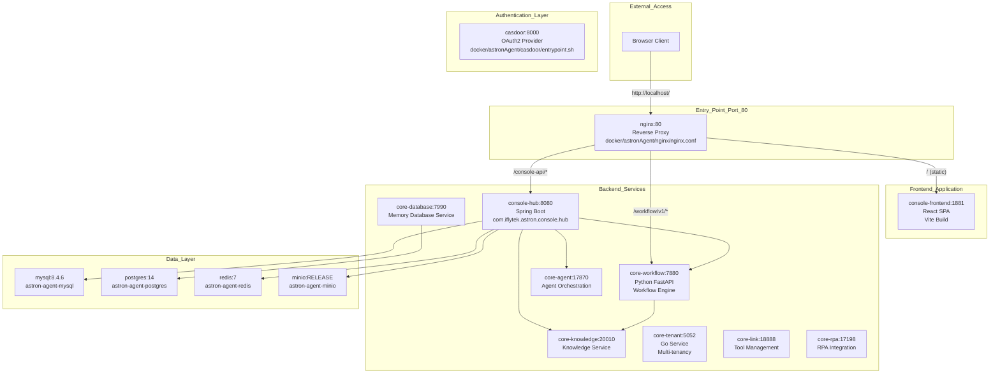

**Sources**: [docker/astronAgent/docker-compose.yaml:1-200](), [docs/DEPLOYMENT_GUIDE_zh.md:5-11](), [docker/astronAgent/nginx/nginx.conf:45-186]()

---

## Step 1: Prepare Environment Configuration

The platform relies on a central `.env` file for orchestration. Copy the provided example to get started.

```bash
cd docker/astronAgent
cp .env.example .env
```

### Key Environment Variables
The `.env` file controls service versions, middleware credentials, and inter-service URLs.

| Variable | Default Value | Description |
|----------|---------------|-------------|
| `ASTRON_AGENT_VERSION` | `latest` | Image tag for all core services [docker/astronAgent/.env.example:9-9]() |
| `HOST_BASE_ADDRESS` | `http://localhost` | Base URL for external access [docker/astronAgent/.env.example:85-85]() |
| `MYSQL_URL` | `jdbc:mysql://mysql:3306/...` | Connection string for the console backend [docker/astronAgent/.env.example:29-29]() |
| `OSS_ENDPOINT` | `http://minio:9000` | Internal endpoint for S3 storage [docker/astronAgent/.env.example:62-62]() |
| `CONSOLE_CASDOOR_URL` | `${HOST_BASE_ADDRESS}:${CASDOOR_PORT}` | Auth server endpoint for frontend [docker/astronAgent/.env.example:108-108]() |
| `SPARK_APP_ID` | `xxx` | iFLYTEK Spark LLM credentials [console/backend/hub/src/main/resources/application.yml:128-128]() |

**Sources**: [docker/astronAgent/.env.example:1-202](), [docs/DEPLOYMENT_GUIDE_zh.md:178-194](), [console/backend/hub/src/main/resources/application.yml:126-140]()

---

## Step 2: Deploy Infrastructure and Core Services

The deployment is modular. You can choose to deploy the core platform or include the integrated Auth module.

### Option A: Standard Deployment
Includes core services and middleware (MySQL, PostgreSQL, Redis, MinIO).
```bash
docker compose up -d
```

### Option B: Integrated Deployment (Auth Included)
Includes Casdoor for authentication using the `include` mechanism or a combined YAML file.
```bash
docker compose -f docker-compose-with-auth.yaml up -d
```

### Service Dependency Flow
The platform uses Docker `healthcheck` and `depends_on` to ensure correct startup order.

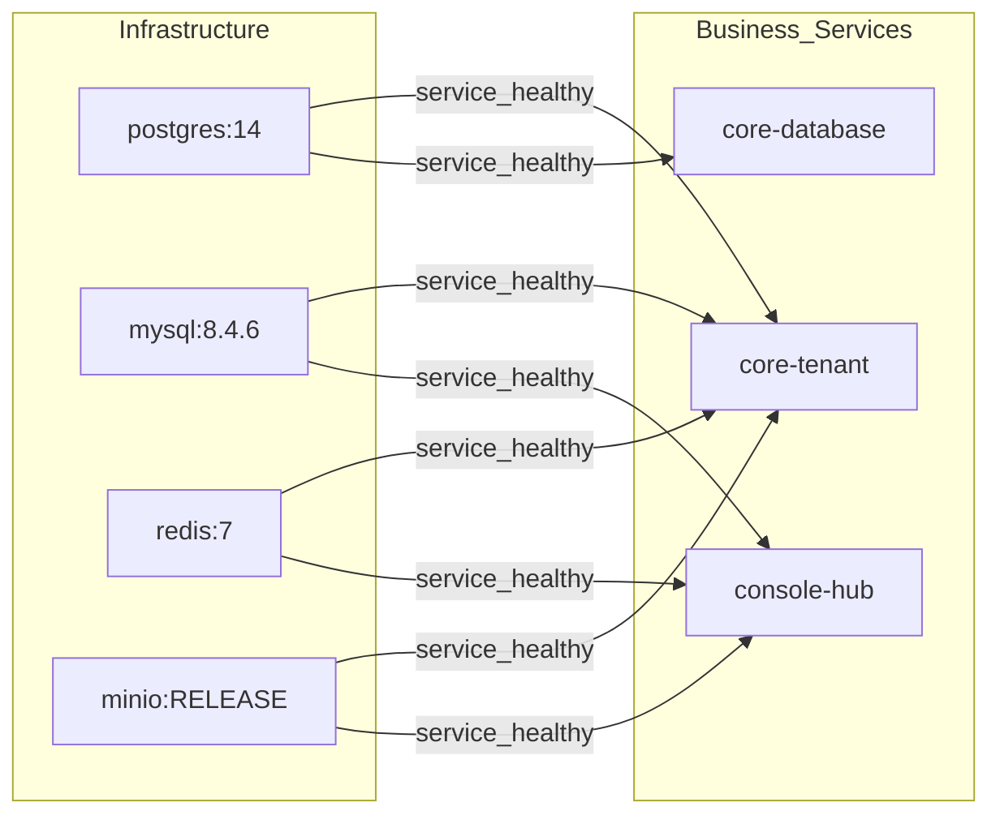

**Sources**: [docker/astronAgent/docker-compose.yaml:178-186](), [docker/astronAgent/docker-compose.yaml:222-226](), [docs/DEPLOYMENT_GUIDE_zh.md:159-252]()

---

## Step 3: Configure Casdoor Authentication

When using the auth-integrated deployment, the Casdoor service initializes with a custom `entrypoint.sh` that injects environment variables into the Casdoor configuration.

1. **Initialization**: The script `docker/astronAgent/casdoor/entrypoint.sh` replaces placeholders in `init_data.json.template` with the `CONSOLE_DOMAIN` and `HOST_BASE_ADDRESS` defined in your `.env` [docker/astronAgent/casdoor/entrypoint.sh:14-18]().
2. **Access**: Navigate to `http://localhost:8000` (or your configured `CASDOOR_PORT`).
3. **Default App**: The system pre-configures `astron-agent-client` and `astron-agent-app` within the `built-in` organization [docker/astronAgent/.env.example:109-111]().
4. **Login**: Default administrator credentials are `admin / 123` [docs/DEPLOYMENT_GUIDE_zh.md:131-131]().

**Sources**: [docker/astronAgent/casdoor/entrypoint.sh:1-25](), [docker/astronAgent/.env.example:108-112](), [docs/DEPLOYMENT_GUIDE_zh.md:129-148](), [docker/astronAgent/docker-compose-auth.yml:1-42]()

---

## Step 4: Optional RagFlow Setup

For advanced RAG capabilities, you can deploy RagFlow alongside Astron Agent.

1. **Deployment**: Run the RagFlow compose file in its directory:
   ```bash
   cd docker/ragflow
   chmod +x *.sh
   docker compose up -d
   ```
   [docs/DEPLOYMENT_GUIDE_zh.md:52-61]()
2. **Configuration**: Set `RAGFLOW_BASE_URL` and `RAGFLOW_API_TOKEN` in your `.env` file [docker/astronAgent/.env.example:179-180]().
3. **Integration**: The `core-knowledge` service uses these credentials to communicate with the RagFlow API for document chunking and retrieval [docker/astronAgent/.env.example:101-101]().

**Sources**: [docs/DEPLOYMENT_GUIDE_zh.md:46-74](), [docker/astronAgent/.env.example:178-184]()

---

## Verification and Health Checks

To verify the deployment, check the health status of the containers:

```bash
docker ps --format "table {{.Names}}\t{{.Status}}\t{{.Ports}}"
```

### Key Health Check Implementations
- **PostgreSQL**: Uses `pg_isready -U ${POSTGRES_USER} -d sparkdb_manager` [docker/astronAgent/docker-compose.yaml:22-25]().
- **MySQL**: Uses `mysqladmin ping` [docker/astronAgent/docker-compose.yaml:40-43]().
- **Redis**: Uses `redis-cli ping` with optional password [docker/astronAgent/docker-compose.yaml:56-59]().
- **MinIO**: Checks the `/minio/health/live` endpoint [docker/astronAgent/docker-compose.yaml:143-146]().

**Sources**: [docker/astronAgent/docker-compose.yaml:1-150]()

---

# Page: Environment Configuration

# Environment Configuration

<details>
<summary>Relevant source files</summary>

The following files were used as context for generating this wiki page:

- [README.md](README.md)
- [console/backend/hub/src/main/resources/application.yml](console/backend/hub/src/main/resources/application.yml)
- [console/backend/hub/src/main/resources/db/migration/V1.24__add_multi_mode_to_model_table.sql](console/backend/hub/src/main/resources/db/migration/V1.24__add_multi_mode_to_model_table.sql)
- [console/frontend/index.html](console/frontend/index.html)
- [console/frontend/public/runtime-config.js](console/frontend/public/runtime-config.js)
- [core/workflow/api/v1/chat/open.py](core/workflow/api/v1/chat/open.py)
- [core/workflow/config.env](core/workflow/config.env)
- [core/workflow/engine/nodes/decision/decision_node.py](core/workflow/engine/nodes/decision/decision_node.py)
- [core/workflow/engine/nodes/knowledge_pro/knowledge_pro_node.py](core/workflow/engine/nodes/knowledge_pro/knowledge_pro_node.py)
- [core/workflow/extensions/fastapi/middleware/otlp.py](core/workflow/extensions/fastapi/middleware/otlp.py)
- [core/workflow/extensions/middleware/log/factory.py](core/workflow/extensions/middleware/log/factory.py)
- [core/workflow/extensions/otlp/log_trace/workflow_log.py](core/workflow/extensions/otlp/log_trace/workflow_log.py)
- [core/workflow/extensions/otlp/metric/meter.py](core/workflow/extensions/otlp/metric/meter.py)
- [core/workflow/extensions/otlp/trace/span.py](core/workflow/extensions/otlp/trace/span.py)
- [core/workflow/infra/providers/llm/chat_ai.py](core/workflow/infra/providers/llm/chat_ai.py)
- [core/workflow/infra/providers/llm/iflytek_spark/spark_chat_llm.py](core/workflow/infra/providers/llm/iflytek_spark/spark_chat_llm.py)
- [core/workflow/infra/providers/llm/iflytek_spark/spark_fc_llm.py](core/workflow/infra/providers/llm/iflytek_spark/spark_fc_llm.py)
- [core/workflow/infra/providers/llm/openai/openai_chat_llm.py](core/workflow/infra/providers/llm/openai/openai_chat_llm.py)
- [docker/astronAgent/.env.example](docker/astronAgent/.env.example)
- [docker/astronAgent/config/agent/config.env](docker/astronAgent/config/agent/config.env)
- [docker/astronAgent/config/aitools/config.env](docker/astronAgent/config/aitools/config.env)
- [docker/astronAgent/config/knowledge/config.env](docker/astronAgent/config/knowledge/config.env)
- [docker/astronAgent/config/link/config.env](docker/astronAgent/config/link/config.env)
- [docker/astronAgent/config/tenant/config.toml](docker/astronAgent/config/tenant/config.toml)
- [docker/astronAgent/config/workflow/config.env](docker/astronAgent/config/workflow/config.env)
- [docker/astronAgent/docker-compose.yaml](docker/astronAgent/docker-compose.yaml)
- [docker/astronAgent/nginx/nginx.conf](docker/astronAgent/nginx/nginx.conf)
- [docker/ragflow/docker-compose-macos.yml](docker/ragflow/docker-compose-macos.yml)
- [docs/CONFIGURATION.md](docs/CONFIGURATION.md)
- [docs/CONFIGURATION_zh.md](docs/CONFIGURATION_zh.md)
- [docs/CONTRIBUTING_CN.md](docs/CONTRIBUTING_CN.md)
- [docs/DEPLOYMENT_GUIDE.md](docs/DEPLOYMENT_GUIDE.md)
- [docs/DEPLOYMENT_GUIDE_zh.md](docs/DEPLOYMENT_GUIDE_zh.md)
- [docs/README-zh.md](docs/README-zh.md)
- [helm/astron-agent/files/config/database/config.env](helm/astron-agent/files/config/database/config.env)
- [helm/astron-agent/files/config/knowledge/config.env](helm/astron-agent/files/config/knowledge/config.env)
- [helm/astron-agent/files/config/link/config.env](helm/astron-agent/files/config/link/config.env)
- [helm/astron-agent/files/config/rpa/config.env](helm/astron-agent/files/config/rpa/config.env)

</details>


This document details the environment configuration system for the Astron Agent platform, covering the `.env` file structure, variable categories, configuration hierarchy, and the mechanisms by which configuration values flow from environment files through Docker Compose into both backend and frontend services.

## Configuration File Structure

The Astron Agent platform uses a hierarchical configuration approach with `.env` files at the root of the deployment structure and service-specific `config.env` files for granular control.

### Configuration Template and Instantiation

The platform provides [docker/astronAgent/.env.example:1-311]() as a template containing all available configuration variables with documentation and default values. Users must copy this template to create their active configuration:

```bash
cd docker/astronAgent
cp .env.example .env
# Edit .env with deployment-specific values
```

The `.env.example` file is organized into logical sections:
- **Image Version Configuration**: Container image tags (e.g., `ASTRON_AGENT_VERSION`) [docker/astronAgent/.env.example:5-9]().
- **Middleware Configuration**: Settings for PostgreSQL, MySQL, Redis, Elasticsearch, Kafka, MinIO, and OTLP [docker/astronAgent/.env.example:12-81]().
- **Port Configuration**: Internal and external service port mappings [docker/astronAgent/.env.example:88-102]().
- **Console Casdoor Configuration**: OAuth2 frontend settings used for authentication [docker/astronAgent/.env.example:104-111]().
- **Component-specific Configuration**: Individual parameters for Tenant, Database, RPA, Link, Agent, Knowledge, and Workflow services [docker/astronAgent/.env.example:114-189]().
- **Console Module Configuration**: Backend service settings for the `console-hub` [docker/astronAgent/.env.example:191-297]().

**Sources:** [docker/astronAgent/.env.example:1-311]()

## Configuration Flow Architecture

### Configuration Transformation Pipeline

**Diagram: Environment Variable Flow from .env to Application Code**

```mermaid
graph TB
    subgraph "SourceFiles" ["1. Configuration Source Files"]
        "EnvExample" [".env.example Template with defaults"]
        "EnvFile" [".env User-created active config"]
    end
    
    subgraph "DockerLayer" ["2. Docker Layer"]
        "ComposeFile" ["docker-compose.yaml Service definitions"]
        "VarSub" ["Variable Substitution Syntax: ${VAR:-default}"]
    end
    
    subgraph "ContainerEnv" ["3. Container Environment Variables"]
        "PgEnv" ["postgres POSTGRES_USER POSTGRES_PASSWORD"]
        "MySQLEnv" ["mysql MYSQL_ROOT_PASSWORD"]
        "RedisEnv" ["redis REDIS_PASSWORD"]
        "MinIOEnv" ["minio MINIO_ROOT_USER MINIO_ROOT_PASSWORD"]
        "CoreEnv" ["core-workflow SERVICE_PORT MYSQL_HOST REDIS_ADDR"]
        "HubEnv" ["console-hub MYSQL_URL OAUTH2_ISSUER_URI"]
        "FrontendEnv" ["console-frontend CONSOLE_CASDOOR_URL CONSOLE_CASDOOR_ID"]
    end
    
    subgraph "AppConfig" ["4. Application Configuration Files"]
        "YamlConfig" ["application.yml Spring ${VAR:default}"]
        "ConfigEnv" ["config.env files Mounted volumes"]
        "RuntimeJS" ["runtime-config.js Generated by entrypoint.sh"]
    end
    
    subgraph "CodeAccess" ["5. Configuration Access in Code"]
        "SpringBoot" ["@Value annotations PropertySourcesPlaceholder"]
        "PythonEnv" ["os.environ.get() os.getenv()"]
        "FrontendFunc" ["window.__APP_CONFIG__"]
    end
    
    "EnvExample" -->|"cp .env.example .env"| "EnvFile"
    "EnvFile" --> "ComposeFile"
    "ComposeFile" --> "VarSub"
    
    "VarSub" --> "PgEnv"
    "VarSub" --> "MySQLEnv"
    "VarSub" --> "RedisEnv"
    "VarSub" --> "MinIOEnv"
    "VarSub" --> "CoreEnv"
    "VarSub" --> "HubEnv"
    "VarSub" --> "FrontendEnv"
    
    "CoreEnv" -->|"volume mount"| "ConfigEnv"
    "HubEnv" -->|"startup read"| "YamlConfig"
    "FrontendEnv" -->|"entrypoint.sh"| "RuntimeJS"
    
    "YamlConfig" --> "SpringBoot"
    "ConfigEnv" --> "PythonEnv"
    "RuntimeJS" --> "FrontendFunc"
```

Configuration flows through five transformation stages:

1. **Source Stage**: [docker/astronAgent/.env.example:1-311]() provides the documented template.
2. **Compose Stage**: [docker/astronAgent/docker-compose.yaml:1-252]() performs variable substitution with `${VAR:-default}` syntax.
3. **Container Stage**: Environment variables are injected into container namespaces via `environment:` blocks.
4. **Application Stage**:
   - **Spring Boot**: [console/backend/hub/src/main/resources/application.yml:14-194]() uses `${VAR:default}` syntax to bind container variables to Java properties.
   - **Python/Go**: Services read configuration through mounted `config.env` files (e.g., [docker/astronAgent/config/workflow/config.env:1-180]()) or direct `os.environ` access via `os.getenv()` [core/workflow/extensions/middleware/log/factory.py:40-46]().
   - **Frontend**: The `entrypoint.sh` script in the frontend container generates `runtime-config.js` to populate `window.__APP_CONFIG__`.
5. **Code Stage**: Application code accesses configuration through language-specific APIs.

**Sources:** [docker/astronAgent/.env.example:1-311](), [docker/astronAgent/docker-compose.yaml:1-252](), [console/backend/hub/src/main/resources/application.yml:1-194](), [docker/astronAgent/config/workflow/config.env:1-180](), [core/workflow/extensions/middleware/log/factory.py:40-46]()

## Variable Substitution and Defaults

Docker Compose supports fallback values using the `${VAR:-default}` syntax, enabling flexible configuration with sensible defaults.

### Common Substitution Patterns

| Pattern | Example | Behavior |
|---------|---------|----------|
| `${VAR:-default}` | `${MYSQL_PASSWORD:-root123}` | Use `MYSQL_PASSWORD` if set, otherwise `root123`. |
| Chained reference | `${MYSQL_PASSWORD:-root123}` → `${DATABASE_PASSWORD}` | Variable references can chain between sections. |

Example from [docker/astronAgent/.env.example:23-26]():
```bash
MYSQL_ROOT_PASSWORD=root123
MYSQL_PASSWORD=${MYSQL_ROOT_PASSWORD:-root123}
```

The `MYSQL_PASSWORD` variable defaults to the value of `MYSQL_ROOT_PASSWORD`, which itself has a hardcoded default.

**Sources:** [docker/astronAgent/.env.example:23-26](), [docker/astronAgent/docker-compose.yaml:31-32]()

## Middleware Configuration

### Database Configuration

The platform uses PostgreSQL and MySQL with separate roles:

#### PostgreSQL (Memory Database)
Used by `core-database` for dynamic tenant schema management [docker/astronAgent/docker-compose.yaml:11-14]().
```bash
POSTGRES_USER=spark
POSTGRES_PASSWORD=spark123
PGSQL_DATABASE=sparkdb_manager
```

#### MySQL (Application Data)
Used by `console-hub`, `core-link`, and `core-workflow` for persistent application state [docker/astronAgent/.env.example:22-29]().
```bash
MYSQL_URL=jdbc:mysql://mysql:3306/astron_console?useSSL=false...
MYSQL_USER=root
MYSQL_PASSWORD=root123
```

### Redis Cache Configuration
Redis supports both standalone and cluster modes. The console backend uses a specific database index (`REDIS_DATABASE_CONSOLE`) to isolate its cache [docker/astronAgent/.env.example:31-40](), [console/backend/hub/src/main/resources/application.yml:44-52]().

### MinIO Object Storage Configuration
MinIO provides S3-compatible storage for workflows and console assets [docker/astronAgent/.env.example:54-67]().
```bash
OSS_ENDPOINT=http://minio:9000
OSS_ACCESS_KEY_ID=minioadmin
OSS_BUCKET_NAME=workflow
OSS_REMOTE_ENDPOINT=${HOST_BASE_ADDRESS}:${EXPOSE_MINIO_PORT}
```
The `OSS_REMOTE_ENDPOINT` is used for pre-signed URLs accessible from the browser [docker/astronAgent/.env.example:197-198]().

**Sources:** [docker/astronAgent/.env.example:15-67](), [docker/astronAgent/docker-compose.yaml:7-147](), [console/backend/hub/src/main/resources/application.yml:14-52]()

## Service-Specific Configuration Mapping

### Core Service Configuration Hierarchy

```mermaid
graph TB
    subgraph "EnvSource" [".env Configuration Source"]
        "EnvFile" ["docker/astronAgent/.env"]
    end
    
    subgraph "ComposeMappings" ["docker-compose.yaml Service Definitions"]
        "TenantBlock" ["core-tenant SERVICE_PORT DATABASE_URL"]
        "DatabaseBlock" ["core-database SERVICE_PORT PGSQL_HOST"]
        "AgentBlock" ["core-agent SERVICE_PORT MYSQL_DB"]
        "WorkflowBlock" ["core-workflow SERVICE_PORT MYSQL_HOST"]
    end
    
    subgraph "VolumeMounts" ["Volume-Mounted config.env Files"]
        "DatabaseEnv" ["config/database/config.env"]
        "AgentEnv" ["config/agent/config.env"]
        "WorkflowEnv" ["config/workflow/config.env"]
        "LinkEnv" ["config/link/config.env"]
    end
    
    "EnvFile" --> "TenantBlock"
    "EnvFile" --> "DatabaseBlock"
    "EnvFile" --> "AgentBlock"
    "EnvFile" --> "WorkflowBlock"
    
    "DatabaseBlock" -->|"Mounts"| "DatabaseEnv"
    "AgentBlock" -->|"Mounts"| "AgentEnv"
    "WorkflowBlock" -->|"Mounts"| "WorkflowEnv"
```

Each core service receives configuration through two primary layers:
1. **Docker Compose environment blocks**: Maps `.env` variables to container environment variables [docker/astronAgent/docker-compose.yaml:168-177]().
2. **Volume-mounted `config.env` files**: Provides additional service-specific settings from the `./config/` directory [docker/astronAgent/config/workflow/config.env:1-180]().

### Key Service Variables

#### Workflow Service (`core-workflow`)
The `core-workflow` service uses a `config.env` file for its Python-based runtime. It initializes various services (OSS, Kafka, OTLP) during startup.
- `MYSQL_DB`: Persistent database name [core/workflow/config.env:46]().
- `OSS_TYPE`: Storage backend (s3/ifly) [core/workflow/config.env:98]().
- `KAFKA_TOPIC`: Event streaming topic [core/workflow/config.env:117]().
- `SHUTDOWN_TIMEOUT`: Graceful shutdown duration [core/workflow/config.env:34]().

#### Agent Service (`core-agent`)
Orchestrates tools and workflows. It requires URLs for all peer services [docker/astronAgent/.env.example:161-163]().
- `GET_LINK_URL`: Tool retrieval endpoint.
- `RUN_LINK_URL`: Tool execution endpoint.

#### Knowledge Service (`core-knowledge`)
Manages RAG integrations. Configuration includes endpoints for external providers [docker/astronAgent/config/knowledge/config.env:1-109]().
- `RAGFLOW_BASE_URL`: URL for the optional RAGFlow service [docker/astronAgent/config/knowledge/config.env:104]().
- `XINGHUO_RAG_URL`: URL for iFLYTEK Spark RAG service [docker/astronAgent/config/knowledge/config.env:76]().

**Sources:** [docker/astronAgent/docker-compose.yaml:165-252](), [core/workflow/config.env:1-180](), [docker/astronAgent/.env.example:161-163](), [docker/astronAgent/config/knowledge/config.env:1-109]()

## Backend Console Configuration

The `console-hub` is a Spring Boot application that binds environment variables to properties in [console/backend/hub/src/main/resources/application.yml:1-194]().

### Spring Boot Property Binding Examples

| Property Path | Environment Variable | Purpose |
|---------------|----------------------|---------|
| `spring.datasource.url` | `MYSQL_URL` | Database connection string [console/backend/hub/src/main/resources/application.yml:14](). |
| `spring.security.oauth2.resourceserver.jwt.issuer-uri` | `OAUTH2_ISSUER_URI` | Casdoor JWT issuer validation [console/backend/hub/src/main/resources/application.yml:57](). |
| `s3.endpoint` | `OSS_ENDPOINT` | Internal MinIO endpoint for uploads [console/backend/hub/src/main/resources/application.yml:118](). |
| `spark.app-id` | `SPARK_APP_ID` | iFLYTEK Spark platform credentials [console/backend/hub/src/main/resources/application.yml:128](). |
| `maas.publishApi` | `MAAS_PUBLISH_API` | External workflow publishing endpoint [console/backend/hub/src/main/resources/application.yml:189](). |

**Sources:** [console/backend/hub/src/main/resources/application.yml:1-194]()

## Frontend Configuration System

### Runtime Configuration Injection

The frontend uses a `runtime-config.js` file to allow environment variable injection without rebuilding the Docker image.

1. **Generation**: The container entrypoint script reads environment variables like `CONSOLE_CASDOOR_URL` [docker/astronAgent/.env.example:108]().
2. **Injection**: It generates `/runtime-config.js` which populates `window.__APP_CONFIG__`.
3. **Consumption**: The frontend application reads these values at runtime for Casdoor authentication and API base URLs.

### Nginx Proxy Configuration

The Nginx configuration routes requests based on paths defined in the environment:
- `/runtime-config.js`: Served from the frontend container with no-cache headers [docker/astronAgent/nginx/nginx.conf:55-66]().
- `/console-api/`: Proxied to the `console-hub` backend [docker/astronAgent/nginx/nginx.conf:153-164]().
- `/workflow/v1/`: Proxied to `core-workflow` with SSE support enabled [docker/astronAgent/nginx/nginx.conf:109-122]().

**Sources:** [docker/astronAgent/.env.example:104-111](), [docker/astronAgent/docker-compose.yaml:221-250](), [docker/astronAgent/nginx/nginx.conf:55-164]()

## Observability Configuration (OTLP)

The platform supports OpenTelemetry for distributed tracing and metrics across all core services.

| Variable | Default | Purpose |
|----------|---------|---------|
| `OTLP_ENABLE` | `0` | Globally enable/disable telemetry [docker/astronAgent/.env.example:70](). |
| `OTLP_ENDPOINT` | `127.0.0.1:4317` | Endpoint for OTLP collector [docker/astronAgent/.env.example:71](). |
| `OTLP_METRIC_EXPORT_INTERVAL_MILLIS` | `3000` | Frequency of metric reporting [core/workflow/config.env:74](). |
| `OTLP_TRACE_MAX_QUEUE_SIZE` | `2048` | Buffer size for span exports [core/workflow/config.env:84](). |

**Sources:** [docker/astronAgent/.env.example:70-80](), [core/workflow/config.env:63-90]()

---

# Page: Authentication Setup with Casdoor

# Authentication Setup with Casdoor

<details>
<summary>Relevant source files</summary>

The following files were used as context for generating this wiki page:

- [console/backend/hub/src/main/java/com/iflytek/astron/console/hub/service/bot/impl/TalkAgentServiceImpl.java](console/backend/hub/src/main/java/com/iflytek/astron/console/hub/service/bot/impl/TalkAgentServiceImpl.java)
- [console/frontend/.env.development](console/frontend/.env.development)
- [console/frontend/.env.production](console/frontend/.env.production)
- [console/frontend/.env.test](console/frontend/.env.test)
- [console/frontend/Dockerfile](console/frontend/Dockerfile)
- [console/frontend/docker-entrypoint.sh](console/frontend/docker-entrypoint.sh)
- [console/frontend/src/components/create-application-modal/index.tsx](console/frontend/src/components/create-application-modal/index.tsx)
- [console/frontend/src/components/sidebar/create-button.tsx](console/frontend/src/components/sidebar/create-button.tsx)
- [console/frontend/src/components/virtual-config-modal/index.module.scss](console/frontend/src/components/virtual-config-modal/index.module.scss)
- [console/frontend/src/components/vms-interaction-cmp/index.tsx](console/frontend/src/components/vms-interaction-cmp/index.tsx)
- [console/frontend/src/components/workflow/drawer/chat-debugger/index.scss](console/frontend/src/components/workflow/drawer/chat-debugger/index.scss)
- [console/frontend/src/config/casdoor.ts](console/frontend/src/config/casdoor.ts)
- [console/frontend/src/utils/http.ts](console/frontend/src/utils/http.ts)
- [console/frontend/vite-env.d.ts](console/frontend/vite-env.d.ts)
- [console/frontend/vite.config.js](console/frontend/vite.config.js)
- [docker/astronAgent/casdoor/conf/app.conf](docker/astronAgent/casdoor/conf/app.conf)
- [docker/astronAgent/casdoor/conf/init_data.json](docker/astronAgent/casdoor/conf/init_data.json)
- [docker/astronAgent/casdoor/conf/init_data.json.template](docker/astronAgent/casdoor/conf/init_data.json.template)
- [docker/astronAgent/casdoor/entrypoint.sh](docker/astronAgent/casdoor/entrypoint.sh)
- [docker/astronAgent/docker-compose-auth.yml](docker/astronAgent/docker-compose-auth.yml)
- [docker/astronAgent/docker-compose-with-auth.yaml](docker/astronAgent/docker-compose-with-auth.yaml)
- [docker/ragflow/docker-compose.yml](docker/ragflow/docker-compose.yml)
- [docs/DEPLOYMENT_GUIDE_WITH_AUTH.md](docs/DEPLOYMENT_GUIDE_WITH_AUTH.md)
- [docs/DEPLOYMENT_GUIDE_WITH_AUTH_RPA.md](docs/DEPLOYMENT_GUIDE_WITH_AUTH_RPA.md)
- [docs/DEPLOYMENT_GUIDE_WITH_AUTH_RPA_zh.md](docs/DEPLOYMENT_GUIDE_WITH_AUTH_RPA_zh.md)
- [docs/DEPLOYMENT_GUIDE_WITH_AUTH_zh.md](docs/DEPLOYMENT_GUIDE_WITH_AUTH_zh.md)

</details>


This document provides detailed instructions for configuring Casdoor as the OAuth2/OIDC authentication provider for the Astron Agent platform. Casdoor is a required component that provides single sign-on (SSO) and identity management for all console services.

---

## Overview

Casdoor is an open-source identity and access management (IAM) platform that provides:

- **OAuth 2.0 and OIDC protocols** for authentication.
- **Organization-based multi-tenancy** for user isolation.
- **Application management** for client registration.
- **JWT token issuance** for stateless authentication.

The Astron Agent platform uses Casdoor as the centralized authentication gateway for both the React frontend (`console-frontend`) and Spring Boot backend (`console-hub`).

**Sources**: [docs/DEPLOYMENT_GUIDE_WITH_AUTH.md:9-11](), [console/frontend/src/utils/http.ts:10-10]()

---

## Deployment Architecture

### Casdoor Service Integration

The Casdoor service is deployed via the `docker-compose-auth.yml` or `docker-compose-with-auth.yaml` file, which uses Docker Compose's `include` mechanism to bundle Casdoor with the core Astron Agent services.

| Component | Container Name | Port | Database |
|-----------|---------------|------|----------|
| Casdoor Server | `astron-agent-casdoor` | 8000 | MySQL `casdoor` schema |
| Casdoor Admin UI | Same as server | 8000 | Same |
| Console Frontend | `console-frontend` | 1881 (internal) | N/A |
| Console Hub | `console-hub` | 8080 (internal) | MySQL `astron_console` |

### Deployment Data Flow

Title: "Authentication Service Topology"
```mermaid
graph TB
    subgraph "Docker_Compose_Deployment"
        ["docker-compose-auth.yml"]
    end
    
    subgraph "Authentication_Layer"
        ["astron-agent-casdoor"] -- "Port: 8000" --> ["casdoor_service"]
        ["casdoor_service"] --> ["astron-agent-casdoor-mysql"]
    end
    
    subgraph "Console_Services"
        ["console-frontend"] -- "React_SPA" --> ["Nginx_Container"]
        ["console-hub"] -- "Spring_Boot" --> ["Nginx_Container"]
        ["Nginx_Container"] -- "Port: 1881" --> ["External_Access"]
    end
    
    subgraph "Configuration"
        [".env_file"] -- "CONSOLE_CASDOOR_*" --> ["console-frontend"]
        ["docker-entrypoint.sh"] -- "Injects" --> ["runtime-config.js"]
    end
    
    ["docker-compose-auth.yml"] --> ["astron-agent-casdoor"]
    ["astron-agent-casdoor"] --> ["astron-agent-casdoor-mysql"]
```

**Sources**: [docker/astronAgent/docker-compose-auth.yml:2-32](), [console/frontend/Dockerfile:38-38](), [console/frontend/docker-entrypoint.sh:4-9]()

---

## Initial Setup

### Step 1: Start Casdoor Service

Casdoor is automatically started when using the recommended deployment method. The system includes an initialization script `entrypoint.sh` that prepares the configuration from templates.

```bash
cd docker/astronAgent
docker compose -f docker-compose-auth.yml up -d
```

**Initialization Logic:**
The Casdoor container uses `docker/astronAgent/casdoor/entrypoint.sh` to generate `init_data.json` from `init_data.json.template` by replacing placeholders like `${CONSOLE_DOMAIN}` and `${HOST_BASE_ADDRESS}` using `sed` [docker/astronAgent/casdoor/entrypoint.sh:14-18](). This ensures that the `redirectUris` are dynamically set based on the deployment environment [docker/astronAgent/casdoor/entrypoint.sh:21]().

**Default Credentials:**
- Username: `admin`
- Password: `123`
- Access URL: `http://localhost:8000`

**Sources**: [docker/astronAgent/casdoor/entrypoint.sh:1-25](), [docker/astronAgent/docker-compose-auth.yml:23-23](), [docker/astronAgent/casdoor/conf/init_data.json.template:1-5]()

---

## Organization and Application Configuration

### Casdoor Entity Hierarchy

Title: "Casdoor Configuration Entities"
```mermaid
graph TB
    ["Casdoor_Instance"] -- "localhost:8000" --> ["Organization"]
    
    ["Organization"] -- "CONSOLE_CASDOOR_ORG" --> ["Application"]
    
    ["Organization"] --> ["Users"]
    
    ["Application"] -- "Redirect_URL" --> ["Callback_Route"]
    
    ["Application"] -- "Generates" --> ["CONSOLE_CASDOOR_ID"]
    
    ["Application"] -- "Named" --> ["CONSOLE_CASDOOR_APP"]
    
    ["Organization"] -- "Named" --> ["CONSOLE_CASDOOR_ORG"]
    
    ["Callback_Route"] -- "Target" --> ["http://localhost/callback"]
```

**Sources**: [console/frontend/.env.test:10-13](), [docker/astronAgent/casdoor/entrypoint.sh:21-21]()

### Step 2: Create Organization and Application

1. **Organization**: Navigate to `http://localhost:8000/organizations`. Create a new organization. The platform defaults to `built-in` in development [console/frontend/.env.development:4-4]().
2. **Application**: Navigate to `http://localhost:8000/applications`. 
   - **Name**: Map this to `CONSOLE_CASDOOR_APP` (e.g., `astronAgent`) [console/frontend/.env.test:12-12]().
   - **Organization**: Select the organization created above.
   - **Redirect URL**: Set to `${CONSOLE_DOMAIN}/callback`. The `entrypoint.sh` script handles this during container initialization [docker/astronAgent/casdoor/entrypoint.sh:21-21]().
   - **Client ID**: Record this for `CONSOLE_CASDOOR_ID` [console/frontend/.env.test:11-11]().

**Sources**: [console/frontend/.env.test:10-13](), [docker/astronAgent/casdoor/entrypoint.sh:21-21]()

---

## Environment Variable Configuration

### Configuration Mapping

Title: "Environment Variable Mapping"
```mermaid
graph LR
    subgraph "Casdoor_Admin_UI"
        ["Service_URL"]
        ["Client_ID"]
        ["App_Name"]
        ["Org_Name"]
    end
    
    subgraph ".env_Configuration"
        ["CONSOLE_CASDOOR_URL"]
        ["CONSOLE_CASDOOR_ID"]
        ["CONSOLE_CASDOOR_APP"]
        ["CONSOLE_CASDOOR_ORG"]
    end
    
    ["Service_URL"] -->|"maps_to"| ["CONSOLE_CASDOOR_URL"]
    ["Client_ID"] -->|"maps_to"| ["CONSOLE_CASDOOR_ID"]
    ["App_Name"] -->|"maps_to"| ["CONSOLE_CASDOOR_APP"]
    ["Org_Name"] -->|"maps_to"| ["CONSOLE_CASDOOR_ORG"]
```

### Step 3: Configure .env File

Edit your environment configuration (e.g., `.env.production` or `.env.development`). These variables are prefixed with `CONSOLE_` or `VITE_` to be picked up by the Vite build system [console/frontend/vite.config.js:11-11]().

```env
# Casdoor Configuration
CONSOLE_CASDOOR_URL=http://your-casdoor-server:8000
CONSOLE_CASDOOR_ID=your-casdoor-client-id
CONSOLE_CASDOOR_APP=astronAgent
CONSOLE_CASDOOR_ORG=built-in
```

**Sources**: [console/frontend/.env.test:10-13](), [console/frontend/vite.config.js:11-11]()

---

## Service Integration Details

### Authentication Sequence

The authentication flow follows the standard OAuth2 Authorization Code grant.

Title: "OAuth2 Authentication Sequence"
```mermaid
sequenceDiagram
    participant User
    participant Browser
    participant Frontend["console-frontend"]
    participant Casdoor["astron-agent-casdoor"]
    participant Hub["console-hub"]
    
    User->>Browser: Access http://localhost/
    Browser->>Frontend: Load React App
    
    Note over Browser,Frontend: Frontend checks accessToken in localStorage
    
    Browser->>Casdoor: Redirect via handleLoginRedirect()
    User->>Casdoor: Login (admin/123)
    Casdoor->>Browser: 302 Redirect to /callback?code=xyz
    
    Browser->>Frontend: Handle route in React
    Frontend->>Casdoor: Exchange code for JWT
    Casdoor->>Frontend: Return JWT Access Token
    
    Browser->>Hub: Axios Request + Bearer JWT
    Hub->>Browser: 200 OK
```

### Integration Points

1. **Frontend Runtime Injection**: The `docker-entrypoint.sh` script in the frontend container reads `CONSOLE_CASDOOR_*` variables and writes them to `window.__APP_CONFIG__` in `runtime-config.js` [console/frontend/docker-entrypoint.sh:26-37](). This allows changing Casdoor settings without rebuilding the Docker image.
2. **HTTP Interceptor**: The `http.ts` utility automatically injects the `accessToken` from `localStorage` into the `Authorization` header for all outgoing requests [console/frontend/src/utils/http.ts:90-93]().
3. **Error Handling**: If a service returns a `401` or specific business codes (e.g., `80000`, `90000`), the frontend triggers `jumpToLogin()` which calls `handleLoginRedirect()` to restart the Casdoor flow [console/frontend/src/utils/http.ts:167-173](), [console/frontend/src/utils/http.ts:199-204]().
4. **Space Management**: Headers such as `space-id` and `enterprise-id` are also attached to requests to maintain multi-tenant context alongside the Casdoor identity [console/frontend/src/utils/http.ts:85-102]().

**Sources**: [console/frontend/docker-entrypoint.sh:26-37](), [console/frontend/src/utils/http.ts:90-102](), [console/frontend/src/utils/http.ts:167-173]()

---

## Summary of Configuration Values

| Variable | Description | Typical Value |
|----------|-------------|---------------|
| `CONSOLE_CASDOOR_URL` | The URL of the Casdoor server | `http://localhost:8000` |
| `CONSOLE_CASDOOR_ID` | Client ID from Casdoor Application | `client-id` |
| `CONSOLE_CASDOOR_APP` | Name of the Casdoor Application | `astronAgent` |
| `CONSOLE_CASDOOR_ORG` | Name of the Casdoor Organization | `built-in` |

**Sources**: [console/frontend/.env.test:10-13](), [console/frontend/vite-env.d.ts:8-11]()

---

# Page: Optional Services Configuration

# Optional Services Configuration

<details>
<summary>Relevant source files</summary>

The following files were used as context for generating this wiki page:

- [docker/astronAgent/.env.with-rpa](docker/astronAgent/.env.with-rpa)
- [docker/astronAgent/astronRPA/.env](docker/astronAgent/astronRPA/.env)
- [docker/astronAgent/astronRPA/docker-compose.yml](docker/astronAgent/astronRPA/docker-compose.yml)
- [docker/astronAgent/astronRPA/volumes/atlas/atlas.hcl](docker/astronAgent/astronRPA/volumes/atlas/atlas.hcl)
- [docker/astronAgent/astronRPA/volumes/atlas/schema.hcl](docker/astronAgent/astronRPA/volumes/atlas/schema.hcl)
- [docker/astronAgent/astronRPA/volumes/mysql/init_app_market_dict_data.sql](docker/astronAgent/astronRPA/volumes/mysql/init_app_market_dict_data.sql)
- [docker/astronAgent/astronRPA/volumes/mysql/init_c_atom_meta_data.sql](docker/astronAgent/astronRPA/volumes/mysql/init_c_atom_meta_data.sql)
- [docker/astronAgent/astronRPA/volumes/mysql/init_c_atom_meta_new_data.sql](docker/astronAgent/astronRPA/volumes/mysql/init_c_atom_meta_new_data.sql)
- [docker/astronAgent/astronRPA/volumes/mysql/init_his_data_enum_data.sql](docker/astronAgent/astronRPA/volumes/mysql/init_his_data_enum_data.sql)
- [docker/astronAgent/astronRPA/volumes/mysql/init_sample_template_data.sql](docker/astronAgent/astronRPA/volumes/mysql/init_sample_template_data.sql)
- [docker/astronAgent/astronRPA/volumes/mysql/schema.sql](docker/astronAgent/astronRPA/volumes/mysql/schema.sql)
- [docker/astronAgent/astronRPA/volumes/nginx/default.conf](docker/astronAgent/astronRPA/volumes/nginx/default.conf)
- [docker/astronAgent/astronRPA/volumes/nginx/lua/auth_handler.lua](docker/astronAgent/astronRPA/volumes/nginx/lua/auth_handler.lua)
- [docker/astronAgent/docker-compose-with-auth-rpa.yaml](docker/astronAgent/docker-compose-with-auth-rpa.yaml)
- [helm/README.md](helm/README.md)
- [helm/astron-agent/.helmignore](helm/astron-agent/.helmignore)
- [helm/astron-agent/Chart.yaml](helm/astron-agent/Chart.yaml)
- [helm/astron-agent/files/casdoor/conf/app.conf](helm/astron-agent/files/casdoor/conf/app.conf)
- [helm/astron-agent/files/casdoor/conf/init_data.json](helm/astron-agent/files/casdoor/conf/init_data.json)
- [helm/astron-agent/files/casdoor/conf/init_data.json.template](helm/astron-agent/files/casdoor/conf/init_data.json.template)
- [helm/astron-agent/files/casdoor/entrypoint.sh](helm/astron-agent/files/casdoor/entrypoint.sh)
- [helm/astron-agent/files/config/agent/config.env](helm/astron-agent/files/config/agent/config.env)
- [helm/astron-agent/files/config/workflow/config.env](helm/astron-agent/files/config/workflow/config.env)
- [helm/astron-agent/files/mysql/agent.sql](helm/astron-agent/files/mysql/agent.sql)
- [helm/astron-agent/files/mysql/link.sql](helm/astron-agent/files/mysql/link.sql)
- [helm/astron-agent/files/mysql/tenant.sql](helm/astron-agent/files/mysql/tenant.sql)
- [helm/astron-agent/files/mysql/workflow.sql](helm/astron-agent/files/mysql/workflow.sql)
- [helm/astron-agent/files/pgsql/memory.sql](helm/astron-agent/files/pgsql/memory.sql)
- [helm/astron-agent/templates/auth/casdoor-deployment.yaml](helm/astron-agent/templates/auth/casdoor-deployment.yaml)
- [helm/astron-agent/templates/configmaps.yaml](helm/astron-agent/templates/configmaps.yaml)
- [helm/astron-agent/templates/console/console-hub-deployment.yaml](helm/astron-agent/templates/console/console-hub-deployment.yaml)
- [helm/astron-agent/templates/core/core-services.yaml](helm/astron-agent/templates/core/core-services.yaml)
- [helm/astron-agent/templates/infrastructure/mysql-statefulset.yaml](helm/astron-agent/templates/infrastructure/mysql-statefulset.yaml)
- [helm/astron-agent/templates/ingress.yaml](helm/astron-agent/templates/ingress.yaml)
- [helm/astron-agent/values.yaml](helm/astron-agent/values.yaml)

</details>


This page provides a technical setup guide for integrating optional platform extensions into the Astron Agent ecosystem. This includes RagFlow knowledge base integration, the Astron RPA open-source studio, and Helm/Kubernetes deployment strategies.

## Overview

The Astron Agent platform is designed with a modular architecture where several high-value services are optional. These services enhance the platform's RAG (Retrieval-Augmented Generation) capabilities, automation power, and enterprise scalability.

| Service | Purpose | Implementation Class/Service | Default State |
|---------|---------|------------------------------|---------------|
| **RagFlow** | Deep document understanding & RAG | `RagflowRAGStrategy` | Disabled |
| **Astron RPA** | Open-source RPA studio & execution | `rpa-opensource-studio` | Optional |
| **Helm/K8s** | Enterprise orchestration | Kubernetes Manifests | Manual |
| **Kafka** | Event streaming & Telemetry | `spark-agent-builder` topic | Disabled |
| **OTLP** | Distributed Tracing | OpenTelemetry SDKs | Disabled |

Sources: [helm/astron-agent/values.yaml:228-232](), [docker/astronAgent/docker-compose-with-auth-rpa.yaml:1-27]()

---

## RagFlow Knowledge Base Integration

RagFlow is an optional open-source RAG (Retrieval-Augmented Generation) engine that provides accurate question-answering using deep document understanding. The integration is managed via the `core-knowledge` service.

### Integration Architecture

The integration layer communicates with the RagFlow API to manage datasets and perform retrieval. The following diagram illustrates how the system bridges the Natural Language Space (queries) to the Code Entity Space (RagFlow API).

**Diagram: Knowledge Retrieval Data Flow**

```mermaid
graph TD
    subgraph "Natural_Language_Space"
        UserQuery["User Query String"]
    end

    subgraph "Core_Knowledge_Entity_Space"
        RAG_CFG["RAGFLOW_BASE_URL<br/>(docker/astronAgent/.env)"]
        RAG_TOKEN["RAGFLOW_API_TOKEN<br/>(docker/astronAgent/.env)"]
    end

    subgraph "RagFlow_API_Space"
        RF_WEB["RagFlow Web Interface<br/>(port 18080)"]
        RF_DS["/api/v1/datasets"]
        RF_MODEL["Model Providers Configuration"]
    end

    UserQuery --> RAG_CFG
    RAG_CFG --> RF_WEB
    RAG_TOKEN --> RF_DS
    RF_WEB --> RF_MODEL
```

### Key Implementation Details

*   **API Token Acquisition**: Users must generate an API KEY from the RagFlow Web Interface (User Settings -> API) and map it to `RAGFLOW_API_TOKEN` in the `.env` file.
*   **Model Defaults**: Within RagFlow, users must configure both a **Chat model** and an **Embedding model** as defaults for the integration to function correctly.
*   **Deployment Options**: RagFlow can be deployed using `docker-compose.yml` (standard) or `docker-compose-gpu.yml` for hardware acceleration.

---

## Astron RPA Studio Integration

The platform supports integration with the **Astron RPA Open-Source Studio**, enabling agents to achieve a complete loop "from decision to action" through cross-system process automation.

### RPA Service Stack

The RPA extension introduces a dedicated stack of services including its own database, cache, and API gateway.

**Diagram: RPA Service Topology**

```mermaid
graph TD
    subgraph "Astron_Agent_Network"
        CoreRPA["core-rpa Service"]
        Nginx["rpa-opensource-openresty-nginx<br/>(port 32742)"]
    end

    subgraph "Astron_RPA_Entity_Space"
        RPA_AI["ai-service"]
        RPA_DB["rpa-mysql<br/>(Database: rpa)"]
        RPA_Redis["rpa-redis"]
        RPA_Minio["rpa-minio<br/>(Bucket: rpa-resource)"]
        RPA_Atlas["rpa-opensource-atlas"]
    end

    CoreRPA -- "Async Execution" --> Nginx
    Nginx -- "Proxy Pass" --> RPA_AI
    RPA_AI --> RPA_DB
    RPA_AI --> RPA_Redis
    RPA_AI --> RPA_Minio
    RPA_Atlas -- "schema apply" --> RPA_DB
```

Sources: [docker/astronAgent/astronRPA/docker-compose.yml:3-214](), [docker/astronAgent/astronRPA/volumes/mysql/schema.sql:13-29](), [docker/astronAgent/astronRPA/docker-compose.yml:68-88]()

### Configuration Steps

1.  **Integrated Deployment**: Launch the combined stack using the specialized compose file which includes Casdoor, Astron Agent core, and Astron RPA services [docker/astronAgent/docker-compose-with-auth-rpa.yaml:7-27]().
    ```bash
    docker compose -f docker-compose-with-auth-rpa.yaml up -d
    ```

2.  **External RPA Configuration**: If using the iFLYTEK Cloud RPA instead of the open-source studio, configure the external endpoints in the `coreRpa` environment [helm/astron-agent/values.yaml:230-231]().
    *   `xiaowuRpaTaskCreateUrl`: `https://newapi.iflyrpa.com/api/rpa-openapi/workflows/execute-async`
    *   `xiaowuRpaTaskQueryUrl`: `https://newapi.iflyrpa.com/api/rpa-openapi/executions`

3.  **Database Initialization**: The RPA suite uses `rpa-mysql` (port 3306) and `rpa-atlas` for schema management. It initializes a database named `rpa` with tables such as `agent_table` and `app_application` [docker/astronAgent/astronRPA/volumes/mysql/schema.sql:13-93]().

---

## Kubernetes Deployment with Helm

For production environments, Astron Agent provides Helm charts to manage the microservice cluster on Kubernetes.

### Resource Orchestration

The Helm chart organizes core services and infrastructure. It uses `initContainers` to ensure infrastructure readiness (MySQL, Redis, MinIO) before starting backend services like `console-hub` [helm/astron-agent/templates/console/console-hub-deployment.yaml:25-39]().

**Diagram: Helm Resource Mapping**

```mermaid
graph LR
    subgraph "Helm_Chart_Source"
        Values["values.yaml"]
        TplConsole["console-hub-deployment.yaml"]
    end

    subgraph "Kubernetes_Cluster_Entities"
        K8s_Deploy["Deployment: astron-agent-console-hub"]
        K8s_Svc["Service: core-tenant (ClusterIP)"]
        K8s_STS["StatefulSet: astron-agent-mysql"]
        K8s_Secret["Secret: astron-agent-mysql-secret"]
    end

    Values --> TplConsole
    TplConsole --> K8s_Deploy
    TplConsole -- "envFrom" --> K8s_Secret
    K8s_Deploy -- "Init Wait" --> K8s_STS
```

Sources: [helm/astron-agent/values.yaml:1-29](), [helm/astron-agent/templates/console/console-hub-deployment.yaml:41-109](), [helm/README.md:25-41]()

### Key Helm Parameters

The `values.yaml` file centralizes configuration for the entire cluster.

| Parameter | Default | Description |
|-----------|---------|-------------|
| `global.hostBaseAddress` | `http://astron-agent.example.com` | Root URL for MinIO and Casdoor callbacks [helm/astron-agent/values.yaml:9]() |
| `global.platformAppId` | `your-app-id` | iFLYTEK Platform Application ID [helm/astron-agent/values.yaml:14]() |
| `mysql.auth.rootPassword` | `root123` | Root password for the primary MySQL instance [helm/astron-agent/values.yaml:77]() |
| `coreTenant.env.databaseUrl` | `(astron-agent-mysql:3306)/tenant` | Internal connection string for tenant service [helm/astron-agent/values.yaml:181]() |

Sources: [helm/astron-agent/values.yaml:9-181](), [helm/README.md:25-41]()

---

## Telemetry and Event Streaming

The platform supports optional observability through Kafka and OpenTelemetry (OTLP).

### Kafka Configuration
Kafka is used for high-throughput event streaming. It is disabled by default but can be activated via the `KAFKA_ENABLE` environment variable in services like `core-link`, `core-rpa`, and `core-aitools` [helm/astron-agent/values.yaml:228-229](), [helm/astron-agent/values.yaml:260-261](), [helm/astron-agent/values.yaml:289-290]().

### OpenTelemetry (OTLP)
Distributed tracing is supported across the microservice mesh. Each core service (e.g., `core-database`, `core-rpa`, `core-link`) includes configuration for an OTLP collector [helm/astron-agent/values.yaml:207-208](), [helm/astron-agent/values.yaml:226-227](), [helm/astron-agent/values.yaml:258-259]().
*   `OTLP_ENDPOINT`: Defaults to `127.0.0.1:4317`.
*   `OTLP_ENABLE`: Set to `"1"` to enable tracing.

---

## FAQ and Troubleshooting

### Common Deployment Issues

| Symptom | Probable Cause | Resolution |
|---------|----------------|------------|
| `RagFlow API error` | API Key mismatch or default models not set | Verify `RAGFLOW_API_TOKEN` and check default models in RagFlow UI. |
| `RPA Task failure` | Openresty Nginx not reachable | Check port `32742` accessibility and service health [docker/astronAgent/astronRPA/docker-compose.yml:183-184](). |
| `Helm Pods Pending` | StorageClass or Resources unavailable | Check `global.storageClass` in `values.yaml` and cluster resource quotas [helm/astron-agent/values.yaml:5](). |
| `Casdoor Login Fail` | Redirect URL mismatch | Ensure `CONSOLE_CASDOOR_URL` matches the app configuration in Casdoor. |

Sources: [helm/README.md:64-89](), [helm/astron-agent/values.yaml:5-10]()

---

# Page: Core Services Architecture

# Core Services Architecture

<details>
<summary>Relevant source files</summary>

The following files were used as context for generating this wiki page:

- [README.md](README.md)
- [console/backend/hub/src/main/resources/application.yml](console/backend/hub/src/main/resources/application.yml)
- [console/frontend/index.html](console/frontend/index.html)
- [console/frontend/public/runtime-config.js](console/frontend/public/runtime-config.js)
- [core/tenant/config.toml](core/tenant/config.toml)
- [core/tenant/config/config.go](core/tenant/config/config.go)
- [core/tenant/config/config_test.go](core/tenant/config/config_test.go)
- [core/tenant/config/env_loader.go](core/tenant/config/env_loader.go)
- [core/tenant/config/env_loader_test.go](core/tenant/config/env_loader_test.go)
- [core/tenant/config/loader_test.go](core/tenant/config/loader_test.go)
- [core/tenant/config/local_loader_test.go](core/tenant/config/local_loader_test.go)
- [core/tenant/internal/dao/app_dao_test.go](core/tenant/internal/dao/app_dao_test.go)
- [core/tenant/internal/dao/auth_dao_test.go](core/tenant/internal/dao/auth_dao_test.go)
- [core/tenant/internal/dao/base_test.go](core/tenant/internal/dao/base_test.go)
- [core/tenant/internal/handler/app_handler_test.go](core/tenant/internal/handler/app_handler_test.go)
- [core/tenant/internal/handler/auth_handler_test.go](core/tenant/internal/handler/auth_handler_test.go)
- [core/tenant/internal/handler/resp_test.go](core/tenant/internal/handler/resp_test.go)
- [core/tenant/internal/handler/router_test.go](core/tenant/internal/handler/router_test.go)
- [core/tenant/tools/generator/sid_test.go](core/tenant/tools/generator/sid_test.go)
- [docker/astronAgent/.env.example](docker/astronAgent/.env.example)
- [docker/astronAgent/docker-compose.yaml](docker/astronAgent/docker-compose.yaml)
- [docker/astronAgent/nginx/nginx.conf](docker/astronAgent/nginx/nginx.conf)
- [docker/ragflow/docker-compose-macos.yml](docker/ragflow/docker-compose-macos.yml)
- [docs/CONFIGURATION.md](docs/CONFIGURATION.md)
- [docs/CONFIGURATION_zh.md](docs/CONFIGURATION_zh.md)
- [docs/CONTRIBUTING_CN.md](docs/CONTRIBUTING_CN.md)
- [docs/DEPLOYMENT_GUIDE.md](docs/DEPLOYMENT_GUIDE.md)
- [docs/DEPLOYMENT_GUIDE_zh.md](docs/DEPLOYMENT_GUIDE_zh.md)
- [docs/README-zh.md](docs/README-zh.md)

</details>


## Purpose and Scope

This page provides an architectural overview of the eight core microservices that power the Astron Agent platform backend. These services handle agent runtime execution, workflow orchestration, knowledge retrieval, plugin management, and multi-tenant data operations. The document covers service responsibilities, communication patterns, initialization lifecycle, configuration management, and deployment topology.

For detailed information about specific services and subsystems, see the child pages:
- [Service Communication and Dependencies](#3.1) — Inter-service communication patterns and health checks.
- [Tenant and Multi-Tenancy Management](#3.2) — How `core-tenant` service manages multi-tenancy and app provisioning.
- [Agent Runtime Service](#3.3) — Architecture of `core-agent` service and workflow execution.
- [Knowledge Service and RAG](#3.4) — Knowledge base operations and RAG integration with RagFlow and Xinghuo.
- [RPA and Automation Service](#3.5) — `core-rpa` service architecture and task execution.
- [AI Tools Service](#3.6) — `core-aitools` service for AI capability integration (TTS, OCR, Translation).

---

## Service Inventory and Responsibilities

The Astron Agent platform comprises eight core microservices, each with distinct responsibilities:

| Service | Technology Stack | Port | Primary Responsibility | Database |
|---------|-----------------|------|----------------------|----------|
| `core-tenant` | Go + Gin | 5052 | Multi-tenant app provisioning, API key generation, auth validation | MySQL (`tenant`) |
| `core-agent` | Python + FastAPI | 17870 | Agent runtime orchestration, chat coordination, tool invocation | MySQL (`agent`) |
| `core-workflow` | Python + FastAPI | 7880 | Workflow DSL execution, node orchestration, SSE streaming | MySQL (`workflow`) |
| `core-knowledge` | Python + FastAPI | 20010 | Knowledge chunk retrieval, RagFlow/Xinghuo RAG integration | Stateless Proxy |
| `core-link` | Python + FastAPI | 18888 | HTTP tool execution, OpenAPI validation, MCP server proxy | MySQL (`spark-link`) |
| `core-aitools` | Python + FastAPI | 18668 | iFLYTEK AI API integration (Translation, TTS, OCR, Image Gen) | Stateless Proxy |
| `core-rpa` | Python + FastAPI | 17198 | RPA task creation/polling via external RPA cloud platforms | Stateless Proxy |
| `core-database` | Python + Flask | 7990 | Multi-tenant PostgreSQL schema management, DML/DDL execution | PostgreSQL (`sparkdb_manager`) |

**Key Dependencies by Service:**
- **`core-agent`**: Orchestrates calls to `core-link` (tools), `core-workflow` (workflows), and `core-knowledge` (RAG) [docker/astronAgent/.env.example:161-171]().
- **`core-workflow`**: Central execution engine, provides SSE endpoints for real-time chat and progress tracking [docker/astronAgent/nginx/nginx.conf:81-122]().
- **`core-tenant`**: Provides authentication validation for all services via `APP_AUTH_HOST` [docker/astronAgent/.env.example:173]().
- **`core-database`**: Manages isolated PostgreSQL schemas for user data storage, specifically using the `sparkdb_manager` database [docker/astronAgent/.env.example:134]().

**Sources:** [docker/astronAgent/docker-compose.yaml:164-480](), [docker/astronAgent/.env.example:91-102](), [docker/astronAgent/nginx/nginx.conf:81-122]()

---

## Service Architecture Overview

**Service Layer Architecture Diagram**

```mermaid
graph TB
    subgraph "Frontend Layer"
        Nginx["nginx:80<br/>docker/astronAgent/nginx/nginx.conf"]
        Frontend["console-frontend:1881<br/>React SPA"]
    end
    
    subgraph "API Gateway Layer"
        Hub["console-hub:8080<br/>Spring Boot Hub<br/>application.yml"]
    end
    
    subgraph "Go Core Services"
        Tenant["core-tenant:5052<br/>Go Service<br/>MySQL: tenant"]
    end
    
    subgraph "Python Core Services - Orchestration"
        Agent["core-agent:17870<br/>FastAPI Service<br/>MySQL: agent"]
        Workflow["core-workflow:7880<br/>FastAPI Service<br/>MySQL: workflow"]
    end
    
    subgraph "Python Core Services - Data & Knowledge"
        Knowledge["core-knowledge:20010<br/>FastAPI Proxy"]
        Database["core-database:7990<br/>Flask Service<br/>PostgreSQL: sparkdb_manager"]
    end
    
    subgraph "Python Core Services - Integration"
        Link["core-link:18888<br/>FastAPI app<br/>MySQL: spark-link"]
        AITools["core-aitools:18668<br/>FastAPI app<br/>Stateless"]
        RPA["core-rpa:17198<br/>FastAPI app<br/>Stateless"]
    end
    
    subgraph "Data Layer"
        PG[("PostgreSQL:5432<br/>sparkdb_manager")]
        MY[("MySQL:3306<br/>astron_console, tenant, agent, workflow, spark-link")]
        RD[("Redis:6379<br/>DB 0: services, DB 1: console")]
        MIO[("MinIO:9000<br/>workflow & console-oss buckets")]
    end
    
    Nginx --> Frontend
    Nginx --> Hub
    Frontend --> Hub
    
    Hub --> Agent
    Hub --> Workflow
    Hub --> Knowledge
    
    Agent --> Link
    Agent --> Workflow
    Agent --> Knowledge
    Agent --> Tenant
    
    Workflow --> Link
    Workflow --> Knowledge
    Workflow --> Database
    Workflow --> RPA
    Workflow --> AITools
    Workflow --> Tenant
    
    Tenant --> MY
    Agent --> MY
    Agent --> RD
    Workflow --> MY
    Workflow --> RD
    Workflow --> MIO
    Link --> MY
    Link --> RD
    Database --> PG
    Hub --> MY
    Hub --> RD
    Hub --> MIO
```

**Service Communication Patterns:**

1. **Console Hub** (`console-hub:8080`) — Spring Boot API gateway serving the frontend and routing requests to core services. It manages connections to MySQL, Redis, and MinIO [console/backend/hub/src/main/resources/application.yml:14-52]().
2. **Agent Service** (`core-agent:17870`) — Runtime orchestrator that coordinates tool execution via `core-link` and knowledge retrieval via `core-knowledge` [docker/astronAgent/.env.example:161-171]().
3. **Workflow Service** (`core-workflow:7880`) — Central DSL execution engine. It uses Kafka for event streaming and MinIO for object storage [docker/astronAgent/.env.example:187](), [docker/astronAgent/.env.example:62-67]().
4. **Tenant Service** (`core-tenant:5052`) — Written in Go, it manages application authentication and database connection pools for multi-tenancy [core/tenant/config/config.go:1-50](), [core/tenant/config/env_loader.go:20-30]().

**Sources:** [docker/astronAgent/docker-compose.yaml:164-631](), [console/backend/hub/src/main/resources/application.yml:1-194](), [docker/astronAgent/.env.example:146-177]()

---

## Service Initialization and Lifecycle

The services use a mix of configuration loaders to initialize runtime environments.

### Go Service Initialization (`core-tenant`)
The Go-based tenant service utilizes an `EnvLoader` to map environment variables like `SERVICE_PORT` and `DATABASE_URL` to its internal `Config` struct [core/tenant/config/env_loader.go:20-30](). It performs validation to ensure critical parameters like database credentials and server ports are present before starting [core/tenant/config/config_test.go:73-109]().

### Infrastructure Health Checks
The platform relies on Docker Compose health checks to ensure the dependency chain is respected during startup:
- **PostgreSQL**: Verified via `pg_isready` [docker/astronAgent/docker-compose.yaml:22]().
- **MySQL**: Verified via `mysqladmin ping` [docker/astronAgent/docker-compose.yaml:40]().
- **Redis**: Verified via `redis-cli ping` [docker/astronAgent/docker-compose.yaml:56]().
- **MinIO**: Verified via `/minio/health/live` [docker/astronAgent/docker-compose.yaml:143]().

**Sources:** [docker/astronAgent/docker-compose.yaml:21-146](), [core/tenant/config/env_loader.go:19-41](), [core/tenant/config/config_test.go:73-228]()

---

## Observability and Telemetry

All core services integrate with OpenTelemetry Protocol (OTLP) for distributed tracing and metrics collection, enabling enterprise-grade monitoring.

**Telemetry Configuration:**
The following variables in `.env.example` control the telemetry behavior across the cluster [docker/astronAgent/.env.example:70-80]():
- `OTLP_ENABLE`: Global toggle for telemetry.
- `OTLP_ENDPOINT`: Target collector address (e.g., Jaeger or Tempo).
- `OTLP_METRIC_EXPORT_INTERVAL_MILLIS`: Frequency of metric pushes.
- `OTLP_TRACE_MAX_QUEUE_SIZE`: Buffer size for spans before export.

**Sources:** [docker/astronAgent/.env.example:70-80](), [docker/astronAgent/docker-compose.yaml:164-480]()

---

# Page: Service Communication and Dependencies

# Service Communication and Dependencies

<details>
<summary>Relevant source files</summary>

The following files were used as context for generating this wiki page:

- [README.md](README.md)
- [console/backend/commons/src/main/java/com/iflytek/astron/console/commons/dto/bot/ChatBotApi.java](console/backend/commons/src/main/java/com/iflytek/astron/console/commons/dto/bot/ChatBotApi.java)
- [console/backend/hub/pom.xml](console/backend/hub/pom.xml)
- [console/backend/hub/src/main/java/com/iflytek/astron/console/hub/dto/publish/cbm/AssistantInfo.java](console/backend/hub/src/main/java/com/iflytek/astron/console/hub/dto/publish/cbm/AssistantInfo.java)
- [console/backend/hub/src/main/java/com/iflytek/astron/console/hub/dto/publish/cbm/CbmBody.java](console/backend/hub/src/main/java/com/iflytek/astron/console/hub/dto/publish/cbm/CbmBody.java)
- [console/backend/hub/src/main/java/com/iflytek/astron/console/hub/dto/publish/cbm/CbmForm.java](console/backend/hub/src/main/java/com/iflytek/astron/console/hub/dto/publish/cbm/CbmForm.java)
- [console/backend/hub/src/main/java/com/iflytek/astron/console/hub/dto/publish/cbm/CbmResponse.java](console/backend/hub/src/main/java/com/iflytek/astron/console/hub/dto/publish/cbm/CbmResponse.java)
- [console/backend/hub/src/main/java/com/iflytek/astron/console/hub/dto/publish/cbm/Options.java](console/backend/hub/src/main/java/com/iflytek/astron/console/hub/dto/publish/cbm/Options.java)
- [console/backend/hub/src/main/java/com/iflytek/astron/console/hub/dto/user/TenantAuth.java](console/backend/hub/src/main/java/com/iflytek/astron/console/hub/dto/user/TenantAuth.java)
- [console/backend/hub/src/main/java/com/iflytek/astron/console/hub/service/chat/ChatBotApiService.java](console/backend/hub/src/main/java/com/iflytek/astron/console/hub/service/chat/ChatBotApiService.java)
- [console/backend/hub/src/main/java/com/iflytek/astron/console/hub/service/chat/impl/ChatBotApiServiceImpl.java](console/backend/hub/src/main/java/com/iflytek/astron/console/hub/service/chat/impl/ChatBotApiServiceImpl.java)
- [console/backend/hub/src/main/java/com/iflytek/astron/console/hub/service/publish/TenantService.java](console/backend/hub/src/main/java/com/iflytek/astron/console/hub/service/publish/TenantService.java)
- [console/backend/hub/src/main/java/com/iflytek/astron/console/hub/service/publish/impl/TenantServiceImpl.java](console/backend/hub/src/main/java/com/iflytek/astron/console/hub/service/publish/impl/TenantServiceImpl.java)
- [console/backend/hub/src/main/resources/application.yml](console/backend/hub/src/main/resources/application.yml)
- [console/frontend/index.html](console/frontend/index.html)
- [console/frontend/public/runtime-config.js](console/frontend/public/runtime-config.js)
- [docker/astronAgent/.env.example](docker/astronAgent/.env.example)
- [docker/astronAgent/docker-compose.yaml](docker/astronAgent/docker-compose.yaml)
- [docker/astronAgent/nginx/nginx.conf](docker/astronAgent/nginx/nginx.conf)
- [docker/ragflow/docker-compose-macos.yml](docker/ragflow/docker-compose-macos.yml)
- [docs/CONFIGURATION.md](docs/CONFIGURATION.md)
- [docs/CONFIGURATION_zh.md](docs/CONFIGURATION_zh.md)
- [docs/CONTRIBUTING_CN.md](docs/CONTRIBUTING_CN.md)
- [docs/DEPLOYMENT_GUIDE.md](docs/DEPLOYMENT_GUIDE.md)
- [docs/DEPLOYMENT_GUIDE_zh.md](docs/DEPLOYMENT_GUIDE_zh.md)
- [docs/README-zh.md](docs/README-zh.md)

</details>


## Purpose and Scope

This document describes the communication patterns and dependency relationships between services in the Astron Agent platform. It covers the service startup sequence, health check mechanisms, inter-service API endpoints, network topology, and configuration management for service URLs.

The platform utilizes a microservices architecture where eight core services (`tenant`, `database`, `agent`, `workflow`, `knowledge`, `link`, `rpa`, `aitools`) interact with infrastructure components and a console layer.

---

## Service Dependency Graph

The platform enforces a strict dependency chain via `depends_on` in `docker-compose.yaml` to ensure services start in the correct order. Infrastructure services (databases, caching, storage) start first, followed by core services, and finally the console layer.

Title: System Service Dependency and Network Topology
```mermaid
graph TB
    subgraph "Infrastructure Layer"
        postgres["postgres:14<br/>Health: pg_isready<br/>Port: 5432"]
        mysql["mysql:8.4.6<br/>Health: mysqladmin ping<br/>Port: 3306"]
        redis["redis:7<br/>Health: redis-cli ping<br/>Port: 6379"]
        minio["minio/minio<br/>Health: curl /minio/health/live<br/>Port: 9000"]
    end
    
    subgraph "Core Services Layer"
        core-tenant["core-tenant<br/>Port: 5052<br/>depends_on: postgres, mysql,<br/>redis, minio"]
        core-database["core-database<br/>Port: 7990<br/>depends_on: postgres,<br/>mysql, redis"]
        core-rpa["core-rpa<br/>Port: 17198<br/>depends_on: postgres,<br/>mysql, redis"]
        core-link["core-link<br/>Port: 18888<br/>depends_on: mysql, redis"]
        core-aitools["core-aitools<br/>Port: 18668<br/>depends_on: minio"]
        core-agent["core-agent<br/>Port: 17870<br/>depends_on: mysql, redis"]
        core-knowledge["core-knowledge<br/>Port: 20010<br/>depends_on: postgres,<br/>mysql, redis"]
        core-workflow["core-workflow<br/>Port: 7880<br/>depends_on: mysql,<br/>redis, minio"]
    end
    
    subgraph "Console Layer"
        nginx["nginx:1.25-alpine<br/>Port: 80<br/>depends_on: console-frontend,<br/>console-hub"]
        console-frontend["console-frontend<br/>Port: 1881<br/>no dependencies"]
        console-hub["console-hub<br/>Port: 8080<br/>depends_on: postgres,<br/>mysql, redis, minio"]
    end
    
    postgres --> core-tenant
    postgres --> core-database
    postgres --> core-rpa
    postgres --> core-knowledge
    
    mysql --> core-tenant
    mysql --> core-database
    mysql --> core-rpa
    mysql --> core-link
    mysql --> core-agent
    mysql --> core-knowledge
    mysql --> core-workflow
    mysql --> console-hub
    
    redis --> core-tenant
    redis --> core-database
    redis --> core-rpa
    redis --> core-link
    redis --> core-agent
    redis --> core-knowledge
    redis --> core-workflow
    redis --> console-hub
    
    minio --> core-tenant
    minio --> core-aitools
    minio --> core-workflow
    minio --> console-hub
    
    core-tenant -.-> console-hub
    core-database -.-> console-hub
    core-agent -.-> console-hub
    core-workflow -.-> console-hub
    core-knowledge -.-> console-hub
    core-link -.-> console-hub
    core-rpa -.-> console-hub
    
    console-frontend --> nginx
    console-hub --> nginx
```

Sources: [docker/astronAgent/docker-compose.yaml:1-504]()

---

## Health Check Configuration

All infrastructure and core services implement health checks that must pass before dependent services start. The health check configuration uses parameters defined in the environment.

| Parameter | Default Value | Description |
|-----------|--------------|-------------|
| `HEALTH_CHECK_INTERVAL` | `30s` | Time between health checks |
| `HEALTH_CHECK_TIMEOUT` | `10s` | Maximum time for health check to complete |
| `HEALTH_CHECK_RETRIES` | `60` | Number of retries before marking unhealthy |

### Health Check Commands by Service

| Service | Health Check Command | Configuration |
|---------|---------------------|---------------|
| `postgres` | `pg_isready -U ${POSTGRES_USER:-spark} -d sparkdb_manager` | [docker/astronAgent/docker-compose.yaml:22-25]() |
| `mysql` | `mysqladmin ping -h localhost` | [docker/astronAgent/docker-compose.yaml:40-43]() |
| `redis` | `redis-cli ${REDIS_PASSWORD:+-a "$REDIS_PASSWORD"} ping \| grep PONG` | [docker/astronAgent/docker-compose.yaml:56-59]() |
| `minio` | `curl -f http://localhost:9000/minio/health/live` | [docker/astronAgent/docker-compose.yaml:143-146]() |
| `nginx` | `curl -f http://localhost/nginx-health` | [docker/astronAgent/docker-compose.yaml:506-509]() |

Sources: [docker/astronAgent/docker-compose.yaml:21-59](), [docker/astronAgent/docker-compose.yaml:142-146](), [docker/astronAgent/docker-compose.yaml:505-509]()

---

## Inter-Service Communication Patterns

Services communicate exclusively over HTTP using container DNS names within the `astron-agent-network` bridge network. Service URLs are configured via environment variables.

### Core Service URL Configuration

The following table maps environment variables to their default service endpoints as defined in the global `.env` configuration:

| Service | Environment Variable | Default Value | Configured In |
|---------|---------------------|---------------|---------------|
| core-tenant | `APP_URL` | `http://core-tenant:5052/v2/app` | [docker/astronAgent/.env.example:269]() |
| core-database | `SPARK_DB_URL` | `http://core-database:7990` | [docker/astronAgent/.env.example:274]() |
| core-knowledge | `KNOWLEDGE_URL` | `http://core-knowledge:20010/knowledge` | [docker/astronAgent/.env.example:270]() |
| core-link | `TOOL_URL` | `http://core-link:18888` | [docker/astronAgent/.env.example:271]() |
| core-rpa | `TOOL_RPA_URL` | `http://core-rpa:17198` | [docker/astronAgent/.env.example:272]() |
| core-workflow | `WORKFLOW_URL` | `http://core-workflow:7880` | [docker/astronAgent/.env.example:273]() |

### Console Hub Service Integration

The `console-hub` service (Java Spring Boot) acts as the primary orchestrator for user-facing actions. It integrates with core services via its application configuration and the `TenantServiceImpl` class.

Title: Console Hub to Core Service Mapping
```mermaid
graph LR
    subgraph "Console Hub Space"
        hub["astron-console-hub:8080"]
        tenantSvc["TenantServiceImpl.java"]
        appYaml["application.yml"]
    end
    
    subgraph "Core Service Space"
        tenant["core-tenant:5052"]
        workflow["core-workflow:7880"]
        knowledge["core-knowledge:20010"]
    end

    hub --> tenantSvc
    tenantSvc -->|"POST /v2/app (createApp)"| tenant
    tenantSvc -->|"GET /v2/app/details (getAppDetail)"| tenant
    appYaml -->|"WORKFLOW_CHAT_URL"| workflow
    appYaml -->|"KNOWLEDGE_URL"| knowledge
```

**Key environment variables** ([console/backend/hub/src/main/resources/application.yml:153-194](), [docker/astronAgent/.env.example:251-274]()):

- `WORKFLOW_CHAT_URL`: `http://core-workflow:7880/workflow/v1/chat/completions`
- `WORKFLOW_DEBUG_URL`: `http://core-workflow:7880/workflow/v1/debug/chat/completions`
- `WORKFLOW_RESUME_URL`: `http://core-workflow:7880/workflow/v1/resume`
- `TENANT_CREATE_APP`: Configured via `@Value("${tenant.create-app}")` in `TenantServiceImpl` [console/backend/hub/src/main/java/com/iflytek/astron/console/hub/service/publish/impl/TenantServiceImpl.java:24-25]()
- `TENANT_GET_APP_DETAIL`: Configured via `@Value("${tenant.get-app-detail}")` in `TenantServiceImpl` [console/backend/hub/src/main/java/com/iflytek/astron/console/hub/service/publish/impl/TenantServiceImpl.java:27-28]()

Sources: [docker/astronAgent/.env.example:251-303](), [console/backend/hub/src/main/resources/application.yml:153-194](), [console/backend/hub/src/main/java/com/iflytek/astron/console/hub/service/publish/impl/TenantServiceImpl.java:1-101]()

---

## Core Agent Service Dependencies

The `core-agent` service coordinates workflow and plugin execution, requiring direct access to link, workflow, and knowledge services.

Title: Agent Service Runtime Dependencies
```mermaid
graph TB
    subgraph "Core Agent Entity Space"
        agent["core-agent:17870"]
        agentEnv["Agent Env Config"]
    end
    
    subgraph "Link Service Endpoints"
        get-link["GET_LINK_URL<br/>/api/v1/tools"]
        run-link["RUN_LINK_URL<br/>/api/v1/http_run"]
        run-mcp["RUN_MCP_PLUGIN_URL<br/>/api/v1/mcp/call_tool"]
    end
    
    subgraph "Workflow Service Endpoints"
        get-workflows["GET_WORKFLOWS_URL<br/>/sparkflow/v1/protocol/get"]
    end
    
    agent --> get-link
    agent --> run-link
    agent --> run-mcp
    agent --> get-workflows
```

**Environment variable configuration for Agent service** ([docker/astronAgent/.env.example:161-176]()):

| Variable | Default Value | Purpose |
|----------|--------------|---------|
| `GET_LINK_URL` | `http://core-link:18888/api/v1/tools` | Retrieve tool definitions |
| `VERSIONS_LINK_URL` | `http://core-link:18888/api/v1/tools/versions` | Get tool versions |
| `RUN_LINK_URL` | `http://core-link:18888/api/v1/tools/http_run` | Execute HTTP tools |
| `LIST_MCP_PLUGIN_URL` | `http://core-link:18888/api/v1/mcp/tool_list` | List MCP plugins |
| `RUN_MCP_PLUGIN_URL` | `http://core-link:18888/api/v1/mcp/call_tool` | Execute MCP tools |
| `GET_WORKFLOWS_URL` | `http://core-workflow:7880/sparkflow/v1/protocol/get` | Retrieve workflow definitions |
| `CHUNK_QUERY_URL` | `http://core-knowledge:20010/knowledge/v1/chunk/query` | Query knowledge chunks |
| `APP_AUTH_HOST` | `core-tenant:5052` | App authentication service |

Sources: [docker/astronAgent/.env.example:160-176]()

---

## Network Architecture and Reverse Proxy

### Docker Bridge Network

All services communicate over a single bridge network named `astron-agent-network` ([docker/astronAgent/docker-compose.yaml:636-638]()):

```yaml
networks:
  astron-agent-network:
    driver: bridge
```

### Nginx Reverse Proxy Routing

The `nginx` service provides a unified HTTP entry point on port 80, routing requests to backend services based on path prefixes. It is specifically configured to handle standard API requests as well as Server-Sent Events (SSE) for real-time streaming.

**Key routing rules** ([docker/astronAgent/nginx/nginx.conf]()):

| Path Prefix | Destination | Special Handling |
|------|------------|------------------|
| `/runtime-config.js` | `console-frontend:1881` | No cache, dynamic config injection ([nginx.conf:55-66]()) |
| `/workflow/v1/chat/completions` | `core-workflow:7880` | SSE with `proxy_buffering off` ([nginx.conf:81-106]()) |
| `/console-api/chat-message/` | `console-hub:8080` | SSE for chat history/messages ([nginx.conf:125-150]()) |
| `/console-api/` | `console-hub:8080` | Standard backend API proxy ([nginx.conf:153-164]()) |
| `/` | `console-frontend:1881` | Default frontend React application ([nginx.conf:167-178]()) |

**SSE Configuration for Streaming Endpoints:**

Streaming endpoints use specific settings to prevent Nginx from buffering the response, ensuring low latency for AI responses ([docker/astronAgent/nginx/nginx.conf:89-105]()):

```nginx
proxy_buffering off;
proxy_cache off;
proxy_set_header Connection '';
proxy_http_version 1.1;
chunked_transfer_encoding on;
proxy_set_header X-Accel-Buffering no;
proxy_read_timeout 1800s;
```

Sources: [docker/astronAgent/nginx/nginx.conf:1-187]()

---

## Service-Specific Configuration Management

Core services utilize `config.env` or `config.toml` files for internal configuration, mounted as volumes in Docker.

| Service | Config File Path | Volume Mount |
|---------|-----------------|--------------|
| core-tenant | `config/tenant/config.toml` | `/opt/tenant/config/config.toml` |
| core-database | `config/database/config.env` | `/opt/core/memory/database/config.env` |
| core-knowledge | `config/knowledge/config.env` | `/opt/core/knowledge/config.env` |
| core-link | `config/link/config.env` | `/opt/core/link/config.env` |
| core-aitools | `config/aitools/config.env` | `/opt/core/aitools/config.env` |

Sources: [docker/astronAgent/docker-compose.yaml:188-189](), [docker/astronAgent/docker-compose.yaml:212-213](), [docker/astronAgent/docker-compose.yaml:262-263]()

---

## Service Authentication and Security

### Tenant Service App Authentication

Internal core services authenticate against `core-tenant` using pre-shared API keys and secrets configured in the environment ([docker/astronAgent/.env.example:173-176]()):
- `APP_AUTH_HOST`: `core-tenant:5052`
- `APP_AUTH_API_KEY`: `7b709739e8da44536127a333c7603a83`
- `APP_AUTH_SECRET`: `NjhmY2NmM2NkZDE4MDFlNmM5ZjcyZjMy`

### Console Hub OAuth2 Configuration

The `console-hub` service validates JWTs issued by Casdoor for user authentication ([console/backend/hub/src/main/resources/application.yml:53-60]()):

```yaml
spring:
  security:
    oauth2:
      resourceserver:
        jwt:
          issuer-uri: ${OAUTH2_ISSUER_URI:http://auth-server:8000}
          jwk-set-uri: ${OAUTH2_JWK_SET_URI:http://auth-server:8000/.well-known/jwks}
```

Sources: [docker/astronAgent/.env.example:173-176](), [console/backend/hub/src/main/resources/application.yml:53-60]()

---

## Observability and Telemetry Communication

### OTLP Configuration

Services report traces and metrics via the OpenTelemetry Protocol (OTLP) to a collector ([docker/astronAgent/.env.example:69-80]()):

```env
OTLP_ENABLE=0
OTLP_ENDPOINT=127.0.0.1:4317
OTLP_METRIC_EXPORT_INTERVAL_MILLIS=3000
```

### Kafka Event Streaming

Kafka is used for asynchronous event-driven communication, specifically for agent and workflow updates ([docker/astronAgent/.env.example:159, 187]()):

- `AGENT_KAFKA_TOPIC`: `spark-agent-builder`
- `WORKFLOW_KAFKA_TOPIC`: `spark-agent-builder`

Sources: [docker/astronAgent/.env.example:47-80](), [docker/astronAgent/.env.example:159-187]()

---

## External Service Integration Points

### MaaS Platform Integration

The platform integrates with an external MaaS provider for workflow execution and publishing synchronization ([console/backend/hub/src/main/resources/application.yml:176-193]()):

- `MAAS_PUBLISH_API`: `http://localhost:7880/workflow/v1/publish`
- `MAAS_AUTH_API`: `http://localhost:7880/workflow/v1/auth`
- `MAAS_MCP_HOST`: `https://xingchen-api.xf-yun.com/mcp/xingchen/flow/%s/sse`

### RPA Cloud Platform

RPA tasks are delegated to an external cloud platform via the `core-rpa` service ([docker/astronAgent/.env.example:136-141]()):

- `RPA_URL`: `https://newapi.iflyrpa.com`
- `XIAOWU_RPA_TASK_CREATE_URL`: `${RPA_URL}/api/rpa-openapi/workflows/execute-async`

Sources: [console/backend/hub/src/main/resources/application.yml:176-193](), [docker/astronAgent/.env.example:136-141]()

---

# Page: Tenant and Multi-Tenancy Management

# Tenant and Multi-Tenancy Management

<details>
<summary>Relevant source files</summary>

The following files were used as context for generating this wiki page:

- [console/backend/commons/src/main/java/com/iflytek/astron/console/commons/dto/bot/ChatBotApi.java](console/backend/commons/src/main/java/com/iflytek/astron/console/commons/dto/bot/ChatBotApi.java)
- [console/backend/hub/pom.xml](console/backend/hub/pom.xml)
- [console/backend/hub/src/main/java/com/iflytek/astron/console/hub/dto/publish/cbm/AssistantInfo.java](console/backend/hub/src/main/java/com/iflytek/astron/console/hub/dto/publish/cbm/AssistantInfo.java)
- [console/backend/hub/src/main/java/com/iflytek/astron/console/hub/dto/publish/cbm/CbmBody.java](console/backend/hub/src/main/java/com/iflytek/astron/console/hub/dto/publish/cbm/CbmBody.java)
- [console/backend/hub/src/main/java/com/iflytek/astron/console/hub/dto/publish/cbm/CbmForm.java](console/backend/hub/src/main/java/com/iflytek/astron/console/hub/dto/publish/cbm/CbmForm.java)
- [console/backend/hub/src/main/java/com/iflytek/astron/console/hub/dto/publish/cbm/CbmResponse.java](console/backend/hub/src/main/java/com/iflytek/astron/console/hub/dto/publish/cbm/CbmResponse.java)
- [console/backend/hub/src/main/java/com/iflytek/astron/console/hub/dto/publish/cbm/Options.java](console/backend/hub/src/main/java/com/iflytek/astron/console/hub/dto/publish/cbm/Options.java)
- [console/backend/hub/src/main/java/com/iflytek/astron/console/hub/dto/user/TenantAuth.java](console/backend/hub/src/main/java/com/iflytek/astron/console/hub/dto/user/TenantAuth.java)
- [console/backend/hub/src/main/java/com/iflytek/astron/console/hub/service/chat/ChatBotApiService.java](console/backend/hub/src/main/java/com/iflytek/astron/console/hub/service/chat/ChatBotApiService.java)
- [console/backend/hub/src/main/java/com/iflytek/astron/console/hub/service/chat/impl/ChatBotApiServiceImpl.java](console/backend/hub/src/main/java/com/iflytek/astron/console/hub/service/chat/impl/ChatBotApiServiceImpl.java)
- [console/backend/hub/src/main/java/com/iflytek/astron/console/hub/service/publish/TenantService.java](console/backend/hub/src/main/java/com/iflytek/astron/console/hub/service/publish/TenantService.java)
- [console/backend/hub/src/main/java/com/iflytek/astron/console/hub/service/publish/impl/TenantServiceImpl.java](console/backend/hub/src/main/java/com/iflytek/astron/console/hub/service/publish/impl/TenantServiceImpl.java)
- [core/tenant/Dockerfile](core/tenant/Dockerfile)
- [core/tenant/config.toml](core/tenant/config.toml)
- [core/tenant/config/config.go](core/tenant/config/config.go)
- [core/tenant/config/config_test.go](core/tenant/config/config_test.go)
- [core/tenant/config/env_loader.go](core/tenant/config/env_loader.go)
- [core/tenant/config/env_loader_test.go](core/tenant/config/env_loader_test.go)
- [core/tenant/config/loader_test.go](core/tenant/config/loader_test.go)
- [core/tenant/config/local_loader_test.go](core/tenant/config/local_loader_test.go)
- [core/tenant/internal/dao/app_dao_test.go](core/tenant/internal/dao/app_dao_test.go)
- [core/tenant/internal/dao/auth_dao_test.go](core/tenant/internal/dao/auth_dao_test.go)
- [core/tenant/internal/dao/base_test.go](core/tenant/internal/dao/base_test.go)
- [core/tenant/internal/handler/app_handler_test.go](core/tenant/internal/handler/app_handler_test.go)
- [core/tenant/internal/handler/auth_handler.go](core/tenant/internal/handler/auth_handler.go)
- [core/tenant/internal/handler/auth_handler_test.go](core/tenant/internal/handler/auth_handler_test.go)
- [core/tenant/internal/handler/resp_test.go](core/tenant/internal/handler/resp_test.go)
- [core/tenant/internal/handler/router.go](core/tenant/internal/handler/router.go)
- [core/tenant/internal/handler/router_test.go](core/tenant/internal/handler/router_test.go)
- [core/tenant/internal/service/app_service_test.go](core/tenant/internal/service/app_service_test.go)
- [core/tenant/internal/service/auth_service.go](core/tenant/internal/service/auth_service.go)
- [core/tenant/internal/service/auth_service_test.go](core/tenant/internal/service/auth_service_test.go)
- [core/tenant/tools/database/database_test.go](core/tenant/tools/database/database_test.go)
- [core/tenant/tools/generator/sid_test.go](core/tenant/tools/generator/sid_test.go)

</details>


## Purpose and Scope

This document describes the multi-tenancy architecture of the Astron Agent platform, implemented through the `core-tenant` service and space-based access control. The system supports organizational hierarchies with isolated workspaces called "spaces." Each space provides data isolation and resource management. The platform manages application provisioning, API key generation, and cross-service authentication to ensure tenant isolation.

---

## Multi-Tenancy Architecture Overview

The Astron Agent platform implements a multi-tenancy model where **Enterprises** contain multiple **Spaces**, and each space contains **Users** with associated resources (bots, workflows, apps).

**Diagram: Multi-Tenancy Hierarchy and Code Entities**

```mermaid
graph TB
    subgraph "Space_Level_(Context)"
        Space["Space ID<br/>(X-Space-Id Header)"]
    end
    
    subgraph "User_Level"
        User["User UID<br/>(uid parameter)"]
    end
    
    subgraph "Application_Level_(Provisioning)"
        ChatBotApi["ChatBotApi Entity<br/>(ChatBotApi.java)"]
        TenantAuth["TenantAuth DTO<br/>(api_key/api_secret)"]
    end
    
    subgraph "Isolation_Mechanism"
        TenantService["TenantService.java<br/>(Interface)"]
        ChatBotApiService["ChatBotApiServiceImpl.java<br/>(MyBatis-Plus)"]
    end
    
    Space --> User
    User --> ChatBotApi
    ChatBotApiService -->|"Filters by UID"| ChatBotApi
    TenantService -->|"Provisions"| TenantAuth
```

**Sources**: [console/backend/hub/src/main/java/com/iflytek/astron/console/hub/service/chat/impl/ChatBotApiServiceImpl.java:31-33](), [console/backend/hub/src/main/java/com/iflytek/astron/console/hub/dto/user/TenantAuth.java:16-21](), [console/backend/commons/src/main/java/com/iflytek/astron/console/commons/dto/bot/ChatBotApi.java:1-20]()

Data access is strictly filtered by `uid` (user ID). This ensures that users only interact with resources they own or have been granted access to within their space.

**Sources**: [console/backend/hub/src/main/java/com/iflytek/astron/console/hub/service/chat/impl/ChatBotApiServiceImpl.java:61-67]()

---

## Core Tenant Service Implementation

### Service Architecture

The `core-tenant` service is a Go-based microservice responsible for application registration and API credential management. It uses a layered architecture consisting of Handlers, Services, and DAOs.

**Diagram: core-tenant Internal Service Structure**

```mermaid
graph LR
    subgraph "API_Layer"
        AH["AuthHandler<br/>(auth_handler.go)"]
    end

    subgraph "Business_Logic"
        AS["AuthService<br/>(auth_service.go)"]
    end

    subgraph "Data_Access"
        AD["AuthDao<br/>(auth_dao.go)"]
        APD["AppDao<br/>(app_dao.go)"]
        DB["MySQL DB"]
    end

    AH -->|"calls"| AS
    AS -->|"uses"| AD
    AS -->|"uses"| APD
    AD --> DB
    APD --> DB
```

**Sources**: [core/tenant/internal/handler/auth_handler.go:15-26](), [core/tenant/internal/service/app_service_test.go:8-10]()

### Application Provisioning

When a user creates an "App" for API publishing, the system performs the following steps:
1.  **Remote Provisioning**: The `TenantServiceImpl` in the console hub calls the `core-tenant` service via `createApp` to generate a unique `app_id`. It includes a `request_id` generated from the user `uid` and a UUID [console/backend/hub/src/main/java/com/iflytek/astron/console/hub/service/publish/impl/TenantServiceImpl.java:38-50]().
2.  **Credential Retrieval**: The `getAppDetail` method retrieves the `auth_list` for a specific `appId`, which contains the `api_key` and `api_secret` [console/backend/hub/src/main/java/com/iflytek/astron/console/hub/service/publish/impl/TenantServiceImpl.java:73-99]().
3.  **Persistence**: The `ChatBotApiServiceImpl` manages the local lifecycle of these credentials, using `insertOrUpdate` to ensure the bot's API configuration is stored against the user's `uid` [console/backend/hub/src/main/java/com/iflytek/astron/console/hub/service/chat/impl/ChatBotApiServiceImpl.java:46-58]().

**Sources**: [console/backend/hub/src/main/java/com/iflytek/astron/console/hub/service/publish/impl/TenantServiceImpl.java:38-70](), [console/backend/hub/src/main/java/com/iflytek/astron/console/hub/service/publish/impl/TenantServiceImpl.java:73-99](), [console/backend/hub/src/main/java/com/iflytek/astron/console/hub/service/chat/impl/ChatBotApiServiceImpl.java:46-58]()

---

## API Key Generation and Management

The platform manages API keys generated per application created by users in the console.

### Key Generation Logic

The `AuthHandler` in the `core-tenant` service handles the lifecycle of these credentials. During the `SaveAuth` operation, it generates timestamps and delegates the logic to the `AuthService`.

*   **Creation**: Handled by `AuthHandler.SaveAuth` [core/tenant/internal/handler/auth_handler.go:68-101]().
*   **Deletion**: Handled by `AuthHandler.DeleteAuth`, which requires both `app_id` and `api_key` [core/tenant/internal/handler/auth_handler.go:103-129]().

**Sources**: [core/tenant/internal/handler/auth_handler.go:68-101](), [core/tenant/internal/handler/auth_handler.go:103-129]()

### Credential Retrieval and Validation

The `AuthHandler` provides endpoints to list credentials for an app or find an application by its API key.

| Function | Code Entity | Description |
|----------|-------------|-------------|
| List Credentials | `AuthHandler.ListAuth` | Returns all API keys/secrets for a given `app_id` [core/tenant/internal/handler/auth_handler.go:28-66](). |
| Find App by Key | `AuthHandler.GetAppByAPIKey` | Look up application metadata (name, dev_id, channel_id) using an API key [core/tenant/internal/handler/auth_handler.go:131-162](). |

**Sources**: [core/tenant/internal/handler/auth_handler.go:28-66](), [core/tenant/internal/handler/auth_handler.go:131-162]()

---

## Tenant Isolation in Bot API Publishing

Multi-tenancy is enforced during the bot publishing process to ensure users can only access their own API configurations.

### Isolation at the Mapper Level

The `ChatBotApiServiceImpl` uses MyBatis-Plus wrappers to ensure every query includes a `uid` equality check. For example, when retrieving a specific bot's API configuration, the system filters by both `botId` and `uid`.

```java
// From ChatBotApiServiceImpl.java
public ChatBotApi getOneByUidAndBotId(String uid, Long botId) {
    return chatBotApiMapper.selectOne(Wrappers.lambdaQuery(ChatBotApi.class)
            .eq(ChatBotApi::getBotId, botId)
            .eq(ChatBotApi::getUid, uid)
            .orderByDesc(ChatBotApi::getId)
            .last("limit 1"));
}
```

**Sources**: [console/backend/hub/src/main/java/com/iflytek/astron/console/hub/service/chat/impl/ChatBotApiServiceImpl.java:61-67]()

---

## Configuration and Environment

The `core-tenant` service is configured via environment variables, loaded by an `EnvLoader` [core/tenant/config/env_loader.go:8-12]().

### Core Tenant Service Settings (Go)

| Environment Variable | Config Mapping Function | Description |
|----------------------|-------------------------|-------------|
| `SERVICE_PORT` | `setServicePort` | Port for the HTTP server [core/tenant/config/env_loader.go:43-48](). |
| `DATABASE_URL` | `setDatabaseURL` | Connection string for the database [core/tenant/config/env_loader.go:70-73](). |
| `DATABASE_USERNAME`| `setDatabaseUsername` | Database user [core/tenant/config/env_loader.go:60-63](). |
| `DATABASE_PASSWORD`| `setDatabasePassword` | Database password [core/tenant/config/env_loader.go:64-67](). |
| `LOG_PATH` | `setLogPath` | Path to the log file [core/tenant/config/env_loader.go:89-92](). |

**Sources**: [core/tenant/config/env_loader.go:20-30](), [core/tenant/config/env_loader.go:43-92]()

### Console Hub Integration

The Console Hub connects to the `core-tenant` service using endpoints configured via Spring `@Value` annotations. It uses a dedicated `OkHttpClient` with a connection pool to manage these inter-service requests.

**Sources**: [console/backend/hub/src/main/java/com/iflytek/astron/console/hub/service/publish/impl/TenantServiceImpl.java:24-35]()

---

# Page: Agent Runtime Service

# Agent Runtime Service

<details>
<summary>Relevant source files</summary>

The following files were used as context for generating this wiki page:

- [core/agent/Dockerfile](core/agent/Dockerfile)
- [core/agent/api/schemas/base_inputs.py](core/agent/api/schemas/base_inputs.py)
- [core/agent/api/schemas/completion_chunk.py](core/agent/api/schemas/completion_chunk.py)
- [core/agent/api/v1/base_api.py](core/agent/api/v1/base_api.py)
- [core/agent/config.env](core/agent/config.env)
- [core/agent/domain/models/base.py](core/agent/domain/models/base.py)
- [core/agent/engine/nodes/base.py](core/agent/engine/nodes/base.py)
- [core/agent/engine/nodes/chat/chat_runner.py](core/agent/engine/nodes/chat/chat_runner.py)
- [core/agent/engine/nodes/cot/cot_runner.py](core/agent/engine/nodes/cot/cot_runner.py)
- [core/agent/engine/nodes/cot_process/cot_process_runner.py](core/agent/engine/nodes/cot_process/cot_process_runner.py)
- [core/agent/main.py](core/agent/main.py)
- [core/agent/pyproject.toml](core/agent/pyproject.toml)
- [core/agent/service/builder/base_builder.py](core/agent/service/builder/base_builder.py)
- [core/agent/service/plugin/knowledge.py](core/agent/service/plugin/knowledge.py)
- [core/agent/service/plugin/link.py](core/agent/service/plugin/link.py)
- [core/agent/service/plugin/mcp.py](core/agent/service/plugin/mcp.py)
- [core/agent/service/plugin/workflow.py](core/agent/service/plugin/workflow.py)
- [core/agent/service/runner/workflow_agent_runner.py](core/agent/service/runner/workflow_agent_runner.py)
- [core/agent/tests/test_base_builder.py](core/agent/tests/test_base_builder.py)
- [core/agent/tests/test_base_llm_model.py](core/agent/tests/test_base_llm_model.py)
- [core/agent/tests/test_runner_base_and_chat_cot.py](core/agent/tests/test_runner_base_and_chat_cot.py)
- [core/agent/uv.lock](core/agent/uv.lock)
- [core/common/service/oss/s3_service.py](core/common/service/oss/s3_service.py)
- [core/plugin/aitools/pyproject.toml](core/plugin/aitools/pyproject.toml)
- [core/plugin/aitools/uv.lock](core/plugin/aitools/uv.lock)

</details>


The Agent Runtime Service (`core-agent`) is the execution engine for AI agents in the Astron Agent platform. It orchestrates agent workflows, manages tool invocations, integrates knowledge retrieval, and coordinates with other core services to execute agent tasks in real-time. This service runs as a Python FastAPI application and serves as the runtime layer between bot configurations (managed by console-hub) and actual execution capabilities (tools, workflows, knowledge bases).

For bot lifecycle management and configuration, see [5.1 Bot Creation and Configuration](). For workflow orchestration details, see [4.1 Workflow Architecture and MaaS Integration](). For tool execution mechanisms, see [6.2 Tool Execution Service]().

---

## Service Overview

### Architecture Components

The agent service implements a microservice architecture pattern with clear separation between execution, integration, and observability layers. It is built using FastAPI and managed with the `uv` package manager [core/agent/main.py:47-68]().

**Astron Agent Service Component Bridge**
```mermaid
graph TB
    subgraph "Natural_Language_Space_(Agent_Capabilities)"
        direction TB
        A["Chain-of-Thought_Reasoning"]
        B["Simple_Chat_Interaction"]
        C["Tool/Plugin_Execution"]
        D["Knowledge_Retrieval"]
    end

    subgraph "Code_Entity_Space_(core-agent)"
        direction TB
        CotRunner["[CotRunner]<br/>core/agent/engine/nodes/cot/cot_runner.py"]
        ChatRunner["[ChatRunner]<br/>core/agent/engine/nodes/chat/chat_runner.py"]
        BaseLLM["[BaseLLMModel]<br/>core/agent/domain/models/base.py"]
        BaseBuilder["[BaseApiBuilder]<br/>core/agent/service/builder/base_builder.py"]
        PluginBase["[BasePlugin]<br/>core/agent/service/plugin/base.py"]
        WorkflowRunner["[WorkflowAgentRunner]<br/>core/agent/service/runner/workflow_agent_runner.py"]
    end

    A --- CotRunner
    B --- ChatRunner
    C --- PluginBase
    D --- BaseBuilder
    CotRunner -.-> BaseLLM
    ChatRunner -.-> BaseLLM
    WorkflowRunner -.-> CotRunner
    WorkflowRunner -.-> ChatRunner
```

**Sources**: [core/agent/domain/models/base.py:15-118](), [core/agent/service/builder/base_builder.py:43-209](), [core/agent/engine/nodes/base.py:19-137](), [core/agent/engine/nodes/cot/cot_runner.py:33-42](), [core/agent/service/runner/workflow_agent_runner.py:23-31]()

---

## Agent Execution Framework

### The Builder Pattern

The service uses a builder pattern to construct agent runners based on incoming request parameters. The `BaseApiBuilder` class [core/agent/service/builder/base_builder.py:43]() provides the foundation for creating LLM models, building plugins, and initializing runners.

*   **Plugin Construction**: `build_plugins` [core/agent/service/builder/base_builder.py:80-137]() orchestrates the creation of `LinkPlugin`, `McpPlugin`, and `WorkflowPlugin` instances by calling their respective factories [core/agent/service/builder/base_builder.py:93-119]().
*   **Runner Initialization**: It supports creating `ChatRunner` for standard conversational tasks [core/agent/service/builder/base_builder.py:139-165]() and `CotRunner` for complex reasoning tasks requiring tool use [core/agent/service/builder/base_builder.py:166-205]().
*   **HTTP Client Management**: The builder provides a centralized `_create_http_client` [core/agent/service/builder/base_builder.py:61-78]() that handles SSL verification settings (configurable via `SKIP_SSL_VERIFY`) and connection pooling for external LLM requests.
*   **Workflow Specifics**: `WorkflowAgentRunnerBuilder` [core/agent/service/builder/workflow_agent_builder.py:32]() extends the base builder to handle specialized knowledge queries [core/agent/service/builder/workflow_agent_builder.py:91-112]() and complex instruction mapping for reasoning and answering [core/agent/service/builder/workflow_agent_builder.py:56-82]().

**Sources**: [core/agent/service/builder/base_builder.py:43-209](), [core/agent/service/builder/workflow_agent_builder.py:32-89](), [core/agent/service/plugin/link.py:1-20]()

### Runner Execution Logic

Runners inherit from `RunnerBase` [core/agent/engine/nodes/base.py:19](). The execution flow generally involves:
1.  **Prompt Construction**: Building system and user prompts using templates like `COT_SYSTEM_TEMPLATE` and `COT_USER_TEMPLATE` [core/agent/engine/nodes/cot/cot_runner.py:44-69]().
2.  **LLM Streaming**: Invoking the LLM via `model.stream` and processing the response stream [core/agent/engine/nodes/base.py:36-137]().
3.  **Chain of Thought (CoT)**: For `CotRunner`, a loop of "Thought -> Action -> Observation" is executed [core/agent/engine/nodes/cot/cot_runner.py:149-210]().
4.  **Action Parsing**: `_parse_action_and_input` [core/agent/engine/nodes/cot/cot_runner.py:80-99]() extracts the tool name and arguments from the LLM's reasoning output.

**Workflow Execution Sequence**
```mermaid
sequenceDiagram
    participant API as [CompletionBase]<br/>core/agent/api/v1/base_api.py
    participant B as [BaseApiBuilder]<br/>core/agent/service/builder/base_builder.py
    participant WR as [WorkflowAgentRunner]<br/>core/agent/service/runner/workflow_agent_runner.py
    participant R as [CotRunner]<br/>core/agent/engine/nodes/cot/cot_runner.py
    participant LLM as [BaseLLMModel]<br/>core/agent/domain/models/base.py

    API->>B: build_runner(span)
    B->>B: build_plugins()
    B-->>API: WorkflowAgentRunner
    API->>WR: run(span, node_trace_log)
    WR->>R: run(span, node_trace_log)
    R->>LLM: stream(messages)
    LLM-->>R: Chunks (Thought/Action)
    R->>R: parse_cot_step()
    Note over R: If Action, call [BasePlugin].run()
    R->>LLM: stream(with Observation)
    LLM-->>WR: Final Answer
    WR-->>API: ReasonChatCompletionChunk
```

**Sources**: [core/agent/api/v1/base_api.py:105-187](), [core/agent/engine/nodes/cot/cot_runner.py:149-210](), [core/agent/service/runner/workflow_agent_runner.py:35-54](), [core/agent/engine/nodes/base.py:36-137]()

---

## Plugin and Tool Integration

The agent service integrates external capabilities as "Plugins". These are dynamically built during the runner construction phase.

| Plugin Type | Class | Backend Service | Purpose |
| :--- | :--- | :--- | :--- |
| **Link** | `LinkPlugin` | `core-link` | Standard HTTP tool execution [core/agent/service/plugin/link.py]() |
| **MCP** | `McpPlugin` | `core-link` | Model Context Protocol tools [core/agent/service/plugin/mcp.py:15-19]() |
| **Workflow** | `WorkflowPlugin` | `core-workflow` | Complex multi-step workflow execution [core/agent/service/plugin/workflow.py]() |
| **Knowledge** | `KnowledgePlugin` | `core-knowledge` | RAG-based document retrieval [core/agent/service/plugin/knowledge.py]() |

The `BaseApiBuilder.build_plugins` method [core/agent/service/builder/base_builder.py:80-137]() handles the instantiation of these plugins. For knowledge integration in workflows, `WorkflowAgentRunnerBuilder` performs a parallel query across multiple repositories (AIUI, CBG, Ragflow) using `asyncio.gather` [core/agent/service/builder/workflow_agent_builder.py:91-112]().

**Sources**: [core/agent/service/builder/base_builder.py:80-123](), [core/agent/service/builder/workflow_agent_builder.py:114-164](), [core/agent/service/plugin/mcp.py:15-140]()

---

## LLM Provider Abstraction

The `BaseLLMModel` [core/agent/domain/models/base.py:15]() provides a unified interface for different LLM providers. It handles:
*   **Request Configuration**: Timeouts and max token limits via environment variables `DEFAULT_LLM_TIMEOUT` and `DEFAULT_LLM_MAX_TOKEN` [core/agent/domain/models/base.py:21-37]().
*   **Streaming**: Standardized `stream` method that yields chunks and logs events to OpenTelemetry spans [core/agent/domain/models/base.py:94-118]().
*   **Normalization**: `ProviderLLMModel` [core/agent/domain/models/base.py:141]() uses `CompatChunk` to normalize disparate API responses (like Anthropic or OpenAI) into a unified internal format [core/agent/domain/models/base.py:155-166]().
*   **Error Handling**: Specialized handling for timeouts (`APITimeoutError`), API errors (`APIError`), and SSL/connection issues [core/agent/domain/models/base.py:47-92]().

**Sources**: [core/agent/domain/models/base.py:15-118](), [core/agent/domain/models/base.py:141-193](), [core/agent/service/builder/base_builder.py:12-16]()

---

## Observability and Tracing

The service utilizes a sophisticated tracing system. Every execution step is wrapped in a `Span` [core/agent/api/v1/base_api.py:109]().

*   **Node Tracing**: `NodeTraceLog` [core/agent/api/v1/base_api.py:41]() records the execution details of each "node" (e.g., LLM call, tool invocation).
*   **Token Usage**: Token consumption is tracked across chunks via `Usage` objects [core/agent/engine/nodes/base.py:57-73](). The `CompletionBase.run_runner` method aggregates these usages from the `node_trace_log` into the final response chunk [core/agent/api/v1/base_api.py:147-171]().
*   **Metrics**: `Meter` [core/agent/api/v1/base_api.py:80]() tracks application-level metrics such as error counts [core/agent/api/v1/base_api.py:181]().
*   **Detailed Logging**: Prompt inputs, model outputs, and plugin parameters are logged as info events in the OTLP spans [core/agent/service/builder/base_builder.py:143-209]().

**Sources**: [core/agent/api/v1/base_api.py:11-13](), [core/agent/api/v1/base_api.py:105-187](), [core/agent/engine/nodes/base.py:57-127](), [core/agent/service/builder/base_builder.py:143-209]()

---

# Page: Knowledge Service and RAG

# Knowledge Service and RAG

<details>
<summary>Relevant source files</summary>

The following files were used as context for generating this wiki page:

- [core/knowledge/Dockerfile](core/knowledge/Dockerfile)
- [core/knowledge/README.md](core/knowledge/README.md)
- [core/knowledge/api/v1/api.py](core/knowledge/api/v1/api.py)
- [core/knowledge/config.env](core/knowledge/config.env)
- [core/knowledge/consts/error_code.py](core/knowledge/consts/error_code.py)
- [core/knowledge/domain/entity/chunk_dto.py](core/knowledge/domain/entity/chunk_dto.py)
- [core/knowledge/domain/entity/rag_do.py](core/knowledge/domain/entity/rag_do.py)
- [core/knowledge/domain/response.py](core/knowledge/domain/response.py)
- [core/knowledge/infra/aiui/aiui.py](core/knowledge/infra/aiui/aiui.py)
- [core/knowledge/infra/desk/sparkdesk.py](core/knowledge/infra/desk/sparkdesk.py)
- [core/knowledge/infra/ragflow/__init__.py](core/knowledge/infra/ragflow/__init__.py)
- [core/knowledge/infra/ragflow/ragflow_client.py](core/knowledge/infra/ragflow/ragflow_client.py)
- [core/knowledge/infra/ragflow/ragflow_utils.py](core/knowledge/infra/ragflow/ragflow_utils.py)
- [core/knowledge/infra/xinghuo/xinghuo.py](core/knowledge/infra/xinghuo/xinghuo.py)
- [core/knowledge/llm/__init__.py](core/knowledge/llm/__init__.py)
- [core/knowledge/llm/base.py](core/knowledge/llm/base.py)
- [core/knowledge/llm/openai_llm.py](core/knowledge/llm/openai_llm.py)
- [core/knowledge/main.py](core/knowledge/main.py)
- [core/knowledge/pyproject.toml](core/knowledge/pyproject.toml)
- [core/knowledge/service/impl/aiui_strategy.py](core/knowledge/service/impl/aiui_strategy.py)
- [core/knowledge/service/impl/cbg_strategy.py](core/knowledge/service/impl/cbg_strategy.py)
- [core/knowledge/service/impl/ragflow_strategy.py](core/knowledge/service/impl/ragflow_strategy.py)
- [core/knowledge/service/impl/sparkdesk_strategy.py](core/knowledge/service/impl/sparkdesk_strategy.py)
- [core/knowledge/service/rag_strategy.py](core/knowledge/service/rag_strategy.py)
- [core/knowledge/service/rq/__init__.py](core/knowledge/service/rq/__init__.py)
- [core/knowledge/service/rq/rewrite_query.py](core/knowledge/service/rq/rewrite_query.py)
- [core/knowledge/tests/infra/ragflow/ragflow_client_error_propagation_test.py](core/knowledge/tests/infra/ragflow/ragflow_client_error_propagation_test.py)
- [core/knowledge/tests/infra/ragflow/ragflow_client_pagination_test.py](core/knowledge/tests/infra/ragflow/ragflow_client_pagination_test.py)
- [core/knowledge/tests/infra/ragflow/ragflow_utils_test.py](core/knowledge/tests/infra/ragflow/ragflow_utils_test.py)
- [core/knowledge/tests/service/impl/ragflow_strategy_error_propagation_test.py](core/knowledge/tests/service/impl/ragflow_strategy_error_propagation_test.py)
- [core/knowledge/tests/service/impl/ragflow_strategy_pagination_test.py](core/knowledge/tests/service/impl/ragflow_strategy_pagination_test.py)
- [core/knowledge/tests/service/impl/ragflow_strategy_upsert_test.py](core/knowledge/tests/service/impl/ragflow_strategy_upsert_test.py)
- [core/knowledge/uv.lock](core/knowledge/uv.lock)

</details>


## Purpose and Scope

The **core-knowledge** service is a Python FastAPI microservice that provides knowledge base management and Retrieval-Augmented Generation (RAG) capabilities. It acts as an abstraction layer over multiple RAG backends, including **RagFlow**, **iFLYTEK Xinghuo RAG (CBG)**, and **AIUI**. The service handles document parsing, semantic chunking, embedding-based retrieval, and knowledge base synchronization. [core/knowledge/api/v1/api.py:1-6]()

This page details the internal implementation of the knowledge service, its strategy-based architecture, and how it integrates with external retrieval engines to provide context for AI agents.

---

## Service Architecture

The service is built on a strategy pattern, allowing it to swap between different RAG implementations (RagFlow, Xinghuo, AIUI) while exposing a unified API to the rest of the Astron platform via the `RAGStrategyFactory`. [core/knowledge/service/rag_strategy_factory.py:35-35]()

### Component Interaction Diagram

This diagram maps the logical RAG flow to specific code entities within the `core-knowledge` service and their counterparts in the Java `console-toolkit`.

```mermaid
graph TB
    subgraph "Java Toolkit [console/backend/toolkit/]"
        KHandler["KnowledgeV2ServiceCallHandler"]
        KService["KnowledgeService"]
    end

    subgraph "API Layer [core/knowledge/api/v1/api.py]"
        Router["rag_router"]
        SplitHandler["file_split()"]
        QueryHandler["chunk_query()"]
        SaveHandler["chunks_save()"]
    end

    subgraph "Strategy Pattern [core/knowledge/service/]"
        Factory["RAGStrategyFactory"]
        Base["RAGStrategy (Abstract)"]
        RagFlowStrat["RagflowRAGStrategy"]
        CBGStrat["CBGRAGStrategy (Xinghuo)"]
        AIUIStrat["AIUIRAGStrategy"]
    end

    subgraph "Infrastructure Clients [core/knowledge/infra/]"
        RFClient["ragflow_client.py"]
        XHClient["xinghuo.py"]
        AIUIClient["aiui.py"]
    end

    KHandler -->|HTTP POST| Router
    Router --> SplitHandler & QueryHandler & SaveHandler
    SplitHandler --> Factory
    QueryHandler --> Factory
    
    Factory -->|instantiates| RagFlowStrat & CBGStrat & AIUIStrat
    RagFlowStrat -.->|implements| Base
    CBGStrat -.->|implements| Base
    
    RagFlowStrat --> RFClient
    CBGStrat --> XHClient
    AIUIStrat --> AIUIClient

    subgraph "External Systems"
        RF_Srv["RagFlow Server"]
        XH_Srv["Xinghuo Cloud"]
    end

    RFClient --> RF_Srv
    XHClient --> XH_Srv
```

**Sources:**
- [core/knowledge/api/v1/api.py:38-168]()
- [core/knowledge/service/rag_strategy_factory.py:1-40]()
- [core/knowledge/service/impl/cbg_strategy.py:39-41]()
- [core/knowledge/service/impl/ragflow_strategy.py:24-27]()

---

## RAG Backend Implementations

### 1. RagFlow Integration
RagFlow is integrated via the `RagflowRAGStrategy`. It utilizes a module-level session management system in `ragflow_client.py` to maintain persistent connections to the RagFlow API. [core/knowledge/infra/ragflow/ragflow_client.py:112-150]()

*   **Dataset Management**: The service uses a "Double-Check Locking" pattern with `asyncio.Lock` to ensure datasets exist or are created safely under concurrent requests. [core/knowledge/infra/ragflow/ragflow_utils.py:109-163]()
*   **Retrieval**: Queries are sent to the RagFlow retrieval API with configurable `top_k` and `similarity_threshold`. [core/knowledge/service/impl/ragflow_strategy.py:69-85]()
*   **Format Conversion**: The `RagflowUtils.convert_ragflow_query_response` method maps RagFlow's specific chunk format into the Astron platform's abstract interface format. [core/knowledge/infra/ragflow/ragflow_utils.py:72-106]()
*   **Pagination & Fetching**: To handle large documents, `ragflow_client` implements `fetch_all_document_chunks`, which iterates through pages until the `total` count reported by the server is reached. [core/knowledge/tests/infra/ragflow/ragflow_client_pagination_test.py:6-9]()
*   **Blue-Green Upsert**: `RagflowRAGStrategy` implements an atomic `_upsert_document` method that uploads a new version, waits for parsing, and only deletes the old document ID (`old_doc_id`) if the new one is successfully processed. [core/knowledge/tests/service/impl/ragflow_strategy_upsert_test.py:77-128]()

**Sources:**
- [core/knowledge/infra/ragflow/ragflow_client.py:37-150]()
- [core/knowledge/infra/ragflow/ragflow_utils.py:38-163]()
- [core/knowledge/service/impl/ragflow_strategy.py:32-104]()
- [core/knowledge/tests/infra/ragflow/ragflow_client_pagination_test.py:29-70]()

### 2. Xinghuo (CBG) RAG
The `CBGRAGStrategy` interfaces with iFLYTEK's Xinghuo knowledge base. It supports advanced features like hybrid search and image reference extraction. [core/knowledge/service/impl/cbg_strategy.py:39-41]()

*   **Hybrid Search**: Uses the `new_topk_search` interface for improved retrieval performance. [core/knowledge/infra/xinghuo/xinghuo.py:217-233]()
*   **Context Rebuilding**: Unlike simple chunking, the `CBGRAGStrategy` processes "overlap" chunks and sorts them by `dataIndex` to reconstruct the full context surrounding a retrieved segment. [core/knowledge/service/impl/cbg_strategy.py:120-150]()
*   **Signature Auth**: All requests to Xinghuo are signed using HMAC-SHA256 via `get_signature`. [core/knowledge/infra/xinghuo/xinghuo.py:20-21]()
*   **Chunk Retrieval**: The `get_chunks` function handles the polling logic for document splitting status, retrying until the file status moves from `spliting` to a terminal state. [core/knowledge/infra/xinghuo/xinghuo.py:146-214]()

**Sources:**
- [core/knowledge/service/impl/cbg_strategy.py:42-118]()
- [core/knowledge/infra/xinghuo/xinghuo.py:146-250]()

---

## Data Flow: Knowledge Retrieval

This diagram tracks a query from the entry point through the strategy layer to the final response, highlighting the interaction between the API router and the RagFlow strategy.

```mermaid
sequenceDiagram
    participant API as "api.py:chunk_query"
    participant Factory as "RAGStrategyFactory"
    participant Strat as "RagflowRAGStrategy"
    participant Utils as "RagflowUtils"
    participant Client as "ragflow_client.py"

    API->>Factory: get_strategy(ragType)
    Factory-->>API: Strategy Instance
    API->>Strat: query(text, top_k, threshold)
    Strat->>Utils: get_default_dataset_name()
    Strat->>Utils: get_dataset_id_by_name(dataset_name)
    Utils->>Client: list_datasets(name)
    Client-->>Strat: dataset_id
    Strat->>Client: retrieval_with_dataset(dataset_id, request_data)
    Client-->>Strat: raw_ragflow_json
    Strat->>Utils: convert_ragflow_query_response(raw_json, threshold)
    Utils-->>Strat: abstract_results_list
    Strat-->>API: {"query": text, "count": N, "results": [...]}
```

**Sources:**
- [core/knowledge/api/v1/api.py:35-38]()
- [core/knowledge/service/impl/ragflow_strategy.py:32-104]()
- [core/knowledge/infra/ragflow/ragflow_utils.py:41-70]()

---

## Core Operations and Implementation

### Document Splitting and Chunking
The `file_split` operation is the first step in populating a knowledge base. [core/knowledge/api/v1/api.py:146-159]()

1.  **Request Handling**: The `rag_router` receives a `FileSplitReq`. [core/knowledge/api/v1/api.py:146-149]()
2.  **Parameter Parsing**: Length ranges and separators are parsed from JSON strings into usable lists via `_parse_form_data_parameters`. [core/knowledge/service/impl/ragflow_strategy.py:125-154]()
3.  **Parsing/Splitting**:
    *   **AIUI**: Performs a two-step `document_parse` followed by `chunk_split`. [core/knowledge/service/impl/aiui_strategy.py:119-132]()
    *   **Xinghuo**: Uses `upload` and then `split` with Base64 encoded separators. [core/knowledge/infra/xinghuo/xinghuo.py:23-107]()
    *   **RagFlow**: Handles document upload via `_process_document_upload` and triggers parsing with `_handle_document_parsing`, which waits for completion. [core/knowledge/service/impl/ragflow_strategy.py:156-190]()

### Knowledge Persistence and Mapping
The service maintains a mapping of existing chunks to prevent duplicates. For RagFlow, `_get_existing_chunks` builds a dictionary keyed by both `chunkId` and `dataIndex` (if available) to ensure idempotent updates. [core/knowledge/tests/service/impl/ragflow_strategy_pagination_test.py:150-183]()

### Knowledge Query Rewriting
Before retrieval, the service can optionally rewrite the user's query to improve search accuracy. This is handled by the `rewrite_query` utility, which leverages an LLM to generate search-optimized variations of the original question. [core/knowledge/service/rq/rewrite_query.py:1-20]()

### LLM Integration
The service includes a generic LLM wrapper for tasks like query rewriting. The `OpenAI` class in `openai_llm.py` provides an asynchronous `stream_chat` implementation compatible with OpenAI-style APIs, including Spark LLM via its OpenAI-compatible endpoint. [core/knowledge/llm/openai_llm.py:12-108]()

**Sources:**
- [core/knowledge/service/rq/rewrite_query.py:1-20]()
- [core/knowledge/llm/openai_llm.py:56-108]()
- [core/knowledge/service/impl/ragflow_strategy.py:125-190]()

---

## Monitoring and Traceability

The service uses OpenTelemetry (OTLP) for distributed tracing and metrics. Every RAG operation is wrapped in a `handle_rag_operation` helper which: [core/knowledge/api/v1/api.py:60-81]()

1.  Starts a span for the operation using `get_span_and_metric`. [core/knowledge/api/v1/api.py:47-56]()
2.  Records the user input and final output in the span events as `usr_output`. [core/knowledge/api/v1/api.py:89-102]()
3.  Increments success or error counters in the OTLP `Meter`. [core/knowledge/api/v1/api.py:104-112]()

The application initialization logic in `main.py` sets up the OTLP services including `otlp_span_service` and `otlp_metric_service`. [core/knowledge/main.py:28-37]()

**Sources:**
- [core/knowledge/api/v1/api.py:60-143]()
- [core/knowledge/main.py:28-37]()

---

# Page: RPA and Automation Service

# RPA and Automation Service

<details>
<summary>Relevant source files</summary>

The following files were used as context for generating this wiki page:

- [core/plugin/rpa/api/app.py](core/plugin/rpa/api/app.py)
- [core/plugin/rpa/api/router.py](core/plugin/rpa/api/router.py)
- [core/plugin/rpa/api/schemas/execution_schema.py](core/plugin/rpa/api/schemas/execution_schema.py)
- [core/plugin/rpa/api/v1/execution.py](core/plugin/rpa/api/v1/execution.py)
- [core/plugin/rpa/config.env](core/plugin/rpa/config.env)
- [core/plugin/rpa/consts/const.py](core/plugin/rpa/consts/const.py)
- [core/plugin/rpa/consts/otlp/otlp_keys.py](core/plugin/rpa/consts/otlp/otlp_keys.py)
- [core/plugin/rpa/doc/API_EXAMPLES.md](core/plugin/rpa/doc/API_EXAMPLES.md)
- [core/plugin/rpa/doc/DEPLOYMENT.md](core/plugin/rpa/doc/DEPLOYMENT.md)
- [core/plugin/rpa/errors/error_code.py](core/plugin/rpa/errors/error_code.py)
- [core/plugin/rpa/infra/xiaowu/tasks.py](core/plugin/rpa/infra/xiaowu/tasks.py)
- [core/plugin/rpa/main.py](core/plugin/rpa/main.py)
- [core/plugin/rpa/service/xiaowu/process.py](core/plugin/rpa/service/xiaowu/process.py)
- [core/plugin/rpa/tests/conftest.py](core/plugin/rpa/tests/conftest.py)
- [core/plugin/rpa/tests/integration/test_api_integration.py](core/plugin/rpa/tests/integration/test_api_integration.py)
- [core/plugin/rpa/tests/unit/api/schemas/test_execution_schema.py](core/plugin/rpa/tests/unit/api/schemas/test_execution_schema.py)
- [core/plugin/rpa/tests/unit/api/v1/test_execution.py](core/plugin/rpa/tests/unit/api/v1/test_execution.py)
- [core/plugin/rpa/tests/unit/errors/test_error_code.py](core/plugin/rpa/tests/unit/errors/test_error_code.py)
- [core/plugin/rpa/tests/unit/infra/xiaowu/test_tasks.py](core/plugin/rpa/tests/unit/infra/xiaowu/test_tasks.py)
- [core/plugin/rpa/tests/unit/service/xiaowu/test_process.py](core/plugin/rpa/tests/unit/service/xiaowu/test_process.py)
- [core/plugin/rpa/utils/log/logger.py](core/plugin/rpa/utils/log/logger.py)
- [docker/astronAgent/.env.with-rpa](docker/astronAgent/.env.with-rpa)
- [docker/astronAgent/astronRPA/.env](docker/astronAgent/astronRPA/.env)
- [docker/astronAgent/astronRPA/docker-compose.yml](docker/astronAgent/astronRPA/docker-compose.yml)
- [docker/astronAgent/astronRPA/volumes/atlas/atlas.hcl](docker/astronAgent/astronRPA/volumes/atlas/atlas.hcl)
- [docker/astronAgent/astronRPA/volumes/atlas/schema.hcl](docker/astronAgent/astronRPA/volumes/atlas/schema.hcl)
- [docker/astronAgent/astronRPA/volumes/mysql/init_app_market_dict_data.sql](docker/astronAgent/astronRPA/volumes/mysql/init_app_market_dict_data.sql)
- [docker/astronAgent/astronRPA/volumes/mysql/init_c_atom_meta_data.sql](docker/astronAgent/astronRPA/volumes/mysql/init_c_atom_meta_data.sql)
- [docker/astronAgent/astronRPA/volumes/mysql/init_c_atom_meta_new_data.sql](docker/astronAgent/astronRPA/volumes/mysql/init_c_atom_meta_new_data.sql)
- [docker/astronAgent/astronRPA/volumes/mysql/init_his_data_enum_data.sql](docker/astronAgent/astronRPA/volumes/mysql/init_his_data_enum_data.sql)
- [docker/astronAgent/astronRPA/volumes/mysql/init_sample_template_data.sql](docker/astronAgent/astronRPA/volumes/mysql/init_sample_template_data.sql)
- [docker/astronAgent/astronRPA/volumes/mysql/schema.sql](docker/astronAgent/astronRPA/volumes/mysql/schema.sql)
- [docker/astronAgent/astronRPA/volumes/nginx/default.conf](docker/astronAgent/astronRPA/volumes/nginx/default.conf)
- [docker/astronAgent/astronRPA/volumes/nginx/lua/auth_handler.lua](docker/astronAgent/astronRPA/volumes/nginx/lua/auth_handler.lua)
- [docker/astronAgent/docker-compose-with-auth-rpa.yaml](docker/astronAgent/docker-compose-with-auth-rpa.yaml)

</details>


## Purpose and Scope

The **core-rpa** service provides robotic process automation (RPA) capabilities within the Astron Agent platform. It acts as an integration adapter between the workflow engine and external RPA cloud platforms, primarily the **XiaoWu RPA** (iFLYTEK RPA) system. The service manages the complete lifecycle of RPA tasks, including assistant configuration, task creation, status polling, and result retrieval.

Implemented as a FastAPI application in Python, it handles the bridging of "Natural Language Space" (workflow parameters) to "Code Entity Space" (RPA project executions and task monitoring).

---

## Service Architecture

### Component Overview

The `core-rpa` service is a Python-based microservice. It is designed to be highly concurrent, utilizing `uvicorn` with multiple workers to handle simultaneous RPA task monitoring loops.

**Natural Language to Code Entity Mapping**
| Concept | Code Entity | File Path |
| :--- | :--- | :--- |
| **RPA Service Entry** | `RPAServer` | [core/plugin/rpa/api/app.py:21-26]() |
| **Task Monitor** | `task_monitoring` | [core/plugin/rpa/service/xiaowu/process.py:23-31]() |
| **External Client** | `create_task`, `query_task_status` | [core/plugin/rpa/infra/xiaowu/tasks.py:16-177]() |
| **Execution Schema** | `RPAExecutionResponse` | [core/plugin/rpa/api/schemas/execution_schema.py:1-20]() |

### System Integration Diagram

```mermaid
graph TB
    subgraph "Astron_Agent_Core_(Python/FastAPI)"
        RPAServer["RPAServer<br/>plugin.rpa.api.app.RPAServer"]
        Process["Task_Monitor<br/>plugin.rpa.service.xiaowu.process.task_monitoring"]
        Infra["RPA_Infra_Client<br/>plugin.rpa.infra.xiaowu.tasks"]
    end
    
    subgraph "Infrastructure_&_Persistence"
        RPAMySQL["rpa-mysql<br/>MySQL_8.4.6"]
        RPARedis["rpa-redis<br/>Bitnami_Redis"]
        RPAMinio["rpa-minio<br/>MinIO_S3"]
        Atlas["rpa-atlas<br/>arigaio/atlas"]
    end
    
    subgraph "External_Platforms"
        XiaoWu["XiaoWu_RPA_Cloud<br/>(External_API)"]
    end

    RPAServer --> Process
    Process --> Infra
    Infra -->|"httpx.AsyncClient"| XiaoWu
    
    Process -->|"Persistence"| RPAMySQL
    Process -->|"Cache"| RPARedis
    RPAMinio -->|"Resources"| Process
```

**Deployment Characteristics:**

| Attribute | Value |
|-----------|-------|
| **Container Name** | `rpa-opensource-ai-service` |
| **Database** | `rpa` (MySQL) |
| **Storage** | `rpa-resource` (MinIO Bucket) |
| **Internal Proxy** | `openresty-nginx` |
| **Orchestration** | `docker-compose-with-auth-rpa.yaml` |

Sources: [core/plugin/rpa/api/app.py:21-34](), [core/plugin/rpa/service/xiaowu/process.py:23-31](), [docker/astronAgent/astronRPA/docker-compose.yml:4-214](), [docker/astronAgent/astronRPA/.env:23-42](), [docker/astronAgent/docker-compose-with-auth-rpa.yaml:1-35]()

---

## Task Creation and Execution

The core execution logic follows an asynchronous "Fire and Poll" pattern, bridging the platform's workflow requests to the external RPA engine.

### Task Creation Flow
Tasks are initiated via `create_task` in the `infra` layer [core/plugin/rpa/infra/xiaowu/tasks.py:16-23]().

1. **Endpoint Resolution**: The service retrieves the `XIAOWU_RPA_TASK_CREATE_URL_KEY` from environment variables [core/plugin/rpa/infra/xiaowu/tasks.py:28-31]().
2. **Request Assembly**: It builds a JSON body containing `project_id`, `exec_position`, and `params` [core/plugin/rpa/infra/xiaowu/tasks.py:37-41]().
3. **Authentication**: Injects the `access_token` into the `Authorization` header as a Bearer token [core/plugin/rpa/infra/xiaowu/tasks.py:33-36]().
4. **ID Extraction**: Captures the `executionId` from the `data` field of the cloud response for subsequent polling [core/plugin/rpa/infra/xiaowu/tasks.py:60-78]().

### Status Monitoring (Polling)
The `task_monitoring` function implements an asynchronous generator to track task progress [core/plugin/rpa/service/xiaowu/process.py:31-32]().

```mermaid
sequenceDiagram
    participant P as "task_monitoring"<br/>plugin.rpa.service.xiaowu.process
    participant I as "create_task"<br/>plugin.rpa.infra.xiaowu.tasks
    participant Q as "query_task_status"<br/>plugin.rpa.infra.xiaowu.tasks
    participant X as "XiaoWu_Cloud_API"

    Note over P: Start monitoring loop
    P->>I: create_task(access_token, project_id, ...)
    I->>X: POST /execute-async
    X-->>I: {"code": "0000", "data": {"executionId": "task_123"}}
    I-->>P: task_id: "task_123"

    loop Every Interval (default 10s)
        P->>Q: query_task_status(access_token, "task_123")
        Q->>X: GET /executions/task_123
        X-->>Q: Status (PENDING/COMPLETED/FAILED)
        alt COMPLETED
            Q-->>P: (ErrorCode.SUCCESS, msg, r_data)
            P-->>P: yield RPAExecutionResponse
        end
    end
```

**Execution Parameters:**
- **Timeout**: Configured via `XIAOWU_RPA_TIMEOUT` (default 300s) [core/plugin/rpa/service/xiaowu/process.py:105-106]().
- **Polling Interval**: Configured via `XIAOWU_RPA_TASK_QUERY_INTERVAL` (default 10s) [core/plugin/rpa/service/xiaowu/process.py:109-110]().
- **Schema**: Uses `RPAExecutionResponse` for standardizing output across the API [core/plugin/rpa/api/schemas/execution_schema.py:1-20]().

Sources: [core/plugin/rpa/service/xiaowu/process.py:23-184](), [core/plugin/rpa/infra/xiaowu/tasks.py:16-177](), [core/plugin/rpa/config.env:79-83]()

---

## Data Schema and Persistence

The RPA service utilizes a dedicated MySQL database (`rpa`) initialized via `schema.sql` [docker/astronAgent/astronRPA/volumes/mysql/schema.sql:13-15]().

| Table Name | Purpose |
|------------|---------|
| `agent_table` | Stores RPA Agent configurations and unique `agent_id` [docker/astronAgent/astronRPA/volumes/mysql/schema.sql:18-29]() |
| `app_application` | Manages robot publishing status (pending, approved, rejected) [docker/astronAgent/astronRPA/volumes/mysql/schema.sql:70-93]() |
| `app_market` | Defines the marketplace for sharing RPA capabilities [docker/astronAgent/astronRPA/volumes/mysql/schema.sql:110-126]() |
| `alarm_rule` | Configuration for execution monitoring and alerts [docker/astronAgent/astronRPA/volumes/mysql/schema.sql:34-53]() |

Sources: [docker/astronAgent/astronRPA/volumes/mysql/schema.sql:1-126]()

---

## Error Handling and Status Codes

The service uses a structured `ErrorCode` mapping to handle various failure scenarios during the RPA lifecycle.

| Code | Message | Description |
|------|---------|-------------|
| `0000` | Success | Task completed successfully [core/plugin/rpa/infra/xiaowu/tasks.py:141]() |
| `5001` | Create task error | Failed to initiate task on cloud platform [core/plugin/rpa/service/xiaowu/process.py:92-93]() |
| `5002` | Query task error | Failed to retrieve status from cloud platform [core/plugin/rpa/service/xiaowu/process.py:138-139]() |
| `5003` | Task exec failed | Cloud platform reported internal execution failure [core/plugin/rpa/infra/xiaowu/tasks.py:151-163]() |
| `5004` | Timeout error | Task exceeded the monitoring TTL [core/plugin/rpa/service/xiaowu/process.py:173-174]() |

Sources: [core/plugin/rpa/service/xiaowu/process.py:72-184](), [core/plugin/rpa/infra/xiaowu/tasks.py:135-167]()

---

## Infrastructure and Integration

### Networking and Proxy
The service is integrated into the platform via `docker-compose-with-auth-rpa.yaml`, which includes the `astronRPA` project directory [docker/astronAgent/docker-compose-with-auth-rpa.yaml:19-27](). All traffic is routed through `openresty-nginx`, which provides internal URL mapping for task creation and querying [docker/astronAgent/.env.with-rpa:4-6]().

### Telemetry and Observability
- **Service Initialization**: `RPAServer` initializes OTLP and Kafka services via `initialize_services` [core/plugin/rpa/api/app.py:37-47]().
- **OTLP Tracing**: `setup_span_and_trace` initializes spans for every task execution, allowing observability of long-running RPA processes [core/plugin/rpa/service/xiaowu/process.py:50-55]().
- **Metrics**: `Meter` objects record execution statistics, exported via OpenTelemetry [core/plugin/rpa/service/xiaowu/process.py:56-58]().
- **Watchdog**: A gateway watchdog is set up during server startup to monitor service health [core/plugin/rpa/api/app.py:52-54]().

### Configuration Management
The service supports remote configuration via **Polaris**. If `USE_POLARIS` is enabled, it pulls configuration from the remote center and overrides local environment variables [core/plugin/rpa/api/app.py:61-97]().

Sources: [docker/astronAgent/docker-compose-with-auth-rpa.yaml:1-35](), [docker/astronAgent/.env.with-rpa:1-6](), [core/plugin/rpa/service/xiaowu/process.py:50-58](), [core/plugin/rpa/api/app.py:61-97]()

---

# Page: AI Tools Service

# AI Tools Service

<details>
<summary>Relevant source files</summary>

The following files were used as context for generating this wiki page:

- [core/plugin/aitools/api/decorators/api_meta.py](core/plugin/aitools/api/decorators/api_meta.py)
- [core/plugin/aitools/api/decorators/api_service.py](core/plugin/aitools/api/decorators/api_service.py)
- [core/plugin/aitools/api/middlewares/otlp_middleware.py](core/plugin/aitools/api/middlewares/otlp_middleware.py)
- [core/plugin/aitools/api/routes/endpoint_factory.py](core/plugin/aitools/api/routes/endpoint_factory.py)
- [core/plugin/aitools/api/routes/register.py](core/plugin/aitools/api/routes/register.py)
- [core/plugin/aitools/app/start_server.py](core/plugin/aitools/app/start_server.py)
- [core/plugin/aitools/common/clients/hooks.py](core/plugin/aitools/common/clients/hooks.py)
- [core/plugin/aitools/common/clients/websockets_client.py](core/plugin/aitools/common/clients/websockets_client.py)
- [core/plugin/aitools/common/exceptions/exceptions.py](core/plugin/aitools/common/exceptions/exceptions.py)
- [core/plugin/aitools/common/log/logger.py](core/plugin/aitools/common/log/logger.py)
- [core/plugin/aitools/config.env](core/plugin/aitools/config.env)
- [core/plugin/aitools/const/const.py](core/plugin/aitools/const/const.py)
- [core/plugin/aitools/main.py](core/plugin/aitools/main.py)
- [core/plugin/aitools/service/ase_image_generator/req_ase_ability_image_generate_service.py](core/plugin/aitools/service/ase_image_generator/req_ase_ability_image_generate_service.py)
- [core/plugin/aitools/service/dial_test/dial_test.py](core/plugin/aitools/service/dial_test/dial_test.py)
- [core/plugin/aitools/service/dial_test/dial_test_client.py](core/plugin/aitools/service/dial_test/dial_test_client.py)
- [core/plugin/aitools/service/image_understanding/image_understanding_service.py](core/plugin/aitools/service/image_understanding/image_understanding_service.py)
- [core/plugin/aitools/service/ise/ise_client.py](core/plugin/aitools/service/ise/ise_client.py)
- [core/plugin/aitools/service/ise/ise_evaluate_service.py](core/plugin/aitools/service/ise/ise_evaluate_service.py)
- [core/plugin/aitools/service/ocr_llm/req_ase_ability_ocr_service.py](core/plugin/aitools/service/ocr_llm/req_ase_ability_ocr_service.py)
- [core/plugin/aitools/service/smart_tts/smart_tts_service.py](core/plugin/aitools/service/smart_tts/smart_tts_service.py)
- [core/plugin/aitools/service/translation/translation_client.py](core/plugin/aitools/service/translation/translation_client.py)
- [core/plugin/aitools/service/translation/translation_service.py](core/plugin/aitools/service/translation/translation_service.py)
- [core/plugin/aitools/utils/otlp_utils.py](core/plugin/aitools/utils/otlp_utils.py)
- [core/plugin/link/app/start_server.py](core/plugin/link/app/start_server.py)
- [core/plugin/link/main.py](core/plugin/link/main.py)
- [core/plugin/link/tests/unit/test_main.py](core/plugin/link/tests/unit/test_main.py)
- [core/plugin/rpa/tests/unit/api/test_app.py](core/plugin/rpa/tests/unit/api/test_app.py)
- [core/plugin/rpa/tests/unit/test_main.py](core/plugin/rpa/tests/unit/test_main.py)

</details>


## Purpose and Scope

The AI Tools Service (`core-aitools`) is a high-performance FastAPI microservice designed to unify diverse AI capabilities into a standardized interface. It serves as the integration layer for iFLYTEK's Spark ecosystem, providing services for:
- **Intelligent Speech Evaluation (ISE)**: Assessment of pronunciation and fluency using WebSocket connections [core/plugin/aitools/service/ise/ise_client.py:2-21]().
- **OCR LLM**: Document layout analysis and text extraction from PDFs/images, including complex table reconstruction [core/plugin/aitools/config.env:128-133]().
- **Smart Text-to-Speech (TTS)**: High-quality voice synthesis via WebSocket streaming [core/plugin/aitools/config.env:142-144]().
- **Image Generation & Understanding**: Vision-to-text and text-to-vision capabilities [core/plugin/aitools/config.env:134-140]().
- **Machine Translation**: Bidirectional multi-language text translation supporting 44+ languages [core/plugin/aitools/config.env:150-152]().

The service handles complex authentication (HMAC-SHA256), websocket streaming for real-time AI tasks, and provides comprehensive observability via OpenTelemetry (OTLP) and Kafka.

---

## Service Architecture

The service follows a modular architecture where capabilities are registered as individual providers through a central manager.

### Code Entity to System Space Mapping

The following diagram bridges the logical AI services to their specific implementation classes and routes.

```mermaid
graph TD
    subgraph "FastAPI_Entry_Space"
        App["app/start_server.py<br/>aitools_app()"]
        Reg["api/routes/register.py<br/>register_api_services()"]
        Factory["api/routes/endpoint_factory.py<br/>EndpointFactory"]
    end

    subgraph "AI_Capability_Space"
        ISE["service/ise/ise_evaluate_service.py<br/>ise_evaluate_service()"]
        OCR["service/ocr_llm/req_ase_ability_ocr_service.py<br/>OCRLLMService"]
        TTS["service/smart_tts/smart_tts_service.py<br/>SmartTTSService"]
        Trans["service/translation/translation_service.py<br/>TranslationService"]
        ImgGen["service/ase_image_generator/req_ase_ability_image_generate_service.py<br/>ImageGenerateService"]
        Dial["service/dial_test/dial_test.py<br/>dial_test_servic()"]
    end

    subgraph "External_API_Space"
        XF_ISE["ISE_URL: wss://ise-api.xfyun.cn"]
        XF_OCR["OCR_LLM_HTTP_URL: https://cbm01.cn-huabei-1.xf-yun.com"]
        XF_TTS["TTS_URL: wss://cbm01.cn-huabei-1.xf-yun.com"]
        XF_Trans["TRANSLATION_URL: https://itrans.xf-yun.com"]
    end

    App --> Reg
    Reg --> Reg_API["register.py: register_api_services()"]
    Reg_API --> Factory
    Factory -->|Reflects| ISE
    Factory -->|Reflects| OCR
    Factory -->|Reflects| TTS
    Factory -->|Reflects| Trans
    Factory -->|Reflects| ImgGen
    Factory -->|Reflects| Dial

    ISE --> XF_ISE
    OCR --> XF_OCR
    TTS --> XF_TTS
    Trans --> XF_Trans
```

**Sources:** [core/plugin/aitools/app/start_server.py:106-126](), [core/plugin/aitools/api/routes/register.py:1-13](), [core/plugin/aitools/config.env:127-152](), [core/plugin/aitools/const/const.py:93-122](), [core/plugin/aitools/service/dial_test/dial_test.py:44-61]()

---

## Core Implementation Details

### 1. Server Lifecycle and Initialization
The service uses a FastAPI `lifespan` context manager to initialize shared resources and background watchers.

- **ConfigWatcher**: Monitors `config.env` for changes and triggers `aitools_service_manager.hot_load_callback` to refresh service configurations without restarts [core/plugin/aitools/app/start_server.py:81-90]().
- **AIOHTTP Session**: Manages a global `ClientSession` with specific connection limits (200 total, 50 per host) for efficient HTTP connection pooling [core/plugin/aitools/app/start_server.py:14-17](), [core/plugin/aitools/config.env:48-58]().
- **Kafka Producer**: If `KAFKA_ENABLE` is set to `1`, initializes a producer to stream telemetry data to the `spark-agent-builder` topic [core/plugin/aitools/app/start_server.py:96-100](), [core/plugin/aitools/config.env:71-82]().
- **Gateway Watchdog**: Optionally sets up a watchdog for gateway synchronization during startup via `setup_watchdog()` [core/plugin/aitools/app/start_server.py:44-59]().

### 2. Intelligent Speech Evaluation (ISE)
The ISE implementation handles complex audio processing and XML result parsing for assessment tasks.

- **AudioConverter**: Detects formats (WAV, MP3, OGG, FLAC) and normalizes them to the required 16kHz, 16-bit, mono WAV format using `pydub` [core/plugin/aitools/service/ise/ise_client.py:26-165]().
- **ISEResultParser**: Uses `xml.etree.ElementTree` to transform raw iFLYTEK XML responses into structured JSON including `overall_score`, `detailed_scores`, and pronunciation warnings [core/plugin/aitools/service/ise/ise_client.py:166-200]().

### 3. Service Entry Points
The service provides a standardized entry point for development and production environments.
- **Main Entry**: `main.py` handles Python path setup via `setup_python_path()` and environment variable loading before spawning the FastAPI server via `subprocess` [core/plugin/aitools/main.py:15-79]().
- **Uvicorn Configuration**: The server runs with 20 workers and binds to port `18668` by default [core/plugin/aitools/app/start_server.py:61-79](), [core/plugin/aitools/config.env:28-28]().

---

## Observability and Middleware

The service integrates a robust OTLP (OpenTelemetry) pipeline for distributed tracing and metrics.

### OTLP Data Flow

```mermaid
sequenceDiagram
    participant Req as "Incoming Request"
    participant MW as "OTLPMiddleware"
    participant Service as "AI Tool Logic"
    participant OTLP as "OTLP Collector"
    participant Kafka as "Kafka (spark-agent-builder)"

    Req->>MW: dispatch()
    Note over MW: Generates sid via SidGenerator2
    MW->>MW: _init_span_instance()
    MW->>MW: _capture_user_input()
    MW->>Service: call_next()
    Service-->>MW: BaseResponse
    MW->>MW: update_span(response)
    MW->>MW: upload_trace(response)
    MW->>OTLP: Send Spans/Metrics (OTLP_ENDPOINT)
    MW->>Kafka: enqueue(node_trace.to_json())
    MW-->>Req: JSONResponse
```

**Key Observability Entities:**
- **`OTLPMiddleware`**: Intercepts every request to generate a unique `sid` (Session ID) and track execution time. It captures request bodies (truncated at `SPAN_SIZE_LIMIT`) [core/plugin/aitools/api/middlewares/otlp_middleware.py:60-115]().
- **`SidGenerator2`**: Generates unique session identifiers based on service metadata (sub, location, IP, port) [core/plugin/aitools/api/middlewares/otlp_middleware.py:77-84]().
- **`NodeTraceLog`**: Encapsulates tracing data for export to OTLP and Kafka [core/plugin/aitools/api/middlewares/otlp_middleware.py:17-21]().
- **`Meter`**: Handles metrics collection for function calls and application performance [core/plugin/aitools/api/middlewares/otlp_middleware.py:207-211]().

**Sources:** [core/plugin/aitools/api/middlewares/otlp_middleware.py:1-115](), [core/plugin/aitools/const/const.py:73-86]()

---

## Configuration Reference

The service is configured via `core/plugin/aitools/config.env`.

| Category | Key | Default | Description |
| :--- | :--- | :--- | :--- |
| **Service** | `SERVICE_PORT` | 18668 | Internal port for the AI Tools API [core/plugin/aitools/config.env:28]() |
| **Auth** | `AI_APP_ID` | - | iFLYTEK Platform Application ID [core/plugin/aitools/config.env:123]() |
| **Auth** | `AI_API_KEY` | - | iFLYTEK Platform API Key [core/plugin/aitools/config.env:124]() |
| **Auth** | `AI_API_SECRET` | - | iFLYTEK Platform API Secret [core/plugin/aitools/config.env:125]() |
| **Observability** | `OTLP_ENABLE` | 0 | Toggle for OpenTelemetry tracing [core/plugin/aitools/config.env:97]() |
| **Observability** | `KAFKA_ENABLE` | 0 | Toggle for Kafka telemetry logging [core/plugin/aitools/config.env:73]() |
| **Timeout** | `AIOHTTP_CLIENT_TOTAL_TIMEOUT` | 300.0 | Global timeout for upstream AI calls [core/plugin/aitools/config.env:50]() |
| **Hot Reload** | `HOT_RELOAD_ENABLE` | 0 | Toggle for configuration hot loading [core/plugin/aitools/config.env:16]() |

**Sources:** [core/plugin/aitools/config.env:1-152](), [core/plugin/aitools/const/const.py:1-123]()

---

## Error Handling

The service uses a centralized exception hierarchy to ensure consistent API responses across all AI capabilities.

- **`ServiceException`**: Base class for all internal errors. Produces standard responses with `code` and `message` [core/plugin/aitools/api/middlewares/otlp_middleware.py:28-28]().
- **`CodeEnums`**: Centralized registry of error codes used to categorize failures [core/plugin/aitools/api/middlewares/otlp_middleware.py:27-27]().
- **`OTLPMiddleware` Handlers**: The middleware includes specific handlers for `ServiceException`, `HTTPException`, and generic Python exceptions to ensure telemetry is captured even during failures [core/plugin/aitools/api/middlewares/otlp_middleware.py:107-112]().
- **`ErrorResponse`**: Standard schema for error payloads [core/plugin/aitools/api/middlewares/otlp_middleware.py:25-25]().

**Sources:** [core/plugin/aitools/api/middlewares/otlp_middleware.py:86-115](), [core/plugin/aitools/common/exceptions/exceptions.py:1-10]()

---

# Page: Workflow and Publishing System

# Workflow and Publishing System

<details>
<summary>Relevant source files</summary>

The following files were used as context for generating this wiki page:

- [console/backend/commons/src/main/java/com/iflytek/astron/console/commons/util/MaasUtil.java](console/backend/commons/src/main/java/com/iflytek/astron/console/commons/util/MaasUtil.java)
- [console/backend/hub/src/main/java/com/iflytek/astron/console/hub/controller/publish/BotPublishController.java](console/backend/hub/src/main/java/com/iflytek/astron/console/hub/controller/publish/BotPublishController.java)
- [console/backend/hub/src/main/java/com/iflytek/astron/console/hub/entity/BotConversationStats.java](console/backend/hub/src/main/java/com/iflytek/astron/console/hub/entity/BotConversationStats.java)
- [console/backend/hub/src/main/java/com/iflytek/astron/console/hub/listener/WorkflowBotPublishListener.java](console/backend/hub/src/main/java/com/iflytek/astron/console/hub/listener/WorkflowBotPublishListener.java)
- [console/backend/hub/src/main/java/com/iflytek/astron/console/hub/mapper/BotConversationStatsMapper.java](console/backend/hub/src/main/java/com/iflytek/astron/console/hub/mapper/BotConversationStatsMapper.java)
- [console/backend/hub/src/main/java/com/iflytek/astron/console/hub/service/publish/BotPublishService.java](console/backend/hub/src/main/java/com/iflytek/astron/console/hub/service/publish/BotPublishService.java)
- [console/backend/hub/src/main/java/com/iflytek/astron/console/hub/service/publish/McpService.java](console/backend/hub/src/main/java/com/iflytek/astron/console/hub/service/publish/McpService.java)
- [console/backend/hub/src/main/java/com/iflytek/astron/console/hub/service/publish/impl/BotPublishServiceImpl.java](console/backend/hub/src/main/java/com/iflytek/astron/console/hub/service/publish/impl/BotPublishServiceImpl.java)
- [console/backend/hub/src/main/java/com/iflytek/astron/console/hub/service/workflow/impl/WorkflowReleaseServiceImpl.java](console/backend/hub/src/main/java/com/iflytek/astron/console/hub/service/workflow/impl/WorkflowReleaseServiceImpl.java)
- [console/backend/hub/src/main/java/com/iflytek/astron/console/hub/strategy/publish/PublishStrategy.java](console/backend/hub/src/main/java/com/iflytek/astron/console/hub/strategy/publish/PublishStrategy.java)
- [console/backend/hub/src/main/java/com/iflytek/astron/console/hub/strategy/publish/PublishStrategyFactory.java](console/backend/hub/src/main/java/com/iflytek/astron/console/hub/strategy/publish/PublishStrategyFactory.java)
- [console/backend/hub/src/main/java/com/iflytek/astron/console/hub/strategy/publish/impl/ApiPublishStrategy.java](console/backend/hub/src/main/java/com/iflytek/astron/console/hub/strategy/publish/impl/ApiPublishStrategy.java)
- [console/backend/hub/src/main/java/com/iflytek/astron/console/hub/strategy/publish/impl/FeishuPublishStrategy.java](console/backend/hub/src/main/java/com/iflytek/astron/console/hub/strategy/publish/impl/FeishuPublishStrategy.java)
- [console/backend/hub/src/main/java/com/iflytek/astron/console/hub/strategy/publish/impl/MarketPublishStrategy.java](console/backend/hub/src/main/java/com/iflytek/astron/console/hub/strategy/publish/impl/MarketPublishStrategy.java)
- [console/backend/hub/src/main/java/com/iflytek/astron/console/hub/strategy/publish/impl/McpPublishStrategy.java](console/backend/hub/src/main/java/com/iflytek/astron/console/hub/strategy/publish/impl/McpPublishStrategy.java)
- [console/backend/hub/src/main/java/com/iflytek/astron/console/hub/strategy/publish/impl/WechatPublishStrategy.java](console/backend/hub/src/main/java/com/iflytek/astron/console/hub/strategy/publish/impl/WechatPublishStrategy.java)
- [console/backend/hub/src/main/resources/mapper/BotConversationStatsMapper.xml](console/backend/hub/src/main/resources/mapper/BotConversationStatsMapper.xml)
- [core/workflow/engine/callbacks/callback_handler.py](core/workflow/engine/callbacks/callback_handler.py)
- [core/workflow/engine/dsl_engine.py](core/workflow/engine/dsl_engine.py)
- [core/workflow/engine/entities/chains.py](core/workflow/engine/entities/chains.py)
- [core/workflow/engine/entities/variable_pool.py](core/workflow/engine/entities/variable_pool.py)
- [core/workflow/engine/entities/workflow_dsl.py](core/workflow/engine/entities/workflow_dsl.py)
- [core/workflow/engine/node.py](core/workflow/engine/node.py)
- [core/workflow/engine/nodes/base_node.py](core/workflow/engine/nodes/base_node.py)
- [core/workflow/engine/nodes/code/executor/local/local_executor.py](core/workflow/engine/nodes/code/executor/local/local_executor.py)
- [core/workflow/engine/nodes/if_else/if_else_node.py](core/workflow/engine/nodes/if_else/if_else_node.py)
- [core/workflow/engine/nodes/iteration/iteration_node.py](core/workflow/engine/nodes/iteration/iteration_node.py)
- [core/workflow/engine/nodes/llm/spark_llm_node.py](core/workflow/engine/nodes/llm/spark_llm_node.py)
- [core/workflow/service/chat_service.py](core/workflow/service/chat_service.py)
- [core/workflow/service/flow_service.py](core/workflow/service/flow_service.py)

</details>


The Workflow and Publishing System manages the complete lifecycle of bot publishing across multiple channels (Market, WeChat, MCP, API, Feishu). It coordinates workflow version management, synchronization with the external MaaS platform, multi-channel publishing strategies, and API credential provisioning. The system uses an event-driven architecture with the Strategy pattern to handle channel-specific publishing logic.

For bot creation and configuration prior to publishing, see [Bot Lifecycle Management](#5). For publishing UI components, see [Release Management and Publishing UI](#9.5).

## System Architecture

The publishing system spans multiple services with the console backend (`console-hub`) orchestrating publishing operations and the workflow service (`core-workflow`) managing workflow execution. The system integrates with the external MaaS platform for workflow version management and API publishing.

### Publishing System Components

```mermaid
graph TB
    subgraph "Console Backend (Spring Boot :8080)"
        BotPublishController["BotPublishController<br/>/publish/bots/*"]
        BotPublishServiceImpl["BotPublishServiceImpl<br/>publishing coordination"]
        PublishStrategyFactory["PublishStrategyFactory<br/>strategy selection"]
        WorkflowReleaseServiceImpl["WorkflowReleaseServiceImpl<br/>version creation"]
    end
    
    subgraph "Publishing Strategies"
        MarketPublishStrategy["MarketPublishStrategy<br/>agent hub market"]
        WechatPublishStrategy["WechatPublishStrategy<br/>WeChat OAuth"]
        McpPublishStrategy["McpPublishStrategy<br/>MCP server"]
        ApiPublishStrategy["ApiPublishStrategy<br/>API endpoint"]
        FeishuPublishStrategy["FeishuPublishStrategy<br/>Feishu integration"]
    end
    
    subgraph "External Integration"
        MaasUtil["MaasUtil<br/>workflow sync utility"]
        MaasPlatform["MaaS Platform<br/>workflow management"]
    end
    
    subgraph "Database Entities"
        ChatBotBase["ChatBotBase<br/>bot configuration"]
        ChatBotMarket["ChatBotMarket<br/>market listings"]
        ChatBotApi["ChatBotApi<br/>API credentials"]
        WorkflowVersion["WorkflowVersion<br/>version history"]
        UserLangChainInfo["UserLangChainInfo<br/>workflow mapping"]
    end
    
    subgraph "Event System"
        EventPublisher["ApplicationEventPublisher"]
        BotPublishStatusChangedEvent["BotPublishStatusChangedEvent<br/>workflow bot listener"]
    end
    
    BotPublishController --> BotPublishServiceImpl
    BotPublishServiceImpl --> PublishStrategyFactory
    PublishStrategyFactory --> MarketPublishStrategy
    PublishStrategyFactory --> WechatPublishStrategy
    PublishStrategyFactory --> McpPublishStrategy
    PublishStrategyFactory --> ApiPublishStrategy
    PublishStrategyFactory --> FeishuPublishStrategy
    
    MarketPublishStrategy --> EventPublisher
    EventPublisher --> BotPublishStatusChangedEvent
    BotPublishStatusChangedEvent --> WorkflowReleaseServiceImpl
    
    WorkflowReleaseServiceImpl --> MaasUtil
    MaasUtil --> MaasPlatform
    
    BotPublishServiceImpl --> ChatBotBase
    MarketPublishStrategy --> ChatBotMarket
    WorkflowReleaseServiceImpl --> WorkflowVersion
    WorkflowReleaseServiceImpl --> ChatBotApi
    WorkflowReleaseServiceImpl --> UserLangChainInfo
```

**Sources:** [console/backend/hub/src/main/java/com/iflytek/astron/console/hub/service/publish/impl/BotPublishServiceImpl.java:68-87](), [console/backend/hub/src/main/java/com/iflytek/astron/console/hub/strategy/publish/impl/McpPublishStrategy.java:18-38](), [console/backend/hub/src/main/java/com/iflytek/astron/console/hub/service/workflow/impl/WorkflowReleaseServiceImpl.java:36-42](), [console/backend/hub/src/main/java/com/iflytek/astron/console/hub/service/publish/impl/BotPublishServiceImpl.java:70-87]()

## Workflow Architecture and MaaS Integration

The system integrates with an external MaaS (Model-as-a-Service) platform for workflow version management and API publishing. The `MaasUtil` class provides the integration layer, handling HTTP communication with the MaaS platform via `OkHttpClient` [console/backend/commons/src/main/java/com/iflytek/astron/console/commons/util/MaasUtil.java:44-49]().

### MaaS Synchronization Flow

The `synchronizeWorkFlow()` method performs bidirectional workflow synchronization between the Astron platform and the external MaaS engine.

```mermaid
graph TB
    subgraph "Bot Configuration Space"
        BotCreateForm["BotCreateForm<br/>name, desc, avatar"]
        UserLangChainInfo["UserLangChainInfo<br/>botId, maasId, flowId"]
        TalkAgentConfig["TalkAgentConfigDto<br/>flow configuration"]
    end
    
    subgraph "MaasUtil.java Logic"
        SynchronizeWorkflow["synchronizeWorkFlow()<br/>PUT or POST"]
        DeleteSynchronize["deleteSynchronize()<br/>DELETE"]
        CopyWorkflow["copyWorkFlow()<br/>clone workflow"]
    end
    
    subgraph "MaaS Platform API Space"
        SyncURL["synchronizeUrl<br/>/v1/workflow/sync"]
        CloneURL["cloneWorkFlowUrl<br/>/v1/workflow/clone"]
    end
    
    subgraph "Request Entity Construction"
        JSONParam["JSONObject payload<br/>avatarIcon, description, advancedConfig"]
        HTTPMethod["PUT if maasId exists<br/>POST for new workflow"]
        AuthHeader["Authorization header<br/>from HttpServletRequest"]
    end
    
    subgraph "Persistence and Cache"
        MaasID["Extract maasId<br/>from response.data.id"]
        FlowID["Extract flowId<br/>from response.data.flowId"]
        RedisCache["RedissonClient.getBucket()<br/>PREFIX_MAAS_COPY"]
    end
    
    BotCreateForm --> SynchronizeWorkflow
    UserLangChainInfo --> SynchronizeWorkflow
    TalkAgentConfig --> SynchronizeWorkflow
    
    SynchronizeWorkflow --> JSONParam
    JSONParam --> HTTPMethod
    HTTPMethod --> AuthHeader
    
    AuthHeader --> SyncURL
    SynchronizeWorkflow --> DeleteSynchronize
    DeleteSynchronize --> SyncURL
    
    SynchronizeWorkflow --> CopyWorkflow
    CopyWorkflow --> CloneURL
    
    SyncURL --> MaasID
    SyncURL --> FlowID
    MaasID --> RedisCache
```

**Sources:** [console/backend/commons/src/main/java/com/iflytek/astron/console/commons/util/MaasUtil.java:108-167](), [console/backend/commons/src/main/java/com/iflytek/astron/console/commons/util/MaasUtil.java:169-249]()

The `synchronizeWorkFlow()` method at [console/backend/commons/src/main/java/com/iflytek/astron/console/commons/util/MaasUtil.java:169-249]() performs bidirectional workflow synchronization:

1. **Request Preparation** - Builds `JSONObject` payload with bot metadata including `avatarIcon`, `description`, and `advancedConfig` (prologue, inputExample, text-to-speech settings) [console/backend/commons/src/main/java/com/iflytek/astron/console/commons/util/MaasUtil.java:170-181]().
2. **HTTP Method Selection** - Uses `PUT` if `UserLangChainInfo.maasId` exists (update), `POST` for new workflows [console/backend/commons/src/main/java/com/iflytek/astron/console/commons/util/MaasUtil.java:214-221]().
3. **Authorization** - Extracts Authorization header from `HttpServletRequest` via `getAuthorizationHeader()` [console/backend/commons/src/main/java/com/iflytek/astron/console/commons/util/MaasUtil.java:131]().
4. **Redis Caching** - Stores maasId in Redis with key pattern `maas_copy_{botId}` using `redissonClient` [console/backend/commons/src/main/java/com/iflytek/astron/console/commons/util/MaasUtil.java:94-96]().

For more details on integration patterns, see [Workflow Architecture and MaaS Integration](#4.1).

## Bot Publishing Lifecycle

The publishing lifecycle uses an event-driven architecture with status transitions managed through the `BotPublishServiceImpl` and channel-specific strategies.

### Publishing Status Flow

```mermaid
graph TB
    subgraph "Status Enumeration (ShelfStatusEnum)"
        OffShelf["OFF_SHELF (0)<br/>Bot is private"]
        OnShelf["ON_SHELF (1)<br/>Bot is public"]
    end
    
    subgraph "Publishing Actions (BotPublishServiceImpl.java)"
        Publish["publish()<br/>Strategy selection"]
        Offline["offline()<br/>Take down bot"]
    end
    
    subgraph "Data Persistence"
        FirstPublish["ChatBotMarketMapper.insert()<br/>Create market record"]
        RepublishSync["ChatBotMarketMapper.updateById()<br/>Full data sync"]
        OfflineUpdate["ChatBotMarketMapper.updateStatus()<br/>Status toggle"]
    end
    
    subgraph "Event System (Spring Event)"
        BotPublishStatusChangedEvent["BotPublishStatusChangedEvent<br/>Type: PUBLISH/OFFLINE"]
    end
    
    OffShelf --> Publish
    Publish --> OnShelf
    OnShelf --> Offline
    Offline --> OffShelf
    
    Publish --> FirstPublish
    OnShelf --> RepublishSync
    Offline --> OfflineUpdate
    
    FirstPublish --> BotPublishStatusChangedEvent
    RepublishSync --> BotPublishStatusChangedEvent
```

**Sources:** [console/backend/hub/src/main/java/com/iflytek/astron/console/hub/service/publish/impl/BotPublishServiceImpl.java:68-150](), [console/backend/hub/src/main/java/com/iflytek/astron/console/hub/strategy/publish/impl/MarketPublishStrategy.java:40-93](), [console/backend/hub/src/main/java/com/iflytek/astron/console/hub/event/BotPublishStatusChangedEvent.java:1-49]()

The `BotPublishServiceImpl` implements the core publishing flow by validating permissions, coordinating with the `PublishStrategyFactory`, and emitting a `BotPublishStatusChangedEvent` [console/backend/hub/src/main/java/com/iflytek/astron/console/hub/service/publish/impl/BotPublishServiceImpl.java:75](). For a deep dive into status transitions, see [Bot Publishing Lifecycle](#4.2).

## Multi-Channel Publishing Strategy

The system uses the Strategy pattern to handle channel-specific publishing logic. The `PublishStrategyFactory` manages strategy selection based on the `ReleaseTypeEnum`.

### Strategy Pattern Implementation

The `PublishStrategy` interface defines the contract for all publishing channels.

- **Market Strategy**: Handles publishing to the platform's internal agent marketplace via `MarketPublishStrategy` [console/backend/hub/src/main/java/com/iflytek/astron/console/hub/strategy/publish/impl/MarketPublishStrategy.java:32]().
- **WeChat Strategy**: Manages bot deployment to WeChat via `WechatPublishStrategy`.
- **MCP Strategy**: Handles bot publishing to Model Context Protocol servers [console/backend/hub/src/main/java/com/iflytek/astron/console/hub/strategy/publish/impl/McpPublishStrategy.java:18-38]().
- **API Strategy**: Provisions dedicated API endpoints and credentials via `ApiPublishStrategy`.

For channel-specific logic, see [Multi-Channel Publishing Strategy](#4.3).

## Workflow Versioning and Release Management

The `WorkflowReleaseServiceImpl` manages workflow version creation and release to the MaaS platform. It ensures that every publication is associated with a specific, immutable version of the workflow DSL.

### Version Creation Flow

```mermaid
graph TB
    subgraph "Release Service (WorkflowReleaseServiceImpl.java)"
        PublishWorkflow["publishWorkflow()<br/>Entry point"]
        GetFlowId["UserLangChainDataService.findFlowIdByBotId()"]
        GetVersionName["getNextVersionName()<br/>POST /get-version-name"]
    end
    
    subgraph "Version Entity (WorkflowVersion.java)"
        BuildRequest["WorkflowReleaseRequestDto<br/>botId, flowId, name"]
        CreateVersion["createWorkflowVersion()<br/>POST maas.workflowVersion"]
    end
    
    subgraph "API Sync System"
        GetAppId["getAppIdByBotId()<br/>ChatBotApiMapper lookup"]
        SyncToApi["syncToApiSystem()<br/>MaaS API synchronization"]
    end
    
    subgraph "Audit Result Tracking"
        UpdateAudit["updateAuditResult()<br/>POST /update-channel-result"]
    end
    
    PublishWorkflow --> GetFlowId
    GetFlowId --> GetVersionName
    GetVersionName --> BuildRequest
    BuildRequest --> CreateVersion
    CreateVersion --> GetAppId
    GetAppId --> SyncToApi
    SyncToApi --> UpdateAudit
```

**Sources:** [console/backend/hub/src/main/java/com/iflytek/astron/console/hub/service/workflow/impl/WorkflowReleaseServiceImpl.java:76-137](), [console/backend/hub/src/main/java/com/iflytek/astron/console/hub/service/workflow/impl/WorkflowReleaseServiceImpl.java:143-203]()

The `publishWorkflow()` method orchestrates the release by fetching the `flowId`, generating a version name via MaaS APIs, and creating a record in the `workflow_version` table [console/backend/hub/src/main/java/com/iflytek/astron/console/hub/service/workflow/impl/WorkflowReleaseServiceImpl.java:103-111](). For more on version management, see [Workflow Versioning and Release Management](#4.4).

## Bot API Publishing Service

The API publishing system provisions tenant applications with credentials and publishes workflow APIs through the MaaS platform. It uses the `ChatBotApi` entity to track application bindings.

### API Publishing Architecture

1. **Persistence**: Stores binding in the `chat_bot_api` table via `ChatBotApiMapper` [console/backend/hub/src/main/java/com/iflytek/astron/console/hub/service/workflow/impl/WorkflowReleaseServiceImpl.java:40]().
2. **MaaS Registration**: Calls `publishApi` and `authApi` endpoints defined in `MaasUtil` to expose the workflow as a RESTful service [console/backend/commons/src/main/java/com/iflytek/astron/console/commons/util/MaasUtil.java:75-79]().
3. **App ID Resolution**: Resolves the target `appId` for the API based on whether the bot is published to the marketplace (using `maas.appId`) or a custom tenant app [console/backend/hub/src/main/java/com/iflytek/astron/console/hub/service/workflow/impl/WorkflowReleaseServiceImpl.java:117-122]().

For details on credential management and API lifecycles, see [Bot API Publishing Service](#4.5).

---

# Page: Workflow Architecture and MaaS Integration

# Workflow Architecture and MaaS Integration

<details>
<summary>Relevant source files</summary>

The following files were used as context for generating this wiki page:

- [console/backend/hub/src/main/resources/db/migration/V1.24__add_multi_mode_to_model_table.sql](console/backend/hub/src/main/resources/db/migration/V1.24__add_multi_mode_to_model_table.sql)
- [core/workflow/alembic/README.md](core/workflow/alembic/README.md)
- [core/workflow/alembic/alembic.ini](core/workflow/alembic/alembic.ini)
- [core/workflow/alembic/env.py](core/workflow/alembic/env.py)
- [core/workflow/alembic/script.py.mako](core/workflow/alembic/script.py.mako)
- [core/workflow/alembic/versions/2026_01_23_0929-b13356244aea_init_tables.py](core/workflow/alembic/versions/2026_01_23_0929-b13356244aea_init_tables.py)
- [core/workflow/api/v1/chat/open.py](core/workflow/api/v1/chat/open.py)
- [core/workflow/config.env](core/workflow/config.env)
- [core/workflow/configs/app_config.py](core/workflow/configs/app_config.py)
- [core/workflow/consts/database.py](core/workflow/consts/database.py)
- [core/workflow/consts/engine/model_provider.py](core/workflow/consts/engine/model_provider.py)
- [core/workflow/domain/entities/flow.py](core/workflow/domain/entities/flow.py)
- [core/workflow/domain/entities/response.py](core/workflow/domain/entities/response.py)
- [core/workflow/engine/callbacks/callback_handler.py](core/workflow/engine/callbacks/callback_handler.py)
- [core/workflow/engine/dsl_engine.py](core/workflow/engine/dsl_engine.py)
- [core/workflow/engine/entities/chains.py](core/workflow/engine/entities/chains.py)
- [core/workflow/engine/entities/variable_pool.py](core/workflow/engine/entities/variable_pool.py)
- [core/workflow/engine/entities/workflow_dsl.py](core/workflow/engine/entities/workflow_dsl.py)
- [core/workflow/engine/node.py](core/workflow/engine/node.py)
- [core/workflow/engine/nodes/base_node.py](core/workflow/engine/nodes/base_node.py)
- [core/workflow/engine/nodes/code/executor/ifly/ifly_executor.py](core/workflow/engine/nodes/code/executor/ifly/ifly_executor.py)
- [core/workflow/engine/nodes/code/executor/ifly/ifly_executor_v2.py](core/workflow/engine/nodes/code/executor/ifly/ifly_executor_v2.py)
- [core/workflow/engine/nodes/code/executor/local/local_executor.py](core/workflow/engine/nodes/code/executor/local/local_executor.py)
- [core/workflow/engine/nodes/decision/decision_node.py](core/workflow/engine/nodes/decision/decision_node.py)
- [core/workflow/engine/nodes/if_else/if_else_node.py](core/workflow/engine/nodes/if_else/if_else_node.py)
- [core/workflow/engine/nodes/iteration/iteration_node.py](core/workflow/engine/nodes/iteration/iteration_node.py)
- [core/workflow/engine/nodes/knowledge_pro/knowledge_pro_node.py](core/workflow/engine/nodes/knowledge_pro/knowledge_pro_node.py)
- [core/workflow/engine/nodes/llm/spark_llm_node.py](core/workflow/engine/nodes/llm/spark_llm_node.py)
- [core/workflow/engine/nodes/rpa/rpa_node.py](core/workflow/engine/nodes/rpa/rpa_node.py)
- [core/workflow/exception/errors/err_code.py](core/workflow/exception/errors/err_code.py)
- [core/workflow/extensions/fastapi/lifespan/database_migration.py](core/workflow/extensions/fastapi/lifespan/database_migration.py)
- [core/workflow/extensions/fastapi/middleware/auth.py](core/workflow/extensions/fastapi/middleware/auth.py)
- [core/workflow/extensions/fastapi/middleware/otlp.py](core/workflow/extensions/fastapi/middleware/otlp.py)
- [core/workflow/extensions/middleware/cache/base.py](core/workflow/extensions/middleware/cache/base.py)
- [core/workflow/extensions/middleware/cache/manager.py](core/workflow/extensions/middleware/cache/manager.py)
- [core/workflow/extensions/middleware/database/factory.py](core/workflow/extensions/middleware/database/factory.py)
- [core/workflow/extensions/middleware/database/manager.py](core/workflow/extensions/middleware/database/manager.py)
- [core/workflow/extensions/middleware/log/factory.py](core/workflow/extensions/middleware/log/factory.py)
- [core/workflow/extensions/middleware/manager.py](core/workflow/extensions/middleware/manager.py)
- [core/workflow/extensions/middleware/oss/factory.py](core/workflow/extensions/middleware/oss/factory.py)
- [core/workflow/extensions/otlp/log_trace/workflow_log.py](core/workflow/extensions/otlp/log_trace/workflow_log.py)
- [core/workflow/extensions/otlp/metric/meter.py](core/workflow/extensions/otlp/metric/meter.py)
- [core/workflow/extensions/otlp/metric/metric.py](core/workflow/extensions/otlp/metric/metric.py)
- [core/workflow/extensions/otlp/trace/span.py](core/workflow/extensions/otlp/trace/span.py)
- [core/workflow/extensions/otlp/trace/trace.py](core/workflow/extensions/otlp/trace/trace.py)
- [core/workflow/infra/providers/llm/chat_ai.py](core/workflow/infra/providers/llm/chat_ai.py)
- [core/workflow/infra/providers/llm/chat_ai_factory.py](core/workflow/infra/providers/llm/chat_ai_factory.py)
- [core/workflow/infra/providers/llm/google/google_chat_llm.py](core/workflow/infra/providers/llm/google/google_chat_llm.py)
- [core/workflow/infra/providers/llm/iflytek_spark/spark_chat_llm.py](core/workflow/infra/providers/llm/iflytek_spark/spark_chat_llm.py)
- [core/workflow/infra/providers/llm/iflytek_spark/spark_fc_llm.py](core/workflow/infra/providers/llm/iflytek_spark/spark_fc_llm.py)
- [core/workflow/infra/providers/llm/openai/openai_chat_llm.py](core/workflow/infra/providers/llm/openai/openai_chat_llm.py)
- [core/workflow/main.py](core/workflow/main.py)
- [core/workflow/pyproject.toml](core/workflow/pyproject.toml)
- [core/workflow/repository/flow_dao.py](core/workflow/repository/flow_dao.py)
- [core/workflow/repository/license_dao.py](core/workflow/repository/license_dao.py)
- [core/workflow/service/chat_service.py](core/workflow/service/chat_service.py)
- [core/workflow/service/flow_service.py](core/workflow/service/flow_service.py)
- [core/workflow/service/publish_service.py](core/workflow/service/publish_service.py)
- [core/workflow/uv.lock](core/workflow/uv.lock)
- [docker/astronAgent/config/workflow/config.env](docker/astronAgent/config/workflow/config.env)

</details>


## Purpose and Scope

This document describes the workflow architecture and integration with the external MaaS (Model-as-a-Service) platform in the Astron Agent platform. The workflow system is built on three layers:

1.  **console-hub** (Java Spring Boot): Bot management and MaaS integration layer.
2.  **MaaS Platform** (External Service): Centralized workflow version management and API publishing.
3.  **core-workflow** (Python FastAPI): Workflow execution engine providing high-performance DAG orchestration and multi-provider LLM support.

The MaaS integration enables centralized workflow lifecycle management, version control, and multi-channel API publishing. When a bot is created or published, the `console-hub` service synchronizes workflow definitions with the MaaS platform, which handles version generation, API provisioning, and authentication binding.

---

## System Architecture Overview

The workflow system architecture involves three main components with distinct responsibilities:

**Three-Layer Workflow Architecture:**

```mermaid
graph TB
    subgraph "Frontend Layer"
        ["console-frontend"]
    end
    
    subgraph "Backend Layer - console-hub"
        ["WorkflowService"]
        ["ModelService"]
        ["S3Util"]
    end
    
    subgraph "External MaaS Platform"
        ["maas_workflow_api"]
        ["maas_version_api"]
        ["maas_publish_api"]
    end
    
    subgraph "Workflow Execution Layer (core-workflow)"
        ["main.py:128"] -- "uvicorn.run" --> ["create_app"]
        ["dsl_engine.py:49"] -- "WorkflowEngineCtx" --> ["WorkflowEngine"]
        ["base_node.py:91"] -- "async_execute" --> ["BaseNode"]
        ["variable_pool.py:57"] -- "VariablePool" --> ["ParamKey"]
    end
    
    subgraph "Infrastructure"
        ["mysql_workflow"]
        ["REDIS_ADDR"]
        ["OSS_ENDPOINT"]
    end
    
    ["console-frontend"] --> ["WorkflowService"]
    
    ["WorkflowService"] --> ["maas_workflow_api"]
    ["WorkflowService"] --> ["maas_publish_api"]
    ["WorkflowService"] --> ["maas_version_api"]
    
    ["maas_workflow_api"] -.-> ["main.py:128"]
    ["create_app"] --> ["WorkflowEngine"]
    ["WorkflowEngine"] --> ["BaseNode"]
    ["WorkflowEngine"] --> ["VariablePool"]
    
    ["create_app"] --> ["mysql_workflow"]
    ["create_app"] --> ["REDIS_ADDR"]
    ["create_app"] --> ["OSS_ENDPOINT"]
```

**Component Responsibilities:**

| Component | Code Reference | Primary Responsibilities |
| :--- | :--- | :--- |
| `core-workflow` | [core/workflow/main.py:36-116]() | FastAPI service entry point, lifecycle management, and middleware orchestration. |
| `WorkflowEngine` | [core/workflow/engine/dsl_engine.py:38-95]() | Orchestrates the execution of nodes defined in the DSL, handling concurrency and retries. |
| `VariablePool` | [core/workflow/engine/entities/variable_pool.py:57-110]() | Manages state, variable resolution, and mapping between node inputs/outputs. |
| `BaseNode` | [core/workflow/engine/nodes/base_node.py:56-111]() | Abstract base class defining the execution interface for all node types (LLM, Code, RPA). |
| `LogService` | [core/workflow/extensions/middleware/log/factory.py:26-76]() | Configures `loguru` for asynchronous logging, rotation, and serialization. |

**Sources:** [core/workflow/main.py:36-116](), [core/workflow/engine/dsl_engine.py:38-95](), [core/workflow/engine/nodes/base_node.py:56-111](), [core/workflow/extensions/middleware/log/factory.py:26-76]()

---

## Workflow Execution and Node Architecture

The execution engine in `core-workflow` processes DSL definitions and orchestrates node execution. It utilizes an asynchronous model to handle long-running LLM calls and tool executions.

### Core Execution Flow
The `event_stream` function [core/workflow/service/chat_service.py:60-112]() serves as the primary entry point for chat-based workflow execution. It:
1.  Initializes the `WorkflowLog` [core/workflow/service/chat_service.py:115-139]() for tracing.
2.  Builds or retrieves a cached `WorkflowEngine` using `WorkflowEngineFactory` [core/workflow/service/chat_service.py:163-185]().
3.  Launches an asynchronous task to run the engine and pipes results into a `response_queue` [core/workflow/service/chat_service.py:87-101]().

### Node System and Multi-Provider Integration
The engine supports diverse node types through a standardized `BaseNode` interface. A critical part of the architecture is the `ChatAI` abstraction [core/workflow/infra/providers/llm/chat_ai.py:15](), allowing the workflow to interact with various MaaS providers:

*   **Google Gemini**: Integration using the official `google.genai` SDK [core/workflow/infra/providers/llm/google/google_chat_llm.py:12-47](). It handles message conversion to `Content` and `Part` objects [core/workflow/infra/providers/llm/google/google_chat_llm.py:183-210]().
*   **iFLYTEK Spark**: Primary integration for Spark models via `SparkLLMNode` [core/workflow/engine/nodes/llm/spark_llm_node.py:1-50]().
*   **OpenAI**: Standard integration for OpenAI-compatible models [core/workflow/infra/providers/llm/openai/openai_chat_llm.py:1-40]().

### Data Flow within the Engine

```mermaid
sequenceDiagram
    participant API as "FastAPI (main.py)"
    participant CS as "ChatService (chat_service.py)"
    participant WE as "WorkflowEngine (dsl_engine.py)"
    participant VP as "VariablePool (variable_pool.py)"
    participant Node as "BaseNode (base_node.py)"
    participant LLM as "GoogleChatAI (google_chat_llm.py)"

    API->>CS: "event_stream()"
    CS->>WE: "create_engine(WorkflowDSL)"
    WE->>VP: "init_pool(system_params)"
    WE->>Node: "async_execute(variable_pool)"
    Node->>VP: "get_stream_node_has_sent_first_token()"
    VP-->>Node: "token_status"
    Node->>LLM: "_convert_messages_to_genai_format()"
    LLM-->>Node: "LLMResponse"
    Node->>VP: "put_stream_content()"
    Node-->>WE: "NodeRunResult"
    WE-->>CS: "StreamOutputMsg"
    CS-->>API: "AsyncIterator[str]"
```

**Sources:** [core/workflow/service/chat_service.py:60-112](), [core/workflow/engine/dsl_engine.py:49-95](), [core/workflow/infra/providers/llm/google/google_chat_llm.py:24-44](), [core/workflow/engine/entities/variable_pool.py:146-154]()

---

## Infrastructure and Configuration

The workflow service relies on a specific environment configuration to integrate with the broader platform and external MaaS providers.

### Environment Configuration and Initialization
The `create_app` function [core/workflow/main.py:36-116]() initializes critical services via `initialize_services` [core/workflow/main.py:51-62]():
*   **Database Service**: Handles persistence via MySQL/PostgreSQL [core/workflow/main.py:55]().
*   **OSS Service**: Manages file artifacts via S3/MinIO [core/workflow/main.py:59]().
*   **OTLP Service**: Configures distributed tracing and metrics [core/workflow/main.py:60]().

### Storage Integration (S3/MinIO)
The service configuration defines S3/MinIO endpoints and credentials [core/workflow/config.env:96-102]():
*   **OSS_TYPE**: Supports `s3` or `ifly_gateway_storage` [core/workflow/config.env:98]().
*   **OSS_BUCKET_NAME**: Default bucket is `workflow` [core/workflow/config.env:102]().

### Authentication Middleware
The `AuthMiddleware` [core/workflow/extensions/fastapi/middleware/auth.py:23-93]() ensures secure communication. It intercepts requests to protected paths [core/workflow/extensions/fastapi/middleware/auth.py:35](), validates tokens against the `APP_MANAGE_PLAT_BASE_URL` [core/workflow/extensions/fastapi/middleware/auth.py:125](), and caches `app_id` to reduce latency [core/workflow/extensions/fastapi/middleware/auth.py:179-198]().

**Sources:** [core/workflow/main.py:36-116](), [core/workflow/config.env:96-102](), [core/workflow/extensions/fastapi/middleware/auth.py:23-93]()

---

## Workflow Versioning and MaaS Synchronization

The platform manages workflow versions through the interaction between the backend services and the `core-workflow` runtime.

### Version Management Logic
1.  **DSL Persistence**: Workflows are defined as JSON DSLs validated by the `WorkflowDSL` model [core/workflow/engine/entities/workflow_dsl.py:1-50]().
2.  **Runtime Sync**: The `core-workflow` service initializes its engine context from these DSLs [core/workflow/service/chat_service.py:163-185]().
3.  **Variable Isolation**: Each execution instance uses a unique `VariablePool` [core/workflow/engine/dsl_engine.py:58](), ensuring that concurrent executions of different versions do not interfere.
4.  **Graceful Shutdown**: The service handles lifecycle transitions using `GracefulShutdown` [core/workflow/main.py:83-87](), ensuring that running executions complete before the service terminates.

### Error Handling and Retries
The engine implements a Chain of Responsibility for exception handling [core/workflow/engine/dsl_engine.py:97-103]():
*   **TimeoutErrorHandler**: Specifically manages `asyncio.TimeoutError` [core/workflow/engine/dsl_engine.py:140-174]().
*   **CustomExceptionInterruptHandler**: Handles domain-specific interrupts [core/workflow/engine/dsl_engine.py:177-192]().
*   **Retry Logic**: Node-level retries are configured via `RetryConfig` [core/workflow/engine/entities/retry_config.py:1-20]().

**Sources:** [core/workflow/service/chat_service.py:163-185](), [core/workflow/engine/dsl_engine.py:97-174](), [core/workflow/main.py:83-87](), [core/workflow/engine/entities/workflow_dsl.py:1-50]()

---

# Page: Bot Publishing Lifecycle

# Bot Publishing Lifecycle

<details>
<summary>Relevant source files</summary>

The following files were used as context for generating this wiki page:

- [console/backend/commons/src/main/java/com/iflytek/astron/console/commons/util/MaasUtil.java](console/backend/commons/src/main/java/com/iflytek/astron/console/commons/util/MaasUtil.java)
- [console/backend/hub/src/main/java/com/iflytek/astron/console/hub/controller/publish/BotPublishController.java](console/backend/hub/src/main/java/com/iflytek/astron/console/hub/controller/publish/BotPublishController.java)
- [console/backend/hub/src/main/java/com/iflytek/astron/console/hub/dto/publish/ReleaseBotReqDto.java](console/backend/hub/src/main/java/com/iflytek/astron/console/hub/dto/publish/ReleaseBotReqDto.java)
- [console/backend/hub/src/main/java/com/iflytek/astron/console/hub/dto/publish/ReleaseBotRespDto.java](console/backend/hub/src/main/java/com/iflytek/astron/console/hub/dto/publish/ReleaseBotRespDto.java)
- [console/backend/hub/src/main/java/com/iflytek/astron/console/hub/entity/BotConversationStats.java](console/backend/hub/src/main/java/com/iflytek/astron/console/hub/entity/BotConversationStats.java)
- [console/backend/hub/src/main/java/com/iflytek/astron/console/hub/listener/WorkflowBotPublishListener.java](console/backend/hub/src/main/java/com/iflytek/astron/console/hub/listener/WorkflowBotPublishListener.java)
- [console/backend/hub/src/main/java/com/iflytek/astron/console/hub/mapper/BotConversationStatsMapper.java](console/backend/hub/src/main/java/com/iflytek/astron/console/hub/mapper/BotConversationStatsMapper.java)
- [console/backend/hub/src/main/java/com/iflytek/astron/console/hub/service/publish/BotPublishService.java](console/backend/hub/src/main/java/com/iflytek/astron/console/hub/service/publish/BotPublishService.java)
- [console/backend/hub/src/main/java/com/iflytek/astron/console/hub/service/publish/McpService.java](console/backend/hub/src/main/java/com/iflytek/astron/console/hub/service/publish/McpService.java)
- [console/backend/hub/src/main/java/com/iflytek/astron/console/hub/service/publish/ReleaseManageClientService.java](console/backend/hub/src/main/java/com/iflytek/astron/console/hub/service/publish/ReleaseManageClientService.java)
- [console/backend/hub/src/main/java/com/iflytek/astron/console/hub/service/publish/impl/BotPublishServiceImpl.java](console/backend/hub/src/main/java/com/iflytek/astron/console/hub/service/publish/impl/BotPublishServiceImpl.java)
- [console/backend/hub/src/main/java/com/iflytek/astron/console/hub/service/publish/impl/ReleaseManageClientServiceImpl.java](console/backend/hub/src/main/java/com/iflytek/astron/console/hub/service/publish/impl/ReleaseManageClientServiceImpl.java)
- [console/backend/hub/src/main/java/com/iflytek/astron/console/hub/service/workflow/impl/WorkflowReleaseServiceImpl.java](console/backend/hub/src/main/java/com/iflytek/astron/console/hub/service/workflow/impl/WorkflowReleaseServiceImpl.java)
- [console/backend/hub/src/main/java/com/iflytek/astron/console/hub/strategy/publish/PublishStrategy.java](console/backend/hub/src/main/java/com/iflytek/astron/console/hub/strategy/publish/PublishStrategy.java)
- [console/backend/hub/src/main/java/com/iflytek/astron/console/hub/strategy/publish/PublishStrategyFactory.java](console/backend/hub/src/main/java/com/iflytek/astron/console/hub/strategy/publish/PublishStrategyFactory.java)
- [console/backend/hub/src/main/java/com/iflytek/astron/console/hub/strategy/publish/impl/ApiPublishStrategy.java](console/backend/hub/src/main/java/com/iflytek/astron/console/hub/strategy/publish/impl/ApiPublishStrategy.java)
- [console/backend/hub/src/main/java/com/iflytek/astron/console/hub/strategy/publish/impl/FeishuPublishStrategy.java](console/backend/hub/src/main/java/com/iflytek/astron/console/hub/strategy/publish/impl/FeishuPublishStrategy.java)
- [console/backend/hub/src/main/java/com/iflytek/astron/console/hub/strategy/publish/impl/MarketPublishStrategy.java](console/backend/hub/src/main/java/com/iflytek/astron/console/hub/strategy/publish/impl/MarketPublishStrategy.java)
- [console/backend/hub/src/main/java/com/iflytek/astron/console/hub/strategy/publish/impl/McpPublishStrategy.java](console/backend/hub/src/main/java/com/iflytek/astron/console/hub/strategy/publish/impl/McpPublishStrategy.java)
- [console/backend/hub/src/main/java/com/iflytek/astron/console/hub/strategy/publish/impl/WechatPublishStrategy.java](console/backend/hub/src/main/java/com/iflytek/astron/console/hub/strategy/publish/impl/WechatPublishStrategy.java)
- [console/backend/hub/src/main/resources/mapper/BotConversationStatsMapper.xml](console/backend/hub/src/main/resources/mapper/BotConversationStatsMapper.xml)

</details>


## Purpose and Scope

The Bot Publishing Lifecycle documents the end-to-end process of transitioning a bot from a development/draft state to a live, multi-channel deployment. This system utilizes an event-driven architecture to coordinate between the core platform, the MaaS (Modeling as a Service) workflow engine, and various publishing channels (Market, API, WeChat, MCP, Feishu).

**Key Components:**
- **Strategy Pattern:** Decouples channel-specific publishing logic (Market, API, etc.) via the `PublishStrategy` interface [[console/backend/hub/src/main/java/com/iflytek/astron/console/hub/strategy/publish/PublishStrategy.java:7-7]]().
- **Event-Driven Coordination:** Uses `BotPublishStatusChangedEvent` to trigger secondary actions like workflow versioning [[console/backend/hub/src/main/java/com/iflytek/astron/console/hub/event/BotPublishStatusChangedEvent.java:48-48]]().
- **MaaS Synchronization:** Ensures the underlying LLM workflow is synchronized and versioned on the execution platform using `MaasUtil` [[console/backend/commons/src/main/java/com/iflytek/astron/console/commons/util/MaasUtil.java:43-43]]().

**Sources:**
- [[console/backend/hub/src/main/java/com/iflytek/astron/console/hub/strategy/publish/PublishStrategy.java:7-7]]()
- [[console/backend/hub/src/main/java/com/iflytek/astron/console/hub/service/publish/impl/BotPublishServiceImpl.java:48-48]]()
- [[console/backend/commons/src/main/java/com/iflytek/astron/console/commons/util/MaasUtil.java:43-43]]()

---

## Publishing System Architecture

The publishing system is centered around the `BotPublishController` which acts as the entry point, delegating to `BotPublishService` and various strategy implementations coordinated by `PublishStrategyFactory` [[console/backend/hub/src/main/java/com/iflytek/astron/console/hub/controller/publish/BotPublishController.java:50-55]]().

### Publishing Logic Flow

Title: Publishing Architecture and Strategy Dispatch
```mermaid
graph TD
    subgraph "Controller Layer [BotPublishController]"
        UP["unifiedPublish()"]
    end

    subgraph "Strategy Factory [PublishStrategyFactory]"
        GET_STRAT["getStrategy(publishType)"]
    end

    subgraph "Strategies [PublishStrategy Interface]"
        MARKET["MarketPublishStrategy"]
        API_STRAT["ApiPublishStrategy"]
        WECHAT_STRAT["WechatPublishStrategy"]
        MCP_STRAT["McpPublishStrategy"]
        FEISHU_STRAT["FeishuPublishStrategy"]
    end

    subgraph "Event System"
        EVENT_PUB["ApplicationEventPublisher"]
        EVENT_OBJ["BotPublishStatusChangedEvent"]
        WF_LISTENER["WorkflowBotPublishListener"]
    end

    subgraph "Workflow Release [WorkflowReleaseServiceImpl]"
        WF_PUB["publishWorkflow()"]
    end

    UP --> GET_STRAT
    GET_STRAT --> MARKET
    GET_STRAT --> MCP_STRAT
    GET_STRAT --> FEISHU_STRAT
    GET_STRAT --> API_STRAT
    GET_STRAT --> WECHAT_STRAT
    
    MARKET -->|publish| EVENT_PUB
    EVENT_PUB -->|notify| EVENT_OBJ
    EVENT_OBJ -->|onApplicationEvent| WF_LISTENER
    
    WF_LISTENER -->|handleBotPublishStatusChanged| WF_PUB
```

**Sources:**
- [[console/backend/hub/src/main/java/com/iflytek/astron/console/hub/controller/publish/BotPublishController.java:136-160]]()
- [[console/backend/hub/src/main/java/com/iflytek/astron/console/hub/strategy/publish/impl/MarketPublishStrategy.java:82-84]]()
- [[console/backend/hub/src/main/java/com/iflytek/astron/console/hub/listener/WorkflowBotPublishListener.java:35-43]]()

---

## Publishing Channels and Strategies

The platform supports multiple release types defined in `ReleaseTypeEnum`. Each type is handled by a specific implementation of the `PublishStrategy` interface.

| Channel | ReleaseTypeEnum | Strategy Implementation | Description |
| :--- | :--- | :--- | :--- |
| **Market** | `MARKET` | `MarketPublishStrategy` | Publishes the bot to the internal Agent Hub [[console/backend/hub/src/main/java/com/iflytek/astron/console/hub/strategy/publish/impl/MarketPublishStrategy.java:32-32]](). |
| **Bot API** | `BOT_API` | `ApiPublishStrategy` | Generates external API endpoints and credentials [[console/backend/hub/src/main/java/com/iflytek/astron/console/hub/strategy/publish/impl/ApiPublishStrategy.java:16-16]](). |
| **WeChat** | `WECHAT` | `WechatPublishStrategy` | Integrates with WeChat Official Accounts via OAuth2 binding [[console/backend/hub/src/main/java/com/iflytek/astron/console/hub/strategy/publish/impl/WechatPublishStrategy.java:20-20]](). |
| **MCP** | `MCP` | `McpPublishStrategy` | Publishes as a Model Context Protocol server [[console/backend/hub/src/main/java/com/iflytek/astron/console/hub/strategy/publish/impl/McpPublishStrategy.java:18-18]](). |
| **Feishu** | `FEISHU` | `FeishuPublishStrategy` | Handles bot publishing to Feishu channel [[console/backend/hub/src/main/java/com/iflytek/astron/console/hub/strategy/publish/impl/FeishuPublishStrategy.java:16-16]](). |

**Sources:**
- [[console/backend/hub/src/main/java/com/iflytek/astron/console/hub/strategy/publish/impl/MarketPublishStrategy.java:139-139]]()
- [[console/backend/hub/src/main/java/com/iflytek/astron/console/hub/strategy/publish/impl/McpPublishStrategy.java:35-37]]()
- [[console/backend/hub/src/main/java/com/iflytek/astron/console/hub/strategy/publish/impl/FeishuPublishStrategy.java:50-50]]()
- [[console/backend/hub/src/main/java/com/iflytek/astron/console/hub/strategy/publish/impl/ApiPublishStrategy.java:49-51]]()
- [[console/backend/hub/src/main/java/com/iflytek/astron/console/hub/strategy/publish/impl/WechatPublishStrategy.java:73-75]]()

---

## Event-Driven Architecture

The publishing process uses `BotPublishStatusChangedEvent` to decouple the core status update from workflow-specific release logic.

### Status Transition and Event Propagation

1. **Validation:** `MarketPublishStrategy` validates the bot exists and the user has permissions via `chatBotBaseMapper.checkBotPermission` [[console/backend/hub/src/main/java/com/iflytek/astron/console/hub/strategy/publish/impl/MarketPublishStrategy.java:45-48]]().
2. **State Update:** The bot's status and channels in `chat_bot_market` are updated via `handleBotMarketSync` [[console/backend/hub/src/main/java/com/iflytek/astron/console/hub/strategy/publish/impl/MarketPublishStrategy.java:79-80]]().
3. **Event Publication:** Upon successful status change, the `ApplicationEventPublisher` broadcasts the `BotPublishStatusChangedEvent` [[console/backend/hub/src/main/java/com/iflytek/astron/console/hub/strategy/publish/impl/MarketPublishStrategy.java:82-84]]().
4. **Asynchronous Handling:** `WorkflowBotPublishListener` filters events. If the bot is a `WORKFLOW_BOT` or `TALK_BOT`, it triggers `WorkflowReleaseService.publishWorkflow` [[console/backend/hub/src/main/java/com/iflytek/astron/console/hub/listener/WorkflowBotPublishListener.java:52-71]]().

**Sources:**
- [[console/backend/hub/src/main/java/com/iflytek/astron/console/hub/service/publish/impl/BotPublishServiceImpl.java:48-48]]()
- [[console/backend/hub/src/main/java/com/iflytek/astron/console/hub/listener/WorkflowBotPublishListener.java:35-55]]()
- [[console/backend/hub/src/main/java/com/iflytek/astron/console/hub/strategy/publish/impl/MarketPublishStrategy.java:145-146]]()

---

## Workflow Release and MaaS Sync

For workflow bots, publishing requires creating a fixed version of the workflow and synchronizing it with the MaaS platform.

### Release Sequence Diagram

Title: Workflow Bot Publishing Sequence
```mermaid
sequenceDiagram
    participant Listener as WorkflowBotPublishListener
    participant ReleaseSvc as WorkflowReleaseServiceImpl
    participant UserLangSvc as UserLangChainDataService
    participant Maas as MaasUtil
    participant External as MaaS Platform API

    Listener->>ReleaseSvc: publishWorkflow(botId, ...)
    ReleaseSvc->>UserLangSvc: findFlowIdByBotId(botId)
    UserLangSvc-->>ReleaseSvc: flowId
    ReleaseSvc->>External: POST /get-version-name
    External-->>ReleaseSvc: versionName (e.g., v2024...)
    ReleaseSvc->>ReleaseSvc: createWorkflowVersion(request)
    ReleaseSvc->>ReleaseSvc: syncToApiSystem(botId, flowId, versionName, ...)
    ReleaseSvc->>Maas: synchronizeWorkFlow(...)
    Maas->>External: POST /synchronize
    ReleaseSvc->>ReleaseSvc: updateAuditResult(versionId, "成功")
```

**Sources:**
- [[console/backend/hub/src/main/java/com/iflytek/astron/console/hub/service/workflow/impl/WorkflowReleaseServiceImpl.java:76-137]]()
- [[console/backend/hub/src/main/java/com/iflytek/astron/console/hub/service/workflow/impl/WorkflowReleaseServiceImpl.java:143-163]]()
- [[console/backend/commons/src/main/java/com/iflytek/astron/console/commons/util/MaasUtil.java:169-180]]()

### MaaS Integration Details

`MaasUtil` handles the low-level HTTP communication with the MaaS platform using `OkHttpClient` [[console/backend/commons/src/main/java/com/iflytek/astron/console/commons/util/MaasUtil.java:44-49]]().
- **Workflow Synchronization:** `synchronizeWorkFlow` updates bot metadata like `avatarIcon`, `description`, and `advancedConfig` (prologue, input examples) [[console/backend/commons/src/main/java/com/iflytek/astron/console/commons/util/MaasUtil.java:172-177]]().
- **Version Management:** `WorkflowReleaseServiceImpl` fetches the next version name using the `GET_VERSION_NAME_URL` endpoint [[console/backend/hub/src/main/java/com/iflytek/astron/console/hub/service/workflow/impl/WorkflowReleaseServiceImpl.java:54-54]]().
- **Audit Update:** Once published, the system calls `updateAuditResult` to set the workflow version status to "成功" (Success) [[console/backend/hub/src/main/java/com/iflytek/astron/console/hub/service/workflow/impl/WorkflowReleaseServiceImpl.java:126-126]]().

**Sources:**
- [[console/backend/commons/src/main/java/com/iflytek/astron/console/commons/util/MaasUtil.java:102-102]]()
- [[console/backend/hub/src/main/java/com/iflytek/astron/console/hub/service/workflow/impl/WorkflowReleaseServiceImpl.java:54-54]]()

---

## Data Model and Statistics

The lifecycle involves persistence of status changes and tracking of bot performance post-publication.

| Entity | Table | Responsibility |
| :--- | :--- | :--- |
| `ChatBotBase` | `chat_bot_base` | Core bot definition and version type [[console/backend/hub/src/main/java/com/iflytek/astron/console/hub/service/publish/impl/BotPublishServiceImpl.java:71-71]](). |
| `ChatBotMarket` | `chat_bot_market` | Stores publishing status and active channels [[console/backend/hub/src/main/java/com/iflytek/astron/console/hub/strategy/publish/impl/MarketPublishStrategy.java:35-35]](). |
| `WorkflowVersion` | `workflow_version` | Stores immutable versions of published workflows [[console/backend/hub/src/main/java/com/iflytek/astron/console/hub/service/workflow/impl/WorkflowReleaseServiceImpl.java:8-9]](). |
| `BotConversationStats` | `bot_conversation_stats` | Tracks token usage and conversation counts [[console/backend/hub/src/main/java/com/iflytek/astron/console/hub/entity/BotConversationStats.java:17-18]](). |

### Performance Tracking
After publication, the `BotConversationStatsMapper` provides insights into bot usage:
- **Summary Stats:** Aggregates conversation metrics (tokens, chats, users) for the published bot via `selectSummaryStats` [[console/backend/hub/src/main/resources/mapper/BotConversationStatsMapper.xml:6-21]]().
- **Time Series Stats:** Retrieves historical usage trends via `selectTimeSeriesStats` [[console/backend/hub/src/main/resources/mapper/BotConversationStatsMapper.xml:24-45]]().
- **Conversation Logging:** `recordDashboardCountLog` persists conversation metadata for analytics [[console/backend/hub/src/main/java/com/iflytek/astron/console/hub/service/publish/impl/BotPublishServiceImpl.java:231-255]]().

**Sources:**
- [[console/backend/hub/src/main/java/com/iflytek/astron/console/hub/service/publish/impl/BotPublishServiceImpl.java:83-83]]()
- [[console/backend/hub/src/main/java/com/iflytek/astron/console/hub/service/workflow/impl/WorkflowReleaseServiceImpl.java:8-9]]()
- [[console/backend/hub/src/main/resources/mapper/BotConversationStatsMapper.xml:6-45]]()
- [[console/backend/hub/src/main/java/com/iflytek/astron/console/hub/entity/BotConversationStats.java:17-18]]()

---

# Page: Multi-Channel Publishing Strategy

# Multi-Channel Publishing Strategy

<details>
<summary>Relevant source files</summary>

The following files were used as context for generating this wiki page:

- [console/backend/commons/src/main/java/com/iflytek/astron/console/commons/util/MaasUtil.java](console/backend/commons/src/main/java/com/iflytek/astron/console/commons/util/MaasUtil.java)
- [console/backend/hub/src/main/java/com/iflytek/astron/console/hub/controller/publish/BotPublishController.java](console/backend/hub/src/main/java/com/iflytek/astron/console/hub/controller/publish/BotPublishController.java)
- [console/backend/hub/src/main/java/com/iflytek/astron/console/hub/controller/wechat/WechatCallbackController.java](console/backend/hub/src/main/java/com/iflytek/astron/console/hub/controller/wechat/WechatCallbackController.java)
- [console/backend/hub/src/main/java/com/iflytek/astron/console/hub/dto/publish/UnifiedPrepareDto.java](console/backend/hub/src/main/java/com/iflytek/astron/console/hub/dto/publish/UnifiedPrepareDto.java)
- [console/backend/hub/src/main/java/com/iflytek/astron/console/hub/dto/publish/prepare/ApiPrepareDto.java](console/backend/hub/src/main/java/com/iflytek/astron/console/hub/dto/publish/prepare/ApiPrepareDto.java)
- [console/backend/hub/src/main/java/com/iflytek/astron/console/hub/dto/publish/prepare/BasePrepareDto.java](console/backend/hub/src/main/java/com/iflytek/astron/console/hub/dto/publish/prepare/BasePrepareDto.java)
- [console/backend/hub/src/main/java/com/iflytek/astron/console/hub/dto/publish/prepare/FeishuPrepareDto.java](console/backend/hub/src/main/java/com/iflytek/astron/console/hub/dto/publish/prepare/FeishuPrepareDto.java)
- [console/backend/hub/src/main/java/com/iflytek/astron/console/hub/dto/publish/prepare/MarketPrepareDto.java](console/backend/hub/src/main/java/com/iflytek/astron/console/hub/dto/publish/prepare/MarketPrepareDto.java)
- [console/backend/hub/src/main/java/com/iflytek/astron/console/hub/dto/publish/prepare/McpPrepareDto.java](console/backend/hub/src/main/java/com/iflytek/astron/console/hub/dto/publish/prepare/McpPrepareDto.java)
- [console/backend/hub/src/main/java/com/iflytek/astron/console/hub/entity/BotConversationStats.java](console/backend/hub/src/main/java/com/iflytek/astron/console/hub/entity/BotConversationStats.java)
- [console/backend/hub/src/main/java/com/iflytek/astron/console/hub/listener/WorkflowBotPublishListener.java](console/backend/hub/src/main/java/com/iflytek/astron/console/hub/listener/WorkflowBotPublishListener.java)
- [console/backend/hub/src/main/java/com/iflytek/astron/console/hub/mapper/BotConversationStatsMapper.java](console/backend/hub/src/main/java/com/iflytek/astron/console/hub/mapper/BotConversationStatsMapper.java)
- [console/backend/hub/src/main/java/com/iflytek/astron/console/hub/service/publish/BotPublishService.java](console/backend/hub/src/main/java/com/iflytek/astron/console/hub/service/publish/BotPublishService.java)
- [console/backend/hub/src/main/java/com/iflytek/astron/console/hub/service/publish/McpService.java](console/backend/hub/src/main/java/com/iflytek/astron/console/hub/service/publish/McpService.java)
- [console/backend/hub/src/main/java/com/iflytek/astron/console/hub/service/publish/impl/BotPublishServiceImpl.java](console/backend/hub/src/main/java/com/iflytek/astron/console/hub/service/publish/impl/BotPublishServiceImpl.java)
- [console/backend/hub/src/main/java/com/iflytek/astron/console/hub/service/publish/impl/McpServiceImpl.java](console/backend/hub/src/main/java/com/iflytek/astron/console/hub/service/publish/impl/McpServiceImpl.java)
- [console/backend/hub/src/main/java/com/iflytek/astron/console/hub/service/wechat/WechatThirdpartyService.java](console/backend/hub/src/main/java/com/iflytek/astron/console/hub/service/wechat/WechatThirdpartyService.java)
- [console/backend/hub/src/main/java/com/iflytek/astron/console/hub/service/wechat/impl/WechatThirdpartyServiceImpl.java](console/backend/hub/src/main/java/com/iflytek/astron/console/hub/service/wechat/impl/WechatThirdpartyServiceImpl.java)
- [console/backend/hub/src/main/java/com/iflytek/astron/console/hub/service/workflow/WorkflowReleaseService.java](console/backend/hub/src/main/java/com/iflytek/astron/console/hub/service/workflow/WorkflowReleaseService.java)
- [console/backend/hub/src/main/java/com/iflytek/astron/console/hub/service/workflow/impl/WorkflowReleaseServiceImpl.java](console/backend/hub/src/main/java/com/iflytek/astron/console/hub/service/workflow/impl/WorkflowReleaseServiceImpl.java)
- [console/backend/hub/src/main/java/com/iflytek/astron/console/hub/strategy/publish/PublishStrategy.java](console/backend/hub/src/main/java/com/iflytek/astron/console/hub/strategy/publish/PublishStrategy.java)
- [console/backend/hub/src/main/java/com/iflytek/astron/console/hub/strategy/publish/PublishStrategyFactory.java](console/backend/hub/src/main/java/com/iflytek/astron/console/hub/strategy/publish/PublishStrategyFactory.java)
- [console/backend/hub/src/main/java/com/iflytek/astron/console/hub/strategy/publish/impl/ApiPublishStrategy.java](console/backend/hub/src/main/java/com/iflytek/astron/console/hub/strategy/publish/impl/ApiPublishStrategy.java)
- [console/backend/hub/src/main/java/com/iflytek/astron/console/hub/strategy/publish/impl/FeishuPublishStrategy.java](console/backend/hub/src/main/java/com/iflytek/astron/console/hub/strategy/publish/impl/FeishuPublishStrategy.java)
- [console/backend/hub/src/main/java/com/iflytek/astron/console/hub/strategy/publish/impl/MarketPublishStrategy.java](console/backend/hub/src/main/java/com/iflytek/astron/console/hub/strategy/publish/impl/MarketPublishStrategy.java)
- [console/backend/hub/src/main/java/com/iflytek/astron/console/hub/strategy/publish/impl/McpPublishStrategy.java](console/backend/hub/src/main/java/com/iflytek/astron/console/hub/strategy/publish/impl/McpPublishStrategy.java)
- [console/backend/hub/src/main/java/com/iflytek/astron/console/hub/strategy/publish/impl/WechatPublishStrategy.java](console/backend/hub/src/main/java/com/iflytek/astron/console/hub/strategy/publish/impl/WechatPublishStrategy.java)
- [console/backend/hub/src/main/java/com/iflytek/astron/console/hub/util/wechat/WXBizMsgCrypt.java](console/backend/hub/src/main/java/com/iflytek/astron/console/hub/util/wechat/WXBizMsgCrypt.java)
- [console/backend/hub/src/main/java/com/iflytek/astron/console/hub/util/wechat/XMLParse.java](console/backend/hub/src/main/java/com/iflytek/astron/console/hub/util/wechat/XMLParse.java)
- [console/backend/hub/src/main/resources/mapper/BotConversationStatsMapper.xml](console/backend/hub/src/main/resources/mapper/BotConversationStatsMapper.xml)

</details>


This document describes the strategy pattern implementation used for publishing bots to multiple channels in the Astron Agent platform. The system uses the Strategy design pattern to support publishing bots to different channels (Market, API, WeChat, MCP, Feishu) through a unified interface, with each channel having its own specialized publishing logic.

## System Architecture and Design Pattern

The multi-channel publishing system implements the **Strategy Pattern** to encapsulate channel-specific publishing logic. The pattern consists of:

- **Strategy Interface**: `PublishStrategy` defines the contract for all publishing strategies [console/backend/hub/src/main/java/com/iflytek/astron/console/hub/strategy/publish/PublishStrategy.java:9-40]().
- **Concrete Strategies**: One implementation per channel (Market, API, WeChat, MCP, Feishu).
- **Strategy Factory**: `PublishStrategyFactory` manages and provides strategy instances [console/backend/hub/src/main/java/com/iflytek/astron/console/hub/strategy/publish/PublishStrategyFactory.java:16-62]().
- **Context**: `BotPublishController` uses the factory to select and execute strategies [console/backend/hub/src/main/java/com/iflytek/astron/console/hub/controller/publish/BotPublishController.java:149-166]().

### Strategy Pattern Class Structure

```mermaid
classDiagram
    class "PublishStrategy" {
        <<interface>>
        +publish(botId, publishData, uid, spaceId) ApiResult
        +offline(botId, publishData, uid, spaceId) ApiResult
        +getPublishType() String
    }
    
    class "PublishStrategyFactory" {
        -Map~String,PublishStrategy~ strategyMap
        +getStrategy(publishType) PublishStrategy
        +isSupported(publishType) boolean
        +getSupportedTypes() Set~String~
    }
    
    class "MarketPublishStrategy" {
        -ChatBotBaseMapper chatBotBaseMapper
        -ChatBotMarketMapper chatBotMarketMapper
        -PublishChannelService publishChannelService
        -ApplicationEventPublisher eventPublisher
        +publish() ApiResult
        +offline() ApiResult
        +getPublishType() String
    }
    
    class "ApiPublishStrategy" {
        +publish() ApiResult
        +offline() ApiResult
        +getPublishType() String
    }
    
    class "WechatPublishStrategy" {
        -BotPublishService botPublishService
        +publish() ApiResult
        +offline() ApiResult
        +getPublishType() String
    }
    
    class "McpPublishStrategy" {
        +publish() ApiResult
        +offline() ApiResult
        +getPublishType() String
    }
    
    class "FeishuPublishStrategy" {
        +publish() ApiResult
        +offline() ApiResult
        +getPublishType() String
    }
    
    class "BotPublishController" {
        -BotPublishService botPublishService
        -PublishStrategyFactory publishStrategyFactory
        +unifiedPublish(botId, request) ApiResult
    }
    
    "PublishStrategy" <|.. "MarketPublishStrategy"
    "PublishStrategy" <|.. "ApiPublishStrategy"
    "PublishStrategy" <|.. "WechatPublishStrategy"
    "PublishStrategy" <|.. "McpPublishStrategy"
    "PublishStrategy" <|.. "FeishuPublishStrategy"
    
    "PublishStrategyFactory" o-- "PublishStrategy"
    "BotPublishController" --> "PublishStrategyFactory"
```

**Sources:** 
- [console/backend/hub/src/main/java/com/iflytek/astron/console/hub/strategy/publish/PublishStrategy.java:9-40]()
- [console/backend/hub/src/main/java/com/iflytek/astron/console/hub/strategy/publish/PublishStrategyFactory.java:16-62]()
- [console/backend/hub/src/main/java/com/iflytek/astron/console/hub/controller/publish/BotPublishController.java:50-55]()

## Strategy Interface Contract

The `PublishStrategy` interface defines a consistent contract for all publishing channels. Each strategy must implement two primary operations and declare its channel type.

| Method | Parameters | Return Type | Purpose |
|--------|------------|-------------|---------|
| `publish()` | `botId`, `publishData`, `currentUid`, `spaceId` | `ApiResult<Object>` | Publish bot to specific channel |
| `offline()` | `botId`, `publishData`, `currentUid`, `spaceId` | `ApiResult<Object>` | Take bot offline from channel |
| `getPublishType()` | None | `String` | Return channel identifier |

The `publishData` parameter is channel-specific. For example, `WechatPublishStrategy` parses this into a `WechatPublishData` object containing `appId` and `redirectUrl` [console/backend/hub/src/main/java/com/iflytek/astron/console/hub/strategy/publish/impl/WechatPublishStrategy.java:80-121]().

**Sources:**
- [console/backend/hub/src/main/java/com/iflytek/astron/console/hub/strategy/publish/PublishStrategy.java:9-40]()

## Channel Types and Strategy Mapping

The system maps strategy implementations to types defined in `ReleaseTypeEnum`:

- `MARKET` → `MarketPublishStrategy` [console/backend/hub/src/main/java/com/iflytek/astron/console/hub/strategy/publish/impl/MarketPublishStrategy.java:138-140]()
- `BOT_API` → `ApiPublishStrategy` [console/backend/hub/src/main/java/com/iflytek/astron/console/hub/strategy/publish/impl/ApiPublishStrategy.java:49-51]()
- `WECHAT` → `WechatPublishStrategy` [console/backend/hub/src/main/java/com/iflytek/astron/console/hub/strategy/publish/impl/WechatPublishStrategy.java:72-75]()
- `MCP` → `McpPublishStrategy` [console/backend/hub/src/main/java/com/iflytek/astron/console/hub/strategy/publish/impl/McpPublishStrategy.java:35-38]()
- `FEISHU` → `FeishuPublishStrategy` [console/backend/hub/src/main/java/com/iflytek/astron/console/hub/strategy/publish/impl/FeishuPublishStrategy.java:49-52]()

## Strategy Factory Implementation

The `PublishStrategyFactory` uses Spring's dependency injection to automatically collect all `PublishStrategy` implementations at startup via the constructor [console/backend/hub/src/main/java/com/iflytek/astron/console/hub/strategy/publish/PublishStrategyFactory.java:20-27]().

### Factory Initialization Sequence

```mermaid
sequenceDiagram
    participant Spring as "Spring Container"
    participant Factory as "PublishStrategyFactory"
    participant Strategies as "List~PublishStrategy~"
    
    Spring->>Factory: Constructor(List~PublishStrategy~)
    loop For each strategy
        Factory->>Strategies: getPublishType()
        Strategies-->>Factory: typeName (e.g., "MARKET")
        Factory->>Factory: strategyMap.put(typeName, strategy)
    end
    Note over Factory: strategyMap initialized
```

**Sources:**
- [console/backend/hub/src/main/java/com/iflytek/astron/console/hub/strategy/publish/PublishStrategyFactory.java:16-62]()

## Unified Publishing Request Flow

The `BotPublishController` provides a `unifiedPublish` endpoint [console/backend/hub/src/main/java/com/iflytek/astron/console/hub/controller/publish/BotPublishController.java:135-145]().

### Complete Publishing Sequence

```mermaid
sequenceDiagram
    participant Client as "HTTP Client"
    participant Controller as "BotPublishController"
    participant Factory as "PublishStrategyFactory"
    participant Strategy as "Concrete Strategy"
    participant EventBus as "ApplicationEventPublisher"
    
    Client->>Controller: POST /publish/bots/{botId} (UnifiedPublishRequestDto)
    Controller->>Factory: getStrategy(request.getPublishType())
    Factory-->>Controller: PublishStrategy instance
    
    alt Action is "PUBLISH"
        Controller->>Strategy: publish(botId, publishData, uid, spaceId)
    else Action is "OFFLINE"
        Controller->>Strategy: offline(botId, publishData, uid, spaceId)
    end
    
    Strategy->>Strategy: Validate Permissions & Status
    Strategy->>Strategy: Channel-specific logic
    Strategy->>EventBus: publishEvent(BotPublishStatusChangedEvent)
    
    Strategy-->>Controller: ApiResult
    Controller-->>Client: ApiResult
```

**Sources:**
- [console/backend/hub/src/main/java/com/iflytek/astron/console/hub/controller/publish/BotPublishController.java:135-178]()
- [console/backend/hub/src/main/java/com/iflytek/astron/console/hub/strategy/publish/impl/MarketPublishStrategy.java:40-93]()

## Market Publishing Strategy

`MarketPublishStrategy` handles publishing to the platform's internal bot marketplace.

**Key Logic:**
1. **Permission Check**: Uses `chatBotBaseMapper.checkBotPermission` [console/backend/hub/src/main/java/com/iflytek/astron/console/hub/strategy/publish/impl/MarketPublishStrategy.java:45-48]().
2. **Channel Management**: Updates the bot's channel bitmask via `publishChannelService.updatePublishChannels` [console/backend/hub/src/main/java/com/iflytek/astron/console/hub/strategy/publish/impl/MarketPublishStrategy.java:68-69]().
3. **Data Sync**: Synchronizes base bot configuration to the marketplace table via `handleBotMarketSync` [console/backend/hub/src/main/java/com/iflytek/astron/console/hub/strategy/publish/impl/MarketPublishStrategy.java:79-79]().
4. **Events**: Publishes `BotPublishStatusChangedEvent` to trigger downstream workflow versioning [console/backend/hub/src/main/java/com/iflytek/astron/console/hub/strategy/publish/impl/MarketPublishStrategy.java:82-84]().

**Sources:**
- [console/backend/hub/src/main/java/com/iflytek/astron/console/hub/strategy/publish/impl/MarketPublishStrategy.java:32-157]()

## WeChat Publishing Strategy

`WechatPublishStrategy` manages integration with WeChat Official Accounts.

**Logic Highlights:**
- **Auth URL Generation**: Instead of direct publishing, it returns a `WechatAuthUrlResponseDto` which the frontend uses to redirect the user to WeChat for account binding [console/backend/hub/src/main/java/com/iflytek/astron/console/hub/strategy/publish/impl/WechatPublishStrategy.java:35-42]().
- **Channel Update**: When taking a bot offline, it explicitly removes the WeChat channel from the bot's metadata [console/backend/hub/src/main/java/com/iflytek/astron/console/hub/strategy/publish/impl/WechatPublishStrategy.java:61-61]().
- **Callback Handling**: System events (verify tickets, authorization updates) are handled by `WechatCallbackController`.

**Sources:**
- [console/backend/hub/src/main/java/com/iflytek/astron/console/hub/strategy/publish/impl/WechatPublishStrategy.java:20-121]()
- [console/backend/hub/src/main/java/com/iflytek/astron/console/hub/service/publish/BotPublishService.java:127-128]()

## MCP Publishing Strategy

`McpPublishStrategy` implements the Model Context Protocol server publishing. While the strategy itself currently serves as a bridge [console/backend/hub/src/main/java/com/iflytek/astron/console/hub/strategy/publish/impl/McpPublishStrategy.java:18-38](), the underlying orchestration involves `McpService` and `MaasUtil`.

**Logic Highlights:**
- **Workflow Versioning**: For workflow-based bots, it generates a specific version frozen at the time of publication [console/backend/hub/src/main/java/com/iflytek/astron/console/hub/service/workflow/impl/WorkflowReleaseServiceImpl.java:76-137]().
- **Server Registration**: Interacts with external MaaS systems via `MaasUtil` to register the MCP host and release URL [console/backend/hub/src/main/java/com/iflytek/astron/console/commons/util/MaasUtil.java:81-85]().

**Sources:**
- [console/backend/hub/src/main/java/com/iflytek/astron/console/hub/strategy/publish/impl/McpPublishStrategy.java:15-38]()
- [console/backend/hub/src/main/java/com/iflytek/astron/console/commons/util/MaasUtil.java:43-167]()

## Workflow Versioning Integration

When a bot is published to any channel, the system often needs to freeze the current workflow state into a version. This is handled by `WorkflowReleaseServiceImpl`.

- **Event Listener**: `WorkflowBotPublishListener` listens for `BotPublishStatusChangedEvent` and triggers workflow release if the bot type is workflow or talk [console/backend/hub/src/main/java/com/iflytek/astron/console/hub/listener/WorkflowBotPublishListener.java:35-57]().
- **Version Generation**: The system retrieves the next version name using `getNextVersionName` which calls the MaaS platform [console/backend/hub/src/main/java/com/iflytek/astron/console/hub/service/workflow/impl/WorkflowReleaseServiceImpl.java:89-93]().
- **API Synchronization**: Once a version is created, it is synchronized to the API system via `syncToApiSystem` [console/backend/hub/src/main/java/com/iflytek/astron/console/hub/service/workflow/impl/WorkflowReleaseServiceImpl.java:123-123]().
- **Audit Update**: The audit result is automatically updated to "Success" in this simplified implementation [console/backend/hub/src/main/java/com/iflytek/astron/console/hub/service/workflow/impl/WorkflowReleaseServiceImpl.java:126-126]().

**Sources:**
- [console/backend/hub/src/main/java/com/iflytek/astron/console/hub/listener/WorkflowBotPublishListener.java:24-87]()
- [console/backend/hub/src/main/java/com/iflytek/astron/console/hub/service/workflow/impl/WorkflowReleaseServiceImpl.java:76-137]()

## Data Flow and Statistics

The publishing system is integrated with a statistics engine to track bot usage across channels.

- **Conversation Stats**: Every interaction is recorded in `bot_conversation_stats` via `recordDashboardCountLog` [console/backend/hub/src/main/java/com/iflytek/astron/console/hub/service/publish/BotPublishService.java:98-100]().
- **Summary Analytics**: The `BotConversationStatsMapper` provides aggregated views including total tokens, chats, and unique users [console/backend/hub/src/main/resources/mapper/BotConversationStatsMapper.xml:6-21]().
- **Time Series**: Daily usage trends are calculated for the dashboard [console/backend/hub/src/main/resources/mapper/BotConversationStatsMapper.xml:24-45]().

**Sources:**
- [console/backend/hub/src/main/java/com/iflytek/astron/console/hub/entity/BotConversationStats.java:18-139]()
- [console/backend/hub/src/main/resources/mapper/BotConversationStatsMapper.xml:1-47]()

## Implementation Status by Channel

| Channel | Strategy Class | Status | Core Logic |
|---------|---------------|--------|------------|
| **MARKET** | `MarketPublishStrategy` | ✅ Active | DB sync to `chat_bot_market` [console/backend/hub/src/main/java/com/iflytek/astron/console/hub/strategy/publish/impl/MarketPublishStrategy.java:32-38]() |
| **WECHAT** | `WechatPublishStrategy` | ✅ Active | OAuth URL generation & channel management [console/backend/hub/src/main/java/com/iflytek/astron/console/hub/strategy/publish/impl/WechatPublishStrategy.java:20-21]() |
| **MCP** | `McpPublishStrategy` | ⚠️ Stub | Logic placeholder [console/backend/hub/src/main/java/com/iflytek/astron/console/hub/strategy/publish/impl/McpPublishStrategy.java:18-32]() |
| **BOT_API** | `ApiPublishStrategy` | ⚠️ Stub | Logic placeholder [console/backend/hub/src/main/java/com/iflytek/astron/console/hub/strategy/publish/impl/ApiPublishStrategy.java:22-28]() |
| **FEISHU** | `FeishuPublishStrategy` | ⚠️ Stub | Logic placeholder [console/backend/hub/src/main/java/com/iflytek/astron/console/hub/strategy/publish/impl/FeishuPublishStrategy.java:22-28]() |

**Sources:**
- [console/backend/hub/src/main/java/com/iflytek/astron/console/hub/strategy/publish/impl/MarketPublishStrategy.java:32-38]()
- [console/backend/hub/src/main/java/com/iflytek/astron/console/hub/strategy/publish/impl/ApiPublishStrategy.java:16-17]()
- [console/backend/hub/src/main/java/com/iflytek/astron/console/hub/strategy/publish/impl/WechatPublishStrategy.java:20-21]()
- [console/backend/hub/src/main/java/com/iflytek/astron/console/hub/strategy/publish/impl/McpPublishStrategy.java:15-16]()
- [console/backend/hub/src/main/java/com/iflytek/astron/console/hub/strategy/publish/impl/FeishuPublishStrategy.java:16-17]()

---

# Page: Workflow Versioning and Release Management

# Workflow Versioning and Release Management

<details>
<summary>Relevant source files</summary>

The following files were used as context for generating this wiki page:

- [console/backend/commons/src/main/resources/mapper/BotDatasetMaasMapper.xml](console/backend/commons/src/main/resources/mapper/BotDatasetMaasMapper.xml)
- [console/backend/toolkit/src/main/java/com/iflytek/astron/console/toolkit/handler/McpServerHandler.java](console/backend/toolkit/src/main/java/com/iflytek/astron/console/toolkit/handler/McpServerHandler.java)
- [console/backend/toolkit/src/main/java/com/iflytek/astron/console/toolkit/mapper/workflow/WorkflowVersionMapper.java](console/backend/toolkit/src/main/java/com/iflytek/astron/console/toolkit/mapper/workflow/WorkflowVersionMapper.java)
- [console/backend/toolkit/src/main/java/com/iflytek/astron/console/toolkit/service/model/ModelService.java](console/backend/toolkit/src/main/java/com/iflytek/astron/console/toolkit/service/model/ModelService.java)
- [console/backend/toolkit/src/main/java/com/iflytek/astron/console/toolkit/service/repo/FileInfoV2Service.java](console/backend/toolkit/src/main/java/com/iflytek/astron/console/toolkit/service/repo/FileInfoV2Service.java)
- [console/backend/toolkit/src/main/java/com/iflytek/astron/console/toolkit/service/workflow/VersionService.java](console/backend/toolkit/src/main/java/com/iflytek/astron/console/toolkit/service/workflow/VersionService.java)
- [console/backend/toolkit/src/main/java/com/iflytek/astron/console/toolkit/service/workflow/WorkflowService.java](console/backend/toolkit/src/main/java/com/iflytek/astron/console/toolkit/service/workflow/WorkflowService.java)
- [console/backend/toolkit/src/main/java/com/iflytek/astron/console/toolkit/tool/UrlCheckTool.java](console/backend/toolkit/src/main/java/com/iflytek/astron/console/toolkit/tool/UrlCheckTool.java)
- [console/backend/toolkit/src/main/resources/mybatis/mapper/mysql/WorkflowVersionMapper.xml](console/backend/toolkit/src/main/resources/mybatis/mapper/mysql/WorkflowVersionMapper.xml)
- [console/backend/toolkit/src/test/java/com/iflytek/astron/console/toolkit/service/extra/OpenPlatformServiceTest.java](console/backend/toolkit/src/test/java/com/iflytek/astron/console/toolkit/service/extra/OpenPlatformServiceTest.java)
- [console/backend/toolkit/src/test/java/com/iflytek/astron/console/toolkit/service/group/GroupVisibilityServiceTest.java](console/backend/toolkit/src/test/java/com/iflytek/astron/console/toolkit/service/group/GroupVisibilityServiceTest.java)

</details>


This document describes the workflow versioning and release management system, which tracks workflow bot deployments across different channels. When a workflow bot is published to Market, API, or other channels, the system creates immutable version records that capture the workflow configuration at that point in time. This enables version history tracking, rollback capabilities, and audit trails.

For information about the initial workflow synchronization with MaaS platform, see [Workflow Architecture and MaaS Integration](4.1). For the overall bot publishing lifecycle, see [Bot Publishing Lifecycle](4.2). For channel-specific publishing logic, see [Multi-Channel Publishing Strategy](4.3).

## Version Creation Architecture

The workflow versioning system operates as part of the publishing pipeline. When a workflow bot is published, `WorkflowReleaseServiceImpl` and `ReleaseManageClientServiceImpl` orchestrate version creation, naming, and synchronization with the external MaaS platform. The `VersionService` handles the persistence and retrieval of these version records within the toolkit module.

Title: Workflow Versioning Data Flow
```mermaid
graph TB
    PublishTrigger["BotPublishController<br/>/publish/bots/{botId}"]
    Strategy["MarketPublishStrategy<br/>.publish()"]
    EventBus["ApplicationEventPublisher<br/>BotPublishStatusChangedEvent"]
    ReleaseService["WorkflowReleaseServiceImpl<br/>.publishWorkflow()"]
    NamingAPI["MaaS Platform<br/>POST /get-version-name"]
    CreateAPI["MaaS Platform<br/>POST / (ADD_VERSION_URL)"]
    VersionSvc["VersionService<br/>.create()"]
    
    DBTable[("workflow_version table<br/>id, name, flow_id,<br/>bot_id, publish_result")]
    
    PublishTrigger -->|"UnifiedPublishRequestDto"| Strategy
    Strategy -->|"Event"| EventBus
    EventBus -->|"Triggers"| ReleaseService
    ReleaseService -->|"flowId"| NamingAPI
    NamingAPI -->|"versionName"| ReleaseService
    ReleaseService -->|"ReleaseBotReqDto<br/>+ channel + versionName"| CreateAPI
    VersionSvc -->|"WorkflowVersion Entity"| DBTable
    
    style ReleaseService stroke-dasharray: 5 5
    style DBTable stroke-width:2px
```

**Sources:** [console/backend/hub/src/main/java/com/iflytek/astron/console/hub/service/publish/impl/ReleaseManageClientServiceImpl.java:38-42](), [console/backend/toolkit/src/main/java/com/iflytek/astron/console/toolkit/service/workflow/VersionService.java:152-162](), [console/backend/hub/src/main/java/com/iflytek/astron/console/hub/service/publish/impl/ReleaseManageClientServiceImpl.java:90-105]()

## Version Creation Flow

The version creation process follows a pipeline executed by `WorkflowReleaseServiceImpl` (orchestrator) and `ReleaseManageClientServiceImpl` (HTTP client):

| Step | Operation | Implementation | Purpose |
|------|-----------|----------------|---------|
| 1 | Resolve IDs | `userLangChainDataService.findFlowIdByBotId()` | Map the internal `botId` to the MaaS `flowId`. |
| 2 | Get Version Name | `getVersionNameByBotId()` | Call external MaaS service to get the next sequential version name. |
| 3 | Create Record | `releaseBot()` | Notify MaaS platform to create a new version record for the specific channel. |
| 4 | Execute Request | `executeRequestForReleaseBot()` | Perform the actual OkHttp POST call with `ReleaseBotReqDto`. |
| 5 | Internal Persistence | `VersionService.create()` | Save the `WorkflowVersion` entity to the local database for history tracking. |

**Sources:** [console/backend/hub/src/main/java/com/iflytek/astron/console/hub/service/publish/impl/ReleaseManageClientServiceImpl.java:60-75](), [console/backend/hub/src/main/java/com/iflytek/astron/console/hub/service/publish/impl/ReleaseManageClientServiceImpl.java:90-105](), [console/backend/toolkit/src/main/java/com/iflytek/astron/console/toolkit/service/workflow/VersionService.java:152-180]()

### Version Naming Strategy

Version names are retrieved from the MaaS platform via the `/get-version-name` endpoint. The system queries this endpoint with the `flowId` and receives a sequential version name based on existing history in the MaaS environment. Locally, `VersionService` may generate internal version numbers or descriptions based on the provided `WorkflowVersion` DTO.

Title: Version Naming Sequence
```mermaid
sequenceDiagram
    participant WRS as WorkflowReleaseServiceImpl
    participant RMC as ReleaseManageClientServiceImpl
    participant MaaS as MaaS Platform<br/>/get-version-name
    participant VS as VersionService
    
    WRS->>RMC: getVersionNameByBotId(botId, spaceId)
    RMC->>RMC: findFlowIdByBotId(botId)
    RMC->>MaaS: POST {flowId} (via buildRequest)
    MaaS-->>RMC: {versionName: "v2.0"}
    RMC-->>WRS: "v2.0"
    
    WRS->>VS: create(workflowVersionDto)
    VS->>VS: checkWorkflowBelong(workflow, spaceId)
    VS-->>WRS: ApiResult
```

**Sources:** [console/backend/hub/src/main/java/com/iflytek/astron/console/hub/service/publish/impl/ReleaseManageClientServiceImpl.java:142-152](), [console/backend/toolkit/src/main/java/com/iflytek/astron/console/toolkit/service/workflow/VersionService.java:152-162]()

## Version Data Model

Workflow versions are persisted in the `workflow_version` table and managed by the `VersionService`. This service handles version listing, pagination, and configuration mapping.

Title: Workflow Version Entity Relationships
```mermaid
erDiagram
    WorkflowVersion {
        Long id PK
        String name "MaaS Version Name"
        String version_num "Timestamp-based number"
        String flow_id FK
        Integer bot_id FK
        Integer publish_channel
        String publish_result "Success/Failed"
        Boolean deleted
        DateTime created_time
        String data "Workflow JSON"
    }
    
    Workflow {
        String flow_id PK
        String advanced_config
    }
    
    WorkflowConfig {
        Integer id PK
        Integer bot_id FK
        String version_num
        String config "JSON string"
    }
    
    WorkflowVersion }o--|| Workflow : "belongs to"
    WorkflowVersion ||--o| WorkflowConfig : "mapped by version_num"
```

The `VersionService` provides `listPage` and `list_botId_Page` methods to retrieve version history. It enriches `WorkflowVersion` records with `WorkflowConfig` data by matching the `versionNum` field.

**Sources:** [console/backend/toolkit/src/main/java/com/iflytek/astron/console/toolkit/service/workflow/VersionService.java:67-83](), [console/backend/toolkit/src/main/java/com/iflytek/astron/console/toolkit/service/workflow/VersionService.java:85-111](), [console/backend/toolkit/src/main/resources/mybatis/mapper/mysql/WorkflowVersionMapper.xml:7-31]()

## Version Creation Request (MaaS)

The `ReleaseBotReqDto` structure is used to notify the MaaS platform of a release. This DTO is the primary payload for the `ADD_VERSION_URL` endpoint.

| Field | Type | Source | Description |
|-------|------|--------|-------------|
| `botId` | String | Bot Identifier | The internal ID of the chatbot. |
| `flowId` | String | Workflow Identifier | The unique ID of the workflow in MaaS. |
| `publishChannel` | Integer | `ReleaseTypeEnum` code | Channel (e.g., 1: Market, 3: API). |
| `publishResult` | String | Status string | "Success", "Failed", or "Under Review". |
| `description` | String | Optional notes | Metadata describing the release. |
| `name` | String | `versionName` | The sequential name (e.g., "v1.0.1"). |

**Sources:** [console/backend/hub/src/main/java/com/iflytek/astron/console/hub/dto/publish/ReleaseBotReqDto.java:15-32](), [console/backend/hub/src/main/java/com/iflytek/astron/console/hub/service/publish/impl/ReleaseManageClientServiceImpl.java:94-98](), [console/backend/toolkit/src/main/java/com/iflytek/astron/console/toolkit/service/workflow/VersionService.java:143-149]()

## Audit and Listing Logic

The system utilizes specialized SQL queries in `WorkflowVersionMapper.xml` to manage version visibility and ensure only the latest records are presented to the user.

1.  **Condition-based Listing**: `selectPageByCondition` filters for the latest record of each version name for a specific `flowId` where `deleted = 1`. It performs an inner join with a subquery that groups by name and finds the `MAX(created_time)`.
2.  **Latest Successful Versions**: `selectPageLatestByName` uses a window function (`ROW_NUMBER() OVER (PARTITION BY wv.name ORDER BY wv.created_time DESC)`) to find the most recent successful release (`publish_result = 'Success'`) for each version name.

Title: Version Selection Logic
```mermaid
graph TD
    Mapper["WorkflowVersionMapper<br/>.selectPageLatestByName()"]
    Subquery["Subquery with ROW_NUMBER()"]
    Filter1["Filter by bot_id"]
    Filter2["Filter publish_result = 'Success'"]
    Rank["Rank by created_time DESC"]
    Final["Select where rn = 1"]
    
    Mapper --> Subquery
    Subquery --> Filter1
    Filter1 --> Filter2
    Filter2 --> Rank
    Rank --> Final
```

**Sources:** [console/backend/toolkit/src/main/resources/mybatis/mapper/mysql/WorkflowVersionMapper.xml:34-46](), [console/backend/toolkit/src/main/java/com/iflytek/astron/console/toolkit/service/workflow/VersionService.java:85-141]()

## Configuration and Security

Release management relies on external MaaS service URLs and timeouts configured in the environment. Additionally, version operations are protected by data permission checks.

| Property | Purpose | Implementation |
|----------|---------|----------------|
| `maas.workflowVersion` | Base URL for MaaS versioning APIs | `baseUrl` in `ReleaseManageClientServiceImpl` |
| `Connection Pool` | HTTP resource management | 100 max connections, 5 min keep-alive |
| `Timeouts` | Request reliability | 60s for Connect, Read, and Write |
| `Permission Check` | Security | `dataPermissionCheckTool.checkWorkflowBelong` |

**Sources:** [console/backend/hub/src/main/java/com/iflytek/astron/console/hub/service/publish/impl/ReleaseManageClientServiceImpl.java:29-30](), [console/backend/hub/src/main/java/com/iflytek/astron/console/hub/service/publish/impl/ReleaseManageClientServiceImpl.java:52-57](), [console/backend/toolkit/src/main/java/com/iflytek/astron/console/toolkit/service/workflow/VersionService.java:158-158]()

---

# Page: Bot API Publishing Service

# Bot API Publishing Service

<details>
<summary>Relevant source files</summary>

The following files were used as context for generating this wiki page:

- [console/backend/commons/src/main/java/com/iflytek/astron/console/commons/dto/bot/ChatBotApi.java](console/backend/commons/src/main/java/com/iflytek/astron/console/commons/dto/bot/ChatBotApi.java)
- [console/backend/commons/src/main/java/com/iflytek/astron/console/commons/entity/user/AppMst.java](console/backend/commons/src/main/java/com/iflytek/astron/console/commons/entity/user/AppMst.java)
- [console/backend/commons/src/main/java/com/iflytek/astron/console/commons/mapper/user/AppMstMapper.java](console/backend/commons/src/main/java/com/iflytek/astron/console/commons/mapper/user/AppMstMapper.java)
- [console/backend/commons/src/main/java/com/iflytek/astron/console/commons/service/user/AppMstService.java](console/backend/commons/src/main/java/com/iflytek/astron/console/commons/service/user/AppMstService.java)
- [console/backend/commons/src/main/java/com/iflytek/astron/console/commons/service/user/Impl/AppMstServiceImpl.java](console/backend/commons/src/main/java/com/iflytek/astron/console/commons/service/user/Impl/AppMstServiceImpl.java)
- [console/backend/hub/pom.xml](console/backend/hub/pom.xml)
- [console/backend/hub/src/main/java/com/iflytek/astron/console/hub/controller/publish/PublishApiController.java](console/backend/hub/src/main/java/com/iflytek/astron/console/hub/controller/publish/PublishApiController.java)
- [console/backend/hub/src/main/java/com/iflytek/astron/console/hub/dto/publish/AppListDTO.java](console/backend/hub/src/main/java/com/iflytek/astron/console/hub/dto/publish/AppListDTO.java)
- [console/backend/hub/src/main/java/com/iflytek/astron/console/hub/dto/publish/BotApiInfoDTO.java](console/backend/hub/src/main/java/com/iflytek/astron/console/hub/dto/publish/BotApiInfoDTO.java)
- [console/backend/hub/src/main/java/com/iflytek/astron/console/hub/dto/publish/BotApiRealTimeUsageDTO.java](console/backend/hub/src/main/java/com/iflytek/astron/console/hub/dto/publish/BotApiRealTimeUsageDTO.java)
- [console/backend/hub/src/main/java/com/iflytek/astron/console/hub/dto/publish/CreateAppVo.java](console/backend/hub/src/main/java/com/iflytek/astron/console/hub/dto/publish/CreateAppVo.java)
- [console/backend/hub/src/main/java/com/iflytek/astron/console/hub/dto/publish/cbm/AssistantInfo.java](console/backend/hub/src/main/java/com/iflytek/astron/console/hub/dto/publish/cbm/AssistantInfo.java)
- [console/backend/hub/src/main/java/com/iflytek/astron/console/hub/dto/publish/cbm/CbmBody.java](console/backend/hub/src/main/java/com/iflytek/astron/console/hub/dto/publish/cbm/CbmBody.java)
- [console/backend/hub/src/main/java/com/iflytek/astron/console/hub/dto/publish/cbm/CbmForm.java](console/backend/hub/src/main/java/com/iflytek/astron/console/hub/dto/publish/cbm/CbmForm.java)
- [console/backend/hub/src/main/java/com/iflytek/astron/console/hub/dto/publish/cbm/CbmResponse.java](console/backend/hub/src/main/java/com/iflytek/astron/console/hub/dto/publish/cbm/CbmResponse.java)
- [console/backend/hub/src/main/java/com/iflytek/astron/console/hub/dto/publish/cbm/Options.java](console/backend/hub/src/main/java/com/iflytek/astron/console/hub/dto/publish/cbm/Options.java)
- [console/backend/hub/src/main/java/com/iflytek/astron/console/hub/dto/user/TenantAuth.java](console/backend/hub/src/main/java/com/iflytek/astron/console/hub/dto/user/TenantAuth.java)
- [console/backend/hub/src/main/java/com/iflytek/astron/console/hub/service/chat/ChatBotApiService.java](console/backend/hub/src/main/java/com/iflytek/astron/console/hub/service/chat/ChatBotApiService.java)
- [console/backend/hub/src/main/java/com/iflytek/astron/console/hub/service/chat/impl/ChatBotApiServiceImpl.java](console/backend/hub/src/main/java/com/iflytek/astron/console/hub/service/chat/impl/ChatBotApiServiceImpl.java)
- [console/backend/hub/src/main/java/com/iflytek/astron/console/hub/service/publish/PublishApiService.java](console/backend/hub/src/main/java/com/iflytek/astron/console/hub/service/publish/PublishApiService.java)
- [console/backend/hub/src/main/java/com/iflytek/astron/console/hub/service/publish/TenantService.java](console/backend/hub/src/main/java/com/iflytek/astron/console/hub/service/publish/TenantService.java)
- [console/backend/hub/src/main/java/com/iflytek/astron/console/hub/service/publish/impl/PublishApiServiceImpl.java](console/backend/hub/src/main/java/com/iflytek/astron/console/hub/service/publish/impl/PublishApiServiceImpl.java)
- [console/backend/hub/src/main/java/com/iflytek/astron/console/hub/service/publish/impl/TenantServiceImpl.java](console/backend/hub/src/main/java/com/iflytek/astron/console/hub/service/publish/impl/TenantServiceImpl.java)

</details>


## Purpose and Scope

The Bot API Publishing Service enables users to expose their bots as RESTful APIs for external consumption. This service manages the creation of application credentials (apps), associates bots with these apps, and generates API endpoints that external systems can invoke to interact with published bots. It also handles the integration with the MaaS (Model as a Service) platform for workflow-based bot execution.

This document covers the API publishing channel specifically. For information about other publishing channels (Market, WeChat, MCP, Feishu), see **4.3 Multi-Channel Publishing Strategy**. For bot creation and configuration, see **5.1 Bot Creation and Configuration**.

**Sources:** [console/backend/hub/src/main/java/com/iflytek/astron/console/hub/service/publish/impl/PublishApiServiceImpl.java:44-82](), [console/backend/hub/src/main/java/com/iflytek/astron/console/hub/service/publish/PublishApiService.java:14-22]()

## Architecture Overview

The Bot API Publishing Service follows a two-tier model: **Apps** serve as credential containers that hold authentication keys (`appKey`, `appSecret`), and **Bot APIs** represent the published bot-to-app associations with generated service URLs.

### System Components and Code Entities

The following diagram maps high-level functional blocks to specific code entities within the service architecture.

```mermaid
graph TB
    subgraph "Entry Layer"
        [PublishApiController] -- "/publish-api/*" --> Service["PublishApiServiceImpl"]
    end

    subgraph "Business Logic Layer"
        Service -- "createApp" --> TenantSvc["TenantServiceImpl"]
        Service -- "insert/get" --> AppMstSvc["AppMstServiceImpl"]
        Service -- "getOneByUidAndBotId" --> BotApiSvc["ChatBotApiServiceImpl"]
    end
    
    subgraph "Persistence Layer"
        AppMstSvc -- "CRUD" --> AppMstMapper["AppMstMapper (app_mst)"]
        BotApiSvc -- "CRUD" --> ChatBotApiMapper["ChatBotApiMapper (chat_bot_api)"]
    end
    
    subgraph "Infrastructure & External"
        Service -- "tryLock/unlock" --> Redis["RedisUtil (Distributed Lock)"]
        TenantSvc -- "execute" --> OkHttp["OkHttpClient (Tenant API Calls)"]
        Service -- "createApi" --> MaaS["MaasUtil (Workflow API Sync)"]
    end
```

**Sources:** [console/backend/hub/src/main/java/com/iflytek/astron/console/hub/controller/publish/PublishApiController.java:30-34](), [console/backend/hub/src/main/java/com/iflytek/astron/console/hub/service/publish/impl/PublishApiServiceImpl.java:44-82](), [console/backend/hub/src/main/java/com/iflytek/astron/console/hub/service/publish/impl/TenantServiceImpl.java:22-35]()

## Service Endpoints

The service exposes primary REST endpoints through `PublishApiController` for credential and publishing management:

| Endpoint | Method | Description | Rate Limit |
|----------|--------|-------------|------------|
| `/publish-api/create-user-app` | POST | Create a new app (credential container) | 30/60s per user |
| `/publish-api/app-list` | GET | List all apps for the current user | 30/60s per user |
| `/publish-api/create-bot-api` | POST | Publish a bot as an API under an app | 30/60s per user |
| `/publish-api/get-bot-api-info` | GET | Retrieve API information for a published bot | 30/60s per user |

All endpoints enforce rate limiting using the `@RateLimit` annotation [console/backend/hub/src/main/java/com/iflytek/astron/console/hub/controller/publish/PublishApiController.java:36-61]().

**Sources:** [console/backend/hub/src/main/java/com/iflytek/astron/console/hub/controller/publish/PublishApiController.java:35-61]()

## App Creation and Management

### App Entity Structure

The `AppMst` entity represents an application credential container that stores authentication keys for API access.

```mermaid
classDiagram
    class AppMst {
        +Long id
        +String uid
        +String appName
        +String appId
        +String appKey
        +String appSecret
        +Integer isDelete
        +LocalDateTime createTime
    }
    note for AppMst "Table: app_mst"
    
    class AppListDTO {
        +String appId
        +String appName
        +String appKey
        +String appSecret
        +LocalDateTime createTime
    }
```

**Sources:** [console/backend/commons/src/main/java/com/iflytek/astron/console/commons/entity/user/AppMst.java:21-58](), [console/backend/hub/src/main/java/com/iflytek/astron/console/hub/dto/publish/AppListDTO.java:21-42]()

### App Creation Flow with Tenant Service

The app creation process involves coordination between the console hub and the external tenant service:

1. **Uniqueness Check**: `AppMstService.exist` verifies if the app name is already taken [console/backend/hub/src/main/java/com/iflytek/astron/console/hub/service/publish/impl/PublishApiServiceImpl.java:90-92]().
2. **Tenant Provisioning**: `TenantService.createApp` sends a POST request to the tenant API to register the application [console/backend/hub/src/main/java/com/iflytek/astron/console/hub/service/publish/impl/TenantServiceImpl.java:38-51]().
3. **Credential Retrieval**: The service fetches the generated `apiKey` and `apiSecret` via `tenantService.getAppDetail` [console/backend/hub/src/main/java/com/iflytek/astron/console/hub/service/publish/impl/PublishApiServiceImpl.java:98]().
4. **Local Persistence**: Metadata and credentials are saved to the local `app_mst` table via `appMstService.insert` [console/backend/hub/src/main/java/com/iflytek/astron/console/hub/service/publish/impl/PublishApiServiceImpl.java:102]().

**Sources:** [console/backend/hub/src/main/java/com/iflytek/astron/console/hub/service/publish/impl/PublishApiServiceImpl.java:87-105](), [console/backend/hub/src/main/java/com/iflytek/astron/console/hub/service/publish/impl/TenantServiceImpl.java:38-99]()

## Bot API Publishing Lifecycle

### Authorization and Distributed Locking

Bot API publishing has strict authorization requirements and concurrency controls to ensure data integrity:

- **Space Creator Restriction**: Only the space creator can publish APIs for bots within that space [console/backend/hub/src/main/java/com/iflytek/astron/console/hub/service/publish/impl/PublishApiServiceImpl.java:122-124]().
- **Distributed Locking**: To prevent duplicate publishing attempts for the same user, a Redis lock is acquired using the key `publish_api + uid` for 3000ms [console/backend/hub/src/main/java/com/iflytek/astron/console/hub/service/publish/impl/PublishApiServiceImpl.java:132-134]().
- **Version Constraint**: Currently, only bots with version matching `BotVersionEnum.WORKFLOW.getVersion()` are supported for API publishing [console/backend/hub/src/main/java/com/iflytek/astron/console/hub/service/publish/impl/PublishApiServiceImpl.java:136-141]().

### API Creation Logic

When `createBotApi` is invoked, the service performs the following steps:

1. **Validation**: Verifies existence of the bot and the target application [console/backend/hub/src/main/java/com/iflytek/astron/console/hub/service/publish/impl/PublishApiServiceImpl.java:126-130]().
2. **MaaS Synchronization**: For workflow bots, it calls `createMaasApi` (internal method) which uses `maasUtil.createApi` to register the bot as an executable API in the MaaS platform [console/backend/hub/src/main/java/com/iflytek/astron/console/hub/service/publish/impl/PublishApiServiceImpl.java:138]().
3. **Status Update**: Executes `releaseManageClientService.releaseBotApi` to finalize the publishing status [console/backend/hub/src/main/java/com/iflytek/astron/console/hub/service/publish/impl/PublishApiServiceImpl.java:80]().
4. **Record Management**: `ChatBotApiService.insertOrUpdate` persists the association between the bot and the app in the `chat_bot_api` table [console/backend/hub/src/main/java/com/iflytek/astron/console/hub/service/chat/impl/ChatBotApiServiceImpl.java:46-58]().

**Sources:** [console/backend/hub/src/main/java/com/iflytek/astron/console/hub/service/publish/impl/PublishApiServiceImpl.java:118-149](), [console/backend/hub/src/main/java/com/iflytek/astron/console/hub/service/chat/impl/ChatBotApiServiceImpl.java:46-58]()

## API Credential Management

API credentials consist of an `appKey` and `appSecret` retrieved from the `TenantAuth` object provided by the `TenantService`.

```mermaid
sequenceDiagram
    participant P as PublishApiServiceImpl
    participant T as TenantServiceImpl
    participant D as Database (app_mst)

    P->>T: createApp(uid, name, desc)
    T-->>P: appId
    P->>T: getAppDetail(appId)
    T-->>P: TenantAuth (apiKey, apiSecret)
    P->>D: insert(uid, appId, name, desc, apiKey, apiSecret)
```

The credentials are then exposed to the user via the `getAppList` endpoint, which maps `AppMst` entities to `AppListDTO` [console/backend/hub/src/main/java/com/iflytek/astron/console/hub/service/publish/impl/PublishApiServiceImpl.java:108-115]().

**Sources:** [console/backend/hub/src/main/java/com/iflytek/astron/console/hub/service/publish/impl/PublishApiServiceImpl.java:94-102](), [console/backend/hub/src/main/java/com/iflytek/astron/console/hub/dto/user/TenantAuth.java:16-21]()

## API Information Retrieval

The `getApiInfo` method constructs the `BotApiInfoDTO` required for external integration by aggregating data from multiple services:

1. **Bot Metadata**: Fetched via `chatBotDataService.findOne` [console/backend/hub/src/main/java/com/iflytek/astron/console/hub/service/publish/impl/PublishApiServiceImpl.java:158]().
2. **API Mapping**: Fetched via `chatBotApiService.getOneByUidAndBotId` to find which app the bot is published to [console/backend/hub/src/main/java/com/iflytek/astron/console/hub/service/publish/impl/PublishApiServiceImpl.java:162]().
3. **App Credentials**: Fetched via `appMstService.getByAppId` [console/backend/hub/src/main/java/com/iflytek/astron/console/hub/service/publish/impl/PublishApiServiceImpl.java:166]().
4. **URL Construction**: The `serviceUrl` is determined by the bot version. For workflow bots, it uses the `botApiMaasBaseUrl` combined with the standard path `/workflow/v1/chat/completions` [console/backend/hub/src/main/java/com/iflytek/astron/console/hub/service/publish/impl/PublishApiServiceImpl.java:170-176]().

**Sources:** [console/backend/hub/src/main/java/com/iflytek/astron/console/hub/service/publish/impl/PublishApiServiceImpl.java:152-181]()

---

# Page: Bot Lifecycle Management

# Bot Lifecycle Management

<details>
<summary>Relevant source files</summary>

The following files were used as context for generating this wiki page:

- [console/backend/commons/src/main/java/com/iflytek/astron/console/commons/constant/RedisKeyConstant.java](console/backend/commons/src/main/java/com/iflytek/astron/console/commons/constant/RedisKeyConstant.java)
- [console/backend/commons/src/main/java/com/iflytek/astron/console/commons/dto/bot/BotCreateForm.java](console/backend/commons/src/main/java/com/iflytek/astron/console/commons/dto/bot/BotCreateForm.java)
- [console/backend/commons/src/main/java/com/iflytek/astron/console/commons/entity/bot/BotTemplate.java](console/backend/commons/src/main/java/com/iflytek/astron/console/commons/entity/bot/BotTemplate.java)
- [console/backend/commons/src/main/java/com/iflytek/astron/console/commons/entity/bot/ChatBotBase.java](console/backend/commons/src/main/java/com/iflytek/astron/console/commons/entity/bot/ChatBotBase.java)
- [console/backend/commons/src/main/java/com/iflytek/astron/console/commons/enums/bot/DefaultBotModelEnum.java](console/backend/commons/src/main/java/com/iflytek/astron/console/commons/enums/bot/DefaultBotModelEnum.java)
- [console/backend/commons/src/main/java/com/iflytek/astron/console/commons/mapper/bot/BotTemplateMapper.java](console/backend/commons/src/main/java/com/iflytek/astron/console/commons/mapper/bot/BotTemplateMapper.java)
- [console/backend/commons/src/main/java/com/iflytek/astron/console/commons/service/bot/BotDatasetService.java](console/backend/commons/src/main/java/com/iflytek/astron/console/commons/service/bot/BotDatasetService.java)
- [console/backend/commons/src/main/java/com/iflytek/astron/console/commons/service/bot/BotService.java](console/backend/commons/src/main/java/com/iflytek/astron/console/commons/service/bot/BotService.java)
- [console/backend/commons/src/main/java/com/iflytek/astron/console/commons/service/bot/ChatBotDataService.java](console/backend/commons/src/main/java/com/iflytek/astron/console/commons/service/bot/ChatBotDataService.java)
- [console/backend/commons/src/main/java/com/iflytek/astron/console/commons/service/bot/impl/BotServiceImpl.java](console/backend/commons/src/main/java/com/iflytek/astron/console/commons/service/bot/impl/BotServiceImpl.java)
- [console/backend/commons/src/main/java/com/iflytek/astron/console/commons/service/bot/impl/ChatBotDataServiceImpl.java](console/backend/commons/src/main/java/com/iflytek/astron/console/commons/service/bot/impl/ChatBotDataServiceImpl.java)
- [console/backend/commons/src/main/java/com/iflytek/astron/console/commons/service/data/impl/ChatListDataServiceImpl.java](console/backend/commons/src/main/java/com/iflytek/astron/console/commons/service/data/impl/ChatListDataServiceImpl.java)
- [console/backend/commons/src/main/java/com/iflytek/astron/console/commons/service/workflow/WorkflowBotService.java](console/backend/commons/src/main/java/com/iflytek/astron/console/commons/service/workflow/WorkflowBotService.java)
- [console/backend/commons/src/main/java/com/iflytek/astron/console/commons/util/BotUtil.java](console/backend/commons/src/main/java/com/iflytek/astron/console/commons/util/BotUtil.java)
- [console/backend/commons/src/test/java/com/iflytek/astron/console/commons/service/bot/impl/ChatBotDataServiceImplTest.java](console/backend/commons/src/test/java/com/iflytek/astron/console/commons/service/bot/impl/ChatBotDataServiceImplTest.java)
- [console/backend/hub/src/main/java/com/iflytek/astron/console/hub/controller/bot/BotController.java](console/backend/hub/src/main/java/com/iflytek/astron/console/hub/controller/bot/BotController.java)
- [console/backend/hub/src/main/java/com/iflytek/astron/console/hub/controller/bot/BotCreateController.java](console/backend/hub/src/main/java/com/iflytek/astron/console/hub/controller/bot/BotCreateController.java)
- [console/backend/hub/src/main/java/com/iflytek/astron/console/hub/controller/user/MyBotController.java](console/backend/hub/src/main/java/com/iflytek/astron/console/hub/controller/user/MyBotController.java)
- [console/backend/hub/src/main/java/com/iflytek/astron/console/hub/dto/publish/CreateBotApiVo.java](console/backend/hub/src/main/java/com/iflytek/astron/console/hub/dto/publish/CreateBotApiVo.java)
- [console/backend/hub/src/main/java/com/iflytek/astron/console/hub/service/bot/BotAIService.java](console/backend/hub/src/main/java/com/iflytek/astron/console/hub/service/bot/BotAIService.java)
- [console/backend/hub/src/main/java/com/iflytek/astron/console/hub/service/bot/BotTransactionalService.java](console/backend/hub/src/main/java/com/iflytek/astron/console/hub/service/bot/BotTransactionalService.java)
- [console/backend/hub/src/main/java/com/iflytek/astron/console/hub/service/bot/impl/BotAIServiceImpl.java](console/backend/hub/src/main/java/com/iflytek/astron/console/hub/service/bot/impl/BotAIServiceImpl.java)
- [console/backend/hub/src/main/java/com/iflytek/astron/console/hub/service/workflow/BotChainService.java](console/backend/hub/src/main/java/com/iflytek/astron/console/hub/service/workflow/BotChainService.java)
- [console/backend/hub/src/main/java/com/iflytek/astron/console/hub/util/BotAIServiceClient.java](console/backend/hub/src/main/java/com/iflytek/astron/console/hub/util/BotAIServiceClient.java)
- [console/backend/hub/src/test/java/com/iflytek/astron/console/hub/data/impl/ChatDataServiceImplTest.java](console/backend/hub/src/test/java/com/iflytek/astron/console/hub/data/impl/ChatDataServiceImplTest.java)
- [console/backend/hub/src/test/java/com/iflytek/astron/console/hub/data/impl/ReqKnowledgeRecordsDataServiceImplTest.java](console/backend/hub/src/test/java/com/iflytek/astron/console/hub/data/impl/ReqKnowledgeRecordsDataServiceImplTest.java)
- [console/backend/hub/src/test/java/com/iflytek/astron/console/hub/data/impl/ShareDataServiceImplTest.java](console/backend/hub/src/test/java/com/iflytek/astron/console/hub/data/impl/ShareDataServiceImplTest.java)
- [console/backend/toolkit/src/main/java/com/iflytek/astron/console/toolkit/service/repo/MassDatasetInfoService.java](console/backend/toolkit/src/main/java/com/iflytek/astron/console/toolkit/service/repo/MassDatasetInfoService.java)

</details>


This document provides a comprehensive guide to bot creation, configuration, publishing, and version management across multiple channels. A bot in the Astron Agent platform progresses through several lifecycle stages: creation (draft), configuration, AI-assisted generation, publishing to various channels (marketplace, API, WeChat, MCP, Feishu), and version management for workflow bots.

---

## Bot Lifecycle Overview

### Lifecycle States and Transitions

Bots in the system exist in different states tracked by the `bot_status` field and progress through a structured lifecycle from creation to multi-channel publishing. The `BotService` and `ChatBotDataService` interfaces define the operations that drive these transitions.

**Bot Lifecycle State Machine**

```mermaid
stateDiagram-v2
    [*] --> Draft: "insertBotBasicInfo()"
    Draft --> Draft: "updateBot()"
    Draft --> OnShelf: "publish(MARKET)"
    Draft --> ApiPublished: "publish(BOT_API)"
    Draft --> WechatBound: "publish(WECHAT)"
    Draft --> McpRegistered: "publish(MCP)"
    
    OnShelf --> OnShelf: "Re-publish"
    OnShelf --> OffShelf: "offline(MARKET)"
    OffShelf --> OnShelf: "publish(MARKET)"
    
    ApiPublished --> ApiPublished: "Re-publish"
    ApiPublished --> Draft: "offline(BOT_API)"
    
    WechatBound --> Draft: "offline(WECHAT)"
    
    McpRegistered --> Draft: "offline(MCP)"
    
    note right of Draft
        "bot_status: -9 (initial)"
        "chat_bot_base only"
    end note
    
    note right of OnShelf
        "bot_status: 1 (on_shelf)"
        "chat_bot_market record"
        "publish_channels: 'market'"
    end note
    
    note right of OffShelf
        "bot_status: 2 (off_shelf)"
        "chat_bot_market record"
        "publish_channels updated"
    end note
    
    note right of ApiPublished
        "chat_bot_api record"
        "app_mst application"
        "publish_channels: 'api'"
    end note
```

**Status Code Mapping**

| Status Code | Name | Description | Table |
|------------|------|-------------|-------|
| -9 | Initial Draft | Bot created, not published | `chat_bot_base` |
| 1 | On Shelf | Published to marketplace | `chat_bot_market` |
| 2 | Off Shelf | Removed from marketplace | `chat_bot_market` |
| 4 | Published | Multi-channel published | `chat_bot_market` |

Sources: [console/backend/commons/src/main/java/com/iflytek/astron/console/commons/enums/ShelfStatusEnum.java:1-15](), [console/backend/commons/src/main/java/com/iflytek/astron/console/commons/enums/bot/BotStatusEnum.java:1-20](), [console/backend/commons/src/main/java/com/iflytek/astron/console/commons/service/bot/impl/ChatBotDataServiceImpl.java:21-22]()

### Database Schema Architecture

The platform uses a distributed data model where core bot definitions are stored in `chat_bot_base`, while publication-specific metadata resides in specialized tables like `chat_bot_market` and `chat_bot_api`.

**Bot Data Distribution Across Tables**

```mermaid
erDiagram
    "ChatBotBase" ||--o{ "ChatBotMarket" : "synced_to"
    "ChatBotBase" ||--o{ "ChatBotApi" : "published_as"
    "ChatBotBase" ||--o{ "BotDataset" : "associates"
    "ChatBotBase" ||--o{ "ChatBotList" : "user_collection"
    "ChatBotBase" ||--o{ "ChatList" : "conversation_history"
    
    "ChatBotBase" {
        int id PK "Bot ID"
        string bot_name "Display name"
        string bot_desc "Description"
        string avatar "Avatar URL"
        int bot_type "Category"
        string prompt "System prompt"
        string prologue "Opening message"
        int version "1=standard, 3=workflow"
        int support_document "Enable knowledge base"
        string model "LLM model domain"
        long model_id "Custom model ID"
    }
    
    "ChatBotMarket" {
        int id PK
        int bot_id FK "Reference to ChatBotBase"
        int bot_status "1=on_shelf, 2=off_shelf"
        string publish_channels "Comma-separated channels"
    }
    
    "ChatBotApi" {
        int id PK
        int bot_id FK
        string app_id "Tenant service app identifier"
        string api_key "Access credential"
    }
```

Sources: [console/backend/commons/src/main/java/com/iflytek/astron/console/commons/service/bot/impl/ChatBotDataServiceImpl.java:46-81](), [console/backend/commons/src/main/java/com/iflytek/astron/console/commons/entity/bot/ChatBotBase.java:1-100](), [console/backend/hub/src/main/java/com/iflytek/astron/console/hub/dto/publish/CreateBotApiVo.java:1-25]()

---

## Bot Creation and Configuration

### Creation Flow

Bot creation involves validating dataset ownership, setting basic info, and optionally configuring personality settings. The `BotService` handles the core logic while `BotCreateController` manages the API interface, ensuring multi-tenant isolation via `SpaceInfoUtil`.

**Bot Creation Request Flow**

```mermaid
sequenceDiagram
    participant FE as "Frontend (React)"
    participant BCC as "BotCreateController"
    participant BS as "BotServiceImpl"
    participant BDS as "BotDatasetService"
    participant PCS as "PersonalityConfigService"
    participant CDB as "ChatBotDataServiceImpl"
    
    FE->>BCC: "POST /bot/create"
    BCC->>BDS: "checkDatasetBelong(uid, spaceId, datasetList)"
    BDS-->>BCC: "Validation Result"
    
    BCC->>BS: "insertBotBasicInfo(uid, bot, spaceId)"
    BS->>CDB: "createBot(chatBotBase)"
    CDB-->>BS: "botId"
    
    alt "Has datasets"
        BCC->>BDS: "botAssociateDataset(uid, botId, datasetList)"
    end
    
    alt "Enable Personality"
        BCC->>PCS: "insertOrUpdate(personalityConfig, botId, DEBUG)"
    end
    
    BCC-->>FE: "ApiResult<Integer>(botId)"
```

For details on configuration options, model selection (e.g., Spark 4.0), and dataset associations, see [Bot Creation and Configuration](#5.1).

Sources: [console/backend/hub/src/main/java/com/iflytek/astron/console/hub/controller/bot/BotCreateController.java:82-122](), [console/backend/commons/src/main/java/com/iflytek/astron/console/commons/service/bot/impl/BotServiceImpl.java:189-210](), [console/backend/commons/src/main/java/com/iflytek/astron/console/commons/enums/bot/DefaultBotModelEnum.java:8-10]()

---

## AI-Assisted Bot Generation

The platform leverages iFLYTEK Spark APIs to assist users in creating bots through natural language or automated asset generation via the `BotAIService`.

### AI Generation Capabilities

- **One-Sentence Creation**: Generates a full bot profile (name, description, prompt, category) from a single user sentence using `BotAIService.sentenceBot` [console/backend/hub/src/main/java/com/iflytek/astron/console/hub/service/bot/impl/BotAIServiceImpl.java:283-343]().
- **Avatar Generation**: Uses Spark image generation APIs (`tti` endpoint) to create custom avatars based on the bot's persona [console/backend/hub/src/main/java/com/iflytek/astron/console/hub/util/BotAIServiceClient.java:127-187]().
- **Prologue & Examples**: Automatically generates opening messages and user input examples using formatted prompt templates retrieved via `AiPromptTemplateMapper` [console/backend/hub/src/main/java/com/iflytek/astron/console/hub/service/bot/impl/BotAIServiceImpl.java:62-102]().

**AI Generation Pipeline**

```mermaid
graph LR
    User["User Sentence"] --> BAI["BotAIServiceImpl.sentenceBot()"]
    BAI --> Prompt["BotAIServiceImpl.formatPrompt()"]
    Prompt --> Spark["BotAIServiceClient.generateText()"]
    Spark --> Parse["JSON Parsing"]
    Parse --> DTO["BotGenerationDTO"]
    DTO --> Avatar["BotAIServiceClient.generateImage()"]
    Avatar --> Final["Complete Bot Profile"]
```

For details on AI prompts, Spark API authentication, and input example generation logic, see [AI-Assisted Bot Generation](#5.2).

Sources: [console/backend/hub/src/main/java/com/iflytek/astron/console/hub/service/bot/impl/BotAIServiceImpl.java:283-343](), [console/backend/hub/src/main/java/com/iflytek/astron/console/hub/util/BotAIServiceClient.java:127-187](), [console/backend/hub/src/main/java/com/iflytek/astron/console/hub/service/bot/impl/BotAIServiceImpl.java:62-102]()

---

## Bot Templates and Personalities

The platform provides a template system and fine-grained personality configuration to standardize bot behavior and simplify the creation process for common use cases.

### Template and Personality Services

- **Template System**: `BotTemplateMapper` provides access to `BotTemplate` entities which define pre-configured bot structures, including structured prompts and input examples [console/backend/commons/src/main/java/com/iflytek/astron/console/commons/mapper/bot/BotTemplateMapper.java:14-22]().
- **Personality Config**: `PersonalityConfigService` manages advanced behavioral settings (tone, language style) stored in a separate configuration layer [console/backend/hub/src/main/java/com/iflytek/astron/console/hub/controller/bot/BotCreateController.java:72-73]().
- **Bot Types**: `BotTypeListService` categorizes bots (e.g., Assistant, Tool, Knowledge) for marketplace organization [console/backend/commons/src/main/java/com/iflytek/astron/console/commons/service/bot/impl/BotServiceImpl.java:121-135]().

For details on the `BotTemplate` entity structure and template-based bot creation, see [Bot Templates and Personalities](#5.3).

Sources: [console/backend/commons/src/main/java/com/iflytek/astron/console/commons/entity/bot/BotTemplate.java:19-59](), [console/backend/commons/src/main/java/com/iflytek/astron/console/commons/mapper/bot/BotTemplateMapper.java:14-22](), [console/backend/hub/src/main/java/com/iflytek/astron/console/hub/controller/bot/BotCreateController.java:72-73]()

---

## Bot Data Models and Schema

The bot system relies on a set of core database entities managed primarily through MyBatis Plus mappers in the `commons` module.

### Core Entities

- **ChatBotBase**: The primary record for any bot, containing its core definition and configuration [console/backend/commons/src/main/java/com/iflytek/astron/console/commons/service/bot/impl/ChatBotDataServiceImpl.java:161-180]().
- **ChatBotMarket**: Tracks bots published to the marketplace, including popularity metrics and shelf status [console/backend/commons/src/main/java/com/iflytek/astron/console/commons/service/bot/ChatBotDataService.java:120-133]().
- **ChatBotList**: Manages the "My Bots" collection for individual users [console/backend/commons/src/main/java/com/iflytek/astron/console/commons/service/bot/impl/ChatBotDataServiceImpl.java:141-153]().
- **BotDataset**: Manages the associations between bots and knowledge base datasets [console/backend/commons/src/main/java/com/iflytek/astron/console/commons/service/bot/impl/ChatBotDataServiceImpl.java:56-57]().

For a detailed breakdown of the database schema, field mappings, and relationships between these entities, see [Bot Data Models and Schema](#5.4).

Sources: [console/backend/commons/src/main/java/com/iflytek/astron/console/commons/service/bot/impl/ChatBotDataServiceImpl.java:46-81](), [console/backend/commons/src/main/java/com/iflytek/astron/console/commons/service/data/impl/ChatListDataServiceImpl.java:32-36]()

---

# Page: Bot Creation and Configuration

# Bot Creation and Configuration

<details>
<summary>Relevant source files</summary>

The following files were used as context for generating this wiki page:

- [console/backend/commons/src/main/java/com/iflytek/astron/console/commons/constant/RedisKeyConstant.java](console/backend/commons/src/main/java/com/iflytek/astron/console/commons/constant/RedisKeyConstant.java)
- [console/backend/commons/src/main/java/com/iflytek/astron/console/commons/dto/bot/BotCreateForm.java](console/backend/commons/src/main/java/com/iflytek/astron/console/commons/dto/bot/BotCreateForm.java)
- [console/backend/commons/src/main/java/com/iflytek/astron/console/commons/entity/bot/BotTemplate.java](console/backend/commons/src/main/java/com/iflytek/astron/console/commons/entity/bot/BotTemplate.java)
- [console/backend/commons/src/main/java/com/iflytek/astron/console/commons/entity/bot/ChatBotBase.java](console/backend/commons/src/main/java/com/iflytek/astron/console/commons/entity/bot/ChatBotBase.java)
- [console/backend/commons/src/main/java/com/iflytek/astron/console/commons/enums/bot/DefaultBotModelEnum.java](console/backend/commons/src/main/java/com/iflytek/astron/console/commons/enums/bot/DefaultBotModelEnum.java)
- [console/backend/commons/src/main/java/com/iflytek/astron/console/commons/mapper/bot/BotTemplateMapper.java](console/backend/commons/src/main/java/com/iflytek/astron/console/commons/mapper/bot/BotTemplateMapper.java)
- [console/backend/commons/src/main/java/com/iflytek/astron/console/commons/service/bot/BotDatasetService.java](console/backend/commons/src/main/java/com/iflytek/astron/console/commons/service/bot/BotDatasetService.java)
- [console/backend/commons/src/main/java/com/iflytek/astron/console/commons/service/bot/BotService.java](console/backend/commons/src/main/java/com/iflytek/astron/console/commons/service/bot/BotService.java)
- [console/backend/commons/src/main/java/com/iflytek/astron/console/commons/service/bot/ChatBotDataService.java](console/backend/commons/src/main/java/com/iflytek/astron/console/commons/service/bot/ChatBotDataService.java)
- [console/backend/commons/src/main/java/com/iflytek/astron/console/commons/service/bot/impl/BotServiceImpl.java](console/backend/commons/src/main/java/com/iflytek/astron/console/commons/service/bot/impl/BotServiceImpl.java)
- [console/backend/commons/src/main/java/com/iflytek/astron/console/commons/service/bot/impl/ChatBotDataServiceImpl.java](console/backend/commons/src/main/java/com/iflytek/astron/console/commons/service/bot/impl/ChatBotDataServiceImpl.java)
- [console/backend/commons/src/main/java/com/iflytek/astron/console/commons/service/data/impl/ChatListDataServiceImpl.java](console/backend/commons/src/main/java/com/iflytek/astron/console/commons/service/data/impl/ChatListDataServiceImpl.java)
- [console/backend/commons/src/main/java/com/iflytek/astron/console/commons/service/workflow/WorkflowBotService.java](console/backend/commons/src/main/java/com/iflytek/astron/console/commons/service/workflow/WorkflowBotService.java)
- [console/backend/commons/src/main/java/com/iflytek/astron/console/commons/util/BotUtil.java](console/backend/commons/src/main/java/com/iflytek/astron/console/commons/util/BotUtil.java)
- [console/backend/commons/src/test/java/com/iflytek/astron/console/commons/service/bot/impl/ChatBotDataServiceImplTest.java](console/backend/commons/src/test/java/com/iflytek/astron/console/commons/service/bot/impl/ChatBotDataServiceImplTest.java)
- [console/backend/hub/src/main/java/com/iflytek/astron/console/hub/controller/bot/BotController.java](console/backend/hub/src/main/java/com/iflytek/astron/console/hub/controller/bot/BotController.java)
- [console/backend/hub/src/main/java/com/iflytek/astron/console/hub/controller/bot/BotCreateController.java](console/backend/hub/src/main/java/com/iflytek/astron/console/hub/controller/bot/BotCreateController.java)
- [console/backend/hub/src/main/java/com/iflytek/astron/console/hub/controller/user/MyBotController.java](console/backend/hub/src/main/java/com/iflytek/astron/console/hub/controller/user/MyBotController.java)
- [console/backend/hub/src/main/java/com/iflytek/astron/console/hub/dto/publish/CreateBotApiVo.java](console/backend/hub/src/main/java/com/iflytek/astron/console/hub/dto/publish/CreateBotApiVo.java)
- [console/backend/hub/src/main/java/com/iflytek/astron/console/hub/service/bot/BotAIService.java](console/backend/hub/src/main/java/com/iflytek/astron/console/hub/service/bot/BotAIService.java)
- [console/backend/hub/src/main/java/com/iflytek/astron/console/hub/service/bot/BotTransactionalService.java](console/backend/hub/src/main/java/com/iflytek/astron/console/hub/service/bot/BotTransactionalService.java)
- [console/backend/hub/src/main/java/com/iflytek/astron/console/hub/service/bot/impl/BotAIServiceImpl.java](console/backend/hub/src/main/java/com/iflytek/astron/console/hub/service/bot/impl/BotAIServiceImpl.java)
- [console/backend/hub/src/main/java/com/iflytek/astron/console/hub/service/workflow/BotChainService.java](console/backend/hub/src/main/java/com/iflytek/astron/console/hub/service/workflow/BotChainService.java)
- [console/backend/hub/src/main/java/com/iflytek/astron/console/hub/util/BotAIServiceClient.java](console/backend/hub/src/main/java/com/iflytek/astron/console/hub/util/BotAIServiceClient.java)
- [console/backend/hub/src/test/java/com/iflytek/astron/console/hub/data/impl/ChatDataServiceImplTest.java](console/backend/hub/src/test/java/com/iflytek/astron/console/hub/data/impl/ChatDataServiceImplTest.java)
- [console/backend/hub/src/test/java/com/iflytek/astron/console/hub/data/impl/ReqKnowledgeRecordsDataServiceImplTest.java](console/backend/hub/src/test/java/com/iflytek/astron/console/hub/data/impl/ReqKnowledgeRecordsDataServiceImplTest.java)
- [console/backend/hub/src/test/java/com/iflytek/astron/console/hub/data/impl/ShareDataServiceImplTest.java](console/backend/hub/src/test/java/com/iflytek/astron/console/hub/data/impl/ShareDataServiceImplTest.java)
- [console/backend/toolkit/src/main/java/com/iflytek/astron/console/toolkit/service/repo/MassDatasetInfoService.java](console/backend/toolkit/src/main/java/com/iflytek/astron/console/toolkit/service/repo/MassDatasetInfoService.java)

</details>


This page documents the core workflow for creating and configuring bots in the Astron Agent platform. It covers the basic creation endpoints, configuration options, model selection, dataset associations, and validation logic. For AI-powered generation features (one-sentence bot creation, avatar generation), see **5.2 AI-Assisted Bot Generation**. For template-based creation and personality systems, see **5.3 Bot Templates and Personalities**. For detailed database schema, see **5.4 Bot Data Models and Schema**.

## Overview

Bot creation in the Astron Agent platform is handled primarily by the `BotCreateController` and `BotServiceImpl` classes. These provide REST endpoints for creating, updating, and configuring workflow assistants. The system supports both manual configuration and template-based creation, with extensive validation for dataset ownership, personality configuration, and model selection.

## Bot Creation Workflow

The bot creation process involves multiple service layers and validation steps to ensure data integrity and proper multi-tenant isolation.

Title: "Bot Creation Sequence"
```mermaid
sequenceDiagram
    participant Client as "Frontend Client"
    participant Controller as "BotCreateController"
    participant BotService as "BotServiceImpl"
    participant DatasetService as "BotDatasetService"
    participant MaasDatasetService as "MassDatasetInfoService"
    participant PersonalityService as "PersonalityConfigService"
    participant DB as "Database (ChatBotBaseMapper)"
    
    Client->>Controller: "POST /bot/create (BotCreateForm)"
    Controller->>Controller: "Extract uid, spaceId from context"
    
    Controller->>DatasetService: "checkDatasetBelong(uid, spaceId, datasetList)"
    DatasetService-->>Controller: "Ownership validation result"
    
    alt "Dataset ownership invalid"
        Controller-->>Client: "Return BOT_BELONG_ERROR"
    end
    
    Controller->>PersonalityService: "checkPersonalityConfig() if enabled"
    PersonalityService-->>Controller: "Validation result"
    
    alt "Personality config invalid"
        Controller-->>Client: "Return CREATE_BOT_FAILED"
    end
    
    Controller->>Controller: "Calculate supportDocument flag"
    
    Controller->>BotService: "insertBotBasicInfo(uid, bot, spaceId)"
    BotService->>DB: "INSERT into chat_bot_base"
    DB-->>BotService: "Return botId"
    BotService-->>Controller: "Return BotInfoDto with botId"
    
    alt "Self-hosted datasets exist"
        Controller->>DatasetService: "botAssociateDataset(uid, botId, datasetList, supportDocument)"
    end
    
    alt "MaaS datasets exist"
        Controller->>MaasDatasetService: "botAssociateDataset(uid, botId, maasDatasetList, supportDocument)"
    end
    
    alt "Personality enabled"
        Controller->>PersonalityService: "personalityConfigService.insertOrUpdate()"
    else "Personality disabled"
        Controller->>PersonalityService: "personalityConfigService.setDisabledByBotId()"
    end
    
    Controller-->>Client: "Return success with botId"
```
Sources: [console/backend/hub/src/main/java/com/iflytek/astron/console/hub/controller/bot/BotCreateController.java:81-122](), [console/backend/commons/src/main/java/com/iflytek/astron/console/commons/service/bot/impl/BotServiceImpl.java:189-210]()

## Core API Endpoints

### POST /bot/create
Creates a new workflow assistant with the provided configuration.

**Key Implementation Details**:
- **Rate Limiting**: Limited to 1 request per second per user via `@RateLimit` [console/backend/hub/src/main/java/com/iflytek/astron/console/hub/controller/bot/BotCreateController.java:83]().
- **Authorization**: Requires space-level authentication via `@SpacePreAuth` [console/backend/hub/src/main/java/com/iflytek/astron/console/hub/controller/bot/BotCreateController.java:81]().
- **Transactional**: Operations are wrapped in a database transaction to ensure atomicity [console/backend/hub/src/main/java/com/iflytek/astron/console/hub/controller/bot/BotCreateController.java:84]().
- **Dataset Validation**: Validates dataset ownership via `botDatasetService.checkDatasetBelong` before proceeding with creation [console/backend/hub/src/main/java/com/iflytek/astron/console/hub/controller/bot/BotCreateController.java:92]().

Sources: [console/backend/hub/src/main/java/com/iflytek/astron/console/hub/controller/bot/BotCreateController.java:81-122]()

### POST /workflow/base-save
Saves or updates the basic information of a workflow assistant and synchronizes it with the MaaS platform.

**Key Implementation Details**:
- **Workflow Sync**: Calls `maasUtil.synchronizeWorkFlow` to sync the bot definition to the underlying workflow engine [console/backend/hub/src/main/java/com/iflytek/astron/console/hub/controller/bot/BotController.java:103]().
- **Model Sync**: Calls `syncWorkflowRuntimeModel` to ensure the selected LLM configuration is propagated to the workflow runtime [console/backend/hub/src/main/java/com/iflytek/astron/console/hub/controller/bot/BotController.java:95]().
- **MaaS Info Storage**: Uses `botService.addMaasInfo` to store external `flowId` and MaaS internal IDs [console/backend/hub/src/main/java/com/iflytek/astron/console/hub/controller/bot/BotController.java:106]().

Sources: [console/backend/hub/src/main/java/com/iflytek/astron/console/hub/controller/bot/BotController.java:86-111]()

### Model Selection and Configuration
The platform integrates with iFLYTEK Spark and other LLM providers. Model selection is defined by `DefaultBotModelEnum`.

Title: "Model Resolution and Configuration"
```mermaid
graph TB
    subgraph "Natural Language Space"
        "UI_Model_Selection"["UI Model Selection"]
    end

    subgraph "Code Entity Space"
        Enum["DefaultBotModelEnum"]
        Service["BotServiceImpl.insertBotBasicInfo"]
        DataService["ChatBotDataServiceImpl.updateBot"]
        Mapper["ChatBotBaseMapper"]
        WorkflowSync["BotController.syncWorkflowRuntimeModel"]
    end

    "UI_Model_Selection" --> Enum
    Enum --> Service
    Service --> DataService
    DataService --> Mapper
    Mapper --> WorkflowSync
```
Sources: [console/backend/commons/src/main/java/com/iflytek/astron/console/commons/enums/bot/DefaultBotModelEnum.java:8-10](), [console/backend/commons/src/main/java/com/iflytek/astron/console/commons/service/bot/impl/ChatBotDataServiceImpl.java:171-180](), [console/backend/hub/src/main/java/com/iflytek/astron/console/hub/controller/bot/BotController.java:113-130]()

## Configuration Options

### Dataset Associations
Bots can associate with multiple datasets to enhance their knowledge base:
- **Internal Datasets**: Managed via `botDatasetService.botAssociateDataset` [console/backend/hub/src/main/java/com/iflytek/astron/console/hub/controller/bot/BotCreateController.java:108]().
- **MaaS Datasets**: Managed via `MassDatasetInfoService.botAssociateDataset` which creates records in the `bot_dataset_maas` table [console/backend/toolkit/src/main/java/com/iflytek/astron/console/toolkit/service/repo/MassDatasetInfoService.java:62-88]().
- **Logic**: The `supportDocument` flag is set to `1` if any dataset list is non-empty [console/backend/hub/src/main/java/com/iflytek/astron/console/hub/controller/bot/BotCreateController.java:100]().

### Personality Configuration
Managed by `PersonalityConfigService`, this allows fine-tuning the bot's behavior:
- **Persistence**: Config is stored using `ConfigTypeEnum.DEBUG` during the creation phase [console/backend/hub/src/main/java/com/iflytek/astron/console/hub/controller/bot/BotCreateController.java:116]().
- **Disabling**: If `enablePersonality` is false, existing configs for that bot are disabled [console/backend/hub/src/main/java/com/iflytek/astron/console/hub/controller/bot/BotCreateController.java:118]().

### Prompt Configuration
The bot's personality and instructions are stored in structured formats:
- **Prompt Structure**: Managed via `ChatBotPromptStructMapper` [console/backend/commons/src/main/java/com/iflytek/astron/console/commons/mapper/bot/ChatBotPromptStructMapper.java]() which is used in `BotServiceImpl` [console/backend/commons/src/main/java/com/iflytek/astron/console/commons/service/bot/impl/BotServiceImpl.java:103]().
- **Input Examples**: Multiple examples are stored as a single string joined by the `%%split%%` constant [console/backend/commons/src/main/java/com/iflytek/astron/console/commons/service/bot/impl/BotServiceImpl.java:111]().

## Multi-Tenancy and Space Isolation

Bot management enforces strict space-level isolation.

| Feature | Implementation Logic | Source |
| :--- | :--- | :--- |
| **Space Filtering** | Queries use `spaceId` to filter bots within a workspace. | [console/backend/commons/src/main/java/com/iflytek/astron/console/commons/service/bot/impl/ChatBotDataServiceImpl.java:112-118]() |
| **Name Validation** | `checkRepeatBotName` ensures name uniqueness within a space. | [console/backend/commons/src/main/java/com/iflytek/astron/console/commons/service/bot/impl/ChatBotDataServiceImpl.java:156-170]() |
| **Bot Retrieval** | `findByIdAndSpaceId` ensures users only access bots in their current space context. | [console/backend/commons/src/main/java/com/iflytek/astron/console/commons/service/bot/impl/ChatBotDataServiceImpl.java:95-102]() |

Title: "Bot Entity Relationships"
```mermaid
erDiagram
    "ChatBotBase" ||--o{ "BotDataset" : "contains internal knowledge"
    "ChatBotBase" ||--o{ "BotDatasetMaas" : "contains MaaS knowledge"
    "ChatBotBase" ||--o{ "ChatBotList" : "appears in user list"
    "ChatBotBase" ||--o| "ChatBotMarket" : "published to market"
    "ChatBotBase" {
        int id
        string uid
        long space_id
        string name
        string model_id
        int version
    }
    "BotDatasetMaas" {
        long bot_id
        long dataset_id
        int is_act
    }
    "ChatBotList" {
        string uid
        int bot_id
        datetime update_time
    }
    "ChatBotMarket" {
        int bot_id
        int bot_status
        int hot_num
    }
```
Sources: [console/backend/commons/src/main/java/com/iflytek/astron/console/commons/service/bot/impl/ChatBotDataServiceImpl.java:47-81](), [console/backend/toolkit/src/main/java/com/iflytek/astron/console/toolkit/service/repo/MassDatasetInfoService.java:62-88](), [console/backend/commons/src/main/java/com/iflytek/astron/console/commons/service/bot/ChatBotDataService.java:12-187]()

## Bot Retrieval and Detail Assembly

The `BotServiceImpl.getBotInfo` method provides a comprehensive view of a bot by aggregating data from multiple sources:
1. **Basic Info**: Name, avatar, description from `ChatBotBase` via `createBasicBotInfo` [console/backend/commons/src/main/java/com/iflytek/astron/console/commons/service/bot/impl/BotServiceImpl.java:165]().
2. **Market Stats**: Setup market-specific information and favorite status via `setupMarketInfo` [console/backend/commons/src/main/java/com/iflytek/astron/console/commons/service/bot/impl/BotServiceImpl.java:167]().
3. **Dataset Info**: Associated knowledge bases through `setupDatasetInfo` [console/backend/commons/src/main/java/com/iflytek/astron/console/commons/service/bot/impl/BotServiceImpl.java:171]().
4. **Workflow Info**: Versioning and MaaS synchronization status via `setupWorkflowInfo` [console/backend/commons/src/main/java/com/iflytek/astron/console/commons/service/bot/impl/BotServiceImpl.java:173]().

Sources: [console/backend/commons/src/main/java/com/iflytek/astron/console/commons/service/bot/impl/BotServiceImpl.java:156-176]()

---

# Page: AI-Assisted Bot Generation

# AI-Assisted Bot Generation

<details>
<summary>Relevant source files</summary>

The following files were used as context for generating this wiki page:

- [console/backend/commons/src/main/java/com/iflytek/astron/console/commons/entity/bot/BotTemplate.java](console/backend/commons/src/main/java/com/iflytek/astron/console/commons/entity/bot/BotTemplate.java)
- [console/backend/commons/src/main/java/com/iflytek/astron/console/commons/enums/bot/DefaultBotModelEnum.java](console/backend/commons/src/main/java/com/iflytek/astron/console/commons/enums/bot/DefaultBotModelEnum.java)
- [console/backend/commons/src/main/java/com/iflytek/astron/console/commons/mapper/bot/BotTemplateMapper.java](console/backend/commons/src/main/java/com/iflytek/astron/console/commons/mapper/bot/BotTemplateMapper.java)
- [console/backend/commons/src/main/java/com/iflytek/astron/console/commons/service/bot/BotDatasetService.java](console/backend/commons/src/main/java/com/iflytek/astron/console/commons/service/bot/BotDatasetService.java)
- [console/backend/hub/src/main/java/com/iflytek/astron/console/hub/controller/bot/BotController.java](console/backend/hub/src/main/java/com/iflytek/astron/console/hub/controller/bot/BotController.java)
- [console/backend/hub/src/main/java/com/iflytek/astron/console/hub/controller/bot/BotCreateController.java](console/backend/hub/src/main/java/com/iflytek/astron/console/hub/controller/bot/BotCreateController.java)
- [console/backend/hub/src/main/java/com/iflytek/astron/console/hub/controller/user/MyBotController.java](console/backend/hub/src/main/java/com/iflytek/astron/console/hub/controller/user/MyBotController.java)
- [console/backend/hub/src/main/java/com/iflytek/astron/console/hub/service/bot/BotAIService.java](console/backend/hub/src/main/java/com/iflytek/astron/console/hub/service/bot/BotAIService.java)
- [console/backend/hub/src/main/java/com/iflytek/astron/console/hub/service/bot/BotTransactionalService.java](console/backend/hub/src/main/java/com/iflytek/astron/console/hub/service/bot/BotTransactionalService.java)
- [console/backend/hub/src/main/java/com/iflytek/astron/console/hub/service/bot/impl/BotAIServiceImpl.java](console/backend/hub/src/main/java/com/iflytek/astron/console/hub/service/bot/impl/BotAIServiceImpl.java)
- [console/backend/hub/src/main/java/com/iflytek/astron/console/hub/service/workflow/BotChainService.java](console/backend/hub/src/main/java/com/iflytek/astron/console/hub/service/workflow/BotChainService.java)
- [console/backend/hub/src/main/java/com/iflytek/astron/console/hub/util/BotAIServiceClient.java](console/backend/hub/src/main/java/com/iflytek/astron/console/hub/util/BotAIServiceClient.java)
- [console/backend/toolkit/src/main/java/com/iflytek/astron/console/toolkit/service/repo/MassDatasetInfoService.java](console/backend/toolkit/src/main/java/com/iflytek/astron/console/toolkit/service/repo/MassDatasetInfoService.java)
- [console/frontend/src/components/config-page-component/config-base/index.tsx](console/frontend/src/components/config-page-component/config-base/index.tsx)
- [console/frontend/src/components/wx-modal/index.tsx](console/frontend/src/components/wx-modal/index.tsx)
- [console/frontend/src/constants/index.ts](console/frontend/src/constants/index.ts)
- [console/frontend/src/locales/en-En/openPlatform-En/agentPage.ts](console/frontend/src/locales/en-En/openPlatform-En/agentPage.ts)
- [console/frontend/src/locales/en-En/openPlatform-En/createAgent.ts](console/frontend/src/locales/en-En/openPlatform-En/createAgent.ts)
- [console/frontend/src/locales/zh-ZH/openPlatform-ZH/agentPage.ts](console/frontend/src/locales/zh-ZH/openPlatform-ZH/agentPage.ts)
- [console/frontend/src/locales/zh-ZH/openPlatform-ZH/createAgent.ts](console/frontend/src/locales/zh-ZH/openPlatform-ZH/createAgent.ts)
- [console/frontend/src/pages/home-page/index.tsx](console/frontend/src/pages/home-page/index.tsx)
- [console/frontend/src/pages/release-management/agent-list/index.module.scss](console/frontend/src/pages/release-management/agent-list/index.module.scss)
- [console/frontend/src/pages/release-management/agent-list/index.tsx](console/frontend/src/pages/release-management/agent-list/index.tsx)
- [console/frontend/src/pages/release-management/detail-overview/index.tsx](console/frontend/src/pages/release-management/detail-overview/index.tsx)
- [console/frontend/src/pages/space-page/agent-page/components/delete-bot/index.tsx](console/frontend/src/pages/space-page/agent-page/components/delete-bot/index.tsx)
- [console/frontend/src/pages/space-page/agent-page/index.tsx](console/frontend/src/pages/space-page/agent-page/index.tsx)
- [console/frontend/src/pages/workflow/components/btn-groups/index.tsx](console/frontend/src/pages/workflow/components/btn-groups/index.tsx)
- [console/frontend/src/services/agent.ts](console/frontend/src/services/agent.ts)
- [console/frontend/src/services/release-management.ts](console/frontend/src/services/release-management.ts)
- [console/frontend/src/services/spark-common.ts](console/frontend/src/services/spark-common.ts)
- [console/frontend/src/types/agent-square.ts](console/frontend/src/types/agent-square.ts)

</details>


## Overview
The AI-assisted bot generation system provides four distinct features that leverage iFLYTEK Spark APIs to automate bot configuration: avatar image generation, one-sentence bot creation, prologue text generation, and input example generation. These features integrate with the bot creation workflow through dedicated REST endpoints in `BotCreateController` [console/backend/hub/src/main/java/com/iflytek/astron/console/hub/controller/bot/BotCreateController.java:45-45]().

Related documentation: Bot creation workflows (section 5.1), LLM provider integration (section 8.4).

## Feature Summary

| Feature | Endpoint | Controller Method | Service Method | External API |
|---------|----------|------------------|----------------|--------------|
| Avatar Generation | `POST /bot/ai-avatar-gen` | `generateAvatar()` | `BotAIServiceImpl.generateAvatar()` | Spark Image API `safecfa46` domain |
| One-Sentence Bot | `POST /bot/ai-sentence-gen` | `sentence()` | `BotAIServiceImpl.sentenceBot()` | Spark 4.0 Ultra WebSocket |
| Prologue Generation | `POST /bot/ai-prologue-gen` | `aiGenPrologue()` | `BotAIServiceImpl.generatePrologue()` | Spark 4.0 Ultra WebSocket |
| Input Examples | `POST /bot/generate-input-example` | `generateInputExample()` | `BotAIServiceImpl.generateInputExample()` | Spark 4.0 Ultra WebSocket |

**Sources:**
- [console/backend/hub/src/main/java/com/iflytek/astron/console/hub/controller/bot/BotCreateController.java:141-211]()
- [console/backend/hub/src/main/java/com/iflytek/astron/console/hub/service/bot/BotAIService.java:17-46]()

## Component Architecture

| Layer | Class | Responsibility |
|-------|-------|----------------|
| Controller | `BotCreateController` | HTTP endpoints at `/bot/*`, request validation, rate limiting via `@RateLimit` [console/backend/hub/src/main/java/com/iflytek/astron/console/hub/controller/bot/BotCreateController.java:45-185]() |
| Service Interface | `BotAIService` | Method signatures for generation operations [console/backend/hub/src/main/java/com/iflytek/astron/console/hub/service/bot/BotAIService.java:17-46]() |
| Service Implementation | `BotAIServiceImpl` | Prompt template management, response parsing, field extraction [console/backend/hub/src/main/java/com/iflytek/astron/console/hub/service/bot/impl/BotAIServiceImpl.java:39-153]() |
| AI Client | `BotAIServiceClient` | Spark API communication (HTTP POST for images, WebSocket for text), HMAC-SHA256 authentication [console/backend/hub/src/main/java/com/iflytek/astron/console/hub/util/BotAIServiceClient.java:35-118]() |
| Prompt Mapper | `AiPromptTemplateMapper` | MyBatis-Plus mapper for `ai_prompt_template` table [console/backend/hub/src/main/java/com/iflytek/astron/console/hub/mapper/AiPromptTemplateMapper.java:1-10]() |
| Cache | `RedisUtil` | Prompt template caching with 86400s TTL [console/backend/hub/src/main/java/com/iflytek/astron/console/hub/service/bot/impl/BotAIServiceImpl.java:64-99]() |
| Image Utilities | `ImageUtil` | Base64 decoding, image compression [console/backend/hub/src/main/java/com/iflytek/astron/console/hub/util/ImageUtil.java:1-50]() |
| Object Storage | `S3ClientUtil` | MinIO upload to `avatar/{uid}/{timestamp}.jpg` path pattern [console/backend/hub/src/main/java/com/iflytek/astron/console/hub/service/bot/impl/BotAIServiceImpl.java:276-276]() |

**Rate Limiting Configuration:**
- Avatar generation: 50 requests per user per day (`@RateLimit(dimension = "USER", window = 86400, limit = 50)`) [console/backend/hub/src/main/java/com/iflytek/astron/console/hub/controller/bot/BotCreateController.java:142-142]()
- Text generation endpoints: 1 request per user per second (`@RateLimit(dimension = "USER", window = 1, limit = 1)`) [console/backend/hub/src/main/java/com/iflytek/astron/console/hub/controller/bot/BotCreateController.java:168-168]()

**Database Schema:**

`ai_prompt_template` table stores localized prompt templates [console/backend/hub/src/main/java/com/iflytek/astron/console/hub/entity/AiPromptTemplate.java:1-30]():

| Column | Type | Description |
|--------|------|-------------|
| `id` | INT | Primary key |
| `prompt_key` | VARCHAR(100) | Template identifier (e.g., `avatar_generation`) |
| `language_code` | VARCHAR(10) | Language code (`en`, `zh`) |
| `prompt_content` | TEXT | Template content with `{0}`, `{1}` placeholders |
| `is_active` | TINYINT | Activation flag (1 = active) |

Query pattern: `LambdaQueryWrapper.eq(prompt_key, language_code, is_active=1)` with fallback to `language_code='en'` and hardcoded defaults [console/backend/hub/src/main/java/com/iflytek/astron/console/hub/service/bot/impl/BotAIServiceImpl.java:71-97]().

**Sources:**
- [console/backend/hub/src/main/java/com/iflytek/astron/console/hub/service/bot/impl/BotAIServiceImpl.java:44-100]()
- [console/backend/hub/src/main/java/com/iflytek/astron/console/hub/controller/bot/BotCreateController.java:81-194]()
- [console/backend/hub/src/main/java/com/iflytek/astron/console/hub/util/BotAIServiceClient.java:35-118]()

## Service Architecture

**Class Hierarchy and Request Flow**

```mermaid
graph TB
    subgraph "Controller_Layer"
        BotCreateController["BotCreateController<br/>@RequestMapping('/bot')"]
        generateAvatar["generateAvatar()<br/>POST /ai-avatar-gen"]
        sentence["sentence()<br/>POST /ai-sentence-gen"]
        aiGenPrologue["aiGenPrologue()<br/>POST /ai-prologue-gen"]
        generateInputExample["generateInputExample()<br/>POST /generate-input-example"]
    end
    
    subgraph "Service_Layer"
        BotAIService["BotAIService<br/>interface"]
        BotAIServiceImpl["BotAIServiceImpl<br/>@Service"]
        
        getPromptTemplate["getPromptTemplate(key)"]
        formatPrompt["formatPrompt(key, params)"]
        parseFieldsFromLines["parseFieldsFromLines()"]
        parseNumberedExamples["parseNumberedExamples()"]
    end
    
    subgraph "AI_Client"
        BotAIServiceClient["BotAIServiceClient<br/>@Component"]
        generateImage["generateImage(uid, prompt, size)"]
        generateText["generateText(question, domain, seconds)"]
    end
    
    subgraph "Data_Access"
        AiPromptTemplateMapper["AiPromptTemplateMapper"]
        RedisUtil["RedisUtil"]
        ai_prompt_template["ai_prompt_template table"]
    end
    
    subgraph "External_APIs"
        SparkImageAPI["spark-openapi.cn-huabei-1.xf-yun.com<br/>/v2.1/tti"]
        SparkWebSocket["spark-api.xf-yun.com<br/>/v4.0/chat"]
    end
    
    subgraph "Utilities"
        ImageUtil["ImageUtil"]
        S3ClientUtil["S3ClientUtil"]
    end
    
    BotCreateController --> generateAvatar
    BotCreateController --> sentence
    BotCreateController --> aiGenPrologue
    BotCreateController --> generateInputExample
    
    generateAvatar --> BotAIService
    sentence --> BotAIService
    aiGenPrologue --> BotAIService
    generateInputExample --> BotAIService
    
    BotAIService --> BotAIServiceImpl
    
    BotAIServiceImpl --> getPromptTemplate
    BotAIServiceImpl --> formatPrompt
    BotAIServiceImpl --> parseFieldsFromLines
    BotAIServiceImpl --> parseNumberedExamples
    BotAIServiceImpl --> BotAIServiceClient
    
    getPromptTemplate --> RedisUtil
    getPromptTemplate --> AiPromptTemplateMapper
    AiPromptTemplateMapper --> ai_prompt_template
    
    BotAIServiceClient --> generateImage
    BotAIServiceClient --> generateText
    
    generateImage --> SparkImageAPI
    generateText --> SparkWebSocket
    
    generateImage --> ImageUtil
    ImageUtil --> S3ClientUtil
```

**Sources:**
- [console/backend/hub/src/main/java/com/iflytek/astron/console/hub/controller/bot/BotCreateController.java:141-194]()
- [console/backend/hub/src/main/java/com/iflytek/astron/console/hub/service/bot/impl/BotAIServiceImpl.java:39-100]()
- [console/backend/hub/src/main/java/com/iflytek/astron/console/hub/util/BotAIServiceClient.java:35-118]()

---

## Avatar Generation

### Request Flow

**Avatar Generation Sequence**

```mermaid
sequenceDiagram
    participant Frontend
    participant BotCreateController
    participant BotAIServiceImpl
    participant BotAIServiceClient
    participant SparkImageAPI
    participant ImageUtil
    participant S3ClientUtil
    
    Frontend->>BotCreateController: "POST /bot/ai-avatar-gen<br/>{name, botDesc}"
    BotCreateController->>BotAIServiceImpl: "generateAvatar(uid, name, desc)"
    BotAIServiceImpl->>BotAIServiceImpl: "formatPrompt('avatar_generation', name, desc)"
    BotAIServiceImpl->>BotAIServiceClient: "generateImage(uid, prompt, 1024)"
    BotAIServiceClient->>BotAIServiceClient: "buildAuthenticatedUrl(imageHost, imageApiKey)"
    BotAIServiceClient->>SparkImageAPI: "POST /v2.1/tti<br/>domain: safecfa46"
    SparkImageAPI-->>BotAIServiceClient: "header.code=0<br/>payload.choices.text[0].content"
    BotAIServiceClient-->>BotAIServiceImpl: "base64 image string"
    BotAIServiceImpl->>ImageUtil: "base64ToImageInputStream(base64)"
    ImageUtil-->>BotAIServiceImpl: "InputStream"
    BotAIServiceImpl->>ImageUtil: "compressImage(stream, 0.2f)"
    ImageUtil-->>BotAIServiceImpl: "compressed InputStream"
    BotAIServiceImpl->>S3ClientUtil: "uploadObject(fileName, 'image/jpeg', stream)"
    S3ClientUtil-->>BotAIServiceImpl: "avatarUrl"
    BotAIServiceImpl-->>BotCreateController: "avatarUrl?width=204&height=204"
    BotCreateController-->>Frontend: "avatarUrl"
```

### Implementation

**Constants** (from `BotAIServiceImpl` and `BotAIServiceClient`):

```java
IMAGE_COMPRESS_SCALE = 0.2f // BotAIServiceImpl:41
BASE_IMAGE_SIZE = 1024 // BotAIServiceImpl:42
IMAGE_GENERATION_DOMAIN = "safecfa46" // BotAIServiceClient:39
imageHost = "http://spark-openapi.cn-huabei-1.xf-yun.com/v2.1/tti" // BotAIServiceClient:41
ALLOWED_IMAGE_SIZES = [512, 640, 768, 1024] // BotAIServiceClient:37
```

**Processing Steps** (`BotAIServiceImpl.generateAvatar()`):

1. Validate inputs: `uid != null && !StrUtil.isBlank(botName)` [console/backend/hub/src/main/java/com/iflytek/astron/console/hub/service/bot/impl/BotAIServiceImpl.java:196-200]()
2. Format prompt: `formatPrompt("avatar_generation", botName, botDesc)` [console/backend/hub/src/main/java/com/iflytek/astron/console/hub/service/bot/impl/BotAIServiceImpl.java:202-202]()
3. Call image API: `aiServiceClient.generateImage(uid, prompt, BASE_IMAGE_SIZE)` [console/backend/hub/src/main/java/com/iflytek/astron/console/hub/service/bot/impl/BotAIServiceImpl.java:214-214]()
4. Parse response: Extract `payload.choices.text[0].content` as base64 string [console/backend/hub/src/main/java/com/iflytek/astron/console/hub/service/bot/impl/BotAIServiceImpl.java:231-231]()
5. Decode image: `ImageUtil.base64ToImageInputStream(base64Image)` [console/backend/hub/src/main/java/com/iflytek/astron/console/hub/service/bot/impl/BotAIServiceImpl.java:257-257]()
6. Compress: `ImageUtil.compressImage(imageInput, IMAGE_COMPRESS_SCALE)` [console/backend/hub/src/main/java/com/iflytek/astron/console/hub/service/bot/impl/BotAIServiceImpl.java:266-266]()
7. Upload: `s3ClientUtil.uploadObject("avatar/{uid}/{timestamp}.jpg", "image/jpeg", stream)` [console/backend/hub/src/main/java/com/iflytek/astron/console/hub/service/bot/impl/BotAIServiceImpl.java:276-276]()
8. Return URL with dimensions: `avatarUrl + "?width=204&height=204"` [console/backend/hub/src/main/java/com/iflytek/astron/console/hub/service/bot/impl/BotAIServiceImpl.java:283-283]()

**Sources:**
- [console/backend/hub/src/main/java/com/iflytek/astron/console/hub/service/bot/impl/BotAIServiceImpl.java:41-43]()
- [console/backend/hub/src/main/java/com/iflytek/astron/console/hub/service/bot/impl/BotAIServiceImpl.java:195-284]()
- [console/backend/hub/src/main/java/com/iflytek/astron/console/hub/util/BotAIServiceClient.java:37-42]()

---

## One-Sentence Bot Creation

### Process Overview

The one-sentence bot creation endpoint (`POST /bot/ai-sentence-gen`) accepts a natural language description and returns a complete `BotGenerationDTO` object. Spark 4.0 Ultra generates structured text which is parsed using configurable field mappings [console/backend/hub/src/main/java/com/iflytek/astron/console/hub/controller/bot/BotCreateController.java:168-177]().

**Bot Generation Pipeline**

```mermaid
graph TB
    subgraph "Input_Processing"
        SentenceParam["BotCreateController.sentence()<br/>@RequestParam String sentence"]
        ValidationCheck["if (sentence == null || empty)<br/>throw ApiResult.error(PARAMS_ERROR)"]
    end
    
    subgraph "AI_Generation"
        FormatPrompt["BotAIServiceImpl.formatPrompt()<br/>key='sentence_bot_generation'"]
        SparkCall["BotAIServiceClient.generateText()<br/>domain='4.0Ultra'"]
        RawResponse["aiResponse: String<br/>(multi-line structured text)"]
    end
    
    subgraph "Response_Parsing"
        ParseMethod["BotAIServiceImpl.parseBotConfigFromResponse()"]
        LoadMappings["getFieldMappings()<br/>from ai_prompt_template table"]
        
        ParseLoop["parseFieldsFromLines(lines, fieldMappings)"]
        
        ParsedFields["ParsedBotFields inner class:<br/>botName, botTypeName, botDesc<br/>roleDesc, targetTask, requirement<br/>inputExample"]
    end
    
    subgraph "Type_Mapping"
        TypeMapping["getBotTypeMappings()<br/>Map<String, Integer> from DB"]
        MapType["mapBotType(botTypeName)"]
    end
    
    subgraph "DTO_Construction"
        PopulateBasic["populateBotBasicInfo()"]
        BuildPrompt["buildPromptStructList()"]
        ProcessExamples["processInputExamples()"]
    end
    
    SentenceParam --> ValidationCheck
    ValidationCheck --> FormatPrompt
    FormatPrompt --> SparkCall
    SparkCall --> RawResponse
    
    RawResponse --> ParseMethod
    ParseMethod --> LoadMappings
    LoadMappings --> ParseLoop
    ParseLoop --> ParsedFields
    
    ParsedFields --> TypeMapping
    TypeMapping --> MapType
    
    ParsedFields --> PopulateBasic
    ParsedFields --> BuildPrompt
    ParsedFields --> ProcessExamples
```

### Configuration Structures

**Field Mappings** (`parseJsonToFieldMappings()`):
Loaded from `ai_prompt_template` where `prompt_key = 'field_mappings'` [console/backend/hub/src/main/java/com/iflytek/astron/console/hub/service/bot/impl/BotAIServiceImpl.java:158-166](). Structure: `Map<String, List<String>>` mapping field identifiers to localized prefixes [console/backend/hub/src/main/java/com/iflytek/astron/console/hub/service/bot/impl/BotAIServiceImpl.java:639-656]().

**Bot Type Mappings** (`parseJsonToBotTypeMappings()`):
Loaded from `ai_prompt_template` where `prompt_key = 'bot_type_mappings'` [console/backend/hub/src/main/java/com/iflytek/astron/console/hub/service/bot/impl/BotAIServiceImpl.java:171-179](). Maps category names to `bot_type_list.type_id`. Default ID is 17 (Lifestyle) [console/backend/hub/src/main/java/com/iflytek/astron/console/hub/service/bot/impl/BotAIServiceImpl.java:593-601]().

**Sources:**
- [console/backend/hub/src/main/java/com/iflytek/astron/console/hub/service/bot/impl/BotAIServiceImpl.java:287-323]()
- [console/backend/hub/src/main/java/com/iflytek/astron/console/hub/service/bot/impl/BotAIServiceImpl.java:389-415]()
- [console/backend/hub/src/main/java/com/iflytek/astron/console/hub/service/bot/impl/BotAIServiceImpl.java:511-538]()

---

## Prologue Generation

### Process Flow

```mermaid
sequenceDiagram
    participant UI as "Frontend UI"
    participant API as "/bot/ai-prologue-gen"
    participant Service as "BotAIServiceImpl"
    participant Client as "BotAIServiceClient"
    participant Spark as "Spark 4.0 Ultra"
    
    UI->>API: POST {name: "Customer Support Bot"}
    API->>Service: generatePrologue("Customer Support Bot")
    Service->>Service: formatPrompt("prologue_generation", name)
    Service->>Client: generateText(prompt, "4.0Ultra", 60s)
    Client->>Spark: WebSocket Connection
    Spark-->>Client: Text Response
    Client-->>Service: Complete Prologue Text
    Service-->>API: Prologue String
    API-->>UI: Display Prologue
```

Method `BotAIServiceImpl.generatePrologue()` [console/backend/hub/src/main/java/com/iflytek/astron/console/hub/service/bot/impl/BotAIServiceImpl.java:604-634]() uses the `prologue_generation` template to generate a friendly opening message based on the bot's name.

**Sources:**
- [console/backend/hub/src/main/java/com/iflytek/astron/console/hub/service/bot/impl/BotAIServiceImpl.java:604-634]()
- [console/backend/hub/src/main/java/com/iflytek/astron/console/hub/controller/bot/BotCreateController.java:202-211]()

---

## Input Example Generation

### Process Overview

The system generates up to 3 task descriptions that a user might input to interact with the bot, based on its name, description, and prompt [console/backend/hub/src/main/java/com/iflytek/astron/console/hub/service/bot/BotAIService.java:38-46]().

**Parsing Strategy**

```mermaid
graph TD
    parseNumberedExamples["parseNumberedExamples(text)"]
    
    tryPattern["tryPatternBasedExtraction()"]
    regex["Regex: (?s)1\\.\\s*(.*?)(?:\\n|\\r|$)\\s*2\\..."]
    matchGroups["Extract groups 1, 2, 3"]
    
    tryLine["tryLineBasedExtraction()<br/>fallback if empty"]
    splitLines["Split by \\r?\\n"]
    
    result["List<String> max 3"]
    
    parseNumberedExamples --> tryPattern
    tryPattern --> regex
    regex --> matchGroups
    matchGroups --> result
    
    matchGroups -->|"if empty"| tryLine
    tryLine --> splitLines
    splitLines --> result
```

Method `parseNumberedExamples()` [console/backend/hub/src/main/java/com/iflytek/astron/console/hub/service/bot/impl/BotAIServiceImpl.java:817-832]() implements dual-strategy extraction using regex patterns or line-by-line fallback.

**Sources:**
- [console/backend/hub/src/main/java/com/iflytek/astron/console/hub/service/bot/impl/BotAIServiceImpl.java:817-909]()

---

## Prompt Template System

### Architecture

**Template Lookup and Caching**

```mermaid
graph TB
    subgraph "Service_Callers"
        CallerAvatar["BotAIServiceImpl.generateAvatar()"]
        CallerSentence["BotAIServiceImpl.sentenceBot()"]
        CallerPrologue["BotAIServiceImpl.generatePrologue()"]
        CallerExample["BotAIServiceImpl.generateInputExample()"]
    end
    
    subgraph "Template_Lookup"
        GetTemplate["BotAIServiceImpl.getPromptTemplate()"]
        CacheKey["cacheKey = 'prompt_template:' + key + ':' + lang"]
        RedisGet["redisUtil.getStr(cacheKey)"]
        
        DBQuery["AiPromptTemplateMapper.selectOne()"]
        FallbackDefault["getDefaultPromptTemplate(key)"]
        
        CachePut["redisUtil.put(cacheKey, result, 86400)"]
    end
    
    subgraph "Formatting_Engine"
        FormatPrompt["BotAIServiceImpl.formatPrompt()"]
        CheckKey["check if promptKey ==<br/>'input_example_generation'"]
        Branch1["Preserve structure"]
        Branch2["Normalize whitespace"]
    end
    
    CallerAvatar --> FormatPrompt
    CallerSentence --> FormatPrompt
    CallerPrologue --> FormatPrompt
    CallerExample --> FormatPrompt
    
    FormatPrompt --> GetTemplate
    GetTemplate --> RedisGet
    RedisGet -->|"miss"| DBQuery
    DBQuery -->|"null"| FallbackDefault
    DBQuery --> CachePut
    
    GetTemplate --> FormatPrompt
    FormatPrompt --> CheckKey
    CheckKey -->|"Yes"| Branch1
    CheckKey -->|"No"| Branch2
```

**Cache Configuration**:
- **Key Pattern**: `"prompt_template:" + promptKey + ":" + languageCode` [console/backend/hub/src/main/java/com/iflytek/astron/console/hub/service/bot/impl/BotAIServiceImpl.java:64-64]()
- **TTL**: 86400 seconds (24 hours) [console/backend/hub/src/main/java/com/iflytek/astron/console/hub/service/bot/impl/BotAIServiceImpl.java:99-99]()

**Formatting Logic**:
- **Normalization**: Most prompts normalize whitespace using `template.replaceAll("\\s+", " ")` [console/backend/hub/src/main/java/com/iflytek/astron/console/hub/service/bot/impl/BotAIServiceImpl.java:129-129]().
- **Exceptions**: `input_example_generation` preserves structure and newlines [console/backend/hub/src/main/java/com/iflytek/astron/console/hub/service/bot/impl/BotAIServiceImpl.java:115-126]().

**Sources:**
- [console/backend/hub/src/main/java/com/iflytek/astron/console/hub/service/bot/impl/BotAIServiceImpl.java:59-99]()
- [console/backend/hub/src/main/java/com/iflytek/astron/console/hub/service/bot/impl/BotAIServiceImpl.java:104-150]()
- [console/backend/hub/src/main/java/com/iflytek/astron/console/hub/service/bot/impl/BotAIServiceImpl.java:692-746]()

---

# Page: Bot Templates and Personalities

# Bot Templates and Personalities

<details>
<summary>Relevant source files</summary>

The following files were used as context for generating this wiki page:

- [AGENTS.md](AGENTS.md)
- [console/backend/commons/src/main/java/com/iflytek/astron/console/commons/entity/bot/BotTemplate.java](console/backend/commons/src/main/java/com/iflytek/astron/console/commons/entity/bot/BotTemplate.java)
- [console/backend/commons/src/main/java/com/iflytek/astron/console/commons/enums/bot/DefaultBotModelEnum.java](console/backend/commons/src/main/java/com/iflytek/astron/console/commons/enums/bot/DefaultBotModelEnum.java)
- [console/backend/commons/src/main/java/com/iflytek/astron/console/commons/mapper/bot/BotTemplateMapper.java](console/backend/commons/src/main/java/com/iflytek/astron/console/commons/mapper/bot/BotTemplateMapper.java)
- [console/backend/commons/src/main/java/com/iflytek/astron/console/commons/service/bot/BotDatasetService.java](console/backend/commons/src/main/java/com/iflytek/astron/console/commons/service/bot/BotDatasetService.java)
- [console/backend/hub/src/main/java/com/iflytek/astron/console/hub/controller/bot/BotController.java](console/backend/hub/src/main/java/com/iflytek/astron/console/hub/controller/bot/BotController.java)
- [console/backend/hub/src/main/java/com/iflytek/astron/console/hub/controller/bot/BotCreateController.java](console/backend/hub/src/main/java/com/iflytek/astron/console/hub/controller/bot/BotCreateController.java)
- [console/backend/hub/src/main/java/com/iflytek/astron/console/hub/controller/user/MyBotController.java](console/backend/hub/src/main/java/com/iflytek/astron/console/hub/controller/user/MyBotController.java)
- [console/backend/hub/src/main/java/com/iflytek/astron/console/hub/controller/workflow/WorkflowBotController.java](console/backend/hub/src/main/java/com/iflytek/astron/console/hub/controller/workflow/WorkflowBotController.java)
- [console/backend/hub/src/main/java/com/iflytek/astron/console/hub/entity/maas/ExportedWorkflowTemplate.java](console/backend/hub/src/main/java/com/iflytek/astron/console/hub/entity/maas/ExportedWorkflowTemplate.java)
- [console/backend/hub/src/main/java/com/iflytek/astron/console/hub/entity/maas/MaasDuplicate.java](console/backend/hub/src/main/java/com/iflytek/astron/console/hub/entity/maas/MaasDuplicate.java)
- [console/backend/hub/src/main/java/com/iflytek/astron/console/hub/entity/maas/MaasTemplate.java](console/backend/hub/src/main/java/com/iflytek/astron/console/hub/entity/maas/MaasTemplate.java)
- [console/backend/hub/src/main/java/com/iflytek/astron/console/hub/entity/maas/WorkflowTemplateExportRequest.java](console/backend/hub/src/main/java/com/iflytek/astron/console/hub/entity/maas/WorkflowTemplateExportRequest.java)
- [console/backend/hub/src/main/java/com/iflytek/astron/console/hub/mapper/ExportedWorkflowTemplateMapper.java](console/backend/hub/src/main/java/com/iflytek/astron/console/hub/mapper/ExportedWorkflowTemplateMapper.java)
- [console/backend/hub/src/main/java/com/iflytek/astron/console/hub/service/bot/BotAIService.java](console/backend/hub/src/main/java/com/iflytek/astron/console/hub/service/bot/BotAIService.java)
- [console/backend/hub/src/main/java/com/iflytek/astron/console/hub/service/bot/BotTransactionalService.java](console/backend/hub/src/main/java/com/iflytek/astron/console/hub/service/bot/BotTransactionalService.java)
- [console/backend/hub/src/main/java/com/iflytek/astron/console/hub/service/bot/impl/BotAIServiceImpl.java](console/backend/hub/src/main/java/com/iflytek/astron/console/hub/service/bot/impl/BotAIServiceImpl.java)
- [console/backend/hub/src/main/java/com/iflytek/astron/console/hub/service/workflow/BotChainService.java](console/backend/hub/src/main/java/com/iflytek/astron/console/hub/service/workflow/BotChainService.java)
- [console/backend/hub/src/main/java/com/iflytek/astron/console/hub/service/workflow/BotMaasService.java](console/backend/hub/src/main/java/com/iflytek/astron/console/hub/service/workflow/BotMaasService.java)
- [console/backend/hub/src/main/java/com/iflytek/astron/console/hub/service/workflow/impl/BotMaasServiceImpl.java](console/backend/hub/src/main/java/com/iflytek/astron/console/hub/service/workflow/impl/BotMaasServiceImpl.java)
- [console/backend/hub/src/main/java/com/iflytek/astron/console/hub/service/workflow/impl/WorkflowTemplateGroupServiceImpl.java](console/backend/hub/src/main/java/com/iflytek/astron/console/hub/service/workflow/impl/WorkflowTemplateGroupServiceImpl.java)
- [console/backend/hub/src/main/java/com/iflytek/astron/console/hub/util/BotAIServiceClient.java](console/backend/hub/src/main/java/com/iflytek/astron/console/hub/util/BotAIServiceClient.java)
- [console/backend/hub/src/main/resources/db/migration/V1.26__add_exported_workflow_template.sql](console/backend/hub/src/main/resources/db/migration/V1.26__add_exported_workflow_template.sql)
- [console/backend/toolkit/src/main/java/com/iflytek/astron/console/toolkit/service/repo/MassDatasetInfoService.java](console/backend/toolkit/src/main/java/com/iflytek/astron/console/toolkit/service/repo/MassDatasetInfoService.java)
- [console/frontend/src/components/make-creation/index.module.scss](console/frontend/src/components/make-creation/index.module.scss)
- [console/frontend/src/components/make-creation/index.tsx](console/frontend/src/components/make-creation/index.tsx)

</details>


This page documents the bot template system and personality configuration features in Astron Agent. Templates provide pre-configured bot structures that users can instantiate quickly, while personality configuration allows customization of bot behavior and conversational style.

---

## Overview

The platform provides three primary mechanisms for template-based and customized bot creation:

1.  **Official & Exported Templates**: Pre-built bot configurations. Official templates are platform-provided, while exported templates allow users to save and reuse their own workflows as blueprints [console/backend/hub/src/main/java/com/iflytek/astron/console/hub/service/workflow/impl/BotMaasServiceImpl.java:93-99]().
2.  **Bot Templates (Legacy/Simple)**: Basic bot configurations stored in the database with multi-language support, managed via `BotTemplate` entities [console/backend/commons/src/main/java/com/iflytek/astron/console/commons/entity/bot/BotTemplate.java:17-21]().
3.  **Personality Configuration**: Behavioral customization layer applied to bots, managed by the `PersonalityConfigService` [console/backend/hub/src/main/java/com/iflytek/astron/console/hub/controller/bot/BotCreateController.java:72-73]().

**Sources**: [console/backend/hub/src/main/java/com/iflytek/astron/console/hub/service/workflow/impl/BotMaasServiceImpl.java:57-99](), [console/backend/hub/src/main/java/com/iflytek/astron/console/hub/controller/bot/BotCreateController.java:72-73]()

---

## Workflow Template System Architecture

The platform distinguishes between "Official" templates (from the MaaS platform) and "Exported" templates (user-created within the workspace).

### Template Creation and Retrieval

Title: Workflow Template Management Space
```mermaid
graph TD
    subgraph "Frontend [make-creation/index.tsx]"
        UI["MakeCreateModal"]
        Tab["handleTabChange"]
        Create["createFromTemplate"]
    end

    subgraph "Backend Hub [WorkflowBotController]"
        WBC["WorkflowBotController"]
        BMS["BotMaasServiceImpl"]
        TGS["WorkflowTemplateGroupServiceImpl"]
    end

    subgraph "Data Storage"
        EWT["ExportedWorkflowTemplate (MySQL)"]
        BTL["BotTypeList (MySQL)"]
    end

    UI -->|GET /workflow/bot/templateGroup| WBC
    WBC --> TGS
    TGS -->|Query| EWT
    TGS -->|Join| BTL
    
    UI -->|POST /workflow/bot/createFromTemplate| WBC
    WBC --> BMS
    BMS -->|Source: OFFICIAL| Maas["MaasUtil.copyWorkFlow"]
    BMS -->|Source: EXPORTED| Snap["Load Snapshot YAML"]
```

**Sources**: [console/frontend/src/components/make-creation/index.tsx:9-14](), [console/backend/hub/src/main/java/com/iflytek/astron/console/hub/controller/workflow/WorkflowBotController.java:58-72](), [console/backend/hub/src/main/java/com/iflytek/astron/console/hub/service/workflow/impl/BotMaasServiceImpl.java:93-125](), [console/backend/hub/src/main/java/com/iflytek/astron/console/hub/service/workflow/impl/WorkflowTemplateGroupServiceImpl.java:32-54]()

### Creation Logic (Official vs. Exported)

*   **Official Templates**: These utilize `MaasUtil.copyWorkFlow` to duplicate an existing workflow on the underlying MaaS platform. The system generates a temporary Redisson bucket entry to track the synchronization process [console/backend/hub/src/main/java/com/iflytek/astron/console/hub/service/workflow/impl/BotMaasServiceImpl.java:101-125]().
*   **Exported Templates**: These rely on a `snapshotYaml` stored in the `ExportedWorkflowTemplate` table. The `WorkflowExportService` parses this YAML to reconstruct the workflow and its associated nodes for the new bot [console/backend/hub/src/main/java/com/iflytek/astron/console/hub/service/workflow/impl/BotMaasServiceImpl.java:127-149]().

**Sources**: [console/backend/hub/src/main/java/com/iflytek/astron/console/hub/service/workflow/impl/BotMaasServiceImpl.java:101-149]()

---

## Bot Template Data Model

### BotTemplate Entity Structure

The `BotTemplate` class defines the structure for simple pre-configured agents, primarily used in the basic creation flow.

Title: Bot Template Class Diagram
```mermaid
classDiagram
    class BotTemplate {
        +Integer id
        +String botName
        +String botDesc
        +String botTemplate
        +Integer botType
        +String botTypeName
        +String inputExample
        +String prompt
        +String promptStructList
        +Integer promptType
        +Integer supportContext
        +Integer botStatus
        +String language
        +LocalDateTime createTime
        +LocalDateTime updateTime
        +getInputExampleList() List~String~
        +getPromptStructList() List~PromptStruct~
    }
    
    class PromptStruct {
        +Long id
        +String promptKey
        +String promptValue
    }
    
    BotTemplate "1" *-- "0..*" PromptStruct : "contains"
```

**Sources**: [console/backend/commons/src/main/java/com/iflytek/astron/console/commons/entity/bot/BotTemplate.java:17-99]()

### Exported Workflow Template Entity

For complex workflow-based bots, the `ExportedWorkflowTemplate` entity is used.

| Field | Type | Purpose |
| :--- | :--- | :--- |
| `id` | Long | Primary Key [console/backend/hub/src/main/java/com/iflytek/astron/console/hub/entity/maas/ExportedWorkflowTemplate.java:15]() |
| `snapshotYaml` | String | The full YAML representation of the workflow structure [console/backend/hub/src/main/java/com/iflytek/astron/console/hub/entity/maas/ExportedWorkflowTemplate.java:23]() |
| `groupId` | Integer | Links to `BotTypeList` for categorization [console/backend/hub/src/main/java/com/iflytek/astron/console/hub/entity/maas/ExportedWorkflowTemplate.java:20]() |
| `spaceId` | Long | Multi-tenancy isolation [console/backend/hub/src/main/java/com/iflytek/astron/console/hub/entity/maas/ExportedWorkflowTemplate.java:19]() |

**Sources**: [console/backend/hub/src/main/java/com/iflytek/astron/console/hub/entity/maas/ExportedWorkflowTemplate.java:13-30]()

---

## Personality Configuration System

### Personality Integration Architecture

Personality settings allow for fine-tuning the bot's tone and behavior. This is handled during the bot creation process in `BotCreateController`.

Title: Personality Config Logic Flow
```mermaid
graph TB
    subgraph "Bot Creation Flow [BotCreateController]"
        Form["BotCreateForm"]
        EnableFlag["enablePersonality (Boolean)"]
        PersonalityConfig["personalityConfig (Object)"]
    end
    
    subgraph "Validation Layer [PersonalityConfigService]"
        Validator["checkPersonalityConfig()"]
        Result{Valid?}
    end
    
    subgraph "Storage Layer [PersonalityConfigService]"
        Insert["insertOrUpdate()"]
        ConfigTypeDebug["ConfigTypeEnum.DEBUG"]
        Disable["setDisabledByBotId()"]
    end
    
    Form --> EnableFlag
    Form --> PersonalityConfig
    
    EnableFlag -->|true| Validator
    PersonalityConfig --> Validator
    
    Validator --> Result
    Result -->|Invalid| Error["ResponseEnum.CREATE_BOT_FAILED"]
    Result -->|Valid| Insert
    
    Insert --> ConfigTypeDebug
    
    EnableFlag -->|false| Disable
```

**Sources**: [console/backend/hub/src/main/java/com/iflytek/astron/console/hub/controller/bot/BotCreateController.java:95-119]()

---

## AI Prompt Template System

The `BotAIServiceImpl` uses a prompt template system that supports internationalization, caching, and dynamic parameter formatting for generating bot attributes (avatars, descriptions, etc.).

### Prompt Template Resolution

Templates are stored in the `ai_prompt_template` table and managed via `AiPromptTemplateMapper`.

Title: Prompt Template Resolution Architecture
```mermaid
graph TB
    subgraph "Template Request [BotAIServiceImpl]"
        PromptKey["promptKey"]
        Language["I18nUtil.getLanguage()"]
    end
    
    subgraph "Cache Layer [RedisUtil]"
        CacheKey["'prompt_template:' + key + ':' + lang"]
        CacheCheck{Cache exists?}
        CacheStore["put(key, template, 86400s)"]
    end
    
    subgraph "Database Layer [AiPromptTemplateMapper]"
        QueryPrimary["SELECT * FROM ai_prompt_template WHERE prompt_key = ? AND language_code = ?"]
        QueryFallback["SELECT * FROM ai_prompt_template WHERE prompt_key = ? AND language_code = 'en'"]
        QueryResult{Found?}
        DefaultTemplate["getDefaultPromptTemplate(key)"]
    end
    
    PromptKey --> CacheKey
    Language --> CacheKey
    
    CacheKey --> CacheCheck
    CacheCheck -->|Hit| Return[Return template]
    CacheCheck -->|Miss| QueryPrimary
    
    QueryPrimary --> QueryResult
    QueryResult -->|Found| CacheStore
    QueryResult -->|Not found + lang != 'en'| QueryFallback
    QueryResult -->|Not found + lang == 'en'| DefaultTemplate
    
    QueryFallback --> QueryResult
    
    CacheStore --> Return
    DefaultTemplate --> CacheStore
```

**Sources**: [console/backend/hub/src/main/java/com/iflytek/astron/console/hub/service/bot/impl/BotAIServiceImpl.java:59-102]()

### Template Formatting Logic

The `formatPrompt` method handles parameter substitution using `MessageFormat` or `String.format` [console/backend/hub/src/main/java/com/iflytek/astron/console/hub/service/bot/impl/BotAIServiceImpl.java:107-148]().

*   **Input Example Generation**: Preserves structure and newlines by expanding `%n` to `System.lineSeparator()` [console/backend/hub/src/main/java/com/iflytek/astron/console/hub/service/bot/impl/BotAIServiceImpl.java:115-126]().
*   **Default Behavior**: Normalizes spaces to a single line and converts legacy `%s` templates to `MessageFormat` indices (e.g., `{0}`) [console/backend/hub/src/main/java/com/iflytek/astron/console/hub/service/bot/impl/BotAIServiceImpl.java:129-148]().

**Sources**: [console/backend/hub/src/main/java/com/iflytek/astron/console/hub/service/bot/impl/BotAIServiceImpl.java:106-153]()

---

## Bot Model Configuration

The platform supports both default Spark models and custom models.

### Default Models

The `DefaultBotModelEnum` defines the standard models available out-of-the-box.

| Model | Domain | Icon |
| :--- | :--- | :--- |
| X1 | `x1` | iFLYTEK Spark Icon [console/backend/commons/src/main/java/com/iflytek/astron/console/commons/enums/bot/DefaultBotModelEnum.java:9]() |
| SPARK_4_0 | `spark` | iFLYTEK Spark Icon [console/backend/commons/src/main/java/com/iflytek/astron/console/commons/enums/bot/DefaultBotModelEnum.java:10]() |

The `BotController` ensures that when a bot is created or updated, the underlying workflow's runtime model is synchronized via `workflowService.syncWorkflowModelConfig` [console/backend/hub/src/main/java/com/iflytek/astron/console/hub/controller/bot/BotController.java:113-130]().

**Sources**: [console/backend/commons/src/main/java/com/iflytek/astron/console/commons/enums/bot/DefaultBotModelEnum.java:1-51](), [console/backend/hub/src/main/java/com/iflytek/astron/console/hub/controller/bot/BotController.java:113-130]()

---

# Page: Bot Data Models and Schema

# Bot Data Models and Schema

<details>
<summary>Relevant source files</summary>

The following files were used as context for generating this wiki page:

- [console/backend/commons/src/main/java/com/iflytek/astron/console/commons/constant/RedisKeyConstant.java](console/backend/commons/src/main/java/com/iflytek/astron/console/commons/constant/RedisKeyConstant.java)
- [console/backend/commons/src/main/java/com/iflytek/astron/console/commons/dto/bot/BotCreateForm.java](console/backend/commons/src/main/java/com/iflytek/astron/console/commons/dto/bot/BotCreateForm.java)
- [console/backend/commons/src/main/java/com/iflytek/astron/console/commons/entity/bot/ChatBotBase.java](console/backend/commons/src/main/java/com/iflytek/astron/console/commons/entity/bot/ChatBotBase.java)
- [console/backend/commons/src/main/java/com/iflytek/astron/console/commons/enums/ShelfStatusEnum.java](console/backend/commons/src/main/java/com/iflytek/astron/console/commons/enums/ShelfStatusEnum.java)
- [console/backend/commons/src/main/java/com/iflytek/astron/console/commons/enums/bot/BotTypeEnum.java](console/backend/commons/src/main/java/com/iflytek/astron/console/commons/enums/bot/BotTypeEnum.java)
- [console/backend/commons/src/main/java/com/iflytek/astron/console/commons/service/bot/BotService.java](console/backend/commons/src/main/java/com/iflytek/astron/console/commons/service/bot/BotService.java)
- [console/backend/commons/src/main/java/com/iflytek/astron/console/commons/service/bot/ChatBotDataService.java](console/backend/commons/src/main/java/com/iflytek/astron/console/commons/service/bot/ChatBotDataService.java)
- [console/backend/commons/src/main/java/com/iflytek/astron/console/commons/service/bot/impl/BotServiceImpl.java](console/backend/commons/src/main/java/com/iflytek/astron/console/commons/service/bot/impl/BotServiceImpl.java)
- [console/backend/commons/src/main/java/com/iflytek/astron/console/commons/service/bot/impl/ChatBotDataServiceImpl.java](console/backend/commons/src/main/java/com/iflytek/astron/console/commons/service/bot/impl/ChatBotDataServiceImpl.java)
- [console/backend/commons/src/main/java/com/iflytek/astron/console/commons/service/data/impl/ChatListDataServiceImpl.java](console/backend/commons/src/main/java/com/iflytek/astron/console/commons/service/data/impl/ChatListDataServiceImpl.java)
- [console/backend/commons/src/main/java/com/iflytek/astron/console/commons/service/workflow/WorkflowBotService.java](console/backend/commons/src/main/java/com/iflytek/astron/console/commons/service/workflow/WorkflowBotService.java)
- [console/backend/commons/src/main/java/com/iflytek/astron/console/commons/util/BotUtil.java](console/backend/commons/src/main/java/com/iflytek/astron/console/commons/util/BotUtil.java)
- [console/backend/commons/src/main/resources/mapper/ChatBotBaseMapper.xml](console/backend/commons/src/main/resources/mapper/ChatBotBaseMapper.xml)
- [console/backend/commons/src/main/resources/mapper/ChatBotMarketMapper.xml](console/backend/commons/src/main/resources/mapper/ChatBotMarketMapper.xml)
- [console/backend/commons/src/main/resources/mapper/McpDataMapper.xml](console/backend/commons/src/main/resources/mapper/McpDataMapper.xml)
- [console/backend/commons/src/test/java/com/iflytek/astron/console/commons/service/bot/impl/ChatBotDataServiceImplTest.java](console/backend/commons/src/test/java/com/iflytek/astron/console/commons/service/bot/impl/ChatBotDataServiceImplTest.java)
- [console/backend/hub/src/main/java/com/iflytek/astron/console/hub/dto/publish/BotDetailResponseDto.java](console/backend/hub/src/main/java/com/iflytek/astron/console/hub/dto/publish/BotDetailResponseDto.java)
- [console/backend/hub/src/main/java/com/iflytek/astron/console/hub/dto/publish/BotPublishInfoDto.java](console/backend/hub/src/main/java/com/iflytek/astron/console/hub/dto/publish/BotPublishInfoDto.java)
- [console/backend/hub/src/main/java/com/iflytek/astron/console/hub/dto/publish/BotTraceRequestDto.java](console/backend/hub/src/main/java/com/iflytek/astron/console/hub/dto/publish/BotTraceRequestDto.java)
- [console/backend/hub/src/main/java/com/iflytek/astron/console/hub/dto/publish/CreateBotApiVo.java](console/backend/hub/src/main/java/com/iflytek/astron/console/hub/dto/publish/CreateBotApiVo.java)
- [console/backend/hub/src/main/java/com/iflytek/astron/console/hub/dto/workflow/WorkflowReleaseRequestDto.java](console/backend/hub/src/main/java/com/iflytek/astron/console/hub/dto/workflow/WorkflowReleaseRequestDto.java)
- [console/backend/hub/src/main/java/com/iflytek/astron/console/hub/dto/workflow/WorkflowReleaseResponseDto.java](console/backend/hub/src/main/java/com/iflytek/astron/console/hub/dto/workflow/WorkflowReleaseResponseDto.java)
- [console/backend/hub/src/test/java/com/iflytek/astron/console/hub/data/impl/ChatDataServiceImplTest.java](console/backend/hub/src/test/java/com/iflytek/astron/console/hub/data/impl/ChatDataServiceImplTest.java)
- [console/backend/hub/src/test/java/com/iflytek/astron/console/hub/data/impl/ReqKnowledgeRecordsDataServiceImplTest.java](console/backend/hub/src/test/java/com/iflytek/astron/console/hub/data/impl/ReqKnowledgeRecordsDataServiceImplTest.java)
- [console/backend/hub/src/test/java/com/iflytek/astron/console/hub/data/impl/ShareDataServiceImplTest.java](console/backend/hub/src/test/java/com/iflytek/astron/console/hub/data/impl/ShareDataServiceImplTest.java)

</details>


This page documents the database schema, entity classes, and data transfer objects (DTOs) used to represent bots throughout their lifecycle in the Astron Agent platform. This includes core bot entities, templates, type classifications, and model configurations.

For information about the bot creation workflow and API endpoints, see [Bot Creation and Configuration](5.1). For details on how bots are published and synced to different storage tables, see [Multi-Channel Publishing Strategy](4.3).

## Core Bot Entity Model

The platform uses a multi-table strategy to store bot data across different lifecycle stages: draft/edit mode, published marketplace versions, and API-exposed versions.

### Database Schema Overview

```mermaid
erDiagram
    "chat_bot_base" ||--o{ "chat_bot_market" : "publishes to"
    "chat_bot_base" ||--o{ "chat_bot_api" : "exposes via"
    "chat_bot_base" ||--o{ "bot_dataset" : "references"
    "chat_bot_base" ||--o{ "chat_bot_list" : "appears in user list"
    "bot_template" ||--o| "chat_bot_base" : "instantiates"
    "chat_bot_base" ||--o{ "mcp_data" : "provides MCP tools"
    "chat_bot_base" ||--o{ "chat_list" : "has conversations"
    
    "chat_bot_base" {
        int id PK
        varchar uid
        long space_id
        varchar bot_name
        text bot_desc
        varchar avatar
        int bot_type
        text prompt
        int prompt_type
        varchar prologue
        text input_example
        varchar model
        int model_id
        int support_context
        int support_system
        int support_upload
        int version
        datetime create_time
    }
    
    "chat_bot_market" {
        int id PK
        int bot_id FK
        varchar uid
        int bot_status
        int hot_num
        int is_delete
        varchar publish_channels
    }

    "chat_bot_list" {
        int id PK
        varchar uid
        int bot_id FK
        int real_bot_id
        int is_delete
    }

    "chat_list" {
        long id PK
        varchar uid
        int bot_id FK
        int enable
        int is_delete
    }
    
    "bot_template" {
        int id PK
        varchar bot_name
        text bot_desc
        varchar bot_template
        int bot_type
        varchar bot_type_name
        text input_example
        text prompt
        int prompt_type
        int support_context
        int bot_status
        varchar language
    }
```
**Sources**: [console/backend/commons/src/main/resources/mapper/ChatBotBaseMapper.xml:5-44](), [console/backend/commons/src/main/java/com/iflytek/astron/console/commons/service/bot/impl/ChatBotDataServiceImpl.java:89-102](), [console/backend/commons/src/main/java/com/iflytek/astron/console/commons/service/data/impl/ChatListDataServiceImpl.java:46-61](), [console/backend/commons/src/main/resources/mapper/ChatBotMarketMapper.xml:59-72]()

### ChatBotBase Entity

The `chat_bot_base` table stores all bot configurations during draft and edit phases. This is the primary source of truth for bot definitions.

| Field | Type | Description |
|-------|------|-------------|
| `id` | INT | Primary key, auto-increment |
| `uid` | VARCHAR | Owner user ID |
| `space_id` | LONG | Tenant space identifier |
| `bot_name` | VARCHAR | Display name |
| `bot_desc` | TEXT | Description |
| `avatar` | VARCHAR | Avatar image URL |
| `bot_type` | INT | Type category (1=System, 3=Workflow, 4=Talk) [console/backend/commons/src/main/java/com/iflytek/astron/console/commons/enums/bot/BotTypeEnum.java:8-10]() |
| `prompt` | TEXT | System prompt or instruction template |
| `prompt_type` | INT | Prompt format type (1=structured, 0=plain text) |
| `prologue` | VARCHAR | Opening message shown to users |
| `model` | VARCHAR | LLM model domain (e.g., "spark") |
| `model_id` | INT | ID of the selected model configuration |
| `support_context` | INT | Whether bot maintains conversation context (0/1) |
| `support_upload` | INT | Whether file upload is supported (Cast to Signed) |

**Sources**: [console/backend/commons/src/main/resources/mapper/ChatBotBaseMapper.xml:5-44](), [console/backend/commons/src/main/java/com/iflytek/astron/console/commons/service/bot/impl/ChatBotDataServiceImpl.java:171-180](), [console/backend/commons/src/main/java/com/iflytek/astron/console/commons/enums/bot/BotTypeEnum.java:6-11]()

### ChatBotMarket and List Entities

- **ChatBotMarket**: Tracks bots published to the "Agent Square". It mirrors essential metadata and tracks popularity via `hot_num` [console/backend/commons/src/main/resources/mapper/ChatBotBaseMapper.xml:31-32](). It also manages `publish_channels` which defines where the bot is visible (Market, API, MCP) [console/backend/commons/src/main/resources/mapper/ChatBotMarketMapper.xml:123-128]().
- **ChatBotList**: Represents the collection of bots a specific user has "added" to their sidebar. The `addV2Bot` function handles migrating or adding bots to this list [console/backend/commons/src/main/java/com/iflytek/astron/console/commons/service/bot/impl/BotServiceImpl.java:141-153]().

## Conversation and Interaction Data

The platform tracks user interactions with bots through several related tables to manage chat history and knowledge retrieval.

### Chat History and Knowledge Mapping

| Entity | Role | Key Function |
|-------|------|--------------|
| `ChatList` | Represents a top-level conversation session [console/backend/commons/src/main/java/com/iflytek/astron/console/commons/service/data/impl/ChatListDataServiceImpl.java:46-61](). | `createChat` |
| `ChatReqRecords` | Stores individual user questions within a session [console/backend/hub/src/test/java/com/iflytek/astron/console/hub/data/impl/ChatDataServiceImplTest.java:107-114](). | `findRequestsByChatIdAndUid` |
| `ChatRespRecords` | Stores the AI's response to a specific request [console/backend/hub/src/test/java/com/iflytek/astron/console/hub/data/impl/ChatDataServiceImplTest.java:115-122](). | `findResponsesByReqId` |
| `ReqKnowledgeRecords` | Maps a specific request to the knowledge chunks retrieved for it [console/backend/hub/src/test/java/com/iflytek/astron/console/hub/data/impl/ReqKnowledgeRecordsDataServiceImplTest.java:49-59](). | `findByReqIds` |

**Sources**: [console/backend/commons/src/main/java/com/iflytek/astron/console/commons/service/data/impl/ChatListDataServiceImpl.java:78-81](), [console/backend/hub/src/test/java/com/iflytek/astron/console/hub/data/impl/ChatDataServiceImplTest.java:127-166](), [console/backend/hub/src/test/java/com/iflytek/astron/console/hub/data/impl/ReqKnowledgeRecordsDataServiceImplTest.java:64-114]()

## Bot Template and Classification

The system uses pre-defined types and templates to facilitate bot creation.

### Bot Type List
The `bot_type_list` table categorizes bots into domains. The `BotServiceImpl` handles internationalization of these types based on the request language [console/backend/commons/src/main/java/com/iflytek/astron/console/commons/service/bot/impl/BotServiceImpl.java:122-135]().

### Bot Template Structure
Templates provide the blueprint for new bots. Input examples within templates use the `BOT_INPUT_EXAMPLE_SPLIT` ("%%split%%") to separate multiple suggestions [console/backend/commons/src/main/java/com/iflytek/astron/console/commons/service/bot/impl/BotServiceImpl.java:111-111]().

**Sources**: [console/backend/commons/src/main/java/com/iflytek/astron/console/commons/service/bot/impl/BotServiceImpl.java:122-135](), [console/backend/commons/src/main/java/com/iflytek/astron/console/commons/service/bot/impl/ChatBotDataServiceImpl.java:86-86]()

## Data Transfer Objects (DTOs)

The system uses multiple DTOs to bridge the gap between internal entities and external API requirements.

### Data Mapping Flow

```mermaid
graph TB
    subgraph "Natural Language / UI Space"
        "BotCreateForm"["BotCreateForm<br/>(User Input)"]
        "BotInfoDto"["BotInfoDto<br/>(Marketplace View)"]
        "WorkflowReleaseRequestDto"["WorkflowReleaseRequestDto<br/>(Publish Action)"]
    end
    
    subgraph "Code Logic (Functions)"
        "insertWorkflowBot"["BotServiceImpl.insertWorkflowBot()"]
        "getBotInfo"["BotServiceImpl.getBotInfo()"]
        "syncToSpark"["BotUtil.syncToSparkDatabase()"]
        "updatePublishStatus"["ChatBotMarketMapper.updatePublishStatus()"]
    end
    
    subgraph "Entity / Database Space"
        "ChatBotBase"["ChatBotBase Entity"]
        "ChatBotMarket"["ChatBotMarket Entity"]
        "ChatList"["ChatList Entity"]
    end
    
    "BotCreateForm" --> "insertWorkflowBot"
    "insertWorkflowBot" --> "ChatBotBase"
    "ChatBotBase" --> "getBotInfo"
    "getBotInfo" --> "BotInfoDto"
    "ChatBotBase" --> "syncToSpark"
    "syncToSpark" --> "ChatBotMarket"
    "ChatBotBase" --> "syncToSpark"
    "syncToSpark" --> "ChatList"
    "WorkflowReleaseRequestDto" --> "updatePublishStatus"
    "updatePublishStatus" --> "ChatBotMarket"
```
**Sources**: [console/backend/commons/src/main/java/com/iflytek/astron/console/commons/service/bot/impl/BotServiceImpl.java:156-176](), [console/backend/commons/src/main/java/com/iflytek/astron/console/commons/util/BotUtil.java:49-77](), [console/backend/hub/src/main/java/com/iflytek/astron/console/hub/dto/workflow/WorkflowReleaseRequestDto.java:9-54]()

### BotDetail and BotInfoDto

- **BotDetail**: A comprehensive object returned by `ChatBotBaseMapper.botDetail` which performs a `LEFT JOIN` between `chat_bot_base` and `chat_bot_market` to retrieve both configuration and market status [console/backend/commons/src/main/resources/mapper/ChatBotBaseMapper.xml:5-44]().
- **BotInfoDto**: Used for the bot detail page. It aggregates basic info, market info, input examples, creator details, and dataset associations [console/backend/commons/src/main/java/com/iflytek/astron/console/commons/service/bot/impl/BotServiceImpl.java:165-174]().

## Bot Lifecycle Logic in Code

### Data Synchronization

When a workflow is synchronized to the bot system via `BotUtil.syncToSparkDatabase`, it creates a `ChatBotBase` record and an entry in the user's `ChatBotList` [console/backend/commons/src/main/java/com/iflytek/astron/console/commons/util/BotUtil.java:49-67]().

Key logic in `ChatBotDataServiceImpl`:
- **Soft Delete**: Uses `is_delete = 0` filters across all query methods like `findByIdAndSpaceId` [console/backend/commons/src/main/java/com/iflytek/astron/console/commons/service/bot/impl/ChatBotDataServiceImpl.java:95-101]().
- **Model Updates**: Explicitly handles setting `model_id` to null in the database if the entity field is null, bypassing standard MyBatis-Plus null-skipping [console/backend/commons/src/main/java/com/iflytek/astron/console/commons/service/bot/impl/ChatBotDataServiceImpl.java:173-180]().
- **Permission Checking**: `ChatBotBaseMapper.checkBotPermission` validates that a bot belongs to the user or is within a permitted `spaceId` [console/backend/commons/src/main/resources/mapper/ChatBotBaseMapper.xml:51-60]().
- **Channel Management**: The `updatePublishStatus` method in `ChatBotMarketMapper` updates the `bot_status` and `publish_channels` (e.g., Market, API, MCP) based on user release requests [console/backend/commons/src/main/resources/mapper/ChatBotMarketMapper.xml:123-146]().

**Sources**: [console/backend/commons/src/main/java/com/iflytek/astron/console/commons/service/bot/impl/ChatBotDataServiceImpl.java:88-187](), [console/backend/commons/src/main/java/com/iflytek/astron/console/commons/util/BotUtil.java:49-77](), [console/backend/commons/src/main/resources/mapper/ChatBotBaseMapper.xml:51-60](), [console/backend/commons/src/main/resources/mapper/ChatBotMarketMapper.xml:123-146]()

---

# Page: Tool and Plugin Management System

# Tool and Plugin Management System

<details>
<summary>Relevant source files</summary>

The following files were used as context for generating this wiki page:

- [console/backend/hub/src/main/java/com/iflytek/astron/console/hub/controller/share/ShareController.java](console/backend/hub/src/main/java/com/iflytek/astron/console/hub/controller/share/ShareController.java)
- [console/backend/toolkit/src/main/java/com/iflytek/astron/console/toolkit/controller/knowledge/FileController.java](console/backend/toolkit/src/main/java/com/iflytek/astron/console/toolkit/controller/knowledge/FileController.java)
- [console/backend/toolkit/src/main/java/com/iflytek/astron/console/toolkit/controller/knowledge/RepoController.java](console/backend/toolkit/src/main/java/com/iflytek/astron/console/toolkit/controller/knowledge/RepoController.java)
- [console/backend/toolkit/src/main/java/com/iflytek/astron/console/toolkit/controller/model/ModelController.java](console/backend/toolkit/src/main/java/com/iflytek/astron/console/toolkit/controller/model/ModelController.java)
- [console/backend/toolkit/src/main/java/com/iflytek/astron/console/toolkit/controller/tool/ToolBoxController.java](console/backend/toolkit/src/main/java/com/iflytek/astron/console/toolkit/controller/tool/ToolBoxController.java)
- [console/backend/toolkit/src/main/java/com/iflytek/astron/console/toolkit/entity/core/openapi/SecurityScheme.java](console/backend/toolkit/src/main/java/com/iflytek/astron/console/toolkit/entity/core/openapi/SecurityScheme.java)
- [console/backend/toolkit/src/main/java/com/iflytek/astron/console/toolkit/entity/vo/ToolBoxExportVo.java](console/backend/toolkit/src/main/java/com/iflytek/astron/console/toolkit/entity/vo/ToolBoxExportVo.java)
- [console/backend/toolkit/src/main/java/com/iflytek/astron/console/toolkit/handler/MySqlJsonHandler.java](console/backend/toolkit/src/main/java/com/iflytek/astron/console/toolkit/handler/MySqlJsonHandler.java)
- [console/backend/toolkit/src/main/java/com/iflytek/astron/console/toolkit/service/database/DBExcelReadListener.java](console/backend/toolkit/src/main/java/com/iflytek/astron/console/toolkit/service/database/DBExcelReadListener.java)
- [console/backend/toolkit/src/main/java/com/iflytek/astron/console/toolkit/service/tool/ToolBoxService.java](console/backend/toolkit/src/main/java/com/iflytek/astron/console/toolkit/service/tool/ToolBoxService.java)
- [console/backend/toolkit/src/main/java/com/iflytek/astron/console/toolkit/sse/WorkflowSseEventSourceListener.java](console/backend/toolkit/src/main/java/com/iflytek/astron/console/toolkit/sse/WorkflowSseEventSourceListener.java)
- [core/plugin/link/.gitignore](core/plugin/link/.gitignore)
- [core/plugin/link/config.env](core/plugin/link/config.env)
- [core/plugin/link/consts/const.py](core/plugin/link/consts/const.py)
- [core/plugin/link/consts/keys/xc_utils_keys.py](core/plugin/link/consts/keys/xc_utils_keys.py)
- [core/plugin/link/infra/kafka_telemetry.py](core/plugin/link/infra/kafka_telemetry.py)
- [core/plugin/link/service/community/deprecated/management_server.py](core/plugin/link/service/community/deprecated/management_server.py)
- [core/plugin/link/service/community/tools/http/execution_server.py](core/plugin/link/service/community/tools/http/execution_server.py)
- [core/plugin/link/service/community/tools/http/management_server.py](core/plugin/link/service/community/tools/http/management_server.py)
- [core/plugin/link/service/community/tools/mcp/mcp_server.py](core/plugin/link/service/community/tools/mcp/mcp_server.py)
- [core/plugin/link/service/enterprise/extension.py](core/plugin/link/service/enterprise/extension.py)
- [core/plugin/link/tests/unit/test_response_filter.py](core/plugin/link/tests/unit/test_response_filter.py)
- [core/plugin/link/tests/unit/test_services.py](core/plugin/link/tests/unit/test_services.py)
- [core/plugin/link/utils/open_api_schema/response_filter.py](core/plugin/link/utils/open_api_schema/response_filter.py)

</details>


## Purpose and Scope

This document describes the Tool and Plugin Management System within the Astron Agent platform, which enables users to create, manage, and execute custom tools and plugins. The system supports two primary tool types: **HTTP Tools** (custom API integrations) and **MCP Tools** (Model Context Protocol integrations). It handles the complete tool lifecycle including creation, versioning, authentication, execution, and debugging.

This document covers:
- Tool lifecycle management (create, read, update, delete operations)
- HTTP tool execution with OpenAPI schema validation and visibility filtering
- MCP protocol integration for advanced tool interactions
- Tool validation, security, and authentication mechanisms
- Tool marketplace features and AI-assisted tool generation

For detailed technical implementation, see the following child pages:
- [Tool Management Architecture](#6.1) — ToolBoxService architecture and lifecycle
- [Tool Execution Service](#6.2) — HTTP execution server and parameter validation
- [MCP Protocol Integration](#6.3) — SSE client for MCP servers and tool calling
- [Tool Validation and Security](#6.4) — OpenAPI schema validation and URL blacklisting
- [Tool Marketplace and Sharing](#6.5) — Plugin square, favorites, and history

---

## System Architecture Overview

The tool management system is split between two primary services: `console-toolkit` (Java) for management and `core-link` (Python) for execution and protocol handling.

**Title: Tool Management System Architecture**

```mermaid
graph TB
    subgraph "Frontend"
        UI["Console Frontend"]
    end
    
    subgraph "console-toolkit (Java)"
        ToolBoxController["com.iflytek.astron.console.toolkit.controller.tool.ToolBoxController"]
        ToolBoxService["com.iflytek.astron.console.toolkit.service.tool.ToolBoxService"]
        ToolServiceCallHandler["com.iflytek.astron.console.toolkit.handler.ToolServiceCallHandler"]
        UrlCheckTool["com.iflytek.astron.console.toolkit.tool.UrlCheckTool"]
    end
    
    subgraph "core-link (Python)"
        Router["FastAPI Router"]
        ExecutionServer["core/plugin/link/service/community/tools/http/execution_server.py"]
        MgmtServer["core/plugin/link/service/community/tools/http/management_server.py"]
        McpServer["core/plugin/link/service/community/tools/mcp/mcp_server.py"]
        ToolCrudOperation["plugin.link.infra.tool_crud.process.ToolCrudOperation"]
        OpenapiSchemaValidator["plugin.link.utils.open_api_schema.schema_validate.OpenapiSchemaValidator"]
        ResponseFilter["core/plugin/link/utils/open_api_schema/response_filter.py"]
    end
    
    subgraph "Storage & Messaging"
        MySQL["MySQL:3306"]
        Redis["Redis:6379"]
        Kafka["Kafka Topic: spark-agent-builder"]
    end
    
    UI --> ToolBoxController
    ToolBoxController --> ToolBoxService
    ToolBoxService --> ToolServiceCallHandler
    ToolServiceCallHandler --> Router
    ToolBoxService --> UrlCheckTool
    
    Router --> MgmtServer
    Router --> ExecutionServer
    Router --> McpServer
    
    MgmtServer --> OpenapiSchemaValidator
    MgmtServer --> ToolCrudOperation
    ExecutionServer --> ToolCrudOperation
    ExecutionServer --> ResponseFilter
    McpServer --> ToolCrudOperation
    
    ToolCrudOperation --> MySQL
    ToolBoxService --> Redis
    ExecutionServer --> Kafka
```

**Sources:**
- [console/backend/toolkit/src/main/java/com/iflytek/astron/console/toolkit/service/tool/ToolBoxService.java:82-150]()
- [core/plugin/link/service/community/tools/http/execution_server.py:1-45]()
- [core/plugin/link/service/community/tools/http/management_server.py:1-15]()
- [core/plugin/link/service/community/tools/mcp/mcp_server.py:1-6]()
- [core/plugin/link/utils/open_api_schema/response_filter.py:1-15]()

---

## Core Components

### Tool Management Architecture (#6.1)
The `ToolBoxService` handles the high-level lifecycle of tools. It manages transitions between **Draft** (temporary storage via `temporaryTool`) and **Formal** (published via `createTool`) states [console/backend/toolkit/src/main/java/com/iflytek/astron/console/toolkit/service/tool/ToolBoxService.java:160-183](). It also handles the conversion of simplified web schemas into full OpenAPI specifications before calling the `core-link` service via `ToolServiceCallHandler` [console/backend/toolkit/src/main/java/com/iflytek/astron/console/toolkit/service/tool/ToolBoxService.java:181-182](). For details, see [Tool Management Architecture](#6.1).

**Sources:**
- [console/backend/toolkit/src/main/java/com/iflytek/astron/console/toolkit/service/tool/ToolBoxService.java:159-183]()
- [console/backend/toolkit/src/main/java/com/iflytek/astron/console/toolkit/controller/tool/ToolBoxController.java:29-50]()

### Tool Execution Service (#6.2)
The `execution_server.py` in `core-link` provides the runtime for HTTP tools. It handles parameter validation via `api_validate` [core/plugin/link/service/community/tools/http/execution_server.py:38](), injects authentication [core/plugin/link/service/community/tools/http/execution_server.py:202-218](), and performs HTTP calls. A key feature is the `x-display` visibility filtering, which removes fields from the response based on the OpenAPI schema to prevent sensitive data exposure to the LLM [core/plugin/link/utils/open_api_schema/response_filter.py:6-12](). For details, see [Tool Execution Service](#6.2).

**Sources:**
- [core/plugin/link/service/community/tools/http/execution_server.py:5-45]()
- [core/plugin/link/utils/open_api_schema/response_filter.py:6-12]()
- [core/plugin/link/tests/unit/test_response_filter.py:43-63]()

### MCP Protocol Integration (#6.3)
The system supports the **Model Context Protocol (MCP)** for advanced tool discovery and execution. It uses an SSE (Server-Sent Events) client via `sse_client` [core/plugin/link/service/community/tools/mcp/mcp_server.py:17]() to connect to external MCP servers, list available tools [core/plugin/link/service/community/tools/mcp/mcp_server.py:160-165](), and call them using standardized JSON-RPC over SSE. Registration is handled via `register_mcp` in the enterprise extension module [core/plugin/link/service/enterprise/extension.py:34-50](). For details, see [MCP Protocol Integration](#6.3).

**Sources:**
- [core/plugin/link/service/community/tools/mcp/mcp_server.py:89-158]()
- [core/plugin/link/service/enterprise/extension.py:34-50]()

### Tool Validation and Security (#6.4)
Security is enforced through multiple layers:
- **OpenAPI Validation**: `OpenapiSchemaValidator` ensures definitions are compliant before creation or update [core/plugin/link/service/community/tools/http/management_server.py:218-235]().
- **SSRF Protection**: `UrlCheckTool` [console/backend/toolkit/src/main/java/com/iflytek/astron/console/toolkit/service/tool/ToolBoxService.java:176]() and `is_in_blacklist` [core/plugin/link/service/community/tools/mcp/mcp_server.py:37]() verify that tool endpoints do not point to internal or restricted networks.
- **Data Permission**: `dataPermissionCheckTool` ensures tools belong to the correct space and user during modification [console/backend/toolkit/src/main/java/com/iflytek/astron/console/toolkit/service/tool/ToolBoxService.java:167]().
For details, see [Tool Validation and Security](#6.4).

**Sources:**
- [console/backend/toolkit/src/main/java/com/iflytek/astron/console/toolkit/service/tool/ToolBoxService.java:175-177]()
- [core/plugin/link/service/community/tools/http/management_server.py:218-235]()

### Tool Marketplace and Sharing (#6.5)
The **Plugin Square** allows discovery and sharing. The system tracks tool "heat" (usage frequency) using Redis [console/backend/toolkit/src/main/java/com/iflytek/astron/console/toolkit/service/tool/ToolBoxService.java:155]() and allows users to favorite tools via `UserFavoriteToolMapper` [console/backend/toolkit/src/main/java/com/iflytek/astron/console/toolkit/service/tool/ToolBoxService.java:134](). Operation history is tracked in `tool_box_operate_history` [console/backend/toolkit/src/main/java/com/iflytek/astron/console/toolkit/service/tool/ToolBoxService.java:144](). For details, see [Tool Marketplace and Sharing](#6.5).

**Sources:**
- [console/backend/toolkit/src/main/java/com/iflytek/astron/console/toolkit/service/tool/ToolBoxService.java:152-156]()
- [console/backend/toolkit/src/main/java/com/iflytek/astron/console/toolkit/controller/tool/ToolBoxController.java:97-111]()

---

## Telemetry and Observability

The tool system integrates with the platform's telemetry pipeline via `KafkaTelemetry` [core/plugin/link/infra/kafka_telemetry.py:30]() to track execution performance and errors.

**Title: Tool Execution Telemetry Flow**

```mermaid
graph LR
    subgraph "core-link Execution Space"
        HttpRun["plugin.link.infra.tool_exector.process.HttpRun"]
        Meter["common.otlp.metrics.meter.Meter"]
        Span["common.otlp.trace.span.Span"]
    end
    
    subgraph "Telemetry Logic"
        NodeTraceLog["common.otlp.log_trace.node_trace_log.NodeTraceLog"]
        send_telemetry_sync["plugin.link.infra.kafka_telemetry.send_telemetry_sync"]
    end
    
    HttpRun --> Meter
    HttpRun --> Span
    Meter --> NodeTraceLog
    Span --> NodeTraceLog
    NodeTraceLog --> send_telemetry_sync
    send_telemetry_sync -->|"Kafka Topic: spark-agent-builder"| OTLP["OTLP Collector"]
```

**Sources:**
- [core/plugin/link/service/community/tools/http/execution_server.py:109-124]()
- [core/plugin/link/infra/kafka_telemetry.py:13-30]()
- [core/plugin/link/config.env:43-75]()

---

# Page: Tool Management Architecture

# Tool Management Architecture

<details>
<summary>Relevant source files</summary>

The following files were used as context for generating this wiki page:

- [console/backend/commons/src/main/resources/mapper/BotDatasetMaasMapper.xml](console/backend/commons/src/main/resources/mapper/BotDatasetMaasMapper.xml)
- [console/backend/hub/src/main/java/com/iflytek/astron/console/hub/controller/share/ShareController.java](console/backend/hub/src/main/java/com/iflytek/astron/console/hub/controller/share/ShareController.java)
- [console/backend/toolkit/src/main/java/com/iflytek/astron/console/toolkit/controller/knowledge/FileController.java](console/backend/toolkit/src/main/java/com/iflytek/astron/console/toolkit/controller/knowledge/FileController.java)
- [console/backend/toolkit/src/main/java/com/iflytek/astron/console/toolkit/controller/knowledge/RepoController.java](console/backend/toolkit/src/main/java/com/iflytek/astron/console/toolkit/controller/knowledge/RepoController.java)
- [console/backend/toolkit/src/main/java/com/iflytek/astron/console/toolkit/controller/model/ModelController.java](console/backend/toolkit/src/main/java/com/iflytek/astron/console/toolkit/controller/model/ModelController.java)
- [console/backend/toolkit/src/main/java/com/iflytek/astron/console/toolkit/controller/tool/ToolBoxController.java](console/backend/toolkit/src/main/java/com/iflytek/astron/console/toolkit/controller/tool/ToolBoxController.java)
- [console/backend/toolkit/src/main/java/com/iflytek/astron/console/toolkit/entity/core/openapi/SecurityScheme.java](console/backend/toolkit/src/main/java/com/iflytek/astron/console/toolkit/entity/core/openapi/SecurityScheme.java)
- [console/backend/toolkit/src/main/java/com/iflytek/astron/console/toolkit/entity/vo/ToolBoxExportVo.java](console/backend/toolkit/src/main/java/com/iflytek/astron/console/toolkit/entity/vo/ToolBoxExportVo.java)
- [console/backend/toolkit/src/main/java/com/iflytek/astron/console/toolkit/handler/McpServerHandler.java](console/backend/toolkit/src/main/java/com/iflytek/astron/console/toolkit/handler/McpServerHandler.java)
- [console/backend/toolkit/src/main/java/com/iflytek/astron/console/toolkit/handler/MySqlJsonHandler.java](console/backend/toolkit/src/main/java/com/iflytek/astron/console/toolkit/handler/MySqlJsonHandler.java)
- [console/backend/toolkit/src/main/java/com/iflytek/astron/console/toolkit/service/database/DBExcelReadListener.java](console/backend/toolkit/src/main/java/com/iflytek/astron/console/toolkit/service/database/DBExcelReadListener.java)
- [console/backend/toolkit/src/main/java/com/iflytek/astron/console/toolkit/service/model/ModelService.java](console/backend/toolkit/src/main/java/com/iflytek/astron/console/toolkit/service/model/ModelService.java)
- [console/backend/toolkit/src/main/java/com/iflytek/astron/console/toolkit/service/repo/FileInfoV2Service.java](console/backend/toolkit/src/main/java/com/iflytek/astron/console/toolkit/service/repo/FileInfoV2Service.java)
- [console/backend/toolkit/src/main/java/com/iflytek/astron/console/toolkit/service/tool/ToolBoxService.java](console/backend/toolkit/src/main/java/com/iflytek/astron/console/toolkit/service/tool/ToolBoxService.java)
- [console/backend/toolkit/src/main/java/com/iflytek/astron/console/toolkit/service/workflow/WorkflowService.java](console/backend/toolkit/src/main/java/com/iflytek/astron/console/toolkit/service/workflow/WorkflowService.java)
- [console/backend/toolkit/src/main/java/com/iflytek/astron/console/toolkit/sse/WorkflowSseEventSourceListener.java](console/backend/toolkit/src/main/java/com/iflytek/astron/console/toolkit/sse/WorkflowSseEventSourceListener.java)
- [console/backend/toolkit/src/main/java/com/iflytek/astron/console/toolkit/tool/UrlCheckTool.java](console/backend/toolkit/src/main/java/com/iflytek/astron/console/toolkit/tool/UrlCheckTool.java)

</details>


## Purpose and Scope

This document describes the tool management architecture in the Astron Agent platform, specifically the tool catalog and lifecycle management system implemented in the `console-backend/toolkit` module and its interaction with the `core-link` service. Tools are reusable API integrations that can be invoked by bots and workflows to extend platform capabilities.

This page covers:
- Database schema and entity model for tool storage
- Tool lifecycle states (draft/formal) and versioning system
- Tool creation, registration, and validation flows
- Authentication mechanisms and multi-tenancy isolation
- Tool debugging, import/export, and integration patterns

For HTTP tool execution details, see [6.2](). For MCP protocol integration, see [6.3](). For tool CRUD operations, see [6.4](). For import/export functionality, see [6.5]().

## Database Schema and Entity Model

The tool management system uses a MySQL database with the primary table `tool_box` storing tool definitions. Each tool has a unique `tool_id` (assigned by the core-link service) and may have multiple versions.

### ToolBox Entity Structure

```mermaid
erDiagram
    "ToolBox" {
        bigint id PK "Auto-increment primary key"
        string toolId UK "Unique tool identifier from core-link"
        string name "Tool display name"
        string description "Tool description"
        string icon "Avatar icon path"
        string avatarColor "Icon background color"
        string endPoint "API endpoint URL"
        string method "HTTP method (GET/POST/PUT/DELETE)"
        string operationId "OpenAPI operation identifier"
        text schema "Full OpenAPI schema JSON"
        text webSchema "Frontend-friendly schema JSON"
        string version "Version string (V1.0, V2.0, etc)"
        integer status "Lifecycle state (0=draft, 1=formal)"
        text temporaryData "Staged changes JSON"
        integer authType "Authentication type (0=NONE, 1=SERVICE)"
        text authInfo "Authentication config JSON"
        string userId "Owner user ID"
        string spaceId "Owner space ID"
        string appId "Application ID"
        boolean deleted "Soft delete flag"
        boolean isPublic "Public tool flag"
        string toolTag "Category tag"
        integer source "Platform code"
        timestamp createTime "Creation timestamp"
        timestamp updateTime "Last update timestamp"
    }
    
    "BotToolRel" {
        string botId "Bot identifier"
        string toolId "Tool identifier"
    }
    
    "FlowToolRel" {
        string flowId "Workflow identifier"
        string toolId "Tool identifier"
    }
    
    "UserFavoriteTool" {
        string userId "User identifier"
        string toolId "Tool identifier"
    }
    
    "ToolBoxOperateHistory" {
        string toolId "Tool identifier"
        string uid "User identifier"
        integer type "Operation type (1=debug)"
    }
    
    "ToolBoxFeedback" {
        string toolId "Tool identifier"
        string userId "User identifier"
        text feedback "Feedback content"
    }
    
    "ToolBox" ||--o{ "BotToolRel" : "used_by"
    "ToolBox" ||--o{ "FlowToolRel" : "used_by"
    "ToolBox" ||--o{ "UserFavoriteTool" : "favorited_by"
    "ToolBox" ||--o{ "ToolBoxOperateHistory" : "tracked_by"
    "ToolBox" ||--o{ "ToolBoxFeedback" : "receives"
```

**Key Fields:**

| Field | Purpose |
|-------|---------|
| `toolId` | Unique identifier assigned by core-link service, used for cross-references [console/backend/toolkit/src/main/java/com/iflytek/astron/console/toolkit/service/tool/ToolBoxService.java:183-184]() |
| `version` | Version string (V1.0, V2.0, etc.) incremented on schema changes [console/backend/toolkit/src/main/java/com/iflytek/astron/console/toolkit/service/tool/ToolBoxService.java:369-384]() |
| `status` | Lifecycle state: `0` (draft/temporary), `1` (formal/published) [console/backend/toolkit/src/main/java/com/iflytek/astron/console/toolkit/service/tool/ToolBoxService.java:237-237]() |
| `temporaryData` | JSON cache for staging changes to formal tools without creating new version [console/backend/toolkit/src/main/java/com/iflytek/astron/console/toolkit/service/tool/ToolBoxService.java:444-445]() |
| `schema` | Complete OpenAPI 3.0 specification for the tool [console/backend/toolkit/src/main/java/com/iflytek/astron/console/toolkit/service/tool/ToolBoxService.java:180-180]() |
| `webSchema` | Simplified schema format for frontend display and debugging [console/backend/toolkit/src/main/java/com/iflytek/astron/console/toolkit/service/tool/ToolBoxService.java:543-543]() |
| `operationId` | Unique operation identifier extracted from OpenAPI schema [console/backend/toolkit/src/main/java/com/iflytek/astron/console/toolkit/service/tool/ToolBoxService.java:188-188]() |

**Sources:** [console/backend/toolkit/src/main/java/com/iflytek/astron/console/toolkit/service/tool/ToolBoxService.java:84-157]()

## Tool Lifecycle States

Tools transition through distinct lifecycle states managed by the `status` field and `temporaryData` mechanism.

### State Transition Diagram

```mermaid
stateDiagram-v2
    [*] --> Draft : "temporaryTool()"
    Draft --> Formal : "createTool() with validation"
    Formal --> Formal_with_Temp : "temporaryTool() on formal tool"
    Formal_with_Temp --> Formal : "createTool() publish changes"
    Formal --> New_Version : "updateTool() when schema changed"
    New_Version --> Formal : "automatic registration"
    Draft --> [*] : "deleteTool()"
    Formal --> [*] : "deleteTool() with usage check"
    
    state Draft {
        direction L
        "status: 0"
        "Not yet a Formal release"
    }
    
    state Formal {
        direction L
        "status: 1"
        "Registered with core-link"
    }
    
    state Formal_with_Temp {
        direction L
        "status: 1"
        "temporary_data is not null"
        "Staging changes for preview"
    }
```

**Draft State (status=0):**
- Created by `temporaryTool()` [console/backend/toolkit/src/main/java/com/iflytek/astron/console/toolkit/service/tool/ToolBoxService.java:423-457]().
- Used for staging initial tool creation or saving work-in-progress.
- Does not assign a `tool_id` until a formal creation occurs.

**Formal State (status=1):**
- Created by `createTool()` [console/backend/toolkit/src/main/java/com/iflytek/astron/console/toolkit/service/tool/ToolBoxService.java:160-198]().
- Requires registration with the core-link service via `toolServiceCallHandler.toolCreate()` [console/backend/toolkit/src/main/java/com/iflytek/astron/console/toolkit/service/tool/ToolBoxService.java:181-182]().
- Used by bots and workflows via `BotToolRel` and `FlowToolRel` tables.

**Temporary Data Mechanism:**
- For formal tools, changes can be staged in `temporaryData` [console/backend/toolkit/src/main/java/com/iflytek/astron/console/toolkit/service/tool/ToolBoxService.java:444-445]().
- Allows preview/debugging without affecting the active tool used by bots.
- Published by calling `createTool()` which clears `temporaryData` [console/backend/toolkit/src/main/java/com/iflytek/astron/console/toolkit/service/tool/ToolBoxService.java:187-187]().

**Sources:** [console/backend/toolkit/src/main/java/com/iflytek/astron/console/toolkit/service/tool/ToolBoxService.java:160-198](), [console/backend/toolkit/src/main/java/com/iflytek/astron/console/toolkit/service/tool/ToolBoxService.java:423-457]()

## Tool Versioning System

The platform implements versioning for tools, automatically incrementing major versions when the tool schema changes during an update.

### Version Comparison Logic

The `isEqual()` method compares `ToolBoxDto` fields while ignoring metadata like `version` or `temporaryData` [console/backend/toolkit/src/main/java/com/iflytek/astron/console/toolkit/service/tool/ToolBoxService.java:386-421](). If a substantive change is detected, `buildVersion()` parses the current version string (e.g., "V1.0") and increments the major number [console/backend/toolkit/src/main/java/com/iflytek/astron/console/toolkit/service/tool/ToolBoxService.java:369-384]().

**Sources:** [console/backend/toolkit/src/main/java/com/iflytek/astron/console/toolkit/service/tool/ToolBoxService.java:308-367](), [console/backend/toolkit/src/main/java/com/iflytek/astron/console/toolkit/service/tool/ToolBoxService.java:369-384](), [console/backend/toolkit/src/main/java/com/iflytek/astron/console/toolkit/service/tool/ToolBoxService.java:386-421]()

## Tool Creation and Registration Flow

Tool creation involves converting user-provided tool definitions into OpenAPI 3.0 schemas and registering them with the core-link service.

### Tool Creation Flow Diagram

```mermaid
sequenceDiagram
    participant Client as "Frontend Client"
    participant Controller as "ToolBoxController"
    participant Service as "ToolBoxService"
    participant Validator as "UrlCheckTool"
    participant Handler as "ToolServiceCallHandler"
    participant MySQL as "MySQL DB"
    
    Client->>Controller: POST /tool/create-tool
    Controller->>Service: createTool(toolBoxDto)
    
    Service->>Validator: checkUrl(endPoint)
    Validator-->>Service: URL Validated
    
    Service->>Service: buildToolBox() (Entity mapping)
    Service->>Service: buildToolRequest() (OpenAPI generation)
    
    Service->>Handler: toolCreate(toolProtocolDto)
    Handler-->>Service: ToolResp (contains toolId)
    
    Service->>MySQL: save(toolBox)
    Service-->>Controller: ToolBox Entity
    Controller-->>Client: HTTP 200 OK
```

**Step-by-Step Process:**
1. **URL Validation:** `urlCheckTool.checkUrl()` ensures the endpoint is not blacklisted or an internal network range [console/backend/toolkit/src/main/java/com/iflytek/astron/console/toolkit/service/tool/ToolBoxService.java:176-176]().
2. **Schema Generation:** The tool definition is converted into an OpenAPI schema string [console/backend/toolkit/src/main/java/com/iflytek/astron/console/toolkit/service/tool/ToolBoxService.java:179-180]().
3. **Core-Link Sync:** The schema is sent to `core-link` via `toolServiceCallHandler.toolCreate()`. The service returns a globally unique `tool_id` [console/backend/toolkit/src/main/java/com/iflytek/astron/console/toolkit/service/tool/ToolBoxService.java:181-184]().
4. **Persistence:** The `toolId`, `schema`, and metadata are saved to the `tool_box` table [console/backend/toolkit/src/main/java/com/iflytek/astron/console/toolkit/service/tool/ToolBoxService.java:196-196]().

**Sources:** [console/backend/toolkit/src/main/java/com/iflytek/astron/console/toolkit/service/tool/ToolBoxService.java:160-198](), [console/backend/toolkit/src/main/java/com/iflytek/astron/console/toolkit/tool/UrlCheckTool.java:167-200]()

## Authentication Mechanisms

Tools support authentication schemes to secure API access, primarily `SERVICE` (API Key) authentication.

### Authentication Types and Storage

| Auth Type | Description | Configuration |
|-----------|-------------|---------------|
| `NONE` (0) | No authentication required | N/A |
| `SERVICE` (1) | API Key based authentication | `authInfo` JSON containing parameter name, token, and location (header/query) |

**Auth Storage in Redis:**
For runtime access by the agent, authentication info is written to Redis using the key prefix `spark_bot:tool_config:` followed by the `tool_id` and `version` [console/backend/toolkit/src/main/java/com/iflytek/astron/console/toolkit/service/tool/ToolBoxService.java:154-154]().

```java
// Logic in writeAuthInfoToRedis [console/backend/toolkit/src/main/java/com/iflytek/astron/console/toolkit/service/tool/ToolBoxService.java:299-306]
JSONObject jsonObject = new JSONObject();
jsonObject.put("apiKey", new JSONObject().fluentPut(serviceAuthInfo.getParameterName(), serviceAuthInfo.getServiceToken()));
redisTemplate.opsForValue().set(CONFIG_KEY_PREFIX.concat(toolId).concat(":").concat(version), 
    new JSONObject().fluentPut("authentication", jsonObject));
```

**Sources:** [console/backend/toolkit/src/main/java/com/iflytek/astron/console/toolkit/service/tool/ToolBoxService.java:299-306](), [console/backend/toolkit/src/main/java/com/iflytek/astron/console/toolkit/entity/core/openapi/SecurityScheme.java:7-13]()

## Multi-Tenancy and Access Control

The tool management system enforces isolation through `spaceId` and `userId` fields.

### Access Control Logic
- **Ownership:** When creating or updating tools, `dataPermissionCheckTool.checkToolBelong(toolBox)` ensures the user has permission for that specific tool [console/backend/toolkit/src/main/java/com/iflytek/astron/console/toolkit/service/tool/ToolBoxService.java:167-167]().
- **Space Isolation:** Tools are filtered by `space_id` in list operations [console/backend/toolkit/src/main/java/com/iflytek/astron/console/toolkit/service/tool/ToolBoxService.java:632-674]().
- **Public Visibility:** Tools can be marked as `isPublic`. For public tools not owned by the user, sensitive schema details (like `authInfo`) are redacted in the details view [console/backend/toolkit/src/main/java/com/iflytek/astron/console/toolkit/service/tool/ToolBoxService.java:605-611]().

**Sources:** [console/backend/toolkit/src/main/java/com/iflytek/astron/console/toolkit/service/tool/ToolBoxService.java:632-674](), [console/backend/toolkit/src/main/java/com/iflytek/astron/console/toolkit/service/tool/ToolBoxService.java:605-611]()

## Tool Validation and Security Checks

The platform implements comprehensive validation to prevent malicious tool configurations, particularly SSRF.

### Security Validation Flow

```mermaid
graph LR
    Input["Endpoint URL"] --> Protocol["Protocol Check (HTTP/HTTPS)"]
    Protocol --> ShortLink["Short Link Check (bit.ly, etc.)"]
    ShortLink --> IPv6["IPv6 Block"]
    IPv6 --> Redirect["Redirect Resolution"]
    Redirect --> Blacklist["IP/CIDR Blacklist Check"]
    Blacklist --> Success["Safe URL"]
```

**URL Security:**
The `UrlCheckTool` resolves redirects and checks the final IP against blacklists configured in the `ConfigInfo` table under categories `IP_BLACK_LIST` and `NETWORK_SEGMENT_BLACK_LIST` [console/backend/toolkit/src/main/java/com/iflytek/astron/console/toolkit/tool/UrlCheckTool.java:51-53]().

**Parameter Validation:**
The system checks parameter types (String, Number, Integer, Boolean, Array, Object) to ensure input data conforms to the OpenAPI schema [console/backend/toolkit/src/main/java/com/iflytek/astron/console/toolkit/service/tool/ToolBoxService.java:95-101]().

**Sources:** [console/backend/toolkit/src/main/java/com/iflytek/astron/console/toolkit/tool/UrlCheckTool.java:167-200](), [console/backend/toolkit/src/main/java/com/iflytek/astron/console/toolkit/service/tool/ToolBoxService.java:95-101]()

## Tool Debugging and Testing

The `debugToolV2` endpoint allows users to test tools without persistence.

### Debug Execution Flow
1. **Schema Generation:** Converts the current UI configuration into a temporary OpenAPI schema [console/backend/toolkit/src/main/java/com/iflytek/astron/console/toolkit/service/tool/ToolBoxService.java:539-540]().
2. **Parameter Mapping:** Maps input values to their locations (header, query, body, path) as defined in the `webSchema` [console/backend/toolkit/src/main/java/com/iflytek/astron/console/toolkit/service/tool/ToolBoxService.java:543-553]().
3. **Execution:** Calls `toolServiceCallHandler.toolDebug()` to invoke the `core-link` debug endpoint [console/backend/toolkit/src/main/java/com/iflytek/astron/console/toolkit/service/tool/ToolBoxService.java:572-572]().
4. **History:** Records the debug attempt in `ToolBoxOperateHistoryMapper` [console/backend/toolkit/src/main/java/com/iflytek/astron/console/toolkit/service/tool/ToolBoxService.java:527-531]().

**Sources:** [console/backend/toolkit/src/main/java/com/iflytek/astron/console/toolkit/service/tool/ToolBoxService.java:511-582]()

## Tool Import and Export System

Tools can be exported to JSON/YAML and imported back, facilitating portability.

### Export/Import Mechanism
- **Export:** Serializes tool metadata and schema into a `ToolBoxExportVo` [console/backend/toolkit/src/main/java/com/iflytek/astron/console/toolkit/entity/vo/ToolBoxExportVo.java:11-64](). It supports JSON and YAML formats using `ObjectMapper` and `YAMLFactory` [console/backend/toolkit/src/main/java/com/iflytek/astron/console/toolkit/service/tool/ToolBoxService.java:763-774]().
- **Import:** Accepts a file via `MultipartFile`, parses it based on extension, and populates a `ToolBoxDto` [console/backend/toolkit/src/main/java/com/iflytek/astron/console/toolkit/service/tool/ToolBoxService.java:792-805](). The imported tool is initially saved as a temporary tool [console/backend/toolkit/src/main/java/com/iflytek/astron/console/toolkit/service/tool/ToolBoxService.java:809-809]().

**Sources:** [console/backend/toolkit/src/main/java/com/iflytek/astron/console/toolkit/service/tool/ToolBoxService.java:750-781](), [console/backend/toolkit/src/main/java/com/iflytek/astron/console/toolkit/service/tool/ToolBoxService.java:783-810]()

## Toolbox Controller

The `ToolBoxController` exposes the RESTful interface for the management system.

| Endpoint | Method | Description |
|----------|--------|-------------|
| `/tool/create-tool` | `POST` | Create and publish a formal tool [console/backend/toolkit/src/main/java/com/iflytek/astron/console/toolkit/controller/tool/ToolBoxController.java:29-40]() |
| `/tool/temporary-tool` | `POST` | Save a draft or temporary changes [console/backend/toolkit/src/main/java/com/iflytek/astron/console/toolkit/controller/tool/ToolBoxController.java:42-50]() |
| `/tool/update-tool` | `PUT` | Update an existing tool (triggers versioning) [console/backend/toolkit/src/main/java/com/iflytek/astron/console/toolkit/controller/tool/ToolBoxController.java:52-57]() |
| `/tool/debug-tool` | `POST` | Test tool execution [console/backend/toolkit/src/main/java/com/iflytek/astron/console/toolkit/controller/tool/ToolBoxController.java:90-95]() |
| `/tool/export` | `GET` | Export tool to JSON/YAML [console/backend/toolkit/src/main/java/com/iflytek/astron/console/toolkit/controller/tool/ToolBoxController.java:145-152]() |
| `/tool/import` | `POST` | Import tool from file [console/backend/toolkit/src/main/java/com/iflytek/astron/console/toolkit/controller/tool/ToolBoxController.java:154-159]() |

**Sources:** [console/backend/toolkit/src/main/java/com/iflytek/astron/console/toolkit/controller/tool/ToolBoxController.java:20-161]()

---

# Page: Tool Execution Service

# Tool Execution Service

<details>
<summary>Relevant source files</summary>

The following files were used as context for generating this wiki page:

- [core/plugin/link/.gitignore](core/plugin/link/.gitignore)
- [core/plugin/link/alembic.ini](core/plugin/link/alembic.ini)
- [core/plugin/link/alembic/README](core/plugin/link/alembic/README)
- [core/plugin/link/alembic/default_tools.py](core/plugin/link/alembic/default_tools.py)
- [core/plugin/link/alembic/env.py](core/plugin/link/alembic/env.py)
- [core/plugin/link/alembic/script.py.mako](core/plugin/link/alembic/script.py.mako)
- [core/plugin/link/alembic/versions/2026_03_06_0257-5c4f1b5ab83d_init.py](core/plugin/link/alembic/versions/2026_03_06_0257-5c4f1b5ab83d_init.py)
- [core/plugin/link/config.env](core/plugin/link/config.env)
- [core/plugin/link/consts/const.py](core/plugin/link/consts/const.py)
- [core/plugin/link/consts/keys/xc_utils_keys.py](core/plugin/link/consts/keys/xc_utils_keys.py)
- [core/plugin/link/domain/models/manager.py](core/plugin/link/domain/models/manager.py)
- [core/plugin/link/domain/models/utils.py](core/plugin/link/domain/models/utils.py)
- [core/plugin/link/extensions/__init__.py](core/plugin/link/extensions/__init__.py)
- [core/plugin/link/extensions/database_migration.py](core/plugin/link/extensions/database_migration.py)
- [core/plugin/link/infra/kafka_telemetry.py](core/plugin/link/infra/kafka_telemetry.py)
- [core/plugin/link/pyproject.toml](core/plugin/link/pyproject.toml)
- [core/plugin/link/service/community/deprecated/management_server.py](core/plugin/link/service/community/deprecated/management_server.py)
- [core/plugin/link/service/community/tools/http/execution_server.py](core/plugin/link/service/community/tools/http/execution_server.py)
- [core/plugin/link/service/community/tools/http/management_server.py](core/plugin/link/service/community/tools/http/management_server.py)
- [core/plugin/link/service/community/tools/mcp/mcp_server.py](core/plugin/link/service/community/tools/mcp/mcp_server.py)
- [core/plugin/link/service/enterprise/extension.py](core/plugin/link/service/enterprise/extension.py)
- [core/plugin/link/tests/unit/test_alembic_migration.py](core/plugin/link/tests/unit/test_alembic_migration.py)
- [core/plugin/link/tests/unit/test_domain_models.py](core/plugin/link/tests/unit/test_domain_models.py)
- [core/plugin/link/tests/unit/test_response_filter.py](core/plugin/link/tests/unit/test_response_filter.py)
- [core/plugin/link/tests/unit/test_services.py](core/plugin/link/tests/unit/test_services.py)
- [core/plugin/link/utils/open_api_schema/response_filter.py](core/plugin/link/utils/open_api_schema/response_filter.py)
- [core/plugin/link/uv.lock](core/plugin/link/uv.lock)
- [core/plugin/rpa/pyproject.toml](core/plugin/rpa/pyproject.toml)
- [core/plugin/rpa/uv.lock](core/plugin/rpa/uv.lock)
- [core/tenant/tools/database/database.go](core/tenant/tools/database/database.go)
- [core/tenant/tools/database/migrations.go](core/tenant/tools/database/migrations.go)
- [core/tenant/tools/database/tenant_schema.go](core/tenant/tools/database/tenant_schema.go)

</details>


The Tool Execution Service, implemented within the `core-link` microservice, provides a high-performance HTTP execution engine for community-contributed tools and Model Context Protocol (MCP) servers. It handles the complete lifecycle of a tool invocation: from parameter validation and authentication injection to secure HTTP execution, response validation, and visibility filtering.

## Tool Execution Architecture

The service architecture bridges Natural Language Space (where agents operate) to Code Entity Space (where REST APIs and MCP servers reside). It utilizes a FastAPI-based server that orchestrates database lookups, schema parsing, and telemetry.

### Natural Language to Code Entity Mapping (HTTP)

The following diagram maps high-level execution concepts to specific code entities within the `core-link` service.

```mermaid
graph TB
    subgraph "Natural Language Space (Agent Intent)"
        Intent["Invoke 'Get Weather' Tool"]
        Params["city='Hefei', unit='celsius'"]
    end

    subgraph "Code Entity Space (core-link)"
        Handler["execution_server:http_run"]
        Parser["OpenapiSchemaParser:schema_parser"]
        Executor["tool_exector.process:HttpRun"]
        DB["ToolCrudOperation:get_db_engine"]
        Auth["execution_server:process_authentication"]
    end

    subgraph "Infrastructure"
        MySQL[("MySQL: tools_schema table")]
        Kafka["Kafka: spark-agent-builder"]
    end

    Intent --> Handler
    Handler --> DB
    DB --> MySQL
    Handler --> Parser
    Handler --> Auth
    Params --> Handler
    Handler --> Executor
    Executor --> Kafka
```

**Sources**: [core/plugin/link/service/community/tools/http/execution_server.py:1-20](), [core/plugin/link/service/community/tools/http/execution_server.py:31-32](), [core/plugin/link/service/community/tools/http/execution_server.py:202-207](), [core/plugin/link/alembic/versions/2026_03_06_0257-5c4f1b5ab83d_init.py:24-25](), [core/plugin/link/config.env:83-86]()

## Core Execution Flow: http_run

The execution engine transforms a structured `HttpRunRequest` into a live API call while maintaining strict security and observability.

### Execution Sequence

1.  **Parameter Extraction**: The service extracts `app_id`, `uid`, and `caller` from the request header using `extract_request_params`. If missing, it defaults to values defined in `config.env` via `os.getenv(const.DEFAULT_APPID_KEY)` [core/plugin/link/service/community/tools/http/execution_server.py:56-75]().
2.  **Schema Validation**: Incoming requests are validated against pre-loaded JSON schemas (retrieved via `get_http_run_schema`) using `api_validate` to ensure protocol compliance [core/plugin/link/service/community/tools/http/execution_server.py:34-38]().
3.  **Tool Retrieval**: The system queries the database via `ToolCrudOperation` to fetch the tool definition and OpenAPI schema from the `tools_schema` table [core/plugin/link/service/community/tools/http/execution_server.py:31-32](), [core/plugin/link/alembic/versions/2026_03_06_0257-5c4f1b5ab83d_init.py:24-81]().
4.  **Authentication Injection**: If the tool requires security (e.g., API Keys), `process_authentication` injects stored credentials into headers or query parameters based on the `security_type` defined in the schema [core/plugin/link/service/community/tools/http/execution_server.py:202-229]().
5.  **HTTP Invocation**: The `HttpRun` class constructs the final request and performs the execution [core/plugin/link/service/community/tools/http/execution_server.py:32-32]().

**Sources**: [core/plugin/link/service/community/tools/http/execution_server.py:56-75](), [core/plugin/link/service/community/tools/http/execution_server.py:202-229](), [core/plugin/link/service/community/tools/http/execution_server.py:31-38]()

## MCP Protocol Integration

The service supports the Model Context Protocol (MCP) for dynamic tool discovery and execution. Unlike static HTTP tools, MCP tools are discovered at runtime by connecting to an MCP server via Server-Sent Events (SSE).

### MCP Execution Mapping

```mermaid
graph LR
    subgraph "NL Intent"
        CallMCP["Call MCP Tool: 'filesystem'"]
    end

    subgraph "Code Entities (mcp_server.py)"
        List["mcp_server:tool_list"]
        Call["mcp_server:tool_call"]
        SSE["mcp.client.sse:sse_client"]
        Session["mcp:ClientSession"]
    end

    subgraph "Security"
        Blacklist["access_interceptor:is_in_blacklist"]
        LocalCheck["access_interceptor:is_local_url"]
    end

    CallMCP --> List
    CallMCP --> Call
    Call --> Blacklist
    Call --> LocalCheck
    Call --> SSE
    SSE --> Session
```

**Key MCP Functions**:
- `tool_list`: Connects to one or more MCP servers via `sse_client` to retrieve available tool definitions including names, descriptions, and input schemas [core/plugin/link/service/community/tools/mcp/mcp_server.py:160-195]().
- `_connect_and_get_tools`: Handles the underlying SSE session and initializes the `ClientSession` to fetch tools [core/plugin/link/service/community/tools/mcp/mcp_server.py:89-158]().
- **Security Interceptors**: Before connecting, the service validates URLs using `is_local_url` and `is_in_blacklist` to prevent SSRF attacks [core/plugin/link/service/community/tools/mcp/mcp_server.py:37-38]().

**Sources**: [core/plugin/link/service/community/tools/mcp/mcp_server.py:37-38](), [core/plugin/link/service/community/tools/mcp/mcp_server.py:89-158](), [core/plugin/link/service/community/tools/mcp/mcp_server.py:160-195]()

## Response Validation and Visibility Filtering

The service ensures that external tool outputs conform to the expected schema and respects visibility constraints defined in the OpenAPI specification using the `x-display` extension.

### Response Processing Logic

| Step | Function/Class | Description |
| :--- | :--- | :--- |
| **Schema Extraction** | `extract_response_schema` | Extracts the 200 OK JSON schema from the OpenAPI definition [core/plugin/link/utils/open_api_schema/response_filter.py:15-38](). |
| **Visibility Filtering** | `filter_response_by_x_display` | Recursively removes fields marked with `x-display: false` to hide internal data from agents [core/plugin/link/utils/open_api_schema/response_filter.py:6-12](). |
| **Validation Error Handling** | `should_ignore_validation_error_by_x_display` | Suppresses validation errors if the missing field was intentionally hidden via `x-display` [core/plugin/link/utils/open_api_schema/response_filter.py:8-9](). |
| **Default Values** | `default_value` | Patches missing required fields with type-appropriate defaults (e.g., `""` for strings, `0` for numbers) [core/plugin/link/service/community/tools/http/execution_server.py:46-53](). |

**Sources**: [core/plugin/link/utils/open_api_schema/response_filter.py:15-38](), [core/plugin/link/service/community/tools/http/execution_server.py:46-53]()

## Telemetry and Observability

The service integrates with OpenTelemetry and Kafka to provide deep visibility into tool execution performance and errors.

- **Tracing**: Every execution generates a `NodeTraceLog` containing a unique `sid` (Session ID) and span context [core/plugin/link/service/community/tools/http/execution_server.py:13-15](), [core/plugin/link/service/community/tools/http/execution_server.py:91-96]().
- **Metrics**: The `Meter` class tracks success and error counts, categorized by specific error codes like `ErrCode.JSON_PROTOCOL_PARSER_ERR` [core/plugin/link/service/community/tools/http/execution_server.py:83-83](), [core/plugin/link/service/community/tools/http/execution_server.py:147-147]().
- **Kafka Export**: Telemetry data is pushed to the Kafka topic defined by `KAFKA_TOPIC` (default: `spark-agent-builder`) via `send_telemetry_sync` [core/plugin/link/config.env:83-86](), [core/plugin/link/infra/kafka_telemetry.py:30-30]().

**Sources**: [core/plugin/link/service/community/tools/http/execution_server.py:78-98](), [core/plugin/link/config.env:43-75](), [core/plugin/link/infra/kafka_telemetry.py:30-30]()

## Database Migration and Initialization

The service uses Alembic for schema management and includes a distributed locking mechanism to prevent concurrent migrations during scale-out.

- **Migration Lock**: Uses Redis `setnx` with a `LOCK_KEY` ("link_database_migration_lock") to ensure only one instance runs migrations [core/plugin/link/extensions/database_migration.py:23-24](), [core/plugin/link/extensions/database_migration.py:178-184]().
- **Seed Data**: After migration, `seed_default_tools` inserts built-in tools into the `tools_schema` table using idempotent `INSERT IGNORE` statements [core/plugin/link/extensions/database_migration.py:132-139](), [core/plugin/link/extensions/database_migration.py:142-170]().
- **Schema Definition**: The `tools_schema` table stores `app_id`, `tool_id`, `open_api_schema`, and `mcp_server_url` [core/plugin/link/alembic/versions/2026_03_06_0257-5c4f1b5ab83d_init.py:24-81]().

**Sources**: [core/plugin/link/extensions/database_migration.py:171-188](), [core/plugin/link/alembic/versions/2026_03_06_0257-5c4f1b5ab83d_init.py:24-81](), [core/plugin/link/extensions/database_migration.py:23-24]()

---

# Page: MCP Protocol Integration

# MCP Protocol Integration

<details>
<summary>Relevant source files</summary>

The following files were used as context for generating this wiki page:

- [console/backend/commons/src/main/resources/mapper/BotDatasetMaasMapper.xml](console/backend/commons/src/main/resources/mapper/BotDatasetMaasMapper.xml)
- [console/backend/toolkit/src/main/java/com/iflytek/astron/console/toolkit/handler/McpServerHandler.java](console/backend/toolkit/src/main/java/com/iflytek/astron/console/toolkit/handler/McpServerHandler.java)
- [console/backend/toolkit/src/main/java/com/iflytek/astron/console/toolkit/service/model/ModelService.java](console/backend/toolkit/src/main/java/com/iflytek/astron/console/toolkit/service/model/ModelService.java)
- [console/backend/toolkit/src/main/java/com/iflytek/astron/console/toolkit/service/repo/FileInfoV2Service.java](console/backend/toolkit/src/main/java/com/iflytek/astron/console/toolkit/service/repo/FileInfoV2Service.java)
- [console/backend/toolkit/src/main/java/com/iflytek/astron/console/toolkit/service/workflow/WorkflowService.java](console/backend/toolkit/src/main/java/com/iflytek/astron/console/toolkit/service/workflow/WorkflowService.java)
- [console/backend/toolkit/src/main/java/com/iflytek/astron/console/toolkit/tool/UrlCheckTool.java](console/backend/toolkit/src/main/java/com/iflytek/astron/console/toolkit/tool/UrlCheckTool.java)
- [core/plugin/link/.gitignore](core/plugin/link/.gitignore)
- [core/plugin/link/config.env](core/plugin/link/config.env)
- [core/plugin/link/consts/const.py](core/plugin/link/consts/const.py)
- [core/plugin/link/consts/keys/xc_utils_keys.py](core/plugin/link/consts/keys/xc_utils_keys.py)
- [core/plugin/link/infra/kafka_telemetry.py](core/plugin/link/infra/kafka_telemetry.py)
- [core/plugin/link/service/community/deprecated/management_server.py](core/plugin/link/service/community/deprecated/management_server.py)
- [core/plugin/link/service/community/tools/http/execution_server.py](core/plugin/link/service/community/tools/http/execution_server.py)
- [core/plugin/link/service/community/tools/http/management_server.py](core/plugin/link/service/community/tools/http/management_server.py)
- [core/plugin/link/service/community/tools/mcp/mcp_server.py](core/plugin/link/service/community/tools/mcp/mcp_server.py)
- [core/plugin/link/service/enterprise/extension.py](core/plugin/link/service/enterprise/extension.py)
- [core/plugin/link/tests/unit/test_response_filter.py](core/plugin/link/tests/unit/test_response_filter.py)
- [core/plugin/link/tests/unit/test_services.py](core/plugin/link/tests/unit/test_services.py)
- [core/plugin/link/utils/open_api_schema/response_filter.py](core/plugin/link/utils/open_api_schema/response_filter.py)

</details>


## Purpose and Scope

This document describes the Model Context Protocol (MCP) integration in the Astron Agent platform. MCP enables secure communication with external tool servers through a standardized protocol, allowing dynamic tool discovery and execution. The integration provides FastAPI endpoints for MCP server registration, tool listing, and tool invocation with comprehensive security validations and observability tracking.

The MCP support is primarily implemented within the `core-link` service, which acts as an execution and management bridge for community and enterprise tools.

## MCP Protocol Overview

Model Context Protocol (MCP) is a standardized protocol for communication between the Astron Agent platform and external tool servers. Unlike HTTP tools which are statically defined with OpenAPI schemas, MCP tools are discovered dynamically from MCP servers.

### Key Characteristics

| Feature | Description |
|---------|-------------|
| **Communication** | Server-Sent Events (SSE) with bidirectional messaging [core/plugin/link/service/community/tools/mcp/mcp_server.py:94-96]() |
| **Discovery** | Dynamic tool listing through `list_tools()` [core/plugin/link/service/community/tools/mcp/mcp_server.py:110-111]() |
| **Execution** | Tool invocation through `call_tool()` with structured arguments [core/plugin/link/service/community/tools/mcp/mcp_server.py:349-350]() |
| **Session Management** | `ClientSession` manages connection lifecycle [core/plugin/link/service/community/tools/mcp/mcp_server.py:96-98]() |
| **Schema Format** | Tools provide `inputSchema` for parameter validation [core/plugin/link/service/community/tools/mcp/mcp_server.py:119-121]() |
| **Response Types** | Supports text and image content types [core/plugin/link/api/schemas/community/tools/mcp/mcp_tools_schema.py]() |

The MCP client implementation uses the official `mcp` Python library with SSE transport, establishing persistent connections to MCP servers for tool operations.

**Sources:** [core/plugin/link/service/community/tools/mcp/mcp_server.py:1-38]()

## Architecture and Components

### MCP Integration Architecture

The following diagram bridges the Natural Language Space to the Code Entity Space, showing how the `core-link` service (Python) and the backend interact for MCP logic.

Title: MCP Service Interaction Map
```mermaid
graph TB
    subgraph "Backend Layer [Spring Boot]"
        WorkflowSrv["WorkflowService.java"]
        McpHandler["McpServerHandler.java"]
    end
    
    subgraph "core-link Service [Python]"
        ToolList["tool_list()<br/>POST /mcp/v1/tools/list"]
        CallTool["call_tool()<br/>POST /mcp/v1/tools/call"]
        RegisterMCP["register_mcp()<br/>POST /enterprise/v1/mcp/register"]
        GetURL["get_mcp_server_url()"]
    end
    
    subgraph "Validation Layer [plugin.link.utils.security]"
        LocalCheck["is_local_url()"]
        BlacklistCheck["is_in_blacklist()"]
    end
    
    subgraph "MCP Communication [mcp library]"
        SSEClient["sse_client()<br/>HTTP SSE Transport"]
        ClientSession["ClientSession<br/>mcp.ClientSession"]
        InitSession["session.initialize()"]
        ListTools["session.list_tools()"]
        CallToolOp["session.call_tool()"]
    end
    
    subgraph "Database Layer [plugin.link.infra.tool_crud]"
        ToolCRUD["ToolCrudOperation"]
        MySQL["MySQL<br/>spark-link DB"]
    end
    
    subgraph "External MCP Servers"
        MCPServer1["MCP Server 1<br/>SSE Endpoint"]
    end
    
    subgraph "Observability [common.otlp]"
        Span["Span Context"]
        Meter["Meter"]
        Telemetry["Kafka Telemetry"]
    end
    
    WorkflowSrv --> ToolList
    WorkflowSrv --> CallTool
    
    ToolList --> GetURL
    CallTool --> GetURL
    RegisterMCP --> ToolCRUD
    
    GetURL --> ToolCRUD
    ToolCRUD --> MySQL
    
    ToolList --> LocalCheck
    ToolList --> BlacklistCheck
    CallTool --> LocalCheck
    CallTool --> BlacklistCheck
    
    ToolList --> SSEClient
    CallTool --> SSEClient
    
    SSEClient --> ClientSession
    ClientSession --> InitSession
    ClientSession --> ListTools
    ClientSession --> CallToolOp
    
    SSEClient -.connects to.-> MCPServer1
    
    ToolList --> Span
    CallTool --> Span
    Span --> Meter
    Meter --> Telemetry
```

**Sources:** [core/plugin/link/service/community/tools/mcp/mcp_server.py:1-514](), [core/plugin/link/service/enterprise/extension.py:1-168](), [console/backend/toolkit/src/main/java/com/iflytek/astron/console/toolkit/service/workflow/WorkflowService.java:72]()

### Core Components

| Component | File Location | Purpose |
|-----------|---------------|---------|
| `tool_list()` | [core/plugin/link/service/community/tools/mcp/mcp_server.py:160-229]() | Lists available tools from MCP servers |
| `call_tool()` | [core/plugin/link/service/community/tools/mcp/mcp_server.py:406-474]() | Executes a tool on an MCP server |
| `register_mcp()` | [core/plugin/link/service/enterprise/extension.py:34-167]() | Registers MCP server/tool in database |
| `get_mcp_server_url()` | [core/plugin/link/service/community/tools/mcp/mcp_server.py:477-513]() | Retrieves MCP server URL from database |
| `sse_client` | [core/plugin/link/service/community/tools/mcp/mcp_server.py:17]() | SSE transport for MCP communication |
| `ClientSession` | [core/plugin/link/service/community/tools/mcp/mcp_server.py:16]() | Manages MCP protocol session |
| `McpServerTool` | [console/backend/toolkit/src/main/java/com/iflytek/astron/console/toolkit/entity/tool/McpServerTool.java]() | Java entity for MCP tool configuration |

**Sources:** [core/plugin/link/service/community/tools/mcp/mcp_server.py:1-514](), [core/plugin/link/service/enterprise/extension.py:1-168](), [console/backend/toolkit/src/main/java/com/iflytek/astron/console/toolkit/service/workflow/WorkflowService.java:72]()

## MCP Server Registration

MCP servers must be registered before their tools can be discovered or executed. Registration stores the server URL and metadata in the database. The `core-link` service handles the registration logic through `register_mcp` [core/plugin/link/service/enterprise/extension.py:34]().

### Registration Flow

Title: MCP Registration Sequence
```mermaid
sequenceDiagram
    participant Client
    participant RegisterAPI as "register_mcp()"
    participant Validation as "api_validate()"
    participant IDGen as "gen_id()"
    participant ToolCRUD as "ToolCrudOperation"
    participant MySQL
    participant Telemetry as "Kafka Telemetry"
    
    Client->>RegisterAPI: POST /enterprise/v1/mcp/register
    RegisterAPI->>Validation: api_validate(get_mcp_register_schema())
    
    alt Validation Failed
        Validation-->>RegisterAPI: validation error
        RegisterAPI->>Telemetry: Send error telemetry
        RegisterAPI-->>Client: Error Response
    else Validation Passed
        Validation-->>RegisterAPI: valid
        RegisterAPI->>IDGen: gen_id()
        IDGen-->>RegisterAPI: snowflake_id
        
        Note over RegisterAPI: tool_id = "mcp@{type}{flow_id or id}"
        
        RegisterAPI->>ToolCRUD: add_mcp(tool_info)
        ToolCRUD->>MySQL: INSERT INTO tool_base
        MySQL-->>ToolCRUD: Success
        ToolCRUD-->>RegisterAPI: Success
        
        RegisterAPI->>Telemetry: Send success telemetry
        RegisterAPI-->>Client: Success Response
    end
```

### Tool ID Generation

The system generates unique tool IDs for MCP servers using the pattern:
- With `flow_id`: `mcp@{type}{flow_id}` [core/plugin/link/service/enterprise/extension.py:105]()
- Without `flow_id`: `mcp@{type}{new_id[2:]}` [core/plugin/link/service/enterprise/extension.py:107]()

This distinguishes MCP tools from standard HTTP tools (which use the `tool@` prefix).

**Sources:** [core/plugin/link/service/enterprise/extension.py:34-167](), [core/plugin/link/utils/json_schemas/read_json_schemas.py:29]()

## Tool Discovery and Listing

The `tool_list` endpoint discovers available tools from one or more MCP servers dynamically. It supports querying by `mcp_server_ids` (stored in DB) or directly via `mcp_server_urls` [core/plugin/link/service/community/tools/mcp/mcp_server.py:165-166]().

### Tool Listing Flow

Title: Dynamic Tool Discovery
```mermaid
sequenceDiagram
    participant Client
    participant ToolListAPI as "tool_list()"
    participant Connect as "_connect_and_get_tools()"
    participant SSE as "sse_client"
    participant Session as "ClientSession"
    participant MCPServer as "MCP Server"
    
    Client->>ToolListAPI: POST /mcp/v1/tools/list
    
    loop For each server_id or server_url
        ToolListAPI->>Connect: Connect to URL
        Connect->>SSE: async with sse_client(url)
        SSE->>Session: async with ClientSession(read, write)
        Session->>MCPServer: initialize()
        Session->>MCPServer: list_tools()
        MCPServer-->>Session: tools_result
        Session-->>Connect: tools_dict
        Connect-->>ToolListAPI: MCPItemInfo(tools=[...])
    end
    
    ToolListAPI-->>Client: MCPToolListResponse
```

**Sources:** [core/plugin/link/service/community/tools/mcp/mcp_server.py:160-229](), [core/plugin/link/service/community/tools/mcp/mcp_server.py:89-158]()

## Tool Execution Flow

The `call_tool` endpoint executes a specific tool on an MCP server with provided arguments. It validates the server URL against security policies before attempting connection [core/plugin/link/service/community/tools/mcp/mcp_server.py:373-380]().

### Code Execution Mapping

The following diagram maps the logical execution steps to specific internal helper functions in `mcp_server.py`.

Title: MCP Call Internal Mapping
```mermaid
graph TD
    Request["MCPCallToolRequest"] --> CallTool["call_tool() [line 406]"]
    CallTool --> Validate["_validate_and_get_url() [line 373]"]
    Validate --> GetDB["get_mcp_server_url() [line 477]"]
    CallTool --> ExecCall["_call_mcp_tool() [line 277]"]
    ExecCall --> InitSession["_initialize_session() [line 232]"]
    ExecCall --> Execute["_execute_tool_call() [line 314]"]
    Execute --> ClientCall["session.call_tool()"]
```

**Sources:** [core/plugin/link/service/community/tools/mcp/mcp_server.py:232-474]()

## Security and Validation

The MCP integration implements multiple security layers to prevent SSRF attacks and unauthorized access to internal resources.

### Security Checks

| Check | Function | Configuration | Purpose |
|-------|----------|---------------|---------|
| **Local URL** | `is_local_url()` [core/plugin/link/utils/security/access_interceptor.py]() | Hardcoded patterns | Blocks localhost, 127.0.0.1, private IPs [core/plugin/link/service/community/tools/mcp/mcp_server.py:54]() |
| **IP Blacklist** | `is_in_blacklist()` [core/plugin/link/utils/security/access_interceptor.py]() | `IP_BLACK_LIST` env var | Blocks specific IP addresses [core/plugin/link/config.env:103]() |
| **Domain Blacklist** | `is_in_blacklist()` | `DOMAIN_BLACK_LIST` env var | Blocks specific domain names [core/plugin/link/config.env:104]() |
| **Segment Blacklist** | `is_in_blacklist()` | `SEGMENT_BLACK_LIST` env var | Blocks network segments (CIDR) [core/plugin/link/config.env:102]() |

**Sources:** [core/plugin/link/service/community/tools/mcp/mcp_server.py:41-87](), [core/plugin/link/service/community/tools/mcp/mcp_server.py:373-403](), [core/plugin/link/config.env:101-104]()

## Database Integration

MCP servers and their metadata are stored in the MySQL database using the `ToolCrudOperation` class.

### URL Retrieval Process

The `get_mcp_server_url()` function in the Python service retrieves the MCP server URL from the database by querying the `tool_base` table using `ToolCrudOperation(get_db_engine())` [core/plugin/link/service/community/tools/mcp/mcp_server.py:490-491]().

**Sources:** [core/plugin/link/service/community/tools/mcp/mcp_server.py:477-513](), [core/plugin/link/domain/models/manager.py:28]()

## Error Handling and Observability

The MCP integration includes comprehensive error handling and observability through OpenTelemetry and Kafka telemetry.

### Error Codes

Specific error codes are defined in `ErrCode` [core/plugin/link/utils/errors/code.py]():
- `MCP_SERVER_CONNECT_ERR`: Failed to establish SSE connection [core/plugin/link/service/community/tools/mcp/mcp_server.py:150]()
- `MCP_SERVER_INITIAL_ERR`: Session initialization failed [core/plugin/link/service/community/tools/mcp/mcp_server.py:100]()
- `MCP_SERVER_LOCAL_URL_ERR`: URL points to local resource [core/plugin/link/service/community/tools/mcp/mcp_server.py:55]()

### Observability Integration

The integration uses `common.otlp.trace.span.Span` and `common.otlp.metrics.meter.Meter` for tracing and metrics [core/plugin/link/service/community/tools/mcp/mcp_server.py:168-193](). Telemetry data is sent synchronously to Kafka using `send_telemetry_sync()` [core/plugin/link/infra/kafka_telemetry.py:30]().

**Sources:** [core/plugin/link/service/community/tools/mcp/mcp_server.py:160-229](), [core/plugin/link/service/community/tools/mcp/mcp_server.py:406-474](), [core/plugin/link/infra/kafka_telemetry.py:30-34]()

## Configuration

MCP integration configuration is managed through environment variables and the `config.env` file.

| Variable | Default | Description |
|----------|---------|-------------|
| `OTLP_ENABLE` | `0` | Enable/disable OpenTelemetry telemetry [core/plugin/link/config.env:55]() |
| `KAFKA_ENABLE` | `0` | Enable/disable Kafka event streaming [core/plugin/link/config.env:83]() |
| `KAFKA_TOPIC` | `spark-agent-builder` | Kafka topic for telemetry events [core/plugin/link/config.env:86]() |
| `SERVICE_PORT` | `18888` | Port for the link service [core/plugin/link/config.env:10]() |

**Sources:** [core/plugin/link/config.env:1-112]()

---

# Page: Tool Validation and Security

# Tool Validation and Security

<details>
<summary>Relevant source files</summary>

The following files were used as context for generating this wiki page:

- [console/backend/commons/src/main/resources/mapper/BotDatasetMaasMapper.xml](console/backend/commons/src/main/resources/mapper/BotDatasetMaasMapper.xml)
- [console/backend/hub/src/main/java/com/iflytek/astron/console/hub/controller/share/ShareController.java](console/backend/hub/src/main/java/com/iflytek/astron/console/hub/controller/share/ShareController.java)
- [console/backend/toolkit/src/main/java/com/iflytek/astron/console/toolkit/controller/knowledge/FileController.java](console/backend/toolkit/src/main/java/com/iflytek/astron/console/toolkit/controller/knowledge/FileController.java)
- [console/backend/toolkit/src/main/java/com/iflytek/astron/console/toolkit/controller/knowledge/RepoController.java](console/backend/toolkit/src/main/java/com/iflytek/astron/console/toolkit/controller/knowledge/RepoController.java)
- [console/backend/toolkit/src/main/java/com/iflytek/astron/console/toolkit/controller/model/ModelController.java](console/backend/toolkit/src/main/java/com/iflytek/astron/console/toolkit/controller/model/ModelController.java)
- [console/backend/toolkit/src/main/java/com/iflytek/astron/console/toolkit/controller/tool/ToolBoxController.java](console/backend/toolkit/src/main/java/com/iflytek/astron/console/toolkit/controller/tool/ToolBoxController.java)
- [console/backend/toolkit/src/main/java/com/iflytek/astron/console/toolkit/entity/core/openapi/SecurityScheme.java](console/backend/toolkit/src/main/java/com/iflytek/astron/console/toolkit/entity/core/openapi/SecurityScheme.java)
- [console/backend/toolkit/src/main/java/com/iflytek/astron/console/toolkit/entity/vo/ToolBoxExportVo.java](console/backend/toolkit/src/main/java/com/iflytek/astron/console/toolkit/entity/vo/ToolBoxExportVo.java)
- [console/backend/toolkit/src/main/java/com/iflytek/astron/console/toolkit/handler/McpServerHandler.java](console/backend/toolkit/src/main/java/com/iflytek/astron/console/toolkit/handler/McpServerHandler.java)
- [console/backend/toolkit/src/main/java/com/iflytek/astron/console/toolkit/handler/MySqlJsonHandler.java](console/backend/toolkit/src/main/java/com/iflytek/astron/console/toolkit/handler/MySqlJsonHandler.java)
- [console/backend/toolkit/src/main/java/com/iflytek/astron/console/toolkit/service/database/DBExcelReadListener.java](console/backend/toolkit/src/main/java/com/iflytek/astron/console/toolkit/service/database/DBExcelReadListener.java)
- [console/backend/toolkit/src/main/java/com/iflytek/astron/console/toolkit/service/model/ModelService.java](console/backend/toolkit/src/main/java/com/iflytek/astron/console/toolkit/service/model/ModelService.java)
- [console/backend/toolkit/src/main/java/com/iflytek/astron/console/toolkit/service/repo/FileInfoV2Service.java](console/backend/toolkit/src/main/java/com/iflytek/astron/console/toolkit/service/repo/FileInfoV2Service.java)
- [console/backend/toolkit/src/main/java/com/iflytek/astron/console/toolkit/service/tool/ToolBoxService.java](console/backend/toolkit/src/main/java/com/iflytek/astron/console/toolkit/service/tool/ToolBoxService.java)
- [console/backend/toolkit/src/main/java/com/iflytek/astron/console/toolkit/service/workflow/WorkflowService.java](console/backend/toolkit/src/main/java/com/iflytek/astron/console/toolkit/service/workflow/WorkflowService.java)
- [console/backend/toolkit/src/main/java/com/iflytek/astron/console/toolkit/sse/WorkflowSseEventSourceListener.java](console/backend/toolkit/src/main/java/com/iflytek/astron/console/toolkit/sse/WorkflowSseEventSourceListener.java)
- [console/backend/toolkit/src/main/java/com/iflytek/astron/console/toolkit/tool/UrlCheckTool.java](console/backend/toolkit/src/main/java/com/iflytek/astron/console/toolkit/tool/UrlCheckTool.java)

</details>


This page documents the security architecture and validation frameworks for tools within the Astron Agent platform. It covers OpenAPI schema enforcement, URL security (SSRF protection), identifier pattern enforcement, and the secure storage of tool authentication credentials.

## Validation Architecture

The platform implements a multi-layered validation strategy that spans from the Java-based console backend to the Python-based execution engine. This ensures that tool definitions are syntactically correct, semantically valid, and security-compliant before they are persisted or executed.

### Validation Data Flow

```mermaid
flowchart TD
    subgraph "Console Backend (Java)"
        "ToolBoxController"["ToolBoxController"]
        "ToolBoxService"["ToolBoxService"]
        "UrlCheckTool"["UrlCheckTool"]
        "DataPermissionCheckTool"["DataPermissionCheckTool"]
    end

    subgraph "Core Execution / External"
        "ToolServiceCallHandler"["ToolServiceCallHandler"]
        "McpServerHandler"["McpServerHandler"]
    end

    subgraph "Infrastructure"
        "S3Util"["S3Util"]
        "MySQL"[("MySQL Database")]
        "Redis"[("Redis Cache")]
    end

    "ToolBoxController" --> "ToolBoxService"
    "ToolBoxService" --> "UrlCheckTool"
    "ToolBoxService" --> "DataPermissionCheckTool"
    "ToolBoxService" -->|"Tool Creation Protocol"| "ToolServiceCallHandler"
    "ToolBoxService" -->|"MCP Integration"| "McpServerHandler"
    "ToolBoxService" -->|"Storage"| "S3Util"
    "ToolBoxService" -->|"Auth Cache"| "Redis"
    "ToolBoxService" -->|"Persistence"| "MySQL"
```

**Sources**: [console/backend/toolkit/src/main/java/com/iflytek/astron/console/toolkit/service/tool/ToolBoxService.java:160-183](), [console/backend/toolkit/src/main/java/com/iflytek/astron/console/toolkit/controller/tool/ToolBoxController.java:29-40](), [console/backend/toolkit/src/main/java/com/iflytek/astron/console/toolkit/handler/McpServerHandler.java:27-50]()

---

## URL Security and SSRF Protection

The platform utilizes the `UrlCheckTool` and `ModelService` to prevent Server-Side Request Forgery (SSRF) and ensure tool/model endpoints reside in permitted network segments.

### Security Check Process

The validation process follows a strict sequence to prevent bypasses such as DNS rebinding or unauthorized internal access:

1.  **Protocol Restriction**: The `UrlCheckTool` restricts protocols to HTTP/HTTPS and prohibits user information in the `user:pass@host` format [console/backend/toolkit/src/main/java/com/iflytek/astron/console/toolkit/tool/UrlCheckTool.java:27-34]().
2.  **IP and Segment Blacklisting**: The system retrieves blacklists from the `ConfigInfo` table under categories `IP_BLACK_LIST` and `NETWORK_SEGMENT_BLACK_LIST` [console/backend/toolkit/src/main/java/com/iflytek/astron/console/toolkit/tool/UrlCheckTool.java:51-53]().
3.  **Redirect Resolution**: Before final validation, the system resolves one level of HTTP redirects (301/302/303) using `getRedirectUrl` to ensure the final destination is also safe [console/backend/toolkit/src/main/java/com/iflytek/astron/console/toolkit/tool/UrlCheckTool.java:76-110]().
4.  **IPv6 Blocking**: Current policy rejects IPv6 and IPv4-mapped IPv6 addresses (e.g., `[::ffff:192.168.1.1]`) to simplify network boundary enforcement [console/backend/toolkit/src/main/java/com/iflytek/astron/console/toolkit/tool/UrlCheckTool.java:119-149]().
5.  **Short Link Prevention**: Common short link domains (e.g., `bit.ly`, `t.co`, `dwz.cn`) are blocked to prevent obfuscation of malicious targets [console/backend/toolkit/src/main/java/com/iflytek/astron/console/toolkit/tool/UrlCheckTool.java:61-63]().

**Sources**: [console/backend/toolkit/src/main/java/com/iflytek/astron/console/toolkit/tool/UrlCheckTool.java:21-149](), [console/backend/toolkit/src/main/java/com/iflytek/astron/console/toolkit/service/tool/ToolBoxService.java:175-177]()

---

## OpenAPI Schema Validation and Visibility

Tool definitions must conform to the OpenAPI specification. The platform handles schema conversion and validation primarily through the `ToolBoxService`.

### Schema Requirements

| Component | Validation Rule | Implementation |
| :--- | :--- | :--- |
| **OpenAPI Parsing** | Uses Jackson `ObjectMapper` with `YAMLFactory` for YAML/JSON definitions | `ToolBoxService` parsing logic [console/backend/toolkit/src/main/java/com/iflytek/astron/console/toolkit/service/tool/ToolBoxService.java:69-71]() |
| **Parameter Types** | Supported types: `string`, `number`, `integer`, `boolean`, `object`, `array` | Constants in `ToolBoxService` [console/backend/toolkit/src/main/java/com/iflytek/astron/console/toolkit/service/tool/ToolBoxService.java:95-102]() |
| **Endpoint Legality** | Every tool endpoint is passed through `urlCheckTool.checkUrl()` | `createTool` implementation [console/backend/toolkit/src/main/java/com/iflytek/astron/console/toolkit/service/tool/ToolBoxService.java:175-177]() |
| **MCP Validation** | MCP tool calls are routed through `McpServerHandler` with URL encoding for safety | `getMcpToolList` logic [console/backend/toolkit/src/main/java/com/iflytek/astron/console/toolkit/handler/McpServerHandler.java:70-77]() |

### Tool Versioning and Identity
Tools are assigned a default version of `V1.0` during initial creation [console/backend/toolkit/src/main/java/com/iflytek/astron/console/toolkit/service/tool/ToolBoxService.java:178](). The system validates that a tool exists before allowing modification, throwing a `TOOLBOX_NOT_EXIST_MODIFY` exception if the ID is invalid, and performs a ownership check via `dataPermissionCheckTool.checkToolBelong()` [console/backend/toolkit/src/main/java/com/iflytek/astron/console/toolkit/service/tool/ToolBoxService.java:163-170]().

**Sources**: [console/backend/toolkit/src/main/java/com/iflytek/astron/console/toolkit/service/tool/ToolBoxService.java:95-182](), [console/backend/toolkit/src/main/java/com/iflytek/astron/console/toolkit/handler/McpServerHandler.java:59-94]()

---

## Identifier Pattern Enforcement

The platform enforces strict naming and identifier patterns for databases and files to ensure multi-tenant isolation and system integrity.

### Code-to-Entity Mapping: Data Import Validation

```mermaid
flowchart LR
    subgraph "Validation Logic"
        "ExcelListener"["DBExcelReadListener"]
        "FileService"["FileInfoV2Service"]
    end

    subgraph "Security Controls"
        "MaxRows"["maxRows Limit"]
        "TypeCheck"["parseByType()"]
        "FormatVal"["validateFileType()"]
    end

    "ExcelListener" -->|"DoS Prevention"| "MaxRows"
    "ExcelListener" -->|"Data Integrity"| "TypeCheck"
    "FileService" -->|"Malicious File Block"| "FormatVal"
```

1.  **Database Field Validation**: During Excel imports, `DBExcelReadListener` validates headers against `tableFields` and ensures required fields are present [console/backend/toolkit/src/main/java/com/iflytek/astron/console/toolkit/service/database/DBExcelReadListener.java:51-72]().
2.  **Strict Type Casting**: Input strings from files are explicitly cast to `INTEGER`, `NUMBER`, `BOOLEAN`, or `TIME` types, preventing malformed data from reaching the database [console/backend/toolkit/src/main/java/com/iflytek/astron/console/toolkit/service/database/DBExcelReadListener.java:117-132]().
3.  **System Field Protection**: System-managed fields like `id`, `uid`, and `create_time` are filtered out from user-provided headers to prevent identity spoofing [console/backend/toolkit/src/main/java/com/iflytek/astron/console/toolkit/service/database/DBExcelReadListener.java:25-57]().

**Sources**: [console/backend/toolkit/src/main/java/com/iflytek/astron/console/toolkit/service/database/DBExcelReadListener.java:25-132](), [console/backend/toolkit/src/main/java/com/iflytek/astron/console/toolkit/service/repo/FileInfoV2Service.java:162-167]()

---

## Secure Authentication Storage

The platform manages sensitive credentials like API keys for models and tools using encryption and masked retrieval.

### Authentication Processing Logic

1.  **Model API Keys**: During model validation, the system determines if a key needs decryption or if it should use the existing encrypted key from the database based on the `apiKeyMasked` flag [console/backend/toolkit/src/main/java/com/iflytek/astron/console/toolkit/service/model/ModelService.java:133-144]().
2.  **Secret Key Management**: The system uses RSA keys (`private_key`, `public_key`) stored in the configuration to handle sensitive data encryption [console/backend/toolkit/src/main/java/com/iflytek/astron/console/toolkit/service/model/ModelService.java:91-93]().
3.  **Tool Configuration**: Tool authentication configurations (e.g., `authType`, `authInfo`) are handled via `ToolBoxExportVo` during import/export and cached in Redis using the prefix `spark_bot:tool_config:` [console/backend/toolkit/src/main/java/com/iflytek/astron/console/toolkit/service/tool/ToolBoxService.java:154](), [console/backend/toolkit/src/main/java/com/iflytek/astron/console/toolkit/entity/vo/ToolBoxExportVo.java:51-58]().
4.  **Security Schemes**: OpenAPI security schemes are mapped to `SecurityScheme` objects, where sensitive values are stored in an `x-value` extension field [console/backend/toolkit/src/main/java/com/iflytek/astron/console/toolkit/entity/core/openapi/SecurityScheme.java:7-13]().

**Sources**: [console/backend/toolkit/src/main/java/com/iflytek/astron/console/toolkit/service/model/ModelService.java:91-144](), [console/backend/toolkit/src/main/java/com/iflytek/astron/console/toolkit/service/tool/ToolBoxService.java:154](), [console/backend/toolkit/src/main/java/com/iflytek/astron/console/toolkit/entity/vo/ToolBoxExportVo.java:51-58]()

---

## Asset and File Security

The platform utilizes MinIO for asset storage and enforces security during file uploads and database imports.

### Storage and Import Security
1.  **S3 Client Initialization**: `S3Util` initializes its `MinioClient` with configured endpoints, ensuring storage operations are bound to validated infrastructure addresses [console/backend/toolkit/src/main/java/com/iflytek/astron/console/toolkit/util/S3Util.java:93-98]().
2.  **Excel Import Guardrails**: The `DBExcelReadListener` enforces a `maxRows` limit to prevent resource exhaustion attacks (denial of service) during database data imports [console/backend/toolkit/src/main/java/com/iflytek/astron/console/toolkit/service/database/DBExcelReadListener.java:31-48]().
3.  **File Type Validation**: The `FileInfoV2Service` performs strict file format validation and checks for Spark RAG compatibility before processing uploads [console/backend/toolkit/src/main/java/com/iflytek/astron/console/toolkit/service/repo/FileInfoV2Service.java:162-171]().

**Sources**: [console/backend/toolkit/src/main/java/com/iflytek/astron/console/toolkit/util/S3Util.java:93-98](), [console/backend/toolkit/src/main/java/com/iflytek/astron/console/toolkit/service/database/DBExcelReadListener.java:31-48](), [console/backend/toolkit/src/main/java/com/iflytek/astron/console/toolkit/service/repo/FileInfoV2Service.java:162-171]()

---

# Page: Tool Marketplace and Sharing

# Tool Marketplace and Sharing

<details>
<summary>Relevant source files</summary>

The following files were used as context for generating this wiki page:

- [console/backend/hub/src/main/java/com/iflytek/astron/console/hub/controller/share/ShareController.java](console/backend/hub/src/main/java/com/iflytek/astron/console/hub/controller/share/ShareController.java)
- [console/backend/toolkit/src/main/java/com/iflytek/astron/console/toolkit/controller/knowledge/FileController.java](console/backend/toolkit/src/main/java/com/iflytek/astron/console/toolkit/controller/knowledge/FileController.java)
- [console/backend/toolkit/src/main/java/com/iflytek/astron/console/toolkit/controller/knowledge/RepoController.java](console/backend/toolkit/src/main/java/com/iflytek/astron/console/toolkit/controller/knowledge/RepoController.java)
- [console/backend/toolkit/src/main/java/com/iflytek/astron/console/toolkit/controller/model/ModelController.java](console/backend/toolkit/src/main/java/com/iflytek/astron/console/toolkit/controller/model/ModelController.java)
- [console/backend/toolkit/src/main/java/com/iflytek/astron/console/toolkit/controller/tool/ToolBoxController.java](console/backend/toolkit/src/main/java/com/iflytek/astron/console/toolkit/controller/tool/ToolBoxController.java)
- [console/backend/toolkit/src/main/java/com/iflytek/astron/console/toolkit/entity/core/openapi/SecurityScheme.java](console/backend/toolkit/src/main/java/com/iflytek/astron/console/toolkit/entity/core/openapi/SecurityScheme.java)
- [console/backend/toolkit/src/main/java/com/iflytek/astron/console/toolkit/entity/vo/ToolBoxExportVo.java](console/backend/toolkit/src/main/java/com/iflytek/astron/console/toolkit/entity/vo/ToolBoxExportVo.java)
- [console/backend/toolkit/src/main/java/com/iflytek/astron/console/toolkit/handler/MySqlJsonHandler.java](console/backend/toolkit/src/main/java/com/iflytek/astron/console/toolkit/handler/MySqlJsonHandler.java)
- [console/backend/toolkit/src/main/java/com/iflytek/astron/console/toolkit/service/database/DBExcelReadListener.java](console/backend/toolkit/src/main/java/com/iflytek/astron/console/toolkit/service/database/DBExcelReadListener.java)
- [console/backend/toolkit/src/main/java/com/iflytek/astron/console/toolkit/service/tool/ToolBoxService.java](console/backend/toolkit/src/main/java/com/iflytek/astron/console/toolkit/service/tool/ToolBoxService.java)
- [console/backend/toolkit/src/main/java/com/iflytek/astron/console/toolkit/sse/WorkflowSseEventSourceListener.java](console/backend/toolkit/src/main/java/com/iflytek/astron/console/toolkit/sse/WorkflowSseEventSourceListener.java)
- [console/frontend/src/assets/imgs/plugin/icon_export.png](console/frontend/src/assets/imgs/plugin/icon_export.png)
- [console/frontend/src/components/modal/plugin/hooks/use-create-tool.tsx](console/frontend/src/components/modal/plugin/hooks/use-create-tool.tsx)
- [console/frontend/src/components/modal/plugin/import/index.tsx](console/frontend/src/components/modal/plugin/import/index.tsx)
- [console/frontend/src/components/modal/plugin/index.tsx](console/frontend/src/components/modal/plugin/index.tsx)
- [console/frontend/src/components/workflow/nodes/agent/components/add-tool/components/mcp-detail.tsx](console/frontend/src/components/workflow/nodes/agent/components/add-tool/components/mcp-detail.tsx)
- [console/frontend/src/components/workflow/nodes/agent/components/add-tool/index.tsx](console/frontend/src/components/workflow/nodes/agent/components/add-tool/index.tsx)
- [console/frontend/src/components/workflow/types/modal/add-mcp.ts](console/frontend/src/components/workflow/types/modal/add-mcp.ts)
- [console/frontend/src/locales/en-En/plugin.ts](console/frontend/src/locales/en-En/plugin.ts)
- [console/frontend/src/locales/zh-ZH/plugin.ts](console/frontend/src/locales/zh-ZH/plugin.ts)
- [console/frontend/src/pages/plugin-store/detail/index.tsx](console/frontend/src/pages/plugin-store/detail/index.tsx)
- [console/frontend/src/pages/plugin-store/index.tsx](console/frontend/src/pages/plugin-store/index.tsx)
- [console/frontend/src/pages/resource-management/plugin-page/components/card-item/index.module.scss](console/frontend/src/pages/resource-management/plugin-page/components/card-item/index.module.scss)
- [console/frontend/src/pages/resource-management/plugin-page/components/card-item/index.tsx](console/frontend/src/pages/resource-management/plugin-page/components/card-item/index.tsx)
- [console/frontend/src/services/plugin.ts](console/frontend/src/services/plugin.ts)
- [console/frontend/src/types/global.d.ts](console/frontend/src/types/global.d.ts)

</details>


## Purpose and Scope

This document describes the Tool Marketplace (Plugin Square) and the sharing ecosystem within the Astron Agent platform. This system allows users to discover, favorite, provide feedback on, and manage the lifecycle of tools through import/export and versioning. It bridges the gap between private tool development and platform-wide tool distribution.

**Key Capabilities:**
- **Plugin Square**: A marketplace for discovering and installing public tools [console/frontend/src/pages/plugin-store/index.tsx:36-64]().
- **Favorite System**: User-specific bookmarking for frequently used tools with persistence in `user_favorite_tool` [console/backend/toolkit/src/main/java/com/iflytek/astron/console/toolkit/service/tool/ToolBoxService.java:134-152]().
- **Import/Export**: Portability of tool definitions via JSON/YAML files and multipart uploads [console/frontend/src/services/plugin.ts:151-163]().
- **Feedback & History**: User interaction tracking and quality reporting [console/frontend/src/services/plugin.ts:124-138]().
- **Versioning**: Management of tool iterations and latest version tracking [console/frontend/src/services/plugin.ts:107-122]().
- **MCP Integration**: Discovery and debugging of Model Context Protocol (MCP) servers within the tool ecosystem [console/frontend/src/components/workflow/nodes/agent/components/add-tool/components/mcp-detail.tsx:29-74]().

---

## Tool Marketplace (Plugin Square)

The Plugin Square is a centralized repository where tools published by different users or the platform itself are made available for discovery.

### Data Flow and Service Interaction

The marketplace logic is primarily handled by `listToolSquare`, which queries the tool repository for tools marked with a formal status.

Title: Tool Square Data Retrieval Flow
```mermaid
sequenceDiagram
    participant User as "PluginStore.tsx"
    participant API as "services/plugin.ts"
    participant Axios as "utils/http.ts"
    participant Controller as "ToolBoxController"
    participant Service as "ToolBoxService"

    User->>API: listToolSquare(params)
    API->>Axios: http.post("/tool/list-tool-square", params)
    Axios->>Controller: listToolSquare(@RequestBody ToolSquareDto)
    Controller->>Service: listToolSquare(dto)
    Service-->>Controller: PageData<ToolBox>
    Controller-->>Axios: ResponseResult<PageData>
    Axios-->>API: Data Payload
    API-->>User: Update tools state (setTools)
```

**Key Implementation Details:**
- **Status Filter**: Only tools with a formal status (typically status 1) are visible. The frontend triggers this via `listToolSquare` [console/frontend/src/services/plugin.ts:76-82]().
- **Search & Sort**: Supports searching by content and filtering by tags or categories using `ToolSquareDto` [console/backend/toolkit/src/main/java/com/iflytek/astron/console/toolkit/controller/tool/ToolBoxController.java:100-102]().
- **Categorization**: Tools are categorized using tags fetched via `getTags('tool_v2')` [console/frontend/src/pages/plugin-store/index.tsx:156-163]().

Sources: [console/frontend/src/services/plugin.ts:76-82](), [console/backend/toolkit/src/main/java/com/iflytek/astron/console/toolkit/controller/tool/ToolBoxController.java:98-102](), [console/frontend/src/pages/plugin-store/index.tsx:156-163]()

---

## Favorite and Feedback System

To enhance user engagement, the platform provides a favorite system and a feedback mechanism for reporting issues.

### Favorite System Implementation

Favorites allow users to bookmark tools for quick access. The backend manages this via `UserFavoriteToolMapper`.

- **Toggle Logic**: The `favorite` endpoint in `ToolBoxController` handles adding or removing tools from a user's collection [console/backend/toolkit/src/main/java/com/iflytek/astron/console/toolkit/controller/tool/ToolBoxController.java:105-111]().
- **Cache Integration**: The service uses Redis with a prefix `new:user:favorite:tool:` to optimize favorite lookups [console/backend/toolkit/src/main/java/com/iflytek/astron/console/toolkit/service/tool/ToolBoxService.java:152-154]().
- **UI Feedback**: `PluginStoreDetail` component tracks the favorite status and allows toggling via the favorite icon asset [console/frontend/src/pages/plugin-store/detail/index.tsx:25-26]().

### Feedback and Operation History

- **Feedback Submission**: Users submit remarks via the `toolFeedback` function, which sends a POST request to `/tool/feedback` [console/frontend/src/services/plugin.ts:124-138](). The backend stores this in `ToolBoxFeedbackMapper` [console/backend/toolkit/src/main/java/com/iflytek/astron/console/toolkit/service/tool/ToolBoxService.java:146-147]().
- **Operation Tracking**: `addToolOperateHistory` logs user interactions with tools to `ToolBoxOperateHistoryMapper` [console/backend/toolkit/src/main/java/com/iflytek/astron/console/toolkit/controller/tool/ToolBoxController.java:128-131]().

Sources: [console/backend/toolkit/src/main/java/com/iflytek/astron/console/toolkit/service/tool/ToolBoxService.java:134-154](), [console/backend/toolkit/src/main/java/com/iflytek/astron/console/toolkit/controller/tool/ToolBoxController.java:105-138](), [console/frontend/src/pages/plugin-store/detail/index.tsx:25-26]()

---

## Tool Import and Export

The platform supports portability through structured file formats, allowing tools to be migrated between different spaces or environments.

### Import/Export Implementation

Title: Tool Portability Architecture
```mermaid
graph TD
    subgraph "Frontend_Components"
        UI_EXP["card-item/index.tsx"]
        UI_IMP["modal/plugin/import/index.tsx"]
    end

    subgraph "Backend_Logic"
        C_CTRL["ToolBoxController"]
        S_SERV["ToolBoxService"]
        VO_EXP["ToolBoxExportVo"]
    end

    UI_EXP -->|Trigger| C_CTRL
    C_CTRL -->|exportTool| S_SERV
    S_SERV -->|Serialize| VO_EXP
    UI_IMP -->|MultipartFile| C_CTRL
    C_CTRL -->|importTool| S_SERV
    S_SERV -->|Deserialize| VO_EXP
```

**Implementation Details:**
- **Export**: The `exportTool` method in `ToolBoxService` serializes tool metadata into a `ToolBoxExportVo` which includes the `webSchema`, `authInfo`, and `icon` [console/backend/toolkit/src/main/java/com/iflytek/astron/console/toolkit/entity/vo/ToolBoxExportVo.java:11-64]().
- **Import**: The `importTool` method accepts a `MultipartFile` and reconstructs the tool entity [console/backend/toolkit/src/main/java/com/iflytek/astron/console/toolkit/controller/tool/ToolBoxController.java:155-159]().
- **Validation**: The `ImportModal` enforces a 20MB size limit and restricts file extensions to `.json` and `.yaml` [console/frontend/src/components/modal/plugin/import/index.tsx:16-30]().

Sources: [console/backend/toolkit/src/main/java/com/iflytek/astron/console/toolkit/entity/vo/ToolBoxExportVo.java:11-64](), [console/backend/toolkit/src/main/java/com/iflytek/astron/console/toolkit/service/tool/ToolBoxService.java:151-158](), [console/frontend/src/services/plugin.ts:151-163]()

---

## Tool Creation and Verification Lifecycle

Before a tool is shared in the marketplace, it must pass through a multi-step creation and debugging process managed by the `useCreateTool` hook.

### The Creation Wizard
The `StepIndicator` component defines three mandatory phases:
1. **Step 1: Fill Basic Info**: Captures name, description, and icons [console/frontend/src/components/modal/plugin/index.tsx:41-79]().
2. **Step 2: Add Plugin**: Configures endpoints, methods (GET/POST/PUT/DELETE), and parameters [console/frontend/src/components/modal/plugin/index.tsx:81-112]().
3. **Step 3: Debug and Verify**: Required step to ensure the tool is functional before publishing [console/frontend/src/components/modal/plugin/index.tsx:114-145]().

### Debugging Logic
- **Execution**: `debugTool(params)` sends the current configuration and test parameters to the backend for trial execution [console/frontend/src/services/plugin.ts:53-61]().
- **Validation**: The frontend validates that required parameters are filled using `validateDebuggerTransformedData` before allowing a debug run [console/frontend/src/pages/plugin-store/detail/index.tsx:98-129]().
- **Security**: The backend performs URL legality checks via `urlCheckTool.checkUrl` during the creation and debug process [console/backend/toolkit/src/main/java/com/iflytek/astron/console/toolkit/service/tool/ToolBoxService.java:175-177]().

Sources: [console/frontend/src/components/modal/plugin/index.tsx:41-147](), [console/backend/toolkit/src/main/java/com/iflytek/astron/console/toolkit/service/tool/ToolBoxService.java:160-185](), [console/frontend/src/pages/plugin-store/detail/index.tsx:98-129]()

---

## MCP Tool Integration

The platform integrates the Model Context Protocol (MCP), allowing external MCP servers to contribute tools to the marketplace ecosystem.

### Discovery and Detail
- **Server Listing**: `getMcpServerList` retrieves locally configured MCP servers [console/frontend/src/services/plugin.ts:84-86]().
- **Tool Inspection**: `getServerToolDetailAPI(serverId)` fetches the schema for tools provided by a specific MCP server [console/frontend/src/services/plugin.ts:88-94]().
- **MCP Debugging**: The `debugServerToolAPI` allows testing MCP tools by passing `mcpServerUrl`, `toolName`, and `toolArgs` [console/frontend/src/services/plugin.ts:96-104]().

### MCP UI Rendering
The `MCPDetail` component handles the rendering of MCP-specific tool information. It uses the `useMCPDetail` hook to manage input parameter changes and debug execution. It supports various parameter types including `string`, `boolean`, `integer`, and `number` [console/frontend/src/components/workflow/nodes/agent/components/add-tool/components/mcp-detail.tsx:153-220]().

Sources: [console/frontend/src/services/plugin.ts:84-104](), [console/frontend/src/components/workflow/nodes/agent/components/add-tool/components/mcp-detail.tsx:153-220](), [console/frontend/src/components/workflow/types/modal/add-mcp.ts:7-14]()

---

# Page: Memory Database Service

# Memory Database Service

<details>
<summary>Relevant source files</summary>

The following files were used as context for generating this wiki page:

- [core/memory/database/alembic/README.md](core/memory/database/alembic/README.md)
- [core/memory/database/alembic/alembic.ini](core/memory/database/alembic/alembic.ini)
- [core/memory/database/alembic/env.py](core/memory/database/alembic/env.py)
- [core/memory/database/alembic/script.py.mako](core/memory/database/alembic/script.py.mako)
- [core/memory/database/alembic/versions/2026_02_11_1801-f2a4ce6e3198_init.py](core/memory/database/alembic/versions/2026_02_11_1801-f2a4ce6e3198_init.py)
- [core/memory/database/api/router.py](core/memory/database/api/router.py)
- [core/memory/database/api/v1/__init__.py](core/memory/database/api/v1/__init__.py)
- [core/memory/database/api/v1/common.py](core/memory/database/api/v1/common.py)
- [core/memory/database/api/v1/db_operator.py](core/memory/database/api/v1/db_operator.py)
- [core/memory/database/api/v1/exec_ddl.py](core/memory/database/api/v1/exec_ddl.py)
- [core/memory/database/api/v1/exec_dml.py](core/memory/database/api/v1/exec_dml.py)
- [core/memory/database/config.env](core/memory/database/config.env)
- [core/memory/database/domain/entity/general.py](core/memory/database/domain/entity/general.py)
- [core/memory/database/domain/entity/schema.py](core/memory/database/domain/entity/schema.py)
- [core/memory/database/domain/models/database_meta.py](core/memory/database/domain/models/database_meta.py)
- [core/memory/database/domain/models/schema_meta.py](core/memory/database/domain/models/schema_meta.py)
- [core/memory/database/exceptions/e.py](core/memory/database/exceptions/e.py)
- [core/memory/database/exceptions/error_code.py](core/memory/database/exceptions/error_code.py)
- [core/memory/database/main.py](core/memory/database/main.py)
- [core/memory/database/pyproject.toml](core/memory/database/pyproject.toml)
- [core/memory/database/repository/middleware/database/db_factory.py](core/memory/database/repository/middleware/database/db_factory.py)
- [core/memory/database/repository/middleware/database/db_manager.py](core/memory/database/repository/middleware/database/db_manager.py)
- [core/memory/database/repository/middleware/mid_utils.py](core/memory/database/repository/middleware/mid_utils.py)
- [core/memory/database/utils/retry.py](core/memory/database/utils/retry.py)
- [core/memory/database/uv.lock](core/memory/database/uv.lock)

</details>


The Memory Database Service (`core-database`) is a secure SQL execution layer running on port 7990 that provides multi-tenant isolated database management (PostgreSQL or MySQL) for AI agents and workflows. This Python FastAPI service enables dynamic database creation, schema management, and SQL execution with automatic security rewriting to enforce data isolation.

## Overview

The service implements a three-tier isolation strategy: schema-level namespacing (`{env}_{uid}_{database_id}`), row-level security through automatic UID filtering, and API-level access control. All DML statements are rewritten to inject `uid` conditions, and DDL statements are reconstructed from validated AST nodes to prevent SQL injection.

Key capabilities include:
- **Database Lifecycle:** Create, modify, and drop databases with production and test schemas. For details, see [Database Lifecycle Operations](#7.1).
- **DML Operations:** Execute SELECT/INSERT/UPDATE/DELETE with automatic security rewriting and parameterization. For details, see [DML Execution and SQL Rewriting](#7.2).
- **DDL Operations:** Execute CREATE/ALTER/DROP TABLE with AST validation and reconstruction. For details, see [DDL Execution and Security](#7.3).
- **Multi-Tenancy:** Schema-level isolation and row-level filtering via search path management. For details, see [Multi-Tenancy and Data Isolation](#7.4).

**Sources:** [core/memory/database/api/router.py:1-31](), [core/memory/database/api/v1/exec_dml.py:1-36](), [core/memory/database/api/v1/exec_ddl.py:1-32](), [core/memory/database/main.py:107-125]()

---

## Service Architecture Overview

The Memory Database Service exposes REST endpoints and organizes functionality into distinct routers. It bridges the Natural Language Space (agent queries) to the Code Entity Space (SQL execution) via secure transformation layers.

### System Components and Code Entities

```mermaid
graph TB
    subgraph "External Clients"
        Agent["core-agent"]
        Workflow["core-workflow"]
        Console["console-hub"]
    end
    
    subgraph "Memory Database Service (FastAPI)"
        Main["main.py:create_app()"]
        Router["api/router.py"]
        
        subgraph "Database Lifecycle"
            CreateRouter["db_operator.py:create_db_router"]
            DropRouter["db_operator.py:drop_db_router"]
        end
        
        subgraph "SQL Execution Layer"
            DDLRouter["exec_ddl.py:exec_ddl_router"]
            DMLRouter["exec_dml.py:exec_dml_router"]
            Dialect["SQLGlot Dialect"]
        end
    end
    
    subgraph "Storage Layer"
        MetaDB["Metadata Tables"]
        DB_Meta["database_meta"]
        Schema_Meta["schema_meta"]
    end
    
    Agent --> Router
    Workflow --> Router
    Console --> Router
    
    Main --> Router
    Router --> CreateRouter
    Router --> DDLRouter
    Router --> DMLRouter
    
    CreateRouter --> DB_Meta
    CreateRouter --> Schema_Meta
    DDLRouter -. "uses" .-> Dialect
    DMLRouter -. "uses" .-> Dialect
```

**Key Components:**

| Component | File Path | Function | Purpose |
|-----------|-----------|----------|---------|
| `create_db_router` | [core/memory/database/api/v1/db_operator.py:35]() | `create_db()` | Entry point for DB creation |
| `exec_ddl_router` | [core/memory/database/api/v1/exec_ddl.py:32]() | `exec_ddl()` | Validates and executes DDL |
| `exec_dml_router` | [core/memory/database/api/v1/exec_dml.py:36]() | `exec_dml()` | Secure DML execution endpoint |
| `database_meta` | [core/memory/database/alembic/versions/2026_02_11_1801-f2a4ce6e3198_init.py:39-52]() | `op.create_table()` | Stores database ownership info |

**Sources:** [core/memory/database/api/router.py:1-31](), [core/memory/database/api/v1/db_operator.py:35-37](), [core/memory/database/api/v1/exec_dml.py:36](), [core/memory/database/main.py:107-125]()

---

## Schema Naming and Metadata

The service uses a strict naming convention to ensure that even if a user bypasses row-level filtering, they are restricted to their own schema/database.

```mermaid
graph LR
    subgraph "Schema Identifier Construction"
        Env["Environment Prefix"]
        UID["User UID"]
        DID["Database ID"]
        Result["Schema Name Identifier"]
        
        Env --> Result
        UID --> Result
        DID --> Result
    end
    
    subgraph "Metadata Entities"
        DBMeta["DatabaseMeta Class"]
        SMeta["SchemaMeta Class"]
    end
    
    DID -.-> DBMeta
    Result -.-> SMeta
```

**Naming Convention:**
- Production schema: `prod_{uid}_{database_id}` [core/memory/database/api/v1/db_operator.py:83]()
- Test schema: `test_{uid}_{database_id}` [core/memory/database/api/v1/db_operator.py:84]()
- Metadata Tables: `database_meta` and `schema_meta` track ownership and mapping. [core/memory/database/alembic/versions/2026_02_11_1801-f2a4ce6e3198_init.py:39-97]()

**Sources:** [core/memory/database/api/v1/db_operator.py:83-84](), [core/memory/database/alembic/versions/2026_02_11_1801-f2a4ce6e3198_init.py:39-108]()

---

## <a name="7.1"></a>Database Lifecycle Operations

The service manages the full lifecycle of memory databases, ensuring that production and test environments are initialized with correct permissions.

- **Creation:** Generates a unique Snowflake ID via `get_id()` and creates two physical schemas (prod/test) using the configured adapter. [core/memory/database/api/v1/db_operator.py:74-94]()
- **Metadata Management:** Persists ownership and schema mapping into `DatabaseMeta` and `SchemaMeta` models. [core/memory/database/api/v1/db_operator.py:96-114]()
- **Modification:** Allows updating database descriptions via `modify_db_description_router`. [core/memory/database/api/v1/db_operator.py:37]()

For details, see [Database Lifecycle Operations](#7.1).

**Sources:** [core/memory/database/api/v1/db_operator.py:70-117](), [core/memory/database/api/v1/db_operator.py:122-184]()

---

## <a name="7.2"></a>DML Execution and SQL Rewriting

The `exec_dml` endpoint implements a sophisticated rewriter using `sqlglot` to prevent SQL injection and enforce multi-tenancy.

- **Literal Mapping:** The service builds a map of literals to columns for safe parameterization during `INSERT`, `UPDATE`, and `SELECT` operations. [core/memory/database/api/v1/exec_dml.py:41-101]()
- **Recursive Resolution:** Handles complex WHERE clauses by recursively mapping literals to their corresponding table columns. [core/memory/database/api/v1/exec_dml.py:125-140]()
- **Dialect Awareness:** Uses `get_adapter().get_sqlglot_dialect()` to ensure SQL is parsed correctly for either MySQL or PostgreSQL environments. [core/memory/database/api/v1/exec_ddl.py:58-59]()

For details, see [DML Execution and SQL Rewriting](#7.2).

**Sources:** [core/memory/database/api/v1/exec_dml.py:41-140](), [core/memory/database/api/v1/exec_ddl.py:58-59]()

---

## <a name="7.3"></a>DDL Execution and Security

DDL operations are restricted to a safe whitelist of operations to prevent destructive actions or privilege escalation.

- **Whitelisted Operations:** Only `CREATE TABLE`, `ALTER TABLE`, `DROP TABLE`, `DROP DATABASE`, `COMMENT`, and `RENAME` are permitted. [core/memory/database/api/v1/exec_ddl.py:34-41]()
- **AST Validation:** Uses `sqlglot` to parse the statement and verify the `full_type` matches the whitelist. [core/memory/database/api/v1/exec_ddl.py:59-80]()
- **Identifier Protection:** Validates that new column or table names do not use reserved keywords or dangerous functions. [core/memory/database/api/v1/exec_ddl.py:180-200]()

For details, see [DDL Execution and Security](#7.3).

**Sources:** [core/memory/database/api/v1/exec_ddl.py:34-80](), [core/memory/database/api/v1/exec_ddl.py:180-209]()

---

## <a name="7.4"></a>Multi-Tenancy and Data Isolation

Isolation is achieved through schema namespacing and session-level path management.

- **Schema Search Path:** The service dynamically sets the search path before execution via `set_search_path_by_schema` to isolate tenant data. [core/memory/database/domain/entity/schema.py:10-21]()
- **Ownership Verification:** Functions like `check_database_exists_by_did_uid` ensure that the requesting `uid` actually owns the target `database_id`. [core/memory/database/api/v1/common.py:22-47]()
- **Reserved Keyword Blocking:** Prevents tenants from using system-reserved keywords or functions that could leak platform information. [core/memory/database/api/v1/common.py:122-151]()

For details, see [Multi-Tenancy and Data Isolation](#7.4).

**Sources:** [core/memory/database/api/v1/common.py:22-47](), [core/memory/database/api/v1/common.py:122-151](), [core/memory/database/domain/entity/schema.py:10-21]()

---

# Page: Database Lifecycle Operations

# Database Lifecycle Operations

<details>
<summary>Relevant source files</summary>

The following files were used as context for generating this wiki page:

- [core/memory/database/alembic/README.md](core/memory/database/alembic/README.md)
- [core/memory/database/alembic/alembic.ini](core/memory/database/alembic/alembic.ini)
- [core/memory/database/alembic/env.py](core/memory/database/alembic/env.py)
- [core/memory/database/alembic/script.py.mako](core/memory/database/alembic/script.py.mako)
- [core/memory/database/alembic/versions/2026_02_11_1801-f2a4ce6e3198_init.py](core/memory/database/alembic/versions/2026_02_11_1801-f2a4ce6e3198_init.py)
- [core/memory/database/api/router.py](core/memory/database/api/router.py)
- [core/memory/database/api/v1/__init__.py](core/memory/database/api/v1/__init__.py)
- [core/memory/database/api/v1/common.py](core/memory/database/api/v1/common.py)
- [core/memory/database/api/v1/db_operator.py](core/memory/database/api/v1/db_operator.py)
- [core/memory/database/api/v1/exec_ddl.py](core/memory/database/api/v1/exec_ddl.py)
- [core/memory/database/api/v1/exec_dml.py](core/memory/database/api/v1/exec_dml.py)
- [core/memory/database/config.env](core/memory/database/config.env)
- [core/memory/database/domain/entity/general.py](core/memory/database/domain/entity/general.py)
- [core/memory/database/domain/entity/schema.py](core/memory/database/domain/entity/schema.py)
- [core/memory/database/domain/models/database_meta.py](core/memory/database/domain/models/database_meta.py)
- [core/memory/database/domain/models/schema_meta.py](core/memory/database/domain/models/schema_meta.py)
- [core/memory/database/exceptions/e.py](core/memory/database/exceptions/e.py)
- [core/memory/database/exceptions/error_code.py](core/memory/database/exceptions/error_code.py)
- [core/memory/database/main.py](core/memory/database/main.py)
- [core/memory/database/pyproject.toml](core/memory/database/pyproject.toml)
- [core/memory/database/repository/middleware/database/db_factory.py](core/memory/database/repository/middleware/database/db_factory.py)
- [core/memory/database/repository/middleware/database/db_manager.py](core/memory/database/repository/middleware/database/db_manager.py)
- [core/memory/database/repository/middleware/mid_utils.py](core/memory/database/repository/middleware/mid_utils.py)
- [core/memory/database/utils/retry.py](core/memory/database/utils/retry.py)
- [core/memory/database/uv.lock](core/memory/database/uv.lock)

</details>


This page documents the core database lifecycle operations in the memory database service, including database creation, cloning, deletion, and metadata management. These operations manage PostgreSQL schemas or MySQL databases with user-specific namespacing to enforce data isolation in the multi-tenant architecture.

For SQL execution within databases (DML statements), see [7.2 DML Execution and SQL Rewriting](). For schema modification operations (DDL statements), see [7.3 DDL Execution and Security](). For multi-tenancy enforcement mechanisms, see [7.4 Multi-Tenancy and Data Isolation]().

## Schema Naming Convention and Namespace Isolation

The memory database service uses PostgreSQL schemas (or MySQL databases) with a strict naming convention to enforce user-level data isolation. Each database created by a user results in **two schemas**: one for production (`prod`) and one for testing (`test`).

**Schema Naming Pattern:**
- Production schema: `prod_{uid}_{database_id}` [core/memory/database/api/v1/db_operator.py:83]()
- Test schema: `test_{uid}_{database_id}` [core/memory/database/api/v1/db_operator.py:84]()

Where:
- `{uid}` - User ID or creator user ID resolved from team space [core/memory/database/api/v1/db_operator.py:75-81]()
- `{database_id}` - Unique database identifier generated via snowflake ID algorithm [core/memory/database/api/v1/db_operator.py:74]()

**Example:**
- User `u1` creates database with ID `1001`
- Production schema: `prod_u1_1001` [core/memory/database/api/v1/db_operator.py:83]()
- Test schema: `test_u1_1001` [core/memory/database/api/v1/db_operator.py:84]()

This naming convention ensures user isolation and environment separation.

Sources: [core/memory/database/api/v1/db_operator.py:70-117](), [core/common/utils/snowfake.py:10-20]()

## Database Lifecycle State Machine

The following diagram illustrates the lifecycle of a database entity within the system, from initial creation to final deletion.

| Diagram: Database State Transitions |
| :--- |
```mermaid
stateDiagram-v2
    [*] --> "NonExistent"
    "NonExistent" --> "Creating" : "POST /create_database"
    "Creating" --> "Active" : "Schemas created successfully"
    "Creating" --> "Failed" : "Creation error"
    "Failed" --> [*]
    
    "Active" --> "Cloning" : "POST /clone_database"
    "Cloning" --> "Active" : "Clone successful"
    "Cloning" --> "Active" : "Original unchanged"
    
    "Active" --> "Modifying" : "POST /modify_db_description"
    "Modifying" --> "Active" : "Description updated"
    
    "Active" --> "Dropping" : "POST /drop_database"
    "Dropping" --> "Deleted" : "Schemas dropped, metadata removed"
    "Deleted" --> [*]
    
    note right of "Active"
        Metadata in "DatabaseMeta" table
        Schemas in "SchemaMeta" table
        PostgreSQL/MySQL schemas exist
    end note
```

Sources: [core/memory/database/api/v1/db_operator.py:122-184](), [core/memory/database/api/v1/db_operator.py:187-275](), [core/memory/database/api/v1/db_operator.py:339-423]()

## Database Creation Flow

### API Endpoint and Input Schema

**Endpoint:** `POST /create_database` [core/memory/database/api/v1/db_operator.py:122]()

**Input Schema:** `CreateDBInput` [core/memory/database/api/schemas/create_db_types.py:1-20]()
- `uid` (str) - User ID creating the database
- `database_name` (str) - Logical name for the database
- `description` (str) - Human-readable description
- `space_id` (str, optional) - Team space ID for shared access

### Creation Process

The creation process involves generating a unique ID, resolving the owner UID (especially for team spaces), and physically creating the production/test schemas via the database adapter.

| Diagram: Creation Sequence |
| :--- |
```mermaid
sequenceDiagram
    participant Client
    participant "create_db" as "db_operator.create_db"
    participant "exec_generate_schema" as "db_operator.exec_generate_schema"
    participant "DB_Backend" as "PostgreSQL/MySQL"
    participant "DatabaseMeta" as "DatabaseMeta Table"
    participant "SchemaMeta" as "SchemaMeta Table"
    
    Client->>"create_db": POST CreateDBInput
    "create_db"->>"create_db": Generate snowflake ID via get_id()
    
    alt Team space provided
        "create_db"->>"DatabaseMeta": get_uid_by_space_id(space_id)
        "DatabaseMeta"-->>"create_db": Creator UID
        "create_db"->>"create_db": Override uid with creator UID
    end
    
    "create_db"->>"exec_generate_schema": Execute schema generation
    
    "exec_generate_schema"->>"exec_generate_schema": Generate prod_{uid}_{id}
    "exec_generate_schema"->>"exec_generate_schema": Generate test_{uid}_{id}
    
    "exec_generate_schema"->>"DB_Backend": CREATE SCHEMA/DATABASE "prod_{uid}_{id}"
    "exec_generate_schema"->>"DB_Backend": CREATE SCHEMA/DATABASE "test_{uid}_{id}"
    
    "exec_generate_schema"->>"DatabaseMeta": INSERT DatabaseMeta record
    "exec_generate_schema"->>"SchemaMeta": INSERT SchemaMeta (prod)
    "exec_generate_schema"->>"SchemaMeta": INSERT SchemaMeta (test)
    
    "exec_generate_schema"->>"DB_Backend": COMMIT transaction
    "exec_generate_schema"-->>"create_db": DatabaseInfo
    
    "create_db"-->>Client: 200 OK {database_id}
```

Sources: [core/memory/database/api/v1/db_operator.py:70-117](), [core/memory/database/api/v1/db_operator.py:122-184](), [core/common/utils/snowfake.py:10-14]()

### Schema Creation Security

The service uses an adapter pattern to handle dialect-specific schema creation. The `safe_create_schema_sql` function uses the configured adapter to generate properly quoted identifiers [core/memory/database/api/v1/db_operator.py:40-49]().

```python
def safe_create_schema_sql(schema_name: str) -> sqlalchemy.sql.elements.TextClause:
    """Safely create CREATE SCHEMA/DATABASE SQL using the configured adapter."""
    adapter = get_adapter()
    return adapter.safe_create_schema_sql(schema_name)
```

Sources: [core/memory/database/api/v1/db_operator.py:40-49]()

## Database Cloning Flow

Database cloning creates a complete copy of an existing database including all table structures and data across both production and test schemas.

### API Endpoint and Input Schema

**Endpoint:** `POST /clone_database` [core/memory/database/api/v1/db_operator.py:187]()

**Input Schema:** `CloneDBInput` [core/memory/database/api/schemas/clone_db_types.py:1-20]()

### Cloning Process

The cloning operation involves validating the source, creating new metadata via `exec_generate_schema`, and then copying table structures and data using the adapter's SQL generation utilities [core/memory/database/api/v1/db_operator.py:187-275]().

| Diagram: Cloning Logic |
| :--- |
```mermaid
sequenceDiagram
    participant Client
    participant "clone_db" as "db_operator.clone_db"
    participant "check_db" as "common.check_database_exists_by_did_uid"
    participant "exec_generate_schema" as "db_operator.exec_generate_schema"
    participant "DB_Backend" as "PostgreSQL/MySQL"
    
    Client->>"clone_db": POST CloneDBInput
    
    "clone_db"->>"check_db": Validate source database
    "check_db"-->>"clone_db": Source schemas list
    
    "clone_db"->>"exec_generate_schema": Create new database metadata & schemas
    "exec_generate_schema"-->>"clone_db": New DatabaseInfo
    
    loop For each source schema
        "clone_db"->>"DB_Backend": Execute generate_copy_table_structures_sql
        Note over "DB_Backend": CREATE TABLE target.tbl LIKE source.tbl
        
        "clone_db"->>"DB_Backend": Execute generate_copy_data_sql
        Note over "DB_Backend": INSERT INTO target.tbl SELECT * FROM source.tbl
    end
    
    "clone_db"->>"DB_Backend": COMMIT transaction
    "clone_db"-->>Client: 200 OK {new_database_id}
```

Sources: [core/memory/database/api/v1/db_operator.py:187-275](), [core/memory/database/api/v1/common.py:22-64]()

## Database Deletion Flow

Database deletion removes both the physical schemas/databases and all associated metadata from the control tables.

### API Endpoint and Input Schema

**Endpoint:** `POST /drop_database` [core/memory/database/api/v1/db_operator.py:339]()

### Deletion Process

The service uses the adapter's `safe_drop_schema_sql` to generate the appropriate `DROP` command, typically including `CASCADE` for PostgreSQL [core/memory/database/api/v1/db_operator.py:51-60]().

| Diagram: Deletion and Cascade |
| :--- |
```mermaid
sequenceDiagram
    participant Client
    participant "drop_db" as "db_operator.drop_db"
    participant "check_db" as "common.check_database_exists_by_did_uid"
    participant "DatabaseMeta" as "DatabaseMeta Table"
    participant "SchemaMeta" as "SchemaMeta Table"
    participant "DB_Backend" as "PostgreSQL/MySQL"
    
    Client->>"drop_db": POST DropDBInput
    
    "drop_db"->>"check_db": Validate database ownership
    "check_db"-->>"drop_db": schema_list
    
    "drop_db"->>"DatabaseMeta": del_database_meta_by_did(database_id)
    "drop_db"->>"SchemaMeta": del_schema_meta_by_did(database_id)
    
    loop For each schema in schema_list
        "drop_db"->>"DB_Backend": safe_drop_schema_sql("{schema}")
        Note over "DB_Backend": DROP SCHEMA/DATABASE "{schema}" CASCADE
    end
    
    "drop_db"->>"DB_Backend": COMMIT transaction
    "drop_db"-->>Client: 200 OK
```

Sources: [core/memory/database/api/v1/db_operator.py:339-423](), [core/memory/database/api/v1/db_operator.py:51-60]()

## Metadata Management

Database and schema metadata are managed within a management schema using `DatabaseMeta` and `SchemaMeta` models. These tables are initialized via Alembic migrations [core/memory/database/alembic/versions/2026_02_11_1801-f2a4ce6e3198_init.py:39-108]().

### Database Metadata Table

**Model:** `DatabaseMeta` [core/memory/database/domain/models/database_meta.py:1-20]()

| Column | Type | Description |
| :--- | :--- | :--- |
| `id` | BigInteger | Snowflake-generated unique database ID [core/memory/database/domain/models/database_meta.py:11]() |
| `uid` | String | User ID or Creator UID [core/memory/database/domain/models/database_meta.py:12]() |
| `name` | String | Logical database name [core/memory/database/domain/models/database_meta.py:13]() |
| `description` | String | User-provided description [core/memory/database/domain/models/database_meta.py:14]() |
| `space_id` | String | Team space identifier [core/memory/database/domain/models/database_meta.py:15]() |

### Schema Metadata Table

**Model:** `SchemaMeta` [core/memory/database/domain/models/schema_meta.py:1-18]()

| Column | Type | Description |
| :--- | :--- | :--- |
| `id` | BigInteger | Primary key [core/memory/database/domain/models/schema_meta.py:11]() |
| `database_id` | BigInteger | Reference to `DatabaseMeta.id` [core/memory/database/domain/models/schema_meta.py:12]() |
| `schema_name` | String | Actual PostgreSQL/MySQL schema name [core/memory/database/domain/models/schema_meta.py:13]() |

Sources: [core/memory/database/domain/models/database_meta.py:1-20](), [core/memory/database/domain/models/schema_meta.py:1-18](), [core/memory/database/alembic/versions/2026_02_11_1801-f2a4ce6e3198_init.py:39-108]()

## Error Handling and Observability

The service integrates with OpenTelemetry for metrics and tracing.

- **Metrics**: Tracks success and error counts for operations like `create_database` using the OTLP metric service [core/memory/database/api/v1/db_operator.py:128-129]().
- **Tracing**: Spans record critical metadata like `uid`, `space_id`, and specific execution events [core/memory/database/api/v1/db_operator.py:131-148]().
- **Exceptions**: Custom error codes (e.g., `CodeEnum.DatabaseNotExistError`, `CodeEnum.CreatDBError`) provide standardized API responses [core/memory/database/api/v1/common.py:34-38](), [core/memory/database/api/v1/db_operator.py:176-180]().

Sources: [core/memory/database/api/v1/db_operator.py:128-183](), [core/memory/database/exceptions/error_code.py:1-50](), [core/memory/database/api/v1/common.py:22-64]()

---

# Page: DML Execution and SQL Rewriting

# DML Execution and SQL Rewriting

<details>
<summary>Relevant source files</summary>

The following files were used as context for generating this wiki page:

- [console/backend/toolkit/src/main/java/com/iflytek/astron/console/toolkit/service/database/DatabaseService.java](console/backend/toolkit/src/main/java/com/iflytek/astron/console/toolkit/service/database/DatabaseService.java)
- [console/backend/toolkit/src/main/java/com/iflytek/astron/console/toolkit/util/S3Util.java](console/backend/toolkit/src/main/java/com/iflytek/astron/console/toolkit/util/S3Util.java)
- [console/backend/toolkit/src/main/java/com/iflytek/astron/console/toolkit/util/database/SqlRenderer.java](console/backend/toolkit/src/main/java/com/iflytek/astron/console/toolkit/util/database/SqlRenderer.java)
- [console/backend/toolkit/src/main/java/com/iflytek/astron/console/toolkit/util/database/dialect/DbDialect.java](console/backend/toolkit/src/main/java/com/iflytek/astron/console/toolkit/util/database/dialect/DbDialect.java)
- [console/backend/toolkit/src/main/java/com/iflytek/astron/console/toolkit/util/database/dialect/MysqlDialect.java](console/backend/toolkit/src/main/java/com/iflytek/astron/console/toolkit/util/database/dialect/MysqlDialect.java)
- [console/backend/toolkit/src/main/java/com/iflytek/astron/console/toolkit/util/database/dialect/PostgresDialect.java](console/backend/toolkit/src/main/java/com/iflytek/astron/console/toolkit/util/database/dialect/PostgresDialect.java)
- [console/backend/toolkit/src/test/java/com/iflytek/astron/console/toolkit/service/model/ModelServiceTest.java](console/backend/toolkit/src/test/java/com/iflytek/astron/console/toolkit/service/model/ModelServiceTest.java)
- [core/memory/database/api/router.py](core/memory/database/api/router.py)
- [core/memory/database/api/v1/__init__.py](core/memory/database/api/v1/__init__.py)
- [core/memory/database/api/v1/common.py](core/memory/database/api/v1/common.py)
- [core/memory/database/api/v1/db_operator.py](core/memory/database/api/v1/db_operator.py)
- [core/memory/database/api/v1/exec_ddl.py](core/memory/database/api/v1/exec_ddl.py)
- [core/memory/database/api/v1/exec_dml.py](core/memory/database/api/v1/exec_dml.py)
- [core/memory/database/main.py](core/memory/database/main.py)
- [core/memory/database/repository/middleware/database/db_factory.py](core/memory/database/repository/middleware/database/db_factory.py)
- [core/memory/database/repository/middleware/mid_utils.py](core/memory/database/repository/middleware/mid_utils.py)
- [core/memory/database/tests/test_exec_dml.py](core/memory/database/tests/test_exec_dml.py)

</details>


## Purpose and Scope

This document describes the DML (Data Manipulation Language) execution and SQL rewriting subsystem of the Memory Database Service. This subsystem is responsible for:

- Accepting and validating DML statements (`SELECT`, `INSERT`, `UPDATE`, `DELETE`). [[core/memory/database/api/v1/exec_dml.py:1-9]]()
- Rewriting SQL to enforce multi-tenancy through automatic `uid` filtering. [[core/memory/database/api/v1/exec_dml.py:481-546]]()
- Parameterizing literal values to prevent SQL injection attacks and handle specific data types like `datetime`. [[core/memory/database/api/v1/exec_dml.py:384-424]]()
- Applying row-level security and query limits (default 100 rows). [[core/memory/database/api/v1/exec_dml.py:548-574]]()
- Executing rewritten queries against tenant-specific schemas (e.g., `prod_uid_dbid`) using the configured database dialect. [[core/memory/database/api/v1/exec_dml.py:24-25]](), [[core/memory/database/api/v1/db_operator.py:83-84]]()

For information about database lifecycle operations, see **7.1 Database Lifecycle Operations**. For DDL execution, see **7.3 DDL Execution and Security**.

**Sources:** [[core/memory/database/api/v1/exec_dml.py:1-34]]()

---

## DML Execution Flow

The DML execution flow processes user-submitted SQL statements through validation, rewriting, and execution stages. The main entry point is the `exec_dml` function. [[core/memory/database/api/v1/exec_dml.py:946-1031]]()

### Code Entity Interaction Diagram

This diagram maps the high-level execution flow to specific functions and classes in the codebase.

```mermaid
sequenceDiagram
    participant Client
    participant API as "exec_dml (api/v1/exec_dml.py)"
    participant Validation as "DML Validation Logic"
    participant Rewriter as "rewrite_dml_with_uid_and_limit"
    participant DB as "SQL Database (AsyncSession)"

    Client->>API: POST /exec_dml {app_id, uid, database_id, dml, env}
    Note over API: calls _validate_and_prepare_dml()
    API->>API: check_database_exists_by_did()
    API->>API: _set_search_path(schema)
    API->>API: _dml_split(dml)
    
    loop For each statement
        API->>Validation: _validate_dml_legality()
        Validation-->>API: Validation result
        
        API->>DB: _get_table_column_types()
        DB-->>API: Column type mapping
        
        API->>Rewriter: rewrite_dml_with_uid_and_limit()
        Note over Rewriter: Uses sqlglot AST with Dialect
        Rewriter-->>API: Rewritten SQL + params + insert_ids
    end
    
    API->>DB: _exec_dml_sql(rewrite_dmls)
    
    loop For each rewritten DML
        DB->>DB: exec_sql_statement() [general.py]
    end
    
    DB-->>API: Results + execution time
    API-->>Client: JSONResponse
```

**Sources:** [[core/memory/database/api/v1/exec_dml.py:946-1031]](), [[core/memory/database/api/v1/exec_dml.py:816-852]](), [[core/memory/database/api/v1/exec_dml.py:1033-1084]](), [[core/memory/database/domain/entity/general.py:24-24]]()

---

## SQL Rewriting Architecture

The SQL rewriting pipeline transforms user-submitted DML into secure, multi-tenant-aware SQL using the `sqlglot` library for AST (Abstract Syntax Tree) manipulation. [[core/memory/database/api/v1/exec_dml.py:11-11]]()

```mermaid
graph TB
    Input["User DML Statement"]
    Parse["sqlglot.parse_one()<br/>Uses get_adapter().get_sqlglot_dialect()"]
    
    subgraph "Rewriting Pipeline (exec_dml.py)"
        AddWhere["_dml_add_where()<br/>Inject uid IN conditions"]
        AddInsert["_dml_insert_add_params()<br/>Add id, uid columns"]
        AddLimit["Add LIMIT clause<br/>Enforce max rows"]
        BuildMap["_build_literal_column_map()<br/>Map literals to columns"]
        Parameterize["_parameterize_literals()<br/>Replace literals with :param_N"]
    end
    
    Reconstruct["parsed.sql(dialect=adapter_dialect)<br/>Reconstruct SQL"]
    Output["Rewritten SQL + Parameters"]
    
    Input-->Parse
    Parse-->AddWhere
    AddWhere-->AddInsert
    AddInsert-->AddLimit
    AddLimit-->BuildMap
    BuildMap-->Parameterize
    Parameterize-->Reconstruct
    Reconstruct-->Output
```

The `rewrite_dml_with_uid_and_limit` function orchestrates this pipeline and is dialect-aware, supporting both PostgreSQL and MySQL syntax. [[core/memory/database/api/v1/exec_dml.py:427-479]]()

**Sources:** [[core/memory/database/api/v1/exec_dml.py:427-479]](), [[core/memory/database/api/v1/exec_dml.py:11-11]]()

---

## UID Filtering and Data Isolation

The system enforces row-level security by automatically injecting `uid` filter conditions into all DML statements.

### WHERE Clause Injection

For `SELECT`, `UPDATE`, and `DELETE` statements, the `_dml_add_where` function modifies the WHERE clause to ensure users only interact with their own data. [[core/memory/database/api/v1/exec_dml.py:481-546]]()

```sql
-- Original query
SELECT * FROM users WHERE age > 18

-- Rewritten query (uid='user456', app_id='app123')
SELECT * FROM users WHERE (age > 18) AND users.uid IN ('user456', 'app123:user456') LIMIT 100
```

The injection logic creates an `IN` clause matching the user's `uid` directly and the composite `app_id:uid` format used for application-scoped data. [[core/memory/database/api/v1/exec_dml.py:530-540]]()

### INSERT Statement Injection

For `INSERT` statements, the `_dml_insert_add_params` function adds mandatory metadata columns to every row: [[core/memory/database/api/v1/exec_dml.py:576-664]]()

| Column | Value | Purpose |
|--------|-------|---------|
| `id` | `get_id()` (snowflake ID) | Primary key for the row [[core/memory/database/api/v1/exec_dml.py:14-14]]() |
| `uid` | `app_id:uid` | Owner identifier for multi-tenancy isolation |
| `create_time` | `datetime.now()` | Audit timestamp |
| `update_time` | `datetime.now()` | Audit timestamp |

The function automatically removes any user-provided values for these reserved columns defined in `INSERT_EXTRA_COLUMNS`. [[core/memory/database/api/v1/exec_dml.py:38-38]]()

**Sources:** [[core/memory/database/api/v1/exec_dml.py:481-546]](), [[core/memory/database/api/v1/exec_dml.py:38-38]](), [[core/memory/database/api/v1/exec_dml.py:576-664]]()

---

## Parameterization and SQL Injection Prevention

The system converts literals in DML statements to parameterized placeholders (`:param_N`), preventing SQL injection while maintaining query correctness.

### Parameterization Logic

The `_parameterize_literals` function implements this logic: [[core/memory/database/api/v1/exec_dml.py:384-424]]()

1. **Skip Numeric Values**: Numeric literals are generally left as-is unless they require specific type handling. [[core/memory/database/api/v1/exec_dml.py:402-402]]()
2. **Generate Parameter Names**: Each literal gets a unique parameter name (`param_0`, `param_1`, etc.). [[core/memory/database/api/v1/exec_dml.py:408-408]]()
3. **Type Conversion**: If a literal maps to a `timestamp` or `datetime` column, the string is converted to a `datetime.datetime` object for safe driver-level binding. [[core/memory/database/api/v1/exec_dml.py:412-416]]()
4. **AST Replacement**: The `exp.Literal` node is replaced with an `exp.Placeholder`. [[core/memory/database/api/v1/exec_dml.py:421-421]]()

### Example Transformation

```python
# Original query
"SELECT * FROM users WHERE name = 'Alice'"

# Rewritten query
"SELECT * FROM users WHERE name = :param_0 AND users.uid IN (:param_1, :param_2) LIMIT 100"

# Parameters dict
{
    'param_0': 'Alice',
    'param_1': 'user456',
    'param_2': 'app123:user456'
}
```

**Sources:** [[core/memory/database/api/v1/exec_dml.py:384-424]]()

---

## Column Type Resolution and Literal Mapping

To enable type-aware parameterization, the system builds a mapping from literal values in the SQL AST to their corresponding table columns.

### Literal-to-Column Mapping

The `literal_column_map` (type: `Dict[int, str]`) maps Python object IDs of `exp.Literal` AST nodes to qualified column names (e.g., `users.name`). This is handled by specific builders:
- `_build_insert_literal_map`: Maps values in `VALUES` clauses to column names. [[core/memory/database/api/v1/exec_dml.py:41-66]]()
- `_build_update_literal_map`: Maps values in `SET` clauses. [[core/memory/database/api/v1/exec_dml.py:69-102]]()
- `_build_select_literal_map`: Recursively maps literals in `WHERE` clauses using `_map_where_literals_recursive`. [[core/memory/database/api/v1/exec_dml.py:142-175]](), [[core/memory/database/api/v1/exec_dml.py:125-140]]()

### Column Type Query

The `_get_table_column_types` function queries the database's `information_schema.columns` to determine if a literal needs specific conversion (like `timestamp`). [[core/memory/database/api/v1/exec_dml.py:329-375]]()

**Sources:** [[core/memory/database/api/v1/exec_dml.py:39-175]](), [[core/memory/database/api/v1/exec_dml.py:329-375]]()

---

## Validation and Security Checks

### Identifier Validation

The `_validate_name_pattern` function enforces strict naming rules: column and key names must contain only ASCII letters and underscores. [[core/memory/database/api/v1/exec_dml.py:766-814]]()

```python
# Allowed characters for identifiers
allow_chars = string.ascii_letters + "_"
```

The system also uses a specialized `SqlRenderer` utility in the console backend to validate identifiers before they reach the execution engine. This utility checks against an `IDENTIFIER` regex pattern and a `RESERVED` keyword set. [[console/backend/toolkit/src/main/java/com/iflytek/astron/console/toolkit/util/database/SqlRenderer.java:19-55]]()

### Reserved Keyword and Function Validation

The system checks identifiers and function calls against a blacklist:
- **Keywords**: `validate_reserved_keywords` checks against dialect-specific reserved words retrieved via the database adapter. [[core/memory/database/api/v1/common.py:122-135]]()
- **Functions**: `validate_reserved_functions` prevents execution of dangerous database functions defined in the adapter's blacklist. [[core/memory/database/api/v1/common.py:138-151]]()

**Sources:** [[core/memory/database/api/v1/exec_dml.py:766-814]](), [[core/memory/database/api/v1/common.py:122-151]](), [[console/backend/toolkit/src/main/java/com/iflytek/astron/console/toolkit/util/database/SqlRenderer.java:12-55]]()

---

## Observability and Error Handling

The DML execution endpoint implements comprehensive observability using OpenTelemetry.

### Observability Integration

- **Metrics**: Tracks success and error counts by user ID via `get_otlp_metric_service`. [[core/memory/database/api/v1/exec_dml.py:13-13]](), [[core/memory/database/api/v1/exec_dml.py:950-950]]()
- **Tracing**: Records input DML, rewritten SQL, and schema information in the span context via `get_otlp_span_service`. [[core/memory/database/api/v1/exec_dml.py:13-13]](), [[core/memory/database/api/v1/exec_dml.py:952-952]]()

### Error Catalog

| Code | Enum | Condition |
|------|------|-----------|
| `40300` | `DMLNotAllowed` | Invalid name pattern or reserved keyword/function. [[core/memory/database/api/v1/common.py:131-131]]() |
| `50001` | `DatabaseNotExistError` | Database or schema doesn't exist. [[core/memory/database/api/v1/common.py:34-34]]() |
| `50004` | `DatabaseExecutionError` | SQL execution error returned by the database engine. [[core/memory/database/api/v1/common.py:52-52]]() |

**Sources:** [[core/memory/database/api/v1/exec_dml.py:946-1031]](), [[core/memory/database/api/v1/common.py:22-63]]()

---

# Page: DDL Execution and Security

# DDL Execution and Security

<details>
<summary>Relevant source files</summary>

The following files were used as context for generating this wiki page:

- [core/memory/database/api/router.py](core/memory/database/api/router.py)
- [core/memory/database/api/v1/__init__.py](core/memory/database/api/v1/__init__.py)
- [core/memory/database/api/v1/common.py](core/memory/database/api/v1/common.py)
- [core/memory/database/api/v1/db_operator.py](core/memory/database/api/v1/db_operator.py)
- [core/memory/database/api/v1/exec_ddl.py](core/memory/database/api/v1/exec_ddl.py)
- [core/memory/database/api/v1/exec_dml.py](core/memory/database/api/v1/exec_dml.py)
- [core/memory/database/main.py](core/memory/database/main.py)
- [core/memory/database/repository/middleware/database/db_factory.py](core/memory/database/repository/middleware/database/db_factory.py)
- [core/memory/database/repository/middleware/mid_utils.py](core/memory/database/repository/middleware/mid_utils.py)

</details>


This document describes the DDL (Data Definition Language) execution system in the `core-database` service, focusing on security validation, SQL injection prevention, and multi-schema execution patterns. For DML (Data Manipulation Language) execution and query rewriting, see [7.2 DML Execution and SQL Rewriting](). For database lifecycle operations (creation, cloning, dropping), see [7.1 Database Lifecycle Operations]().

## Purpose and Scope

The DDL execution system provides a secure interface for executing schema modification statements (CREATE TABLE, ALTER TABLE, DROP TABLE, etc.) on user-specific schemas. The system enforces strict security controls including:

- **Statement type whitelisting** - Only approved DDL operations are allowed.
- **Identifier validation** - Column and table names must conform to strict patterns.
- **Reserved keyword blocking** - Database reserved words and dangerous functions are prohibited.
- **SQL injection prevention** - AST-based reconstruction ensures structural safety.
- **Multi-schema execution** - DDL changes are applied to both production and test environments.

The implementation is primarily located in [core/memory/database/api/v1/exec_ddl.py]().

---

## DDL Execution Architecture

The DDL execution flow follows a secure pipeline from API request to database execution, with multiple validation and reconstruction stages to prevent malicious or malformed SQL.

### DDL Execution Pipeline in `exec_ddl.py`
```mermaid
graph TB
    Client["API Client"]
    
    ExecDDL["exec_ddl()<br/>/xingchen-db/v1/exec_ddl<br/>exec_ddl.py:249-315"]
    ResetUID["check_space_id_and_get_uid()<br/>Handle space_id<br/>common.py:99-120"]
    CheckDB["check_database_exists_by_did_uid_res()<br/>Validate database<br/>exec_ddl.py:339-369"]
    
    DDLSplit["_ddl_split()<br/>Split and validate<br/>exec_ddl.py:372-404"]
    IsDDLAllowed["is_ddl_allowed()<br/>Whitelist check<br/>exec_ddl.py:44-85"]
    ValidateLegality["_validate_ddl_legality()<br/>Identifier validation<br/>exec_ddl.py:202-246"]
    RebuildAST["_rebuild_ddl_from_ast()<br/>SQL injection prevention<br/>exec_ddl.py:407-440"]
    
    ExecuteDDL["_execute_ddl_statements()<br/>Cross-schema execution<br/>exec_ddl.py:443-457"]
    SetSearchPath["set_search_path_by_schema()<br/>Schema context<br/>schema.py"]
    ExecSQL["exec_sql_statement()<br/>SQL execution<br/>general.py"]
    
    Commit["db.commit()<br/>Transaction commit"]
    Response["JSONResponse<br/>Success/Error"]
    
    Client --> ExecDDL
    ExecDDL --> ResetUID
    ResetUID --> CheckDB
    CheckDB --> DDLSplit
    
    DDLSplit --> IsDDLAllowed
    IsDDLAllowed --> ValidateLegality
    ValidateLegality --> RebuildAST
    RebuildAST --> DDLSplit
    
    DDLSplit --> ExecuteDDL
    ExecuteDDL --> SetSearchPath
    SetSearchPath --> ExecSQL
    ExecSQL --> ExecuteDDL
    
    ExecuteDDL --> Commit
    Commit --> Response
    Response --> Client
```
Sources: [core/memory/database/api/v1/exec_ddl.py:249-315](), [core/memory/database/api/v1/common.py:99-120](), [core/memory/database/api/v1/exec_ddl.py:339-369](), [core/memory/database/api/v1/exec_ddl.py:372-404](), [core/memory/database/api/v1/exec_ddl.py:44-85](), [core/memory/database/api/v1/exec_ddl.py:202-246](), [core/memory/database/api/v1/exec_ddl.py:407-440](), [core/memory/database/api/v1/exec_ddl.py:443-457]()

### API Endpoint and Input Schema

The DDL execution endpoint accepts POST requests at `/xingchen-db/v1/exec_ddl` [core/memory/database/api/router.py:21]() with the following input structure defined in `ExecDDLInput`:

| Field | Type | Required | Description |
|-------|------|----------|-------------|
| `uid` | string | Yes | User identifier (1-64 chars, no special symbols) |
| `database_id` | integer | Yes | Database ID to execute against |
| `ddl` | string | Yes | DDL statement(s) to execute |
| `space_id` | string | No | Team space ID for multi-tenancy |

The endpoint is defined in [core/memory/database/api/v1/exec_ddl.py:249-315]() and uses the `ExecDDLInput` schema [core/memory/database/api/v1/exec_ddl.py:12]().

Sources: [core/memory/database/api/v1/exec_ddl.py:249-315](), [core/memory/database/api/router.py:16-25]()

---

## Security Validation Pipeline

The DDL validation pipeline implements defense-in-depth through multiple sequential checks, each blocking progressively more sophisticated attack vectors.

### Security Check Sequence in `_validate_ddl_legality`
```mermaid
graph LR
    Input["DDL Statement<br/>Input String"]
    
    Split["Statement Splitting<br/>Split by semicolon"]
    
    WhitelistCheck["Whitelist Check<br/>is_ddl_allowed()"]
    WhitelistAllowed{{"Allowed<br/>Statement?"}}
    
    Parse["SQL Parsing<br/>sqlglot.parse_one()"]
    ParseSuccess{{"Valid<br/>Syntax?"}}
    
    FunctionCheck["Function Validation<br/>_collect_functions_names()"]
    FunctionReserved{{"Reserved<br/>Function?"}}
    
    IdentifierCheck["Identifier Validation<br/>_collect_ddl_identifiers()"]
    PatternCheck["Pattern Validation<br/>_validate_name_pattern_ddl()"]
    PatternValid{{"Valid<br/>Pattern?"}}
    
    KeywordCheck["Keyword Validation<br/>validate_reserved_keywords()"]
    KeywordReserved{{"Reserved<br/>Keyword?"}}
    
    Reconstruct["AST Reconstruction<br/>_rebuild_ddl_from_ast()"]
    ReconstructSuccess{{"Reconstruction<br/>Success?"}}
    
    SafeDDL["Safe DDL Statement<br/>Ready for execution"]
    
    Error["Error Response<br/>DMLNotAllowed/SQLParseError"]
    
    Input --> Split
    Split --> WhitelistCheck
    WhitelistCheck --> WhitelistAllowed
    WhitelistAllowed -->|No| Error
    WhitelistAllowed -->|Yes| Parse
    
    Parse --> ParseSuccess
    ParseSuccess -->|No| Error
    ParseSuccess -->|Yes| FunctionCheck
    
    FunctionCheck --> FunctionReserved
    FunctionReserved -->|Yes| Error
    FunctionReserved -->|No| IdentifierCheck
    
    IdentifierCheck --> PatternCheck
    PatternCheck --> PatternValid
    PatternValid -->|No| Error
    PatternValid -->|Yes| KeywordCheck
    
    KeywordCheck --> KeywordReserved
    KeywordReserved -->|Yes| Error
    KeywordReserved -->|No| Reconstruct
    
    Reconstruct --> ReconstructSuccess
    ReconstructSuccess -->|No| Error
    ReconstructSuccess -->|Yes| SafeDDL
```
Sources: [core/memory/database/api/v1/exec_ddl.py:44-85](), [core/memory/database/api/v1/exec_ddl.py:202-246](), [core/memory/database/api/v1/exec_ddl.py:372-404](), [core/memory/database/api/v1/common.py:122-151]()

### Validation Stages

The pipeline implements four distinct validation stages:

1. **Statement Type Validation**: Whitelists allowed DDL operations via `is_ddl_allowed` [core/memory/database/api/v1/exec_ddl.py:44-85]().
2. **Function Name Validation**: Blocks reserved database functions using `_collect_functions_names` [core/memory/database/api/v1/exec_ddl.py:144-177]().
3. **Identifier Validation**: Enforces strict naming rules for columns/tables via `_validate_name_pattern_ddl` [core/memory/database/api/v1/exec_ddl.py:180-200]().
4. **AST Reconstruction**: Rebuilds SQL from parsed AST to prevent injection using `_rebuild_ddl_from_ast` [core/memory/database/api/v1/exec_ddl.py:407-440]().

---

## Statement Type Validation

The system restricts DDL execution to a whitelist defined in `ALLOWED_DDL_STATEMENTS` [core/memory/database/api/v1/exec_ddl.py:34-41]():

```python
ALLOWED_DDL_STATEMENTS = {
    "CREATE TABLE",
    "ALTER TABLE",
    "DROP TABLE",
    "DROP DATABASE",
    "COMMENT",
    "RENAME",
}
```

### Statement Type Detection

The `is_ddl_allowed()` function [core/memory/database/api/v1/exec_ddl.py:44-85]() uses `sqlglot` to parse the statement and determine the object type. It handles specific `sqlglot` expressions:

- **Drop**: Extracts `kind` (e.g., "TABLE" or "DATABASE") [core/memory/database/api/v1/exec_ddl.py:62-64]().
- **Create**: Extracts `kind` [core/memory/database/api/v1/exec_ddl.py:65-67]().
- **Alter**: Extracts `kind` [core/memory/database/api/v1/exec_ddl.py:68-70]().
- **Command**: Fallback for complex statements using regex to identify "ALTER TABLE" [core/memory/database/api/v1/exec_ddl.py:71-76]().

Sources: [core/memory/database/api/v1/exec_ddl.py:34-85]()

---

## Identifier and Keyword Validation

### Identifier Collection

The `_collect_ddl_identifiers()` function [core/memory/database/api/v1/exec_ddl.py:180-200]() walks the AST to extract column names from `ColumnDef` nodes [core/memory/database/api/v1/exec_ddl.py:196-199](). This ensures that every column being created or altered is checked against security policies.

### Function Name Collection

The `_collect_functions_names()` function [core/memory/database/api/v1/exec_ddl.py:144-177]() extracts function names. It includes a `sqlglot_func_key_map` [core/memory/database/api/v1/exec_ddl.py:149-163]() to translate internal `sqlglot` keys (like `currenttimestamp`) to standard SQL function names [core/memory/database/api/v1/exec_ddl.py:172]().

### Reserved Keyword and Dangerous Function Validation

The system uses adapter-specific lists for blocking:
- **`validate_reserved_keywords()`**: Checks identifiers against adapter-provided reserved keywords [core/memory/database/api/v1/common.py:122-135]().
- **`validate_reserved_functions()`**: Checks function names against adapter-provided dangerous functions [core/memory/database/api/v1/common.py:138-151]().

Sources: [core/memory/database/api/v1/common.py:122-151](), [core/memory/database/api/v1/exec_ddl.py:144-200]()

---

## AST Reconstruction

After validation, `_rebuild_ddl_from_ast()` [core/memory/database/api/v1/exec_ddl.py:407-440]() rebuilds the SQL string.

```python
dialect = get_adapter().get_sqlglot_dialect()
parsed = sqlglot.parse_one(ddl, dialect=dialect, error_level="raise")
safe_sql = parsed.sql(dialect=dialect, pretty=False)
```

This process strips comments, normalizes whitespace, and ensures that only the validated structural components of the SQL are sent to the database [core/memory/database/api/v1/exec_ddl.py:433-435](), effectively neutralizing SQL injection payloads.

Sources: [core/memory/database/api/v1/exec_ddl.py:407-440]()

---

## Cross-Schema Execution

DDL statements are executed across multiple schemas (typically production and test) to maintain consistency.

### Execution Implementation

The `_execute_ddl_statements()` function [core/memory/database/api/v1/exec_ddl.py:443-457]() handles the multi-schema loop:

1. Iterates through `schema_list` [core/memory/database/api/v1/exec_ddl.py:447]().
2. Sets the `search_path` using `set_search_path_by_schema()` [core/memory/database/api/v1/exec_ddl.py:449]().
3. Executes each validated DDL statement via `exec_sql_statement()` [core/memory/database/api/v1/exec_ddl.py:453]().

### Space-Based UID Resolution

If a `space_id` is provided, the system resolves the correct owner `uid` by calling `check_space_id_and_get_uid()` [core/memory/database/api/v1/common.py:99-120](). This ensures that even if a team member executes the DDL, it targets the schemas belonging to the database creator [core/memory/database/api/v1/common.py:105]().

Sources: [core/memory/database/api/v1/exec_ddl.py:443-457](), [core/memory/database/api/v1/common.py:99-120]()

---

## Safe Schema Identifier Escaping

For internal operations like database creation, the system uses safe escaping utilities in `db_operator.py`:

- **`safe_create_schema_sql()`**: Uses the configured adapter to wrap schema names in properly quoted identifiers [core/memory/database/api/v1/db_operator.py:40-48]().
- **`safe_drop_schema_sql()`**: Safely constructs `DROP SCHEMA/DATABASE` SQL using the adapter [core/memory/database/api/v1/db_operator.py:51-59]().

Sources: [core/memory/database/api/v1/db_operator.py:40-59]()

---

## Error Handling and Observability

The system integrates with OpenTelemetry for tracing and metrics:

- **Tracing**: Every DDL execution starts a `Span` [core/memory/database/api/v1/exec_ddl.py:261-267]().
- **Metrics**: Success and error counts are recorded using `get_otlp_metric_service` [core/memory/database/api/v1/exec_ddl.py:258-259]().
- **Transaction Safety**: If any part of the execution fails, `db.rollback()` is called to maintain schema integrity [core/memory/database/api/v1/exec_ddl.py:310]().

Sources: [core/memory/database/api/v1/exec_ddl.py:249-315]()

---

# Page: Multi-Tenancy and Data Isolation

# Multi-Tenancy and Data Isolation

<details>
<summary>Relevant source files</summary>

The following files were used as context for generating this wiki page:

- [core/memory/database/alembic/README.md](core/memory/database/alembic/README.md)
- [core/memory/database/alembic/alembic.ini](core/memory/database/alembic/alembic.ini)
- [core/memory/database/alembic/env.py](core/memory/database/alembic/env.py)
- [core/memory/database/alembic/script.py.mako](core/memory/database/alembic/script.py.mako)
- [core/memory/database/alembic/versions/2026_02_11_1801-f2a4ce6e3198_init.py](core/memory/database/alembic/versions/2026_02_11_1801-f2a4ce6e3198_init.py)
- [core/memory/database/api/router.py](core/memory/database/api/router.py)
- [core/memory/database/api/v1/__init__.py](core/memory/database/api/v1/__init__.py)
- [core/memory/database/api/v1/common.py](core/memory/database/api/v1/common.py)
- [core/memory/database/api/v1/db_operator.py](core/memory/database/api/v1/db_operator.py)
- [core/memory/database/api/v1/exec_ddl.py](core/memory/database/api/v1/exec_ddl.py)
- [core/memory/database/api/v1/exec_dml.py](core/memory/database/api/v1/exec_dml.py)
- [core/memory/database/config.env](core/memory/database/config.env)
- [core/memory/database/domain/entity/general.py](core/memory/database/domain/entity/general.py)
- [core/memory/database/domain/entity/schema.py](core/memory/database/domain/entity/schema.py)
- [core/memory/database/domain/models/database_meta.py](core/memory/database/domain/models/database_meta.py)
- [core/memory/database/domain/models/schema_meta.py](core/memory/database/domain/models/schema_meta.py)
- [core/memory/database/exceptions/e.py](core/memory/database/exceptions/e.py)
- [core/memory/database/exceptions/error_code.py](core/memory/database/exceptions/error_code.py)
- [core/memory/database/main.py](core/memory/database/main.py)
- [core/memory/database/pyproject.toml](core/memory/database/pyproject.toml)
- [core/memory/database/repository/middleware/database/db_factory.py](core/memory/database/repository/middleware/database/db_factory.py)
- [core/memory/database/repository/middleware/database/db_manager.py](core/memory/database/repository/middleware/database/db_manager.py)
- [core/memory/database/repository/middleware/mid_utils.py](core/memory/database/repository/middleware/mid_utils.py)
- [core/memory/database/utils/retry.py](core/memory/database/utils/retry.py)
- [core/memory/database/uv.lock](core/memory/database/uv.lock)

</details>


## Purpose and Scope

This document describes how the Memory Database Service enforces multi-tenancy and data isolation to ensure secure separation of data between users and teams. The service employs a dual-layer isolation strategy: **schema-based namespace isolation** at the database level and **row-level security through automatic SQL rewriting** at the query level. This approach prevents unauthorized data access while maintaining performance and simplicity.

For information about database lifecycle operations (creation, cloning, deletion), see [7.1 Database Lifecycle Operations](). For details on SQL execution mechanics and parameterization, see [7.2 DML Execution and SQL Rewriting]() and [7.3 DDL Execution and Security]().

---

## Schema-Based Namespace Isolation

### Schema Naming Convention

Each database instance is isolated using backend-specific namespaces (schemas in PostgreSQL or separate databases in MySQL) with a strict naming convention that embeds tenant identifiers:

```
{environment}_{uid}_{database_id}
```

Where:
- `environment`: Either `prod` or `test` [core/memory/database/api/v1/db_operator.py:83-84]()
- `uid`: User identifier (or space owner identifier for team spaces) [core/memory/database/api/v1/db_operator.py:75-81]()
- `database_id`: Unique database identifier generated by Snowflake ID algorithm [core/memory/database/api/v1/db_operator.py:74-74]()

**Example**: `prod_u12345_9876543210`

This naming scheme ensures that:
1. Each user's databases are physically separated at the storage level.
2. Production and test environments are isolated within the same database instance.
3. Schema names are globally unique and cannot collide.

### Schema Creation and Management

When a database is created via `create_db`, the service provisions two schemas:

| Schema Type | Format | Purpose |
|-------------|--------|---------|
| Production Schema | `prod_{uid}_{database_id}` | Live production data [core/memory/database/api/v1/db_operator.py:83-83]() |
| Test Schema | `test_{uid}_{database_id}` | Development and testing data [core/memory/database/api/v1/db_operator.py:84-84]() |

Sources: [core/memory/database/api/v1/db_operator.py:70-117]()

### Schema Creation Flow

The following diagram illustrates the process of provisioning isolated schemas during database creation.

Title: "Database Creation and Schema Provisioning Flow"
```mermaid
graph TB
    subgraph "Database Creation Flow"
        CreateRequest["create_db (POST /create_database)"]
        GenerateID["get_id()<br/>Generate database_id"]
        ResolveUID["get_uid_by_space_id()<br/>Resolve owner uid"]
        BuildSchemas["Build schema names:<br/>prod_{uid}_{database_id}<br/>test_{uid}_{database_id}"]
        CreateProdSchema["safe_create_schema_sql(prod_schema)"]
        CreateTestSchema["safe_create_schema_sql(dev_schema)"]
        StoreMeta["Insert DatabaseMeta<br/>Insert SchemaMeta (prod)<br/>Insert SchemaMeta (test)"]
    end
    
    CreateRequest --> GenerateID
    GenerateID --> ResolveUID
    ResolveUID --> BuildSchemas
    BuildSchemas --> CreateProdSchema
    BuildSchemas --> CreateTestSchema
    CreateProdSchema --> StoreMeta
    CreateTestSchema --> StoreMeta
```

Sources: [core/memory/database/api/v1/db_operator.py:70-117](), [core/memory/database/domain/models/database_meta.py:1-20](), [core/memory/database/domain/models/schema_meta.py:1-20]()

### Secure Identifier Escaping

All schema and table identifiers are safely handled using database-specific adapters to prevent SQL injection during DDL operations. The system uses `get_adapter()` to retrieve the correct dialect-specific logic for quoting [core/memory/database/api/v1/db_operator.py:40-59]().

Sources: [core/memory/database/api/v1/db_operator.py:40-59](), [core/memory/database/domain/entity/schema.py:9-21]()

---

## Row-Level Data Isolation Through SQL Rewriting

### Automatic UID and App ID Injection

Every DML statement (SELECT, UPDATE, DELETE, INSERT) is automatically rewritten to inject user and application identifiers. This ensures that users can only access their own data, even if they query the correct schema.

### DML Rewriting Mechanism

The DML execution flow (invoked during `exec_dml`) transforms SQL statements to enforce row-level isolation by appending `uid` filters to the `WHERE` clause.

**Original SQL:**
```sql
SELECT * FROM users WHERE age > 18
```

**Rewritten SQL (Simplified):**
```sql
SELECT * FROM users 
WHERE (age > 18) AND users.uid IN (:param_uid_0, :param_uid_1) 
LIMIT 100
```

Where the parameters correspond to the user's `uid` and the `app_id:uid` combination to support cross-application data access within the same tenant context.

Sources: [core/memory/database/api/v1/exec_dml.py:11-33]()

### DML SQL Rewriting Pipeline

This diagram shows how raw user SQL is transformed into a secure, isolated query within the `exec_dml` flow.

Title: "SQL Rewriting and Isolation Pipeline"
```mermaid
graph LR
    subgraph "SQL Rewriting Pipeline"
        OriginalDML["Original DML<br/>SELECT * FROM users<br/>WHERE age > 18"]
        ParseAST["sqlglot.parse_one()<br/>Build AST"]
        ExtractTables["_resolve_table_name()<br/>Resolve aliases"]
        InjectWhere["_map_where_literals_recursive()<br/>Map literals to columns"]
        InjectLimit["Add LIMIT<br/>if SELECT"]
        RewrittenSQL["Rewritten SQL with<br/>isolation filters"]
    end
    
    OriginalDML --> ParseAST
    ParseAST --> ExtractTables
    ExtractTables --> InjectWhere
    InjectWhere --> InjectLimit
    InjectLimit --> RewrittenSQL
```

Sources: [core/memory/database/api/v1/exec_dml.py:104-141](), [core/memory/database/api/v1/exec_dml.py:41-67]()

### UID Injection Logic

For `UPDATE`, `DELETE`, and `SELECT` statements, the system iterates through all tables involved and appends the isolation filter. It resolves table names even when aliases are used in the query by mapping literals to columns recursively [core/memory/database/api/v1/exec_dml.py:125-141]().

### INSERT Statement Handling

For `INSERT` statements, the service automatically injects system-managed columns defined in `INSERT_EXTRA_COLUMNS`: `id`, `uid`, `create_time`, and `update_time` [core/memory/database/api/v1/exec_dml.py:38-38]().

Sources: [core/memory/database/api/v1/exec_dml.py:38-67]()

---

## Space-Based Multi-Tenancy Model

### Personal vs Team Spaces

The service supports two types of database ownership:

| Space Type | Description | UID Behavior |
|-----------|-------------|--------------|
| Personal Space | User-owned database | Uses `uid` from request |
| Team Space | Shared team database | `uid` is resolved from `space_id` owner via `get_uid_by_did_space_id` [core/memory/database/api/v1/common.py:99-119]() |

### Space Resolution Flow

When a `space_id` is provided, the system verifies if the `space_id` contains the requested `database_id` and retrieves the owner's `uid` to ensure data consistency within the team space.

Title: "Space-Based Multi-Tenancy Resolution"
```mermaid
graph TB
    subgraph "Space-Based UID Resolution"
        Request["API Request<br/>{uid, space_id, database_id}"]
        CheckSpaceID{"space_id<br/>provided?"}
        UseDirectUID["Use request uid"]
        QuerySpaceOwner["get_uid_by_did_space_id()<br/>Query DatabaseMeta"]
        ValidateOwner{"Owner<br/>found?"}
        OverrideUID["Override uid with<br/>space owner uid"]
        ErrorNoSpace["Error: SpaceIDNotExistError"]
        ProceedExecution["Proceed with execution<br/>using resolved uid"]
    end
    
    Request --> CheckSpaceID
    CheckSpaceID -->|No| UseDirectUID
    CheckSpaceID -->|Yes| QuerySpaceOwner
    UseDirectUID --> ProceedExecution
    QuerySpaceOwner --> ValidateOwner
    ValidateOwner -->|Yes| OverrideUID
    ValidateOwner -->|No| ErrorNoSpace
    OverrideUID --> ProceedExecution
```

Sources: [core/memory/database/api/v1/common.py:99-119](), [core/memory/database/domain/entity/database_meta.py:11-15]()

---

## Data Access Validation and Authorization

### Database Existence Validation

Before any operation, the service validates that the database exists and belongs to the user or space.

```python
# From common.py:22-47
async def check_database_exists_by_did_uid(
    db: Any, database_id: int, uid: str, span_context: Any
) -> Tuple[Optional[List[List[str]]], Optional[Any]]:
    """Check if database exists and return its schemas."""
    db_id_res = await get_id_by_did_uid(db, database_id=database_id, uid=uid)
    if not db_id_res:
        # Log error and return DatabaseNotExistError
        return None, format_response(...)
    
    res = await get_schema_name_by_did(db, database_id=database_id)
    return res, None
```

Sources: [core/memory/database/api/v1/common.py:22-47](), [core/memory/database/api/v1/common.py:66-88]()

---

## Security Mechanisms and Safeguards

### Identifier Validation Rules

To prevent SQL injection and ensure schema integrity, all identifiers must conform to strict naming patterns and avoid reserved keywords.

- **Keyword Validation**: `validate_reserved_keywords` checks identifiers against a dialect-specific list of reserved keywords [core/memory/database/api/v1/common.py:122-135]().
- **Function Validation**: `validate_reserved_functions` prohibits the use of dangerous functions like `current_user` or `session_user` in user queries [core/memory/database/api/v1/common.py:138-151]().

### DDL Whitelisting

Only a specific subset of DDL statements defined in `ALLOWED_DDL_STATEMENTS` is allowed for execution via the API [core/memory/database/api/v1/exec_ddl.py:34-41](). This includes `CREATE TABLE`, `ALTER TABLE`, and `DROP TABLE`. The `is_ddl_allowed` function parses the SQL AST to verify the statement type [core/memory/database/api/v1/exec_ddl.py:44-80]().

Sources: [core/memory/database/api/v1/exec_ddl.py:34-80](), [core/memory/database/api/v1/common.py:122-151]()

### Search Path Management

For every request, the service explicitly sets the database `search_path` (or equivalent) to the specific tenant schema using `set_search_path_by_schema`, preventing cross-schema data leakage during raw SQL execution [core/memory/database/domain/entity/schema.py:10-21](). This is applied in both DML [core/memory/database/api/v1/exec_dml.py:25-25]() and DDL [core/memory/database/api/v1/exec_ddl.py:20-20]() execution paths.

Sources: [core/memory/database/domain/entity/schema.py:9-21](), [core/memory/database/api/v1/exec_dml.py:25-25](), [core/memory/database/api/v1/exec_ddl.py:20-20]()

---

# Page: Chat and Conversation System

# Chat and Conversation System

<details>
<summary>Relevant source files</summary>

The following files were used as context for generating this wiki page:

- [console/backend/commons/src/main/java/com/iflytek/astron/console/commons/entity/bot/ChatBotMarket.java](console/backend/commons/src/main/java/com/iflytek/astron/console/commons/entity/bot/ChatBotMarket.java)
- [console/backend/commons/src/main/java/com/iflytek/astron/console/commons/service/data/ChatHistoryService.java](console/backend/commons/src/main/java/com/iflytek/astron/console/commons/service/data/ChatHistoryService.java)
- [console/backend/hub/src/main/java/com/iflytek/astron/console/hub/service/bot/impl/BotTransactionalServiceImpl.java](console/backend/hub/src/main/java/com/iflytek/astron/console/hub/service/bot/impl/BotTransactionalServiceImpl.java)
- [console/backend/hub/src/main/java/com/iflytek/astron/console/hub/service/chat/impl/BotChatServiceImpl.java](console/backend/hub/src/main/java/com/iflytek/astron/console/hub/service/chat/impl/BotChatServiceImpl.java)
- [console/backend/hub/src/main/java/com/iflytek/astron/console/hub/service/chat/impl/ChatHistoryServiceImpl.java](console/backend/hub/src/main/java/com/iflytek/astron/console/hub/service/chat/impl/ChatHistoryServiceImpl.java)
- [console/backend/hub/src/main/java/com/iflytek/astron/console/hub/service/knowledge/impl/KnowledgeServiceImpl.java](console/backend/hub/src/main/java/com/iflytek/astron/console/hub/service/knowledge/impl/KnowledgeServiceImpl.java)
- [console/backend/hub/src/test/java/com/iflytek/astron/console/hub/service/knowledge/impl/KnowledgeServiceImplTest.java](console/backend/hub/src/test/java/com/iflytek/astron/console/hub/service/knowledge/impl/KnowledgeServiceImplTest.java)
- [console/backend/hub/src/test/java/com/iflytek/astron/console/hub/service/share/impl/ShareServiceImplTest.java](console/backend/hub/src/test/java/com/iflytek/astron/console/hub/service/share/impl/ShareServiceImplTest.java)
- [console/frontend/src/components/prompt-try/index.tsx](console/frontend/src/components/prompt-try/index.tsx)
- [console/frontend/src/components/prompt-try/input-box.tsx](console/frontend/src/components/prompt-try/input-box.tsx)
- [console/frontend/src/components/prompt-try/message-list.tsx](console/frontend/src/components/prompt-try/message-list.tsx)
- [console/frontend/src/hooks/use-chat.ts](console/frontend/src/hooks/use-chat.ts)
- [console/frontend/src/locales/en-En/openPlatform-En/chatPage.ts](console/frontend/src/locales/en-En/openPlatform-En/chatPage.ts)
- [console/frontend/src/locales/zh-ZH/openPlatform-ZH/chatPage.ts](console/frontend/src/locales/zh-ZH/openPlatform-ZH/chatPage.ts)
- [console/frontend/src/pages/chat-page/components/message-list.tsx](console/frontend/src/pages/chat-page/components/message-list.tsx)
- [console/frontend/src/pages/chat-page/components/resq-bottom-buttons.tsx](console/frontend/src/pages/chat-page/components/resq-bottom-buttons.tsx)
- [console/frontend/src/pages/chat-page/index.tsx](console/frontend/src/pages/chat-page/index.tsx)
- [console/frontend/src/store/chat-store.ts](console/frontend/src/store/chat-store.ts)
- [console/frontend/src/styles/classes.scss](console/frontend/src/styles/classes.scss)
- [console/frontend/src/utils/index.ts](console/frontend/src/utils/index.ts)

</details>


## Purpose and Scope

The Chat and Conversation System provides real-time conversational AI capabilities with knowledge base integration, context-aware history management, and streaming responses. It orchestrates message processing, bot configuration resolution, knowledge enhancement, token-based history truncation, and multi-provider LLM integration. [console/backend/hub/src/main/java/com/iflytek/astron/console/hub/service/chat/impl/BotChatServiceImpl.java:64-141]()

The system handles standard conversational bots, complex workflow-based agents, and supports both proprietary iFLYTEK Spark models and custom OpenAI-compatible providers. It also includes a managed web search capability and tool execution via a provider orchestrator. [console/backend/hub/src/main/java/com/iflytek/astron/console/hub/service/chat/impl/BotChatServiceImpl.java:138-141]()

For details on specific subsystems, see:
- [Chat Service Architecture](#8.1) — `BotChatServiceImpl` structure and delegation patterns.
- [Message Processing and Token Management](#8.2) — History truncation, token estimation, and message structure assembly.
- [Knowledge-Enhanced Chat Flow](#8.3) — RAG integration, chunk retrieval, and history enhancement.
- [LLM Provider Integration](#8.4) — Selection between Spark and custom models, and provider-specific services.
- [Streaming Responses with SSE](#8.5) — Server-Sent Events implementation and emitter management.

**Sources:** [console/backend/hub/src/main/java/com/iflytek/astron/console/hub/service/chat/impl/BotChatServiceImpl.java:64-141]()

---

## System Architecture

The chat system implements a layered service architecture with clear separation between message orchestration, history management, knowledge integration, and LLM communication.

### Chat System Entity Mapping

This diagram bridges the Natural Language concepts to the specific Code Entities that manage them.

```mermaid
graph TB
    subgraph "NaturalLanguageSpace"["Natural Language Space"]
        UserQuery["User Message<br/>'How does X work?'"]
        SystemPrompt["Bot Personality<br/>'You are a helpful assistant'"]
        BotContext["Conversation History<br/>Previous Q&A pairs"]
        Knowledge["RAG Context<br/>Retrieved document chunks"]
    end
    
    subgraph "CodeEntitySpace"["Code Entity Space"]
        ChatBotReqDto["ChatBotReqDto<br/>(Input DTO)"]
        BotChatServiceImpl["BotChatServiceImpl<br/>(Orchestrator)"]
        ChatReqRecords["ChatReqRecords<br/>(Database Entity)"]
        MessageDto["SparkChatRequest.MessageDto<br/>(LLM Protocol)"]
        ReqKnowledgeRecords["ReqKnowledgeRecords<br/>(RAG Persistence)"]
    end
    
    UserQuery -.-> ChatBotReqDto
    ChatBotReqDto --> BotChatServiceImpl
    BotChatServiceImpl --> ChatReqRecords
    SystemPrompt -.-> BotChatServiceImpl
    BotContext -.-> BotChatServiceImpl
    BotChatServiceImpl --> MessageDto
    Knowledge -.-> ReqKnowledgeRecords
    ReqKnowledgeRecords --> BotChatServiceImpl
```

**Sources:** [console/backend/hub/src/main/java/com/iflytek/astron/console/hub/service/chat/impl/BotChatServiceImpl.java:124-141](), [console/backend/hub/src/main/java/com/iflytek/astron/console/hub/service/chat/impl/ChatHistoryServiceImpl.java:67-90](), [console/backend/hub/src/main/java/com/iflytek/astron/console/hub/entity/ReqKnowledgeRecords.java:1-15]()

---

## Chat Message Flow

The primary chat flow begins with `chatMessageBot()` and proceeds through configuration resolution, knowledge enhancement, history retrieval, and provider routing. For workflow-based bots, it delegates to `WorkflowBotChatService`. [console/backend/hub/src/main/java/com/iflytek/astron/console/hub/service/chat/impl/BotChatServiceImpl.java:124-132]()

```mermaid
sequenceDiagram
    participant Client as "Frontend Client (use-chat.ts)"
    participant BotChat as "BotChatServiceImpl"
    participant Knowledge as "KnowledgeService"
    participant History as "ChatHistoryServiceImpl"
    participant Provider as "SparkChatService / PromptChatService"
    participant SSE as "SseEmitter"
    
    Client->>BotChat: chatMessageBot()
    BotChat->>BotChat: getBotConfiguration()
    
    alt Knowledge Support Enabled
        BotChat->>Knowledge: getChuncksByBotId()
        Knowledge-->>BotChat: chunks
        BotChat->>BotChat: create ReqKnowledgeRecords
    end
    
    BotChat->>History: getSystemBotHistory()
    History-->>BotChat: historyMessages
    
    BotChat->>BotChat: buildMessageList() with truncation
    
    BotChat->>Provider: chatStream()
    
    loop Streaming
        Provider-->>SSE: send chunk (JSON)
        SSE-->>Client: onmessage event
    end
    
    Provider-->>SSE: complete()
```

For details, see [Chat Service Architecture](#8.1) and [Streaming Responses with SSE](#8.5).

**Sources:** [console/backend/hub/src/main/java/com/iflytek/astron/console/hub/service/chat/impl/BotChatServiceImpl.java:124-145](), [console/frontend/src/hooks/use-chat.ts:131-142]()

---

## Knowledge Base Integration

When a bot has knowledge base support enabled, the system retrieves relevant chunks and injects them into the user's query. This process is handled by `KnowledgeService` and persisted via `ReqKnowledgeRecordsDataService`. [console/backend/hub/src/main/java/com/iflytek/astron/console/hub/service/chat/impl/BotChatServiceImpl.java:82-109]()

### Knowledge Enhancement Logic
The `ChatHistoryServiceImpl` enhances historical messages by wrapping them with knowledge records. If `supportDocument` is true, it calls `enhanceAskWithKnowledgeRecord()` to combine the original user message with retrieved context chunks using an i18n template. [console/backend/hub/src/main/java/com/iflytek/astron/console/hub/service/chat/impl/ChatHistoryServiceImpl.java:74-80]()

For details, see [Knowledge-Enhanced Chat Flow](#8.3).

**Sources:** [console/backend/hub/src/main/java/com/iflytek/astron/console/hub/service/chat/impl/ChatHistoryServiceImpl.java:44-92](), [console/backend/hub/src/main/java/com/iflytek/astron/console/hub/service/chat/impl/BotChatServiceImpl.java:137-143]()

---

## LLM Provider and Workflow Integration

The system supports multiple LLM backends and integrates deeply with a workflow engine for complex task execution. [console/backend/hub/src/main/java/com/iflytek/astron/console/hub/service/chat/impl/BotChatServiceImpl.java:129-131]()

### Provider Capability Matrix

| Feature | Handler Service | Implementation |
| :--- | :--- | :--- |
| **Spark Native** | `SparkChatService` | iFLYTEK Spark protocol [console/backend/hub/src/main/java/com/iflytek/astron/console/hub/service/chat/impl/BotChatServiceImpl.java:141]() |
| **Custom LLM** | `PromptChatService` | OpenAI-compatible/Custom models [console/backend/hub/src/main/java/com/iflytek/astron/console/hub/service/chat/impl/BotChatServiceImpl.java:146-150]() |
| **Workflow Bot** | `WorkflowBotChatService` | Orchestrated node execution [console/backend/hub/src/main/java/com/iflytek/astron/console/hub/service/chat/impl/BotChatServiceImpl.java:131]() |

### Workflow Model Sync
When a bot is updated or copied via `BotTransactionalServiceImpl.copyBot()`, the system ensures configuration and personality settings are preserved and synchronized to the appropriate workflow runtime. [console/backend/hub/src/main/java/com/iflytek/astron/console/hub/service/bot/impl/BotTransactionalServiceImpl.java:48-68]()

For details, see [LLM Provider Integration](#8.4).

**Sources:** [console/backend/hub/src/main/java/com/iflytek/astron/console/hub/service/chat/impl/BotChatServiceImpl.java:129-150](), [console/backend/hub/src/main/java/com/iflytek/astron/console/hub/service/bot/impl/BotTransactionalServiceImpl.java:48-68]()

---

## Token and History Management

To stay within model limits, the system manages context length using `maxInputTokens`. The history is retrieved and then truncated to fit within the model's allowed context window. [console/backend/hub/src/main/java/com/iflytek/astron/console/hub/service/chat/impl/BotChatServiceImpl.java:84-85]()

### Context Assembly Components

```mermaid
graph LR
    subgraph "HistoryProcessing"["History Processing"]
        direction TB
        H1["Oldest Message"]
        H2["Middle Message"]
        H3["Newest Message"]
        
        Trunc["BotChatServiceImpl.truncateHistoryByTokens()"]
        
        H3 --> Trunc
        H2 --> Trunc
        H1 -.->|Dropped if exceeding limit| Trunc
    end
    
    subgraph "FinalPayload"["Final LLM Payload"]
        System["System Prompt"]
        Context["Truncated History"]
        Current["Enhanced User Query"]
        
        System --> Payload["LLM Request Object"]
        Context --> Payload
        Current --> Payload
    end
    
    Trunc --> Context
```

For details, see [Message Processing and Token Management](#8.2).

**Sources:** [console/backend/hub/src/main/java/com/iflytek/astron/console/hub/service/chat/impl/BotChatServiceImpl.java:137-143](), [console/backend/hub/src/main/java/com/iflytek/astron/console/hub/service/chat/impl/ChatHistoryServiceImpl.java:156-158]()

---

## Real-time Streaming (SSE)

Streaming responses are managed by `SparkChatService` and `PromptChatService` in the backend, while the frontend uses `fetchEventSource` to process the stream. [console/frontend/src/hooks/use-chat.ts:131-142]()

### Streaming Features
- **SSE Data Handling:** The frontend `useChat` hook parses `SSEData` objects containing `choices`, `reasoning_content` (thinking chain), and `tool_calls`. [console/frontend/src/hooks/use-chat.ts:10-35]()
- **Reasoning Content:** Support for "thinking" deltas in the stream is handled by checking `choices[0].delta.reasoning_content`. [console/frontend/src/hooks/use-chat.ts:181-186]()
- **Tool Tracing:** Model-returned tool calls are extracted and displayed as trace sources in the UI. [console/frontend/src/hooks/use-chat.ts:169-179]()
- **Interactive Elements:** The UI supports re-answering, audio playback via `TtsModule`, and multimodal content display. [console/frontend/src/pages/chat-page/components/resq-bottom-buttons.tsx:130-185](), [console/frontend/src/pages/chat-page/components/message-list.tsx:183-207]()

For details, see [Streaming Responses with SSE](#8.5).

**Sources:** [console/frontend/src/hooks/use-chat.ts:10-35](), [console/frontend/src/hooks/use-chat.ts:131-186](), [console/frontend/src/pages/chat-page/components/resq-bottom-buttons.tsx:130-185]()

---

# Page: Chat Service Architecture

# Chat Service Architecture

<details>
<summary>Relevant source files</summary>

The following files were used as context for generating this wiki page:

- [console/backend/commons/src/main/java/com/iflytek/astron/console/commons/entity/bot/ChatBotMarket.java](console/backend/commons/src/main/java/com/iflytek/astron/console/commons/entity/bot/ChatBotMarket.java)
- [console/backend/commons/src/main/java/com/iflytek/astron/console/commons/service/data/ChatHistoryService.java](console/backend/commons/src/main/java/com/iflytek/astron/console/commons/service/data/ChatHistoryService.java)
- [console/backend/commons/src/main/java/com/iflytek/astron/console/commons/service/data/DatasetDataService.java](console/backend/commons/src/main/java/com/iflytek/astron/console/commons/service/data/DatasetDataService.java)
- [console/backend/commons/src/main/java/com/iflytek/astron/console/commons/service/data/impl/DatasetDataServiceImpl.java](console/backend/commons/src/main/java/com/iflytek/astron/console/commons/service/data/impl/DatasetDataServiceImpl.java)
- [console/backend/hub/src/main/java/com/iflytek/astron/console/hub/controller/chat/ChatHistoryController.java](console/backend/hub/src/main/java/com/iflytek/astron/console/hub/controller/chat/ChatHistoryController.java)
- [console/backend/hub/src/main/java/com/iflytek/astron/console/hub/controller/chat/ChatMessageController.java](console/backend/hub/src/main/java/com/iflytek/astron/console/hub/controller/chat/ChatMessageController.java)
- [console/backend/hub/src/main/java/com/iflytek/astron/console/hub/data/ReqKnowledgeRecordsDataService.java](console/backend/hub/src/main/java/com/iflytek/astron/console/hub/data/ReqKnowledgeRecordsDataService.java)
- [console/backend/hub/src/main/java/com/iflytek/astron/console/hub/data/impl/ReqKnowledgeRecordsDataServiceImpl.java](console/backend/hub/src/main/java/com/iflytek/astron/console/hub/data/impl/ReqKnowledgeRecordsDataServiceImpl.java)
- [console/backend/hub/src/main/java/com/iflytek/astron/console/hub/dto/chat/BotDebugRequest.java](console/backend/hub/src/main/java/com/iflytek/astron/console/hub/dto/chat/BotDebugRequest.java)
- [console/backend/hub/src/main/java/com/iflytek/astron/console/hub/entity/ReqKnowledgeRecords.java](console/backend/hub/src/main/java/com/iflytek/astron/console/hub/entity/ReqKnowledgeRecords.java)
- [console/backend/hub/src/main/java/com/iflytek/astron/console/hub/mapper/ReqKnowledgeRecordsMapper.java](console/backend/hub/src/main/java/com/iflytek/astron/console/hub/mapper/ReqKnowledgeRecordsMapper.java)
- [console/backend/hub/src/main/java/com/iflytek/astron/console/hub/service/bot/impl/BotTransactionalServiceImpl.java](console/backend/hub/src/main/java/com/iflytek/astron/console/hub/service/bot/impl/BotTransactionalServiceImpl.java)
- [console/backend/hub/src/main/java/com/iflytek/astron/console/hub/service/chat/BotChatService.java](console/backend/hub/src/main/java/com/iflytek/astron/console/hub/service/chat/BotChatService.java)
- [console/backend/hub/src/main/java/com/iflytek/astron/console/hub/service/chat/impl/BotChatServiceImpl.java](console/backend/hub/src/main/java/com/iflytek/astron/console/hub/service/chat/impl/BotChatServiceImpl.java)
- [console/backend/hub/src/main/java/com/iflytek/astron/console/hub/service/chat/impl/ChatEnhanceServiceImpl.java](console/backend/hub/src/main/java/com/iflytek/astron/console/hub/service/chat/impl/ChatEnhanceServiceImpl.java)
- [console/backend/hub/src/main/java/com/iflytek/astron/console/hub/service/chat/impl/ChatHistoryServiceImpl.java](console/backend/hub/src/main/java/com/iflytek/astron/console/hub/service/chat/impl/ChatHistoryServiceImpl.java)
- [console/backend/hub/src/main/java/com/iflytek/astron/console/hub/service/knowledge/impl/KnowledgeServiceImpl.java](console/backend/hub/src/main/java/com/iflytek/astron/console/hub/service/knowledge/impl/KnowledgeServiceImpl.java)
- [console/backend/hub/src/test/java/com/iflytek/astron/console/hub/service/knowledge/impl/KnowledgeServiceImplTest.java](console/backend/hub/src/test/java/com/iflytek/astron/console/hub/service/knowledge/impl/KnowledgeServiceImplTest.java)
- [console/backend/hub/src/test/java/com/iflytek/astron/console/hub/service/share/impl/ShareServiceImplTest.java](console/backend/hub/src/test/java/com/iflytek/astron/console/hub/service/share/impl/ShareServiceImplTest.java)

</details>


## Purpose and Scope

This document describes the architecture of the Chat Service within the Console Hub backend, which processes chat requests from users interacting with bots. The service handles bot type routing, configuration resolution between market and base entities, conversation history management, token budget optimization, knowledge base integration, and real-time streaming responses via Server-Sent Events (SSE).

For information about workflow-based bot execution, see [Workflow and Publishing System](). For bot creation and publishing, see [Bot Lifecycle Management](). For frontend chat UI and API integration, see [Console Frontend Application]().

---

## Service Architecture Overview

The Chat Service is implemented in the Console Hub Java Spring Boot application and serves as the orchestration layer for all chat interactions.

```mermaid
graph TB
    subgraph "Console-Hub-Service"
        BotChatController["ChatMessageController<br/>(REST Endpoints)"]
        
        subgraph "Core-Service-Layer"
            BotChatService["BotChatServiceImpl<br/>Main Orchestration"]
            ChatListService["ChatListService<br/>Session Management"]
            PersonalityConfigService["PersonalityConfigService<br/>Prompt Enhancement"]
        end
        
        subgraph "Bot-Type-Routing"
            WorkflowRouter["workflowBotChatService<br/>(WORKFLOW_BOT, TALK)"]
            SparkRouter["sparkChatService<br/>(modelId == null)"]
            PromptRouter["promptChatService<br/>(modelId != null)"]
        end
        
        subgraph "Data-Access-Services"
            ChatBotDataService["ChatBotDataServiceImpl<br/>Bot Metadata"]
            ChatDataService["ChatDataService<br/>Chat Records"]
            ChatHistoryService["ChatHistoryServiceImpl<br/>History Processing"]
            ReqKnowledgeRecordsDataService["ReqKnowledgeRecordsDataService<br/>Knowledge Storage"]
        end
        
        subgraph "Integration-Services"
            KnowledgeService["KnowledgeService<br/>RAG Queries"]
            ModelService["ModelService<br/>LLM Configuration"]
            WorkflowService["WorkflowService<br/>Model Sync"]
        end
    end
    
    subgraph "Persistence-Layer"
        MySQL["MySQL DB<br/>chat_bot_base<br/>chat_bot_market<br/>chat_list<br/>chat_req_records<br/>chat_resp_records<br/>req_knowledge_records"]
    end
    
    subgraph "External-Engines"
        WorkflowEngine["Core Workflow Service"]
        SparkLLM["Spark LLM API"]
        CustomLLM["Custom LLM<br/>OpenAI-compatible"]
        RagFlow["RagFlow/Knowledge Service"]
    end
    
    BotChatController --> BotChatService
    BotChatService --> ChatListService
    BotChatService --> PersonalityConfigService
    
    BotChatService --> WorkflowRouter
    BotChatService --> SparkRouter
    BotChatService --> PromptRouter
    
    BotChatService --> ChatBotDataService
    BotChatService --> ChatDataService
    BotChatService --> ChatHistoryService
    BotChatService --> ReqKnowledgeRecordsDataService
    BotChatService --> KnowledgeService
    BotChatService --> ModelService
    BotChatService --> WorkflowService
    
    WorkflowRouter --> WorkflowEngine
    SparkRouter --> SparkLLM
    PromptRouter --> CustomLLM
    KnowledgeService --> RagFlow
    
    ChatBotDataService --> MySQL
    ChatDataService --> MySQL
    ReqKnowledgeRecordsDataService --> MySQL
```

**Sources:** [console/backend/hub/src/main/java/com/iflytek/astron/console/hub/service/chat/impl/BotChatServiceImpl.java:64-112](), [console/backend/hub/src/main/java/com/iflytek/astron/console/hub/controller/chat/ChatMessageController.java:45-59](), [console/backend/hub/src/main/java/com/iflytek/astron/console/hub/service/chat/impl/ChatHistoryServiceImpl.java:26-33]()

---

## Request Processing Flow

The following diagram illustrates the complete request processing flow from client to response, mapping natural language concepts to actual code entities.

```mermaid
graph TB
    Client["Client Request<br/>(ChatBotReqDto)"]
    
    subgraph "BotChatServiceImpl.chatMessageBot()"
        Entry["Entry Point<br/>Line 124"]
        GetBotConfig["getBotConfiguration()<br/>Line 128<br/>Returns: BotConfiguration"]
        TypeCheck{"Bot Type Check<br/>Line 129"}
        
        subgraph "Workflow-Path"
            SyncModel["syncWorkflowRuntimeModel()<br/>Line 130"]
            WorkflowCall["workflowBotChatService<br/>.chatWorkflowBot()<br/>Line 131"]
        end
        
        subgraph "LLM-Path-Spark"
            CreateReq1["createChatRequest()<br/>ChatReqRecords<br/>Line 133"]
            ResolveModel1["resolveChatModelConfiguration()<br/>Line 134"]
            BuildMsg1["buildMessageList()<br/>Line 137"]
            SparkStream["sparkChatService<br/>.chatStream()<br/>Line 141"]
        end
        
        subgraph "LLM-Path-Custom"
            CreateReq2["createChatRequest()<br/>ChatReqRecords<br/>Line 133"]
            ResolveModel2["resolveChatModelConfiguration()<br/>Line 134"]
            BuildMsg2["buildMessageList()<br/>Line 143"]
            PromptStream["promptChatService<br/>.chatStream()<br/>Line 150"]
        end
    end
    
    SSE["SSE Stream<br/>(SseEmitter)"]
    
    Client --> Entry
    Entry --> GetBotConfig
    GetBotConfig --> TypeCheck
    
    TypeCheck -->|"WORKFLOW_BOT<br/>TALK"| SyncModel
    SyncModel --> WorkflowCall
    TypeCheck -->|"modelId == null"| CreateReq1
    TypeCheck -->|"modelId != null"| CreateReq2
    
    CreateReq1 --> ResolveModel1
    ResolveModel1 --> BuildMsg1
    BuildMsg1 --> SparkStream
    
    CreateReq2 --> ResolveModel2
    ResolveModel2 --> BuildMsg2
    BuildMsg2 --> PromptStream
    
    WorkflowCall --> SSE
    SparkStream --> SSE
    PromptStream --> SSE
```

**Sources:** [console/backend/hub/src/main/java/com/iflytek/astron/console/hub/service/chat/impl/BotChatServiceImpl.java:124-152](), [console/backend/hub/src/main/java/com/iflytek/astron/console/hub/controller/chat/ChatMessageController.java:69-102]()

---

## Bot Configuration Resolution

The service resolves bot configuration from two possible sources based on bot status and availability.

### Configuration Sources

| Source | Condition | Entity | Priority |
|--------|-----------|--------|----------|
| **Market Bot** | `botStatus` is `ShelfStatusEnum.ON_SHELF` | `ChatBotMarket` | High |
| **Base Bot** | Market bot not found or not on shelf | `ChatBotBase` | Fallback |

### BotConfiguration Record

The `getBotConfiguration()` method [console/backend/hub/src/main/java/com/iflytek/astron/console/hub/service/chat/impl/BotChatServiceImpl.java:310-334]() returns a record containing:

```java
record BotConfiguration(
    String prompt,           // System prompt
    boolean supportContext,  // Enable multi-turn conversation
    String model,           // Model identifier (e.g., "x1", "v4.0")
    String openedTool,      // Comma-separated tool list
    Integer version,        // Bot version type (BotTypeEnum)
    Long modelId,          // Custom LLM model ID (null for Spark)
    boolean supportDocument // Enable knowledge base integration
)
```

### Personality Configuration Enhancement

The prompt is enhanced through `PersonalityConfigService.getChatPrompt()` which supports two configuration types:
- `ConfigTypeEnum.MARKET` [console/backend/hub/src/main/java/com/iflytek/astron/console/hub/enums/ConfigTypeEnum.java:12]() - For published bots.
- `ConfigTypeEnum.DEBUG` [console/backend/hub/src/main/java/com/iflytek/astron/console/hub/enums/ConfigTypeEnum.java:13]() - For development/testing bots.

**Sources:** [console/backend/hub/src/main/java/com/iflytek/astron/console/hub/service/chat/impl/BotChatServiceImpl.java:310-334](), [console/backend/hub/src/main/java/com/iflytek/astron/console/hub/service/chat/impl/BotChatServiceImpl.java:128](), [console/backend/commons/src/main/java/com/iflytek/astron/console/commons/entity/bot/ChatBotMarket.java:14-114]()

---

## Model Selection and Synchronization

### Workflow Runtime Model Sync

When a workflow-based bot is initiated, the system synchronizes the selected LLM configuration with the workflow engine to ensure runtime consistency via `syncWorkflowRuntimeModel` [console/backend/hub/src/main/java/com/iflytek/astron/console/hub/service/chat/impl/BotChatServiceImpl.java:336-351]().

1. **Resolution**: `modelService.getDetail()` [console/backend/hub/src/main/java/com/iflytek/astron/console/hub/service/chat/impl/BotChatServiceImpl.java:340]() identifies the model details.
2. **Synchronization**: `workflowService.syncWorkflowModelConfig()` [console/backend/hub/src/main/java/com/iflytek/astron/console/hub/service/chat/impl/BotChatServiceImpl.java:345]() pushes this configuration to the workflow platform.

### LLM Provider Selection

The architecture differentiates between native Spark models and external providers:
- **Spark Path**: Triggered when `modelId` is null. Uses `sparkChatService.chatStream()` [console/backend/hub/src/main/java/com/iflytek/astron/console/hub/service/chat/impl/BotChatServiceImpl.java:141]().
- **Custom Path**: Triggered when a `modelId` is present. Resolves provider details via `modelService.getDetail()` and uses `promptChatService.chatStream()` [console/backend/hub/src/main/java/com/iflytek/astron/console/hub/service/chat/impl/BotChatServiceImpl.java:150]().

**Sources:** [console/backend/hub/src/main/java/com/iflytek/astron/console/hub/service/chat/impl/BotChatServiceImpl.java:134-152](), [console/backend/hub/src/main/java/com/iflytek/astron/console/hub/service/chat/impl/BotChatServiceImpl.java:336-351]()

---

## Token Management and History Truncation

The service implements token budget management to ensure conversations fit within LLM context windows.

### Token Budget Calculation

The `calculateTokenStatistics()` method [console/backend/hub/src/main/java/com/iflytek/astron/console/hub/service/chat/impl/BotChatServiceImpl.java:391-400]() computes:
- `systemTokens`: Estimation of the system prompt.
- `currentUserTokens`: Estimation of the current user message.
- `availableTokens`: `maxInputTokens` (default 8000 [console/backend/hub/src/main/java/com/iflytek/astron/console/hub/service/chat/impl/BotChatServiceImpl.java:85]()) minus reserved tokens.

### Token Estimation Algorithm

The `estimateTokenCount()` method [console/backend/hub/src/main/java/com/iflytek/astron/console/hub/service/chat/impl/BotChatServiceImpl.java:590-617]() uses character-based multipliers:
- **Chinese**: 1.5 tokens per character.
- **English/Numbers**: 1.3 tokens per character.

### History Truncation Strategy

The `truncateHistoryByTokens()` method [console/backend/hub/src/main/java/com/iflytek/astron/console/hub/service/chat/impl/BotChatServiceImpl.java:560-581]() implements a **newest-first** accumulation:
1. Iterates through messages from most recent to oldest.
2. Stops once the `availableTokens` budget is exceeded.
3. Returns the truncated list in chronological order.

**Sources:** [console/backend/hub/src/main/java/com/iflytek/astron/console/hub/service/chat/impl/BotChatServiceImpl.java:391-400](), [console/backend/hub/src/main/java/com/iflytek/astron/console/hub/service/chat/impl/BotChatServiceImpl.java:560-617]()

---

## Knowledge-Enhanced Chat Flow

### Knowledge Retrieval

The `KnowledgeService` retrieves relevant text chunks from associated datasets:
1. **Association**: `datasetDataService.findMaasDatasetsByBotIdAndIsAct()` [console/backend/hub/src/main/java/com/iflytek/astron/console/hub/service/knowledge/impl/KnowledgeServiceImpl.java:45]() finds active datasets.
2. **Hit Test**: `repoService.hitTest()` [console/backend/hub/src/main/java/com/iflytek/astron/console/hub/service/knowledge/impl/KnowledgeServiceImpl.java:70]() performs vector search on the knowledge base.

### Retrieval Persistence

Retrieved chunks are persisted in the `req_knowledge_records` table [console/backend/hub/src/main/java/com/iflytek/astron/console/hub/entity/ReqKnowledgeRecords.java:10]() to allow for history reconstruction. The `ReqKnowledgeRecordsDataService` handles these operations [console/backend/hub/src/main/java/com/iflytek/astron/console/hub/data/ReqKnowledgeRecordsDataService.java:13]().

### Prompt Wrapping

User prompts are wrapped with retrieved knowledge using i18n templates [console/backend/hub/src/main/java/com/iflytek/astron/console/hub/service/chat/impl/BotChatServiceImpl.java:451-456](). Historical user messages are also enhanced with their specific knowledge context during multi-turn retrieval in `ChatHistoryServiceImpl.getSystemBotHistory()` [console/backend/hub/src/main/java/com/iflytek/astron/console/hub/service/chat/impl/ChatHistoryServiceImpl.java:73-79]().

**Sources:** [console/backend/hub/src/main/java/com/iflytek/astron/console/hub/service/knowledge/impl/KnowledgeServiceImpl.java:43-77](), [console/backend/hub/src/main/java/com/iflytek/astron/console/hub/service/chat/impl/ChatHistoryServiceImpl.java:44-92](), [console/backend/hub/src/main/java/com/iflytek/astron/console/hub/service/chat/impl/BotChatServiceImpl.java:411-459]()

---

## Chat Session and History Management

### Conversation History Assembly

The `ChatHistoryService` is responsible for merging request and response records into a unified list of `MessageDto` objects:
- **Sequential Merging**: It iterates through `ChatReqModelDto` records and pairs them with their corresponding `ChatRespModelDto` [console/backend/hub/src/main/java/com/iflytek/astron/console/hub/service/chat/impl/ChatHistoryServiceImpl.java:67-90]().
- **Multimodal Support**: It handles image URLs and content types in responses, appending history in multimodal protocol formats [console/backend/hub/src/main/java/com/iflytek/astron/console/hub/service/chat/impl/ChatHistoryServiceImpl.java:135-151]().

### Session Restart

The `clear()` method [console/backend/hub/src/main/java/com/iflytek/astron/console/hub/service/chat/impl/BotChatServiceImpl.java:250-275]() manages the logical deletion of the current chat session and the creation of a new `ChatList` entry, effectively resetting the conversation context for the user.

**Sources:** [console/backend/hub/src/main/java/com/iflytek/astron/console/hub/service/chat/impl/ChatHistoryServiceImpl.java:44-158](), [console/backend/hub/src/main/java/com/iflytek/astron/console/hub/service/chat/impl/BotChatServiceImpl.java:250-275]()

---

# Page: Message Processing and Token Management

# Message Processing and Token Management

<details>
<summary>Relevant source files</summary>

The following files were used as context for generating this wiki page:

- [console/backend/commons/src/main/java/com/iflytek/astron/console/commons/entity/bot/ChatBotMarket.java](console/backend/commons/src/main/java/com/iflytek/astron/console/commons/entity/bot/ChatBotMarket.java)
- [console/backend/commons/src/main/java/com/iflytek/astron/console/commons/service/bot/impl/BotDatasetServiceImpl.java](console/backend/commons/src/main/java/com/iflytek/astron/console/commons/service/bot/impl/BotDatasetServiceImpl.java)
- [console/backend/commons/src/main/java/com/iflytek/astron/console/commons/service/data/ChatHistoryService.java](console/backend/commons/src/main/java/com/iflytek/astron/console/commons/service/data/ChatHistoryService.java)
- [console/backend/commons/src/main/resources/mapper/CustomVCNMapper.xml](console/backend/commons/src/main/resources/mapper/CustomVCNMapper.xml)
- [console/backend/hub/src/main/java/com/iflytek/astron/console/hub/controller/HealthController.java](console/backend/hub/src/main/java/com/iflytek/astron/console/hub/controller/HealthController.java)
- [console/backend/hub/src/main/java/com/iflytek/astron/console/hub/service/bot/impl/BotTransactionalServiceImpl.java](console/backend/hub/src/main/java/com/iflytek/astron/console/hub/service/bot/impl/BotTransactionalServiceImpl.java)
- [console/backend/hub/src/main/java/com/iflytek/astron/console/hub/service/chat/impl/BotChatServiceImpl.java](console/backend/hub/src/main/java/com/iflytek/astron/console/hub/service/chat/impl/BotChatServiceImpl.java)
- [console/backend/hub/src/main/java/com/iflytek/astron/console/hub/service/chat/impl/ChatHistoryServiceImpl.java](console/backend/hub/src/main/java/com/iflytek/astron/console/hub/service/chat/impl/ChatHistoryServiceImpl.java)
- [console/backend/hub/src/main/java/com/iflytek/astron/console/hub/service/chat/impl/ChatListServiceImpl.java](console/backend/hub/src/main/java/com/iflytek/astron/console/hub/service/chat/impl/ChatListServiceImpl.java)
- [console/backend/hub/src/main/java/com/iflytek/astron/console/hub/service/knowledge/impl/KnowledgeServiceImpl.java](console/backend/hub/src/main/java/com/iflytek/astron/console/hub/service/knowledge/impl/KnowledgeServiceImpl.java)
- [console/backend/hub/src/test/java/com/iflytek/astron/console/hub/service/chat/impl/ChatEnhanceServiceImplTest.java](console/backend/hub/src/test/java/com/iflytek/astron/console/hub/service/chat/impl/ChatEnhanceServiceImplTest.java)
- [console/backend/hub/src/test/java/com/iflytek/astron/console/hub/service/chat/impl/ChatHistoryMultiModalServiceImplTest.java](console/backend/hub/src/test/java/com/iflytek/astron/console/hub/service/chat/impl/ChatHistoryMultiModalServiceImplTest.java)
- [console/backend/hub/src/test/java/com/iflytek/astron/console/hub/service/chat/impl/ChatHistoryServiceImplTest.java](console/backend/hub/src/test/java/com/iflytek/astron/console/hub/service/chat/impl/ChatHistoryServiceImplTest.java)
- [console/backend/hub/src/test/java/com/iflytek/astron/console/hub/service/chat/impl/ChatListServiceImplTest.java](console/backend/hub/src/test/java/com/iflytek/astron/console/hub/service/chat/impl/ChatListServiceImplTest.java)
- [console/backend/hub/src/test/java/com/iflytek/astron/console/hub/service/knowledge/impl/KnowledgeServiceImplTest.java](console/backend/hub/src/test/java/com/iflytek/astron/console/hub/service/knowledge/impl/KnowledgeServiceImplTest.java)
- [console/backend/hub/src/test/java/com/iflytek/astron/console/hub/service/share/impl/ShareServiceImplTest.java](console/backend/hub/src/test/java/com/iflytek/astron/console/hub/service/share/impl/ShareServiceImplTest.java)
- [console/backend/toolkit/src/main/java/com/iflytek/astron/console/toolkit/config/exception/handler/GlobalExceptionHandler.java](console/backend/toolkit/src/main/java/com/iflytek/astron/console/toolkit/config/exception/handler/GlobalExceptionHandler.java)

</details>


This document describes the message processing pipeline that constructs LLM-ready message lists while managing token budgets to stay within context window limits. The pipeline implements message structure assembly, token estimation, and history truncation to produce final message arrays sent to LLM providers.

For information about the overall chat service architecture and message routing, see [Chat Service Architecture](8.1). For details on knowledge base integration with chat, see [Knowledge-Enhanced Chat Flow](8.3).

## Purpose and Scope

The message processing pipeline performs these core functions:

1.  **Message Structure Assembly**: Constructs `List<SparkChatRequest.MessageDto>` with role-based messages (system, user, assistant) [[console/backend/hub/src/main/java/com/iflytek/astron/console/hub/service/chat/impl/BotChatServiceImpl.java:390-439]]().
2.  **Token Estimation**: Estimates token counts using a heuristic algorithm based on character types (Chinese vs. English) [[console/backend/hub/src/main/java/com/iflytek/astron/console/hub/service/chat/impl/BotChatServiceImpl.java:569-597]]().
3.  **History Truncation**: Truncates conversation history from oldest to newest to fit within model token limits [[console/backend/hub/src/main/java/com/iflytek/astron/console/hub/service/chat/impl/BotChatServiceImpl.java:539-561]]().
4.  **Knowledge Enhancement**: Optionally wraps user messages with knowledge base chunks using i18n templates [[console/backend/hub/src/main/java/com/iflytek/astron/console/hub/service/chat/impl/BotChatServiceImpl.java:400-421]]().
5.  **Tool Orchestration**: Injects tool definitions into the request structure based on the LLM provider's specific requirements [[console/backend/hub/src/main/java/com/iflytek/astron/console/hub/service/chat/impl/BotChatServiceImpl.java:138-141]]().

## Token Budget Architecture

The token management system divides the total available tokens into three categories. The `TokenStatistics` record manages this allocation budget [[console/backend/hub/src/main/java/com/iflytek/astron/console/hub/service/chat/impl/BotChatServiceImpl.java:668]]().

Title: Token Budget Allocation Logic
```mermaid
graph TB
    MaxTokens["maxInputTokens<br/>(default: 8000)"]
    
    SystemTokens["System Tokens<br/>Role: system<br/>Content: prompt + personality"]
    
    CurrentUserTokens["Current User Tokens<br/>Role: user<br/>Content: question + knowledge"]
    
    HistoryTokens["History Tokens<br/>Available: maxInputTokens - reserved<br/>Allocated newest-first"]
    
    Reserved["Reserved Tokens<br/>= System + Current User"]
    
    MaxTokens --> Reserved
    Reserved --> SystemTokens
    Reserved --> CurrentUserTokens
    MaxTokens --> HistoryTokens
    
    HistoryTokens --> UserMsg1["User Message N"]
    HistoryTokens --> AssistMsg1["Assistant Message N"]
    HistoryTokens --> UserMsg2["User Message N-1"]
    HistoryTokens --> AssistMsg2["Assistant Message N-1"]
    HistoryTokens --> Ellipsis["..."]
    HistoryTokens --> StopPoint["Stop when limit reached"]
```

**Sources**: [[console/backend/hub/src/main/java/com/iflytek/astron/console/hub/service/chat/impl/BotChatServiceImpl.java:370-380]](), [[console/backend/hub/src/main/java/com/iflytek/astron/console/hub/service/chat/impl/BotChatServiceImpl.java:423-429]](), [[console/backend/hub/src/main/java/com/iflytek/astron/console/hub/service/chat/impl/BotChatServiceImpl.java:668]]()

## Token Estimation Algorithm

The system uses a heuristic algorithm in `BotChatServiceImpl.estimateTokenCount()` to estimate token counts without calling an external tokenizer. This provides fast, consistent estimates for resource allocation decisions [[console/backend/hub/src/main/java/com/iflytek/astron/console/hub/service/chat/impl/BotChatServiceImpl.java:569-597]]().

### Estimation Logic

Title: Token Estimation Logic (Code Entity Space)
```mermaid
graph LR
    Text["Input String"]
    
    Iterate["BotChatServiceImpl.estimateTokenCount()"]
    
    ChineseCheck{"isChinese?<br/>(0x4e00-0x9fff)"}
    
    EnglishCheck{"isLetterOrDigit?"}
    
    ChineseCount["Chinese Count++"]
    EnglishCount["English Count++"]
    Skip["Other Chars Skip"]
    
    Formula["Estimated Tokens =<br/>(Chinese * 1.5) +<br/>(English * 1.3)"]
    
    MinOne["Math.max(tokens, 1)"]
    
    Text --> Iterate
    Iterate --> ChineseCheck
    ChineseCheck -->|Yes| ChineseCount
    ChineseCheck -->|No| EnglishCheck
    EnglishCheck -->|Yes| EnglishCount
    EnglishCheck -->|No| Skip
    ChineseCount --> Formula
    EnglishCount --> Formula
    Skip --> Formula
    Formula --> MinOne
```

### Heuristic Constants

| Parameter | Value | Rationale |
| :--- | :--- | :--- |
| Chinese character multiplier | 1.5 | CJK characters typically encode to ~1.5 tokens [[console/backend/hub/src/main/java/com/iflytek/astron/console/hub/service/chat/impl/BotChatServiceImpl.java:586]]() |
| English character multiplier | 1.3 | English words average 4-5 chars, ~1.3 tokens per char [[console/backend/hub/src/main/java/com/iflytek/astron/console/hub/service/chat/impl/BotChatServiceImpl.java:588]]() |
| Unicode range for Chinese | 0x4e00 - 0x9fff | CJK Unified Ideographs block [[console/backend/hub/src/main/java/com/iflytek/astron/console/hub/service/chat/impl/BotChatServiceImpl.java:594]]() |

**Sources**: [[console/backend/hub/src/main/java/com/iflytek/astron/console/hub/service/chat/impl/BotChatServiceImpl.java:569-597]]()

## History Truncation Strategy

### Truncation Algorithm Flow

The `truncateHistoryByTokens()` method ensures that the most recent context is preserved while staying under the `availableTokens` budget [[console/backend/hub/src/main/java/com/iflytek/astron/console/hub/service/chat/impl/BotChatServiceImpl.java:539-561]]().

Title: History Truncation Flow
```mermaid
flowchart TD
    Start["truncateHistoryByTokens()"]
    
    Input["Input:<br/>- historyMessages (List)<br/>- maxHistoryTokens (int)"]
    
    Init["Initialize:<br/>- result = empty list<br/>- currentTokens = 0"]
    
    Reverse["Iterate from back to front<br/>(i = size-1 to 0)"]
    
    GetMsg["message = historyMessages[i]"]
    
    EstTokens["messageTokens =<br/>estimateTokenCount(message.content)"]
    
    CheckLimit{"currentTokens +<br/>messageTokens ><br/>maxHistoryTokens?"}
    
    Break["Break loop<br/>(truncation point reached)"]
    
    AddTokens["currentTokens += messageTokens"]
    
    AddFirst["result.addFirst(message)<br/>(maintains chronological order)"]
    
    Continue["Continue to i--"]
    
    Return["Return result list<br/>(truncated history)"]
    
    Start --> Input
    Input --> Init
    Init --> Reverse
    Reverse --> GetMsg
    GetMsg --> EstTokens
    EstTokens --> CheckLimit
    CheckLimit -->|Yes| Break
    CheckLimit -->|No| AddTokens
    AddTokens --> AddFirst
    AddFirst --> Continue
    Continue --> Reverse
    Break --> Return
```

**Sources**: [[console/backend/hub/src/main/java/com/iflytek/astron/console/hub/service/chat/impl/BotChatServiceImpl.java:539-561]]()

## Message Processing Pipeline

### Pipeline Overview

The message processing pipeline is implemented by `BotChatServiceImpl.buildMessageList()` and follows a strict execution order to assemble the final message array [[console/backend/hub/src/main/java/com/iflytek/astron/console/hub/service/chat/impl/BotChatServiceImpl.java:390-439]]().

Title: Message Building Pipeline (Natural Language to Code Entity)
```mermaid
flowchart TB
    Start["User Sends Message"]
    
    CreateSystem["Step 1: Create System Message<br/>SparkChatRequest.MessageDto(role='system')"]
    
    BuildUser["Step 2: Build User Message<br/>SparkChatRequest.MessageDto(role='user')"]
    
    CheckKnowledge{"Bot.supportDocument<br/>== 1?"}
    
    EnhanceUser["knowledgeService.getChuncksByBotId()<br/>Wrap with I18n templates<br/>Persist in ReqKnowledgeRecords"]
    
    PlainUser["Use original text from ChatBotReqDto"]
    
    CalcTokens["Step 3: BotChatServiceImpl.calculateTokenStatistics()"]
    
    GetHistory["Step 4: chatHistoryService.getSystemBotHistory()"]
    
    Truncate["Step 5: BotChatServiceImpl.truncateHistoryByTokens()"]
    
    Assemble["Step 6: Final List Assembly<br/>[System] + [History] + [Current User]"]
    
    Return["Pass to SparkChatService or PromptChatService"]
    
    Start --> CreateSystem
    CreateSystem --> BuildUser
    BuildUser --> CheckKnowledge
    CheckKnowledge -->|Yes| EnhanceUser
    CheckKnowledge -->|No| PlainUser
    EnhanceUser --> CalcTokens
    PlainUser --> CalcTokens
    CalcTokens --> GetHistory
    GetHistory --> Truncate
    Truncate --> Assemble
    Assemble --> Return
```

**Sources**: [[console/backend/hub/src/main/java/com/iflytek/astron/console/hub/service/chat/impl/BotChatServiceImpl.java:390-439]](), [[console/backend/hub/src/main/java/com/iflytek/astron/console/hub/service/chat/impl/BotChatServiceImpl.java:342-361]]()

## Configuration and Model Limits

### Default and Model-Specific Tokens

The system defaults to 8000 tokens [[console/backend/hub/src/main/java/com/iflytek/astron/console/hub/service/chat/impl/BotChatServiceImpl.java:84-85]]() but dynamically adjusts if the bot uses a specific model [[console/backend/hub/src/main/java/com/iflytek/astron/console/hub/service/chat/impl/BotChatServiceImpl.java:134-135]]().

*   **Default**: Configured via `${spark.chat.max.input.tokens:8000}`.
*   **Dynamic Extraction**: `BotChatServiceImpl.resolveChatModelConfiguration` extracts context length from model metadata [[console/backend/hub/src/main/java/com/iflytek/astron/console/hub/service/chat/impl/BotChatServiceImpl.java:134]]().

**Sources**: [[console/backend/hub/src/main/java/com/iflytek/astron/console/hub/service/chat/impl/BotChatServiceImpl.java:84-85]](), [[console/backend/hub/src/main/java/com/iflytek/astron/console/hub/service/chat/impl/BotChatServiceImpl.java:134-135]]()

## Debug Mode Pipeline

Debug chat via `debugChatMessageBot()` uses a simplified pipeline that accepts a list of string messages directly from the request [[console/backend/hub/src/main/java/com/iflytek/astron/console/hub/service/chat/impl/BotChatServiceImpl.java:450-513]]().

*   **Role Assignment**: `convertStringMessagesToDto` assigns roles based on parity: even indices are `user`, odd are `assistant` [[console/backend/hub/src/main/java/com/iflytek/astron/console/hub/service/chat/impl/BotChatServiceImpl.java:521-530]]().
*   **Knowledge Support**: Debug mode supports knowledge retrieval using `maasDatasetList` IDs provided in the request [[console/backend/hub/src/main/java/com/iflytek/astron/console/hub/service/chat/impl/BotChatServiceImpl.java:463-470]]().

**Sources**: [[console/backend/hub/src/main/java/com/iflytek/astron/console/hub/service/chat/impl/BotChatServiceImpl.java:450-530]]()

## History Retrieval Logic

`ChatHistoryServiceImpl` is responsible for merging request and response records into a chronological list of `MessageDto` objects [[console/backend/hub/src/main/java/com/iflytek/astron/console/hub/service/chat/impl/ChatHistoryServiceImpl.java:44-92]]().

*   **getSystemBotHistory**: Merges `ChatReqModelDto` and `ChatRespModelDto` from `ChatDataService` [[console/backend/hub/src/main/java/com/iflytek/astron/console/hub/service/chat/impl/ChatHistoryServiceImpl.java:46-53]]().
*   **Knowledge Enhancement**: If `supportDocument` is true, it uses `ReqKnowledgeRecords` to reconstruct the enhanced prompt for historical user messages via `enhanceAskWithKnowledgeRecord` [[console/backend/hub/src/main/java/com/iflytek/astron/console/hub/service/chat/impl/ChatHistoryServiceImpl.java:74-76]]().
*   **Character Limit**: For non-token based history retrieval, `MAX_HISTORY_NUMBERS` (8000 characters) is used as a hard cutoff during concatenation [[console/backend/hub/src/main/java/com/iflytek/astron/console/hub/service/chat/impl/ChatHistoryServiceImpl.java:34]](), [[console/backend/hub/src/main/java/com/iflytek/astron/console/hub/service/chat/impl/ChatHistoryServiceImpl.java:157-159]]().

**Sources**: [[console/backend/hub/src/main/java/com/iflytek/astron/console/hub/service/chat/impl/ChatHistoryServiceImpl.java:1-264]](), [[console/backend/hub/src/test/java/com/iflytek/astron/console/hub/service/chat/impl/ChatHistoryServiceImplTest.java:108-138]]()

---

# Page: Knowledge-Enhanced Chat Flow

# Knowledge-Enhanced Chat Flow

<details>
<summary>Relevant source files</summary>

The following files were used as context for generating this wiki page:

- [console/backend/commons/src/main/java/com/iflytek/astron/console/commons/entity/bot/ChatBotMarket.java](console/backend/commons/src/main/java/com/iflytek/astron/console/commons/entity/bot/ChatBotMarket.java)
- [console/backend/commons/src/main/java/com/iflytek/astron/console/commons/service/data/ChatHistoryService.java](console/backend/commons/src/main/java/com/iflytek/astron/console/commons/service/data/ChatHistoryService.java)
- [console/backend/hub/src/main/java/com/iflytek/astron/console/hub/service/bot/impl/BotTransactionalServiceImpl.java](console/backend/hub/src/main/java/com/iflytek/astron/console/hub/service/bot/impl/BotTransactionalServiceImpl.java)
- [console/backend/hub/src/main/java/com/iflytek/astron/console/hub/service/chat/impl/BotChatServiceImpl.java](console/backend/hub/src/main/java/com/iflytek/astron/console/hub/service/chat/impl/BotChatServiceImpl.java)
- [console/backend/hub/src/main/java/com/iflytek/astron/console/hub/service/chat/impl/ChatHistoryServiceImpl.java](console/backend/hub/src/main/java/com/iflytek/astron/console/hub/service/chat/impl/ChatHistoryServiceImpl.java)
- [console/backend/hub/src/main/java/com/iflytek/astron/console/hub/service/knowledge/impl/KnowledgeServiceImpl.java](console/backend/hub/src/main/java/com/iflytek/astron/console/hub/service/knowledge/impl/KnowledgeServiceImpl.java)
- [console/backend/hub/src/main/java/com/iflytek/astron/console/hub/service/workflow/impl/BotChainServiceImpl.java](console/backend/hub/src/main/java/com/iflytek/astron/console/hub/service/workflow/impl/BotChainServiceImpl.java)
- [console/backend/hub/src/test/java/com/iflytek/astron/console/hub/service/knowledge/impl/KnowledgeServiceImplTest.java](console/backend/hub/src/test/java/com/iflytek/astron/console/hub/service/knowledge/impl/KnowledgeServiceImplTest.java)
- [console/backend/hub/src/test/java/com/iflytek/astron/console/hub/service/share/impl/ShareServiceImplTest.java](console/backend/hub/src/test/java/com/iflytek/astron/console/hub/service/share/impl/ShareServiceImplTest.java)
- [console/backend/toolkit/src/main/java/com/iflytek/astron/console/toolkit/handler/KnowledgeV2ServiceCallHandler.java](console/backend/toolkit/src/main/java/com/iflytek/astron/console/toolkit/handler/KnowledgeV2ServiceCallHandler.java)
- [console/backend/toolkit/src/main/java/com/iflytek/astron/console/toolkit/service/repo/KnowledgeService.java](console/backend/toolkit/src/main/java/com/iflytek/astron/console/toolkit/service/repo/KnowledgeService.java)
- [console/backend/toolkit/src/main/java/com/iflytek/astron/console/toolkit/service/repo/RepoService.java](console/backend/toolkit/src/main/java/com/iflytek/astron/console/toolkit/service/repo/RepoService.java)
- [console/backend/toolkit/src/main/java/com/iflytek/astron/console/toolkit/service/workflow/TalkAgentService.java](console/backend/toolkit/src/main/java/com/iflytek/astron/console/toolkit/service/workflow/TalkAgentService.java)
- [console/backend/toolkit/src/main/java/com/iflytek/astron/console/toolkit/tool/spark/SparkApiTool.java](console/backend/toolkit/src/main/java/com/iflytek/astron/console/toolkit/tool/spark/SparkApiTool.java)
- [console/backend/toolkit/src/test/java/com/iflytek/astron/console/toolkit/service/knowledge/FileInfoV2ServiceTest.java](console/backend/toolkit/src/test/java/com/iflytek/astron/console/toolkit/service/knowledge/FileInfoV2ServiceTest.java)
- [console/backend/toolkit/src/test/java/com/iflytek/astron/console/toolkit/service/knowledge/KnowledgeServiceTest.java](console/backend/toolkit/src/test/java/com/iflytek/astron/console/toolkit/service/knowledge/KnowledgeServiceTest.java)
- [console/backend/toolkit/src/test/java/com/iflytek/astron/console/toolkit/service/knowledge/RepoServiceTest.java](console/backend/toolkit/src/test/java/com/iflytek/astron/console/toolkit/service/knowledge/RepoServiceTest.java)

</details>


## Purpose and Scope

This document describes the knowledge-enhanced chat flow in the Astron Agent platform, specifically focusing on how the system implements Retrieval-Augmented Generation (RAG) to enhance bot responses with relevant document knowledge. This page covers dataset association, knowledge chunk retrieval, i18n template wrapping, knowledge record persistence, and the integration of knowledge context into chat history.

For information about the basic chat service architecture without knowledge enhancement, see [8.1 Chat Service Architecture](). For details about LLM provider selection and model configuration, see [8.4 LLM Provider Integration](). For workflow-based chat interactions, see [4. Workflow and Publishing System]().

---

## Overview of Knowledge Enhancement

The knowledge-enhanced chat flow augments user questions with relevant document chunks retrieved from associated knowledge bases before sending them to the LLM. This RAG (Retrieval-Augmented Generation) pattern ensures that bot responses are grounded in specific domain knowledge rather than relying solely on the LLM's pre-trained knowledge.

### Key Components

| Component | Description | Primary Class/Service |
|-----------|-------------|----------------------|
| **Knowledge Retrieval** | Manages knowledge base metadata and retrieval orchestration | `KnowledgeService` |
| **Service Handler** | Low-level HTTP handler for calling the knowledge engine API | `KnowledgeV2ServiceCallHandler` |
| **Prompt Enhancement** | Wraps user questions with knowledge context using i18n templates | `BotChatServiceImpl.buildMessageList()` |
| **Knowledge Records** | Stores retrieved knowledge for history reconstruction and audit | `ReqKnowledgeRecordsDataService` |
| **History Enhancement** | Re-applies knowledge context to historical messages during context assembly | `ChatHistoryServiceImpl.getSystemBotHistory()` |
| **Repository Management** | Handles knowledge base (Repo) lifecycle and configuration | `RepoService` |

The `supportDocument` flag on bot configurations (e.g., `ChatBotMarket.supportDocument`) controls whether knowledge enhancement is enabled for a specific session.

**Sources:** [console/backend/hub/src/main/java/com/iflytek/astron/console/hub/service/chat/impl/BotChatServiceImpl.java:81-85](), [console/backend/hub/src/main/java/com/iflytek/astron/console/hub/service/chat/impl/BotChatServiceImpl.java:108-112](), [console/backend/hub/src/main/java/com/iflytek/astron/console/hub/service/chat/impl/BotChatServiceImpl.java:132-143](), [console/backend/toolkit/src/main/java/com/iflytek/astron/console/toolkit/service/repo/KnowledgeService.java:58-60]()

---

## Knowledge Retrieval Architecture

The retrieval process bridges the Natural Language Space (user queries) to the Vector/Document Space (knowledge chunks) through the `KnowledgeService`.

```mermaid
graph TB
    subgraph "Natural Language Space"
        UserQuery["User Question Text"]
        BotConfig["BotConfiguration<br/>supportDocument: Boolean"]
    end
    
    subgraph "Code Entity Space (Retrieval)"
        BotChatSvc["BotChatServiceImpl<br/>chatMessageBot()"]
        KnowledgeSvc["KnowledgeService<br/>getChuncksByBotId()"]
        KnowledgeHandler["KnowledgeV2ServiceCallHandler<br/>knowledgeQuery()"]
    end
    
    subgraph "Infrastructure / External Space"
        KnowledgeAPI["Knowledge Engine API<br/>/v1/chunk/query"]
        VectorDB["Vector Database / Elasticsearch"]
    end
    
    BotChatSvc -->|"1. check supportDocument"| BotConfig
    BotChatSvc -->|"2. request chunks"| KnowledgeSvc
    KnowledgeSvc -->|"3. HTTP POST"| KnowledgeHandler
    KnowledgeHandler -->|"4. query"| KnowledgeAPI
    KnowledgeAPI -->|"5. search"| VectorDB
    
    VectorDB -.->|"chunks"| KnowledgeAPI
    KnowledgeAPI -.->|"KnowledgeResponse"| KnowledgeHandler
    KnowledgeHandler -.->|"List[String]"| KnowledgeSvc
    KnowledgeSvc -.->|"knowledgeList"| BotChatSvc
```

### Retrieval Implementation
The retrieval is triggered in `BotChatServiceImpl` when `supportDocument` is active. It calls `knowledgeService.getChuncksByBotId(botId, ask, 3)` to fetch relevant fragments. This eventually routes through `KnowledgeV2ServiceCallHandler.knowledgeQuery()` which executes a POST request to the configured knowledge engine URL. 

The `KnowledgeV2ServiceCallHandler` interacts with external RAG engines via the endpoint defined in `apiUrl.getKnowledgeUrl().concat("/v1/chunk/query")`.

**Sources:** [console/backend/hub/src/main/java/com/iflytek/astron/console/hub/service/chat/impl/BotChatServiceImpl.java:132-143](), [console/backend/toolkit/src/main/java/com/iflytek/astron/console/toolkit/handler/KnowledgeV2ServiceCallHandler.java:119-127](), [console/backend/toolkit/src/main/java/com/iflytek/astron/console/toolkit/service/repo/KnowledgeService.java:116-152]()

---

## Prompt Enhancement and i18n Wrapping

Once chunks are retrieved, they are wrapped in an internationalized template to instruct the LLM on how to use the context.

```mermaid
graph LR
    subgraph "Template Components (I18nUtil)"
        Prefix["loose.prefix.prompt<br/>'Please use the following... []'"]
        Suffix["loose.suffix.prompt<br/>'My next input is: {{}}'"]
    end
    
    subgraph "Assembly Logic (BotChatServiceImpl)"
        RetrieveChunks["Retrieve Knowledge Chunks"]
        WrapKnowledge["Insert Chunks into []"]
        InsertAsk["Insert User Ask into {{}}"]
    end
    
    Prefix --> WrapKnowledge
    RetrieveChunks --> WrapKnowledge
    WrapKnowledge --> Suffix
    Suffix --> InsertAsk
    InsertAsk --> FinalPrompt["Enhanced System/User Message"]
```

### Prompt Assembly Rules
The system uses `I18nUtil.getMessage` to fetch localized templates.
1. **Prefix**: `loose.prefix.prompt` usually contains a placeholder `[]` where the retrieved chunks are joined and inserted.
2. **Suffix**: `loose.suffix.prompt` contains a placeholder `{{}}` where the actual user question is placed.
3. **Persistence**: The resulting knowledge string is saved to the `req_knowledge_records` table via `reqKnowledgeRecordsDataService`, keyed by the request ID (`reqId`), to ensure that future history reconstruction uses the exact same context.

**Sources:** [console/backend/hub/src/main/java/com/iflytek/astron/console/hub/service/chat/impl/BotChatServiceImpl.java:132-143](), [console/backend/hub/src/main/java/com/iflytek/astron/console/hub/service/chat/impl/ChatHistoryServiceImpl.java:74-80](), [console/backend/hub/src/main/java/com/iflytek/astron/console/hub/service/chat/impl/BotChatServiceImpl.java:108-112]()

---

## Knowledge Record Persistence

To maintain the integrity of a conversation, retrieved knowledge is persisted as a record of what the bot "knew" at the time of the specific turn.

| Field | Description | Source |
|-------|-------------|--------|
| `reqId` | Foreign key to the chat request record | `ChatReqRecords.id` |
| `knowledge` | JSON array of retrieved text chunks | `KnowledgeService` |
| `uid` / `chatId` | Multi-tenant and session identifiers | `RequestContextUtil` |

This persistence is handled by `ReqKnowledgeRecordsDataService` immediately after retrieval and before the LLM call.

**Sources:** [console/backend/hub/src/main/java/com/iflytek/astron/console/hub/service/chat/impl/BotChatServiceImpl.java:108-112](), [console/backend/hub/src/main/java/com/iflytek/astron/console/hub/service/chat/impl/ChatHistoryServiceImpl.java:32-33](), [console/backend/hub/src/main/java/com/iflytek/astron/console/hub/service/chat/impl/ChatHistoryServiceImpl.java:63-65]()

---

## History Enhancement and Context Reconstruction

When a user continues a conversation, the system must provide the LLM with previous turns. If those turns were knowledge-enhanced, the history must reflect that context.

```mermaid
sequenceDiagram
    participant CHS as ChatHistoryServiceImpl
    participant CDS as ChatDataService
    participant RKDS as ReqKnowledgeRecordsDataService
    
    CHS->>CDS: getReqModelBotHistoryByChatId(uid, chatId)
    CDS-->>CHS: List<ChatReqModelDto> (History)
    
    CHS->>RKDS: findByReqIds(historyIds)
    RKDS-->>CHS: Map<Long, ReqKnowledgeRecords>
    
    loop For each history turn
        alt supportDocument == true
            CHS->>CHS: enhanceAskWithKnowledgeRecord(msg, record)
            Note right of CHS: Re-wraps original message with<br/>stored i18n templates
        else supportDocument == false
            Note right of CHS: Use original message text
        end
    end
    
    CHS-->>BotChatServiceImpl: List<SparkChatRequest.MessageDto>
```

### Implementation Details
The `ChatHistoryServiceImpl.getSystemBotHistory` method orchestrates this:
1. It fetches all previous request pairs via `chatDataService.getReqModelBotHistoryByChatId`.
2. It fetches all associated `ReqKnowledgeRecords` for those request IDs via `reqKnowledgeRecordsDataService.findByReqIds`.
3. It iterates through the history and calls `enhanceAskWithKnowledgeRecord`.
4. This method performs the same i18n wrapping logic used during the initial chat, ensuring the LLM sees the historical context exactly as it was originally presented.

**Sources:** [console/backend/hub/src/main/java/com/iflytek/astron/console/hub/service/chat/impl/ChatHistoryServiceImpl.java:43-92](), [console/backend/hub/src/main/java/com/iflytek/astron/console/hub/service/chat/impl/ChatHistoryServiceImpl.java:102-158]()

---

## Token Management and Truncation

Knowledge enhancement significantly increases the prompt size. The system manages this via:
1. **Max Input Tokens**: Defined by `spark.chat.max.input.tokens` (default 8000) or specific model configurations.
2. **History Truncation**: `ChatHistoryServiceImpl.getHistory` accumulates the length of messages. If the `tempLength` exceeds `MAX_HISTORY_NUMBERS` (8000), it stops adding older messages.
3. **Dynamic Truncation**: In `BotChatServiceImpl`, the history is built and then potentially truncated to fit the specific model's `maxInputTokens` limit.

**Sources:** [console/backend/hub/src/main/java/com/iflytek/astron/console/hub/service/chat/impl/BotChatServiceImpl.java:84-85](), [console/backend/hub/src/main/java/com/iflytek/astron/console/hub/service/chat/impl/ChatHistoryServiceImpl.java:34-35](), [console/backend/hub/src/main/java/com/iflytek/astron/console/hub/service/chat/impl/ChatHistoryServiceImpl.java:156-158]()

---

# Page: LLM Provider Integration

# LLM Provider Integration

<details>
<summary>Relevant source files</summary>

The following files were used as context for generating this wiki page:

- [console/backend/commons/src/main/java/com/iflytek/astron/console/commons/util/S3ClientUtil.java](console/backend/commons/src/main/java/com/iflytek/astron/console/commons/util/S3ClientUtil.java)
- [console/backend/commons/src/main/java/com/iflytek/astron/console/commons/util/SseEmitterUtil.java](console/backend/commons/src/main/java/com/iflytek/astron/console/commons/util/SseEmitterUtil.java)
- [console/backend/commons/src/main/java/com/iflytek/astron/console/commons/util/space/SpaceInfoUtil.java](console/backend/commons/src/main/java/com/iflytek/astron/console/commons/util/space/SpaceInfoUtil.java)
- [console/backend/commons/src/main/java/com/iflytek/astron/console/commons/workflow/WorkflowClient.java](console/backend/commons/src/main/java/com/iflytek/astron/console/commons/workflow/WorkflowClient.java)
- [console/backend/commons/src/main/java/com/iflytek/astron/console/commons/workflow/WorkflowListener.java](console/backend/commons/src/main/java/com/iflytek/astron/console/commons/workflow/WorkflowListener.java)
- [console/backend/commons/src/test/java/com/iflytek/astron/console/commons/data/impl/UserInfoDataServiceImplUnitTest.java](console/backend/commons/src/test/java/com/iflytek/astron/console/commons/data/impl/UserInfoDataServiceImplUnitTest.java)
- [console/backend/commons/src/test/java/com/iflytek/astron/console/commons/service/data/impl/ChatListDataServiceImplTest.java](console/backend/commons/src/test/java/com/iflytek/astron/console/commons/service/data/impl/ChatListDataServiceImplTest.java)
- [console/backend/commons/src/test/java/com/iflytek/astron/console/commons/service/data/impl/UserLangChainInfoDataServiceImplTest.java](console/backend/commons/src/test/java/com/iflytek/astron/console/commons/service/data/impl/UserLangChainInfoDataServiceImplTest.java)
- [console/backend/commons/src/test/java/com/iflytek/astron/console/commons/service/space/impl/ApplyRecordServiceImplTest.java](console/backend/commons/src/test/java/com/iflytek/astron/console/commons/service/space/impl/ApplyRecordServiceImplTest.java)
- [console/backend/commons/src/test/java/com/iflytek/astron/console/commons/util/S3ClientUtilTest.java](console/backend/commons/src/test/java/com/iflytek/astron/console/commons/util/S3ClientUtilTest.java)
- [console/backend/hub/src/main/java/com/iflytek/astron/console/hub/controller/chat/ChatEnhanceController.java](console/backend/hub/src/main/java/com/iflytek/astron/console/hub/controller/chat/ChatEnhanceController.java)
- [console/backend/hub/src/main/java/com/iflytek/astron/console/hub/controller/chat/ChatListController.java](console/backend/hub/src/main/java/com/iflytek/astron/console/hub/controller/chat/ChatListController.java)
- [console/backend/hub/src/main/java/com/iflytek/astron/console/hub/controller/extra/RtasrController.java](console/backend/hub/src/main/java/com/iflytek/astron/console/hub/controller/extra/RtasrController.java)
- [console/backend/hub/src/main/java/com/iflytek/astron/console/hub/converter/BotPublishConverter.java](console/backend/hub/src/main/java/com/iflytek/astron/console/hub/converter/BotPublishConverter.java)
- [console/backend/hub/src/main/java/com/iflytek/astron/console/hub/service/ManagedWebSearchService.java](console/backend/hub/src/main/java/com/iflytek/astron/console/hub/service/ManagedWebSearchService.java)
- [console/backend/hub/src/main/java/com/iflytek/astron/console/hub/service/PromptChatService.java](console/backend/hub/src/main/java/com/iflytek/astron/console/hub/service/PromptChatService.java)
- [console/backend/hub/src/main/java/com/iflytek/astron/console/hub/service/SparkChatService.java](console/backend/hub/src/main/java/com/iflytek/astron/console/hub/service/SparkChatService.java)
- [console/backend/hub/src/main/java/com/iflytek/astron/console/hub/service/WorkflowChatService.java](console/backend/hub/src/main/java/com/iflytek/astron/console/hub/service/WorkflowChatService.java)
- [console/backend/hub/src/main/java/com/iflytek/astron/console/hub/service/chat/impl/ProviderToolOrchestrator.java](console/backend/hub/src/main/java/com/iflytek/astron/console/hub/service/chat/impl/ProviderToolOrchestrator.java)
- [console/backend/hub/src/test/java/com/iflytek/astron/console/hub/service/PromptChatServiceTest.java](console/backend/hub/src/test/java/com/iflytek/astron/console/hub/service/PromptChatServiceTest.java)
- [console/backend/hub/src/test/java/com/iflytek/astron/console/hub/service/chat/impl/BotChatServiceImplUnitTest.java](console/backend/hub/src/test/java/com/iflytek/astron/console/hub/service/chat/impl/BotChatServiceImplUnitTest.java)
- [console/backend/pom.xml](console/backend/pom.xml)
- [console/backend/toolkit/src/main/java/com/iflytek/astron/console/toolkit/service/model/LLMService.java](console/backend/toolkit/src/main/java/com/iflytek/astron/console/toolkit/service/model/LLMService.java)
- [console/backend/toolkit/src/main/java/com/iflytek/astron/console/toolkit/service/workflow/WorkflowExportService.java](console/backend/toolkit/src/main/java/com/iflytek/astron/console/toolkit/service/workflow/WorkflowExportService.java)

</details>


## Purpose and Scope

This document describes how the Astron Agent platform integrates with Large Language Model (LLM) providers, including the built-in iFLYTEK Spark provider and custom OpenAI-compatible model providers. It covers the provider selection logic, model configuration retrieval, context length parsing, and provider-specific chat services.

The integration layer spans across the **Console Backend (Hub)** for orchestration, the **Console Toolkit** for model metadata management, and the **Core Workflow** service for agent execution.

---

## Provider Selection Architecture

The system supports multiple integration paths, selected at runtime based on bot configuration or model metadata.

1.  **Spark Provider**: iFLYTEK's proprietary Spark LLM, integrated via `SparkChatService` [console/backend/hub/src/main/java/com/iflytek/astron/console/hub/service/SparkChatService.java:37]().
2.  **Custom Provider**: OpenAI-compatible API endpoints. Supported providers include `openai`, `anthropic`, `google`, `deepseek`, `minimax`, `zhipu`, `qwen`, `moonshot`, `chatgpt`, and `doubao` [console/backend/toolkit/src/main/java/com/iflytek/astron/console/toolkit/service/model/LLMService.java:61-71]().
3.  **Workflow LLM Providers**: The platform integrates with external workflow engines through `WorkflowBotChatService` [console/backend/hub/src/test/java/com/iflytek/astron/console/hub/service/chat/impl/BotChatServiceImplUnitTest.java:57]().

### Chat Provider Selection Flow

The `BotChatServiceImpl` determines the routing logic for chat requests based on the bot version and the presence of a `modelId`.

"Chat Provider Selection Flow"
```mermaid
graph TB
    subgraph "RequestEntry"
        ChatRequest["ChatBotReqDto<br/>(botId, modelId)"]
    end

    subgraph "LogicLayer[BotChatServiceImpl]"
        FindBot["findMarketBotByBotId()<br/>ChatBotMarket"]
        CheckModelId{"modelId<br/>is null?"}
    end
    
    subgraph "ServiceDelegation"
        SparkPath["SparkChatService.chatStream()"]
        PromptPath["PromptChatService.chatStream()"]
        WorkflowPath["WorkflowBotChatService.chatWorkflowBot()"]
    end
    
    ChatRequest --> FindBot
    FindBot --> CheckBotType{"BotType?"}
    CheckBotType -->|"WORKFLOW_BOT"| WorkflowPath
    CheckBotType -->|"Standard Bot"| CheckModelId
    
    CheckModelId -->|"Yes"| SparkPath
    CheckModelId -->|"No"| PromptPath
```

**Sources:** [console/backend/hub/src/test/java/com/iflytek/astron/console/hub/service/chat/impl/BotChatServiceImplUnitTest.java:86-160](), [console/backend/hub/src/main/java/com/iflytek/astron/console/hub/service/chat/impl/ProviderToolOrchestrator.java:32-47]()

---

## Model Configuration and Management

The `LLMService` handles model authorization, filtering, and configuration retrieval. It manages model metadata stored in the `Model` and `ConfigInfo` tables [console/backend/toolkit/src/main/java/com/iflytek/astron/console/toolkit/service/model/LLMService.java:72-87]().

### Configuration Retrieval and Parsing

For custom models, the system retrieves metadata including provider type and model capabilities.

*   **Provider Normalization**: The `ProviderToolOrchestrator` normalizes provider strings to lowercase and defaults to `openai` if blank [console/backend/hub/src/main/java/com/iflytek/astron/console/hub/service/chat/impl/ProviderToolOrchestrator.java:74-79]().
*   **Authorization List**: `getLlmAuthList` filters available models based on scene (e.g., workflow) and node type (e.g., agent, plan, summary) [console/backend/toolkit/src/main/java/com/iflytek/astron/console/toolkit/service/model/LLMService.java:105-114]().
*   **Self-Models**: Users can integrate custom models which are categorized as "My Models" or "Custom Models" [console/backend/toolkit/src/main/java/com/iflytek/astron/console/toolkit/service/model/LLMService.java:128-134]().

---

## iFLYTEK Spark Integration

The Spark provider is the platform's native integration, supporting specialized features like web search and "thinking" capabilities.

### Backend Implementation (`SparkChatService`)

The backend uses `SparkChatClient` to communicate with the model via a signature-based HTTP protocol using `apiPassword` [console/backend/hub/src/main/java/com/iflytek/astron/console/hub/service/SparkChatService.java:39-41]().

*   **Model Mapping**: The `getSparkModel` function maps internal strings to `SparkModel` enums. "spark" maps to `SPARK_4_0_ULTRA`, while others default to `SPARK_X1` [console/backend/hub/src/main/java/com/iflytek/astron/console/hub/service/SparkChatService.java:129-138]().
*   **Web Search**: If `enableWebSearch` is true, the service configures a `WebSearch` object within `SparkChatParam` [console/backend/hub/src/main/java/com/iflytek/astron/console/hub/service/SparkChatService.java:159-167]().
*   **SSE Streaming**: Responses are processed as a stream and emitted via `SseEmitter` [console/backend/hub/src/main/java/com/iflytek/astron/console/hub/service/SparkChatService.java:110-115]().

---

## Custom Provider Integration

Custom models use OpenAI-compatible API endpoints, handled primarily by `PromptChatService`.

### Prompt Chat Service (`PromptChatService`)

The `PromptChatService` manages communication with non-Spark providers using an `OkHttpClient` [console/backend/hub/src/main/java/com/iflytek/astron/console/hub/service/PromptChatService.java:36]().

*   **Google Gemini**: Uses the `x-goog-api-key` header and appends `?alt=sse` to the URL for streaming [console/backend/hub/src/test/java/com/iflytek/astron/console/hub/service/PromptChatServiceTest.java:163-167]().
*   **Anthropic**: Requires a specific beta header (`web-search-2025-03-05`) for native search capabilities [console/backend/hub/src/main/java/com/iflytek/astron/console/hub/service/chat/impl/ProviderToolOrchestrator.java:61]().
*   **Managed Web Search**: For OpenAI-compatible providers without native search, the system injects an `ifly_search` function tool [console/backend/hub/src/main/java/com/iflytek/astron/console/hub/service/chat/impl/ProviderToolOrchestrator.java:110-130]().

### Tool Orchestration Matrix

The `ProviderToolOrchestrator` defines how search capabilities are mapped across providers [console/backend/hub/src/main/java/com/iflytek/astron/console/hub/service/chat/impl/ProviderToolOrchestrator.java:17-21]().

| Provider | Web Search Mode | Implementation |
| :--- | :--- | :--- |
| **Spark** | `SPARK_NATIVE` | `SparkChatRequest.enableWebSearch` |
| **Google** | `GOOGLE_NATIVE` | `tools.google_search` |
| **Anthropic** | `ANTHROPIC_NATIVE` | `web_search` tool + beta header |
| **Others** | `OPENAI_FUNCTION` | `ifly_search` function tool |

**Sources:** [console/backend/hub/src/main/java/com/iflytek/astron/console/hub/service/chat/impl/ProviderToolOrchestrator.java:32-46](), [console/backend/hub/src/main/java/com/iflytek/astron/console/hub/service/PromptChatService.java:81-91]()

---

## Workflow Integration and Streaming

The platform uses a listener pattern to handle streaming responses from workflow-based bots.

### Workflow Listener (`WorkflowListener`)

The `WorkflowListener` extends `EventSourceListener` to process Server-Sent Events (SSE) from the workflow execution engine [console/backend/commons/src/main/java/com/iflytek/astron/console/commons/workflow/WorkflowListener.java:32]().

*   **Interruption Handling**: Monitors `SseEmitterUtil.isStreamStopped` to handle client-side cancellations, ensuring generated "thinking" and "final" results are persisted even if the connection is severed [console/backend/commons/src/main/java/com/iflytek/astron/console/commons/workflow/WorkflowListener.java:66-77]().
*   **Result Accumulation**: Separately buffers `thinkingResult` (reasoning content) and `finalResult` (answer content) from the SSE chunks [console/backend/commons/src/main/java/com/iflytek/astron/console/commons/workflow/WorkflowListener.java:94-104]().
*   **Data Persistence**: Calls `ChatRecordModelService` to save results once the `finish_reason` is "stop" or "interrupt" [console/backend/commons/src/main/java/com/iflytek/astron/console/commons/workflow/WorkflowListener.java:116-132]().

"Workflow SSE Integration"
```mermaid
graph LR
    subgraph "ExternalWorkflowEngine"
        API["SSE Stream Source"]
    end
    
    subgraph "HubBackend[WorkflowListener]"
        OnEvent["onEvent()"]
        Buffer["thinkingResult / finalResult"]
        Save["ChatRecordModelService.saveChatResponse()"]
    end
    
    subgraph "ClientSide"
        Emitter["SseEmitter"]
    end
    
    API -->|SSE Data| OnEvent
    OnEvent -->|Accumulate| Buffer
    OnEvent -->|Forward| Emitter
    OnEvent -->|FinishReason=stop| Save
```

**Sources:** [console/backend/commons/src/main/java/com/iflytek/astron/console/commons/workflow/WorkflowListener.java:63-140](), [console/backend/hub/src/main/java/com/iflytek/astron/console/hub/service/chat/impl/BotChatServiceImpl.java:101]()

---

## Infrastructure and Storage

### Object Storage (MinIO)

The platform uses MinIO (S3 compatible) for storing assets, handled by `S3ClientUtil` [console/backend/commons/src/main/java/com/iflytek/astron/console/commons/util/S3ClientUtil.java:38]().

*   **Client Initialization**: Initializes a `MinioClient` and a `presignClient` (using `remoteEndpoint`) for generating temporary URLs [console/backend/commons/src/main/java/com/iflytek/astron/console/commons/util/S3ClientUtil.java:74-84]().
*   **Public Read**: Can be configured via `enablePublicRead` to set a bucket policy allowing anonymous `s3:GetObject` actions [console/backend/commons/src/main/java/com/iflytek/astron/console/commons/util/S3ClientUtil.java:98-106]().
*   **Presigned URLs**: Generates URLs with a configurable expiry (default 600s) for secure frontend access [console/backend/commons/src/main/java/com/iflytek/astron/console/commons/util/S3ClientUtil.java:56-57]().

**Sources:** [console/backend/commons/src/main/java/com/iflytek/astron/console/commons/util/S3ClientUtil.java:152-169](), [console/backend/commons/src/test/java/com/iflytek/astron/console/commons/util/S3ClientUtilTest.java:109-114]()

---

# Page: Streaming Responses with SSE

# Streaming Responses with SSE

<details>
<summary>Relevant source files</summary>

The following files were used as context for generating this wiki page:

- [console/backend/commons/src/main/java/com/iflytek/astron/console/commons/service/workflow/impl/WorkflowBotChatServiceImpl.java](console/backend/commons/src/main/java/com/iflytek/astron/console/commons/service/workflow/impl/WorkflowBotChatServiceImpl.java)
- [console/backend/commons/src/main/java/com/iflytek/astron/console/commons/service/workflow/impl/WorkflowBotParamServiceImpl.java](console/backend/commons/src/main/java/com/iflytek/astron/console/commons/service/workflow/impl/WorkflowBotParamServiceImpl.java)
- [console/backend/commons/src/main/java/com/iflytek/astron/console/commons/util/SseEmitterUtil.java](console/backend/commons/src/main/java/com/iflytek/astron/console/commons/util/SseEmitterUtil.java)
- [console/backend/commons/src/main/java/com/iflytek/astron/console/commons/workflow/WorkflowClient.java](console/backend/commons/src/main/java/com/iflytek/astron/console/commons/workflow/WorkflowClient.java)
- [console/backend/commons/src/main/java/com/iflytek/astron/console/commons/workflow/WorkflowListener.java](console/backend/commons/src/main/java/com/iflytek/astron/console/commons/workflow/WorkflowListener.java)
- [console/backend/commons/src/test/java/com/iflytek/astron/console/commons/data/impl/UserInfoDataServiceImplUnitTest.java](console/backend/commons/src/test/java/com/iflytek/astron/console/commons/data/impl/UserInfoDataServiceImplUnitTest.java)
- [console/backend/commons/src/test/java/com/iflytek/astron/console/commons/service/data/impl/ChatListDataServiceImplTest.java](console/backend/commons/src/test/java/com/iflytek/astron/console/commons/service/data/impl/ChatListDataServiceImplTest.java)
- [console/backend/commons/src/test/java/com/iflytek/astron/console/commons/service/data/impl/UserLangChainInfoDataServiceImplTest.java](console/backend/commons/src/test/java/com/iflytek/astron/console/commons/service/data/impl/UserLangChainInfoDataServiceImplTest.java)
- [console/backend/commons/src/test/java/com/iflytek/astron/console/commons/service/space/impl/ApplyRecordServiceImplTest.java](console/backend/commons/src/test/java/com/iflytek/astron/console/commons/service/space/impl/ApplyRecordServiceImplTest.java)
- [console/backend/commons/src/test/java/com/iflytek/astron/console/commons/service/workflow/impl/WorkflowBotChatServiceImplTest.java](console/backend/commons/src/test/java/com/iflytek/astron/console/commons/service/workflow/impl/WorkflowBotChatServiceImplTest.java)
- [console/backend/commons/src/test/java/com/iflytek/astron/console/commons/service/workflow/impl/WorkflowBotParamServiceImplTest.java](console/backend/commons/src/test/java/com/iflytek/astron/console/commons/service/workflow/impl/WorkflowBotParamServiceImplTest.java)
- [console/backend/hub/src/main/java/com/iflytek/astron/console/hub/controller/chat/ChatEnhanceController.java](console/backend/hub/src/main/java/com/iflytek/astron/console/hub/controller/chat/ChatEnhanceController.java)
- [console/backend/hub/src/main/java/com/iflytek/astron/console/hub/controller/chat/ChatListController.java](console/backend/hub/src/main/java/com/iflytek/astron/console/hub/controller/chat/ChatListController.java)
- [console/backend/hub/src/main/java/com/iflytek/astron/console/hub/controller/extra/RtasrController.java](console/backend/hub/src/main/java/com/iflytek/astron/console/hub/controller/extra/RtasrController.java)
- [console/backend/hub/src/main/java/com/iflytek/astron/console/hub/service/SparkChatService.java](console/backend/hub/src/main/java/com/iflytek/astron/console/hub/service/SparkChatService.java)
- [console/backend/hub/src/main/java/com/iflytek/astron/console/hub/service/WorkflowChatService.java](console/backend/hub/src/main/java/com/iflytek/astron/console/hub/service/WorkflowChatService.java)
- [console/backend/hub/src/test/java/com/iflytek/astron/console/hub/service/bot/impl/BotTransactionalServiceImplTest.java](console/backend/hub/src/test/java/com/iflytek/astron/console/hub/service/bot/impl/BotTransactionalServiceImplTest.java)
- [console/backend/hub/src/test/java/com/iflytek/astron/console/hub/service/workflow/impl/BotChainServiceImplTest.java](console/backend/hub/src/test/java/com/iflytek/astron/console/hub/service/workflow/impl/BotChainServiceImplTest.java)

</details>


## Purpose and Scope

This document describes the Server-Sent Events (SSE) implementation for streaming chat responses from Large Language Model (LLM) providers to frontend clients. The SSE mechanism enables real-time, incremental delivery of AI-generated responses as they are produced, providing a responsive user experience during potentially long-running LLM inference operations.

The implementation covers standard chat sessions, workflow-based agent execution, debug mode for bot configuration, and specialized handling for iFLYTEK Spark models.

---

## Architecture Overview

The SSE streaming architecture implements a multi-layered pipeline where HTTP SSE connections are established at the controller layer, managed through service orchestration, and fulfilled by provider-specific streaming implementations or workflow listeners.

### SSE Streaming Pipeline Architecture

```mermaid
graph TB
    Client["Frontend Client"]
    
    subgraph "Controller Layer"
        ChatListController["ChatListController"]
        ChatEnhanceController["ChatEnhanceController"]
        SseEmitterEntity["SseEmitter (Spring MVC)"]
    end
    
    subgraph "Service Orchestration"
        BotChatService["BotChatServiceImpl.chatMessageBot"]
        WorkflowBotChatService["WorkflowBotChatServiceImpl.chatWorkflowBot"]
        SparkChatService["SparkChatService.chatStream"]
    end
    
    subgraph "Execution & Listeners"
        WorkflowListener["WorkflowListener (EventSourceListener)"]
        SseEmitterUtil["SseEmitterUtil"]
    end
    
    subgraph "External Providers"
        SparkAPI["iFLYTEK Spark API"]
        MaaS["MaaS Workflow Engine"]
    end
    
    Client -->|"/chat-message/chat"| ChatListController
    Client -->|"/chat-message/bot-debug"| ChatEnhanceController
    
    ChatListController --> BotChatService
    ChatEnhanceController --> BotChatService
    
    BotChatService -->|BotType: WORKFLOW| WorkflowBotChatService
    BotChatService -->|BotType: CHAT| SparkChatService
    
    WorkflowBotChatService --> WorkflowListener
    WorkflowListener --> MaaS
    
    SparkChatService --> SparkAPI
    
    SparkAPI -->|Chunked Data| SparkChatService
    SparkChatService -->|processSSEStream| SseEmitterEntity
    
    SseEmitterEntity -->|text/event-stream| Client
```

**Sources**: [console/backend/hub/src/main/java/com/iflytek/astron/console/hub/service/SparkChatService.java:54-59](), [console/backend/commons/src/main/java/com/iflytek/astron/console/commons/workflow/WorkflowListener.java:32-52](), [console/backend/commons/src/main/java/com/iflytek/astron/console/commons/service/workflow/impl/WorkflowBotChatServiceImpl.java:98-105]()

---

## Backend Implementation

### SparkChatService
The `SparkChatService` handles native iFLYTEK Spark model streaming. It uses `SparkChatClient` to build signatures and send requests.

*   **Emitter Creation**: Uses `SseEmitterUtil.createSseEmitter()` to instantiate the connection [console/backend/hub/src/main/java/com/iflytek/astron/console/hub/service/SparkChatService.java:55]().
*   **Request Building**: The `chatStream` method initializes the `SparkChatClient` using an `apiPassword` and a `SparkModel` determined by the requested model string [console/backend/hub/src/main/java/com/iflytek/astron/console/hub/service/SparkChatService.java:75-76]().
*   **Response Processing**: `onResponse` captures the `ResponseBody` and delegates to `processSSEStream` to pipe chunks to the client [console/backend/hub/src/main/java/com/iflytek/astron/console/hub/service/SparkChatService.java:101-115]().

### WorkflowBotChatServiceImpl
This service orchestrates workflow-based chats by resolving bot configuration and managing multimodal parameters.

*   **Parameter Handling**: It uses `WorkflowBotParamService` to process single and multi-file parameters, ensuring that file URLs are correctly mapped to the workflow inputs [console/backend/commons/src/main/java/com/iflytek/astron/console/commons/service/workflow/impl/WorkflowBotChatServiceImpl.java:131-134]().
*   **Workflow Request**: It builds a `WorkflowApiRequest` containing the `flowId`, user inputs, and chat history before initiating the connection via `WorkflowClient` [console/backend/commons/src/main/java/com/iflytek/astron/console/commons/service/workflow/impl/WorkflowBotChatServiceImpl.java:140-142]().
*   **Environment Resolution**: It determines whether to use the `debugUrl` or `chatUrl` based on the bot's publishing status in the `ChatBotMarket` [console/backend/commons/src/main/java/com/iflytek/astron/console/commons/service/workflow/impl/WorkflowBotChatServiceImpl.java:145-155]().

### WorkflowListener
For agent workflows, the `WorkflowListener` manages events from the MaaS (Model as a Service) platform.

*   **Event Handling**: It overrides `onEvent` to process workflow-specific data. It checks if the stream was stopped via `SseEmitterUtil.isStreamStopped(sseId)` to handle interruptions [console/backend/commons/src/main/java/com/iflytek/astron/console/commons/workflow/WorkflowListener.java:63-77]().
*   **State Accumulation**: It maintains `thinkingResult` and `finalResult` buffers to persist the complete answer to the database once the stream ends [console/backend/commons/src/main/java/com/iflytek/astron/console/commons/workflow/WorkflowListener.java:36-37]().
*   **Termination**: When `finish_reason` is "stop" or "interrupt", it saves results via `wssListenerService.getChatRecordModelService().saveChatResponse` and sends a completion frame to the client [console/backend/commons/src/main/java/com/iflytek/astron/console/commons/workflow/WorkflowListener.java:114-138]().

**Sources**: [console/backend/hub/src/main/java/com/iflytek/astron/console/hub/service/SparkChatService.java:69-121](), [console/backend/commons/src/main/java/com/iflytek/astron/console/commons/workflow/WorkflowListener.java:63-140](), [console/backend/commons/src/main/java/com/iflytek/astron/console/commons/service/workflow/impl/WorkflowBotChatServiceImpl.java:98-165]()

---

## Error Handling and Resilience

SSE implementation includes specific error handling to ensure system stability:

| Component | Error Handling Logic | Source |
|:---|:---|:---|
| `SparkChatService` | In `onFailure`, it calls `SseEmitterUtil.completeWithError` to signal the client that the connection to the LLM provider failed. | [console/backend/hub/src/main/java/com/iflytek/astron/console/hub/service/SparkChatService.java:88-92]() |
| `WorkflowListener` | Detects client disconnection through `tryServeSSEData`. If the client is gone, it continues processing to ensure data integrity for history persistence. | [console/backend/commons/src/main/java/com/iflytek/astron/console/commons/workflow/WorkflowListener.java:80-87]() |
| `WorkflowListener` | Handles non-zero error codes from the workflow engine by appending a fallback message to the final result. | [console/backend/commons/src/main/java/com/iflytek/astron/console/commons/workflow/WorkflowListener.java:108-112]() |
| `WorkflowBotChatServiceImpl` | Throws a `BusinessException` if the `UserLangChainInfo` for a bot cannot be found, preventing invalid stream initialization. | [console/backend/commons/src/main/java/com/iflytek/astron/console/commons/service/workflow/impl/WorkflowBotChatServiceImpl.java:110-112]() |

### Stream Interruption Flow

```mermaid
sequenceDiagram
    participant Client
    participant SseEmitterUtil
    participant WorkflowListener
    participant ChatRecordModelService

    Client->>SseEmitterUtil: stopStream(sseId)
    Note over SseEmitterUtil: Sets stream status to STOPPED
    WorkflowListener->>SseEmitterUtil: isStreamStopped(sseId)
    SseEmitterUtil-->>WorkflowListener: true
    WorkflowListener->>ChatRecordModelService: saveThinkingResult(...)
    WorkflowListener->>ChatRecordModelService: saveChatResponse(...)
    WorkflowListener->>Client: send(interrupted: true)
    WorkflowListener->>WorkflowListener: complete emitter
```

**Sources**: [console/backend/commons/src/main/java/com/iflytek/astron/console/commons/workflow/WorkflowListener.java:66-76](), [console/backend/commons/src/main/java/com/iflytek/astron/console/commons/util/SseEmitterUtil.java:1-30]()

---

## Key Utility Classes

| Class | Purpose | Source |
|:---|:---|:---|
| `SseEmitterUtil` | Provides static methods for creating emitters, sending data, and tracking the lifecycle of SSE streams (including stop signals). | [console/backend/commons/src/main/java/com/iflytek/astron/console/commons/util/SseEmitterUtil.java:1-30]() |
| `WorkflowBotParamService` | Manages the binding of file uploads and multimodal inputs to workflow execution parameters. | [console/backend/commons/src/main/java/com/iflytek/astron/console/commons/service/workflow/impl/WorkflowBotParamServiceImpl.java:30-50]() |

**Sources**: [console/backend/commons/src/main/java/com/iflytek/astron/console/commons/util/SseEmitterUtil.java:1-30](), [console/backend/commons/src/main/java/com/iflytek/astron/console/commons/service/workflow/impl/WorkflowBotParamServiceImpl.java:30-50]()

---

# Page: Console Frontend Application

# Console Frontend Application

<details>
<summary>Relevant source files</summary>

The following files were used as context for generating this wiki page:

- [console/backend/hub/src/main/java/com/iflytek/astron/console/hub/service/bot/impl/TalkAgentServiceImpl.java](console/backend/hub/src/main/java/com/iflytek/astron/console/hub/service/bot/impl/TalkAgentServiceImpl.java)
- [console/frontend/.env.development](console/frontend/.env.development)
- [console/frontend/.env.production](console/frontend/.env.production)
- [console/frontend/.env.test](console/frontend/.env.test)
- [console/frontend/Dockerfile](console/frontend/Dockerfile)
- [console/frontend/docker-entrypoint.sh](console/frontend/docker-entrypoint.sh)
- [console/frontend/src/components/config-page-component/config-base/index.tsx](console/frontend/src/components/config-page-component/config-base/index.tsx)
- [console/frontend/src/components/create-application-modal/index.tsx](console/frontend/src/components/create-application-modal/index.tsx)
- [console/frontend/src/components/sidebar/create-button.tsx](console/frontend/src/components/sidebar/create-button.tsx)
- [console/frontend/src/components/virtual-config-modal/index.module.scss](console/frontend/src/components/virtual-config-modal/index.module.scss)
- [console/frontend/src/components/vms-interaction-cmp/index.tsx](console/frontend/src/components/vms-interaction-cmp/index.tsx)
- [console/frontend/src/components/workflow/drawer/chat-debugger/index.scss](console/frontend/src/components/workflow/drawer/chat-debugger/index.scss)
- [console/frontend/src/components/wx-modal/index.tsx](console/frontend/src/components/wx-modal/index.tsx)
- [console/frontend/src/config/casdoor.ts](console/frontend/src/config/casdoor.ts)
- [console/frontend/src/constants/index.ts](console/frontend/src/constants/index.ts)
- [console/frontend/src/locales/en-En/openPlatform-En/agentPage.ts](console/frontend/src/locales/en-En/openPlatform-En/agentPage.ts)
- [console/frontend/src/locales/en-En/openPlatform-En/createAgent.ts](console/frontend/src/locales/en-En/openPlatform-En/createAgent.ts)
- [console/frontend/src/locales/zh-ZH/openPlatform-ZH/agentPage.ts](console/frontend/src/locales/zh-ZH/openPlatform-ZH/agentPage.ts)
- [console/frontend/src/locales/zh-ZH/openPlatform-ZH/createAgent.ts](console/frontend/src/locales/zh-ZH/openPlatform-ZH/createAgent.ts)
- [console/frontend/src/pages/home-page/index.tsx](console/frontend/src/pages/home-page/index.tsx)
- [console/frontend/src/pages/release-management/agent-list/index.module.scss](console/frontend/src/pages/release-management/agent-list/index.module.scss)
- [console/frontend/src/pages/release-management/agent-list/index.tsx](console/frontend/src/pages/release-management/agent-list/index.tsx)
- [console/frontend/src/pages/release-management/detail-overview/index.tsx](console/frontend/src/pages/release-management/detail-overview/index.tsx)
- [console/frontend/src/pages/space-page/agent-page/components/delete-bot/index.tsx](console/frontend/src/pages/space-page/agent-page/components/delete-bot/index.tsx)
- [console/frontend/src/pages/space-page/agent-page/index.tsx](console/frontend/src/pages/space-page/agent-page/index.tsx)
- [console/frontend/src/pages/workflow/components/btn-groups/index.tsx](console/frontend/src/pages/workflow/components/btn-groups/index.tsx)
- [console/frontend/src/services/agent.ts](console/frontend/src/services/agent.ts)
- [console/frontend/src/services/release-management.ts](console/frontend/src/services/release-management.ts)
- [console/frontend/src/services/spark-common.ts](console/frontend/src/services/spark-common.ts)
- [console/frontend/src/types/agent-square.ts](console/frontend/src/types/agent-square.ts)
- [console/frontend/src/utils/http.ts](console/frontend/src/utils/http.ts)
- [console/frontend/vite-env.d.ts](console/frontend/vite-env.d.ts)
- [console/frontend/vite.config.js](console/frontend/vite.config.js)

</details>


The Console Frontend Application is a React-based single-page application (SPA) that provides the primary user interface for the Astron Agent platform. It enables users to create, configure, publish, and manage AI agents, workflows, and plugins through a web browser. The frontend communicates with the Console Hub backend API and integrates with Casdoor for OAuth2 authentication.

For details on the backend services, see [Console Backend Services](#10). For deployment infrastructure, see [Infrastructure and Deployment](#11).

---

## System Architecture Overview

The frontend follows a modern React architecture with clear separation between build-time and runtime configuration, enabling flexible deployment without rebuilds. The application is built using Vite and served via Nginx in a Docker container.

**Architecture Diagram: Frontend System Components**

```mermaid
graph TB
    subgraph "Build System"
        Vite["Vite Build<br/>vite.config.js"]
        TSC["TypeScript Compiler"]
        BuildEnv[".env files<br/>.env.development<br/>.env.test"]
    end
    
    subgraph "Docker Container"
        Entrypoint["docker-entrypoint.sh<br/>Runtime Config Injection"]
        RuntimeJS["runtime-config.js<br/>window.__APP_CONFIG__"]
        Nginx["Nginx :1881<br/>Static File Server"]
        StaticFiles["Static Assets<br/>/var/www/"]
    end
    
    subgraph "React Application"
        Router["React Router<br/>SPA Navigation"]
        Components["UI Components<br/>BaseConfig<br/>AgentList<br/>WxModal"]
        Services["API Services<br/>spark-common.ts<br/>agent.ts<br/>release-management.ts"]
    end
    
    subgraph "State Management"
        UserStore["useUserStore<br/>Zustand"]
        SparkStore["useSparkCommonStore<br/>Zustand"]
        BotState["useBotStateStore<br/>Zustand"]
        SpaceStore["useSpaceStore<br/>Zustand"]
    end
    
    subgraph "HTTP Layer"
        AxiosClient["Axios HTTP Client<br/>http.ts"]
        Interceptors["Request/Response<br/>Interceptors"]
        TokenMgmt["Token Management<br/>localStorage"]
    end
    
    subgraph "External Systems"
        CasdoorSDK["Casdoor SDK<br/>config.ts"]
        ConsoleHub["Console Hub API<br/>:8080"]
    end
    
    BuildEnv --> Vite
    Vite --> TSC
    TSC --> StaticFiles
    
    Entrypoint --> RuntimeJS
    RuntimeJS --> Nginx
    StaticFiles --> Nginx
    
    Nginx --> Router
    Router --> Components
    
    Components --> Services
    Components --> SparkStore
    Components --> UserStore
    Components --> SpaceStore
    Components --> BotState
    
    Services --> AxiosClient
    AxiosClient --> Interceptors
    Interceptors --> TokenMgmt
    
    TokenMgmt --> CasdoorSDK
    AxiosClient --> ConsoleHub
```

**Sources**: [console/frontend/Dockerfile:1-85](), [console/frontend/docker-entrypoint.sh:1-40](), [console/frontend/src/utils/http.ts:8-25](), [console/frontend/vite.config.js:1-72]()

---

## Core Subsystems

The frontend application is divided into several specialized subsystems that handle specific aspects of the user experience and platform functionality.

### Build and Deployment System
The frontend uses a multi-stage Docker build process to optimize image size and enable multi-platform deployments [console/frontend/Dockerfile:1-85](). It features a unique runtime configuration injection mechanism via `docker-entrypoint.sh` [console/frontend/docker-entrypoint.sh:1-40]() that allows environment variables to be updated without rebuilding the container image by populating `window.__APP_CONFIG__` [console/frontend/src/utils/http.ts:58-59](). The build is powered by Vite, which manages environment prefixes like `CONSOLE_` and `VITE_` [console/frontend/vite.config.js:11]().

For details, see [Frontend Architecture and Build System](#9.1).

**Sources**: [console/frontend/Dockerfile:1-85](), [console/frontend/docker-entrypoint.sh:1-40](), [console/frontend/src/utils/http.ts:54-59](), [console/frontend/vite.config.js:7-11]()

### HTTP Client and Communication
The application uses a customized Axios instance for all backend communication [console/frontend/src/utils/http.ts:8-25](). This client implements automatic request deduplication via `generateReqKey` [console/frontend/src/utils/http.ts:277-280](), language header injection via `getLanguageCode` [console/frontend/src/utils/http.ts:32-43](), and standardized error handling for business logic exceptions like usage exhaustion (code 11120) or space non-existence (codes 80001, 80004) [console/frontend/src/utils/http.ts:194-224](). It also provides a `downloadFileWithHeaders` utility for authenticated file downloads that manually injects `space-id` and `enterprise-id` headers [console/frontend/src/utils/http.ts:76-139]().

For details, see [HTTP Client and Request Interceptors](#9.2).

**Sources**: [console/frontend/src/utils/http.ts:1-280]()

### Authentication and Security
Authentication is integrated with Casdoor. The frontend configuration supports multiple environments (development, test, production) with variables like `CONSOLE_CASDOOR_URL` and `CONSOLE_CASDOOR_ID` [console/frontend/.env.test:10-13](). The HTTP client automatically injects the `Authorization: Bearer` token from `localStorage` [console/frontend/src/utils/http.ts:90-93]() and handles 401 Unauthorized responses by redirecting to the login page via `jumpToLogin` [console/frontend/src/utils/http.ts:167-173]().

For details, see [Authentication and Token Management](#9.3).

**Sources**: [console/frontend/src/utils/http.ts:90-173](), [console/frontend/.env.test:1-30](), [console/frontend/vite-env.d.ts:8-17]()

### Bot Management UI Services
Bot creation and configuration are handled through components like `BaseConfig`, which manages model selection, prompt settings, and personality configurations [console/frontend/src/components/config-page-component/config-base/index.tsx:107-215](). It interacts with `spark-common.ts` to fetch model lists [console/frontend/src/services/spark-common.ts:64-66]() and update bot metadata [console/frontend/src/services/spark-common.ts:194-197](). The `HomePage` provides an "Agent Square" for discovering and collecting bots [console/frontend/src/pages/home-page/index.tsx:44-206]().

For details, see [Bot Management UI Services](#9.4).

**Sources**: [console/frontend/src/components/config-page-component/config-base/index.tsx:107-215](), [console/frontend/src/services/spark-common.ts:1-200](), [console/frontend/src/pages/home-page/index.tsx:44-206]()

### Release Management and Publishing UI
The release system allows publishing bots to various channels including Market, WeChat, and API [console/frontend/src/pages/release-management/agent-list/index.tsx:47-63](). The `WxModal` component handles the specific UI flow for channel selection and status tracking [console/frontend/src/components/wx-modal/index.tsx:51-236](). The `AgentList` component provides a comprehensive overview of all agents and their current publishing status [console/frontend/src/pages/release-management/agent-list/index.tsx:73-215]().

For details, see [Release Management and Publishing UI](#9.5).

**Sources**: [console/frontend/src/pages/release-management/agent-list/index.tsx:1-215](), [console/frontend/src/components/wx-modal/index.tsx:51-236](), [console/frontend/src/pages/workflow/components/btn-groups/index.tsx:116-153]()

---

## Global State Management

The frontend utilizes Zustand for lightweight, domain-separated state management.

| Store Name | Source Location | Primary Responsibility |
|------------|-----------|------------------------|
| `useSpaceStore` | [console/frontend/src/utils/http.ts:18]() | Manages multi-tenancy context (`spaceId`, `enterpriseId`, `spaceType`) |
| `useUserStore` | [console/frontend/src/pages/home-page/index.tsx:25]() | Manages user profile information and login status |
| `useBotStateStore` | [console/frontend/src/store/spark-store/bot-state]() | Centralizes bot details and configuration state during editing |
| `useSparkCommonStore` | [console/frontend/src/store/spark-store/spark-common]() | Manages global UI configuration and model options |

**State Flow Diagram: Multi-Tenancy Header Injection**

```mermaid
graph LR
    subgraph "State Space"
        SpaceStore["useSpaceStore"]
        Data["spaceId: 's-123'<br/>enterpriseId: 'e-456'<br/>spaceType: 'team'"]
    end
    
    subgraph "HTTP Client"
        Axios["Axios/XHR Utility<br/>http.ts:85"]
        HeaderInject["Inject Headers:<br/>'space-id'<br/>'enterprise-id'<br/>'Authorization'"]
    end
    
    subgraph "Backend"
        ConsoleHub["Console Hub API"]
    end
    
    SpaceStore --> Data
    Data -- "getState()" --> Axios
    Axios --> HeaderInject
    HeaderInject -- "HTTP Request" --> ConsoleHub
```

**Sources**: [console/frontend/src/utils/http.ts:18-103](), [console/frontend/src/pages/home-page/index.tsx:105-106](), [console/frontend/src/components/config-page-component/config-base/index.tsx:133]()

---

# Page: Frontend Architecture and Build System

# Frontend Architecture and Build System

<details>
<summary>Relevant source files</summary>

The following files were used as context for generating this wiki page:

- [console/backend/hub/src/main/java/com/iflytek/astron/console/hub/service/bot/impl/TalkAgentServiceImpl.java](console/backend/hub/src/main/java/com/iflytek/astron/console/hub/service/bot/impl/TalkAgentServiceImpl.java)
- [console/frontend/.env.development](console/frontend/.env.development)
- [console/frontend/.env.production](console/frontend/.env.production)
- [console/frontend/.env.test](console/frontend/.env.test)
- [console/frontend/Dockerfile](console/frontend/Dockerfile)
- [console/frontend/docker-entrypoint.sh](console/frontend/docker-entrypoint.sh)
- [console/frontend/package.json](console/frontend/package.json)
- [console/frontend/pnpm-lock.yaml](console/frontend/pnpm-lock.yaml)
- [console/frontend/src/components/create-application-modal/index.tsx](console/frontend/src/components/create-application-modal/index.tsx)
- [console/frontend/src/components/sidebar/create-button.tsx](console/frontend/src/components/sidebar/create-button.tsx)
- [console/frontend/src/components/virtual-config-modal/index.module.scss](console/frontend/src/components/virtual-config-modal/index.module.scss)
- [console/frontend/src/components/vms-interaction-cmp/index.tsx](console/frontend/src/components/vms-interaction-cmp/index.tsx)
- [console/frontend/src/components/workflow/drawer/chat-debugger/index.scss](console/frontend/src/components/workflow/drawer/chat-debugger/index.scss)
- [console/frontend/src/config/casdoor.ts](console/frontend/src/config/casdoor.ts)
- [console/frontend/src/pages/resource-management/database-detail/database-table-add/components/database-table.tsx](console/frontend/src/pages/resource-management/database-detail/database-table-add/components/database-table.tsx)
- [console/frontend/src/pages/resource-management/database-detail/database-table-add/hooks/use-table-actions.ts](console/frontend/src/pages/resource-management/database-detail/database-table-add/hooks/use-table-actions.ts)
- [console/frontend/src/pages/resource-management/database-detail/database-table-add/hooks/use-table-datasource.ts](console/frontend/src/pages/resource-management/database-detail/database-table-add/hooks/use-table-datasource.ts)
- [console/frontend/src/pages/resource-management/database-detail/database-table-add/index.tsx](console/frontend/src/pages/resource-management/database-detail/database-table-add/index.tsx)
- [console/frontend/src/pages/resource-management/knowledge-detail/document-page/hooks/use-columns.tsx](console/frontend/src/pages/resource-management/knowledge-detail/document-page/hooks/use-columns.tsx)
- [console/frontend/src/utils/http.ts](console/frontend/src/utils/http.ts)
- [console/frontend/vite-env.d.ts](console/frontend/vite-env.d.ts)
- [console/frontend/vite.config.js](console/frontend/vite.config.js)

</details>


## Purpose and Scope

This document describes the frontend build pipeline, Docker packaging strategy, and configuration management system for the Astron Agent console frontend. It covers the Vite build system, multi-stage Docker build process, and the two-tier configuration architecture that enables runtime reconfiguration without rebuilds.

The frontend is a React-based single-page application (SPA) that interacts with various backend services (hub, chat, workflow) and integrates with Casdoor for authentication.

---

## Build System Architecture

The frontend uses **Vite** as its build tool, providing a fast development server and optimized production builds. The build system supports multiple deployment environments through environment-specific configuration files.

### Vite Configuration Structure

Vite manages the compilation and development environment through `vite.config.js`.

```mermaid
graph TB
    subgraph "Vite_Configuration"
        ViteConfig["vite.config.js"]
        EnvPrefix["envPrefix: ['CONSOLE_', 'VITE_']"]
        BuildOpts["Build_Options"]
        Plugins["Plugins_Array"]
        DevServer["Dev_Server_Config"]
    end
    
    subgraph "Build_Options"
        Rollup["rollupOptions"]
        CommonJS["commonjsOptions"]
        MaxParallel["maxParallelFileOps: 1"]
    end
    
    subgraph "Plugin_System"
        CommonJSPlugin["vite-plugin-commonjs"]
        ReactPlugin["@vitejs/plugin-react"]
        Inspector["CodeInspectorPlugin (dev only)"]
    end
    
    subgraph "Dev_Server"
        Port["port: 3000"]
        ProxyRules["Proxy_Rules"]
        XingchenAPI["/xingchen-api"]
        WorkflowAPI["/workflow"]
        ChatAPI["/chat-"]
    end
    
    ViteConfig --> EnvPrefix
    ViteConfig --> BuildOpts
    ViteConfig --> Plugins
    ViteConfig --> DevServer
    
    BuildOpts --> Rollup
    BuildOpts --> CommonJS
    BuildOpts --> MaxParallel
    
    Plugins --> CommonJSPlugin
    Plugins --> ReactPlugin
    Plugins --> Inspector
    
    DevServer --> Port
    DevServer --> ProxyRules
    ProxyRules --> XingchenAPI
    ProxyRules --> WorkflowAPI
    ProxyRules --> ChatAPI
```

**Sources**: [console/frontend/vite.config.js:1-72]()

The Vite configuration implements several key features:

| Feature | Configuration | Purpose |
|---------|--------------|---------|
| Environment Prefix | `envPrefix: ['CONSOLE_', 'VITE_']` | Enables both new `CONSOLE_*` and legacy `VITE_*` variables. [console/frontend/vite.config.js:11-11]() |
| Parallel File Ops | `maxParallelFileOps: 1` | Limits parallel file operations to 1 during Rollup build to prevent race conditions. [console/frontend/vite.config.js:14-14]() |
| CommonJS Handling | `strictRequires: true` | Forces all CommonJS modules to be strictly processed. [console/frontend/vite.config.js:17-17]() |
| Path Alias | `'@': '/src'` | Simplifies imports with the `@/` prefix. [console/frontend/vite.config.js:30-32]() |
| Dev Proxy | `/xingchen-api` → backend | Routes API calls to the target backend (e.g., `http://172.29.202.54:8080`) during development. [console/frontend/vite.config.js:38-49]() |

---

## Multi-Stage Docker Build

The `Dockerfile` implements a **multi-stage build** pattern that separates the Node.js compilation environment from the Nginx runtime environment, reducing the final image size and improving security.

### Docker Build Flow

The build process involves two distinct stages: the `builder` stage for compilation and the `Runtime` stage for serving assets via Nginx.

```mermaid
graph LR
    subgraph "Stage_1: Builder"
        BuildPlatform["--platform=$BUILDPLATFORM<br/>node:18-alpine"]
        NPMInstall["npm ci --legacy-peer-deps"]
        SourceCopy["COPY console/frontend/"]
        ViteBuild["npm run build-prod"]
        DistOutput["dist/ directory"]
    end
    
    subgraph "Stage_2: Runtime"
        NginxBase["nginx:1.15-alpine"]
        BuildArgs["ARG VERSION<br/>ARG GIT_COMMIT<br/>ARG BUILD_TIME"]
        Labels["LABEL metadata"]
        NginxConfig["Embedded nginx.conf"]
        DistCopy["COPY --from=builder /app/dist"]
        Entrypoint["docker-entrypoint.sh"]
    end
    
    BuildPlatform --> NPMInstall
    NPMInstall --> SourceCopy
    SourceCopy --> ViteBuild
    ViteBuild --> DistOutput
    
    DistOutput --> DistCopy
    NginxBase --> BuildArgs
    BuildArgs --> Labels
    NginxBase --> NginxConfig
    DistCopy --> Entrypoint
```

**Sources**: [console/frontend/Dockerfile:1-85]()

### Builder Stage Details

The builder stage uses `--platform=$BUILDPLATFORM` to compile on the build machine's native architecture, then outputs architecture-agnostic JavaScript. It utilizes `npm ci` for reproducible builds based on `package-lock.json`. [console/frontend/Dockerfile:4-20]()

**Key optimizations**:
- **BuildKit cache mount**: `--mount=type=cache,target=/root/.npm` speeds up dependency installation. [console/frontend/Dockerfile:14-15]()
- **Layer caching**: Dependency manifests (`package*.json`) are copied and installed before the source code to maximize cache hits. [console/frontend/Dockerfile:11-15]()

### Runtime Stage Configuration

The runtime stage uses Nginx to serve static assets. The configuration is generated dynamically within the Dockerfile to support SPA routing and specific cache policies.

| Nginx Feature | Configuration | Purpose |
|---------------|---------------|---------|
| SPA Routing | `try_files $uri $uri/ /index.html` | Redirects all non-file requests to `index.html` for client-side routing. [console/frontend/Dockerfile:65-67]() |
| Runtime Config | `location = /runtime-config.js` | Disables caching for the dynamic configuration file to ensure instant updates. [console/frontend/Dockerfile:59-63]() |
| Asset Caching | `expires 1y` | Long-term caching for hashed JS/CSS and media assets. [console/frontend/Dockerfile:68-73]() |
| Gzip | `gzip on` | Compresses text-based assets for faster transfer. [console/frontend/Dockerfile:50-53]() |

**Sources**: [console/frontend/Dockerfile:40-75]()

---

## Two-Tier Configuration System

The frontend implements a **two-tier configuration architecture** that separates build-time environment variables (embedded in the bundle) from runtime environment variables (injected at container startup).

### Configuration Resolution Flow

The system prioritizes runtime variables injected by the `docker-entrypoint.sh` script into `window.__APP_CONFIG__`.

```mermaid
graph TB
    subgraph "Build_Time"
        EnvFiles[".env.development<br/>.env.test<br/>.env.production"]
        ViteEnv["import.meta.env.*"]
        BuildBundle["Compiled_Bundle"]
    end
    
    subgraph "Runtime_Container"
        DockerEnv["Environment_Variables<br/>CONSOLE_*<br/>VITE_*"]
        EntrypointScript["docker-entrypoint.sh"]
        RuntimeJS["runtime-config.js<br/>window.__APP_CONFIG__"]
    end
    
    subgraph "Application_Code"
        RuntimeGetter["getRuntimeBaseURL()"]
        FallbackChain["Check window.__APP_CONFIG__<br/>→ import.meta.env.CONSOLE_*<br/>→ import.meta.env.VITE_*"]
        HttpClient["axios.defaults.baseURL"]
    end
    
    EnvFiles --> ViteEnv
    ViteEnv --> BuildBundle
    
    DockerEnv --> EntrypointScript
    EntrypointScript --> RuntimeJS
    
    RuntimeJS --> RuntimeGetter
    BuildBundle --> RuntimeGetter
    RuntimeGetter --> FallbackChain
    
    FallbackChain --> HttpClient
```

**Sources**: [console/frontend/docker-entrypoint.sh:1-40](), [console/frontend/src/utils/http.ts:54-59](), [console/frontend/vite-env.d.ts:24-36]()

### Runtime Configuration Injection

The `docker-entrypoint.sh` script runs when the container starts. It reads environment variables and generates a `/var/www/runtime-config.js` file which is loaded by `index.html`.

The script handles the following variable mapping:
- `CONSOLE_API_URL` (or `VITE_BASE_URL`) → `window.__APP_CONFIG__.BASE_URL` [console/frontend/docker-entrypoint.sh:5-28]()
- `CONSOLE_CASDOOR_URL` → `window.__APP_CONFIG__.CASDOOR_URL` [console/frontend/docker-entrypoint.sh:6-29]()
- `CONSOLE_CASDOOR_ID` (or `VITE_CASDOOR_CLIENT_ID`) → `window.__APP_CONFIG__.CASDOOR_ID` [console/frontend/docker-entrypoint.sh:7-30]()
- `CONSOLE_CASDOOR_APP` (or `VITE_CASDOOR_APP_NAME`) → `window.__APP_CONFIG__.CASDOOR_APP` [console/frontend/docker-entrypoint.sh:8-31]()
- `CONSOLE_CASDOOR_ORG` (or `VITE_CASDOOR_ORG_NAME`) → `window.__APP_CONFIG__.CASDOOR_ORG` [console/frontend/docker-entrypoint.sh:9-32]()

The script uses `escape_for_js` to sanitize values against injection:
```bash
escape_for_js() {
  printf '%s' "$1" | sed 's/\\/\\\\/g; s/"/\\"/g'
}
```
**Sources**: [console/frontend/docker-entrypoint.sh:13-15]()

### Application Consumption

Code entities access these values with a fallback pattern. For example, the HTTP client in `src/utils/http.ts` resolves the base URL by checking the runtime object first:

```typescript
const getRuntimeBaseURL = (): string | undefined => {
  if (typeof window === 'undefined') {
    return undefined;
  }
  return window.__APP_CONFIG__?.BASE_URL;
};
```
**Sources**: [console/frontend/src/utils/http.ts:54-59]()

Similarly, AI capabilities such as the virtual man interaction retrieve IDs from the runtime config:
```typescript
const appId = window?.__APP_CONFIG__?.SPARK_VIRTUAL_MAN_APP_ID;
```
**Sources**: [console/frontend/src/components/vms-interaction-cmp/index.tsx:15-15]()

---

## Environment Variable Management

The project uses `.env` files for build-time defaults and `vite-env.d.ts` for type safety.

### Variable Categories

| Category | Variables | Sources |
|----------|-----------|---------|
| **API Endpoints** | `CONSOLE_API_URL`, `VITE_BASE_URL` | [console/frontend/.env.test:29-30](), [console/frontend/.env.development:6-7]() |
| **Casdoor Auth** | `CONSOLE_CASDOOR_URL`, `CONSOLE_CASDOOR_ID`, `CONSOLE_CASDOOR_APP`, `CONSOLE_CASDOOR_ORG` | [console/frontend/.env.test:10-13](), [console/frontend/.env.production:5-8]() |
| **Spark AI** | `SPARK_APP_ID`, `SPARK_VIRTUAL_MAN_APP_ID` | [console/frontend/vite-env.d.ts:12-13]() |

### TypeScript Type Definitions

The `ImportMetaEnv` interface defines the available environment variables during the build process, while `AppRuntimeConfig` defines the structure of the runtime-injected object `window.__APP_CONFIG__`. [console/frontend/vite-env.d.ts:24-36]()

---

## Dependency and Build Scripts

The `package.json` file defines the scripts for various build modes and the core dependencies of the React application.

### Key Scripts

| Command | Action | Mode |
|---------|--------|------|
| `npm run dev` | Starts Vite dev server | `development` |
| `npm run build-prod` | Builds for production | `production` |
| `npm run build-test` | Builds for test env | `test` |
| `npm run lint` | Runs ESLint check | N/A |

**Sources**: [console/frontend/package.json:6-23]()

### Core Dependencies

The frontend relies on a modern stack including:
- **React 18**: UI Framework [console/frontend/package.json:70]()
- **Ant Design (antd)**: UI Component library [console/frontend/package.json:35]()
- **Axios**: HTTP Client [console/frontend/package.json:36]()
- **Zustand**: State management [console/frontend/package.json:99]()
- **Casdoor JS SDK**: Authentication [console/frontend/package.json:37]()

**Sources**: [console/frontend/package.json:24-100]()

---

# Page: HTTP Client and Request Interceptors

# HTTP Client and Request Interceptors

<details>
<summary>Relevant source files</summary>

The following files were used as context for generating this wiki page:

- [console/backend/hub/src/main/java/com/iflytek/astron/console/hub/service/bot/impl/TalkAgentServiceImpl.java](console/backend/hub/src/main/java/com/iflytek/astron/console/hub/service/bot/impl/TalkAgentServiceImpl.java)
- [console/frontend/.env.development](console/frontend/.env.development)
- [console/frontend/.env.production](console/frontend/.env.production)
- [console/frontend/.env.test](console/frontend/.env.test)
- [console/frontend/Dockerfile](console/frontend/Dockerfile)
- [console/frontend/docker-entrypoint.sh](console/frontend/docker-entrypoint.sh)
- [console/frontend/eslint.config.js](console/frontend/eslint.config.js)
- [console/frontend/src/components/config-page-component/config-overview/index.tsx](console/frontend/src/components/config-page-component/config-overview/index.tsx)
- [console/frontend/src/components/create-application-modal/index.tsx](console/frontend/src/components/create-application-modal/index.tsx)
- [console/frontend/src/components/sidebar/create-button.tsx](console/frontend/src/components/sidebar/create-button.tsx)
- [console/frontend/src/components/virtual-config-modal/index.module.scss](console/frontend/src/components/virtual-config-modal/index.module.scss)
- [console/frontend/src/components/vms-interaction-cmp/index.tsx](console/frontend/src/components/vms-interaction-cmp/index.tsx)
- [console/frontend/src/components/workflow/drawer/chat-debugger/index.scss](console/frontend/src/components/workflow/drawer/chat-debugger/index.scss)
- [console/frontend/src/config/casdoor.ts](console/frontend/src/config/casdoor.ts)
- [console/frontend/src/config/monaco-config.ts](console/frontend/src/config/monaco-config.ts)
- [console/frontend/src/hooks/use-chat-file-upload.ts](console/frontend/src/hooks/use-chat-file-upload.ts)
- [console/frontend/src/locales/en-En/openPlatform-En/releaseManagement.ts](console/frontend/src/locales/en-En/openPlatform-En/releaseManagement.ts)
- [console/frontend/src/locales/zh-ZH/openPlatform-ZH/releaseManagement.ts](console/frontend/src/locales/zh-ZH/openPlatform-ZH/releaseManagement.ts)
- [console/frontend/src/main.tsx](console/frontend/src/main.tsx)
- [console/frontend/src/pages/chat-page/components/chat-input.tsx](console/frontend/src/pages/chat-page/components/chat-input.tsx)
- [console/frontend/src/pages/chat-page/components/delete-modal.tsx](console/frontend/src/pages/chat-page/components/delete-modal.tsx)
- [console/frontend/src/services/knowledge.ts](console/frontend/src/services/knowledge.ts)
- [console/frontend/src/utils/http.ts](console/frontend/src/utils/http.ts)
- [console/frontend/vite-env.d.ts](console/frontend/vite-env.d.ts)
- [console/frontend/vite.config.js](console/frontend/vite.config.js)

</details>


This page documents the HTTP client configuration and request/response interceptor pipeline used in the frontend application. The system uses Axios as the HTTP client library with sophisticated interceptor patterns for authentication, multi-tenancy, error handling, and duplicate request prevention.

For authentication flow details, see **9.3 Authentication and Token Management**. For frontend service integration patterns, see **9.4 Bot Management UI Services**.

---

## Purpose and Architecture

The HTTP client infrastructure provides centralized configuration for all API requests from the frontend, implementing:

- **Request deduplication** using a pending request map to prevent redundant network calls [console/frontend/src/utils/http.ts:272-311]().
- **Automatic token refresh** with a singleton promise pattern to handle JWT expiration seamlessly [console/frontend/src/utils/http.ts:379-401]().
- **Multi-tenant context injection** via `space-id` and `enterprise-id` headers [console/frontend/src/utils/http.ts:370-374]().
- **Comprehensive error handling** for both business logic codes and network-level errors [console/frontend/src/utils/http.ts:154-247]().
- **Language localization** header management (`Accept-Language`) [console/frontend/src/utils/http.ts:32-43]().
- **Dynamic base URL resolution** supporting runtime configuration via Docker environment variables [console/frontend/src/utils/http.ts:54-59]().

All HTTP configuration is located in [console/frontend/src/utils/http.ts:1-486]().

**Sources:** [console/frontend/src/utils/http.ts:1-486]()

---

## HTTP Client Flow

The following diagram illustrates the lifecycle of a request from the application layer through the interceptors to the network.

**Diagram: Request and Response Interceptor Pipeline**
```mermaid
graph TB
    Request["Application Request"]
    PreInterceptor["Request Interceptor Pipeline"]
    DupCheck["Duplicate Request Check<br/>pendingRequest Map"]
    ContextInject["Multi-tenant Context<br/>space-id, enterprise-id"]
    TokenCheck["Token Expiry Check<br/>isAccessTokenExpired()"]
    TokenRefresh["Token Refresh<br/>refreshingPromise"]
    AuthHeader["Authorization Header<br/>Bearer token"]
    AxiosRequest["Axios HTTP Request"]
    
    AxiosResponse["HTTP Response"]
    RespInterceptor["Response Interceptor"]
    BlobCheck{"responseType === 'blob'?"}
    CodeCheck{"result.code !== 0?"}
    BusinessError["Business Error Handler<br/>initBusinessError()"]
    DataExtract["Extract result.data"]
    ErrorHandler["Server Error Handler<br/>initServerError()"]
    
    Request --> PreInterceptor
    PreInterceptor --> DupCheck
    DupCheck --> ContextInject
    ContextInject --> TokenCheck
    TokenCheck -->|Expired| TokenRefresh
    TokenCheck -->|Valid| AuthHeader
    TokenRefresh --> AuthHeader
    AuthHeader --> AxiosRequest
    
    AxiosRequest --> AxiosResponse
    AxiosResponse --> RespInterceptor
    RespInterceptor --> BlobCheck
    BlobCheck -->|Yes| DataExtract
    BlobCheck -->|No| CodeCheck
    CodeCheck -->|Yes| BusinessError
    CodeCheck -->|No| DataExtract
    
    AxiosRequest -->|Network Error| ErrorHandler
```

**Sources:** [console/frontend/src/utils/http.ts:362-436]()

---

## Axios Instance Configuration

The Axios instance is configured with global defaults that apply to all requests.

### Default Configuration

| Setting | Value | Purpose |
|---------|-------|---------|
| `timeout` | 30000ms (30s) | Maximum request duration [console/frontend/src/utils/http.ts:313]() |
| `X-Requested-With` | "XMLHttpRequest" | Identifies AJAX requests [console/frontend/src/utils/http.ts:314]() |
| `Content-Type` | "application/json" | Default content type [console/frontend/src/utils/http.ts:315]() |
| `web-v` | `packageJson.version` | Client version tracking [console/frontend/src/utils/http.ts:316]() |
| `Accept-Language` | Dynamic | Internationalization [console/frontend/src/utils/http.ts:324]() |

### Language Header Management

The `Accept-Language` header is automatically set and updated when the user changes language preferences using `i18next`. The `getLanguageCode` function maps internal codes to standard formats.

| Internal Code | Header Value |
|---------------|--------------|
| `zh` / `zh-CN` | `zh-CN` |
| `en` / `en-US` | `en-US` |

**Sources:** [console/frontend/src/utils/http.ts:32-43](), [console/frontend/src/utils/http.ts:324-326]()

---

## Duplicate Request Prevention

The system prevents duplicate concurrent requests using a `pendingRequest` Map that tracks in-flight requests by a unique key [console/frontend/src/utils/http.ts:283-311]().

### Request Key Generation

Request uniqueness is determined by combining the HTTP method, URL, query parameters, and request body.

```typescript
const generateReqKey = (config: AxiosRequestConfig): string => {
  const { method, url, params, data } = config;
  return [method, url, qs.stringify(params), qs.stringify(data)].join('&');
};
```

**Sources:** [console/frontend/src/utils/http.ts:277-280]()

### Duplicate Request Logic

1.  **Generate Key**: When a request starts, `generateReqKey` is called [console/frontend/src/utils/http.ts:287]().
2.  **Check Map**: `addPendingRequest` checks if the key exists in the `pendingRequest` Map [console/frontend/src/utils/http.ts:288]().
3.  **Cancel Old**: If found, the existing request is cancelled using `axios.CancelToken` [console/frontend/src/utils/http.ts:291]().
4.  **Register New**: The new request is added to the Map [console/frontend/src/utils/http.ts:293]().
5.  **Cleanup**: Upon completion (success or error), `removePendingRequest` deletes the key [console/frontend/src/utils/http.ts:305]().

**Sources:** [console/frontend/src/utils/http.ts:283-311]()

---

## Multi-Tenant Context Injection

The system supports multi-tenancy by injecting space and enterprise identifiers into request headers based on the current space context from the `useSpaceStore` (Zustand).

### Header Injection Rules

| Header | Source / Condition |
|--------|-------------------|
| `clientType` | Hardcoded to `'11'` [console/frontend/src/utils/http.ts:367]() |
| `Channel` | Extracted from cookies via `getCookie('channel')` [console/frontend/src/utils/http.ts:368]() |
| `space-id` | `useSpaceStore.getState().spaceId` [console/frontend/src/utils/http.ts:85-88](), [console/frontend/src/utils/http.ts:370]() |
| `enterprise-id` | `useSpaceStore.getState().enterpriseId` (Only if `spaceType === 'team'`) [console/frontend/src/utils/http.ts:96-102](), [console/frontend/src/utils/http.ts:372-374]() |

This same pattern is replicated in the specialized download utility function `downloadFileWithHeaders` which uses `XMLHttpRequest` directly for blob downloads [console/frontend/src/utils/http.ts:76-139]().

**Sources:** [console/frontend/src/utils/http.ts:367-374](), [console/frontend/src/utils/http.ts:85-102]()

---

## Token Refresh Strategy

The system implements automatic token refresh with a **singleton promise pattern** to prevent multiple concurrent requests from triggering multiple refresh calls.

### Token Expiry Detection

The system decodes the JWT `exp` claim and considers the token expired **30 seconds** before the actual expiration time to provide a safety buffer.

**Sources:** [console/frontend/src/utils/http.ts:341-360]()

### Refresh Singleton Pattern

The `refreshingPromise` variable ensures only one refresh operation is active at a time [console/frontend/src/utils/http.ts:379-401]().

**Diagram: Token Refresh Sequence**
```mermaid
sequenceDiagram
    participant R1 as Request 1 (Expired)
    participant R2 as Request 2 (Expired)
    participant Int as Interceptor
    participant RP as refreshingPromise
    participant Casdoor as Casdoor SDK
    
    R1->>Int: Intercept Request
    Int->>RP: Check if null
    Note over RP: null, start refresh
    Int->>RP: Create new Promise
    RP->>Casdoor: refreshAccessToken(refreshToken)
    
    R2->>Int: Intercept Request
    Int->>RP: Check if null
    Note over RP: Not null, wait for existing
    R2->>RP: await refreshingPromise
    
    Casdoor-->>RP: New tokens received
    RP->>Int: Resolve Promise
    Note over RP: Set back to null
    
    Int->>R1: Add new Authorization header
    Int->>R2: Add new Authorization header
```

**Sources:** [console/frontend/src/utils/http.ts:379-401]()

---

## Business and Server Error Handling

Errors are handled at two levels: network/server errors and business logic errors (where HTTP status is 200 but the response body indicates failure).

### Business Error Codes (`initBusinessError`)

| Code | Meaning | Action |
|------|---------|--------|
| `11120` | Usage exhausted | Emit `showUsageExhausted` event [console/frontend/src/utils/http.ts:194-198]() |
| `80000`/`90000` | Login exception | `switchPersonal()`, then `jumpToLogin()` [console/frontend/src/utils/http.ts:199-211]() |
| `80001`/`80004` | Space not found | Error message and redirect to `/space/agent` [console/frontend/src/utils/http.ts:212-224]() |
| `99900` | Spark Logout | Redirect to `/spark` [console/frontend/src/utils/http.ts:226-228]() |
| `10004` | Permanent ban | Redirect to `/ban` [console/frontend/src/utils/http.ts:229-232]() |
| `10003` | 24h ban | Show error and redirect to `/spark` [console/frontend/src/utils/http.ts:235-239]() |

### Server Error Handling (`initServerError`)

- **Status 0**: Indicates a network error or CORS failure. Returns code `100` with localized "Server busy" message [console/frontend/src/utils/http.ts:159-165]().
- **Status 401**: Unauthorized. Triggers `jumpToLogin()` and returns code `101` [console/frontend/src/utils/http.ts:167-173]().

**Sources:** [console/frontend/src/utils/http.ts:154-247]()

---

## Base URL and Runtime Configuration

The application supports dynamic base URL resolution, allowing the same container image to be deployed across different environments (Dev, Test, Prod) without rebuilding.

### Resolution Priority

1.  **Production Mode**: Hardcoded to `/console-api` [console/frontend/src/utils/http.ts:442]().
2.  **Runtime Config**: `window.__APP_CONFIG__.BASE_URL` (Injected by `docker-entrypoint.sh`) [console/frontend/src/utils/http.ts:54-59](), [console/frontend/src/utils/http.ts:445-448]().
3.  **Local Proxy**: `/xingchen-api` for localhost development [console/frontend/src/utils/http.ts:450-453]().
4.  **Environment Variables**: `CONSOLE_API_URL` or `VITE_BASE_URL` from `.env` files [console/frontend/src/utils/http.ts:455-458]().

### Runtime Injection

The `docker-entrypoint.sh` script reads environment variables at container startup and writes them to a static JS file at `/var/www/runtime-config.js` [console/frontend/docker-entrypoint.sh:4-37]().

```bash
cat <<EOF > "$RUNTIME_CONFIG_PATH"
window.__APP_CONFIG__ = window.__APP_CONFIG__ || {};
window.__APP_CONFIG__.BASE_URL = "$BASE_URL_ESCAPED";
...
EOF
```

**Sources:** [console/frontend/src/utils/http.ts:439-484](), [console/frontend/docker-entrypoint.sh:4-37](), [console/frontend/Dockerfile:59-63]()

---

## Code Entity Mapping

This diagram maps natural language concepts to the specific code entities in the `http.ts` utility and associated configuration files.

**Diagram: HTTP Utility Code Entities**
```mermaid
classDiagram
    class HttpUtils {
        +generateReqKey(config)
        +addPendingRequest(config)
        +removePendingRequest(config)
        +initBusinessError(response, result)
        +initServerError(error)
        +downloadFileWithHeaders(url, filename)
        +getLanguageCode()
        +getRuntimeBaseURL()
    }
    class Interceptors {
        +request_use(onFulfilled, onRejected)
        +response_use(onFulfilled, onRejected)
    }
    class State {
        +pendingRequest: Map
        +refreshingPromise: Promise
    }
    class RuntimeConfig {
        +__APP_CONFIG__: AppRuntimeConfig
    }
    
    HttpUtils -- Interceptors : calls
    Interceptors -- State : manages
    HttpUtils -- RuntimeConfig : reads window.__APP_CONFIG__
```

**Sources:** [console/frontend/src/utils/http.ts:277-436](), [console/frontend/src/utils/http.ts:54-59](), [console/frontend/vite-env.d.ts:24-36]()

**Diagram: Request Header Injection Logic**
```mermaid
flowchart LR
    Store["useSpaceStore"] -->|getState| Interceptor["Axios Request Interceptor"]
    Cookie["getCookie('channel')"] -->|Read| Interceptor
    I18n["i18n.language"] -->|getLanguageCode| Interceptor
    
    Interceptor -->|space-id| Header["HTTP Headers"]
    Interceptor -->|enterprise-id| Header
    Interceptor -->|Accept-Language| Header
    Interceptor -->|Channel| Header
    Interceptor -->|Authorization| Header
```

**Sources:** [console/frontend/src/utils/http.ts:362-378](), [console/frontend/src/utils/http.ts:32-43](), [console/frontend/src/utils/http.ts:254-269]()

---

# Page: Authentication and Token Management

# Authentication and Token Management

<details>
<summary>Relevant source files</summary>

The following files were used as context for generating this wiki page:

- [console/backend/hub/src/main/java/com/iflytek/astron/console/hub/service/bot/impl/TalkAgentServiceImpl.java](console/backend/hub/src/main/java/com/iflytek/astron/console/hub/service/bot/impl/TalkAgentServiceImpl.java)
- [console/frontend/.env.development](console/frontend/.env.development)
- [console/frontend/.env.production](console/frontend/.env.production)
- [console/frontend/.env.test](console/frontend/.env.test)
- [console/frontend/Dockerfile](console/frontend/Dockerfile)
- [console/frontend/docker-entrypoint.sh](console/frontend/docker-entrypoint.sh)
- [console/frontend/src/components/create-application-modal/index.tsx](console/frontend/src/components/create-application-modal/index.tsx)
- [console/frontend/src/components/sidebar/create-button.tsx](console/frontend/src/components/sidebar/create-button.tsx)
- [console/frontend/src/components/virtual-config-modal/index.module.scss](console/frontend/src/components/virtual-config-modal/index.module.scss)
- [console/frontend/src/components/vms-interaction-cmp/index.tsx](console/frontend/src/components/vms-interaction-cmp/index.tsx)
- [console/frontend/src/components/workflow/drawer/chat-debugger/index.scss](console/frontend/src/components/workflow/drawer/chat-debugger/index.scss)
- [console/frontend/src/config/casdoor.ts](console/frontend/src/config/casdoor.ts)
- [console/frontend/src/utils/http.ts](console/frontend/src/utils/http.ts)
- [console/frontend/vite-env.d.ts](console/frontend/vite-env.d.ts)
- [console/frontend/vite.config.js](console/frontend/vite.config.js)
- [docker/astronAgent/casdoor/conf/app.conf](docker/astronAgent/casdoor/conf/app.conf)
- [docker/astronAgent/casdoor/conf/init_data.json](docker/astronAgent/casdoor/conf/init_data.json)
- [docker/astronAgent/casdoor/conf/init_data.json.template](docker/astronAgent/casdoor/conf/init_data.json.template)
- [docker/astronAgent/casdoor/entrypoint.sh](docker/astronAgent/casdoor/entrypoint.sh)
- [docker/astronAgent/docker-compose-auth.yml](docker/astronAgent/docker-compose-auth.yml)
- [docker/astronAgent/docker-compose-with-auth.yaml](docker/astronAgent/docker-compose-with-auth.yaml)
- [docker/ragflow/docker-compose.yml](docker/ragflow/docker-compose.yml)
- [docs/DEPLOYMENT_GUIDE_WITH_AUTH.md](docs/DEPLOYMENT_GUIDE_WITH_AUTH.md)
- [docs/DEPLOYMENT_GUIDE_WITH_AUTH_RPA.md](docs/DEPLOYMENT_GUIDE_WITH_AUTH_RPA.md)
- [docs/DEPLOYMENT_GUIDE_WITH_AUTH_RPA_zh.md](docs/DEPLOYMENT_GUIDE_WITH_AUTH_RPA_zh.md)
- [docs/DEPLOYMENT_GUIDE_WITH_AUTH_zh.md](docs/DEPLOYMENT_GUIDE_WITH_AUTH_zh.md)

</details>


## Purpose and Scope

This document describes the frontend authentication and token management system for the Astron Agent platform. The system integrates the **Casdoor JavaScript SDK** for OAuth2/OIDC authentication, implements proactive JWT token refresh to prevent session expiration, and provides user information extraction from access tokens.

The authentication logic is tightly coupled with the HTTP client to ensure every outgoing request is authorized and that session expiration is handled gracefully without user intervention.

**Key components covered:**
- Casdoor SDK initialization and configuration resolution.
- Proactive token refresh with concurrency control in Axios interceptors.
- JWT decoding for expiry detection and user profile parsing.
- Logout flow and session cleanup.
- Integration with space and enterprise identifiers for multi-tenancy.

---

## Casdoor SDK Integration

### SDK Initialization

The Casdoor SDK is initialized in the frontend configuration to support OAuth2 flows. It uses settings resolved from environment variables or runtime configurations injected during deployment via a shell script that generates `runtime-config.js`.

**Natural Language to Code Entity Space: Configuration Resolution**

```mermaid
graph TB
    subgraph "Configuration_Sources"
        A["window.__APP_CONFIG__ (Runtime)"]
        B["CONSOLE_* (Env Var)"]
        C["VITE_* (Legacy Env Var)"]
    end
    
    A --> D["Resolution Logic in config/index.ts"]
    B --> D
    C --> D
    
    D --> E["casdoorSdk Instance"]
    
    subgraph "SDK_Config_[console/frontend/src/config/index.ts]"
        E --> F["serverUrl: getRuntimeCasdoorUrl()"]
        E --> G["clientId: getRuntimeCasdoorClientId()"]
        E --> H["appName: getRuntimeCasdoorAppName()"]
        I["organizationName: getRuntimeCasdoorOrgName()"]
    end
    
    subgraph "Injection_[console/frontend/docker-entrypoint.sh]"
        J["DEFAULT_CASDOOR_URL"] --> A
        K["DEFAULT_CASDOOR_ID"] --> A
    end
```

The initialization occurs using helper functions that prioritize runtime values from `window.__APP_CONFIG__` over build-time environment variables defined in `.env` files [console/frontend/.env.test:10-24](). This allows the same Docker image to be deployed across different environments by simply changing environment variables at container startup via `docker-entrypoint.sh` [console/frontend/docker-entrypoint.sh:26-37]().

**Sources:** [console/frontend/src/utils/http.ts:10-10](), [console/frontend/vite-env.d.ts:24-32](), [console/frontend/docker-entrypoint.sh:26-37](), [console/frontend/Dockerfile:59-63](), [console/frontend/.env.test:10-24]()

---

## Token Lifecycle Management

### Proactive Token Refresh

The system implements a "proactive" refresh strategy. Instead of waiting for a `401 Unauthorized` error from the server, the frontend checks the JWT's `exp` (expiration) claim before every request.

If a token is within **30 seconds** of expiring, a refresh request is triggered. To prevent multiple simultaneous refresh calls when a page fires several concurrent API requests, a `refreshingPromise` is used to synchronize them.

```mermaid
sequenceDiagram
    participant Interceptor as "Axios Request Interceptor [http.ts]"
    participant Storage as "localStorage"
    participant SDK as "Casdoor SDK"
    participant Server as "Casdoor Server"

    Interceptor->>Storage: "getItem('accessToken')"
    Interceptor->>Interceptor: "isAccessTokenExpired() check (30s buffer)"
    
    alt "Token Expiring Soon"
        Note over Interceptor: "Check refreshingPromise"
        alt "No Refresh in Progress"
            Interceptor->>SDK: "refreshAccessToken(refreshToken)"
            SDK->>Server: "POST /api/login/oauth/refresh_token"
            Server-->>SDK: "New Access + Refresh Tokens"
            SDK-->>Interceptor: "Token Response"
            Interceptor->>Storage: "setItem('accessToken', ...)"
        else "Refresh already in progress"
            Interceptor->>Interceptor: "await existing refreshingPromise"
        end
    end
    
    Interceptor->>Interceptor: "Add 'Authorization: Bearer' header"
```

The core logic for expiration detection is handled by decoding the JWT locally. The interceptor ensures that the `Authorization` header is always populated with a valid `Bearer` token [console/frontend/src/utils/http.ts:90-93]().

**Sources:** [console/frontend/src/utils/http.ts:90-93](), [console/frontend/src/utils/http.ts:27-139]()

### JWT Decoding and User Parsing

The application decodes the JWT locally to manage the UI state and session timing.

| Function / Logic | File | Description |
|:---|:---|:---|
| `Base64` Decoding | [console/frontend/src/utils/http.ts:9-9]() | Used to process JWT payloads for expiration and user info. |
| `useUserStore` | [console/frontend/src/components/sidebar/index.tsx:36-36]() | Manages the global login state derived from token presence and validity. |
| `getIsLogin` | [console/frontend/src/components/sidebar/icon-entry/index.tsx:23-23]() | Hook to check authentication status before allowing access to features like the Message Center. |

**Sources:** [console/frontend/src/utils/http.ts:9-9](), [console/frontend/src/components/sidebar/index.tsx:36-36](), [console/frontend/src/components/sidebar/icon-entry/index.tsx:23-23]()

---

## Authentication Flow and Redirects

### Login and Callback
When a user is unauthenticated or a session expires (401 error), the `jumpToLogin` function is called [console/frontend/src/utils/http.ts:144-147](). This triggers `handleLoginRedirect` [console/frontend/src/utils/http.ts:26-26](), which navigates the user to the Casdoor login page.

### Logout Implementation
Logout is a multi-step process that ensures both local and server-side sessions are terminated. The frontend clears local storage and state, often accompanied by a reset of the space context via `switchPersonal` [console/frontend/src/utils/http.ts:61-68]().

---

## Multi-Tenancy Authentication Headers

In addition to the `Authorization` bearer token, the HTTP client injects space-specific identifiers into request headers. This is critical for the backend services to enforce data isolation.

**Natural Language to Code Entity Space: Request Header Injection**

```mermaid
classDiagram
    class HttpClient {
        +downloadFileWithHeaders()
        +getLanguageCode()
    }
    class useSpaceStore {
        +spaceId: string
        +enterpriseId: string
        +spaceType: string
    }
    class LocalStorage {
        +accessToken: string
    }

    HttpClient ..> useSpaceStore : "getState()"
    HttpClient ..> LocalStorage : "getItem('accessToken')"
    
    HttpClient : "Header: Authorization: Bearer {token}"
    HttpClient : "Header: space-id: {spaceId}"
    HttpClient : "Header: enterprise-id: {enterpriseId}"
    HttpClient : "Header: Accept-Language: {langCode}"
```

The `downloadFileWithHeaders` function demonstrates manual header injection for binary downloads [console/frontend/src/utils/http.ts:76-139](), ensuring that even file downloads respect tenant boundaries by including `space-id` [console/frontend/src/utils/http.ts:85-88]() and `enterprise-id` [console/frontend/src/utils/http.ts:96-102]() from the `useSpaceStore`. Language headers are resolved via `getLanguageCode` [console/frontend/src/utils/http.ts:32-43]().

**Sources:** [console/frontend/src/utils/http.ts:32-43](), [console/frontend/src/utils/http.ts:84-103](), [console/frontend/src/utils/http.ts:18-18]()

---

## Error Handling and Session Invalidation

The system distinguishes between network errors, business logic errors, and authentication failures in `initServerError` and `initBusinessError`.

- **401 Unauthorized**: Automatically triggers `jumpToLogin` [console/frontend/src/utils/http.ts:167-173]().
- **Business Login Errors (Code 80000/90000)**: These codes indicate specific login exceptions or session anomalies, triggering a redirect to the login page and a fallback to the "personal" space context via `switchPersonal` [console/frontend/src/utils/http.ts:199-211]().
- **Space Errors (Code 80001/80004)**: If a user attempts to access a space that doesn't exist or they don't have permission for, the system forces a redirect to `/space/agent` after clearing the team context [console/frontend/src/utils/http.ts:212-224]().

**Sources:** [console/frontend/src/utils/http.ts:154-247](), [console/frontend/src/utils/http.ts:61-68]()

---

# Page: Bot Management UI Services

# Bot Management UI Services

<details>
<summary>Relevant source files</summary>

The following files were used as context for generating this wiki page:

- [console/frontend/src/components/config-page-component/config-base/index.tsx](console/frontend/src/components/config-page-component/config-base/index.tsx)
- [console/frontend/src/components/language-switcher/index.tsx](console/frontend/src/components/language-switcher/index.tsx)
- [console/frontend/src/components/sidebar/control-modal/index.module.scss](console/frontend/src/components/sidebar/control-modal/index.module.scss)
- [console/frontend/src/components/sidebar/control-modal/index.tsx](console/frontend/src/components/sidebar/control-modal/index.tsx)
- [console/frontend/src/components/sidebar/menu-list/index.tsx](console/frontend/src/components/sidebar/menu-list/index.tsx)
- [console/frontend/src/components/sidebar/personal-center/index.tsx](console/frontend/src/components/sidebar/personal-center/index.tsx)
- [console/frontend/src/components/space/person-space/index.tsx](console/frontend/src/components/space/person-space/index.tsx)
- [console/frontend/src/components/upload-avatar/crop-modal.tsx](console/frontend/src/components/upload-avatar/crop-modal.tsx)
- [console/frontend/src/components/wx-modal/index.tsx](console/frontend/src/components/wx-modal/index.tsx)
- [console/frontend/src/constants/index.ts](console/frontend/src/constants/index.ts)
- [console/frontend/src/locales/en-En/openPlatform-En/agentPage.ts](console/frontend/src/locales/en-En/openPlatform-En/agentPage.ts)
- [console/frontend/src/locales/en-En/openPlatform-En/createAgent.ts](console/frontend/src/locales/en-En/openPlatform-En/createAgent.ts)
- [console/frontend/src/locales/zh-ZH/openPlatform-ZH/agentPage.ts](console/frontend/src/locales/zh-ZH/openPlatform-ZH/agentPage.ts)
- [console/frontend/src/locales/zh-ZH/openPlatform-ZH/createAgent.ts](console/frontend/src/locales/zh-ZH/openPlatform-ZH/createAgent.ts)
- [console/frontend/src/pages/chat-page/components/chat-header.tsx](console/frontend/src/pages/chat-page/components/chat-header.tsx)
- [console/frontend/src/pages/home-page/index.tsx](console/frontend/src/pages/home-page/index.tsx)
- [console/frontend/src/pages/release-management/agent-list/index.module.scss](console/frontend/src/pages/release-management/agent-list/index.module.scss)
- [console/frontend/src/pages/release-management/agent-list/index.tsx](console/frontend/src/pages/release-management/agent-list/index.tsx)
- [console/frontend/src/pages/release-management/detail-overview/index.tsx](console/frontend/src/pages/release-management/detail-overview/index.tsx)
- [console/frontend/src/pages/space-page/agent-page/components/delete-bot/index.tsx](console/frontend/src/pages/space-page/agent-page/components/delete-bot/index.tsx)
- [console/frontend/src/pages/space-page/agent-page/index.tsx](console/frontend/src/pages/space-page/agent-page/index.tsx)
- [console/frontend/src/pages/workflow/components/btn-groups/index.tsx](console/frontend/src/pages/workflow/components/btn-groups/index.tsx)
- [console/frontend/src/services/agent-square.ts](console/frontend/src/services/agent-square.ts)
- [console/frontend/src/services/agent.ts](console/frontend/src/services/agent.ts)
- [console/frontend/src/services/chat.ts](console/frontend/src/services/chat.ts)
- [console/frontend/src/services/release-management.ts](console/frontend/src/services/release-management.ts)
- [console/frontend/src/services/spark-common.ts](console/frontend/src/services/spark-common.ts)
- [console/frontend/src/types/agent-square.ts](console/frontend/src/types/agent-square.ts)
- [console/frontend/src/types/chat.ts](console/frontend/src/types/chat.ts)

</details>


## Purpose and Scope

This document describes the frontend services and UI components that handle bot management operations in the Astron Agent platform. It focuses on the service layer defined in `spark-common.ts`, the primary bot configuration UI component (`ConfigBase`), and the agent management interfaces. These services provide the bridge between user interactions and backend bot management APIs, handling bot creation, editing, AI-assisted generation, model selection, and lifecycle operations.

For detailed information about publishing workflows and multi-channel release management, see [9.5 Release Management and Publishing UI](). For core authentication and HTTP client configuration, see [9.2 HTTP Client and Request Interceptors]() and [9.3 Authentication and Token Management]().

---

## Service Layer Architecture

The bot management services are primarily defined in `spark-common.ts`, which provides a comprehensive suite of API endpoints organized into functional groups. This service layer uses the configured `http` client from the utils layer and handles all bot-related operations.

### Bot Management UI Service Architecture

Title: "Bot Management UI Service Architecture"
```mermaid
graph TB
    subgraph "UI_Components"
        ["ConfigBase<br/>components/config-page-component/config-base"]
        ["AgentList<br/>pages/release-management/agent-list"]
        ["AgentPage<br/>pages/space-page/agent-page"]
        ["DeleteBot<br/>components/delete-bot"]
        ["PublishHeader<br/>pages/workflow/components/btn-groups"]
    end
    
    subgraph "Service_Layer_spark-common.ts"
        ["Bot_CRUD_APIs<br/>insertBot()<br/>updateBot()<br/>getBotInfo()"]
        ["AIGen_APIs<br/>aiGenerateCover()<br/>quickCreateBot()"]
        ["Model_APIs<br/>getModelList()<br/>getBotType()"]
        ["Publishing_APIs<br/>sendApplyBot()<br/>publish()<br/>releasedBotWithChannel()"]
        ["Workflow_APIs<br/>submitBotBaseInfo()<br/>upgradeWorkflow()"]
    end
    
    subgraph "HTTP_Client_Layer"
        ["http<br/>from utils/http"]
    end
    
    subgraph "Backend_Services"
        ["console-hub_API<br/>/bot/*<br/>/workflow/*<br/>/publish/*"]
    end
    
    ["ConfigBase<br/>components/config-page-component/config-base"] --> ["Bot_CRUD_APIs<br/>insertBot()<br/>updateBot()<br/>getBotInfo()"]
    ["ConfigBase<br/>components/config-page-component/config-base"] --> ["AIGen_APIs<br/>aiGenerateCover()<br/>quickCreateBot()"]
    ["ConfigBase<br/>components/config-page-component/config-base"] --> ["Model_APIs<br/>getModelList()<br/>getBotType()"]
    
    ["PublishHeader<br/>pages/workflow/components/btn-groups"] --> ["Workflow_APIs<br/>submitBotBaseInfo()"]
    ["PublishHeader<br/>pages/workflow/components/btn-groups"] --> ["Publishing_APIs<br/>sendApplyBot()"]
    
    ["AgentList<br/>pages/release-management/agent-list"] --> ["Publishing_APIs<br/>releasedBotWithChannel()"]
    ["AgentList<br/>pages/release-management/agent-list"] --> ["Bot_CRUD_APIs<br/>getBotInfo()"]
    
    ["Bot_CRUD_APIs<br/>insertBot()<br/>updateBot()<br/>getBotInfo()"] --> ["http<br/>from utils/http"]
    ["AIGen_APIs<br/>aiGenerateCover()<br/>quickCreateBot()"] --> ["http<br/>from utils/http"]
    ["Model_APIs<br/>getModelList()<br/>getBotType()"] --> ["http<br/>from utils/http"]
    
    ["http<br/>from utils/http"] --> ["console-hub_API<br/>/bot/*<br/>/workflow/*<br/>/publish/*"]
```

**Sources**: [console/frontend/src/services/spark-common.ts:12-280](), [console/frontend/src/components/config-page-component/config-base/index.tsx:31-42](), [console/frontend/src/pages/workflow/components/btn-groups/index.tsx:12-14](), [console/frontend/src/pages/release-management/agent-list/index.tsx:12-23]()

---

## Core Bot CRUD Operations

The service layer provides fundamental bot lifecycle operations with specific endpoints for different bot states (draft, published, market).

### Bot CRUD Service Methods

| Function | Endpoint | Method | Purpose | Returns |
|----------|----------|--------|---------|---------|
| `insertBot` | `/bot/create` | POST | Create new bot | `Promise<any>` |
| `updateBot` | `/bot/update` | POST | Update existing bot | `Promise<any>` |
| `getBotInfo` | `/my-bot/bot-detail` | POST | Get bot details by ID | `Promise<any>` |
| `getMyCreateBotList` | `/bot/created-list` | POST | List user's created bots | `Promise<any>` |
| `submitBotBaseInfo` | `/workflow/base-save` | POST | Save base info for Workflow bots | `Promise<any>` |
| `deleteAgent` | `/bot/delete` | POST | Delete an agent | `Promise<any>` |
| `copyBot` | `/bot/copy` | POST | Clone an existing bot | `Promise<any>` |

### Bot Information Retrieval Flow

Title: "Bot Configuration Retrieval Sequence"
```mermaid
sequenceDiagram
    participant UI as "ConfigBase Component"
    participant Service as "spark-common.ts"
    participant HTTP as "http client"
    participant Backend as "console-hub"
    
    UI->>Service: getBotInfo({botId})
    Service->>HTTP: post('/my-bot/bot-detail')
    HTTP->>Backend: "POST /my-bot/bot-detail?botId=123"
    Backend-->>HTTP: "Bot data (avatar, prompt, model, etc)"
    HTTP-->>Service: "Response object"
    Service-->>UI: "Bot configuration data"
    
    Note over UI: Populate form fields
    UI->>UI: "setDetailInfo(res.data)"
    UI->>UI: "setCoverUrl(data.avatar)"
    UI->>UI: "setPrompt(data.prompt)"
```

**Sources**: [console/frontend/src/services/spark-common.ts:175-177](), [console/frontend/src/services/spark-common.ts:194-197](), [console/frontend/src/components/config-page-component/config-base/index.tsx:32-42](), [console/frontend/src/services/agent.ts:11-14]()

---

## AI-Assisted Bot Generation Services

The platform provides multiple AI-powered services to assist users in bot creation and configuration, leveraging iFLYTEK Spark APIs for content generation.

### AI Generation Service Methods

| Function | Endpoint | Method | Purpose |
|----------|----------|--------|---------|
| `aiGenerateCover` | `/bot/ai-avatar-gen` | POST | Generate bot avatar image from description |
| `quickCreateBot` | `/bot/ai-sentence-gen` | POST | Create bot structure from one sentence |

### One-Sentence Bot Creation Flow

The `quickCreateBot` function enables users to create a complete bot configuration from a single sentence description. The `ConfigBase` component consumes this service to auto-populate the prompt and basic settings.

Title: "AI-Sentence Generation Flow"
```mermaid
sequenceDiagram
    participant User as "User"
    participant ConfigBase as "ConfigBase.tsx"
    participant sparkCommon as "spark-common.ts"
    participant HTTP as "http.ts"
    participant SparkAPI as "iFLYTEK Spark LLM"
    
    User->>ConfigBase: "Enter sentence description"
    ConfigBase->>sparkCommon: "quickCreateBot(sentence)"
    
    Note over sparkCommon: Create FormData with sentence
    sparkCommon->>HTTP: "POST /bot/ai-sentence-gen"
    HTTP->>SparkAPI: "Generate bot structure"
    SparkAPI-->>HTTP: "promptStructList with keys/values"
    HTTP-->>sparkCommon: "Bot generation response"
    
    sparkCommon-->>ConfigBase: "Response with promptStructList"
    
    Note over ConfigBase: Build prompt string
    ConfigBase->>ConfigBase: "setPrompt(promptStr)"
```

**Sources**: [console/frontend/src/services/spark-common.ts:51-53](), [console/frontend/src/services/spark-common.ts:313-324](), [console/frontend/src/components/config-page-component/config-base/index.tsx:39]()

---

## Model and Space Management

These services provide bot model options and handle multi-tenant space isolation for bots.

### Model List Service

The `getModelList` function retrieves available LLM models with their metadata:

```typescript
export interface ModelListData {
  isCustom: boolean;
  modelDomain: string;
  modelName: string;
  modelId: string;
  modelIcon: string;
  model?: string;
}

export const getModelList = (): Promise<ModelListData[]> => {
  return http.get(`/bot/bot-model`);
};
```

### Space Isolation and Favorites
The `AgentPage` component uses `useSpaceStore` to filter bots by `spaceId`. Users can also mark bots as favorites via the `enableBotFavorite` and `cancelFavorite` services.

**Sources**: [console/frontend/src/services/spark-common.ts:55-66](), [console/frontend/src/pages/space-page/agent-page/index.tsx:7-14](), [console/frontend/src/pages/space-page/agent-page/index.tsx:75-101]()

---

## ConfigBase Component Architecture

The `ConfigBase` component is the primary UI for bot configuration, handling creation, editing, and publishing workflows. It integrates multiple services and manages complex state for bot properties.

### ConfigBase Component Structure

Title: "ConfigBase Component Dependency Map"
```mermaid
graph TB
    subgraph "ConfigBase_State"
        ["Bot_State<br/>baseinfo, detailInfo<br/>coverUrl, prompt"]
        ["UI_State<br/>fabuFlag, openWxmol<br/>globalLoading"]
        ["Model_State<br/>modelList<br/>model"]
        ["Tool_State<br/>choosedAlltool<br/>selectSource"]
    end
    
    subgraph "Service_Integration"
        ["getBotInfo()<br/>Load existing bot"]
        ["updateBot()<br/>Update bot"]
        ["getModelList()<br/>Load models"]
        ["handleAgentStatus()<br/>Publish bot"]
    end
    
    subgraph "Child_Components"
        ["ConfigHeader<br/>Save/Publish buttons"]
        ["CapabilityDevelopment<br/>Tools & knowledge"]
        ["UploadCover<br/>Avatar management"]
        ["WxModal<br/>Publishing options"]
        ["PromptTry<br/>Debug sandbox"]
    end
    
    ["ConfigBase_State"] --> ["getBotInfo()<br/>Load existing bot"]
    ["ConfigBase_State"] --> ["updateBot()<br/>Update bot"]
    ["ConfigBase_State"] --> ["getModelList()<br/>Load models"]
    ["ConfigBase_State"] --> ["handleAgentStatus()<br/>Publish bot"]
    
    ["ConfigBase_State"] --> ["ConfigHeader<br/>Save/Publish buttons"]
    ["ConfigBase_State"] --> ["CapabilityDevelopment<br/>Tools & knowledge"]
    ["ConfigBase_State"] --> ["UploadCover<br/>Avatar management"]
    ["ConfigBase_State"] --> ["WxModal<br/>Publishing options"]
    ["ConfigBase_State"] --> ["PromptTry<br/>Debug sandbox"]
```

**Sources**: [console/frontend/src/components/config-page-component/config-base/index.tsx:107-272](), [console/frontend/src/components/config-page-component/config-base/index.tsx:31-42]()

---

## Agent List Management

The `AgentList` component provides a table interface for viewing and managing bots across different states (unpublished, publishing, published, audit failed).

### AgentList Component Data Flow

Title: "Agent List Management Logic"
```mermaid
graph TB
    subgraph "AgentList_State"
        ["pageInfo<br/>{pageIndex, pageSize, botStatus}"]
        ["msg<br/>{version, searchValue}"]
        ["botList<br/>Array of BotData"]
    end
    
    subgraph "Service_Calls"
        ["getAgentList()<br/>from @/services/agent"]
        ["handleAgentStatus()<br/>Publish/Offline actions"]
        ["cancelBindWx()<br/>Unbind WeChat"]
    end
    
    subgraph "User_Actions"
        ["Publish_Button<br/>Opens WxModal"]
        ["Update_Button<br/>Navigate to config"]
        ["Take_Down<br/>Offline bot"]
    end
    
    ["pageInfo<br/>{pageIndex, pageSize, botStatus}"] --> ["getAgentList()<br/>from @/services/agent"]
    ["msg<br/>{version, searchValue}"] --> ["getAgentList()<br/>from @/services/agent"]
    ["getAgentList()<br/>from @/services/agent"] --> ["botList<br/>Array of BotData"]
    
    ["Publish_Button<br/>Opens WxModal"] --> ["handleAgentStatus()<br/>Publish/Offline actions"]
    ["Take_Down<br/>Offline bot"] --> ["handleAgentStatus()<br/>Publish/Offline actions"]
    ["Take_Down<br/>Offline bot"] --> ["cancelBindWx()<br/>Unbind WeChat"]
```

**Sources**: [console/frontend/src/pages/release-management/agent-list/index.tsx:60-68](), [console/frontend/src/pages/release-management/agent-list/index.tsx:146-176](), [console/frontend/src/services/agent.ts:6-10]()

---

## Service Method Reference

### Complete Bot Management API Catalog (spark-common.ts)

| Category | Method | Endpoint | Purpose |
|----------|--------|----------|---------|
| **Bot CRUD** | `insertBot` | `/bot/create` | Create new bot draft |
| | `updateBot` | `/bot/update` | Update bot metadata |
| | `getBotInfo` | `/my-bot/bot-detail` | Get bot details |
| **AI Generation** | `aiGenerateCover` | `/bot/ai-avatar-gen` | AI-generated avatar |
| | `quickCreateBot` | `/bot/ai-sentence-gen` | AI-generated bot prompt |
| **Models** | `getModelList` | `/bot/bot-model` | Get supported LLMs |
| **Workflow** | `submitBotBaseInfo` | `/workflow/base-save` | Save workflow bot info |
| | `getChainInfo` | `/u/bot/v2/info` | Get bot chain config |
| **Publishing** | `sendApplyBot` | `/bot/send-approval` | Submit for audit |
| | `publishMCP` | `/publishMCP` | Publish to MCP channel |
| | `cancelBindWx` | `/bot/offiaccount/unbind` | Unbind WeChat AppID |
| **User Info** | `updateUserInfo` | `/user-info/update` | Update profile |

**Sources**: [console/frontend/src/services/spark-common.ts:1-280](), [console/frontend/src/services/spark-common.ts:313-377]()

---

# Page: Release Management and Publishing UI

# Release Management and Publishing UI

<details>
<summary>Relevant source files</summary>

The following files were used as context for generating this wiki page:

- [console/frontend/src/components/config-page-component/config-base/index.tsx](console/frontend/src/components/config-page-component/config-base/index.tsx)
- [console/frontend/src/components/workflow/drawer/debugger-check/index.tsx](console/frontend/src/components/workflow/drawer/debugger-check/index.tsx)
- [console/frontend/src/components/workflow/drawer/node-detail/index.tsx](console/frontend/src/components/workflow/drawer/node-detail/index.tsx)
- [console/frontend/src/components/workflow/ui/flow-template-editor.tsx](console/frontend/src/components/workflow/ui/flow-template-editor.tsx)
- [console/frontend/src/components/wx-modal/index.tsx](console/frontend/src/components/wx-modal/index.tsx)
- [console/frontend/src/constants/index.ts](console/frontend/src/constants/index.ts)
- [console/frontend/src/locales/en-En/openPlatform-En/agentPage.ts](console/frontend/src/locales/en-En/openPlatform-En/agentPage.ts)
- [console/frontend/src/locales/en-En/openPlatform-En/createAgent.ts](console/frontend/src/locales/en-En/openPlatform-En/createAgent.ts)
- [console/frontend/src/locales/zh-ZH/openPlatform-ZH/agentPage.ts](console/frontend/src/locales/zh-ZH/openPlatform-ZH/agentPage.ts)
- [console/frontend/src/locales/zh-ZH/openPlatform-ZH/createAgent.ts](console/frontend/src/locales/zh-ZH/openPlatform-ZH/createAgent.ts)
- [console/frontend/src/pages/bot-api/api.tsx](console/frontend/src/pages/bot-api/api.tsx)
- [console/frontend/src/pages/bot-api/app-list.tsx](console/frontend/src/pages/bot-api/app-list.tsx)
- [console/frontend/src/pages/home-page/index.tsx](console/frontend/src/pages/home-page/index.tsx)
- [console/frontend/src/pages/release-management/agent-list/index.module.scss](console/frontend/src/pages/release-management/agent-list/index.module.scss)
- [console/frontend/src/pages/release-management/agent-list/index.tsx](console/frontend/src/pages/release-management/agent-list/index.tsx)
- [console/frontend/src/pages/release-management/detail-overview/index.tsx](console/frontend/src/pages/release-management/detail-overview/index.tsx)
- [console/frontend/src/pages/space-page/agent-page/components/delete-bot/index.tsx](console/frontend/src/pages/space-page/agent-page/components/delete-bot/index.tsx)
- [console/frontend/src/pages/space-page/agent-page/index.tsx](console/frontend/src/pages/space-page/agent-page/index.tsx)
- [console/frontend/src/pages/workflow/components/btn-groups/index.tsx](console/frontend/src/pages/workflow/components/btn-groups/index.tsx)
- [console/frontend/src/router/index.tsx](console/frontend/src/router/index.tsx)
- [console/frontend/src/services/agent.ts](console/frontend/src/services/agent.ts)
- [console/frontend/src/services/release-management.ts](console/frontend/src/services/release-management.ts)
- [console/frontend/src/services/spark-common.ts](console/frontend/src/services/spark-common.ts)
- [console/frontend/src/types/agent-square.ts](console/frontend/src/types/agent-square.ts)

</details>


This document covers the frontend user interface components and services for managing agent releases and publishing to multiple channels. The Release Management UI allows users to view, filter, and manage their published agents across different platforms including Agent Hub Market, API endpoints, WeChat, and MCP servers.

For backend publishing logic and multi-channel strategies, see **4.3 Multi-Channel Publishing Strategy**. For bot lifecycle management prior to publishing, see **Section 5 Bot Lifecycle Management**.

---

## Agent List Component

The main release management interface is implemented in the `AgentList` component, which displays a paginated table of agents with filtering, search, and action capabilities.

### Component Structure

The `AgentList` component [console/frontend/src/pages/release-management/agent-list/index.tsx:73-73]() provides a comprehensive view of all agents with their publishing status:

**Key Features:**
- **Status Filtering**: Filter by all, unreleased (0), released (1, 2, 4), or audit failed (3) via `pageInfo.botStatus` [console/frontend/src/pages/release-management/agent-list/index.tsx:91-99]().
- **Agent Type Filtering**: Filter by agent type (agent=1, workflow=3, virtual=4, all='') via `msg.version` [console/frontend/src/pages/release-management/agent-list/index.tsx:104-116]().
- **Search**: Debounced search by agent name or description using `RetractableInput` [console/frontend/src/pages/release-management/agent-list/index.tsx:26-26]().
- **Pagination**: Server-side pagination with configurable page size [console/frontend/src/pages/release-management/agent-list/index.tsx:91-99]().
- **Multi-Action Support**: Publish, edit, view, and take down (offline) actions.

### Status Columns Configuration

The table columns are dynamically configured based on the current status filter. Agents are considered published if their status is in the `PUBLISHED_STATUSES` array (1, 2, 4) [console/frontend/src/pages/release-management/agent-list/index.tsx:47-50]().

| Status | Displayed Columns | Time Column | Special Features |
|--------|------------------|-------------|------------------|
| All (0) | ID, Name, Description, Platform, Create Time, Actions | `createTime` | Shows all agents |
| Unreleased (0) | ID, Name, Description, Platform, Create Time, Actions | `createTime` | Publish action available |
| Released (1, 2, 4) | ID, Name, Description, Platform, Release Time, Actions | `applyTime` | Shows release platforms, take down action |
| Audit Failed (3) | ID, Name, Description, Platform, Rejection Reason, Actions | N/A | Shows `blockReason` in popover |

### Platform Icon Rendering

Platform types are displayed as icons in the "Platform" column [console/frontend/src/pages/release-management/agent-list/index.tsx:289-343]().

```typescript
// Platform type codes (releaseType):
// 1 = Agent Hub Market (agentHubIcon)
// 2 = API (apiImg)
// 3 = WeChat (weixinghaoImg)
// 4 = MCP Server (mcpImg)
```

### Publishing Flow from Agent List

Title: Agent List Publishing Flow
```mermaid
sequenceDiagram
    participant User
    participant AgentList["AgentList (agent-list/index.tsx)"]
    participant API["release-management.ts"]
    participant WxModal["WxModal (wx-modal/index.tsx)"]
    participant PublishAPI["handleAgentStatus"]
    
    User->>AgentList: "Click Publish"
    AgentList->>AgentList: "Check version === 3 (workflow)"
    
    alt Workflow Agent
        AgentList->>API: "isCanPublish(maasId)"
        API-->>AgentList: "flag: boolean"
        
        alt Can Publish
            AgentList->>API: "getPreparationData(botId, 'MARKET')"
            API-->>AgentList: "{ botMultiFileParam }"
            AgentList->>WxModal: "Open with params"
        else Cannot Publish
            AgentList->>User: "Show debug warning"
        end
    else Simple Agent
        AgentList->>WxModal: "Open directly"
    end
    
    WxModal->>User: "Display channel options"
    User->>WxModal: "Select channel & confirm"
    WxModal->>PublishAPI: "POST /publish/bots/:botId"
    PublishAPI-->>WxModal: "Success"
    WxModal->>AgentList: "Refresh list (pageIndex=1)"
```

**Sources:** [console/frontend/src/pages/release-management/agent-list/index.tsx:399-463](), [console/frontend/src/services/release-management.ts:16-17](), [console/frontend/src/services/flow.ts:23-23]()

---

## Publishing Modal Component

The `WxModal` component [console/frontend/src/components/wx-modal/index.tsx:51-70]() provides a unified interface for publishing agents to multiple channels.

### Modal Architecture

Title: WxModal Component Structure
```mermaid
graph TB
    WxModal["WxModal Component (wx-modal/index.tsx)"]
    
    subgraph "Channel Selection UI"
        AgentHub["Agent Hub Market Card (fabuActive)"]
        API_Card["API Publishing Card (apifabuActive)"]
        WX["WeChat Card (unBindStatus)"]
    end
    
    subgraph "Channel Actions"
        MarketAction["handlePublish() (POST /publish/bots/:botId)"]
        APIAction["Navigate to /management/bot-api"]
        WXAction["handleBind() (bindWechat)"]
    end
    
    subgraph "Validation Flags"
        BotMulti["botMultiFileParam (Disables market publish)"]
        MoreParams["moreParams (Workflow parameter check)"]
    end
    
    WxModal --> AgentHub
    WxModal --> API_Card
    WxModal --> WX
    
    AgentHub --> MarketAction
    API_Card --> APIAction
    
    BotMulti -.Disables.-> MarketAction
```

**Sources:** [console/frontend/src/components/wx-modal/index.tsx:51-91]()

### Channel Publishing Logic

#### Agent Hub Market Publishing

The primary publishing channel uses the `handlePublish` function [console/frontend/src/components/wx-modal/index.tsx:220-241]():

```typescript
// Publishing flow:
// 1. Check botMultiFileParam (disables if multiple file params)
// 2. Call handleAgentStatus with:
//    - action: 'PUBLISH'
//    - publishType: 'MARKET'
//    - publishData: {}
// 3. Show success message
// 4. Refresh parent list via setPageInfo
```

**Disabled Conditions:**
- `botMultiFileParam === true`: Workflow has multiple file input parameters [console/frontend/src/components/wx-modal/index.tsx:225-227]().
- `promptbot` mode: Triggers event bus instead [console/frontend/src/components/wx-modal/index.tsx:221-224]().

#### API Publishing Navigation

API publishing navigates to a separate configuration page [console/frontend/src/pages/bot-api/api.tsx:27-31]():

```typescript
// Navigation pattern:
// navigate(`/management/bot-api?id=${botId}&version=${version}`)

// Conditions:
// - Available for workflow agents (version === 3)
// - Available for simple agents (version === 1)
```

**Sources:** [console/frontend/src/components/wx-modal/index.tsx:220-241](), [console/frontend/src/pages/bot-api/api.tsx:27-261]()

---

## Publishing from Bot Configuration

The `BaseConfig` component provides publishing functionality during bot creation and editing [console/frontend/src/components/config-page-component/config-base/index.tsx:107-112]().

### Publishing Trigger Points

Title: ConfigBase Publishing Logic
```mermaid
graph LR
    subgraph "ConfigBase (config-base/index.tsx)"
        SaveBtn["Save Button (savebot)"]
        PublishBtn["Publish Button (releaseFn)"]
        EventBus["Event Bus ('releaseFn')"]
    end
    
    subgraph "Validation"
        CheckCover["Check coverUrl"]
        CheckFields["Check botName, botType, botDesc"]
    end
    
    subgraph "API Calls"
        UpdateBot["updateBot() (Update existing)"]
        InsertBot["insertBot() (Create new)"]
        HandleStatus["handleAgentStatus() (PUBLISH action)"]
    end
    
    subgraph "Navigation"
        AgentNav["Navigate to /space/agent"]
    end
    
    PublishBtn --> CheckFields
    CheckFields --> EventBus
    
    EventBus --> CheckCover
    CheckCover --> UpdateBot
    CheckCover --> InsertBot
    
    UpdateBot --> HandleStatus
    InsertBot --> HandleStatus
    
    HandleStatus --> AgentNav
```

**Sources:** [console/frontend/src/components/config-page-component/config-base/index.tsx:481-587]()

### Publish Function Logic

The `releaseFn` function handles two scenarios [console/frontend/src/components/config-page-component/config-base/index.tsx:514-587]():

**Scenario 1: Updating Published Bot**
- Condition: `botStatus` is 1, 2, or 4.
- Logic: Builds request object with form values and calls `updateBot()`.

**Scenario 2: First-time Publishing**
- Condition: `botStatus` is not 1, 2, or 4.
- Logic: Calls `updateBot()` or `insertBot()`, followed by `handleAgentStatus` with `action: 'PUBLISH'`.

**Sources:** [console/frontend/src/components/config-page-component/config-base/index.tsx:514-587]()

---

## Publishing from Workflow Editor

The workflow editor provides publishing controls through the `PublishHeader` component [console/frontend/src/pages/workflow/components/btn-groups/index.tsx:155-158]().

### Workflow Publishing Flow

Title: Workflow Editor Publishing Flow
```mermaid
sequenceDiagram
    participant User
    participant PublishHeader["PublishHeader (btn-groups/index.tsx)"]
    participant FlowStore["useFlowsManager"]
    participant CanPublish["isCanPublish (flow.ts)"]
    participant WxModal["WxModal (wx-modal/index.tsx)"]
    
    User->>PublishHeader: "Click Publish Button"
    PublishHeader->>FlowStore: "Check historyVersion"
    
    alt Not History Version
        PublishHeader->>CanPublish: "isCanPublish(currentFlow.id)"
        CanPublish-->>PublishHeader: "flag: boolean"
        
        alt Can Publish
            PublishHeader->>FlowStore: "setFabuFlag(true)"
            PublishHeader->>WxModal: "setOpenWxmol(true)"
        else Cannot Publish  
            PublishHeader->>User: "setPublishModal(true) -> Show Warning"
        end
    end
```

**Sources:** [console/frontend/src/pages/workflow/components/btn-groups/index.tsx:116-126]()

### Comparative Debugging Feature

The workflow editor conditionally shows a comparative debugging button [console/frontend/src/pages/workflow/components/btn-groups/index.tsx:71-89]():

**Display Conditions:**
```typescript
// Show when ALL conditions are met:
// 1. !historyVersion (not viewing history)
// 2. canPublish === true (workflow is publishable)
// 3. Nodes contain 'spark-llm' type
// 4. !multiParams (single or file-only params)
```

**Sources:** [console/frontend/src/pages/workflow/components/btn-groups/index.tsx:71-89]()

---

## API Service Layer

The release management API service provides typed interfaces for all publishing operations.

### Core API Functions

| Function | Method | Endpoint | Description |
|----------|--------|----------|-------------|
| `getAgentDetail` | GET | `/publish/bots/${botId}` | Get detailed agent info [console/frontend/src/services/release-management.ts:14-14]() |
| `handleAgentStatus` | POST | `/publish/bots/${botId}` | Core publish/offline action [console/frontend/src/services/release-management.ts:15-15]() |
| `getPreparationData` | GET | `/publish/bots/${botId}/prepare` | Check readiness for channel [console/frontend/src/services/release-management.ts:16-16]() |
| `getApiList` | GET | `/publish-api/app-list` | Get user applications [console/frontend/src/services/spark-common.ts:246-248]() |
| `createApi` | POST | `/publish-api/create-bot-api` | Bind bot to API application [console/frontend/src/services/spark-common.ts:266-268]() |

### Publishing Request Structure

The `handleAgentStatus` function takes a `botId` and a request object containing `action` and `publishType` [console/frontend/src/services/release-management.ts:15-15](). Actions include `PUBLISH` and `OFFLINE` [console/frontend/src/pages/release-management/agent-list/index.tsx:187-188]().

**Sources:** [console/frontend/src/services/release-management.ts:14-17](), [console/frontend/src/pages/release-management/agent-list/index.tsx:186-190]()

---

## Summary

The Release Management and Publishing UI provides a comprehensive frontend interface for managing agent publishing across multiple channels. Key characteristics:

- **Centralized Management**: Single `AgentList` component for viewing all agents with status-based filtering.
- **Multi-Channel Support**: Unified `WxModal` component supports Market and API publishing.
- **Context-Aware Publishing**: Publishing can be triggered from agent list, bot configuration, or workflow editor.
- **Type-Safe APIs**: Strongly typed service layer in `release-management.ts` and `spark-common.ts`.

**Sources:** [console/frontend/src/pages/release-management/agent-list/index.tsx](), [console/frontend/src/components/wx-modal/index.tsx](), [console/frontend/src/services/release-management.ts](), [console/frontend/src/components/config-page-component/config-base/index.tsx](), [console/frontend/src/pages/workflow/components/btn-groups/index.tsx]()

---

# Page: Console Backend Services

# Console Backend Services

<details>
<summary>Relevant source files</summary>

The following files were used as context for generating this wiki page:

- [console/backend/commons/src/main/java/com/iflytek/astron/console/commons/constant/ResponseEnum.java](console/backend/commons/src/main/java/com/iflytek/astron/console/commons/constant/ResponseEnum.java)
- [console/backend/commons/src/main/java/com/iflytek/astron/console/commons/enums/bot/ReleaseTypeEnum.java](console/backend/commons/src/main/java/com/iflytek/astron/console/commons/enums/bot/ReleaseTypeEnum.java)
- [console/backend/commons/src/main/java/com/iflytek/astron/console/commons/util/BotFileParamUtil.java](console/backend/commons/src/main/java/com/iflytek/astron/console/commons/util/BotFileParamUtil.java)
- [console/backend/commons/src/main/resources/messages_en.properties](console/backend/commons/src/main/resources/messages_en.properties)
- [console/backend/commons/src/main/resources/messages_zh.properties](console/backend/commons/src/main/resources/messages_zh.properties)
- [console/backend/config/pmd-ruleset.xml](console/backend/config/pmd-ruleset.xml)
- [console/backend/config/spotbugs-exclude.xml](console/backend/config/spotbugs-exclude.xml)
- [console/backend/hub/src/main/java/com/iflytek/astron/console/hub/aspect/DistributedLockAspect.java](console/backend/hub/src/main/java/com/iflytek/astron/console/hub/aspect/DistributedLockAspect.java)
- [console/backend/hub/src/main/java/com/iflytek/astron/console/hub/config/InternationalConfig.java](console/backend/hub/src/main/java/com/iflytek/astron/console/hub/config/InternationalConfig.java)
- [console/backend/hub/src/main/java/com/iflytek/astron/console/hub/config/WebMvcConfig.java](console/backend/hub/src/main/java/com/iflytek/astron/console/hub/config/WebMvcConfig.java)
- [console/backend/hub/src/main/java/com/iflytek/astron/console/hub/dto/publish/prepare/WechatPrepareDto.java](console/backend/hub/src/main/java/com/iflytek/astron/console/hub/dto/publish/prepare/WechatPrepareDto.java)
- [console/backend/hub/src/main/java/com/iflytek/astron/console/hub/dto/user/UserInfoResultExcelDTO.java](console/backend/hub/src/main/java/com/iflytek/astron/console/hub/dto/user/UserInfoResultExcelDTO.java)
- [console/backend/hub/src/main/java/com/iflytek/astron/console/hub/properties/InviteMessageTempProperties.java](console/backend/hub/src/main/java/com/iflytek/astron/console/hub/properties/InviteMessageTempProperties.java)
- [console/backend/hub/src/main/java/com/iflytek/astron/console/hub/service/space/impl/InviteRecordBizServiceImpl.java](console/backend/hub/src/main/java/com/iflytek/astron/console/hub/service/space/impl/InviteRecordBizServiceImpl.java)
- [console/backend/hub/src/main/java/com/iflytek/astron/console/hub/util/Md5Util.java](console/backend/hub/src/main/java/com/iflytek/astron/console/hub/util/Md5Util.java)

</details>


## Purpose and Scope

The Console Backend Services comprise a Spring Boot application (`console-hub`) that serves as the **API gateway and orchestration layer** for the Astron Agent platform's administrative and management functions. This service layer handles bot lifecycle management, multi-channel publishing, AI-assisted bot generation, workflow version control, and integration with external MaaS (Model-as-a-Service) platforms.

This document covers the backend API services, controllers, business logic, data access patterns, and error handling.

---

## Console Hub Architecture

The `console-hub` application operates as a **centralized API gateway** that authenticates requests, enforces authorization, and delegates operations to specialized core services.

### System Position in Architecture

The following diagram illustrates how the `console-hub` interacts with other system components, bridging the frontend requests to the specialized microservices.

```mermaid
graph TB
    subgraph "Client Layer"
        Frontend["console-frontend<br/>(React Application)"]
    end

    subgraph "Ingress Layer"
        Nginx["nginx<br/>(Reverse Proxy)<br/>:80"]
    end

    subgraph "Orchestration Layer"
        Hub["console-hub<br/>(Spring Boot Hub)<br/>:8080"]
    end
    
    subgraph "Core Services - Java"
        Tenant["core-tenant<br/>:5052"]
        Database["core-database<br/>:7990"]
        RPA["core-rpa<br/>:17198"]
        Link["core-link<br/>:18888"]
        AITools["core-aitools<br/>:18668"]
    end
    
    subgraph "Core Services - Python"
        Agent["core-agent<br/>:17870"]
        Knowledge["core-knowledge<br/>:20010"]
        Workflow["core-workflow<br/>:7880"]
    end
    
    subgraph "External Systems"
        Casdoor["Casdoor SSO<br/>(OAuth2/OIDC)"]
        MaaS["MaaS Platform<br/>(Workflow Management)"]
        SparkLLM["iFLYTEK Spark<br/>(LLM Services)"]
    end
    
    Frontend -->|HTTP| Nginx
    Nginx -->|"/console-api/*"| Hub
    
    Hub -->|OAuth2 Token Validation| Casdoor
    Hub -->|Bot Management| Tenant
    Hub -->|Memory Operations| Database
    Hub -->|Tool Execution| Link
    Hub -->|AI Features| AITools
    Hub -->|"BotChatServiceImpl"| Agent
    Hub -->|RAG Queries| Knowledge
    Hub -->|Workflow Operations| Workflow
    
    Hub -->|Version Sync| MaaS
    Hub -->|AI Generation| SparkLLM
```

**Sources:** [console/backend/hub/src/main/java/com/iflytek/astron/console/hub/config/WebMvcConfig.java:12-23](), [console/backend/commons/src/main/java/com/iflytek/astron/console/commons/constant/ResponseEnum.java:99-131]()

### Service Orchestration Patterns

The backend uses a standard Spring Boot layered architecture:
- **Controllers**: Handle HTTP requests and input validation.
- **Services**: Orchestrate business logic. For example, `InviteRecordBizServiceImpl` manages complex space invitation logic and capacity checks [console/backend/hub/src/main/java/com/iflytek/astron/console/hub/service/space/impl/InviteRecordBizServiceImpl.java:102-127]().
- **Mappers**: Interface with persistence layers via MyBatis or JPA.
- **Aspects**: Handle cross-cutting concerns. The `DistributedLockAspect` uses Redisson to manage concurrency across the cluster, preventing race conditions during critical operations [console/backend/hub/src/main/java/com/iflytek/astron/console/hub/aspect/DistributedLockAspect.java:41-98]().

For details, see [Console Hub Architecture](#10.1).

---

## Bot Management Services

The bot management layer handles the complete bot lifecycle, from AI-assisted creation to dataset association.

### Bot Creation and Configuration
Bots are defined by entities and managed through services that validate multi-tenant permissions. The system handles specific file parameters and input configurations using utilities like `BotFileParamUtil` to determine if a bot supports multi-file parameters [console/backend/commons/src/main/java/com/iflytek/astron/console/commons/util/BotFileParamUtil.java:25-40]().

### AI-Assisted Generation
The AI generation services leverage iFLYTEK Spark APIs to provide:
- **One-sentence bot creation**: Parsing natural language into structured configurations.
- **AI Avatar Generation**: Creating bot icons and managing storage via S3 [console/backend/commons/src/main/java/com/iflytek/astron/console/commons/constant/ResponseEnum.java:30-31]().
- **Prologue and Input Example Generation**: Enhancing user experience with AI-generated content [console/backend/commons/src/main/java/com/iflytek/astron/console/commons/constant/ResponseEnum.java:89-90]().

For details, see [Bot Management Services](#10.2).

---

## Publishing and Marketplace Services

The publishing system handles deployment to diverse channels including the internal Marketplace, API, WeChat, and MCP [console/backend/commons/src/main/java/com/iflytek/astron/console/commons/enums/bot/ReleaseTypeEnum.java:3-14]().

### Multi-Channel Strategy
The system manages different preparation data for various channels. For example, `WechatPrepareDto` holds specific credentials like `appId`, `appSecret`, and `encodingAESKey` required for WeChat Official Account integration [console/backend/hub/src/main/java/com/iflytek/astron/console/hub/dto/publish/prepare/WechatPrepareDto.java:13-44]().

- **Marketplace Sync**: Synchronizes bot metadata and marketplace entries.
- **Status Management**: Enforces strict state transitions, ensuring bots are in a valid state before publishing [console/backend/commons/src/main/java/com/iflytek/astron/console/commons/constant/ResponseEnum.java:42-44]().

For details, see [Publishing and Marketplace Services](#10.3).

---

## Error Handling and Internationalization

The platform implements a robust error handling and i18n system to support global deployments.

### Standardized Responses and Localization Flow

The following diagram shows how the system transforms internal error states into localized API responses using the `ResponseEnum` catalog and `messages_*.properties` files.

```mermaid
sequenceDiagram
    participant S as "Service/Controller"
    participant BE as "BusinessException"
    participant RE as "ResponseEnum"
    participant IU as "Internationalization"
    participant AR as "ApiResult"
    
    S->>BE: "throw new BusinessException(ResponseEnum.BOT_NOT_EXISTS)"
    BE->>RE: "getMessageKey() ('error.bot.not.exists')"
    BE->>IU: "messageSource.getMessage('error.bot.not.exists')"
    IU->>IU: "LocaleResolver (CHINA/US)"
    IU-->>BE: "Agent does not exist"
    S->>AR: "error(BusinessException)"
    AR-->>S: "ApiResult(code=60006, message='Agent does not exist')"
```

### Error Catalog
The `ResponseEnum` provides a comprehensive catalog of error codes:
- **System Errors (5xxxx)**: S3 upload failures, internal server errors [console/backend/commons/src/main/java/com/iflytek/astron/console/commons/constant/ResponseEnum.java:26-31]().
- **Business Errors (6xxxx)**: Bot not found, duplicate names, insufficient permissions [console/backend/commons/src/main/java/com/iflytek/astron/console/commons/constant/ResponseEnum.java:33-45]().
- **Spark API Errors**: Mapping specific engine and WebSocket errors (e.g., `60040-60080`) from iFLYTEK Spark to localized messages [console/backend/commons/src/main/java/com/iflytek/astron/console/commons/constant/ResponseEnum.java:99-131]().

### Message Resolution
The `InternationalConfig` sets up an `AcceptHeaderLocaleResolver` to determine the user's language from HTTP headers, defaulting to `Locale.CHINA` [console/backend/hub/src/main/java/com/iflytek/astron/console/hub/config/InternationalConfig.java:19-24](). Resource bundles like `messages_en.properties` provide the localized strings for all business and system codes [console/backend/commons/src/main/resources/messages_en.properties:1-113]().

For details, see [Error Handling and Internationalization](#10.4).

---

## Data Access Patterns

The backend relies on relational databases for persistence and Redis for distributed locking and caching.

### Key Data Utilities and Configs

| Component | Purpose | Source |
|--------------|---------|--------|
| `ResponseEnum` | Centralized definition of all platform error codes and message keys | [console/backend/commons/src/main/java/com/iflytek/astron/console/commons/constant/ResponseEnum.java:8-131]() |
| `BotFileParamUtil` | Logic for merging and validating bot file upload configurations | [console/backend/commons/src/main/java/com/iflytek/astron/console/commons/util/BotFileParamUtil.java:84-107]() |
| `WebMvcConfig` | Configuration for API interceptors and public endpoint whitelisting | [console/backend/hub/src/main/java/com/iflytek/astron/console/hub/config/WebMvcConfig.java:12-30]() |

### Distributed Locking
To prevent race conditions during bot updates, invitations, or publishing, the system uses the `@DistributedLock` annotation. The `DistributedLockAspect` handles the acquisition of reentrant, fair, or read-write locks using Redisson, supporting SpEL expressions for dynamic keys [console/backend/hub/src/main/java/com/iflytek/astron/console/hub/aspect/DistributedLockAspect.java:61-98]().

**Sources:**
- [console/backend/commons/src/main/java/com/iflytek/astron/console/commons/constant/ResponseEnum.java]()
- [console/backend/commons/src/main/resources/messages_en.properties]()
- [console/backend/commons/src/main/java/com/iflytek/astron/console/commons/util/BotFileParamUtil.java]()
- [console/backend/hub/src/main/java/com/iflytek/astron/console/hub/aspect/DistributedLockAspect.java]()
- [console/backend/hub/src/main/java/com/iflytek/astron/console/hub/config/InternationalConfig.java]()
- [console/backend/hub/src/main/java/com/iflytek/astron/console/hub/service/space/impl/InviteRecordBizServiceImpl.java]()
- [console/backend/hub/src/main/java/com/iflytek/astron/console/hub/dto/publish/prepare/WechatPrepareDto.java]()

---

# Page: Console Hub Architecture

# Console Hub Architecture

<details>
<summary>Relevant source files</summary>

The following files were used as context for generating this wiki page:

- [console/backend/config/pmd-ruleset.xml](console/backend/config/pmd-ruleset.xml)
- [console/backend/config/spotbugs-exclude.xml](console/backend/config/spotbugs-exclude.xml)
- [console/backend/hub/Dockerfile](console/backend/hub/Dockerfile)
- [console/backend/hub/src/main/java/com/iflytek/astron/console/hub/config/WebMvcConfig.java](console/backend/hub/src/main/java/com/iflytek/astron/console/hub/config/WebMvcConfig.java)
- [console/backend/hub/src/main/java/com/iflytek/astron/console/hub/util/Md5Util.java](console/backend/hub/src/main/java/com/iflytek/astron/console/hub/util/Md5Util.java)
- [console/backend/toolkit/src/main/java/com/iflytek/astron/console/toolkit/config/properties/WorkflowTraceProperties.java](console/backend/toolkit/src/main/java/com/iflytek/astron/console/toolkit/config/properties/WorkflowTraceProperties.java)
- [console/backend/toolkit/src/main/java/com/iflytek/astron/console/toolkit/service/workflowtrace/WorkflowTraceEsClient.java](console/backend/toolkit/src/main/java/com/iflytek/astron/console/toolkit/service/workflowtrace/WorkflowTraceEsClient.java)
- [console/backend/toolkit/src/main/resources/application-toolkit.yml](console/backend/toolkit/src/main/resources/application-toolkit.yml)

</details>


## Purpose and Scope

Console Hub (`console-hub`) is the central Spring Boot API Gateway and orchestration service in the Astron Agent platform, running on port 8080 [console/backend/hub/Dockerfile:31-31](). It serves as the primary backend entry point for the Console Frontend, bridging the gap between the React-based UI and the specialized Python, Go, and Java-based core microservices.

**Key responsibilities:**
- **API Gateway**: Routes requests from Nginx to appropriate internal handlers and downstream services.
- **Service Orchestration**: Coordinates complex operations across multiple services, such as bot publishing, knowledge base management, and RPA integration [console/backend/toolkit/src/main/resources/application-toolkit.yml:9-40]().
- **Infrastructure Abstraction**: Provides unified access to object storage (MinIO/S3), databases, and search engines (Elasticsearch) [console/backend/toolkit/src/main/java/com/iflytek/astron/console/toolkit/service/workflowtrace/WorkflowTraceEsClient.java:24-26]().
- **Security and Context**: Manages space-based isolation and user context through interceptors and utility classes.

**Sources:** [console/backend/hub/Dockerfile:31-31](), [console/backend/toolkit/src/main/resources/application-toolkit.yml:9-40](), [console/backend/toolkit/src/main/java/com/iflytek/astron/console/toolkit/service/workflowtrace/WorkflowTraceEsClient.java:24-26]()

## Technology Stack

Console Hub is built on a modern Java stack optimized for containerized environments:

| Component | Technology | Details |
|-----------|-----------|-----------------|
| **Framework** | Spring Boot | Core application framework |
| **Language** | Java | JDK 21 (Eclipse Temurin) [console/backend/hub/Dockerfile:1-1]() |
| **ORM** | MyBatis | Integrated with PageHelper for pagination [console/backend/toolkit/src/main/resources/application-toolkit.yml:2-3]() |
| **Build Tool** | Maven | Multi-module build (hub, toolkit, commons) [console/backend/hub/Dockerfile:4-7]() |
| **External APIs** | OkHttp3 | Used for Elasticsearch and inter-service calls [console/backend/toolkit/src/main/java/com/iflytek/astron/console/toolkit/service/workflowtrace/WorkflowTraceEsClient.java:13-13]() |
| **JSON Library** | Jackson | For data serialization and tree parsing [console/backend/toolkit/src/main/java/com/iflytek/astron/console/toolkit/service/workflowtrace/WorkflowTraceEsClient.java:5-5]() |

**Sources:** [console/backend/hub/Dockerfile:1-1](), [console/backend/toolkit/src/main/resources/application-toolkit.yml:2-6](), [console/backend/toolkit/src/main/java/com/iflytek/astron/console/toolkit/service/workflowtrace/WorkflowTraceEsClient.java:5-13]()

## Request Flow and Component Architecture

Console Hub acts as the orchestrator, receiving requests from the frontend and delegating to specialized services. It utilizes a standard layered architecture: `Controller` (Entry) -> `Service` (Logic) -> `Mapper/Client` (Data/Integration).

**Diagram: Console Hub Internal Service Flow**

```mermaid
graph TB
    subgraph "Frontend_Space"
        UI["React_Frontend"]
    end

    subgraph "Console_Hub_Process"
        direction TB
        MvcConfig["WebMvcConfig<br/>Interceptor_Registry"]
        
        subgraph "Controller_Layer"
            MyBotCtrl["MyBotController<br/>getBotDetail()"]
        end
        
        subgraph "Service_Layer"
            ChatEnhance["ChatEnhanceServiceImpl<br/>saveFile()"]
            EsClient["WorkflowTraceEsClient<br/>search()"]
        end
        
        subgraph "Security_Utils"
            Md5["Md5Util<br/>encryption()"]
        end
    end

    subgraph "Infrastructure_Space"
        ES["Elasticsearch<br/>Workflow_Trace_Index"]
    end

    UI -- "HTTP_Request" --> MvcConfig
    MvcConfig -- "Dispatch" --> MyBotCtrl
    MyBotCtrl -- "Logic_Delegation" --> ChatEnhance
    ChatEnhance -- "Trace_Query" --> EsClient
    EsClient -- "REST_API" --> ES
```

**Sources:** [console/backend/hub/src/main/java/com/iflytek/astron/console/hub/config/WebMvcConfig.java:10-30](), [console/backend/toolkit/src/main/java/com/iflytek/astron/console/toolkit/service/workflowtrace/WorkflowTraceEsClient.java:36-47](), [console/backend/hub/src/main/java/com/iflytek/astron/console/hub/util/Md5Util.java:13-13](), [console/backend/config/spotbugs-exclude.xml:104-112]()

## Infrastructure Orchestration Patterns

### External Service Integration
The Hub centralizes the configuration for various internal and external services. These are managed via the `api.url` configuration prefix [console/backend/toolkit/src/main/resources/application-toolkit.yml:9-10]().

- **Knowledge & Dataset**: Integrates with `knowledgeUrl` and specialized dataset endpoints like `xinghuoDatasetFileUrl` [console/backend/toolkit/src/main/resources/application-toolkit.yml:18-37]().
- **RPA & Tools**: Orchestrates calls to `toolRpaUrl` and the main `toolUrl` [console/backend/toolkit/src/main/resources/application-toolkit.yml:25-26]().
- **MaaS/Workflow**: Communicates with the `workflow` service for agent execution logic [console/backend/toolkit/src/main/resources/application-toolkit.yml:27-27]().

### Workflow Trace Integration
The `WorkflowTraceEsClient` handles communication with Elasticsearch to retrieve execution logs. It utilizes `WorkflowTraceProperties` for configuration [console/backend/toolkit/src/main/java/com/iflytek/astron/console/toolkit/service/workflowtrace/WorkflowTraceEsClient.java:27-31]().

**Diagram: Elasticsearch Client Search Flow**

```mermaid
sequenceDiagram
    participant Svc as Service_Layer
    participant Client as WorkflowTraceEsClient
    participant ES as Elasticsearch

    Svc->>Client: search(JsonNode body)
    Client->>Client: buildSearchUrl()
    Note right of Client: Uses workflow-trace.es-url [95]
    Client->>Client: getClient()
    Note right of Client: Double-check locking singleton
    Client->>ES: POST /spark-agent-builder-*/_search
    alt Success
        ES-->>Client: 200 OK (JSON)
        Client-->>Svc: JsonNode
    else Error
        ES-->>Client: 4xx/5xx
        Client-->>Svc: throw BusinessException(RESPONSE_FAILED)
    end
```

**Sources:** [console/backend/toolkit/src/main/java/com/iflytek/astron/console/toolkit/service/workflowtrace/WorkflowTraceEsClient.java:36-90](), [console/backend/toolkit/src/main/resources/application-toolkit.yml:94-99]()

## Deployment and Runtime Configuration

The Hub is containerized using a multi-stage Docker build to optimize for size and security.

### Docker Multi-Stage Build
1.  **Build Stage**: Uses `maven:3.9.9-eclipse-temurin-21` to compile the `hub` module along with its internal dependencies (`commons`, `toolkit`) [console/backend/hub/Dockerfile:1-12]().
2.  **Runtime Stage**: Uses `eclipse-temurin:21-jre` and configures the environment for `Asia/Shanghai` timezone and `zh_CN.UTF-8` locale [console/backend/hub/Dockerfile:14-28]().

### JVM Performance Tuning
The Hub's `ENTRYPOINT` includes optimized parameters for container environments:
- `-XX:+UseContainerSupport`: Ensures the JVM respects Docker resource limits [console/backend/hub/Dockerfile:35-35]().
- `-XX:MaxRAMPercentage=75.0`: Allocates 75% of container memory to the heap [console/backend/hub/Dockerfile:36-36]().
- `-XX:+UseG1GC`: Utilizes the G1 Garbage Collector for predictable pause times [console/backend/hub/Dockerfile:37-37]().
- `-XX:+UseStringDeduplication`: Reduces memory footprint by deduplicating common strings [console/backend/hub/Dockerfile:38-38]().

**Sources:** [console/backend/hub/Dockerfile:1-40]()

## Code Quality and Standards

The backend adheres to strict quality checks defined in the `console/backend/config` directory:
- **PMD**: Enforces complexity limits (Cyclomatic Complexity < 23) and method length (NCSS < 80) [console/backend/config/pmd-ruleset.xml:12-25]().
- **SpotBugs**: Filters out known false positives, such as internal representation exposure in DTOs or MapStruct generated classes [console/backend/config/spotbugs-exclude.xml:43-45](), [console/backend/config/spotbugs-exclude.xml:149-152]().
- **Async Execution**: Configured with a dedicated thread pool for background tasks, using a `CallerRuns` rejection policy to ensure system stability under high load [console/backend/toolkit/src/main/resources/application-toolkit.yml:75-85]().

**Sources:** [console/backend/config/pmd-ruleset.xml:11-33](), [console/backend/config/spotbugs-exclude.xml:1-154](), [console/backend/toolkit/src/main/resources/application-toolkit.yml:75-85]()

---

# Page: Bot Management Services

# Bot Management Services

<details>
<summary>Relevant source files</summary>

The following files were used as context for generating this wiki page:

- [console/backend/commons/src/main/java/com/iflytek/astron/console/commons/constant/RedisKeyConstant.java](console/backend/commons/src/main/java/com/iflytek/astron/console/commons/constant/RedisKeyConstant.java)
- [console/backend/commons/src/main/java/com/iflytek/astron/console/commons/dto/bot/BotCreateForm.java](console/backend/commons/src/main/java/com/iflytek/astron/console/commons/dto/bot/BotCreateForm.java)
- [console/backend/commons/src/main/java/com/iflytek/astron/console/commons/entity/bot/BotTemplate.java](console/backend/commons/src/main/java/com/iflytek/astron/console/commons/entity/bot/BotTemplate.java)
- [console/backend/commons/src/main/java/com/iflytek/astron/console/commons/entity/bot/ChatBotBase.java](console/backend/commons/src/main/java/com/iflytek/astron/console/commons/entity/bot/ChatBotBase.java)
- [console/backend/commons/src/main/java/com/iflytek/astron/console/commons/enums/bot/DefaultBotModelEnum.java](console/backend/commons/src/main/java/com/iflytek/astron/console/commons/enums/bot/DefaultBotModelEnum.java)
- [console/backend/commons/src/main/java/com/iflytek/astron/console/commons/mapper/bot/BotTemplateMapper.java](console/backend/commons/src/main/java/com/iflytek/astron/console/commons/mapper/bot/BotTemplateMapper.java)
- [console/backend/commons/src/main/java/com/iflytek/astron/console/commons/service/bot/BotDatasetService.java](console/backend/commons/src/main/java/com/iflytek/astron/console/commons/service/bot/BotDatasetService.java)
- [console/backend/commons/src/main/java/com/iflytek/astron/console/commons/service/bot/BotService.java](console/backend/commons/src/main/java/com/iflytek/astron/console/commons/service/bot/BotService.java)
- [console/backend/commons/src/main/java/com/iflytek/astron/console/commons/service/bot/ChatBotDataService.java](console/backend/commons/src/main/java/com/iflytek/astron/console/commons/service/bot/ChatBotDataService.java)
- [console/backend/commons/src/main/java/com/iflytek/astron/console/commons/service/bot/impl/BotServiceImpl.java](console/backend/commons/src/main/java/com/iflytek/astron/console/commons/service/bot/impl/BotServiceImpl.java)
- [console/backend/commons/src/main/java/com/iflytek/astron/console/commons/service/bot/impl/ChatBotDataServiceImpl.java](console/backend/commons/src/main/java/com/iflytek/astron/console/commons/service/bot/impl/ChatBotDataServiceImpl.java)
- [console/backend/commons/src/main/java/com/iflytek/astron/console/commons/service/data/impl/ChatListDataServiceImpl.java](console/backend/commons/src/main/java/com/iflytek/astron/console/commons/service/data/impl/ChatListDataServiceImpl.java)
- [console/backend/commons/src/main/java/com/iflytek/astron/console/commons/service/workflow/WorkflowBotService.java](console/backend/commons/src/main/java/com/iflytek/astron/console/commons/service/workflow/WorkflowBotService.java)
- [console/backend/commons/src/main/java/com/iflytek/astron/console/commons/util/BotUtil.java](console/backend/commons/src/main/java/com/iflytek/astron/console/commons/util/BotUtil.java)
- [console/backend/commons/src/test/java/com/iflytek/astron/console/commons/service/bot/impl/ChatBotDataServiceImplTest.java](console/backend/commons/src/test/java/com/iflytek/astron/console/commons/service/bot/impl/ChatBotDataServiceImplTest.java)
- [console/backend/hub/src/main/java/com/iflytek/astron/console/hub/controller/bot/BotController.java](console/backend/hub/src/main/java/com/iflytek/astron/console/hub/controller/bot/BotController.java)
- [console/backend/hub/src/main/java/com/iflytek/astron/console/hub/controller/bot/BotCreateController.java](console/backend/hub/src/main/java/com/iflytek/astron/console/hub/controller/bot/BotCreateController.java)
- [console/backend/hub/src/main/java/com/iflytek/astron/console/hub/controller/user/MyBotController.java](console/backend/hub/src/main/java/com/iflytek/astron/console/hub/controller/user/MyBotController.java)
- [console/backend/hub/src/main/java/com/iflytek/astron/console/hub/dto/publish/CreateBotApiVo.java](console/backend/hub/src/main/java/com/iflytek/astron/console/hub/dto/publish/CreateBotApiVo.java)
- [console/backend/hub/src/main/java/com/iflytek/astron/console/hub/service/bot/BotAIService.java](console/backend/hub/src/main/java/com/iflytek/astron/console/hub/service/bot/BotAIService.java)
- [console/backend/hub/src/main/java/com/iflytek/astron/console/hub/service/bot/BotTransactionalService.java](console/backend/hub/src/main/java/com/iflytek/astron/console/hub/service/bot/BotTransactionalService.java)
- [console/backend/hub/src/main/java/com/iflytek/astron/console/hub/service/bot/impl/BotAIServiceImpl.java](console/backend/hub/src/main/java/com/iflytek/astron/console/hub/service/bot/impl/BotAIServiceImpl.java)
- [console/backend/hub/src/main/java/com/iflytek/astron/console/hub/service/workflow/BotChainService.java](console/backend/hub/src/main/java/com/iflytek/astron/console/hub/service/workflow/BotChainService.java)
- [console/backend/hub/src/main/java/com/iflytek/astron/console/hub/util/BotAIServiceClient.java](console/backend/hub/src/main/java/com/iflytek/astron/console/hub/util/BotAIServiceClient.java)
- [console/backend/hub/src/test/java/com/iflytek/astron/console/hub/data/impl/ChatDataServiceImplTest.java](console/backend/hub/src/test/java/com/iflytek/astron/console/hub/data/impl/ChatDataServiceImplTest.java)
- [console/backend/hub/src/test/java/com/iflytek/astron/console/hub/data/impl/ReqKnowledgeRecordsDataServiceImplTest.java](console/backend/hub/src/test/java/com/iflytek/astron/console/hub/data/impl/ReqKnowledgeRecordsDataServiceImplTest.java)
- [console/backend/hub/src/test/java/com/iflytek/astron/console/hub/data/impl/ShareDataServiceImplTest.java](console/backend/hub/src/test/java/com/iflytek/astron/console/hub/data/impl/ShareDataServiceImplTest.java)
- [console/backend/toolkit/src/main/java/com/iflytek/astron/console/toolkit/service/repo/MassDatasetInfoService.java](console/backend/toolkit/src/main/java/com/iflytek/astron/console/toolkit/service/repo/MassDatasetInfoService.java)

</details>


Bot Management Services comprise the backend service layer responsible for bot lifecycle operations including creation, AI-assisted generation, configuration management, dataset associations, and chat processing. These services are implemented in the `console-hub` Spring Boot application and provide REST APIs for bot CRUD operations, AI-powered bot generation features, and runtime chat execution with knowledge enhancement.

---

## Service Architecture Overview

The bot management layer follows a controller-service-mapper pattern with specialized services for different aspects of bot lifecycle management.

### Core Service Components

```mermaid
graph TB
    subgraph "REST Controllers [Code Entity Space]"
        BotCreateController["BotCreateController<br/>/bot/*"]
        BotController["BotController<br/>/workflow/*"]
    end
    
    subgraph "Service Layer [Code Entity Space]"
        BotService["BotServiceImpl<br/>insertBotBasicInfo()<br/>insertWorkflowBot()"]
        BotAIService["BotAIServiceImpl<br/>sentenceBot()<br/>generateAvatar()<br/>generateInputExample()"]
        BotDatasetService["BotDatasetServiceImpl<br/>botAssociateDataset()<br/>checkDatasetBelong()"]
        MassDatasetService["MassDatasetInfoService<br/>botAssociateDataset()"]
        ChatBotDataService["ChatBotDataServiceImpl<br/>createBot()<br/>updateBot()"]
        PersonalityConfigService["PersonalityConfigService<br/>insertOrUpdate()"]
    end
    
    subgraph "External Integration [Natural Language Space]"
        BotAIServiceClient["BotAIServiceClient<br/>generateImage()<br/>generateText()"]
        SparkAPI["Spark AI APIs<br/>Image Generation<br/>LLM Chat"]
        MaasUtil["MaasUtil<br/>synchronizeWorkFlow()"]
    end
    
    subgraph "Data Persistence [Code Entity Space]"
        ChatBotBaseMapper["ChatBotBaseMapper<br/>chat_bot_base"]
        BotDatasetMapper["BotDatasetMapper<br/>bot_dataset"]
        BotDatasetMaasMapper["BotDatasetMaasMapper<br/>bot_dataset_maas"]
        ChatBotListMapper["ChatBotListMapper<br/>chat_bot_list"]
        BotTemplateMapper["BotTemplateMapper<br/>bot_template"]
    end
    
    BotCreateController --> BotService
    BotCreateController --> BotAIService
    BotCreateController --> BotDatasetService
    BotCreateController --> MassDatasetService
    BotCreateController --> PersonalityConfigService
    
    BotController --> BotService
    BotController --> ChatBotDataService
    
    BotService --> ChatBotBaseMapper
    BotService --> ChatBotDataService
    
    BotAIService --> BotAIServiceClient
    BotAIServiceClient --> SparkAPI
    
    BotDatasetService --> BotDatasetMapper
    MassDatasetService --> BotDatasetMaasMapper
```

**Sources:** [console/backend/commons/src/main/java/com/iflytek/astron/console/commons/service/bot/impl/BotServiceImpl.java:61-106](), [console/backend/commons/src/main/java/com/iflytek/astron/console/commons/service/bot/impl/ChatBotDataServiceImpl.java:45-85](), [console/backend/toolkit/src/main/java/com/iflytek/astron/console/toolkit/service/repo/MassDatasetInfoService.java:26-36](), [console/backend/hub/src/main/java/com/iflytek/astron/console/hub/controller/bot/BotCreateController.java:45-73]()

---

## Bot Creation and Update Services

### Bot Lifecycle Management

The `BotServiceImpl` and `ChatBotDataServiceImpl` handle the core logic for bot persistence and metadata management.

| Function | Service | Description |
|----------|---------|-------------|
| `insertBotBasicInfo` | `BotServiceImpl` | Creates a basic bot entry with name, description, and avatar [console/backend/commons/src/main/java/com/iflytek/astron/console/commons/service/bot/impl/BotServiceImpl.java:189-205](). |
| `insertWorkflowBot` | `BotServiceImpl` | Creates a bot specifically linked to a workflow version with a distributed lock [console/backend/commons/src/main/java/com/iflytek/astron/console/commons/service/bot/impl/BotServiceImpl.java:179-186](). |
| `updateBot` | `ChatBotDataServiceImpl` | Updates bot configuration, including explicit null handling for `modelId` [console/backend/commons/src/main/java/com/iflytek/astron/console/commons/service/bot/impl/ChatBotDataServiceImpl.java:171-180](). |
| `copyBot` | `ChatBotDataServiceImpl` | Clones an existing bot configuration into a new space or for a new user [console/backend/commons/src/main/java/com/iflytek/astron/console/commons/service/bot/ChatBotDataService.java:167](). |
| `updateBotBasicInfo`| `ChatBotDataServiceImpl`| Updates specific metadata: description, prologue, and input examples [console/backend/commons/src/main/java/com/iflytek/astron/console/commons/service/bot/ChatBotDataService.java:172-174](). |

### Bot Creation Flow

The creation process involves validating ownership of resources (datasets), configuring personality settings, and persisting metadata.

```mermaid
sequenceDiagram
    participant Client
    participant BotCreateController
    participant BotService
    participant BotDatasetService
    participant PersonalityConfigService
    participant ChatBotBaseMapper
    
    Client->>BotCreateController: POST /bot/create
    
    BotCreateController->>BotDatasetService: checkDatasetBelong(uid, spaceId, datasetList)
    BotCreateController->>PersonalityConfigService: checkPersonalityConfig(personalityConfig)
    
    BotCreateController->>BotService: insertBotBasicInfo(uid, bot, spaceId)
    BotService->>ChatBotBaseMapper: insert(ChatBotBase)
    
    alt selfDocumentExist
        BotCreateController->>BotDatasetService: botAssociateDataset(uid, botId, datasetList, supportDocument)
    end
    
    alt maasDocumentExist
        BotCreateController->>MassDatasetService: botAssociateDataset(uid, botId, maasDatasetList, supportDocument)
    end
    
    alt enablePersonality
        BotCreateController->>PersonalityConfigService: insertOrUpdate(personalityConfig, botId, DEBUG)
    end
    
    BotCreateController-->>Client: ApiResult<Integer> botId
```

**Sources:** [console/backend/hub/src/main/java/com/iflytek/astron/console/hub/controller/bot/BotCreateController.java:85-122](), [console/backend/commons/src/main/java/com/iflytek/astron/console/commons/service/bot/impl/BotServiceImpl.java:189-210](), [console/backend/toolkit/src/main/java/com/iflytek/astron/console/toolkit/service/repo/MassDatasetInfoService.java:62-81]()

---

## AI-Assisted Bot Generation

AI-powered generation features use iFLYTEK Spark APIs to streamline bot creation. The `BotAIServiceImpl` uses localized and cached prompt templates to interact with the LLM.

### AI Generation Capabilities

| Feature | Service Method | Output |
|---------|----------------|--------|
| One-Sentence Bot | `sentenceBot()` | Uses `sentence_bot` prompt to generate a JSON structure containing name, desc, and prompt [console/backend/hub/src/main/java/com/iflytek/astron/console/hub/service/bot/impl/BotAIServiceImpl.java:286-300](). |
| Avatar Generation | `generateAvatar()` | Calls Spark TTI (Text-to-Image) via `BotAIServiceClient`, compresses the image, and uploads to MinIO/S3 [console/backend/hub/src/main/java/com/iflytek/astron/console/hub/service/bot/impl/BotAIServiceImpl.java:328-360](). |
| Input Examples | `generateInputExample()` | Uses `input_example_generation` prompt to create suggested user inputs for the bot [console/backend/hub/src/main/java/com/iflytek/astron/console/hub/service/bot/impl/BotAIServiceImpl.java:375-390](). |
| Prologue Generation | `generatePrologue()` | Generates an opening greeting based on the bot's persona [console/backend/hub/src/main/java/com/iflytek/astron/console/hub/service/bot/impl/BotAIServiceImpl.java:400-410](). |

### Prompt Template Management
The system caches prompt templates in Redis with a key structure `prompt_template:{promptKey}:{languageCode}` [console/backend/hub/src/main/java/com/iflytek/astron/console/hub/service/bot/impl/BotAIServiceImpl.java:64-69](). If a localized template is missing, it falls back to English [console/backend/hub/src/main/java/com/iflytek/astron/console/hub/service/bot/impl/BotAIServiceImpl.java:83-92]().

**Sources:** [console/backend/hub/src/main/java/com/iflytek/astron/console/hub/service/bot/impl/BotAIServiceImpl.java:62-102](), [console/backend/hub/src/main/java/com/iflytek/astron/console/hub/service/bot/impl/BotAIServiceImpl.java:286-410](), [console/backend/hub/src/main/java/com/iflytek/astron/console/hub/util/BotAIServiceClient.java:127-146]()

---

## Dataset Association and Knowledge Services

Bots integrate with knowledge bases through association services that manage the mapping between bots and datasets.

### Dataset Association Implementation

1. **Standard Association**: `BotDatasetServiceImpl` links a bot to standard datasets in the `bot_dataset` table, generating a unique `datasetIndex` (uid + datasetId) [console/backend/commons/src/main/java/com/iflytek/astron/console/commons/service/bot/impl/BotDatasetServiceImpl.java:83-100]().
2. **MaaS Association**: `MassDatasetInfoService` handles associations for MaaS-based datasets, storing them in the `bot_dataset_maas` table [console/backend/toolkit/src/main/java/com/iflytek/astron/console/toolkit/service/repo/MassDatasetInfoService.java:62-81]().
3. **Synchronization**: Both services update the `support_document` flag in `chat_bot_base` to notify the runtime that the bot has knowledge base capabilities [console/backend/toolkit/src/main/java/com/iflytek/astron/console/toolkit/service/repo/MassDatasetInfoService.java:84-87]().
4. **Update Strategy**: When updating associations, `MassDatasetInfoService.updateDatasetByBot` first invalidates old associations by setting `is_act = 0` before inserting new ones [console/backend/toolkit/src/main/java/com/iflytek/astron/console/toolkit/service/repo/MassDatasetInfoService.java:94-103]().

**Sources:** [console/backend/toolkit/src/main/java/com/iflytek/astron/console/toolkit/service/repo/MassDatasetInfoService.java:37-105](), [console/backend/commons/src/main/java/com/iflytek/astron/console/commons/service/bot/impl/BotDatasetServiceImpl.java:83-111]()

---

## Data Models and Persistence

### Core Entities and Mappers

| Entity | Mapper | Purpose |
|--------|--------|---------|
| `ChatBotBase` | `ChatBotBaseMapper` | Primary configuration including `botName`, `prompt`, `modelId`, and `version` [console/backend/commons/src/main/java/com/iflytek/astron/console/commons/entity/bot/ChatBotBase.java](). |
| `ChatBotList` | `ChatBotListMapper` | Mapping of bots to a user's personal "My Bots" list [console/backend/commons/src/main/java/com/iflytek/astron/console/commons/service/bot/impl/ChatBotDataServiceImpl.java:51](). |
| `BotDatasetMaas`| `BotDatasetMaasMapper`| Join table for bots and MaaS datasets [console/backend/toolkit/src/main/java/com/iflytek/astron/console/toolkit/service/repo/MassDatasetInfoService.java:29](). |
| `BotTemplate` | `BotTemplateMapper` | Templates used as blueprints for creating new bots [console/backend/hub/src/main/java/com/iflytek/astron/console/hub/controller/bot/BotCreateController.java:66](). |
| `ChatBotMarket` | `ChatBotMarketMapper` | Bots published to the marketplace [console/backend/commons/src/main/java/com/iflytek/astron/console/commons/service/bot/impl/ChatBotDataServiceImpl.java:54](). |

### Data Relationship Diagram

```mermaid
graph LR
    subgraph "Bot Definition [Code Entity Space]"
        CBB["ChatBotBase<br/>(id, bot_name, prompt)"]
        BT["BotTemplate<br/>(id, template_name)"]
    end

    subgraph "User Context [Code Entity Space]"
        CBL["ChatBotList<br/>(uid, bot_id)"]
        CL["ChatList<br/>(uid, bot_id, title)"]
    end

    subgraph "Knowledge [Code Entity Space]"
        BDM["BotDatasetMaas<br/>(bot_id, dataset_id)"]
    end

    CBB --- CBL
    CBB --- CL
    CBB --- BDM
    BT -.-> CBB
```

**Sources:** [console/backend/commons/src/main/java/com/iflytek/astron/console/commons/service/bot/impl/ChatBotDataServiceImpl.java:89-102](), [console/backend/toolkit/src/main/java/com/iflytek/astron/console/toolkit/service/repo/MassDatasetInfoService.java:62-81](), [console/backend/commons/src/main/java/com/iflytek/astron/console/commons/util/BotUtil.java:49-77]()

---

# Page: Publishing and Marketplace Services

# Publishing and Marketplace Services

<details>
<summary>Relevant source files</summary>

The following files were used as context for generating this wiki page:

- [console/backend/commons/src/main/java/com/iflytek/astron/console/commons/entity/user/AppMst.java](console/backend/commons/src/main/java/com/iflytek/astron/console/commons/entity/user/AppMst.java)
- [console/backend/commons/src/main/java/com/iflytek/astron/console/commons/mapper/user/AppMstMapper.java](console/backend/commons/src/main/java/com/iflytek/astron/console/commons/mapper/user/AppMstMapper.java)
- [console/backend/commons/src/main/java/com/iflytek/astron/console/commons/service/bot/impl/ChatBotMarketServiceImpl.java](console/backend/commons/src/main/java/com/iflytek/astron/console/commons/service/bot/impl/ChatBotMarketServiceImpl.java)
- [console/backend/commons/src/main/java/com/iflytek/astron/console/commons/service/user/AppMstService.java](console/backend/commons/src/main/java/com/iflytek/astron/console/commons/service/user/AppMstService.java)
- [console/backend/commons/src/main/java/com/iflytek/astron/console/commons/service/user/Impl/AppMstServiceImpl.java](console/backend/commons/src/main/java/com/iflytek/astron/console/commons/service/user/Impl/AppMstServiceImpl.java)
- [console/backend/hub/src/main/java/com/iflytek/astron/console/hub/controller/homepage/AgentSquareController.java](console/backend/hub/src/main/java/com/iflytek/astron/console/hub/controller/homepage/AgentSquareController.java)
- [console/backend/hub/src/main/java/com/iflytek/astron/console/hub/controller/publish/PublishApiController.java](console/backend/hub/src/main/java/com/iflytek/astron/console/hub/controller/publish/PublishApiController.java)
- [console/backend/hub/src/main/java/com/iflytek/astron/console/hub/dto/homepage/BotInfoDto.java](console/backend/hub/src/main/java/com/iflytek/astron/console/hub/dto/homepage/BotInfoDto.java)
- [console/backend/hub/src/main/java/com/iflytek/astron/console/hub/dto/publish/AppListDTO.java](console/backend/hub/src/main/java/com/iflytek/astron/console/hub/dto/publish/AppListDTO.java)
- [console/backend/hub/src/main/java/com/iflytek/astron/console/hub/dto/publish/BotApiInfoDTO.java](console/backend/hub/src/main/java/com/iflytek/astron/console/hub/dto/publish/BotApiInfoDTO.java)
- [console/backend/hub/src/main/java/com/iflytek/astron/console/hub/dto/publish/BotApiRealTimeUsageDTO.java](console/backend/hub/src/main/java/com/iflytek/astron/console/hub/dto/publish/BotApiRealTimeUsageDTO.java)
- [console/backend/hub/src/main/java/com/iflytek/astron/console/hub/dto/publish/CreateAppVo.java](console/backend/hub/src/main/java/com/iflytek/astron/console/hub/dto/publish/CreateAppVo.java)
- [console/backend/hub/src/main/java/com/iflytek/astron/console/hub/service/homepage/Impl/AgentSquareServiceImpl.java](console/backend/hub/src/main/java/com/iflytek/astron/console/hub/service/homepage/Impl/AgentSquareServiceImpl.java)
- [console/backend/hub/src/main/java/com/iflytek/astron/console/hub/service/publish/PublishApiService.java](console/backend/hub/src/main/java/com/iflytek/astron/console/hub/service/publish/PublishApiService.java)
- [console/backend/hub/src/main/java/com/iflytek/astron/console/hub/service/publish/impl/PublishApiServiceImpl.java](console/backend/hub/src/main/java/com/iflytek/astron/console/hub/service/publish/impl/PublishApiServiceImpl.java)

</details>


This document describes the bot publishing and marketplace services within the Astron Agent platform. These services enable bot creators to publish their bots to multiple channels (Market, API, WeChat, MCP, Feishu), manage bot versions, synchronize with external MaaS (Marketplace as a Service) platforms, and generate API credentials for external consumption.

The publishing system consists of several specialized service components:

1.  **BotPublishService** - General bot publishing to marketplace channels [console/backend/hub/src/main/java/com/iflytek/astron/console/hub/service/publish/impl/PublishApiServiceImpl.java:80]().
2.  **PublishApiServiceImpl** - Manages the creation of user applications, API key generation, and bot-to-API mapping [console/backend/hub/src/main/java/com/iflytek/astron/console/hub/service/publish/impl/PublishApiServiceImpl.java:46-80]().
3.  **ChatBotMarketServiceImpl** - Handles marketplace data synchronization and bot status management [console/backend/commons/src/main/java/com/iflytek/astron/console/commons/service/bot/impl/ChatBotMarketServiceImpl.java:24-26]().
4.  **AgentSquareServiceImpl** - Provides the frontend with enriched bot data for the marketplace discovery page [console/backend/hub/src/main/java/com/iflytek/astron/console/hub/service/homepage/Impl/AgentSquareServiceImpl.java:30-46]().

## Publishing Architecture Overview

The publishing system uses a **Strategy Pattern** to support multiple publishing channels through a unified interface. The system distinguishes between internal marketplace listings and external API exposures.

### Component Architecture

```mermaid
graph TB
    subgraph "API_Controllers"
        PublishApiCtrl["PublishApiController<br/>/publish-api"]
        AgentSquareCtrl["AgentSquareController<br/>/home-page/agent-square"]
    end
    
    subgraph "Service_Layer"
        PublishApiSvc["PublishApiServiceImpl"]
        AgentSquareSvc["AgentSquareServiceImpl"]
        MarketSvc["ChatBotMarketServiceImpl"]
        AppMstSvc["AppMstServiceImpl"]
        TenantSvc["TenantService"]
    end
    
    subgraph "Data_Persistence"
        AppMstMapper["AppMstMapper"]
        BotMarketMapper["ChatBotMarketMapper"]
        ChatBotDataSvc["ChatBotDataService"]
    end
    
    PublishApiCtrl --> PublishApiSvc
    AgentSquareCtrl --> AgentSquareSvc
    
    PublishApiSvc --> TenantSvc
    PublishApiSvc --> AppMstSvc
    PublishApiSvc --> ChatBotDataSvc
    
    AgentSquareSvc --> MarketSvc
    MarketSvc --> BotMarketMapper
    AppMstSvc --> AppMstMapper
```

Sources: [console/backend/hub/src/main/java/com/iflytek/astron/console/hub/controller/publish/PublishApiController.java:30-33](), [console/backend/hub/src/main/java/com/iflytek/astron/console/hub/service/publish/impl/PublishApiServiceImpl.java:46-80](), [console/backend/hub/src/main/java/com/iflytek/astron/console/hub/service/homepage/Impl/AgentSquareServiceImpl.java:30-46](), [console/backend/commons/src/main/java/com/iflytek/astron/console/commons/service/bot/impl/ChatBotMarketServiceImpl.java:24-26]()

## Bot API Publishing and Key Management

The `PublishApiServiceImpl` handles the lifecycle of exposing a bot as a secure web API. This involves creating a "User App" (a container for credentials) and linking a specific bot to that app.

### API Key Generation Flow

When a user creates an application, the platform interacts with the `TenantService` to provision credentials.

```mermaid
sequenceDiagram
    participant User
    participant PublishApiController
    participant PublishApiServiceImpl
    participant TenantService
    participant AppMstServiceImpl
    participant AppMstMapper
    
    User->>PublishApiController: POST /create-user-app (CreateAppVo)
    PublishApiController->>PublishApiServiceImpl: createApp(createAppVo)
    
    PublishApiServiceImpl->>TenantService: createApp(uid, appName, desc)
    Note right of TenantService: Provisions External API Credentials
    TenantService-->>PublishApiServiceImpl: appId
    
    PublishApiServiceImpl->>TenantService: getAppDetail(appId)
    TenantService-->>PublishApiServiceImpl: TenantAuth (apiKey, apiSecret)
    
    PublishApiServiceImpl->>AppMstServiceImpl: insert(uid, appId, appName, desc, key, secret)
    AppMstServiceImpl->>AppMstMapper: insert(AppMst entity)
    Note right of AppMstMapper: Persists in app_mst table
    
    PublishApiServiceImpl-->>User: Boolean success
```

Sources: [console/backend/hub/src/main/java/com/iflytek/astron/console/hub/service/publish/impl/PublishApiServiceImpl.java:87-105](), [console/backend/commons/src/main/java/com/iflytek/astron/console/commons/service/user/Impl/AppMstServiceImpl.java:33-45]()

### Bot-to-API Mapping
To expose a bot, the user calls `createBotApi`. The system enforces that only the space creator can perform this action [console/backend/hub/src/main/java/com/iflytek/astron/console/hub/service/publish/impl/PublishApiServiceImpl.java:121-124](). It uses a distributed lock via `RedisUtil` (key prefix `publish_api`) to prevent concurrent creation collisions [console/backend/hub/src/main/java/com/iflytek/astron/console/hub/service/publish/impl/PublishApiServiceImpl.java:132-134](). Currently, the service primarily supports bots with `BotVersionEnum.WORKFLOW` (version 2) [console/backend/hub/src/main/java/com/iflytek/astron/console/hub/service/publish/impl/PublishApiServiceImpl.java:136-138]().

## Marketplace Services and Agent Square

Market publishing makes bots discoverable in the "Agent Square". The `ChatBotMarketServiceImpl` manages the visibility and status of these bots.

### Market Data Management
*   **Listing**: Bots are queried from the `chat_bot_market` table where `bot_status` is `ON_SHELF` (status code 1) and `is_delete` is 0 [console/backend/commons/src/main/java/com/iflytek/astron/console/commons/service/bot/impl/ChatBotMarketServiceImpl.java:33-36]().
*   **Status Updates**: When a bot's status changes (e.g., taken off-shelf), the `updateBotMarketStatus` method updates the record in the marketplace, setting `bot_status` to 4 [console/backend/commons/src/main/java/com/iflytek/astron/console/commons/service/bot/impl/ChatBotMarketServiceImpl.java:48-63]().

### Agent Square Enrichment
The `AgentSquareServiceImpl` enriches raw marketplace data for the frontend:
1.  **Categorization**: Fetches categories via `BotTypeListService` [console/backend/hub/src/main/java/com/iflytek/astron/console/hub/service/homepage/Impl/AgentSquareServiceImpl.java:48-57]().
2.  **User Context**: Identifies if the current user has "favorited" the bot using `BotFavoriteService` [console/backend/hub/src/main/java/com/iflytek/astron/console/hub/service/homepage/Impl/AgentSquareServiceImpl.java:69-70]().
3.  **Conversation Linkage**: Finds the latest active chat session for the user with that specific bot via `ChatListDataService` [console/backend/hub/src/main/java/com/iflytek/astron/console/hub/service/homepage/Impl/AgentSquareServiceImpl.java:85-86]().

Sources: [console/backend/hub/src/main/java/com/iflytek/astron/console/hub/service/homepage/Impl/AgentSquareServiceImpl.java:60-107](), [console/backend/commons/src/main/java/com/iflytek/astron/console/commons/service/bot/impl/ChatBotMarketServiceImpl.java:31-44]()

## Data Models

### AppMst (Application Master)
Stored in the `app_mst` table, this entity holds the credentials required for external API access.

| Field | Description |
| :--- | :--- |
| `appId` | Unique identifier generated by the tenant service [console/backend/commons/src/main/java/com/iflytek/astron/console/commons/entity/user/AppMst.java:37]() |
| `appKey` | Public API key used for authentication [console/backend/commons/src/main/java/com/iflytek/astron/console/commons/entity/user/AppMst.java:40]() |
| `appSecret` | Private secret for HMAC/Signature verification [console/backend/commons/src/main/java/com/iflytek/astron/console/commons/entity/user/AppMst.java:43]() |
| `uid` | Owner of the application [console/backend/commons/src/main/java/com/iflytek/astron/console/commons/entity/user/AppMst.java:28]() |

### ChatBotMarket
Represents a bot's presence in the public marketplace.

| Field | Description |
| :--- | :--- |
| `botStatus` | Status of the bot (e.g., 1 for ON_SHELF) [console/backend/commons/src/main/java/com/iflytek/astron/console/commons/service/bot/impl/ChatBotMarketServiceImpl.java:35]() |
| `botType` | Category identifier [console/backend/hub/src/main/java/com/iflytek/astron/console/hub/dto/homepage/BotInfoDto.java:27]() |
| `version` | Bot implementation version (e.g., Workflow version 2) [console/backend/hub/src/main/java/com/iflytek/astron/console/hub/dto/homepage/BotInfoDto.java:45]() |

Sources: [console/backend/commons/src/main/java/com/iflytek/astron/console/commons/entity/user/AppMst.java:19-58](), [console/backend/hub/src/main/java/com/iflytek/astron/console/hub/dto/homepage/BotInfoDto.java:15-46]()

## API Reference

### Publish API Controller (`/publish-api`)

| Endpoint | Method | Description |
| :--- | :--- | :--- |
| `/create-user-app` | POST | Creates a new application container for API keys [console/backend/hub/src/main/java/com/iflytek/astron/console/hub/controller/publish/PublishApiController.java:37-40](). |
| `/app-list` | GET | Retrieves all applications owned by the user [console/backend/hub/src/main/java/com/iflytek/astron/console/hub/controller/publish/PublishApiController.java:44-47](). |
| `/create-bot-api` | POST | Maps a bot to an application for API access [console/backend/hub/src/main/java/com/iflytek/astron/console/hub/controller/publish/PublishApiController.java:51-54](). |
| `/get-bot-api-info` | GET | Returns the endpoint URL and credentials for a bot API [console/backend/hub/src/main/java/com/iflytek/astron/console/hub/controller/publish/PublishApiController.java:58-61](). |

### Agent Square Controller (`/home-page/agent-square`)

| Endpoint | Method | Description |
| :--- | :--- | :--- |
| `/get-bot-type-list` | GET | Returns the list of categories for filtering [console/backend/hub/src/main/java/com/iflytek/astron/console/hub/controller/homepage/AgentSquareController.java:30-33](). |
| `/get-bot-page-by-type` | GET | Returns a paginated list of bots for the marketplace [console/backend/hub/src/main/java/com/iflytek/astron/console/hub/controller/homepage/AgentSquareController.java:36-43](). |

Sources: [console/backend/hub/src/main/java/com/iflytek/astron/console/hub/controller/publish/PublishApiController.java:25-63](), [console/backend/hub/src/main/java/com/iflytek/astron/console/hub/controller/homepage/AgentSquareController.java:24-44]()

---

# Page: Error Handling and Internationalization

# Error Handling and Internationalization

<details>
<summary>Relevant source files</summary>

The following files were used as context for generating this wiki page:

- [console/backend/commons/src/main/java/com/iflytek/astron/console/commons/constant/ResponseEnum.java](console/backend/commons/src/main/java/com/iflytek/astron/console/commons/constant/ResponseEnum.java)
- [console/backend/commons/src/main/java/com/iflytek/astron/console/commons/enums/bot/ReleaseTypeEnum.java](console/backend/commons/src/main/java/com/iflytek/astron/console/commons/enums/bot/ReleaseTypeEnum.java)
- [console/backend/commons/src/main/java/com/iflytek/astron/console/commons/exception/BusinessException.java](console/backend/commons/src/main/java/com/iflytek/astron/console/commons/exception/BusinessException.java)
- [console/backend/commons/src/main/java/com/iflytek/astron/console/commons/response/ApiResult.java](console/backend/commons/src/main/java/com/iflytek/astron/console/commons/response/ApiResult.java)
- [console/backend/commons/src/main/java/com/iflytek/astron/console/commons/util/BotFileParamUtil.java](console/backend/commons/src/main/java/com/iflytek/astron/console/commons/util/BotFileParamUtil.java)
- [console/backend/commons/src/main/java/com/iflytek/astron/console/commons/util/I18nUtil.java](console/backend/commons/src/main/java/com/iflytek/astron/console/commons/util/I18nUtil.java)
- [console/backend/commons/src/main/resources/messages_en.properties](console/backend/commons/src/main/resources/messages_en.properties)
- [console/backend/commons/src/main/resources/messages_zh.properties](console/backend/commons/src/main/resources/messages_zh.properties)
- [console/backend/hub/src/main/java/com/iflytek/astron/console/hub/aspect/DistributedLockAspect.java](console/backend/hub/src/main/java/com/iflytek/astron/console/hub/aspect/DistributedLockAspect.java)
- [console/backend/hub/src/main/java/com/iflytek/astron/console/hub/config/InternationalConfig.java](console/backend/hub/src/main/java/com/iflytek/astron/console/hub/config/InternationalConfig.java)
- [console/backend/hub/src/main/java/com/iflytek/astron/console/hub/config/space/EnterpriseSpaceConfig.java](console/backend/hub/src/main/java/com/iflytek/astron/console/hub/config/space/EnterpriseSpaceConfig.java)
- [console/backend/hub/src/main/java/com/iflytek/astron/console/hub/dto/publish/prepare/WechatPrepareDto.java](console/backend/hub/src/main/java/com/iflytek/astron/console/hub/dto/publish/prepare/WechatPrepareDto.java)
- [console/backend/hub/src/main/java/com/iflytek/astron/console/hub/dto/user/UserInfoResultExcelDTO.java](console/backend/hub/src/main/java/com/iflytek/astron/console/hub/dto/user/UserInfoResultExcelDTO.java)
- [console/backend/hub/src/main/java/com/iflytek/astron/console/hub/properties/InviteMessageTempProperties.java](console/backend/hub/src/main/java/com/iflytek/astron/console/hub/properties/InviteMessageTempProperties.java)
- [console/backend/hub/src/main/java/com/iflytek/astron/console/hub/service/space/impl/InviteRecordBizServiceImpl.java](console/backend/hub/src/main/java/com/iflytek/astron/console/hub/service/space/impl/InviteRecordBizServiceImpl.java)
- [console/backend/toolkit/src/main/java/com/iflytek/astron/console/toolkit/tool/CommonTool.java](console/backend/toolkit/src/main/java/com/iflytek/astron/console/toolkit/tool/CommonTool.java)
- [console/backend/toolkit/src/test/java/com/iflytek/astron/console/toolkit/controller/workflow/WorkflowControllerTest.java](console/backend/toolkit/src/test/java/com/iflytek/astron/console/toolkit/controller/workflow/WorkflowControllerTest.java)

</details>


This page documents the centralized error handling and internationalization (i18n) system in the Astron Agent platform's console backend. The system provides structured error codes with localized messages supporting multiple languages (English and Chinese).

**Related pages:**
- Authentication errors: see page 14.1 (Authentication and Authorization)
- Frontend error handling: see page 9.2 (HTTP Client and Request Interceptors)
- Console backend architecture: see page 10.1 (Console Hub Architecture)

## System Architecture

The error handling system consists of three key components:

1.  **ResponseEnum**: Centralized catalog of all error codes and message keys [console/backend/commons/src/main/java/com/iflytek/astron/console/commons/constant/ResponseEnum.java:8-132]().
2.  **ResourceBundleMessageSource**: Resolves message keys to localized text by loading base files named `messages` and `speaker` [console/backend/hub/src/main/java/com/iflytek/astron/console/hub/config/InternationalConfig.java:45-55]().
3.  **ApiResult & GlobalExceptionHandler**: Intercepts exceptions and formats standardized API responses using `I18nUtil` for message resolution [console/backend/commons/src/main/java/com/iflytek/astron/console/commons/response/ApiResult.java:9-61]().

### Natural Language to Code Entity Mapping

The following diagram bridges the gap between the natural language requirements for error handling and the specific code entities implementing them.

**Title: Error Handling Component Mapping**
```mermaid
graph TD
    subgraph "NaturalLanguageConcept" ["Natural Language Concept"]
        ErrDef["Error Definition"]
        LocRes["Locale Resolution"]
        MsgMap["Message Mapping"]
        GlobHand["Global Handling"]
    end

    subgraph "CodeEntitySpace" ["Code Entity Space"]
        REnum["ResponseEnum.java"]
        I18nC["InternationalConfig.java"]
        I18nU["I18nUtil.java"]
        ARes["ApiResult.java"]
        BExc["BusinessException.java"]
    end

    ErrDef -.-> REnum
    LocRes -.-> I18nC
    MsgMap -.-> I18nU
    GlobHand -.-> ARes
    GlobHand -.-> BExc

    REnum --> BExc
    BExc --> ARes
    I18nC --> I18nU
    I18nU --> ARes
```
**Sources:** [console/backend/commons/src/main/java/com/iflytek/astron/console/commons/constant/ResponseEnum.java:8-10]() | [console/backend/hub/src/main/java/com/iflytek/astron/console/hub/config/InternationalConfig.java:15-19]() | [console/backend/commons/src/main/java/com/iflytek/astron/console/commons/util/I18nUtil.java:21-25]() | [console/backend/commons/src/main/java/com/iflytek/astron/console/commons/exception/BusinessException.java:1-15]()

---

## Error Code System Architecture

### ResponseEnum Structure

The error code system is implemented through the `ResponseEnum` enumeration class. Each entry maps a numeric code to a translation key found in `.properties` files.

**Title: Response Processing Flow**
```mermaid
graph TB
    subgraph "ErrorCodeDefinition" ["Error Code Definition"]
        ResponseEnum["ResponseEnum"]
        Code["code: int"]
        MessageKey["messageKey: String"]
    end
    
    subgraph "MessageResolution" ["Message Resolution"]
        I18nUtil["I18nUtil.getMessage()"]
        MessagesEN["messages_en.properties"]
        MessagesZH["messages_zh.properties"]
    end
    
    subgraph "StandardizedResponse" ["Standardized Response"]
        BusinessException["BusinessException"]
        ApiResult["ApiResult.error()"]
        JSON["JSON: {code, message, data, timestamp}"]
    end
    
    ResponseEnum --> Code
    ResponseEnum --> MessageKey
    
    MessageKey --> I18nUtil
    I18nUtil --> MessagesEN
    I18nUtil --> MessagesZH
    
    BusinessException --> ResponseEnum
    ApiResult --> BusinessException
    ApiResult --> I18nUtil
    ApiResult --> JSON
```
**Sources:** [console/backend/commons/src/main/java/com/iflytek/astron/console/commons/constant/ResponseEnum.java:8-132]() | [console/backend/commons/src/main/java/com/iflytek/astron/console/commons/response/ApiResult.java:9-16]() | [console/backend/commons/src/main/java/com/iflytek/astron/console/commons/util/I18nUtil.java:33-57]()

### Error Code Ranges

Error codes are logically grouped to provide immediate context on the error source:

| Code Range | Category | Examples |
| :--- | :--- | :--- |
| **0** | Success | `SUCCESS(0, "system.success")` [console/backend/commons/src/main/java/com/iflytek/astron/console/commons/constant/ResponseEnum.java:9]() |
| **3xxxx** | SSO/Auth | `INCORRECT_PASSWORD(30001, "auth.password.incorrect")` [console/backend/commons/src/main/java/com/iflytek/astron/console/commons/constant/ResponseEnum.java:11]() |
| **4xxxx** | Client Errors | `BAD_REQUEST(40000)`, `UNAUTHORIZED(40001)` [console/backend/commons/src/main/java/com/iflytek/astron/console/commons/constant/ResponseEnum.java:14-15]() |
| **5xxxx** | Server Errors | `INTERNAL_SERVER_ERROR(50000)`, `S3_UPLOAD_ERROR(50005)` [console/backend/commons/src/main/java/com/iflytek/astron/console/commons/constant/ResponseEnum.java:27, 30]() |
| **6xxxx** | Business Errors | `DATA_NOT_FOUND(60001)`, `BOT_NOT_EXISTS(60006)` [console/backend/commons/src/main/java/com/iflytek/astron/console/commons/constant/ResponseEnum.java:35, 40]() |
| **60040-60080**| Spark API | `SPARK_API_PARAM_ERROR(60040)`, `SPARK_API_TOKEN_LIMIT_EXCEEDED(60064)` [console/backend/commons/src/main/java/com/iflytek/astron/console/commons/constant/ResponseEnum.java:100, 124]() |

---

## Internationalization Configuration

### MessageSource and Locale Resolution

The `InternationalConfig` class configures how the system detects and handles different languages.

*   **LocaleResolver**: Uses `AcceptHeaderLocaleResolver` to inspect the `Accept-Language` header, defaulting to `Locale.CHINA` [console/backend/hub/src/main/java/com/iflytek/astron/console/hub/config/InternationalConfig.java:19-24]().
*   **LocaleChangeInterceptor**: Allows manual overrides via a `lang` request parameter (e.g., `?lang=en_US`) [console/backend/hub/src/main/java/com/iflytek/astron/console/hub/config/InternationalConfig.java:31-35]().
*   **ResourceBundleMessageSource**: Loads base files named `messages` and `speaker` with UTF-8 encoding. It is configured to use the message code as the default message if a key is missing [console/backend/hub/src/main/java/com/iflytek/astron/console/hub/config/InternationalConfig.java:46-55]().

### I18n Utility (I18nUtil)

The `I18nUtil` class provides static methods to retrieve localized strings. It uses `RequestContextHolder` to determine the current request's locale and fetches the message from the Spring `ApplicationContext` [console/backend/commons/src/main/java/com/iflytek/astron/console/commons/util/I18nUtil.java:46-57](). It falls back to `Locale.US` if no request context is available [console/backend/commons/src/main/java/com/iflytek/astron/console/commons/util/I18nUtil.java:87]().

**Sources:** [console/backend/hub/src/main/java/com/iflytek/astron/console/hub/config/InternationalConfig.java:15-56]() | [console/backend/commons/src/main/java/com/iflytek/astron/console/commons/util/I18nUtil.java:21-89]()

---

## Standardized API Responses

All backend responses are wrapped in the `ApiResult` record, ensuring a consistent contract for the frontend.

### ApiResult Structure
`ApiResult<T>(int code, String message, T data, Long timestamp)` [console/backend/commons/src/main/java/com/iflytek/astron/console/commons/response/ApiResult.java:9]()

*   **Success**: `ApiResult.success(data)` returns code 0 and the localized "Success" message resolved via `I18nUtil` [console/backend/commons/src/main/java/com/iflytek/astron/console/commons/response/ApiResult.java:19-21]().
*   **Error**: `ApiResult.error(ResponseEnum)` looks up the translation key associated with the enum [console/backend/commons/src/main/java/com/iflytek/astron/console/commons/response/ApiResult.java:29-35]().

### Exception Handling Flow

When a business rule is violated, services throw a `BusinessException` [console/backend/commons/src/main/java/com/iflytek/astron/console/commons/exception/BusinessException.java:16-22]().

**Title: Exception Propagation to Client**
```mermaid
sequenceDiagram
    participant S as "Service Layer"
    participant E as "BusinessException"
    participant H as "GlobalExceptionHandler"
    participant A as "ApiResult"
    participant C as "Client (Frontend)"

    S->>S: "Validate Business Logic"
    Note over S: "Validation Fails"
    S-->>E: "throw new BusinessException(ResponseEnum.ERROR_CODE)"
    E->>H: "Intercepted by @ControllerAdvice"
    H->>A: "ApiResult.error(exception)"
    A->>A: "I18nUtil.getMessage(key)"
    A-->>C: "JSON {code: 6xxxx, message: 'Localized Error', ...}"
```
**Sources:** [console/backend/commons/src/main/java/com/iflytek/astron/console/commons/exception/BusinessException.java:16-22]() | [console/backend/commons/src/main/java/com/iflytek/astron/console/commons/response/ApiResult.java:45-52]() | [console/backend/toolkit/src/test/java/com/iflytek/astron/console/toolkit/controller/workflow/WorkflowControllerTest.java:1-76]()

---

## Message Properties Files

The system maintains `messages_en.properties` and `messages_zh.properties` in the `commons` module.

### Common Keys
*   **System**: `system.success`, `system.error`, `system.s3.upload.error` [console/backend/commons/src/main/resources/messages_en.properties:2-4]().
*   **Authentication**: `auth.password.incorrect`, `token.expired`, `user.not.found` [console/backend/commons/src/main/resources/messages_en.properties:8, 14, 83]().
*   **HTTP Status**: `http.bad.request`, `http.unauthorized`, `http.forbidden` [console/backend/commons/src/main/resources/messages_en.properties:92-94]().
*   **Spark API**: Extensive error mapping for WebSocket, Engine, and Audit errors (60040-60083) [console/backend/commons/src/main/resources/messages_en.properties:43-71]() | [console/backend/commons/src/main/resources/messages_zh.properties:55-83]().

**Sources:** [console/backend/commons/src/main/resources/messages_en.properties:1-113]() | [console/backend/commons/src/main/resources/messages_zh.properties:1-125]()

---

## Specialized Error Handling

### Distributed Lock Failures
The `DistributedLockAspect` handles distributed lock logic and uses `DistributedLockException` when acquisition fails or is interrupted [console/backend/hub/src/main/java/com/iflytek/astron/console/hub/aspect/DistributedLockAspect.java:91, 113-115](). These failures correspond to `lock.error.*` keys in the properties files, such as `lock.error.acquire_timeout` [console/backend/commons/src/main/resources/messages_zh.properties:136-141]().

### Internal System Call Validation
The `CommonTool` utility provides `checkSystemCallResponse(String resp)`, which parses JSON responses from internal services and throws a `BusinessException` if the internal `code` is non-zero. It uses the `ResponseEnum.RESPONSE_FAILED` (or similar business error) to encapsulate the failure [console/backend/toolkit/src/main/java/com/iflytek/astron/console/toolkit/tool/CommonTool.java:83-89]().

### Multi-Tenancy Headers
The system uses specific header keys defined in `EnterpriseSpaceConfig` to identify context:
*   `space-id`: Resolved via `SpaceInfoUtil` [console/backend/hub/src/main/java/com/iflytek/astron/console/hub/config/space/EnterpriseSpaceConfig.java:16, 27]().
*   `enterprise-id`: Resolved via `EnterpriseInfoUtil` [console/backend/hub/src/main/java/com/iflytek/astron/console/hub/config/space/EnterpriseSpaceConfig.java:18, 28]().

**Sources:** [console/backend/hub/src/main/java/com/iflytek/astron/console/hub/aspect/DistributedLockAspect.java:113-115]() | [console/backend/toolkit/src/main/java/com/iflytek/astron/console/toolkit/tool/CommonTool.java:83-89]() | [console/backend/hub/src/main/java/com/iflytek/astron/console/hub/config/space/EnterpriseSpaceConfig.java:14-31]()

---

# Page: Infrastructure and Deployment

# Infrastructure and Deployment

<details>
<summary>Relevant source files</summary>

The following files were used as context for generating this wiki page:

- [README.md](README.md)
- [console/backend/hub/src/main/resources/application.yml](console/backend/hub/src/main/resources/application.yml)
- [console/frontend/index.html](console/frontend/index.html)
- [console/frontend/public/runtime-config.js](console/frontend/public/runtime-config.js)
- [docker/astronAgent/.env.example](docker/astronAgent/.env.example)
- [docker/astronAgent/docker-compose.yaml](docker/astronAgent/docker-compose.yaml)
- [docker/astronAgent/nginx/nginx.conf](docker/astronAgent/nginx/nginx.conf)
- [docker/ragflow/docker-compose-macos.yml](docker/ragflow/docker-compose-macos.yml)
- [docs/CONFIGURATION.md](docs/CONFIGURATION.md)
- [docs/CONFIGURATION_zh.md](docs/CONFIGURATION_zh.md)
- [docs/CONTRIBUTING_CN.md](docs/CONTRIBUTING_CN.md)
- [docs/DEPLOYMENT_GUIDE.md](docs/DEPLOYMENT_GUIDE.md)
- [docs/DEPLOYMENT_GUIDE_zh.md](docs/DEPLOYMENT_GUIDE_zh.md)
- [docs/README-zh.md](docs/README-zh.md)
- [helm/README.md](helm/README.md)
- [helm/astron-agent/.helmignore](helm/astron-agent/.helmignore)
- [helm/astron-agent/Chart.yaml](helm/astron-agent/Chart.yaml)
- [helm/astron-agent/files/casdoor/conf/app.conf](helm/astron-agent/files/casdoor/conf/app.conf)
- [helm/astron-agent/files/casdoor/conf/init_data.json](helm/astron-agent/files/casdoor/conf/init_data.json)
- [helm/astron-agent/files/casdoor/entrypoint.sh](helm/astron-agent/files/casdoor/entrypoint.sh)
- [helm/astron-agent/files/config/agent/config.env](helm/astron-agent/files/config/agent/config.env)
- [helm/astron-agent/templates/auth/casdoor-deployment.yaml](helm/astron-agent/templates/auth/casdoor-deployment.yaml)
- [helm/astron-agent/templates/configmaps.yaml](helm/astron-agent/templates/configmaps.yaml)
- [helm/astron-agent/templates/console/console-hub-deployment.yaml](helm/astron-agent/templates/console/console-hub-deployment.yaml)
- [helm/astron-agent/templates/core/core-services.yaml](helm/astron-agent/templates/core/core-services.yaml)
- [helm/astron-agent/templates/infrastructure/mysql-statefulset.yaml](helm/astron-agent/templates/infrastructure/mysql-statefulset.yaml)
- [helm/astron-agent/values.yaml](helm/astron-agent/values.yaml)

</details>


This document describes the infrastructure components and deployment architecture of the Astron Agent platform. It covers Docker Compose orchestration, database systems (PostgreSQL and MySQL), storage services (MinIO and Redis), message queue configuration (Kafka), and the Kubernetes Helm deployment strategy.

For service-specific configuration details, see [Environment Configuration](#2.3). For observability and telemetry setup, see [Observability and Telemetry](#12.4). For authentication infrastructure, see [Authentication and Authorization](#14.1).

---

## Deployment Architecture Overview

The Astron Agent platform uses Docker Compose or Kubernetes Helm to orchestrate a multi-tier architecture consisting of infrastructure services, eight core microservices, and console services. All components run in a unified network with explicit health checks and dependency chains to ensure proper startup sequencing.

### Infrastructure to Code Mapping

The following diagram bridges the high-level infrastructure components with their corresponding code entities and configuration files.

```mermaid
graph TB
    subgraph "Infrastructure_Services"
        postgres["PostgreSQL 14<br/>'astron-agent-postgres'<br/>Init: pgsql/*.sql"]
        mysql["MySQL 8.4.6<br/>'astron-agent-mysql'<br/>Init: mysql/*.sql"]
        redis["Redis 7<br/>'astron-agent-redis'"]
        minio["MinIO S3<br/>'astron-agent-minio'"]
    end
    
    subgraph "Core_Service_Entities"
        core_tenant["core-tenant<br/>Dockerfile: core/tenant/Dockerfile<br/>Config: config.toml"]
        core_database["core-database<br/>Dockerfile: core/memory/database/Dockerfile<br/>Config: config.env"]
        core_workflow["core-workflow<br/>Port: 7880<br/>Config: config.env"]
        core_agent["core-agent<br/>Port: 17870<br/>Config: config.env"]
    end
    
    subgraph "Console_&_Proxy"
        nginx["Nginx 1.25<br/>Config: nginx/nginx.conf<br/>Routes: /console-api/, /workflow/v1/"]
        console_hub["console-hub<br/>Dockerfile: console/backend/hub/Dockerfile<br/>Config: application.yml"]
        console_frontend["console-frontend<br/>Dockerfile: console/frontend/Dockerfile<br/>Config: runtime-config.js"]
    end

    postgres -.-> core_database
    mysql -.-> core_tenant
    mysql -.-> core_workflow
    redis -.-> core_agent
    minio -.-> core_workflow
    
    nginx --> console_hub
    nginx --> console_frontend
```

**Sources**: [docker/astronAgent/docker-compose.yaml:7-201](), [console/backend/hub/src/main/resources/application.yml:12-14](), [docker/astronAgent/.env.example:125-186]()

---

## Docker Compose Orchestration

The platform is primarily orchestrated using Docker Compose for development and standalone production environments. The `docker-compose.yaml` file defines the core services with strict health checks and dependency management.

### Health Check Implementation
All infrastructure services implement health checks to prevent core services from starting prematurely.

| Service | Health Check Command | Source |
|---------|---------------------|--------|
| `postgres` | `pg_isready -U ${POSTGRES_USER:-spark} -d sparkdb_manager` | [docker/astronAgent/docker-compose.yaml:22-22]() |
| `mysql` | `mysqladmin ping -h localhost` | [docker/astronAgent/docker-compose.yaml:40-40]() |
| `redis` | `redis-cli ${REDIS_PASSWORD:+-a "$REDIS_PASSWORD"} ping \| grep PONG` | [docker/astronAgent/docker-compose.yaml:56-56]() |
| `minio` | `curl -f http://localhost:9000/minio/health/live` | [docker/astronAgent/docker-compose.yaml:143-143]() |

For details on service definitions, dependency chains, and volume management, see [Docker Compose Orchestration](#11.1).

---

## Database Architecture and Configuration

The platform uses a polyglot persistence strategy. PostgreSQL is utilized by the memory database service for multi-tenant data isolation, while MySQL handles application metadata and configuration for the remaining services.

### Connection and Schema Management
- **PostgreSQL**: Used by `core-database` to manage tenant schemas. Default database is `sparkdb_manager` [docker/astronAgent/docker-compose.yaml:11-13]().
- **MySQL**: Hosts separate databases for `tenant`, `agent`, `spark-link`, and `workflow` services [docker/astronAgent/.env.example:125-186]().
- **Migrations**: The `console-hub` uses Flyway for automated schema migrations defined in `classpath:db/migration` [console/backend/hub/src/main/resources/application.yml:67-80]().
- **Pooling**: Java services utilize HikariCP with specific `maximum-pool-size` (default 10) and `idle-timeout` settings [console/backend/hub/src/main/resources/application.yml:19-29]().

For details on schema design, connection pooling, and migration strategies, see [Database Architecture and Configuration](#11.2).

---

## Storage and Caching Services

### MinIO S3 Object Storage
MinIO provides S3-compatible storage for workflow files and console assets.
- **Buckets**: `workflow` (core services) and `console-oss` (frontend assets) [docker/astronAgent/.env.example:65-198]().
- **Persistence**: Data is persisted in the `minio_data` volume [docker/astronAgent/docker-compose.yaml:137-137]().

### Redis Cache
Redis serves as a distributed cache and session store.
- **Console Hub**: Uses `REDIS_DATABASE_CONSOLE=1` with a Lettuce connection pool [console/backend/hub/src/main/resources/application.yml:44-52]().
- **Core Services**: Use `REDIS_DATABASE=0` for general caching and session management [docker/astronAgent/.env.example:33-33]().

For details on S3 configuration and Redis session management, see [Storage and Caching Services](#11.3).

---

## Message Queue and Event Streaming

Kafka is utilized for asynchronous event streaming, specifically for telemetry and agent execution traces.
- **Topic**: `spark-agent-builder` is the primary topic for agent and workflow events [docker/astronAgent/.env.example:159-187]().
- **KRaft Mode**: The deployment configuration supports Kafka 3.7.0 in KRaft mode, which simplifies architecture by removing the dependency on Zookeeper [docker/astronAgent/docker-compose.yaml:99-113]().

For details on Kafka topic setup and producer/consumer patterns, see [Message Queue and Event Streaming](#11.4).

---

## Kubernetes Helm Deployment

For production-grade environments, the platform provides a comprehensive Helm chart located in `helm/astron-agent`.

### Helm Resource Structure

```mermaid
graph LR
    subgraph "Helm_Chart:_astron-agent"
        values["values.yaml<br/>Global settings<br/>Image registries<br/>API credentials"]
        templates["Templates<br/>Deployments<br/>StatefulSets<br/>ConfigMaps"]
        infra["Infrastructure<br/>Postgres StatefulSet<br/>MySQL StatefulSet<br/>MinIO StatefulSet"]
    end
    
    subgraph "Kubernetes_Resources"
        sts["StatefulSets<br/>(Databases)"]
        dep["Deployments<br/>(Core Services)"]
        svc["Services<br/>(ClusterIP/NodePort)"]
        ing["Ingress<br/>(Nginx Controller)"]
    end
    
    values --> templates
    templates --> infra
    infra --> sts
    templates --> dep
    templates --> svc
    templates --> ing
```

### Key Features
- **StatefulSets**: Used for PostgreSQL, MySQL, Redis, and MinIO to ensure stable network identifiers and persistent storage [helm/astron-agent/values.yaml:39-130]().
- **Init Containers**: Services like `console-hub` use init containers to wait for infrastructure readiness via `nslookup` for MySQL, Redis, and MinIO before attempting to connect [helm/astron-agent/templates/console/console-hub-deployment.yaml:25-39]().
- **Ingress**: Configurable Ingress hosts for external access to the console and API, typically mapped to the `hostBaseAddress` [helm/README.md:43-51]().

For details on Helm chart structure, Ingress setup, and values configuration, see [Kubernetes Helm Deployment](#11.5).

**Sources**: [helm/astron-agent/values.yaml:1-306](), [helm/README.md:1-96](), [docker/astronAgent/docker-compose.yaml:7-158](), [helm/astron-agent/templates/console/console-hub-deployment.yaml:25-39]()

---

# Page: Docker Compose Orchestration

# Docker Compose Orchestration

<details>
<summary>Relevant source files</summary>

The following files were used as context for generating this wiki page:

- [README.md](README.md)
- [console/backend/hub/src/main/resources/application.yml](console/backend/hub/src/main/resources/application.yml)
- [console/frontend/index.html](console/frontend/index.html)
- [console/frontend/public/runtime-config.js](console/frontend/public/runtime-config.js)
- [docker/astronAgent/.env.example](docker/astronAgent/.env.example)
- [docker/astronAgent/.env.with-rpa](docker/astronAgent/.env.with-rpa)
- [docker/astronAgent/astronRPA/.env](docker/astronAgent/astronRPA/.env)
- [docker/astronAgent/astronRPA/docker-compose.yml](docker/astronAgent/astronRPA/docker-compose.yml)
- [docker/astronAgent/astronRPA/volumes/atlas/atlas.hcl](docker/astronAgent/astronRPA/volumes/atlas/atlas.hcl)
- [docker/astronAgent/astronRPA/volumes/atlas/schema.hcl](docker/astronAgent/astronRPA/volumes/atlas/schema.hcl)
- [docker/astronAgent/astronRPA/volumes/mysql/init_app_market_dict_data.sql](docker/astronAgent/astronRPA/volumes/mysql/init_app_market_dict_data.sql)
- [docker/astronAgent/astronRPA/volumes/mysql/init_c_atom_meta_data.sql](docker/astronAgent/astronRPA/volumes/mysql/init_c_atom_meta_data.sql)
- [docker/astronAgent/astronRPA/volumes/mysql/init_c_atom_meta_new_data.sql](docker/astronAgent/astronRPA/volumes/mysql/init_c_atom_meta_new_data.sql)
- [docker/astronAgent/astronRPA/volumes/mysql/init_his_data_enum_data.sql](docker/astronAgent/astronRPA/volumes/mysql/init_his_data_enum_data.sql)
- [docker/astronAgent/astronRPA/volumes/mysql/init_sample_template_data.sql](docker/astronAgent/astronRPA/volumes/mysql/init_sample_template_data.sql)
- [docker/astronAgent/astronRPA/volumes/mysql/schema.sql](docker/astronAgent/astronRPA/volumes/mysql/schema.sql)
- [docker/astronAgent/astronRPA/volumes/nginx/default.conf](docker/astronAgent/astronRPA/volumes/nginx/default.conf)
- [docker/astronAgent/astronRPA/volumes/nginx/lua/auth_handler.lua](docker/astronAgent/astronRPA/volumes/nginx/lua/auth_handler.lua)
- [docker/astronAgent/docker-compose-with-auth-rpa.yaml](docker/astronAgent/docker-compose-with-auth-rpa.yaml)
- [docker/astronAgent/docker-compose.yaml](docker/astronAgent/docker-compose.yaml)
- [docker/astronAgent/nginx/nginx.conf](docker/astronAgent/nginx/nginx.conf)
- [docker/ragflow/docker-compose-macos.yml](docker/ragflow/docker-compose-macos.yml)
- [docs/CONFIGURATION.md](docs/CONFIGURATION.md)
- [docs/CONFIGURATION_zh.md](docs/CONFIGURATION_zh.md)
- [docs/CONTRIBUTING_CN.md](docs/CONTRIBUTING_CN.md)
- [docs/DEPLOYMENT_GUIDE.md](docs/DEPLOYMENT_GUIDE.md)
- [docs/DEPLOYMENT_GUIDE_zh.md](docs/DEPLOYMENT_GUIDE_zh.md)
- [docs/README-zh.md](docs/README-zh.md)

</details>


## Purpose and Scope

This document describes the Docker Compose orchestration strategy for the Astron Agent platform, detailing service definitions, health check mechanisms, dependency management, and configuration injection. The orchestration is primarily defined in [docker/astronAgent/docker-compose.yaml:1-658](), coordinated with the environment variables in [docker/astronAgent/.env.example:1-317]().

The platform supports modular deployment, including core infrastructure, mandatory authentication via Casdoor [docs/DEPLOYMENT_GUIDE_zh.md:27-39](), and optional knowledge base services via RagFlow [docs/DEPLOYMENT_GUIDE_zh.md:46-61](). It also supports integrated RPA automation through the `astronRPA` service cluster [docker/astronAgent/docker-compose-with-auth-rpa.yaml:1-27]().

---

## Service Stack Architecture

The Docker Compose configuration orchestrates a multi-tier microservices architecture consisting of infrastructure, core business logic, and frontend console layers.

### Natural Language to Code Entity Mapping (Core Services)

| System Name | Code Image / Entity | Port (Internal) | Configuration File |
| :--- | :--- | :--- | :--- |
| **Tenant Service** | `core-tenant` | `5052` | `config/tenant/config.toml` |
| **Memory DB** | `core-database` | `7990` | `config/database/config.env` |
| **Agent Runtime** | `core-agent` | `17870` | `config/agent/config.env` |
| **Link Service** | `core-link` | `18888` | `config/link/config.env` |
| **Knowledge** | `core-knowledge` | `20010` | `config/knowledge/config.env` |
| **Workflow** | `core-workflow` | `7880` | `config/workflow/config.env` |
| **Console Hub** | `console-hub` | `8080` | `application.yml` |
| **RPA Service** | `ai-service` | `8000` | `astronRPA/.env` |

**Sources:** [docker/astronAgent/docker-compose.yaml:165-481](), [docker/astronAgent/.env.example:91-102](), [console/backend/hub/src/main/resources/application.yml:1-12](), [docker/astronAgent/astronRPA/docker-compose.yml:204-213]()

### Service Dependency and Data Flow

The following diagram illustrates the boot sequence and communication paths between the orchestrated containers, including the optional RPA integration.

Title: Astron Agent Container Communication Graph
```mermaid
graph TB
    subgraph "Infrastructure_Layer"
        postgres["postgres:14<br/>astron-agent-postgres<br/>:5432"]
        mysql["mysql:8.4.6<br/>astron-agent-mysql<br/>:3306"]
        redis["redis:7<br/>astron-agent-redis<br/>:6379"]
        minio["minio/minio<br/>astron-agent-minio<br/>:9000"]
    end
    
    subgraph "Core_Microservices_Layer"
        tenant["core-tenant<br/>:5052"]
        database["core-database<br/>:7990"]
        link["core-link<br/>:18888"]
        agent["core-agent<br/>:17870"]
        workflow["core-workflow<br/>:7880"]
        rpa["core-rpa<br/>:17198"]
    end
    
    subgraph "Console_Layer"
        nginx["nginx:1.25-alpine<br/>:80"]
        hub["console-hub<br/>:8080"]
    end
    
    tenant --> postgres
    tenant --> mysql
    tenant --> redis
    
    database --> postgres
    database --> redis
    
    agent --> mysql
    agent --> redis
    agent -- "GET_LINK_URL" --> link
    agent -- "WORKFLOW_SSE_BASE_URL" --> workflow
    agent -- "RPA_URL" --> rpa
    
    hub --> mysql
    hub --> redis
    hub --> minio
    
    nginx -- "proxy_pass" --> hub
    nginx -- "proxy_pass" --> workflow
```

**Sources:** [docker/astronAgent/docker-compose.yaml:1-632](), [docker/astronAgent/nginx/nginx.conf:81-164](), [docker/astronAgent/.env.example:138-142](), [docker/astronAgent/.env.example:161-166]()

---

## Infrastructure Services Configuration

### Database Orchestration (PostgreSQL & MySQL)

The platform utilizes both PostgreSQL for the `MemoryDB` service and MySQL for general application state.

*   **PostgreSQL**: Initialized with scripts from `./pgsql/` into the `sparkdb_manager` database [docker/astronAgent/docker-compose.yaml:7-26](). Health is verified via `pg_isready` [docker/astronAgent/docker-compose.yaml:22]().
*   **MySQL**: Acts as the primary store for `astron_console`, `tenant`, `agent`, and `workflow` schemas. It uses a health check based on `mysqladmin ping` [docker/astronAgent/docker-compose.yaml:28-44](). The `console-hub` uses Flyway for automated schema migrations on this instance [console/backend/hub/src/main/resources/application.yml:67-82]().
*   **RPA MySQL**: A dedicated MySQL instance `rpa-opensource-mysql` is used for RPA services, initialized with specific schema and data scripts [docker/astronAgent/astronRPA/docker-compose.yml:4-25]().

### Object Storage (MinIO)

MinIO provides S3-compatible storage. The orchestration configures it with API (`9000`) and Console (`9001`) ports [docker/astronAgent/docker-compose.yaml:133-135](). The `MINIO_SERVER_URL` is critical for pre-signed URL generation used by the `console-hub` [docker/astronAgent/docker-compose.yaml:132](). The RPA cluster also includes a dedicated MinIO instance `rpa-opensource-minio` with an automated bucket creation entrypoint [docker/astronAgent/astronRPA/docker-compose.yml:127-165]().

**Sources:** [docker/astronAgent/docker-compose.yaml:7-147](), [docker/astronAgent/.env.example:15-67](), [console/backend/hub/src/main/resources/application.yml:117-124](), [docker/astronAgent/astronRPA/docker-compose.yml:127-165]()

---

## Core Service Orchestration Details

### Memory Database Service (`core-database`)

This service manages dynamic SQL execution and tenant isolation. Its orchestration involves mounting a specific `config.env` for fine-grained OTLP and PGSQL tuning [docker/astronAgent/docker-compose.yaml:221-224]().

| Variable | Source | Purpose |
| :--- | :--- | :--- |
| `PGSQL_DATABASE` | `${DATABASE_POSTGRES_DATABASE}` | Manager DB name [docker/astronAgent/docker-compose.yaml:208]() |
| `OTLP_ENABLE` | `${OTLP_ENABLE}` | Toggle OpenTelemetry [docker/astronAgent/config/database/config.env:74]() |

**Sources:** [docker/astronAgent/docker-compose.yaml:197-227](), [docker/astronAgent/config/database/config.env:1-95]()

### Workflow Service (`core-workflow`)

The workflow service requires `mysql`, `redis`, and `minio` to be healthy before starting [docker/astronAgent/docker-compose.yaml:466-475](). It exposes SSE-capable endpoints proxied by Nginx for real-time chat completions [docker/astronAgent/nginx/nginx.conf:81-106]().

**Sources:** [docker/astronAgent/docker-compose.yaml:421-481](), [docker/astronAgent/nginx/nginx.conf:81-106]()

---

## Build and Release Orchestration

The platform's lifecycle is managed via GitHub Actions, which build and push multi-architecture images (`linux/amd64`, `linux/arm64`) to GHCR.

### Image Tagging Strategy

Title: CI/CD Image Lifecycle Flow
```mermaid
graph LR
    subgraph "CI_Pipeline_GitHub_Actions"
        Tag["Push Tag (v*.*.*)"]
        Main["Push to Main"]
        Manual["Workflow Dispatch"]
    end
    
    subgraph "Image_Registry_GHCR"
        Latest["core-services:latest"]
        Versioned["core-services:v1.0.0"]
        Fix["core-services:fix"]
    end
    
    Main --> Latest
    Tag --> Versioned
    Manual --> Latest
```

**Sources:** [docker/astronAgent/docker-compose.yaml:166, 198, 230]()

---

## Health Checks and Dependency Chains

The platform uses `depends_on` with `condition: service_healthy` to ensure strict startup ordering.

| Service | Health Check Command | Dependency |
| :--- | :--- | :--- |
| `postgres` | `pg_isready -U ${POSTGRES_USER}` | None |
| `mysql` | `mysqladmin ping` | None |
| `redis` | `redis-cli ping` | None |
| `core-tenant` | Internal | `postgres`, `mysql`, `redis`, `minio` |
| `console-hub` | Internal | `mysql`, `redis`, `minio`, `core-tenant` |
| `rpa-atlas` | Schema Apply | `rpa-mysql` |

**Sources:** [docker/astronAgent/docker-compose.yaml:21-25, 39-43, 55-59, 178-187, 620-629](), [docker/astronAgent/astronRPA/docker-compose.yml:85-88]()

---

## Network and Volume Management

### Networks

A single bridge network, `astron-agent-network`, is defined to allow cross-service communication via container names [docker/astronAgent/docker-compose.yaml:636-639](). When integrating RPA, the unified network is explicitly defined to avoid conflicts [docker/astronAgent/docker-compose-with-auth-rpa.yaml:31-35]().

### Volumes

The orchestration uses named volumes for persistence:
*   `postgres_data`: Persistent storage for PGSQL [docker/astronAgent/docker-compose.yaml:16]().
*   `mysql_data`: Persistent storage for MySQL [docker/astronAgent/docker-compose.yaml:35]().
*   `minio_data`: Persistent storage for S3 objects [docker/astronAgent/docker-compose.yaml:137]().
*   `rpa_mysql_data`: Persistent storage for RPA MySQL [docker/astronAgent/astronRPA/docker-compose.yml:19]().

**Sources:** [docker/astronAgent/docker-compose.yaml:643-658](), [docker/astronAgent/astronRPA/docker-compose.yml:19]()

---

## Configuration Management

### Environment Variable Hierarchy

1.  **`.env` file**: Primary source for local overrides [docker/astronAgent/.env.example:1-2]().
2.  **`docker-compose.yaml` defaults**: Hardcoded fallbacks using `${VAR:-default}` syntax [docker/astronAgent/docker-compose.yaml:12]().
3.  **Service Config Files**: Mounted files like `config.env` or `config.toml` for internal service logic [docker/astronAgent/docker-compose.yaml:189, 222]().
4.  **Included Compose Files**: `docker-compose-with-auth-rpa.yaml` uses `include` to load authentication and RPA definitions, allowing parent `.env` to be overridden by child `.env` files [docker/astronAgent/docker-compose-with-auth-rpa.yaml:7-27]().

### Frontend Runtime Configuration

The `console-frontend` uses a unique pattern where environment variables are injected into a `/runtime-config.js` file at container startup [docker/astronAgent/nginx/nginx.conf:55-66](). This allows the same Docker image to be used across different environments by simply changing the Compose environment variables [docker/astronAgent/docker-compose.yaml:516-521](). Nginx is configured to serve this file with `Cache-Control: no-cache` to ensure updates are immediate [docker/astronAgent/nginx/nginx.conf:63-65]().

**Sources:** [docker/astronAgent/nginx/nginx.conf:55-66](), [docker/astronAgent/docker-compose.yaml:511-527](), [console/frontend/index.html:17]()

---

# Page: Database Architecture and Configuration

# Database Architecture and Configuration

<details>
<summary>Relevant source files</summary>

The following files were used as context for generating this wiki page:

- [console/backend/hub/src/main/resources/db/migration/README.md](console/backend/hub/src/main/resources/db/migration/README.md)
- [console/backend/hub/src/main/resources/db/migration/V1.10__insert_permission_data.sql](console/backend/hub/src/main/resources/db/migration/V1.10__insert_permission_data.sql)
- [console/backend/hub/src/main/resources/db/migration/V1.11__insert_template_data.sql](console/backend/hub/src/main/resources/db/migration/V1.11__insert_template_data.sql)
- [console/backend/hub/src/main/resources/db/migration/V1.12__insert_other_data.sql](console/backend/hub/src/main/resources/db/migration/V1.12__insert_other_data.sql)
- [console/backend/hub/src/main/resources/db/migration/V1.13__insert_config_data.sql](console/backend/hub/src/main/resources/db/migration/V1.13__insert_config_data.sql)
- [console/backend/hub/src/main/resources/db/migration/V1.14__insert_config_data2.sql](console/backend/hub/src/main/resources/db/migration/V1.14__insert_config_data2.sql)
- [console/backend/hub/src/main/resources/db/migration/V1.16__insert_workflow_data.sql](console/backend/hub/src/main/resources/db/migration/V1.16__insert_workflow_data.sql)
- [console/backend/hub/src/main/resources/db/migration/V1.1__init_core.sql](console/backend/hub/src/main/resources/db/migration/V1.1__init_core.sql)
- [console/backend/hub/src/main/resources/db/migration/V1.2__init_enterprise.sql](console/backend/hub/src/main/resources/db/migration/V1.2__init_enterprise.sql)
- [console/backend/hub/src/main/resources/db/migration/V1.3__init_space.sql](console/backend/hub/src/main/resources/db/migration/V1.3__init_space.sql)
- [core/plugin/link/alembic/default_tools.py](core/plugin/link/alembic/default_tools.py)
- [core/plugin/link/alembic/versions/2026_03_06_0257-5c4f1b5ab83d_init.py](core/plugin/link/alembic/versions/2026_03_06_0257-5c4f1b5ab83d_init.py)
- [core/plugin/link/domain/models/manager.py](core/plugin/link/domain/models/manager.py)
- [core/plugin/link/extensions/database_migration.py](core/plugin/link/extensions/database_migration.py)
- [core/plugin/link/tests/unit/test_alembic_migration.py](core/plugin/link/tests/unit/test_alembic_migration.py)
- [core/tenant/tools/database/database.go](core/tenant/tools/database/database.go)
- [core/tenant/tools/database/migrations.go](core/tenant/tools/database/migrations.go)
- [core/tenant/tools/database/tenant_schema.go](core/tenant/tools/database/tenant_schema.go)
- [helm/astron-agent/files/casdoor/conf/init_data.json.template](helm/astron-agent/files/casdoor/conf/init_data.json.template)
- [helm/astron-agent/files/config/workflow/config.env](helm/astron-agent/files/config/workflow/config.env)
- [helm/astron-agent/files/mysql/agent.sql](helm/astron-agent/files/mysql/agent.sql)
- [helm/astron-agent/files/mysql/link.sql](helm/astron-agent/files/mysql/link.sql)
- [helm/astron-agent/files/mysql/tenant.sql](helm/astron-agent/files/mysql/tenant.sql)
- [helm/astron-agent/files/mysql/workflow.sql](helm/astron-agent/files/mysql/workflow.sql)
- [helm/astron-agent/files/pgsql/memory.sql](helm/astron-agent/files/pgsql/memory.sql)
- [helm/astron-agent/templates/ingress.yaml](helm/astron-agent/templates/ingress.yaml)

</details>


This document describes the database infrastructure and configuration patterns used across the Astron Agent platform. It covers the two primary relational database systems (PostgreSQL and MySQL), their service-specific usage, connection pooling strategies, schema migration approaches, and multi-tenancy isolation patterns.

---

## Database Systems Overview

The Astron Agent platform employs a **polyglot persistence** strategy using two relational databases:

| Database | Version | Primary Use Cases | Services |
|----------|---------|-------------------|----------|
| **PostgreSQL** | 14 | Structured metadata, memory database manager schemas | `core-database`, `core-tenant`, `core-knowledge` |
| **MySQL** | 8.4.6 | Application data, bot configurations, workflows, chat history, tool schemas | `console-hub`, `core-agent`, `core-workflow`, `core-link`, `core-rpa` |

Both databases are deployed as containerized services with persistent volumes and health checks to ensure proper startup sequencing. The `docker-compose.yaml` defines these as `astron-agent-postgres` and `astron-agent-mysql`.

**Sources:** [docker/astronAgent/docker-compose.yaml:7-43](), [docker/astronAgent/.env.example:15-30]()

---

## Database Service Definitions

### PostgreSQL Service Configuration

The PostgreSQL service is configured as the primary store for metadata and multi-tenant schema management. It specifically supports the memory database functionality where isolated schemas are created per environment and tenant.

```mermaid
graph TB
    subgraph "PostgreSQL Container [astron-agent-postgres]"
        PG["postgres:14"]
        PGDATA["Volume: postgres_data"]
    end
    
    subgraph "Code Entity Mapping"
        ENV_DB["POSTGRES_DB: sparkdb_manager"]
        MEM_SQL["File: helm/astron-agent/files/pgsql/memory.sql"]
    end
    
    subgraph "Service Usage"
        CDB["core-database"]
        CKN["core-knowledge"]
    end
    
    ENV_DB --> PG
    PG --> PGDATA
    MEM_SQL -.-> PG
    CDB --> PG
    CKN --> PG
```

PostgreSQL is initialized with the `sparkdb_manager` database [docker/astronAgent/docker-compose.yaml:11](). The `core-database` service identifies it via the `DB_TYPE=postgresql` environment variable.

**Sources:** [docker/astronAgent/docker-compose.yaml:7-25](), [docker/astronAgent/.env.example:134]()

---

### MySQL Service Configuration

The MySQL service hosts multiple application-specific databases. Each core service typically has its own dedicated schema initialized via SQL scripts during deployment.

```mermaid
graph TB
    subgraph "MySQL Container [astron-agent-mysql]"
        MY["mysql:8.4.6"]
        MYDATA["Volume: mysql_data"]
    end
    
    subgraph "Service Schemas [Database Names]"
        DB_TENANT["tenant [core-tenant]"]
        DB_AGENT["agent [core-agent]"]
        DB_WORKFLOW["workflow [core-workflow]"]
        DB_LINK["spark-link [core-link]"]
        DB_CONSOLE["astron_console [console-hub]"]
    end
    
    subgraph "Initialization Scripts"
        S_TENANT["tenant.sql"]
        S_AGENT["agent.sql"]
        S_WORKFLOW["workflow.sql"]
        S_LINK["link.sql"]
    end
    
    MY --> MYDATA
    MY --> DB_TENANT
    MY --> DB_AGENT
    MY --> DB_WORKFLOW
    MY --> DB_LINK
    MY --> DB_CONSOLE
    
    S_TENANT -.-> DB_TENANT
    S_AGENT -.-> DB_AGENT
    S_WORKFLOW -.-> DB_WORKFLOW
    S_LINK -.-> DB_LINK
```

MySQL is configured with the `astron_console` database by default [docker/astronAgent/docker-compose.yaml:33](). Other databases like `spark-link`, `agent`, and `workflow` are created during initialization [helm/astron-agent/files/mysql/link.sql:2](), [helm/astron-agent/files/mysql/workflow.sql:1]().

**Sources:** [docker/astronAgent/docker-compose.yaml:28-43](), [docker/astronAgent/.env.example:29-30](), [helm/astron-agent/files/mysql/workflow.sql:1-3](), [helm/astron-agent/files/mysql/link.sql:1-4]()

---

## Database Migration and Initialization

The platform utilizes different migration strategies depending on the service technology stack.

### Python-based Migrations (Alembic)
The `core-link` service uses **Alembic** for automated schema migrations [core/plugin/link/extensions/database_migration.py:18-19]().
- **Migration Execution:** The `run_database_migration` function executes migrations using a Redis distributed lock (`link_database_migration_lock`) to prevent race conditions during scaling [core/plugin/link/extensions/database_migration.py:23, 171-188]().
- **Handling Legacy DBs:** If a table already exists (MySQL error 1050), the system stamps the database to the initial version `5c4f1b5ab83d` and continues upgrading [core/plugin/link/extensions/database_migration.py:22, 110-116]().
- **Default Data Seeding:** After migration, `seed_default_tools` inserts official tools into `tools_schema` using `INSERT IGNORE` statements [core/plugin/link/extensions/database_migration.py:132-169, 187]().

### Java-based Migrations (Flyway)
The `console-hub` uses **Flyway** for automated schema migrations.
- **Baseline:** The system uses `baseline-on-migrate` for existing databases with a baseline version of 1.0.
- **Template Seeding:** Complex JSON structures for workflow templates (e.g., "【模板勿动】大模型资讯小助手") are seeded via SQL scripts [console/backend/hub/src/main/resources/db/migration/V1.16__insert_workflow_data.sql:1-3]().

### SQL Initialization
Infrastructure deployment (Docker/Helm) uses raw SQL scripts to set up the environment:
- **System Apps:** A default application with `app_id` `680ab54f` is created in the `workflow` database to support internal operations [helm/astron-agent/files/mysql/workflow.sql:110-111]().
- **Official Tools:** Built-in AI tools like "超拟人合成" and "文生图" are pre-inserted into the `tools_schema` table [helm/astron-agent/files/mysql/link.sql:35-55]().

**Sources:** [core/plugin/link/extensions/database_migration.py:22-188](), [console/backend/hub/src/main/resources/db/migration/V1.16__insert_workflow_data.sql:1-3](), [helm/astron-agent/files/mysql/workflow.sql:110-114](), [helm/astron-agent/files/mysql/link.sql:35-74]()

---

## Schema Architecture per Service

### Workflow Service (`workflow` DB)
Managed by `core-workflow`, this database stores orchestration protocols and execution history.
- **`app`**: Stores application credentials (`api_key`, `api_secret`) and source tracking [helm/astron-agent/files/mysql/workflow.sql:12-32]().
- **`flow`**: Contains the standard orchestration protocol (`data`) and published versions (`release_data`) [helm/astron-agent/files/mysql/workflow.sql:52-71]().
- **`workflow_node_history`**: Audit trail for node execution results, indexed by `chat_id` and `uid` [helm/astron-agent/files/mysql/workflow.sql:93-106]().

### Link Service (`spark-link` DB)
Stores tool definitions and OpenAPI schemas for external service integration.
- **`tools_schema`**: Stores the `open_api_schema` and `mcp_server_url`. It uses a unique constraint on `tool_id`, `version`, and `is_deleted` to manage tool lifecycles [helm/astron-agent/files/mysql/link.sql:14-28](). Defined in code via SQLAlchemy [core/plugin/link/alembic/versions/2026_03_06_0257-5c4f1b5ab83d_init.py:24-81]().

### Console Hub Service (`astron_console` DB)
Stores high-level bot configurations and platform settings.
- **`bot_type_list`**: Defines categories for the bot marketplace such as "Workplace", "Learning", and "Programming" [console/backend/hub/src/main/resources/db/migration/V1.12__insert_other_data.sql:1-21]().
- **`rpa_info`**: Stores integration details for RPA platforms like "晓悟RPA" [console/backend/hub/src/main/resources/db/migration/V1.12__insert_other_data.sql:24-32]().
- **`tool_box`**: Stores the metadata for user-created and official tools, including `web_schema` for UI rendering and `auth_info` for API keys [console/backend/hub/src/main/resources/db/migration/V1.12__insert_other_data.sql:36-38]().

**Sources:** [helm/astron-agent/files/mysql/workflow.sql:12-106](), [helm/astron-agent/files/mysql/link.sql:14-28](), [console/backend/hub/src/main/resources/db/migration/V1.12__insert_other_data.sql:1-38](), [core/plugin/link/alembic/versions/2026_03_06_0257-5c4f1b5ab83d_init.py:24-81]()

---

## Connection Pooling and Data Access

### Python Service Implementation (`core-link`)
The Link service uses a singleton pattern for database and Redis management.

```mermaid
classDiagram
    class DatabaseService {
        +engine Engine
        +SessionLocal sessionmaker
        +__init__(database_url)
    }
    class RedisService {
        +redis_client Redis
        +__init__(cluster_addr, password)
        +setnx(key, value, ex)
    }
    class Manager {
        +init_data_base()
        +get_db_engine() DatabaseService
        +get_redis_engine() RedisService
    }
    Manager ..> DatabaseService : creates
    Manager ..> RedisService : creates
```

- **Database Initialization:** `init_data_base` creates the target database if it doesn't exist before initializing the `DatabaseService` [core/plugin/link/domain/models/manager.py:13-35]().
- **Engine Creation:** Uses `mysql+pymysql` with `utf8mb4` charset [core/plugin/link/domain/models/manager.py:24-27]().

### Connection Pooling Parameters

| Service | Technology | Max Pool Size | Idle Connections |
|-----------|-------|-------------|----------|
| `console-hub` | HikariCP | 10 | 2 |
| `core-tenant` | Go (sql) | Configurable | Configurable |
| `core-link` | SQLAlchemy | Default | Default |

**Sources:** [core/plugin/link/domain/models/manager.py:9-67](), [docker/astronAgent/docker-compose.yaml:175-176]()

---

## Multi-Tenancy and Data Isolation

The platform implements multi-tenancy through a combination of schema isolation and logical filtering.

1.  **Logical Filtering:** Application data in MySQL (like `workflow` and `astron_console`) uses `uid` and `space_id` columns to partition data [console/backend/hub/src/main/resources/db/migration/V1.16__insert_workflow_data.sql:2]().
2.  **Schema-Level Isolation:** The `core-database` service manages dynamic schema creation in PostgreSQL. It creates isolated schemas for tenants to run SQL queries against their own datasets.
3.  **Redis Partitioning:** Different services or environments use distinct Redis database indices. For example, the Link service uses a distributed lock `link_database_migration_lock` in Redis to ensure only one instance performs migrations [core/plugin/link/extensions/database_migration.py:23, 178]().

**Sources:** [console/backend/hub/src/main/resources/db/migration/V1.16__insert_workflow_data.sql:1-3](), [core/plugin/link/extensions/database_migration.py:23, 171-188](), [docker/astronAgent/.env.example:31-41]()

---

# Page: Storage and Caching Services

# Storage and Caching Services

<details>
<summary>Relevant source files</summary>

The following files were used as context for generating this wiki page:

- [console/backend/toolkit/pom.xml](console/backend/toolkit/pom.xml)
- [console/backend/toolkit/src/main/java/com/iflytek/astron/console/toolkit/entity/mongo/Knowledge.java](console/backend/toolkit/src/main/java/com/iflytek/astron/console/toolkit/entity/mongo/Knowledge.java)
- [console/backend/toolkit/src/main/java/com/iflytek/astron/console/toolkit/entity/mongo/PreviewKnowledge.java](console/backend/toolkit/src/main/java/com/iflytek/astron/console/toolkit/entity/mongo/PreviewKnowledge.java)
- [console/backend/toolkit/src/main/java/com/iflytek/astron/console/toolkit/entity/table/knowledge/MysqlKnowledge.java](console/backend/toolkit/src/main/java/com/iflytek/astron/console/toolkit/entity/table/knowledge/MysqlKnowledge.java)
- [console/backend/toolkit/src/main/java/com/iflytek/astron/console/toolkit/entity/table/knowledge/MysqlPreviewKnowledge.java](console/backend/toolkit/src/main/java/com/iflytek/astron/console/toolkit/entity/table/knowledge/MysqlPreviewKnowledge.java)
- [console/backend/toolkit/src/main/java/com/iflytek/astron/console/toolkit/mapper/knowledge/KnowledgeMapper.java](console/backend/toolkit/src/main/java/com/iflytek/astron/console/toolkit/mapper/knowledge/KnowledgeMapper.java)
- [console/backend/toolkit/src/main/java/com/iflytek/astron/console/toolkit/service/database/DatabaseService.java](console/backend/toolkit/src/main/java/com/iflytek/astron/console/toolkit/service/database/DatabaseService.java)
- [console/backend/toolkit/src/main/java/com/iflytek/astron/console/toolkit/util/RedisUtil.java](console/backend/toolkit/src/main/java/com/iflytek/astron/console/toolkit/util/RedisUtil.java)
- [console/backend/toolkit/src/main/java/com/iflytek/astron/console/toolkit/util/S3Util.java](console/backend/toolkit/src/main/java/com/iflytek/astron/console/toolkit/util/S3Util.java)
- [console/backend/toolkit/src/main/java/com/iflytek/astron/console/toolkit/util/database/SqlRenderer.java](console/backend/toolkit/src/main/java/com/iflytek/astron/console/toolkit/util/database/SqlRenderer.java)
- [console/backend/toolkit/src/main/java/com/iflytek/astron/console/toolkit/util/database/dialect/DbDialect.java](console/backend/toolkit/src/main/java/com/iflytek/astron/console/toolkit/util/database/dialect/DbDialect.java)
- [console/backend/toolkit/src/main/java/com/iflytek/astron/console/toolkit/util/database/dialect/MysqlDialect.java](console/backend/toolkit/src/main/java/com/iflytek/astron/console/toolkit/util/database/dialect/MysqlDialect.java)
- [console/backend/toolkit/src/main/java/com/iflytek/astron/console/toolkit/util/database/dialect/PostgresDialect.java](console/backend/toolkit/src/main/java/com/iflytek/astron/console/toolkit/util/database/dialect/PostgresDialect.java)
- [console/backend/toolkit/src/main/resources/mybatis/mapper/mysql/KnowledgeMapper.xml](console/backend/toolkit/src/main/resources/mybatis/mapper/mysql/KnowledgeMapper.xml)
- [console/backend/toolkit/src/main/resources/mybatis/mapper/mysql/PreviewKnowledgeMapper.xml](console/backend/toolkit/src/main/resources/mybatis/mapper/mysql/PreviewKnowledgeMapper.xml)
- [console/backend/toolkit/src/test/java/com/iflytek/astron/console/toolkit/service/model/ModelServiceTest.java](console/backend/toolkit/src/test/java/com/iflytek/astron/console/toolkit/service/model/ModelServiceTest.java)
- [core/memory/database/tests/test_exec_dml.py](core/memory/database/tests/test_exec_dml.py)

</details>


This page provides a technical deep dive into the storage and caching infrastructure of the Astron Agent platform. It covers the implementation of S3-compatible object storage (MinIO), distributed caching and locking via Redis, and the management of persistent data across different storage tiers, including multi-dialect SQL support.

## 1. Object Storage Service (OSS)

The platform utilizes S3-compatible services (primarily MinIO) for storing bot avatars, knowledge base documents, and tool-related artifacts. The Java-based `S3Util` component serves as the unified client for these operations.

### 1.1 MinIO S3 Client Implementation
The `S3Util` class in the console toolkit provides a thread-safe wrapper around the `MinioClient` [console/backend/toolkit/src/main/java/com/iflytek/astron/console/toolkit/util/S3Util.java:46-51](). It is initialized using Spring `@Value` properties for endpoint, access keys, and bucket names [console/backend/toolkit/src/main/java/com/iflytek/astron/console/toolkit/util/S3Util.java:52-63]().

**Storage Service Architecture and Entity Mapping**

```mermaid
classDiagram
    class "S3Util" as S3Util {
        -MinioClient minioClient
        -String bucketName
        +init() void
        +putObject(String key, InputStream input, long size, String type) void
        +getPresignedUrl(String key, Method method) String
        +removeObject(String key) void
    }
    class "MinioClient" as MinioClient {
        <<Library>>
        +putObject(PutObjectArgs args)
        +getPresignedObjectUrl(GetPresignedObjectUrlArgs args)
    }
    class "DatabaseService" as DatabaseService {
        -S3Util s3Util
        +create(DatabaseDto dto)
        +delete(Long id)
    }

    S3Util ..> MinioClient : "wraps"
    DatabaseService --> S3Util : "uses for file exports"
```

**Key Implementation Details:**
*   **Multipart Uploads**: The utility supports both explicit content length uploads and multipart uploads for unknown stream sizes (using a recommended part size ≥ 5MB) [console/backend/toolkit/src/main/java/com/iflytek/astron/console/toolkit/util/S3Util.java:111-150]().
*   **Presigned URLs**: To facilitate secure browser-side downloads or uploads without exposing credentials, `S3Util` generates presigned URLs with a configurable expiry (default 600s) [console/backend/toolkit/src/main/java/com/iflytek/astron/console/toolkit/util/S3Util.java:66-67, 219-236]().
*   **Public vs. Internal Endpoints**: The service distinguishes between an internal `endpoint` (for service-to-service traffic) and a `remoteEndpoint` (used for generating URLs returned to external clients/browsers) [console/backend/toolkit/src/main/java/com/iflytek/astron/console/toolkit/util/S3Util.java:70-75]().

**Sources:** [console/backend/toolkit/src/main/java/com/iflytek/astron/console/toolkit/util/S3Util.java:51-236](), [console/backend/toolkit/src/main/java/com/iflytek/astron/console/toolkit/service/database/DatabaseService.java:78-80]()

## 2. Distributed Caching and Locking (Redis)

Redis serves as the primary distributed caching layer and coordination mechanism for distributed locking across microservice instances.

### 2.1 Distributed Lock Implementation
The `RedisUtil` class provides a robust distributed lock implementation using Lua scripts to ensure atomicity and "owner-only" release semantics [console/backend/toolkit/src/main/java/com/iflytek/astron/console/toolkit/util/RedisUtil.java:40-45]().

**Distributed Lock Flow with Code Entities**

```mermaid
sequenceDiagram
    participant App as "RedisUtil.java"
    participant Redis as "Redis Server"
    
    Note over App, Redis: tryLock(key, ttl, token)
    App->>Redis: stringRedisTemplate.opsForValue().setIfAbsent(key, val, ttl, SECONDS)
    Redis-->>App: Boolean ok
    
    Note over App, Redis: renew(key, ttl, token)
    App->>Redis: stringRedisTemplate.execute(LUA_RENEW, key, token, pttl)
    Note right of Redis: LUA_RENEW: if get(KEYS[1]) == ARGV[1] then PEXPIRE
    Redis-->>App: Long ret
    
    Note over App, Redis: unlock(key, token)
    App->>Redis: stringRedisTemplate.execute(LUA_UNLOCK, key, token)
    Note right of Redis: LUA_UNLOCK: if get(KEYS[1]) == ARGV[1] then DEL
    Redis-->>App: Long ret
```

**Key Implementation Details:**
*   **Safety via Tokens**: The `tryLock` method uses a `token` (typically a UUID) to identify the lock owner [console/backend/toolkit/src/main/java/com/iflytek/astron/console/toolkit/util/RedisUtil.java:83-91]().
*   **Atomic Renewal**: `LUA_RENEW` ensures that a service only extends a lock it actually owns, preventing a service from accidentally extending a lock that has timed out and been re-acquired [console/backend/toolkit/src/main/java/com/iflytek/astron/console/toolkit/util/RedisUtil.java:54-59]().
*   **Atomic Release**: `LUA_UNLOCK` prevents the "late release" problem where a service finishes a task after its lock expired and accidentally deletes a new lock held by a different instance [console/backend/toolkit/src/main/java/com/iflytek/astron/console/toolkit/util/RedisUtil.java:62-67]().

**Sources:** [console/backend/toolkit/src/main/java/com/iflytek/astron/console/toolkit/util/RedisUtil.java:40-165]()

## 3. Persistent Data and SQL Dialect Management

The platform handles structured data across multiple SQL dialects (PostgreSQL and MySQL) and manages specialized knowledge entities.

### 3.1 Multi-Dialect SQL Generation
The system uses a strategy pattern (`DbDialect` interface) to handle syntactic differences between PostgreSQL and MySQL, particularly for DDL operations like creating tables and modifying columns [console/backend/toolkit/src/main/java/com/iflytek/astron/console/toolkit/util/database/dialect/DbDialect.java:11-15]().

| Feature | PostgreSQL (`PostgresDialect`) | MySQL (`MysqlDialect`) |
| :--- | :--- | :--- |
| **Quoting** | Double quotes (`"ident"`) [console/backend/toolkit/src/main/java/com/iflytek/astron/console/toolkit/util/database/dialect/PostgresDialect.java:17-20]() | Backticks (`` `ident` ``) [console/backend/toolkit/src/main/java/com/iflytek/astron/console/toolkit/util/database/dialect/MysqlDialect.java:16-19]() |
| **Primary Key** | `BIGSERIAL PRIMARY KEY` [console/backend/toolkit/src/main/java/com/iflytek/astron/console/toolkit/util/database/dialect/PostgresDialect.java:32]() | `BIGINT AUTO_INCREMENT PRIMARY KEY` [console/backend/toolkit/src/main/java/com/iflytek/astron/console/toolkit/util/database/dialect/MysqlDialect.java:31]() |
| **Comments** | `COMMENT ON TABLE/COLUMN` (Separate) [console/backend/toolkit/src/main/java/com/iflytek/astron/console/toolkit/util/database/dialect/PostgresDialect.java:53-64]() | `COMMENT 'text'` (Inline) [console/backend/toolkit/src/main/java/com/iflytek/astron/console/toolkit/util/database/dialect/MysqlDialect.java:47-55]() |

**SQL Security and Rendering:**
The `SqlRenderer` utility provides strict validation for identifiers and literals to prevent SQL injection [console/backend/toolkit/src/main/java/com/iflytek/astron/console/toolkit/util/database/SqlRenderer.java:9-12](). It enforces length limits (63 for identifiers) and blocks reserved keywords [console/backend/toolkit/src/main/java/com/iflytek/astron/console/toolkit/util/database/SqlRenderer.java:22-28, 51-53]().

### 3.2 Knowledge Persistence Models
Knowledge entries are stored with sequence IDs to preserve document order during RAG operations.

| Entity | Description | Key Fields |
| :--- | :--- | :--- |
| `Knowledge` | Formal knowledge point used in production chat [console/backend/toolkit/src/main/java/com/iflytek/astron/console/toolkit/entity/mongo/Knowledge.java:17](). | `content`, `seqId`, `coreRepoName`, `enabled` [console/backend/toolkit/src/main/java/com/iflytek/astron/console/toolkit/entity/mongo/Knowledge.java:27-41](). |
| `PreviewKnowledge` | Staging area for knowledge points during parsing or audit [console/backend/toolkit/src/main/java/com/iflytek/astron/console/toolkit/entity/mongo/PreviewKnowledge.java:18](). | `fileId`, `seqId`, `content`, `charCount` [console/backend/toolkit/src/main/java/com/iflytek/astron/console/toolkit/entity/mongo/PreviewKnowledge.java:22-32](). |

**Data Integrity Features:**
*   **Sequence Management**: The `seqId` is critical for preserving insertion order, ensuring context remains coherent during retrieval [console/backend/toolkit/src/main/java/com/iflytek/astron/console/toolkit/entity/mongo/Knowledge.java:27]().
*   **MySQL Mapping**: For MySQL environments, `KnowledgeMapper.xml` provides specialized queries like `findByFileId` and `findByFileIdInAndContentLike`, which uses `JSON_EXTRACT` for fuzzy matching within JSON content fields [console/backend/toolkit/src/main/resources/mybatis/mapper/mysql/KnowledgeMapper.xml:15-19, 138-146]().

**Sources:** [console/backend/toolkit/src/main/java/com/iflytek/astron/console/toolkit/util/database/dialect/DbDialect.java:11-73](), [console/backend/toolkit/src/main/java/com/iflytek/astron/console/toolkit/util/database/SqlRenderer.java:12-187](), [console/backend/toolkit/src/main/java/com/iflytek/astron/console/toolkit/entity/mongo/Knowledge.java:1-50](), [console/backend/toolkit/src/main/resources/mybatis/mapper/mysql/KnowledgeMapper.xml:1-182]()

---

# Page: Message Queue and Event Streaming

# Message Queue and Event Streaming

<details>
<summary>Relevant source files</summary>

The following files were used as context for generating this wiki page:

- [README.md](README.md)
- [console/backend/hub/src/main/resources/application.yml](console/backend/hub/src/main/resources/application.yml)
- [console/frontend/index.html](console/frontend/index.html)
- [console/frontend/public/runtime-config.js](console/frontend/public/runtime-config.js)
- [core/workflow/configs/app_config.py](core/workflow/configs/app_config.py)
- [core/workflow/consts/database.py](core/workflow/consts/database.py)
- [core/workflow/domain/entities/flow.py](core/workflow/domain/entities/flow.py)
- [core/workflow/domain/entities/response.py](core/workflow/domain/entities/response.py)
- [core/workflow/engine/nodes/code/executor/ifly/ifly_executor.py](core/workflow/engine/nodes/code/executor/ifly/ifly_executor.py)
- [core/workflow/engine/nodes/code/executor/ifly/ifly_executor_v2.py](core/workflow/engine/nodes/code/executor/ifly/ifly_executor_v2.py)
- [core/workflow/exception/errors/err_code.py](core/workflow/exception/errors/err_code.py)
- [core/workflow/extensions/middleware/cache/manager.py](core/workflow/extensions/middleware/cache/manager.py)
- [core/workflow/extensions/middleware/database/factory.py](core/workflow/extensions/middleware/database/factory.py)
- [core/workflow/extensions/middleware/database/manager.py](core/workflow/extensions/middleware/database/manager.py)
- [core/workflow/extensions/middleware/manager.py](core/workflow/extensions/middleware/manager.py)
- [core/workflow/extensions/middleware/oss/factory.py](core/workflow/extensions/middleware/oss/factory.py)
- [core/workflow/extensions/otlp/metric/metric.py](core/workflow/extensions/otlp/metric/metric.py)
- [core/workflow/extensions/otlp/trace/trace.py](core/workflow/extensions/otlp/trace/trace.py)
- [core/workflow/repository/flow_dao.py](core/workflow/repository/flow_dao.py)
- [core/workflow/repository/license_dao.py](core/workflow/repository/license_dao.py)
- [core/workflow/service/publish_service.py](core/workflow/service/publish_service.py)
- [docker/astronAgent/.env.example](docker/astronAgent/.env.example)
- [docker/astronAgent/docker-compose.yaml](docker/astronAgent/docker-compose.yaml)
- [docker/astronAgent/nginx/nginx.conf](docker/astronAgent/nginx/nginx.conf)
- [docker/ragflow/docker-compose-macos.yml](docker/ragflow/docker-compose-macos.yml)
- [docs/CONFIGURATION.md](docs/CONFIGURATION.md)
- [docs/CONFIGURATION_zh.md](docs/CONFIGURATION_zh.md)
- [docs/CONTRIBUTING_CN.md](docs/CONTRIBUTING_CN.md)
- [docs/DEPLOYMENT_GUIDE.md](docs/DEPLOYMENT_GUIDE.md)
- [docs/DEPLOYMENT_GUIDE_zh.md](docs/DEPLOYMENT_GUIDE_zh.md)
- [docs/README-zh.md](docs/README-zh.md)

</details>


## Purpose and Scope

This document describes the message queue and event streaming infrastructure in the Astron Agent platform, implemented using Apache Kafka. The platform uses Kafka as an optional, asynchronous message broker for publishing operational events, telemetry data, and execution traces across core microservices. This enables a decoupled event-driven architecture for monitoring, auditing, and analytics systems.

The message queue system supports:
- **Operational Event Streaming**: Workflow execution events, agent invocations, and tool executions.
- **Telemetry Data Publishing**: Metrics, traces, and performance data from OTLP-instrumented services.
- **Audit Trail Generation**: Historical records of system operations for compliance and debugging.
- **Analytics Data Pipeline**: Real-time event feeds for downstream analytics and dashboarding.

For OpenTelemetry-based observability, see page 12.4. For Redis-based caching and distributed locking, see page 11.3.

---

## Kafka Integration Overview

Kafka integration is **optional** and disabled by default. When enabled, multiple core microservices publish events to a shared Kafka cluster for downstream consumption. The platform primarily utilizes a single-topic architecture with the default topic `spark-agent-builder`.

### Key Characteristics

| Feature | Value |
|---------|-------|
| **Default State** | Disabled (`KAFKA_ENABLE=0`) [docker/astronAgent/.env.example:47]() |
| **Topic Name** | `spark-agent-builder` [docker/astronAgent/.env.example:159]() |
| **Replication Factor** | 1 (default) [docker/astronAgent/.env.example:48]() |
| **Timeout** | 60 seconds (default) [docker/astronAgent/.env.example:50]() |
| **Security Protocols** | PLAINTEXT, SASL_PLAINTEXT, SSL, SASL_SSL [core/workflow/configs/app_config.py:179-179]() |
| **Supported Services** | `core-workflow`, `core-agent`, `core-link` |

**Sources:** [docker/astronAgent/.env.example:46-52](), [docker/astronAgent/docker-compose.yaml:97-123](), [core/workflow/configs/app_config.py:172-215]()

---

## Kafka Deployment Architecture

The following diagram bridges the logical event flow to the specific code entities and infrastructure components defined in the deployment configuration.

### System Event Flow to Code Entities

```mermaid
graph TB
    subgraph "Infrastructure Layer (docker-compose.yaml)"
        Kafka["Service: kafka (apache/kafka:3.7.0)"]
        KafkaTopic["Topic: spark-agent-builder<br/>(KAFKA_TOPIC)"]
    end
    
    subgraph "Producer Layer (Core Services)"
        CoreAgent["core-agent (Port: 17870)<br/>AGENT_KAFKA_TOPIC"]
        CoreWorkflow["core-workflow (Port: 7880)<br/>WORKFLOW_KAFKA_TOPIC"]
    end
    
    subgraph "Code Entity Space (Python/Java)"
        KafkaConfig["class KafkaConfig<br/>(core/workflow/configs/app_config.py)"]
        AppConfig["module app_config.py<br/>(core/workflow/configs/app_config.py)"]
        RedisCache["class RedisCache<br/>(core/workflow/extensions/middleware/cache/manager.py)"]
    end
    
    CoreWorkflow --> KafkaConfig
    KafkaConfig -->|"Configuration"| KafkaTopic
    Kafka --> KafkaTopic
```

**Kafka Deployment Configuration**
The Kafka service is configured to run in KRaft mode (Kafka without ZooKeeper) as a single-node broker in the `docker-compose.yaml`. It uses internal listener `PLAINTEXT://kafka:29092` for service-to-service communication within the Docker network [docker/astronAgent/docker-compose.yaml:104-105]().

**Sources:** [docker/astronAgent/docker-compose.yaml:97-123](), [core/workflow/configs/app_config.py:172-215]()

---

## Configuration

### Environment Variables

Kafka is configured through environment variables defined in the `.env` file and consumed by the `KafkaConfig` model in core services:

| Variable | Default | Description |
|----------|---------|-------------|
| `KAFKA_ENABLE` | `0` | Enable (1) or disable (0) Kafka integration [docker/astronAgent/.env.example:47]() |
| `KAFKA_SERVERS` | `kafka:29092` | Kafka broker addresses (comma-separated) [docker/astronAgent/.env.example:52]() |
| `KAFKA_TIMEOUT` | `60` | Connection and operation timeout in seconds [docker/astronAgent/.env.example:50]() |
| `KAFKA_SECURITY_PROTOCOL` | `SASL_PLAINTEXT` | Security protocol for Kafka [core/workflow/configs/app_config.py:198-199]() |
| `KAFKA_SASL_MECHANISM` | `PLAIN` | SASL authentication mechanism [core/workflow/configs/app_config.py:204-205]() |

**Sources:** [docker/astronAgent/.env.example:46-52](), [core/workflow/configs/app_config.py:172-215]()

### Service-Specific Overrides

Individual services can override the default topic or enable Kafka independently:

- **Agent Service**: Uses `AGENT_KAFKA_TOPIC` for bot-related events [docker/astronAgent/.env.example:159]().
- **Workflow Service**: Uses `WORKFLOW_KAFKA_TOPIC` for node execution events [docker/astronAgent/.env.example:187]().
- **Link Service**: Integrates Kafka for tool telemetry [docker/astronAgent/.env.example:161-163]().

---

## Implementation Patterns

### Configuration Modeling (core-workflow)

The `KafkaConfig` class in `core-workflow` provides a structured Pydantic model for Kafka settings, supporting environment variable injection and validation.

```mermaid
graph TD
    subgraph "KafkaConfig (app_config.py)"
        KS["kafka_servers"]
        KP["kafka_protocol"]
        KM["kafka_mechanism"]
        KU["kafka_username"]
        KE["kafka_enable"]
    end

    KS ---|"KAFKA_SERVERS"| ENV[".env file"]
    KP ---|"KAFKA_SECURITY_PROTOCOL"| ENV
    KE ---|"KAFKA_ENABLE"| ENV
```

**Key Code Entities:**
- `KafkaConfig`: Defined in `core/workflow/configs/app_config.py`, represents the configuration schema for Kafka producers [core/workflow/configs/app_config.py:172-215]().
- `SettingsConfigDict`: Used to map environment variables to class attributes [core/workflow/configs/app_config.py:186-188]().

**Sources:** [core/workflow/configs/app_config.py:172-215]()

---

## Service-Specific Kafka Configuration

### core-workflow and core-agent Services

These services are the primary producers of execution traces for AI interactions. They use specific variables to route data to the unified topic.

- **core-workflow**: Uses `WORKFLOW_KAFKA_TOPIC` (default: `spark-agent-builder`) [docker/astronAgent/.env.example:187]().
- **core-agent**: Uses `AGENT_KAFKA_TOPIC` (default: `spark-agent-builder`) [docker/astronAgent/.env.example:159]().

### core-link Service

The Link service manages tool execution and uses Kafka for both management (CRUD) and execution telemetry. Telemetry is often paired with OTLP settings:
- **Telemetry Controls**: `UPLOAD_NODE_TRACE=true` and `UPLOAD_METRICS=true` must be set in the service config for full instrumentation [docker/astronAgent/.env.example:156-157]().

**Sources:** [docker/astronAgent/.env.example:155-160](), [docker/astronAgent/.env.example:186-188]()

---

## Troubleshooting

### Debugging the Stream

1. **Verify Connectivity**: Check if the service can reach the broker on the configured `KAFKA_SERVERS` port (default `29092`).
2. **Check Health**: The Kafka container includes a healthcheck that monitors the listener port [docker/astronAgent/docker-compose.yaml:119-123]().
3. **Topic Inspection**: Use Kafka CLI tools inside the container to verify message arrival:
   ```bash
   docker exec astron-agent-kafka /opt/kafka/bin/kafka-console-consumer.sh --bootstrap-server localhost:29092 --topic spark-agent-builder --from-beginning
   ```
4. **Environment Check**: Confirm `KAFKA_ENABLE=1` is set in the specific service's environment, as global `.env` settings may be overridden [docker/astronAgent/.env.example:47]().
5. **Redis Dependency**: Some services use Redis for caching event metadata before streaming. Ensure `RedisCache` is healthy [core/workflow/extensions/middleware/cache/manager.py:11-17]().

**Sources:** [docker/astronAgent/docker-compose.yaml:119-123](), [docker/astronAgent/.env.example:47](), [core/workflow/extensions/middleware/cache/manager.py:77-90]()

---

# Page: Kubernetes Helm Deployment

# Kubernetes Helm Deployment

<details>
<summary>Relevant source files</summary>

The following files were used as context for generating this wiki page:

- [helm/README.md](helm/README.md)
- [helm/astron-agent/.helmignore](helm/astron-agent/.helmignore)
- [helm/astron-agent/Chart.yaml](helm/astron-agent/Chart.yaml)
- [helm/astron-agent/files/casdoor/conf/app.conf](helm/astron-agent/files/casdoor/conf/app.conf)
- [helm/astron-agent/files/casdoor/conf/init_data.json](helm/astron-agent/files/casdoor/conf/init_data.json)
- [helm/astron-agent/files/casdoor/conf/init_data.json.template](helm/astron-agent/files/casdoor/conf/init_data.json.template)
- [helm/astron-agent/files/casdoor/entrypoint.sh](helm/astron-agent/files/casdoor/entrypoint.sh)
- [helm/astron-agent/files/config/agent/config.env](helm/astron-agent/files/config/agent/config.env)
- [helm/astron-agent/files/config/workflow/config.env](helm/astron-agent/files/config/workflow/config.env)
- [helm/astron-agent/files/mysql/agent.sql](helm/astron-agent/files/mysql/agent.sql)
- [helm/astron-agent/files/mysql/link.sql](helm/astron-agent/files/mysql/link.sql)
- [helm/astron-agent/files/mysql/tenant.sql](helm/astron-agent/files/mysql/tenant.sql)
- [helm/astron-agent/files/mysql/workflow.sql](helm/astron-agent/files/mysql/workflow.sql)
- [helm/astron-agent/files/pgsql/memory.sql](helm/astron-agent/files/pgsql/memory.sql)
- [helm/astron-agent/templates/auth/casdoor-deployment.yaml](helm/astron-agent/templates/auth/casdoor-deployment.yaml)
- [helm/astron-agent/templates/configmaps.yaml](helm/astron-agent/templates/configmaps.yaml)
- [helm/astron-agent/templates/console/console-hub-deployment.yaml](helm/astron-agent/templates/console/console-hub-deployment.yaml)
- [helm/astron-agent/templates/core/core-services.yaml](helm/astron-agent/templates/core/core-services.yaml)
- [helm/astron-agent/templates/infrastructure/mysql-statefulset.yaml](helm/astron-agent/templates/infrastructure/mysql-statefulset.yaml)
- [helm/astron-agent/templates/ingress.yaml](helm/astron-agent/templates/ingress.yaml)
- [helm/astron-agent/values.yaml](helm/astron-agent/values.yaml)

</details>


This page details the Kubernetes deployment strategy for the Astron Agent platform using Helm. The deployment architecture transitions the microservices from a container-orchestrated environment (Docker Compose) to a production-grade, scalable Kubernetes cluster, utilizing `StatefulSets` for persistent data layers and `Ingress` for complex routing.

## Helm Chart Structure

The Astron Agent Helm chart is organized into logical components to manage the lifecycle of 8+ microservices and their associated infrastructure.

| Component | Directory / Template | Description |
| :--- | :--- | :--- |
| **Global Config** | `values.yaml` | Centralized configuration for image registries, API keys, and host addresses. |
| **Core Services** | `templates/core/` | Deployments for `core-tenant`, `core-agent`, `core-workflow`, etc. |
| **Infrastructure** | `templates/infrastructure/` | `StatefulSets` for MySQL, PostgreSQL, Redis, and MinIO. |
| **Console** | `templates/console/` | Deployments for `console-hub` and `console-frontend`. |
| **Init Scripts** | `templates/configmaps.yaml` | SQL initialization scripts and service-specific `.env` files. |

### Configuration Flow Diagram
The following diagram illustrates how the `values.yaml` configuration is injected into the Kubernetes `Deployment` and `ConfigMap` entities, mapping natural language configuration to code entities.

**Configuration Injection Map**
```mermaid
graph TD
    subgraph "NaturalLanguageSpace(values.yaml)"
        V1["global.hostBaseAddress"]
        V2["global.platformApiKey"]
        V3["mysql.auth.rootPassword"]
    end

    subgraph "CodeEntitySpace(K8sResources)"
        D1["console-hub-deployment.yaml"]
        S1["astron-agent-mysql-secret"]
        C1["astron-agent-mysql-init(ConfigMap)"]
    end

    V1 -- "InjectedAsCONSOLE_DOMAIN" --> D1
    V2 -- "InjectedAsPLATFORM_API_KEY" --> D1
    V3 -- "StoredInSecret" --> S1
    
    D1 -- "RefersTo_mysql-root-password" --> S1
    C1 -- "MountsSQLFrom" --> F1["files/mysql/*.sql"]
```
**Sources:** [helm/astron-agent/values.yaml:2-26](), [helm/astron-agent/templates/console/console-hub-deployment.yaml:44-110](), [helm/astron-agent/templates/configmaps.yaml:28-40]()

---

## values.yaml Configuration

The `values.yaml` file acts as the single source of truth for the deployment. It defines resource limits, image versions, and platform-specific credentials.

### Key Global Settings
- **`global.hostBaseAddress`**: The external URL (e.g., `http://astron-agent.example.com`) used by services like MinIO and Casdoor for redirecting traffic and generating public links [helm/astron-agent/values.yaml:7-9]().
- **iFLYTEK Platform Keys**: Centralized keys for Spark LLM (`platformApiKey`), Image Generation, and RTASR (`sparkRtasrApiKey`) are defined once and propagated to all relevant microservices [helm/astron-agent/values.yaml:10-26]().

### Service-Specific Overrides
Each core service (e.g., `coreTenant`, `coreDatabase`) has its own section to define:
- `replicaCount`: For horizontal scaling [helm/astron-agent/values.yaml:164-164]().
- `resources`: CPU/Memory requests and limits [helm/astron-agent/values.yaml:165-171]().
- `env`: Service-specific logic variables, such as `databaseType` or `databaseUrl` [helm/astron-agent/values.yaml:175-184]().

**Sources:** [helm/astron-agent/values.yaml:1-306]()

---

## Ingress and Network Routing

The platform uses an Ingress setup to handle standard HTTP traffic, Server-Sent Events (SSE) for streaming AI responses, and path-based routing.

### Ingress Rules and Annotations
The Ingress controller is configured via the `ingress` block in `values.yaml` to handle domain routing [helm/README.md:44-51](). To support SSE, specific annotations like `nginx.ingress.kubernetes.io/proxy-buffering: "off"` and increased timeouts (`1800` seconds) are used to prevent connection drops during long LLM generations [helm/astron-agent/templates/ingress.yaml:10-12]().

### Path Routing Architecture
The following diagram shows how the Ingress rules map external URL paths to specific backend services.

**Ingress Routing Map**
```mermaid
graph LR
    Client["ExternalUser"] --> Ingress["NginxIngressController"]
    
    subgraph "RoutingLogic(ingress.yaml)"
        Ingress -- "/" --> FE["console-frontend-service"]
        Ingress -- "/console-api" --> Hub["console-hub-service"]
        Ingress -- "/workflow/v1/chat/completions" --> WF["core-workflow-service(SSE)"]
    end
```
**Sources:** [helm/astron-agent/templates/ingress.yaml:45-60](), [helm/astron-agent/templates/ingress.yaml:94-101](), [helm/astron-agent/templates/ingress.yaml:135-142]()

---

## StatefulSets for Databases

To ensure data persistence and consistent identity, infrastructure components like MySQL, PostgreSQL, and Redis are deployed as `StatefulSets`.

### Database Initialization
Databases are initialized using `ConfigMaps` that wrap SQL scripts located in the `files/` directory. For MySQL, scripts from `files/mysql/*.sql` are mounted to `/docker-entrypoint-initdb.d` to set up schemas for `workflow`, `tenant`, and `spark-link` [helm/astron-agent/templates/infrastructure/mysql-statefulset.yaml:67-72](), [helm/astron-agent/files/mysql/workflow.sql:1-4](), [helm/astron-agent/files/mysql/link.sql:1-4]().

| Database | Role | Init Script Source |
| :--- | :--- | :--- |
| **MySQL** | Metadata storage for `core-tenant`, `core-workflow`, `core-link` | `files/mysql/*.sql` [helm/astron-agent/templates/configmaps.yaml:36-38]() |
| **PostgreSQL** | Memory Database Service (`core-database`) | `files/pgsql/*.sql` [helm/astron-agent/templates/configmaps.yaml:23-25]() |
| **Redis** | Caching and session management | N/A (Configured via `REDIS_PASSWORD`) [helm/astron-agent/values.yaml:83-98]() |

### Persistence Logic
If `persistence.enabled` is true, the chart generates a `volumeClaimTemplate`. This requests a `PersistentVolume` from the cluster's `storageClass` [helm/astron-agent/templates/infrastructure/mysql-statefulset.yaml:73-84](). 

**Sources:** [helm/astron-agent/templates/infrastructure/mysql-statefulset.yaml:1-88](), [helm/astron-agent/templates/configmaps.yaml:15-40](), [helm/astron-agent/files/mysql/workflow.sql:1-71]()

---

## Kubernetes Deployment Patterns

### Dependency Management (InitContainers)
Core services require infrastructure to be ready before starting. The chart uses `initContainers` with `nslookup` loops to wait for `mysql`, `redis`, and `minio` services within the cluster [helm/astron-agent/templates/console/console-hub-deployment.yaml:25-39](). Similarly, `casdoor` waits for its specific MySQL instance [helm/astron-agent/templates/auth/casdoor-deployment.yaml:27-39]().

### Probes and Health Checks
- **Liveness Probes**: Use `tcpSocket` or `httpGet` to ensure the process is running. For `console-hub`, it checks the HTTP port after a 60-second delay [helm/astron-agent/templates/console/console-hub-deployment.yaml:115-121]().
- **Readiness Probes**: Ensure the service is ready to accept traffic before adding it to the Service endpoint pool [helm/astron-agent/templates/console/console-hub-deployment.yaml:122-128]().
- **MySQL Health**: Uses `mysqladmin ping` inside the container for a reliable health check [helm/astron-agent/templates/infrastructure/mysql-statefulset.yaml:40-50]().

### Deployment Sequence Diagram
```mermaid
sequenceDiagram
    participant K8s as "KubernetesAPI"
    participant Init as "InitContainer(BusyBox)"
    participant Hub as "console-hub"
    participant DB as "mysql-statefulset"

    K8s->>DB: "DeployStatefulSet(astron-agent-mysql)"
    DB-->>K8s: "Running&Ready"
    K8s->>Hub: "DeployDeployment(console-hub)"
    Hub->>Init: "Start_wait-for-dependencies"
    Init->>Init: "nslookup_astron-agent-mysql.astron-agent.svc"
    Init-->>Hub: "Success"
    Hub->>Hub: "StartJavaSpringBoot(ConsoleHubApplication)"
```
**Sources:** [helm/astron-agent/templates/console/console-hub-deployment.yaml:25-39](), [helm/astron-agent/templates/infrastructure/mysql-statefulset.yaml:40-61](), [helm/README.md:53-58]()

---

# Page: Development and Operations

# Development and Operations

<details>
<summary>Relevant source files</summary>

The following files were used as context for generating this wiki page:

- [.github/ISSUE_TEMPLATE/bug_report.yml](.github/ISSUE_TEMPLATE/bug_report.yml)
- [.github/ISSUE_TEMPLATE/config.yml](.github/ISSUE_TEMPLATE/config.yml)
- [.github/ISSUE_TEMPLATE/feature_request.yml](.github/ISSUE_TEMPLATE/feature_request.yml)
- [.github/ISSUE_TEMPLATE/general_issue.yml](.github/ISSUE_TEMPLATE/general_issue.yml)
- [.github/workflows/build-push.yml](.github/workflows/build-push.yml)
- [.github/workflows/ci.yml](.github/workflows/ci.yml)
- [.github/workflows/release.yml](.github/workflows/release.yml)
- [.gitignore](.gitignore)
- [.pre-commit-config.yaml](.pre-commit-config.yaml)
- [Makefile](Makefile)
- [core/memory/database/Dockerfile](core/memory/database/Dockerfile)
- [core/workflow/extensions/middleware/utils.py](core/workflow/extensions/middleware/utils.py)
- [docker/astronAgent/config/database/config.env](docker/astronAgent/config/database/config.env)
- [docs/DEPLOYMENT_FAQ_zh.md](docs/DEPLOYMENT_FAQ_zh.md)
- [docs/imgs/WeCom_Group.png](docs/imgs/WeCom_Group.png)
- [makefiles/check-comments.sh](makefiles/check-comments.sh)
- [makefiles/comment-check.mk](makefiles/comment-check.mk)
- [makefiles/common.mk](makefiles/common.mk)
- [makefiles/core/workflows.mk](makefiles/core/workflows.mk)
- [makefiles/git.mk](makefiles/git.mk)
- [makefiles/go.mk](makefiles/go.mk)
- [makefiles/java.mk](makefiles/java.mk)
- [makefiles/python.mk](makefiles/python.mk)
- [makefiles/typescript.mk](makefiles/typescript.mk)

</details>


## Purpose and Scope

This document provides comprehensive guidance for developers contributing to the Astron Agent platform and operators managing deployment environments. It covers local development environment setup, continuous integration and deployment workflows, code quality standards, multi-language build systems, service lifecycle management, and observability configuration.

For details on CI/CD infrastructure, see [CI/CD Pipeline Architecture](#12.1). For build system specifics, see [Multi-Language Build System](#12.2). For quality gates, see [Code Quality and Testing](#12.3). For monitoring, see [Observability and Telemetry](#12.4).

---

## Development Environment Setup

### Local Development Prerequisites

The Astron Agent platform is a polyglot codebase requiring multiple language runtimes and development tools. The following runtimes are required for full platform development:

| Language | Version | Purpose | Projects |
|----------|---------|---------|----------|
| **Python** | 3.11 | Core microservices | `core/agent`, `core/workflow`, `core/knowledge`, `core/memory/database`, `core/plugin/*` [.github/workflows/ci.yml:144]() |
| **Java** | 21 | Console backend | `console/backend` [.github/workflows/ci.yml:122]() |
| **Node.js** | 20 | Frontend application | `console/frontend` [.github/workflows/ci.yml:129]() |
| **Go** | 1.23 | Tenant service | `core/tenant` [.github/workflows/ci.yml:137]() |

### Python Service Development

Each Python service uses `uv` for dependency management with lock files. The build system detects these projects by scanning for `pyproject.toml` or `requirements.txt` [.github/workflows/ci.yml:71-73]().

**Setup workflow:**
1. **Install uv**: The CI uses the Astral `uv` installer [.github/workflows/ci.yml:149]().
2. **Sync dependencies**: Use `uv sync` to prepare the environment [makefiles/python.mk:115]().
3. **Run tests**: Execute `uv run python -m pytest tests/ -v` for project-specific testing [makefiles/python.mk:116]().

### Java Backend Development

The Console Hub uses Spring Boot with Maven. The CI pipeline detects the project at `console/backend/pom.xml` [.github/workflows/ci.yml:48]().

**Setup workflow:**
1. **Build project**: Run `mvn clean compile` to ensure the project compiles [.github/workflows/ci.yml:159]().
2. **Quality Checks**: Run `mvn spotless:check` and `mvn checkstyle:check` to verify code style [.github/workflows/ci.yml:161-163]().

Sources: [.github/workflows/ci.yml:47-150](), [makefiles/python.mk:104-127]()

---

## CI/CD Pipeline Architecture

### Pipeline Overview

The GitHub Actions CI pipeline implements a matrix-based multi-stage workflow with language-specific parallelization. The pipeline automatically detects active projects and runs checks in parallel across all modified language ecosystems [.github/workflows/ci.yml:27-100]().

```mermaid
graph TB
    subgraph "Stage 1: Project Detection"
        Detect["detect-projects Job<br/>.github/workflows/ci.yml:27"]
        DetectJava["Detect Java<br/>console/backend/pom.xml"]
        DetectTS["Detect TypeScript<br/>console/frontend/package.json"]
        DetectGo["Detect Go<br/>core/tenant/go.mod"]
        DetectPy["Detect Python<br/>core/*/pyproject.toml"]
        
        Detect --> DetectJava
        Detect --> DetectTS
        Detect --> DetectGo
        Detect --> DetectPy
    end
    
    subgraph "Stage 2: Parallel Quality Checks"
        CheckMatrix["check Job Matrix<br/>.github/workflows/ci.yml:104"]
        
        CheckJava["Java: console-backend<br/>spotless:check<br/>checkstyle:check<br/>spotbugs:check"]
        CheckTS["TypeScript: console-frontend<br/>prettier --list-different<br/>eslint"]
        CheckGo["Go: core-tenant<br/>goimports<br/>staticcheck<br/>golangci-lint"]
        CheckPy["Python: Core Services<br/>flake8<br/>isort<br/>black<br/>mypy"]
        
        CheckMatrix --> CheckJava
        CheckMatrix --> CheckTS
        CheckMatrix --> CheckGo
        CheckMatrix --> CheckPy
    end
    
    DetectJava --> CheckMatrix
    DetectTS --> CheckMatrix
    DetectGo --> CheckMatrix
    DetectPy --> CheckMatrix
```

**Project Detection Logic**
The detection job dynamically builds a matrix by scanning the repository for language-specific marker files at [.github/workflows/ci.yml:38-99](). It maps directories like `core/memory/database` to logical names like `core-database` for the CI matrix [.github/workflows/ci.yml:77-78]().

### Container Image Publishing
The platform uses a dedicated `build-push.yml` workflow to generate multi-arch Docker images (`linux/amd64,linux/arm64`) for all core services [.github/workflows/build-push.yml:74](). Images are tagged as `latest` for main branches or specific tags for bugfixes and features [.github/workflows/build-push.yml:51-58]().

For details on the pipeline stages, see [CI/CD Pipeline Architecture](#12.1).

Sources: [.github/workflows/ci.yml:1-112](), [.github/workflows/build-push.yml:1-132]()

---

## Multi-Language Build System

### Makefile Architecture

The build system uses modular makefiles with language-specific modules included in the root `Makefile`. 

**Python Build Targets [makefiles/python.mk:34-160]():**
- `install-tools-python`: Installs `black`, `isort`, `flake8`, `mypy`, `pylint`, `pytest` [makefiles/python.mk:34-44]().
- `check-python`: Runs style, import order, format, type, and code analysis checks [makefiles/python.mk:65-102]().
- `test-python`: Executes `pytest` with `uv` synchronization support [makefiles/python.mk:104-130]().

**Release Management**
Official releases are triggered by tags matching `v*.*.*` [.github/workflows/release.yml:5-7](). The `prepare-release` job performs "Smart project detection" to determine which components (Core, Hub, Frontend) require building based on Dockerfile presence [.github/workflows/release.yml:83-122]().

For details, see [Multi-Language Build System](#12.2).

Sources: [makefiles/python.mk:1-160](), [.github/workflows/release.yml:1-122]()

---

## Code Quality and Testing Standards

### Pre-commit Hooks

The repository uses `pre-commit` to enforce quality checks before commits. The configuration at [.pre-commit-config.yaml]() runs checks only on staged files to maintain fast feedback loops.

**Key Hooks:**
- **Python Formatting**: Enforces `black` formatting with the `--check` flag [.pre-commit-config.yaml:45-49]().
- **Python Typing**: Runs `mypy` with strict flags like `--disallow-untyped-defs` for every core service [.pre-commit-config.yaml:113-161]().
- **Import Ordering**: Uses `isort` with the `black` profile to maintain consistent import blocks [.pre-commit-config.yaml:53-80]().

For details, see [Code Quality and Testing](#12.3).

Sources: [.pre-commit-config.yaml:1-166]()

---

## Observability and Telemetry

### OpenTelemetry (OTLP) Integration

All Python services support OpenTelemetry Protocol (OTLP) for distributed tracing and metrics. Configuration is driven by environment variables like `OTLP_ENABLE` and `OTLP_ENDPOINT` [docker/astronAgent/config/database/config.env:68-74]().

```mermaid
graph LR
    subgraph "Natural Language Space"
        User["'Configure OTLP Metrics Interval'"]
    end
    
    subgraph "Code Entity Space"
        Config["OTLP_METRIC_EXPORT_INTERVAL_MILLIS"]
        EnvFile["docker/astronAgent/config/database/config.env"]
        Factory["otlp_factory.OTLPServiceFactory"]
        Util["get_factories_and_deps"]
    end
    
    User --> Config
    Config --> EnvFile
    EnvFile --> Factory
    Factory --> Util
```

**Service Lifecycle Management:**
Service factories are aggregated in `get_factories_and_deps` [core/workflow/extensions/middleware/utils.py:13-49](). This utility dynamically imports factories to avoid circular dependencies [core/workflow/extensions/middleware/utils.py:21-31](), including:
- `DatabaseServiceFactory` [core/workflow/extensions/middleware/utils.py:34]()
- `CacheServiceFactory` [core/workflow/extensions/middleware/utils.py:35]()
- `OTLPServiceFactory` [core/workflow/extensions/middleware/utils.py:38]()
- `LogServiceFactory` [core/workflow/extensions/middleware/utils.py:39]()

For details, see [Observability and Telemetry](#12.4).

Sources: [core/workflow/extensions/middleware/utils.py:1-50](), [docker/astronAgent/config/database/config.env:62-95]()

---

# Page: CI/CD Pipeline Architecture

# CI/CD Pipeline Architecture

<details>
<summary>Relevant source files</summary>

The following files were used as context for generating this wiki page:

- [.github/ISSUE_TEMPLATE/bug_report.yml](.github/ISSUE_TEMPLATE/bug_report.yml)
- [.github/ISSUE_TEMPLATE/config.yml](.github/ISSUE_TEMPLATE/config.yml)
- [.github/ISSUE_TEMPLATE/feature_request.yml](.github/ISSUE_TEMPLATE/feature_request.yml)
- [.github/ISSUE_TEMPLATE/general_issue.yml](.github/ISSUE_TEMPLATE/general_issue.yml)
- [.github/workflows/build-push.yml](.github/workflows/build-push.yml)
- [.github/workflows/ci.yml](.github/workflows/ci.yml)
- [.github/workflows/claude-review.yml](.github/workflows/claude-review.yml)
- [.github/workflows/claude.yml](.github/workflows/claude.yml)
- [.github/workflows/release.yml](.github/workflows/release.yml)
- [.pre-commit-config.yaml](.pre-commit-config.yaml)
- [core/memory/database/Dockerfile](core/memory/database/Dockerfile)
- [core/workflow/extensions/middleware/utils.py](core/workflow/extensions/middleware/utils.py)
- [docker/astronAgent/config/database/config.env](docker/astronAgent/config/database/config.env)
- [docs/imgs/WeCom_Group.png](docs/imgs/WeCom_Group.png)
- [makefiles/python.mk](makefiles/python.mk)

</details>


## Purpose and Scope

This document describes the automated CI/CD pipeline architecture for the Astron Agent platform. The pipeline consists of multiple GitHub Actions workflows that handle continuous integration, multi-platform Docker image building, code quality enforcement, and automated release management across the microservices ecosystem.

The system automates the lifecycle of the core service components: 8 core backend services (`tenant`, `database`, `rpa`, `link`, `aitools`, `agent`, `knowledge`, and `workflow`) and 2 console components (`frontend` and `backend`).

Sources: [.github/workflows/ci.yml:24-88](), [.github/workflows/build-push.yml:1-15](), [.github/workflows/release.yml:92-118]()

---

## Pipeline Overview

The CI/CD system implements a multi-stage automation workflow using GitHub Actions. The architecture is divided into quality validation (CI), multi-platform image building, and semantic versioned releases.

### GitHub Actions Workflow Architecture

The following diagram illustrates the flow from code push to container registry:

**Workflow Data Flow**
```mermaid
graph TB
    subgraph "Quality_&_Validation_(ci.yml)"
        CITrigger["on: push/pull_request"]
        DetectJob["Job: detect-projects<br/>Logic: bash file scans"]
        CheckJob["Job: check<br/>Tools: pylint, eslint, spotless"]
        TestJob["Job: test<br/>Tools: pytest, maven, go test"]
    end

    subgraph "Containerization_(build-push.yml)"
        BuildTrigger["on: push to main/master"]
        PrepareJob["Job: detect-and-prepare"]
        BuildJobs["Jobs: build-core-* (Parallel)<br/>Jobs: build-console-* (Parallel)"]
        GHCR["Registry: ghcr.io/iflytek/astron-agent/*"]
    end

    subgraph "Release_Management_(release.yml)"
        ReleaseTrigger["on: push tags v*.*.*"]
        PrepareRelease["Job: prepare-release<br/>Logic: Smart project detection"]
        BuildRelease["Job: build-and-push-release<br/>Target: Semantic Tags"]
    end

    subgraph "AI_Assisted_Review_(claude-review.yml)"
        PRTrigger["on: pull_request_target"]
        ClaudeJob["Job: claude-review<br/>Tool: anthropics/claude-code-action"]
    end
    
    CITrigger --> DetectJob
    DetectJob --> CheckJob
    DetectJob --> TestJob
    
    BuildTrigger --> PrepareJob
    PrepareJob --> BuildJobs
    BuildJobs --> GHCR

    ReleaseTrigger --> PrepareRelease
    PrepareRelease --> BuildRelease
    BuildRelease --> GHCR

    PRTrigger --> ClaudeJob
```

Sources: [.github/workflows/ci.yml:1-12](), [.github/workflows/build-push.yml:1-15](), [.github/workflows/release.yml:3-8](), [.github/workflows/claude-review.yml:1-5]()

---

## Continuous Integration Pipeline

### Project Detection Strategy

The `detect-projects` job dynamically generates a build matrix by scanning the repository structure. This allows the pipeline to scale as new services are added without manual workflow updates. It outputs a JSON matrix containing the project name, path, and language type.

| Language | Detection File | Target Service Example | Matrix Type |
| :--- | :--- | :--- | :--- |
| **Java** | `console/backend/pom.xml` | `console-backend` | `java` |
| **Python** | `pyproject.toml` or `requirements.txt` | `core-agent`, `core-workflow` | `python` |
| **Go** | `core/tenant/go.mod` | `core-tenant` | `go` |
| **TypeScript** | `console/frontend/package.json` | `console-frontend` | `typescript` |

Sources: [.github/workflows/ci.yml:27-100]()

### Multi-Language Quality Gates

The pipeline enforces strict code quality standards using language-specific tools defined in the workflow and corresponding Makefiles.

#### Python Quality Suite
For services like `core-agent` and `core-knowledge`, the pipeline executes:
1. **flake8**: Style and complexity checks (max-complexity: 10) [[makefiles/python.mk:9-9]]().
2. **isort**: Import ordering validation using the `black` profile [[makefiles/python.mk:8-8]]().
3. **black**: Deterministic code formatting [[makefiles/python.mk:7-7]]().
4. **mypy**: Static type checking with `--disallow-untyped-defs` [[makefiles/python.mk:10-10]]().
5. **pylint**: Deep static analysis with a failure threshold of `8.0` [[makefiles/python.mk:11-11]]().

#### Java, Go, and Frontend Checks
- **Java**: Uses `mvn spotless:check` for formatting and `mvn checkstyle:check` for standards [[.github/workflows/ci.yml:159-163]]().
- **Go**: Runs `gofmt`, `gocyclo` (complexity > 10), and `staticcheck` [[.github/workflows/ci.yml:186-210]]().
- **Frontend**: Uses `eslint` and `prettier` to validate the React application in `console/frontend` [[.github/workflows/ci.yml:172-183]]().

Sources: [.github/workflows/ci.yml:140-229](), [makefiles/python.mk:7-11](), [.pre-commit-config.yaml:42-166]()

---

## Build and Push Pipeline

The `build-push.yml` workflow manages the creation of production-ready container images for the GitHub Container Registry (GHCR).

### Multi-Platform Strategy
The pipeline utilizes `docker/setup-buildx-action` to build multi-arch images supporting `linux/amd64` and `linux/arm64` [[.github/workflows/build-push.yml:74-74]]().

**Build Entity Mapping**
```mermaid
graph LR
    subgraph "Code_Entity_Space"
        TDir["core/tenant/Dockerfile"]
        DDir["core/memory/database/Dockerfile"]
        RDir["core/plugin/rpa/Dockerfile"]
        LDir["core/plugin/link/Dockerfile"]
        ADir["core/agent/Dockerfile"]
        KDir["core/knowledge/Dockerfile"]
        WDir["core/workflow/Dockerfile"]
        FDir["console/frontend/Dockerfile"]
        HDir["console/backend/hub/Dockerfile"]
    end

    subgraph "Container_Registry_(GHCR)"
        TImg["core-tenant:latest"]
        DImg["core-database:latest"]
        RImg["core-rpa:latest"]
        LImg["core-link:latest"]
        AImg["core-agent:latest"]
        KImg["core-knowledge:latest"]
        WImg["core-workflow:latest"]
        FImg["console-frontend:latest"]
        HImg["console-hub:latest"]
    end

    TDir -->|Buildx| TImg
    DDir -->|Buildx| DImg
    RDir -->|Buildx| RImg
    LDir -->|Buildx| LImg
    ADir -->|Buildx| AImg
    KDir -->|Buildx| KImg
    WDir -->|Buildx| WImg
    FDir -->|Buildx| FImg
    HDir -->|Buildx| HImg
```

Sources: [.github/workflows/build-push.yml:118-131](), [.github/workflows/build-push.yml:164-177](), [.github/workflows/release.yml:92-118](), [core/memory/database/Dockerfile:1-10]()

---

## Release Management

The `release.yml` workflow handles formal versioning of the platform.

- **Trigger**: Activated by semantic tags (e.g., `v1.0.0`) [[.github/workflows/release.yml:5-7]]().
- **Smart Detection**: The `prepare-release` job identifies which components exist in the repository (Core, Console Hub, Console Frontend) before initiating builds [[.github/workflows/release.yml:83-122]]().
- **Changelog Generation**: Automatically generates a release summary by categorizing merged Pull Requests into "Features", "Fixes", and "Improvements" based on PR titles using the `actions/github-script` [[.github/workflows/release.yml:148-181]]().

Sources: [.github/workflows/release.yml:1-181]()

---

## Infrastructure and Observability

### OpenTelemetry Integration
The CI/CD pipeline ensures services are configured for observability. Configuration files like `config.env` define OTLP endpoints and service names for distributed tracing [[docker/astronAgent/config/database/config.env:62-74]]().

### Middleware Orchestration
Backend services utilize a factory pattern for managing infrastructure dependencies such as `DATABASE_SERVICE`, `KAFKA_PRODUCER_SERVICE`, and `OTLP_SERVICE` [[core/workflow/extensions/middleware/utils.py:33-41]]().

### Development Tools
Local development quality is maintained via `pre-commit` hooks that replicate CI quality gates (Black, Isort, Flake8, Mypy) before code is pushed [[.pre-commit-config.yaml:1-18]]().

Sources: [docker/astronAgent/config/database/config.env:62-95](), [core/workflow/extensions/middleware/utils.py:13-49](), [.pre-commit-config.yaml:1-166]()

---

# Page: Multi-Language Build System

# Multi-Language Build System

<details>
<summary>Relevant source files</summary>

The following files were used as context for generating this wiki page:

- [.github/ISSUE_TEMPLATE/bug_report.yml](.github/ISSUE_TEMPLATE/bug_report.yml)
- [.github/ISSUE_TEMPLATE/config.yml](.github/ISSUE_TEMPLATE/config.yml)
- [.github/ISSUE_TEMPLATE/feature_request.yml](.github/ISSUE_TEMPLATE/feature_request.yml)
- [.github/ISSUE_TEMPLATE/general_issue.yml](.github/ISSUE_TEMPLATE/general_issue.yml)
- [.github/workflows/build-push.yml](.github/workflows/build-push.yml)
- [.github/workflows/ci.yml](.github/workflows/ci.yml)
- [.github/workflows/release.yml](.github/workflows/release.yml)
- [.gitignore](.gitignore)
- [.pre-commit-config.yaml](.pre-commit-config.yaml)
- [Makefile](Makefile)
- [core/memory/database/Dockerfile](core/memory/database/Dockerfile)
- [core/workflow/extensions/middleware/utils.py](core/workflow/extensions/middleware/utils.py)
- [docker/astronAgent/config/database/config.env](docker/astronAgent/config/database/config.env)
- [docs/DEPLOYMENT_FAQ_zh.md](docs/DEPLOYMENT_FAQ_zh.md)
- [docs/imgs/WeCom_Group.png](docs/imgs/WeCom_Group.png)
- [makefiles/check-comments.sh](makefiles/check-comments.sh)
- [makefiles/comment-check.mk](makefiles/comment-check.mk)
- [makefiles/common.mk](makefiles/common.mk)
- [makefiles/core/workflows.mk](makefiles/core/workflows.mk)
- [makefiles/git.mk](makefiles/git.mk)
- [makefiles/go.mk](makefiles/go.mk)
- [makefiles/java.mk](makefiles/java.mk)
- [makefiles/python.mk](makefiles/python.mk)
- [makefiles/typescript.mk](makefiles/typescript.mk)

</details>


The Astron Agent platform implements a polyglot build system supporting four programming languages: Java (Maven), Python (uv/pip), Go (modules), and TypeScript (npm). This system provides automated project detection, language-specific compilation, quality checks, and multi-architecture Docker image builds across all core services and console components.

## Purpose and Scope

This document describes the build system architecture, automated project detection matrix, language-specific build configurations, and the integration between local development tools (Makefiles) and CI/CD pipelines (GitHub Actions). The system is designed for high parallelism and strict quality gates, ensuring consistent artifact generation across the microservices landscape.

---

## Build System Architecture

The build system operates through a tiered orchestration model. GitHub Actions handle the global CI/CD lifecycle, while a modular Makefile system provides a standardized interface for local development across all supported languages.

**Title: Build System Data Flow and Component Interaction**
```mermaid
graph TB
    subgraph "Orchestration_Layer"
        Detection["Project_Detection_Logic<br/>.github/workflows/ci.yml:27-100<br/>Matrix_Generation"]
        Workflow["GitHub_Actions_Workflows<br/>ci.yml, build-push.yml"]
        Make["Intelligent_Makefile<br/>Makefile:7-17<br/>Modular_includes"]
    end
    
    subgraph "Language_Modules_(makefiles/)"
        JavaMod["java.mk<br/>Maven_execution"]
        PyMod["python.mk<br/>uv/pip_execution"]
        GoMod["go.mk<br/>Go_toolchain"]
        TSMod["typescript.mk<br/>npm/tsc_execution"]
    end
    
    subgraph "Build_Execution"
        JavaBuild["mvn_clean_compile<br/>console/backend"]
        PyBuild["uv_sync_/_pytest<br/>core/*"]
        GoBuild["go_build_/_go_test<br/>core/tenant"]
        TSBuild["npm_run_build<br/>console/frontend"]
    end
    
    subgraph "Quality_Gates"
        CheckStyle["Static_Analysis<br/>Spotless, flake8, ESLint"]
        CommentCheck["Comment_Language<br/>check-comments.sh"]
        Tests["Test_Suites<br/>JUnit, pytest, go test"]
    end

    Detection --> Workflow
    Workflow --> JavaMod & PyMod & GoMod & TSMod
    Make --> JavaMod & PyMod & GoMod & TSMod
    
    JavaMod --> JavaBuild
    PyMod --> PyBuild
    GoMod --> GoBuild
    TSMod --> TSBuild
    
    JavaBuild & PyBuild & GoBuild & TSBuild --> CheckStyle
    CheckStyle --> CommentCheck
    CommentCheck --> Tests
```

**Sources:** [.github/workflows/ci.yml:27-100](), [Makefile:7-17](), [makefiles/java.mk:61-86](), [makefiles/python.mk:65-102](), [makefiles/go.mk:66-108](), [makefiles/typescript.mk:61-87]()

---

## Project Detection System

The system uses a dynamic detection matrix to identify active projects and their required environments. This prevents unnecessary job execution in CI and allows the `Makefile` to be "intelligent" about which commands to run based on the current directory context.

### Detection Matrix Logic

The detection logic scans for specific file markers to populate a JSON matrix used by GitHub Actions strategy blocks.

**Title: Project Detection Logic Flow**
```mermaid
flowchart TD
    Start["Scan_Root_Directory"]
    
    Java{"console/backend/pom.xml?"}
    TS{"console/frontend/package.json?"}
    Go{"core/tenant/go.mod?"}
    Py{"core/*/pyproject.toml?"}
    
    AddJava["Type: java<br/>Setup: java<br/>Cache: maven"]
    AddTS["Type: typescript<br/>Setup: node<br/>Cache: npm"]
    AddGo["Type: go<br/>Setup: go<br/>Cache: go"]
    AddPy["Type: python<br/>Setup: python<br/>Cache: pip"]
    
    Java -- "Yes" --> AddJava
    TS -- "Yes" --> AddTS
    Go -- "Yes" --> AddGo
    Py -- "Yes" --> AddPy
    
    AddJava & AddTS & AddGo & AddPy --> GenMatrix["Generate_JSON_Matrix<br/>.github/workflows/ci.yml:44-90"]
```

**Project Detection Markers:**

| Language | Path Pattern | Primary Marker | Makefile Module |
| :--- | :--- | :--- | :--- |
| **Java** | `console/backend` | `pom.xml` | `makefiles/java.mk` |
| **TypeScript** | `console/frontend` | `package.json` | `makefiles/typescript.mk` |
| **Go** | `core/tenant` | `go.mod` | `makefiles/go.mk` |
| **Python** | `core/agent`, `core/workflow`, etc. | `pyproject.toml` | `makefiles/python.mk` |

**Sources:** [.github/workflows/ci.yml:38-100](), [Makefile:11-14](), [makefiles/java.mk:7-12](), [makefiles/python.mk:14-19](), [makefiles/go.mk:15-20](), [makefiles/typescript.mk:12-17]()

---

## Language-Specific Build Processes

### Python: `uv` and `pip` Integration
The Python build system prioritizes `uv` for high-performance dependency management but maintains backward compatibility with `pip`.

*   **Tools:** `black`, `isort`, `flake8`, `mypy`, `pylint`, `pytest`. [[makefiles/python.mk:6-11]()]
*   **Execution:** The `build-python` target checks for `uv.lock` before falling back to `requirements.txt`. [[makefiles/python.mk:132-158]()]
*   **Quality Gate:** `check-python` executes a 5-step pipeline: style check, import order, formatting, type checking, and code analysis. [[makefiles/python.mk:65-102]()]
*   **Test Execution:** Tests are run via `pytest` in the `tests/` directory of each service. [[makefiles/python.mk:104-130]()]

### Java: Maven and Spring Boot
The Java build process is centered around the `console-backend` project.

*   **Tools:** `Spotless` (formatting), `Checkstyle` (style), `SpotBugs` (bugs), `PMD` (quality). [[makefiles/java.mk:38-48]()]
*   **Command:** `mvn clean package -DskipTests` is used for artifact generation. [[makefiles/java.mk:105-121]()]
*   **Formatting:** `mvn spotless:apply` is integrated into the `fmt-java` target. [[makefiles/java.mk:123-140]()]

### Go: Toolchain and Linting
Go builds are primarily used for the `core-tenant` service.

*   **Tools:** `goimports`, `gofumpt`, `golines`, `gocyclo`, `staticcheck`, `golangci-lint`. [[makefiles/go.mk:6-11]()]
*   **Complexity:** `gocyclo` enforces a cyclomatic complexity limit of 10. [[makefiles/go.mk:87-88]()]
*   **Build:** Output is directed to a `bin/` directory within the project path. [[makefiles/go.mk:127-145]()]

### TypeScript: Node and Vite
Frontend builds use the standard npm ecosystem.

*   **Tools:** `prettier`, `eslint`, `tsc`. [[makefiles/typescript.mk:6-9]()]
*   **Process:** `npm ci --prefer-offline` is used for reproducible dependency installation. [[makefiles/typescript.mk:115-141]()]
*   **Formatting Check:** Uses `npx prettier --list-different` to detect unformatted files without modifying them. [[makefiles/typescript.mk:70-75]()]

---

## Parallel Job Execution

The CI pipeline leverages the detected project matrix to execute jobs in parallel across different runner instances.

**Title: Parallel CI Execution Matrix**
```mermaid
graph LR
    subgraph "CI_Pipeline_(.github/workflows/ci.yml)"
        Detect["Detect_Projects_Job"]
        
        subgraph "Parallel_Strategy_Matrix"
            Job1["Check:_core-agent_(Python)"]
            Job2["Check:_core-tenant_(Go)"]
            Job3["Check:_console-backend_(Java)"]
            Job4["Check:_console-frontend_(TS)"]
            Job5["Check:_core-workflow_(Python)"]
        end
        
        Summary["CI_Summary_Report"]
    end
    
    Detect --> Job1 & Job2 & Job3 & Job4 & Job5
    Job1 & Job2 & Job3 & Job4 & Job5 --> Summary
```

**Matrix Configuration:**
The `check` job uses `strategy.matrix: ${{ fromJson(needs.detect-projects.outputs.matrix) }}` and `fail-fast: false` to ensure that a failure in one service (e.g., a Python lint error) does not stop the testing of other services (e.g., Go unit tests). [[.github/workflows/ci.yml:104-112]()]

**Docker Image Builds:**
Docker images are built in parallel using the `build-push.yml` workflow. It supports multi-architecture builds (`linux/amd64`, `linux/arm64`) using `docker/setup-buildx-action`. [[.github/workflows/build-push.yml:74-99]()]

**Sources:** [.github/workflows/ci.yml:104-112](), [.github/workflows/ci.yml:152-184](), [.github/workflows/build-push.yml:73-132]()

---

## Intelligent Makefile System

The project provides a "Tier 1" command set through a root `Makefile` that intelligently delegates to language-specific modules based on the `ACTIVE_PROJECTS` variable.

| Command | Implementation | Description |
| :--- | :--- | :--- |
| `make setup` | `smart_setup` | Installs tools for all detected languages and configures Git hooks. |
| `make check` | `smart_check` | Runs quality checks for all active projects sequentially. |
| `make test` | `smart_test` | Executes test suites for all detected projects. |
| `make build` | `smart_build` | Compiles/packages all active services. |
| `make ci` | `smart_ci` | Complete local pipeline: check -> test -> build. |

**Sources:** [Makefile:25-70](), [makefiles/common.mk:32-55]()

---

## Comment Language Enforcement

A unique component of the build system is the `check-comments.sh` script, which enforces English-only comments across all supported languages to maintain internationalization standards.

*   **Mechanism:** Uses Python-based regex extraction to isolate comments from code (ignoring strings/literals). [[makefiles/check-comments.sh:32-197]()]
*   **Detection:** Checks for Unicode ranges `[\u4e00-\u9fff]` to identify Chinese characters in extracted comments. [[makefiles/check-comments.sh:199-216]()]
*   **Integration:** Integrated into the `smart_check` workflow via the `check-comments` target. [[makefiles/comment-check.mk:12-34]()]

**Sources:** [makefiles/check-comments.sh:1-216](), [makefiles/comment-check.mk:1-159]()

---

# Page: Code Quality and Testing

# Code Quality and Testing

<details>
<summary>Relevant source files</summary>

The following files were used as context for generating this wiki page:

- [.github/ISSUE_TEMPLATE/bug_report.yml](.github/ISSUE_TEMPLATE/bug_report.yml)
- [.github/ISSUE_TEMPLATE/config.yml](.github/ISSUE_TEMPLATE/config.yml)
- [.github/ISSUE_TEMPLATE/feature_request.yml](.github/ISSUE_TEMPLATE/feature_request.yml)
- [.github/ISSUE_TEMPLATE/general_issue.yml](.github/ISSUE_TEMPLATE/general_issue.yml)
- [.github/workflows/build-push.yml](.github/workflows/build-push.yml)
- [.github/workflows/ci.yml](.github/workflows/ci.yml)
- [.github/workflows/release.yml](.github/workflows/release.yml)
- [.pre-commit-config.yaml](.pre-commit-config.yaml)
- [console/backend/config/pmd-ruleset.xml](console/backend/config/pmd-ruleset.xml)
- [console/backend/config/spotbugs-exclude.xml](console/backend/config/spotbugs-exclude.xml)
- [console/backend/hub/src/main/java/com/iflytek/astron/console/hub/config/WebMvcConfig.java](console/backend/hub/src/main/java/com/iflytek/astron/console/hub/config/WebMvcConfig.java)
- [console/backend/hub/src/main/java/com/iflytek/astron/console/hub/util/Md5Util.java](console/backend/hub/src/main/java/com/iflytek/astron/console/hub/util/Md5Util.java)
- [core/memory/database/Dockerfile](core/memory/database/Dockerfile)
- [core/workflow/extensions/middleware/utils.py](core/workflow/extensions/middleware/utils.py)
- [docker/astronAgent/config/database/config.env](docker/astronAgent/config/database/config.env)
- [docs/imgs/WeCom_Group.png](docs/imgs/WeCom_Group.png)
- [makefiles/python.mk](makefiles/python.mk)

</details>


This document describes the code quality standards, testing infrastructure, and continuous integration pipeline for the Astron Agent platform. It covers the quality tools, configuration parameters, test execution strategies, and automated checks that ensure code reliability across all services.

For information about CI/CD build and deployment workflows, see [CI/CD Pipeline Architecture](). For observability and monitoring, see [Observability and Telemetry]().

## Overview

The Astron Agent platform enforces code quality through a multi-layered approach:

- **Pre-commit hooks** for local validation before commits [[.pre-commit-config.yaml:1-18]]().
- **CI pipeline** for automated quality checks on push/pull requests [[.github/workflows/ci.yml:1-12]]().
- **Language-specific tools** tailored to Python, TypeScript, Go, and Java codebases [[.github/workflows/ci.yml:156-211]]().
- **Test automation** with coverage reporting across all services [[makefiles/python.mk:104-130]]().

The system uses a project detection matrix to identify active projects and execute appropriate quality checks in parallel, ensuring fast feedback cycles [[.github/workflows/ci.yml:27-100]]().

**Sources:** [[.github/workflows/ci.yml:1-100]](), [[.pre-commit-config.yaml:1-18]](), [[makefiles/python.mk:104-130]]()

## CI Pipeline Architecture

The CI pipeline implements a multi-stage architecture with dynamic project detection and parallel execution.

### Pipeline Stages

The following diagram illustrates the transition from the "Detection Space" (shell scripts identifying files) to the "Execution Space" (GitHub Action jobs running specific tools).

```mermaid
graph TB
    subgraph "Detection Space (detect-projects)"
        Detect["detect-projects<br/>.github/workflows/ci.yml:27"]
        Matrix["Matrix Generation<br/>(Java, TS, Go, Python)"]
    end
    
    subgraph "Code Entity Space (Quality Checks)"
        CheckJava["check: console-backend<br/>mvn spotless:check<br/>mvn checkstyle:check"]
        CheckTS["check: console-frontend<br/>eslint<br/>prettier"]
        CheckGo["check: core-tenant<br/>golangci-lint<br/>gocyclo"]
        CheckPy["check: core-services<br/>flake8<br/>pylint<br/>mypy"]
    end
    
    subgraph "Testing Space (Test Execution)"
        TestJava["test: console-backend<br/>mvn test"]
        TestTS["test: console-frontend<br/>npm test"]
        TestGo["test: core-tenant<br/>go test"]
        TestPy["test: core-python<br/>pytest tests/"]
    end
    
    Detect --> Matrix
    Matrix -- "java type" --> CheckJava
    Matrix -- "typescript type" --> CheckTS
    Matrix -- "go type" --> CheckGo
    Matrix -- "python type" --> CheckPy
    
    CheckJava --> TestJava
    CheckTS --> TestTS
    CheckGo --> TestGo
    CheckPy --> TestPy
```

**Sources:** [[.github/workflows/ci.yml:23-100]](), [[makefiles/python.mk:65-130]]()

### Project Detection Matrix

The pipeline uses dynamic project detection to build an execution matrix based on the presence of project indicators (e.g., `pom.xml`, `package.json`, `go.mod`, `pyproject.toml`) [[.github/workflows/ci.yml:43-86]]().

| Project Type | Detection File | Matrix Name | Path | Cache Type |
|--------------|----------------|-------------|------|------------|
| Java | `console/backend/pom.xml` | `console-backend` | `console/backend` | `maven` [[.github/workflows/ci.yml:48-53]]() |
| TypeScript | `console/frontend/package.json` | `console-frontend` | `console/frontend` | `node` [[.github/workflows/ci.yml:56-61]]() |
| Go | `core/tenant/go.mod` | `core-tenant` | `core/tenant` | `go` [[.github/workflows/ci.yml:64-69]]() |
| Python | `*/pyproject.toml` | `core-*` | Multiple paths | `pip` [[.github/workflows/ci.yml:72-86]]() |

**Sources:** [[.github/workflows/ci.yml:38-100]]()

## Python Quality Standards

### Quality Tool Chain

Python services (Agent, Workflow, Knowledge, etc.) utilize a rigorous toolchain defined in the centralized Makefile module.

```mermaid
graph LR
    subgraph "Code Entity Space"
        PyFiles["Python Files<br/>core/agent/*.py<br/>core/workflow/*.py"]
    end
    
    subgraph "Quality Tools (makefiles/python.mk)"
        Black["black<br/>Formatting"]
        Isort["isort<br/>Import Order"]
        Flake8["flake8<br/>Style/Complexity"]
        Mypy["mypy<br/>Type Safety"]
        Pylint["pylint<br/>Logic Analysis"]
    end
    
    PyFiles --> Black
    PyFiles --> Isort
    PyFiles --> Flake8
    PyFiles --> Mypy
    PyFiles --> Pylint
```

**Sources:** [[makefiles/python.mk:6-11]](), [[makefiles/python.mk:65-102]](), [[.pre-commit-config.yaml:42-166]]()

### Configuration Parameters

#### Black and Isort
- **Black Version:** `24.4.2` [[makefiles/python.mk:38]]()
- **Line length:** 88 characters [[makefiles/python.mk:9]]()
- **Isort Profile:** `black` to ensure compatibility [[makefiles/python.mk:8]]()

#### Flake8 and Complexity
- **Line length:** 88 characters [[makefiles/python.mk:9]]()
- **Complexity Threshold:** 10 (Cyclomatic complexity) [[makefiles/python.mk:9]]()
- **Ignored Rules:** `E203,W503,E501` to prevent conflicts with Black [[makefiles/python.mk:9]]()

#### Mypy and Pylint
- **Mypy Strictness:** `--disallow-untyped-defs --disallow-incomplete-defs` [[makefiles/python.mk:10]]()
- **Pylint Threshold:** Must score above 8.0 [[makefiles/python.mk:11]]()
- **Pylint Constraints:** Max args 7, max locals 15, max returns 6 [[makefiles/python.mk:11]]()

**Sources:** [[makefiles/python.mk:6-11]](), [[.pre-commit-config.yaml:42-166]]()

## TypeScript Quality Standards

### Quality Tool Chain

The frontend quality checks ensure UI stability and code consistency.

- **Prettier:** Checks format compliance for `ts`, `tsx`, `js`, `jsx`, `json`, and `md` files [[.github/workflows/ci.yml:173]]().
- **TypeScript (TSC):** Runs `tsc --noEmit` to perform full type checking without generating output [[.github/workflows/ci.yml:181]]().
- **ESLint:** Targets `**/*.{ts,tsx}` with the `--quiet` flag to fail the build only on errors [[.github/workflows/ci.yml:183]]().

**Sources:** [[.github/workflows/ci.yml:169-183]]()

## Go Quality Standards

### Tool Specifications

| Tool | Flag/Threshold | Purpose |
|------|--------------|---------|
| `goimports` | N/A | Import organization [[makefiles/go.mk:39]]() |
| `gocyclo` | `-over 10` | Cyclomatic complexity threshold [[makefiles/go.mk:87]]() |
| `staticcheck` | `2025.1.1` | Advanced static analysis [[makefiles/go.mk:43]]() |
| `golangci-lint` | `v2.5.0` | Comprehensive meta-linting [[makefiles/go.mk:44]]() |

**Target Service:** Multi-tenancy service at `core/tenant` [[.github/workflows/ci.yml:64-69]]().

**Sources:** [[makefiles/go.mk:36-108]](), [[.github/workflows/ci.yml:185-211]]()

## Java Quality Standards

### Maven Quality Pipeline

The Java quality checks execute sequentially within the `console/backend` project using Maven plugins. The configuration includes specific rulesets and filters for deep analysis.

1. **Spotless:** `mvn spotless:check` enforces Google Java Format [[makefiles/java.mk:71]]().
2. **Checkstyle:** `mvn checkstyle:check` verifies style compliance [[makefiles/java.mk:73]]().
3. **SpotBugs:** `mvn spotbugs:check` detects potential software bugs [[makefiles/java.mk:75]](). It uses `spotbugs-exclude.xml` to filter low-value alarms like `NM_CONFUSING` or `EI_EXPOSE_REP` [[console/backend/config/spotbugs-exclude.xml:19-45]]().
4. **PMD:** `mvn pmd:check` analyzes code for flaws [[makefiles/java.mk:77]](). It uses a custom ruleset defining a cyclomatic complexity threshold of 23 for methods [[console/backend/config/pmd-ruleset.xml:11-17]]() and a parameter list limit of 10 [[console/backend/config/pmd-ruleset.xml:28-32]]().

```mermaid
graph TD
    subgraph "Java Code Entity Space"
        Hub["console/backend/hub"]
        Utils["console/backend/hub/util"]
    end

    subgraph "Quality Filters (console/backend/config)"
        SB_Filter["spotbugs-exclude.xml"]
        PMD_Rules["pmd-ruleset.xml"]
    end

    subgraph "Execution"
        Spotless["spotless:check"]
        Checkstyle["checkstyle:check"]
        SpotBugs["spotbugs:check"]
        PMD["pmd:check"]
    end

    Hub --> Spotless
    Hub --> Checkstyle
    Hub --> SpotBugs
    Hub --> PMD
    SB_Filter -.-> SpotBugs
    PMD_Rules -.-> PMD
```

**Sources:** [[makefiles/java.mk:61-86]](), [[.github/workflows/ci.yml:157-168]](), [[console/backend/config/spotbugs-exclude.xml:1-154]](), [[console/backend/config/pmd-ruleset.xml:1-33]]()

## Test Execution and Coverage

### Test Infrastructure

The platform uses language-native testing frameworks integrated into the build system.

- **Python Testing:** Uses `pytest` for execution and `pytest-cov` for coverage reporting [[makefiles/python.mk:43-44]](). Tests are expected in the `tests/` directory of each service [[makefiles/python.mk:111]](). For projects with `uv.lock`, it uses `uv run python -m pytest` [[makefiles/python.mk:116]]().
- **Java Testing:** Uses standard Maven test lifecycle (`mvn test`) [[makefiles/java.mk:94]]().
- **Go Testing:** Executes `go test ./...` with the `-v` flag for verbose output [[makefiles/go.mk:117]]().
- **Coverage Artifacts:** The system is configured to ignore coverage files in version control, including `*.cover`, `coverage.html`, `coverage.xml`, and `.coverage` [[.gitignore:193-240]]().

**Sources:** [[makefiles/python.mk:104-130]](), [[makefiles/java.mk:88-103]](), [[makefiles/go.mk:110-125]](), [[.gitignore:193-240]]()

## Pre-commit Hook System

Local quality checks are managed via `.pre-commit-config.yaml` to ensure code meets standards before reaching the repository. This system is designed for "Check Only" mode, reporting issues without auto-fixing to prevent unexpected changes during commit [[.pre-commit-config.yaml:12]]().

- **Global Checks:** YAML/JSON validation and large file detection [[.pre-commit-config.yaml:28-38]]().
- **Python Hooks:** Module-specific `isort`, `flake8`, `mypy`, and `pylint` hooks for `core/agent`, `core/workflow`, `core/knowledge`, `core/plugin`, and `core/memory/database` [[.pre-commit-config.yaml:42-166]]().
- **Frontend Hooks:** Prettier and ESLint checks for the `console/frontend` [[.pre-commit-config.yaml:216-230]]().
- **Go Hooks:** `golangci-lint`, `gofmt`, and `go-vet` for the `core/tenant` service [[.pre-commit-config.yaml:240-276]]().
- **Java Hooks:** `spotless-check` and `checkstyle` for the `console/backend` [[.pre-commit-config.yaml:281-291]]().

**Sources:** [[.pre-commit-config.yaml:1-313]]()

---

# Page: Observability and Telemetry

# Observability and Telemetry

<details>
<summary>Relevant source files</summary>

The following files were used as context for generating this wiki page:

- [console/backend/hub/src/main/resources/db/migration/V1.24__add_multi_mode_to_model_table.sql](console/backend/hub/src/main/resources/db/migration/V1.24__add_multi_mode_to_model_table.sql)
- [core/common/audit_system/audit_api/iflytek/ifly_audit_api.py](core/common/audit_system/audit_api/iflytek/ifly_audit_api.py)
- [core/common/audit_system/orchestrator.py](core/common/audit_system/orchestrator.py)
- [core/common/audit_system/strategy/base_strategy.py](core/common/audit_system/strategy/base_strategy.py)
- [core/common/audit_system/strategy/text_strategy.py](core/common/audit_system/strategy/text_strategy.py)
- [core/common/otlp/log_trace/node_log.py](core/common/otlp/log_trace/node_log.py)
- [core/common/otlp/log_trace/node_trace_log.py](core/common/otlp/log_trace/node_trace_log.py)
- [core/common/otlp/metrics/metric.py](core/common/otlp/metrics/metric.py)
- [core/common/otlp/trace/span.py](core/common/otlp/trace/span.py)
- [core/common/otlp/trace/trace.py](core/common/otlp/trace/trace.py)
- [core/common/service/__init__.py](core/common/service/__init__.py)
- [core/common/service/log/factory.py](core/common/service/log/factory.py)
- [core/plugin/aitools/api/decorators/api_meta.py](core/plugin/aitools/api/decorators/api_meta.py)
- [core/plugin/aitools/api/decorators/api_service.py](core/plugin/aitools/api/decorators/api_service.py)
- [core/plugin/aitools/api/middlewares/otlp_middleware.py](core/plugin/aitools/api/middlewares/otlp_middleware.py)
- [core/plugin/aitools/api/routes/endpoint_factory.py](core/plugin/aitools/api/routes/endpoint_factory.py)
- [core/plugin/aitools/api/routes/register.py](core/plugin/aitools/api/routes/register.py)
- [core/plugin/aitools/common/clients/hooks.py](core/plugin/aitools/common/clients/hooks.py)
- [core/plugin/aitools/common/exceptions/exceptions.py](core/plugin/aitools/common/exceptions/exceptions.py)
- [core/plugin/aitools/service/ase_image_generator/req_ase_ability_image_generate_service.py](core/plugin/aitools/service/ase_image_generator/req_ase_ability_image_generate_service.py)
- [core/plugin/aitools/service/image_understanding/image_understanding_service.py](core/plugin/aitools/service/image_understanding/image_understanding_service.py)
- [core/plugin/aitools/service/ise/ise_evaluate_service.py](core/plugin/aitools/service/ise/ise_evaluate_service.py)
- [core/plugin/aitools/service/ocr_llm/req_ase_ability_ocr_service.py](core/plugin/aitools/service/ocr_llm/req_ase_ability_ocr_service.py)
- [core/plugin/aitools/service/smart_tts/smart_tts_service.py](core/plugin/aitools/service/smart_tts/smart_tts_service.py)
- [core/plugin/aitools/service/translation/translation_service.py](core/plugin/aitools/service/translation/translation_service.py)
- [core/plugin/aitools/utils/otlp_utils.py](core/plugin/aitools/utils/otlp_utils.py)
- [core/workflow/api/v1/chat/open.py](core/workflow/api/v1/chat/open.py)
- [core/workflow/config.env](core/workflow/config.env)
- [core/workflow/engine/nodes/decision/decision_node.py](core/workflow/engine/nodes/decision/decision_node.py)
- [core/workflow/engine/nodes/knowledge_pro/knowledge_pro_node.py](core/workflow/engine/nodes/knowledge_pro/knowledge_pro_node.py)
- [core/workflow/extensions/fastapi/middleware/otlp.py](core/workflow/extensions/fastapi/middleware/otlp.py)
- [core/workflow/extensions/middleware/log/factory.py](core/workflow/extensions/middleware/log/factory.py)
- [core/workflow/extensions/otlp/log_trace/workflow_log.py](core/workflow/extensions/otlp/log_trace/workflow_log.py)
- [core/workflow/extensions/otlp/metric/meter.py](core/workflow/extensions/otlp/metric/meter.py)
- [core/workflow/extensions/otlp/trace/span.py](core/workflow/extensions/otlp/trace/span.py)
- [core/workflow/infra/providers/llm/chat_ai.py](core/workflow/infra/providers/llm/chat_ai.py)
- [core/workflow/infra/providers/llm/iflytek_spark/spark_chat_llm.py](core/workflow/infra/providers/llm/iflytek_spark/spark_chat_llm.py)
- [core/workflow/infra/providers/llm/iflytek_spark/spark_fc_llm.py](core/workflow/infra/providers/llm/iflytek_spark/spark_fc_llm.py)
- [core/workflow/infra/providers/llm/openai/openai_chat_llm.py](core/workflow/infra/providers/llm/openai/openai_chat_llm.py)
- [docker/astronAgent/config/workflow/config.env](docker/astronAgent/config/workflow/config.env)

</details>


This document describes the observability and telemetry infrastructure of the Astron Agent platform. The system implements distributed tracing, metrics collection, and structured logging using OpenTelemetry Protocol (OTLP), Elasticsearch, and Apache Kafka for telemetry data transport. This page covers the telemetry architecture, configuration options, data flow patterns, and instrumentation approaches across all core services.

---

## Telemetry Architecture Overview

The Astron Agent platform implements a multi-tier telemetry system that supports synchronous OTLP exports, asynchronous Kafka-based telemetry streaming, and persistent storage in Elasticsearch for frontend trace visualization.

### High-Level Telemetry Flow

```mermaid
graph TB
    subgraph "Core Services (Python/Java)"
        Workflow["core-workflow<br/>:7880"]
        AITools["core-aitools<br/>:18667"]
    end
    
    subgraph "Telemetry Infrastructure"
        OTLP["OTLP Collector<br/>gRPC/HTTP"]
        Kafka["Kafka Broker<br/>Topic: spark-agent-builder"]
    end
    
    subgraph "Instrumentation Components"
        Span["Span Context<br/>workflow.extensions.otlp.trace.span"]
        NodeTrace["NodeTraceLog<br/>common.otlp.log_trace.node_trace_log"]
        OTLPMiddleware["OTLPMiddleware<br/>aitools.api.middlewares.otlp_middleware"]
        LogFactory["LogServiceFactory<br/>workflow.extensions.middleware.log.factory"]
    end
    
    Workflow --> Span
    AITools --> OTLPMiddleware
    OTLPMiddleware --> NodeTrace
    Span --> OTLP
    NodeTrace --> Kafka
    Workflow --> LogFactory
    LogFactory --> Loguru["Loguru Logger"]
```

**Sources**: [core/workflow/extensions/otlp/trace/span.py:26-67](), [core/plugin/aitools/api/middlewares/otlp_middleware.py:60-84](), [core/workflow/extensions/middleware/log/factory.py:10-46](), [docker/astronAgent/config/workflow/config.env:63-88]()

---

## OpenTelemetry Protocol (OTLP) Integration

All core services support OpenTelemetry instrumentation with configurable OTLP exports for distributed tracing and metrics collection. Configuration is managed via environment variables in `config.env`.

### OTLP Configuration Parameters
The `core-workflow` service utilizes the following OTLP settings:
- `OTLP_ENDPOINT`: The target collector address (default `127.0.0.1:4317`) [core/workflow/config.env:66]().
- `OTLP_ENABLE`: Toggle for telemetry reporting [core/workflow/config.env:68]().
- `OTLP_METRIC_EXPORT_INTERVAL_MILLIS`: Interval for reporting metrics, typically `3000ms` [core/workflow/config.env:72]().
- `OTLP_TRACE_MAX_QUEUE_SIZE`: Buffer size for `BatchSpanProcessor` [core/workflow/config.env:84]().

### Distributed Tracing with Span Context
The `Span` class provides distributed tracing capabilities with hierarchical span creation. In the `core-aitools` service, `OTLPMiddleware` manages the lifecycle of these spans for every incoming HTTP request [core/plugin/aitools/api/middlewares/otlp_middleware.py:86-114]().

Key span operations include:
- **Span Initialization**: `_init_span_instance` creates a `SpanInstance`. It generates a unique Session ID (`sid`) using `SidGenerator2` [core/plugin/aitools/api/middlewares/otlp_middleware.py:154-173]().
- **Context Management**: The `OTLPMiddleware.dispatch` method wraps the request execution, capturing user input and initializing node traces [core/plugin/aitools/api/middlewares/otlp_middleware.py:86-105]().
- **Input Capture**: User queries and POST bodies are captured and attached to the span. Large inputs are truncated to `SPAN_SIZE_LIMIT` (10 KB) [core/plugin/aitools/api/middlewares/otlp_middleware.py:175-196](), [core/workflow/extensions/otlp/trace/span.py:23]().
- **Trace Upload**: The `upload_trace` utility sends the final `NodeTraceLog` and `Meter` metrics to Kafka for downstream processing [core/plugin/aitools/utils/otlp_utils.py:38-56]().

**Sources**: [core/workflow/config.env:60-90](), [core/plugin/aitools/api/middlewares/otlp_middleware.py:60-173](), [core/plugin/aitools/utils/otlp_utils.py:16-56](), [core/workflow/extensions/otlp/trace/span.py:23-40]()

---

## Kafka Telemetry and Node Logs

The system uses Apache Kafka as a high-throughput buffer for telemetry data, specifically for `NodeTraceLog` events.

### Node Logging (NodeLog)
The `NodeTraceLog` class tracks individual node execution details within a workflow:
- **Timing**: Tracks `start_time`, `end_time`, and `duration` [core/common/otlp/log_trace/node_trace_log.py:31-33]().
- **LLM Metrics**: Captures `first_frame_duration` for streaming responses [core/common/otlp/log_trace/node_trace_log.py:34]().
- **Data Container**: The `NodeTraceLog` stores aggregated token counts in the `usage` field [core/common/otlp/log_trace/node_trace_log.py:39]().

### Data Flow to Kafka
Telemetry data is aggregated into a `NodeTraceLog` and serialized:
1. `NodeTraceLog` collects multiple `NodeLog` entries in the `trace` list [core/common/otlp/log_trace/node_trace_log.py:41]().
2. The `to_json` method handles large fields by optionally uploading them to MinIO/S3 via `BaseOSSService` if they exceed 5KB [core/common/otlp/log_trace/node_trace_log.py:93-137]().
3. Kafka configuration in `config.env` (e.g., `KAFKA_TOPIC=spark-agent-builder`) defines the destination for these logs [core/workflow/config.env:112-117]().

**Sources**: [core/common/otlp/log_trace/node_trace_log.py:18-42](), [core/common/otlp/log_trace/node_trace_log.py:93-137](), [core/workflow/config.env:112-117]()

---

## LLM Instrumentation

Telemetry is deeply integrated into LLM provider interactions to monitor performance and token usage.

### Spark and OpenAI Tracing
- **URL Assembly**: Both `OpenAIChatAI` and `SparkChatAi` add the base URL to the span context during the `assemble_url` phase [core/workflow/infra/providers/llm/openai/openai_chat_llm.py:65](), [core/workflow/infra/providers/llm/iflytek_spark/spark_chat_llm.py:83]().
- **First Token Latency**: In `_process_stream`, the system calculates the time to the first chunk and logs it as `llm first token cost` [core/workflow/infra/providers/llm/openai/openai_chat_llm.py:171-174]().
- **Token Usage**: Response decoding extracts usage statistics (prompt, completion, and total tokens) which are then appended to the telemetry record [core/workflow/infra/providers/llm/openai/openai_chat_llm.py:88-89](), [core/workflow/infra/providers/llm/iflytek_spark/spark_chat_llm.py:152]().

**Sources**: [core/workflow/infra/providers/llm/openai/openai_chat_llm.py:153-186](), [core/workflow/infra/providers/llm/iflytek_spark/spark_chat_llm.py:134-153](), [core/workflow/infra/providers/llm/chat_ai.py:30-32]()

---

## Structured Logging

The platform uses `loguru` for structured application logging, managed by `LogServiceFactory`.

### Log Configuration
The `LogServiceFactory.create()` method initializes the logging subsystem:
- **Log Rotation**: Files are rotated at 100 MB and retained for 10 days [core/workflow/extensions/middleware/log/factory.py:57-58]().
- **Serialization**: Logs are serialized to JSON format for easier ingestion by log collectors [core/workflow/extensions/middleware/log/factory.py:61]().
- **Levels**: Controlled via `LOG_LEVEL` environment variable (default: `ERROR`) [core/workflow/extensions/middleware/log/factory.py:46]().

```mermaid
classDiagram
    class LogServiceFactory {
        +create() LogService
    }
    class LogService {
    }
    class logger {
        +add(sink, rotation, retention, format, serialize)
    }
    LogServiceFactory --> logger : configures
    LogServiceFactory ..> LogService : creates
```

**Sources**: [core/workflow/extensions/middleware/log/factory.py:10-76](), [core/common/service/log/factory.py:10-54](), [core/workflow/config.env:12-17]()

---

# Page: External Service Integrations

# External Service Integrations

<details>
<summary>Relevant source files</summary>

The following files were used as context for generating this wiki page:

- [console/backend/commons/src/main/java/com/iflytek/astron/console/commons/util/MaasUtil.java](console/backend/commons/src/main/java/com/iflytek/astron/console/commons/util/MaasUtil.java)
- [console/backend/hub/src/main/java/com/iflytek/astron/console/hub/controller/publish/BotPublishController.java](console/backend/hub/src/main/java/com/iflytek/astron/console/hub/controller/publish/BotPublishController.java)
- [console/backend/hub/src/main/java/com/iflytek/astron/console/hub/entity/BotConversationStats.java](console/backend/hub/src/main/java/com/iflytek/astron/console/hub/entity/BotConversationStats.java)
- [console/backend/hub/src/main/java/com/iflytek/astron/console/hub/listener/WorkflowBotPublishListener.java](console/backend/hub/src/main/java/com/iflytek/astron/console/hub/listener/WorkflowBotPublishListener.java)
- [console/backend/hub/src/main/java/com/iflytek/astron/console/hub/mapper/BotConversationStatsMapper.java](console/backend/hub/src/main/java/com/iflytek/astron/console/hub/mapper/BotConversationStatsMapper.java)
- [console/backend/hub/src/main/java/com/iflytek/astron/console/hub/service/publish/BotPublishService.java](console/backend/hub/src/main/java/com/iflytek/astron/console/hub/service/publish/BotPublishService.java)
- [console/backend/hub/src/main/java/com/iflytek/astron/console/hub/service/publish/McpService.java](console/backend/hub/src/main/java/com/iflytek/astron/console/hub/service/publish/McpService.java)
- [console/backend/hub/src/main/java/com/iflytek/astron/console/hub/service/publish/impl/BotPublishServiceImpl.java](console/backend/hub/src/main/java/com/iflytek/astron/console/hub/service/publish/impl/BotPublishServiceImpl.java)
- [console/backend/hub/src/main/java/com/iflytek/astron/console/hub/service/workflow/impl/WorkflowReleaseServiceImpl.java](console/backend/hub/src/main/java/com/iflytek/astron/console/hub/service/workflow/impl/WorkflowReleaseServiceImpl.java)
- [console/backend/hub/src/main/java/com/iflytek/astron/console/hub/strategy/publish/PublishStrategy.java](console/backend/hub/src/main/java/com/iflytek/astron/console/hub/strategy/publish/PublishStrategy.java)
- [console/backend/hub/src/main/java/com/iflytek/astron/console/hub/strategy/publish/PublishStrategyFactory.java](console/backend/hub/src/main/java/com/iflytek/astron/console/hub/strategy/publish/PublishStrategyFactory.java)
- [console/backend/hub/src/main/java/com/iflytek/astron/console/hub/strategy/publish/impl/ApiPublishStrategy.java](console/backend/hub/src/main/java/com/iflytek/astron/console/hub/strategy/publish/impl/ApiPublishStrategy.java)
- [console/backend/hub/src/main/java/com/iflytek/astron/console/hub/strategy/publish/impl/FeishuPublishStrategy.java](console/backend/hub/src/main/java/com/iflytek/astron/console/hub/strategy/publish/impl/FeishuPublishStrategy.java)
- [console/backend/hub/src/main/java/com/iflytek/astron/console/hub/strategy/publish/impl/MarketPublishStrategy.java](console/backend/hub/src/main/java/com/iflytek/astron/console/hub/strategy/publish/impl/MarketPublishStrategy.java)
- [console/backend/hub/src/main/java/com/iflytek/astron/console/hub/strategy/publish/impl/McpPublishStrategy.java](console/backend/hub/src/main/java/com/iflytek/astron/console/hub/strategy/publish/impl/McpPublishStrategy.java)
- [console/backend/hub/src/main/java/com/iflytek/astron/console/hub/strategy/publish/impl/WechatPublishStrategy.java](console/backend/hub/src/main/java/com/iflytek/astron/console/hub/strategy/publish/impl/WechatPublishStrategy.java)
- [console/backend/hub/src/main/resources/mapper/BotConversationStatsMapper.xml](console/backend/hub/src/main/resources/mapper/BotConversationStatsMapper.xml)
- [core/knowledge/api/v1/api.py](core/knowledge/api/v1/api.py)
- [core/knowledge/consts/error_code.py](core/knowledge/consts/error_code.py)
- [core/knowledge/domain/entity/chunk_dto.py](core/knowledge/domain/entity/chunk_dto.py)
- [core/knowledge/infra/ragflow/__init__.py](core/knowledge/infra/ragflow/__init__.py)
- [core/knowledge/infra/ragflow/ragflow_client.py](core/knowledge/infra/ragflow/ragflow_client.py)
- [core/knowledge/infra/ragflow/ragflow_utils.py](core/knowledge/infra/ragflow/ragflow_utils.py)
- [core/knowledge/service/impl/ragflow_strategy.py](core/knowledge/service/impl/ragflow_strategy.py)
- [core/knowledge/service/impl/sparkdesk_strategy.py](core/knowledge/service/impl/sparkdesk_strategy.py)
- [core/knowledge/tests/infra/ragflow/ragflow_client_error_propagation_test.py](core/knowledge/tests/infra/ragflow/ragflow_client_error_propagation_test.py)
- [core/knowledge/tests/infra/ragflow/ragflow_client_pagination_test.py](core/knowledge/tests/infra/ragflow/ragflow_client_pagination_test.py)
- [core/knowledge/tests/infra/ragflow/ragflow_utils_test.py](core/knowledge/tests/infra/ragflow/ragflow_utils_test.py)
- [core/knowledge/tests/service/impl/ragflow_strategy_error_propagation_test.py](core/knowledge/tests/service/impl/ragflow_strategy_error_propagation_test.py)
- [core/knowledge/tests/service/impl/ragflow_strategy_pagination_test.py](core/knowledge/tests/service/impl/ragflow_strategy_pagination_test.py)
- [core/knowledge/tests/service/impl/ragflow_strategy_upsert_test.py](core/knowledge/tests/service/impl/ragflow_strategy_upsert_test.py)

</details>


The Astron Agent platform is designed as an extensible ecosystem that integrates with a wide variety of external AI, automation, and knowledge platforms. This page provides a high-level overview of the integration patterns used to connect with iFLYTEK Spark, RagFlow, MaaS, and RPA services.

## Overview of External Service Architecture

The platform leverages a microservices architecture where specific core services act as gateways to external providers. These integrations allow the platform to bridge "Natural Language Space" (user intent) to "Action Space" (external API execution).

### System Integration Map

The following diagram illustrates how internal services (Code Entity Space) map to external platforms and the components that govern their connectivity.

```mermaid
graph TB
    subgraph "Astron Agent Core (Code Entity Space)"
        ConsoleHub["BotPublishServiceImpl<br/>(console-hub)"]
        MaasUtil["MaasUtil<br/>(console-commons)"]
        CoreKnowledge["knowledge.api.v1<br/>(core-knowledge)"]
        RagStrategy["RAGStrategyFactory<br/>(core-knowledge)"]
        RagflowStrategy["RagflowRAGStrategy<br/>(core-knowledge)"]
        WFRelease["WorkflowReleaseServiceImpl<br/>(console-hub)"]
    end
    
    subgraph "External Service Space"
        SparkAPI["iFLYTEK Spark Platform<br/>(LLM, ASR, TTS, Vision)"]
        RagFlowSvc["RagFlow Service<br/>(SDK v0.13.0)"]
        MaaSPlatform["MaaS Workflow Platform<br/>(Sync & Publishing)"]
        XinghuoRAG["Xinghuo Knowledge Base<br/>(OpenAPI v1)"]
        IFLY_RPA["iFLYTEK RPA Cloud<br/>(Workflow Execution)"]
    end
    
    subgraph "Integration Components"
        MAAS_CONFIG["maas.appId<br/>maas.publishApi"]
        KNOWLEDGE_INFRA["ragflow_client.py<br/>ragflow_utils.py"]
        RPA_CONFIG["RPA_URL<br/>XIAOWU_RPA_TASK_CREATE_URL"]
    end

    ConsoleHub --> MaasUtil
    MaasUtil --> MAAS_CONFIG
    MAAS_CONFIG -.-> MaaSPlatform
    WFRelease --> MAAS_CONFIG

    CoreKnowledge --> RagStrategy
    RagStrategy --> RagflowStrategy
    RagflowStrategy --> KNOWLEDGE_INFRA
    
    KNOWLEDGE_INFRA -.-> RagFlowSvc
    KNOWLEDGE_INFRA -.-> SparkAPI
    
    subgraph "Custom Providers"
        OpenAIComp["OpenAI Compatible API"]
    end
    RagStrategy -.-> OpenAIComp
```

**Sources:** [console/backend/commons/src/main/java/com/iflytek/astron/console/commons/util/MaasUtil.java:43-86](), [core/knowledge/api/v1/api.py:35-38](), [core/knowledge/service/impl/ragflow_strategy.py:25-41](), [console/backend/hub/src/main/java/com/iflytek/astron/console/hub/service/publish/impl/BotPublishServiceImpl.java:68-87](), [console/backend/hub/src/main/java/com/iflytek/astron/console/hub/service/workflow/impl/WorkflowReleaseServiceImpl.java:44-55]()

## Integration Categories

### iFLYTEK Spark Platform Integration
The platform natively integrates with the iFLYTEK Spark ecosystem to provide core AI capabilities. This includes Large Language Models (LLM), Real-time Automatic Speech Recognition (RTASR), and image generation. Authentication typically uses a HMAC-SHA256 signature algorithm. The `core-knowledge` service utilizes Spark-based backends for RAG operations via strategies like `SparkDeskRAGStrategy`.

For details, see [iFLYTEK Spark Platform Integration](#13.1).

**Sources:** [console/backend/commons/src/main/java/com/iflytek/astron/console/commons/util/MaasUtil.java:171-180](), [core/knowledge/service/impl/sparkdesk_strategy.py:1-10]()

### RagFlow Knowledge Base Integration
For advanced Retrieval-Augmented Generation (RAG), the platform supports integration with RagFlow as an optional knowledge engine. The `core-knowledge` service implements `RagflowRAGStrategy` which interacts with the `ragflow_client`. It manages dataset lifecycle through `RagflowUtils.ensure_dataset` [core/knowledge/infra/ragflow/ragflow_utils.py:109-121]() and handles document parsing status tracking via `RagflowUtils.wait_for_parsing` [core/knowledge/service/impl/ragflow_strategy.py:185-188](). The integration also supports "blue-green" upsert patterns to ensure data consistency [core/knowledge/tests/service/impl/ragflow_strategy_upsert_test.py:73-82]().

For details, see [RagFlow Knowledge Base Integration](#13.2).

**Sources:** [core/knowledge/service/impl/ragflow_strategy.py:25-100](), [core/knowledge/infra/ragflow/ragflow_client.py:44-67](), [core/knowledge/tests/service/impl/ragflow_strategy_upsert_test.py:1-21]()

### MaaS Workflow Platform Integration
The platform synchronizes workflow definitions and publishing statuses with an external Model-as-a-Service (MaaS) platform. This is handled primarily by `MaasUtil`. Key operations include workflow synchronization via `synchronizeWorkFlow` [console/backend/commons/src/main/java/com/iflytek/astron/console/commons/util/MaasUtil.java:169-180]() and API publishing via `publishApi` [console/backend/commons/src/main/java/com/iflytek/astron/console/commons/util/MaasUtil.java:75-76](). The `WorkflowReleaseServiceImpl` handles versioning and audit result synchronization [console/backend/hub/src/main/java/com/iflytek/astron/console/hub/service/workflow/impl/WorkflowReleaseServiceImpl.java:103-126]().

For details, see [MaaS Workflow Platform Integration](#13.3).

**Sources:** [console/backend/commons/src/main/java/com/iflytek/astron/console/commons/util/MaasUtil.java:54-86](), [console/backend/hub/src/main/java/com/iflytek/astron/console/hub/service/workflow/impl/WorkflowReleaseServiceImpl.java:76-137]()

### Custom Provider Integrations
To ensure flexibility, the platform supports various publishing channels and AI providers. This includes support for OpenAI-compatible APIs and integration with external RPA cloud platforms. The architecture utilizes a Strategy Pattern for publishing to different channels like WeChat, MCP (Model Context Protocol), and API markets. Special listeners like `WorkflowBotPublishListener` ensure that workflow-specific publishing logic is triggered upon status changes [console/backend/hub/src/main/java/com/iflytek/astron/console/hub/listener/WorkflowBotPublishListener.java:35-42]().

For details, see [Custom Provider Integrations](#13.4).

**Sources:** [console/backend/hub/src/main/java/com/iflytek/astron/console/hub/strategy/publish/impl/McpPublishStrategy.java:18-38](), [console/backend/hub/src/main/java/com/iflytek/astron/console/hub/strategy/publish/impl/MarketPublishStrategy.java:32-38](), [console/backend/hub/src/main/java/com/iflytek/astron/console/hub/listener/WorkflowBotPublishListener.java:59-71]()

## Knowledge Service Strategy Mapping

The `core-knowledge` service implements a Strategy Pattern to switch between different external RAG providers at runtime via the `RAGStrategyFactory`.

```mermaid
graph LR
    subgraph "Code Entity Space (core-knowledge)"
        Factory["RAGStrategyFactory<br/>(get_strategy)"]
        RagflowS["RagflowRAGStrategy<br/>(service.impl)"]
        SparkS["SparkDeskRAGStrategy<br/>(service.impl)"]
    end
    
    subgraph "Infrastructure Layer"
        RF_Client["ragflow_client.py<br/>(SDK Wrapper)"]
        RF_Utils["ragflow_utils.py<br/>(Doc Processing)"]
        API_Routes["api.v1.api.py<br/>(FastAPI Routes)"]
    end

    Factory --> RagflowS
    Factory --> SparkS
    RagflowS --> RF_Client
    RagflowS --> RF_Utils
    API_Routes --> Factory
    
    subgraph "External Endpoints"
        RF_URL["RAGFLOW_BASE_URL"]
        RF_TOKEN["RAGFLOW_API_TOKEN"]
    end

    RF_Client -.-> RF_TOKEN
    RF_Client -.-> RF_URL
```

**Sources:** [core/knowledge/service/impl/ragflow_strategy.py:25-41](), [core/knowledge/infra/ragflow/ragflow_utils.py:42-45](), [core/knowledge/api/v1/api.py:168-183](), [core/knowledge/infra/ragflow/ragflow_client.py:54-64]()

## Summary of Integration Components

| Platform | Key Code Entities | Primary Responsibility |
| :--- | :--- | :--- |
| **iFLYTEK Spark** | `MaasUtil`, `SparkDeskRAGStrategy` | LLM Inference, Speech (ASR/TTS), Workflow Domain Resolution |
| **RagFlow** | `RagflowRAGStrategy`, `ragflow_client.py` | Advanced RAG, Document Parsing, Blue-Green Upsert |
| **MaaS Platform** | `MaasUtil`, `WorkflowReleaseServiceImpl` | Workflow Sync, Versioning, API Publishing |
| **MCP** | `McpPublishStrategy`, `McpService` | Model Context Protocol integration for external tools |

**Sources:** [core/knowledge/service/impl/ragflow_strategy.py:25-31](), [console/backend/commons/src/main/java/com/iflytek/astron/console/commons/util/MaasUtil.java:43-86](), [console/backend/hub/src/main/java/com/iflytek/astron/console/hub/service/workflow/impl/WorkflowReleaseServiceImpl.java:76-137](), [console/backend/hub/src/main/java/com/iflytek/astron/console/hub/strategy/publish/impl/McpPublishStrategy.java:18-38]()

---

# Page: iFLYTEK Spark Platform Integration

# iFLYTEK Spark Platform Integration

<details>
<summary>Relevant source files</summary>

The following files were used as context for generating this wiki page:

- [console/backend/commons/src/main/java/com/iflytek/astron/console/commons/util/SseEmitterUtil.java](console/backend/commons/src/main/java/com/iflytek/astron/console/commons/util/SseEmitterUtil.java)
- [console/backend/commons/src/main/java/com/iflytek/astron/console/commons/workflow/WorkflowClient.java](console/backend/commons/src/main/java/com/iflytek/astron/console/commons/workflow/WorkflowClient.java)
- [console/backend/commons/src/main/java/com/iflytek/astron/console/commons/workflow/WorkflowListener.java](console/backend/commons/src/main/java/com/iflytek/astron/console/commons/workflow/WorkflowListener.java)
- [console/backend/commons/src/test/java/com/iflytek/astron/console/commons/data/impl/UserInfoDataServiceImplUnitTest.java](console/backend/commons/src/test/java/com/iflytek/astron/console/commons/data/impl/UserInfoDataServiceImplUnitTest.java)
- [console/backend/commons/src/test/java/com/iflytek/astron/console/commons/service/data/impl/ChatListDataServiceImplTest.java](console/backend/commons/src/test/java/com/iflytek/astron/console/commons/service/data/impl/ChatListDataServiceImplTest.java)
- [console/backend/commons/src/test/java/com/iflytek/astron/console/commons/service/data/impl/UserLangChainInfoDataServiceImplTest.java](console/backend/commons/src/test/java/com/iflytek/astron/console/commons/service/data/impl/UserLangChainInfoDataServiceImplTest.java)
- [console/backend/commons/src/test/java/com/iflytek/astron/console/commons/service/space/impl/ApplyRecordServiceImplTest.java](console/backend/commons/src/test/java/com/iflytek/astron/console/commons/service/space/impl/ApplyRecordServiceImplTest.java)
- [console/backend/hub/src/main/java/com/iflytek/astron/console/hub/controller/chat/ChatEnhanceController.java](console/backend/hub/src/main/java/com/iflytek/astron/console/hub/controller/chat/ChatEnhanceController.java)
- [console/backend/hub/src/main/java/com/iflytek/astron/console/hub/controller/chat/ChatListController.java](console/backend/hub/src/main/java/com/iflytek/astron/console/hub/controller/chat/ChatListController.java)
- [console/backend/hub/src/main/java/com/iflytek/astron/console/hub/controller/extra/RtasrController.java](console/backend/hub/src/main/java/com/iflytek/astron/console/hub/controller/extra/RtasrController.java)
- [console/backend/hub/src/main/java/com/iflytek/astron/console/hub/service/SparkChatService.java](console/backend/hub/src/main/java/com/iflytek/astron/console/hub/service/SparkChatService.java)
- [console/backend/hub/src/main/java/com/iflytek/astron/console/hub/service/WorkflowChatService.java](console/backend/hub/src/main/java/com/iflytek/astron/console/hub/service/WorkflowChatService.java)
- [console/frontend/src/components/config-page-component/config-base/components/CapabilityDevelopment.tsx](console/frontend/src/components/config-page-component/config-base/components/CapabilityDevelopment.tsx)
- [console/frontend/src/components/config-page-component/config-base/types.ts](console/frontend/src/components/config-page-component/config-base/types.ts)
- [console/frontend/src/components/speaker-modal/index.tsx](console/frontend/src/components/speaker-modal/index.tsx)
- [console/frontend/src/components/speaker-modal/voice-training.tsx](console/frontend/src/components/speaker-modal/voice-training.tsx)
- [console/frontend/src/locales/en-En/openPlatform-En/space.ts](console/frontend/src/locales/en-En/openPlatform-En/space.ts)
- [console/frontend/src/locales/en.js](console/frontend/src/locales/en.js)
- [console/frontend/src/locales/zh-ZH/openPlatform-ZH/space.ts](console/frontend/src/locales/zh-ZH/openPlatform-ZH/space.ts)
- [console/frontend/src/locales/zh.js](console/frontend/src/locales/zh.js)
- [console/frontend/src/pages/bot-api/app-list.module.scss](console/frontend/src/pages/bot-api/app-list.module.scss)
- [console/frontend/src/pages/space/team-create/index.tsx](console/frontend/src/pages/space/team-create/index.tsx)
- [core/plugin/aitools/service/dial_test/dial_test.py](core/plugin/aitools/service/dial_test/dial_test.py)
- [core/plugin/aitools/service/dial_test/dial_test_client.py](core/plugin/aitools/service/dial_test/dial_test_client.py)
- [core/plugin/aitools/service/ise/ise_client.py](core/plugin/aitools/service/ise/ise_client.py)
- [core/plugin/aitools/service/translation/translation_client.py](core/plugin/aitools/service/translation/translation_client.py)

</details>


The Astron Agent platform integrates with iFLYTEK's Spark platform to provide AI capabilities including large language model inference, real-time speech recognition (RTASR), image generation, and virtual avatar services. This document describes the integration architecture, authentication mechanisms, and configuration requirements for each Spark service.

For information about custom LLM provider integrations, see [Custom Provider Integrations](). For RAG-specific knowledge base integration, see [RagFlow Knowledge Base Integration]().

---

## Overview

The iFLYTEK Spark platform provides several primary AI services that are integrated into Astron Agent:

| Service | Purpose | Primary Consumer Services |
|---------|---------|---------------------------|
| **Spark LLM** | Large language model for chat, generation, and reasoning | `core-workflow`, `console-hub` |
| **RTASR** | Real-time Automatic Speech Recognition | `console-hub` |
| **Image Generation** | AI-powered image creation for bot avatars | `core-aitools`, `console-hub` |
| **Virtual Avatar** | Digital human voice and speaker training | `console-frontend`, `console-hub` |
| **ISE/TTS/ITS** | Evaluation, Speech Synthesis, and Translation | `core-aitools` |

All Spark services require authentication credentials obtained from the iFLYTEK Open Platform.

**Sources:** [console/backend/hub/src/main/java/com/iflytek/astron/console/hub/service/SparkChatService.java:39-41](), [core/plugin/aitools/service/ise/ise_client.py:7-12](), [console/frontend/src/components/speaker-modal/index.tsx:13-17]()

---

## Authentication Architecture

### HMAC-SHA256 Authentication Flow

The platform primarily uses HMAC-SHA256 signature verification for Spark services. In the Java-based `console-hub` and Python-based `core-aitools`, this is handled by specialized clients.

**HMAC Signature Process:**
1. Generate an RFC1123 format timestamp.
2. Build a signature base string using the request URL, method, and date.
3. Apply HMAC-SHA256 using the `apiPassword` (Java) or `AI_API_SECRET` (Python).
4. Base64 encode the resulting signature.

In the `SparkChatService`, the `SparkChatClient` uses the `apiPassword` to sign HTTP requests for the Spark LLM. [console/backend/hub/src/main/java/com/iflytek/astron/console/hub/service/SparkChatService.java:75-76]()

**HMAC Authentication Data Flow**
```mermaid
sequenceDiagram
    participant Client as "SparkChatClient / ISEClient"
    participant Auth as "HMAC Signature Logic"
    participant SparkAPI as "iFLYTEK API Gateway"
    
    Client->>Auth: "Request Signature (API Key/Secret)"
    Auth->>Auth: "Generate RFC1123 Timestamp"
    Auth->>Auth: "Build Signature Base String"
    Auth->>Auth: "HMAC-SHA256(BaseString, Secret)"
    Auth->>Auth: "Base64 Encode Signature"
    Auth->>Client: "Return Authenticated URL/Headers"
    Client->>SparkAPI: "WebSocket/HTTP with Auth"
    SparkAPI-->>Client: "AI Result (JSON/SSE)"
```

**Sources:** [console/backend/hub/src/main/java/com/iflytek/astron/console/hub/service/SparkChatService.java:75-81](), [core/plugin/aitools/service/ise/ise_client.py:7-12]()

---

## AI Tools Integration (core-aitools)

The `core-aitools` service provides specialized AI capabilities through a plugin architecture.

### Speech Evaluation (ISE)

The `ISE` client provides intelligent speech assessment. It includes an `AudioConverter` to ensure audio files meet the required specifications for iFLYTEK's processing engine:
- **Format**: WAV (16kHz, 16bit, Mono). [core/plugin/aitools/service/ise/ise_client.py:126-129]()
- **Detection**: Supports `mp3`, `wav`, `ogg`, `flac`, and `amr` detection via magic numbers. [core/plugin/aitools/service/ise/ise_client.py:30-47]()
- **Parsing**: The `ISEResultParser` extracts structured scores from the XML results returned by the evaluation service. [core/plugin/aitools/service/ise/ise_client.py:166-182]()

### Translation and Dial Test

- **Translation**: Bidirectional translation between languages using the `TranslationClient`.
- **Dial Test**: The `dial_test_servic` (decorated with `@api_service`) provides health checks and service availability monitoring for external AI endpoints. [core/plugin/aitools/service/dial_test/dial_test.py:44-63]()

**Sources:** [core/plugin/aitools/service/ise/ise_client.py:26-30](), [core/plugin/aitools/service/dial_test/dial_test.py:74-81]()

---

## Console Hub & Frontend Integration

The `console-hub` service utilizes Spark APIs for real-time chat, AI-assisted bot generation, and virtual avatar management.

### Spark LLM Streaming (SparkChatService)

The `SparkChatService` handles streaming chat requests using Server-Sent Events (SSE). It supports:
- **Web Search**: Optional integration for real-time information retrieval using `WebSearch` parameters. [console/backend/hub/src/main/java/com/iflytek/astron/console/hub/service/SparkChatService.java:159-165]()
- **Model Selection**: Maps user requests to specific Spark versions, defaulting to `SPARK_X1` or specific high-performance models like `SPARK_4_0_ULTRA`. [console/backend/hub/src/main/java/com/iflytek/astron/console/hub/service/SparkChatService.java:134-137]()

### AI-Assisted Configuration

The `CapabilityDevelopment` component uses Spark APIs to automate bot configuration:
- **Input Example Generation**: Uses `generateInputExample` to create sample user queries. [console/frontend/src/components/config-page-component/config-base/components/CapabilityDevelopment.tsx:212-213]()
- **Prologue Generation**: Uses `generatePrologue` to create opening remarks based on the bot's personality. [console/frontend/src/components/config-page-component/config-base/components/CapabilityDevelopment.tsx:16-17]()

### Virtual Avatar & Speaker Training

The `SpeakerModal` component in the frontend allows users to select official Spark voices or create custom ones.
- **Voice Training**: Users can create custom speakers via the `VoiceTraining` component which triggers the `createMyVCN` flow. [console/frontend/src/components/speaker-modal/index.tsx:74-76]()
- **Management**: Integration with `getMySpeakerList`, `updateMySpeaker`, and `deleteMySpeaker` APIs. [console/frontend/src/components/speaker-modal/index.tsx:13-17]()

**Bot Chat to Spark Integration Mapping**
```mermaid
graph TD
    subgraph "console-hub Space"
        SCS["SparkChatService.java"]
        SCC["SparkChatClient (cn.xfyun.api)"]
        SSE["SseEmitterUtil.java"]
        BCS["BotChatServiceImpl.java"]
    end

    subgraph "iFLYTEK Spark Platform"
        SL["Spark LLM (v4.0/v1.1)"]
        WS["Web Search Service"]
        TTS["Text-to-Speech (VCN)"]
    end

    BCS --> SCS
    SCS -->|"buildSparkChatParam"| SCC
    SCC -->|"signatureHttp"| SL
    SL -->|"SSE Stream"| SCS
    SCS -->|"processSSEStream"| SSE
    SL -.->|"WebSearch"| WS
    SCS -.->|"VCN Selection"| TTS
```

**Sources:** [console/backend/hub/src/main/java/com/iflytek/astron/console/hub/service/SparkChatService.java:54-59](), [console/backend/hub/src/main/java/com/iflytek/astron/console/hub/service/SparkChatService.java:75-78](), [console/frontend/src/components/speaker-modal/index.tsx:171-181](), [console/frontend/src/components/config-page-component/config-base/components/CapabilityDevelopment.tsx:157-161]()

---

## Workflow Integration

The `WorkflowListener` processes SSE streams from the workflow engine (which often uses Spark as the backbone LLM).

- **Thinking Process**: Captures `reasoning_content` from the stream to display AI "thinking" steps to the user. [console/backend/commons/src/main/java/com/iflytek/astron/console/commons/workflow/WorkflowListener.java:101-104]()
- **Interruption Handling**: Detects if a stream is stopped or interrupted and ensures partial results are persisted to `chat_reason` and response tables before closing the connection. [console/backend/commons/src/main/java/com/iflytek/astron/console/commons/workflow/WorkflowListener.java:66-70]()
- **Data Integrity**: Even if the client disconnects, the listener continues processing the stream to ensure the database record is complete. [console/backend/commons/src/main/java/com/iflytek/astron/console/commons/workflow/WorkflowListener.java:85-87]()

**Sources:** [console/backend/commons/src/main/java/com/iflytek/astron/console/commons/workflow/WorkflowListener.java:32-41](), [console/backend/commons/src/main/java/com/iflytek/astron/console/commons/workflow/WorkflowListener.java:114-116]()

---

## Configuration

The integration requires the following keys typically configured in the `console-hub` application properties or environment variables:

| Property | Description |
|----------|-------------|
| `spark.api.password` | The API Secret used for HMAC signing of LLM requests. |
| `spark.app-id` | The global Application ID for iFLYTEK services. |
| `ISE_URL_KEY` | Endpoint for the Speech Evaluation service. |

**Sources:** [console/backend/hub/src/main/java/com/iflytek/astron/console/hub/service/SparkChatService.java:39-40](), [core/plugin/aitools/service/ise/ise_client.py:22]()

---

# Page: RagFlow Knowledge Base Integration

# RagFlow Knowledge Base Integration

<details>
<summary>Relevant source files</summary>

The following files were used as context for generating this wiki page:

- [core/knowledge/Dockerfile](core/knowledge/Dockerfile)
- [core/knowledge/README.md](core/knowledge/README.md)
- [core/knowledge/api/v1/api.py](core/knowledge/api/v1/api.py)
- [core/knowledge/config.env](core/knowledge/config.env)
- [core/knowledge/consts/error_code.py](core/knowledge/consts/error_code.py)
- [core/knowledge/domain/entity/chunk_dto.py](core/knowledge/domain/entity/chunk_dto.py)
- [core/knowledge/domain/entity/rag_do.py](core/knowledge/domain/entity/rag_do.py)
- [core/knowledge/domain/response.py](core/knowledge/domain/response.py)
- [core/knowledge/infra/aiui/aiui.py](core/knowledge/infra/aiui/aiui.py)
- [core/knowledge/infra/desk/sparkdesk.py](core/knowledge/infra/desk/sparkdesk.py)
- [core/knowledge/infra/ragflow/__init__.py](core/knowledge/infra/ragflow/__init__.py)
- [core/knowledge/infra/ragflow/ragflow_client.py](core/knowledge/infra/ragflow/ragflow_client.py)
- [core/knowledge/infra/ragflow/ragflow_utils.py](core/knowledge/infra/ragflow/ragflow_utils.py)
- [core/knowledge/infra/xinghuo/xinghuo.py](core/knowledge/infra/xinghuo/xinghuo.py)
- [core/knowledge/main.py](core/knowledge/main.py)
- [core/knowledge/service/impl/aiui_strategy.py](core/knowledge/service/impl/aiui_strategy.py)
- [core/knowledge/service/impl/cbg_strategy.py](core/knowledge/service/impl/cbg_strategy.py)
- [core/knowledge/service/impl/ragflow_strategy.py](core/knowledge/service/impl/ragflow_strategy.py)
- [core/knowledge/service/impl/sparkdesk_strategy.py](core/knowledge/service/impl/sparkdesk_strategy.py)
- [core/knowledge/service/rag_strategy.py](core/knowledge/service/rag_strategy.py)
- [core/knowledge/tests/infra/ragflow/ragflow_client_error_propagation_test.py](core/knowledge/tests/infra/ragflow/ragflow_client_error_propagation_test.py)
- [core/knowledge/tests/infra/ragflow/ragflow_client_pagination_test.py](core/knowledge/tests/infra/ragflow/ragflow_client_pagination_test.py)
- [core/knowledge/tests/infra/ragflow/ragflow_utils_test.py](core/knowledge/tests/infra/ragflow/ragflow_utils_test.py)
- [core/knowledge/tests/service/impl/ragflow_strategy_error_propagation_test.py](core/knowledge/tests/service/impl/ragflow_strategy_error_propagation_test.py)
- [core/knowledge/tests/service/impl/ragflow_strategy_pagination_test.py](core/knowledge/tests/service/impl/ragflow_strategy_pagination_test.py)
- [core/knowledge/tests/service/impl/ragflow_strategy_upsert_test.py](core/knowledge/tests/service/impl/ragflow_strategy_upsert_test.py)

</details>


RagFlow is an optional external RAG (Retrieval-Augmented Generation) engine that provides enhanced knowledge base capabilities through deep document understanding. This integration enables the Astron Agent platform to use RagFlow as an alternative to the built-in Xinghuo RAG service for knowledge retrieval and document processing.

The integration is implemented within the `core-knowledge` service using a strategy pattern, allowing for seamless switching between different RAG providers.

## Integration Architecture

### System Overview

The `core-knowledge` service acts as a gateway, providing a unified REST API for various RAG implementations. When a request specifies `ragType: Ragflow-RAG`, the system routes the operation through the RagFlow-specific infrastructure.

```mermaid
graph TB
    subgraph "Astron Agent Platform"
        Hub["console-hub<br/>Spring Boot"]
        Knowledge["core-knowledge<br/>:20010<br/>Python FastAPI"]
    end
    
    subgraph "core-knowledge Internals"
        Router["rag_router<br/>api/v1/api.py"]
        Factory["RAGStrategyFactory<br/>service/rag_strategy_factory.py"]
        Strategy["RagflowRAGStrategy<br/>service/impl/ragflow_strategy.py"]
        Client["ragflow_client.py<br/>infra/ragflow/"]
        Utils["RagflowUtils<br/>infra/ragflow/ragflow_utils.py"]
    end
    
    subgraph "External RagFlow Service"
        RagFlowAPI["RagFlow API Server"]
        SDK["ragflow-sdk"]
    end
    
    Hub -->|"POST /knowledge/v1/document/split"| Router
    Router -->|"get_strategy(RAGType.RagFlow_RAG)"| Factory
    Factory -->|"Instantiate"| Strategy
    Strategy -->|"ensure_dataset()"| Utils
    Utils -->|"list_datasets()"| Client
    Client -->|"HTTP/SDK Call"| SDK
    SDK -->|"API Request"| RagFlowAPI
```

**Diagram: RagFlow Integration Component Map**

The `core-knowledge` service exposes a unified interface for document splitting, chunk management, and retrieval. When `RAGType.RagFlow_RAG` is selected, the `RAGStrategyFactory` returns an instance of `RagflowRAGStrategy`.

**Sources:** [core/knowledge/api/v1/api.py:38-44](), [core/knowledge/service/impl/ragflow_strategy.py:24-31](), [core/knowledge/domain/entity/chunk_dto.py:20-28]()

## Deployment Configuration

### Service Configuration

The connection to RagFlow is configured via environment variables. These are loaded and cached during the initialization of the `core-knowledge` service infrastructure.

| Variable | Purpose | Code Reference |
|----------|---------|----------------|
| `RAGFLOW_BASE_URL` | Endpoint for the RagFlow service | [core/knowledge/infra/ragflow/ragflow_client.py:54-54]() |
| `RAGFLOW_API_TOKEN` | Bearer token for authentication | [core/knowledge/infra/ragflow/ragflow_client.py:55-55]() |
| `RAGFLOW_TIMEOUT` | Request timeout in seconds (default: 30) | [core/knowledge/infra/ragflow/ragflow_client.py:82-90]() |
| `RAGFLOW_DEFAULT_GROUP` | Default dataset name ("Stellar Knowledge Base") | [core/knowledge/infra/ragflow/ragflow_utils.py:31-44]() |

### Dependency Management

The integration utilizes the `ragflow-sdk` for high-level operations while maintaining an internal `aiohttp` session for direct API calls. The `get_rag_object` function handles the initialization of the SDK client.

**Sources:** [core/knowledge/infra/ragflow/ragflow_client.py:19-24](), [core/knowledge/infra/ragflow/ragflow_client.py:44-67]()

## Implementation Details

### RagflowRAGStrategy

The `RagflowRAGStrategy` class implements the `RAGStrategy` abstract interface. It manages the lifecycle of knowledge within RagFlow, from document upload to retrieval.

**Key Functions:**
- `query()`: Executes a retrieval request. It resolves the dataset ID via `RagflowUtils.get_dataset_id_by_name` and calls `ragflow_client.retrieval_with_dataset`. It uses a default `top_k` of 6 and a `vector_similarity_weight` of 0.2. [core/knowledge/service/impl/ragflow_strategy.py:32-104]()
- `_process_document_upload()`: Handles the binary transfer of documents. It uses `RagflowUtils.process_file` to handle `UploadFile` or URL inputs before calling `ragflow_client.upload_document_to_dataset`. [core/knowledge/service/impl/ragflow_strategy.py:156-175]()
- `_handle_document_parsing()`: Triggers parsing via the client and utilizes `RagflowUtils.wait_for_parsing` with a 300-second timeout to poll for completion. [core/knowledge/service/impl/ragflow_strategy.py:177-190]()
- `_upsert_document()`: Implements a "blue-green" update pattern. It uploads a new document, waits for parsing, fetches chunks, and only deletes the `old_doc_id` upon successful completion. [core/knowledge/tests/service/impl/ragflow_strategy_upsert_test.py:77-128]()

**Sources:** [core/knowledge/service/impl/ragflow_strategy.py:24-190](), [core/knowledge/tests/service/impl/ragflow_strategy_upsert_test.py:77-128]()

### Client and Utility Layer

The infrastructure layer manages low-level communication and dataset consistency.

- **Session Management**: `_get_session()` in `ragflow_client.py` implements a singleton pattern for `aiohttp.ClientSession` with a `TCPConnector` to optimize connection pooling (limit 100, 30 per host). [core/knowledge/infra/ragflow/ragflow_client.py:112-150]()
- **Dataset Synchronization**: `RagflowUtils.ensure_dataset()` uses per-dataset `asyncio.Lock` (stored in `_dataset_locks`) to prevent race conditions when multiple concurrent requests attempt to create the same knowledge base group. [core/knowledge/infra/ragflow/ragflow_utils.py:109-163]()
- **Pagination and Retrieval**: The client includes `fetch_all_document_chunks()` to handle multi-page chunk retrieval, ensuring a "fail-closed" approach where partial results are not returned to prevent data corruption. [core/knowledge/tests/infra/ragflow/ragflow_client_pagination_test.py:34-103]()

**Sources:** [core/knowledge/infra/ragflow/ragflow_client.py:112-150](), [core/knowledge/infra/ragflow/ragflow_utils.py:109-163](), [core/knowledge/tests/infra/ragflow/ragflow_client_pagination_test.py:34-103]()

## Data Flow: Knowledge Retrieval

The following sequence illustrates how a natural language query is transformed into retrieved knowledge chunks using the RagFlow infrastructure.

```mermaid
sequenceDiagram
    participant API as "api.py:rag_router"
    participant Strategy as "RagflowRAGStrategy"
    participant Utils as "RagflowUtils"
    participant Client as "ragflow_client"
    participant RF as "RagFlow Service"
    
    API->>Strategy: "query(query, doc_ids, threshold)"
    Strategy->>Utils: "get_dataset_id_by_name(dataset_name)"
    Utils->>Client: "list_datasets(name=dataset_name)"
    Client->>RF: "GET /api/v1/datasets"
    RF-->>Utils: "{"code": 0, "data": [...]}"
    Strategy->>Client: "retrieval_with_dataset(dataset_id, request_data)"
    Client->>RF: "POST /api/v1/retrieval"
    RF-->>Strategy: "ragflow_response (raw JSON)"
    Strategy->>Utils: "convert_ragflow_query_response(response, threshold)"
    Utils-->>API: "List[Dict] (Standardized results)"
```

**Diagram: RagFlow Retrieval Sequence**

**Sources:** [core/knowledge/service/impl/ragflow_strategy.py:32-104](), [core/knowledge/infra/ragflow/ragflow_utils.py:71-106](), [core/knowledge/infra/ragflow/ragflow_client.py:200-234]()

## Error Handling and Observability

The integration is wrapped in a unified exception handling block in the API layer to ensure stability and traceability.

1. **Exception Mapping**: `handle_rag_operation` catches `ThirdPartyException` (for RagFlow API errors) and `ProtocolParamException` (for invalid request data), returning standardized `ErrorResponse` objects. [core/knowledge/api/v1/api.py:60-142]()
2. **Tracing**: Every operation is associated with an `OtlpSpanService` span. The `usr_output` (the result of the RAG operation) is recorded as an info event on the span. [core/knowledge/api/v1/api.py:84-106]()
3. **Safe Deletion**: `_safe_delete_document` provides a configurable `log_only` parameter to either silently log failures (e.g., during cleanup) or raise `CustomException(CodeEnum.ChunkDeleteFailed)`. [core/knowledge/tests/service/impl/ragflow_strategy_upsert_test.py:27-53]()

**Sources:** [core/knowledge/api/v1/api.py:60-142](), [core/knowledge/tests/service/impl/ragflow_strategy_upsert_test.py:27-53]()

## Comparison with Other Strategies

The platform supports multiple RAG backends, each with its own implementation strategy:

| Feature | RagFlow (`ragflow_strategy.py`) | Xinghuo (`cbg_strategy.py`) | AIUI (`aiui_strategy.py`) |
|---------|--------------------------------|-----------------------------|---------------------------|
| **Primary Infra** | `ragflow_client.py` | `xinghuo.py` | `aiui.py` |
| **Search Method** | `retrieval_with_dataset` | `new_topk_search` | `chunk_query` |
| **Parsing** | Server-side parsing + `wait_for_parsing` | `file/split` API | `document_parse` + `chunk_split` |
| **Similarity** | `vector_similarity_weight: 0.2` | `score` threshold | `score` threshold |

**Sources:** [core/knowledge/service/impl/ragflow_strategy.py:69-75](), [core/knowledge/service/impl/cbg_strategy.py:68-70](), [core/knowledge/service/impl/aiui_strategy.py:41-43](), [core/knowledge/infra/xinghuo/xinghuo.py:72-143]()

---

# Page: MaaS Workflow Platform Integration

# MaaS Workflow Platform Integration

<details>
<summary>Relevant source files</summary>

The following files were used as context for generating this wiki page:

- [console/backend/commons/src/main/java/com/iflytek/astron/console/commons/util/MaasUtil.java](console/backend/commons/src/main/java/com/iflytek/astron/console/commons/util/MaasUtil.java)
- [console/backend/commons/src/test/java/com/iflytek/astron/console/commons/util/BotFileParamUtilTest.java](console/backend/commons/src/test/java/com/iflytek/astron/console/commons/util/BotFileParamUtilTest.java)
- [console/backend/commons/src/test/java/com/iflytek/astron/console/commons/util/MaasUtilTest.java](console/backend/commons/src/test/java/com/iflytek/astron/console/commons/util/MaasUtilTest.java)
- [console/backend/commons/src/test/java/com/iflytek/astron/console/commons/util/SseEmitterUtilTest.java](console/backend/commons/src/test/java/com/iflytek/astron/console/commons/util/SseEmitterUtilTest.java)
- [console/backend/hub/src/main/java/com/iflytek/astron/console/hub/controller/publish/BotPublishController.java](console/backend/hub/src/main/java/com/iflytek/astron/console/hub/controller/publish/BotPublishController.java)
- [console/backend/hub/src/main/java/com/iflytek/astron/console/hub/data/impl/ShareDataServiceImpl.java](console/backend/hub/src/main/java/com/iflytek/astron/console/hub/data/impl/ShareDataServiceImpl.java)
- [console/backend/hub/src/main/java/com/iflytek/astron/console/hub/entity/BotConversationStats.java](console/backend/hub/src/main/java/com/iflytek/astron/console/hub/entity/BotConversationStats.java)
- [console/backend/hub/src/main/java/com/iflytek/astron/console/hub/listener/WorkflowBotPublishListener.java](console/backend/hub/src/main/java/com/iflytek/astron/console/hub/listener/WorkflowBotPublishListener.java)
- [console/backend/hub/src/main/java/com/iflytek/astron/console/hub/mapper/BotConversationStatsMapper.java](console/backend/hub/src/main/java/com/iflytek/astron/console/hub/mapper/BotConversationStatsMapper.java)
- [console/backend/hub/src/main/java/com/iflytek/astron/console/hub/service/publish/BotPublishService.java](console/backend/hub/src/main/java/com/iflytek/astron/console/hub/service/publish/BotPublishService.java)
- [console/backend/hub/src/main/java/com/iflytek/astron/console/hub/service/publish/McpService.java](console/backend/hub/src/main/java/com/iflytek/astron/console/hub/service/publish/McpService.java)
- [console/backend/hub/src/main/java/com/iflytek/astron/console/hub/service/publish/impl/BotPublishServiceImpl.java](console/backend/hub/src/main/java/com/iflytek/astron/console/hub/service/publish/impl/BotPublishServiceImpl.java)
- [console/backend/hub/src/main/java/com/iflytek/astron/console/hub/service/workflow/impl/WorkflowReleaseServiceImpl.java](console/backend/hub/src/main/java/com/iflytek/astron/console/hub/service/workflow/impl/WorkflowReleaseServiceImpl.java)
- [console/backend/hub/src/main/java/com/iflytek/astron/console/hub/strategy/publish/PublishStrategy.java](console/backend/hub/src/main/java/com/iflytek/astron/console/hub/strategy/publish/PublishStrategy.java)
- [console/backend/hub/src/main/java/com/iflytek/astron/console/hub/strategy/publish/PublishStrategyFactory.java](console/backend/hub/src/main/java/com/iflytek/astron/console/hub/strategy/publish/PublishStrategyFactory.java)
- [console/backend/hub/src/main/java/com/iflytek/astron/console/hub/strategy/publish/impl/ApiPublishStrategy.java](console/backend/hub/src/main/java/com/iflytek/astron/console/hub/strategy/publish/impl/ApiPublishStrategy.java)
- [console/backend/hub/src/main/java/com/iflytek/astron/console/hub/strategy/publish/impl/FeishuPublishStrategy.java](console/backend/hub/src/main/java/com/iflytek/astron/console/hub/strategy/publish/impl/FeishuPublishStrategy.java)
- [console/backend/hub/src/main/java/com/iflytek/astron/console/hub/strategy/publish/impl/MarketPublishStrategy.java](console/backend/hub/src/main/java/com/iflytek/astron/console/hub/strategy/publish/impl/MarketPublishStrategy.java)
- [console/backend/hub/src/main/java/com/iflytek/astron/console/hub/strategy/publish/impl/McpPublishStrategy.java](console/backend/hub/src/main/java/com/iflytek/astron/console/hub/strategy/publish/impl/McpPublishStrategy.java)
- [console/backend/hub/src/main/java/com/iflytek/astron/console/hub/strategy/publish/impl/WechatPublishStrategy.java](console/backend/hub/src/main/java/com/iflytek/astron/console/hub/strategy/publish/impl/WechatPublishStrategy.java)
- [console/backend/hub/src/main/resources/mapper/BotConversationStatsMapper.xml](console/backend/hub/src/main/resources/mapper/BotConversationStatsMapper.xml)
- [console/backend/hub/src/test/java/com/iflytek/astron/console/hub/service/SparkChatServiceTest.java](console/backend/hub/src/test/java/com/iflytek/astron/console/hub/service/SparkChatServiceTest.java)

</details>


This document describes the integration between Astron Agent and the MaaS (Model as a Service) Workflow Platform. MaaS serves as a centralized workflow registry and API gateway that manages workflow versions, publishes workflows as callable APIs, and provides workflow lifecycle management capabilities.

This page focuses specifically on the MaaS platform integration layer. For information about workflow execution within Astron Agent itself, see [Workflow Architecture and MaaS Integration (4.1)](). For bot publishing workflows including MaaS synchronization, see [Bot Publishing Lifecycle (4.2)]().

## MaaS Platform Overview

MaaS is an external workflow management platform that provides:

- **Workflow Registry**: Central repository for storing workflow definitions and metadata. [[console/backend/commons/src/main/java/com/iflytek/astron/console/commons/util/MaasUtil.java:169-180]]()
- **Version Management**: Tracking workflow versions with audit trails. [[console/backend/hub/src/main/java/com/iflytek/astron/console/hub/service/workflow/impl/WorkflowReleaseServiceImpl.java:76-137]]()
- **API Gateway**: Publishing workflows as REST APIs with authentication. [[console/backend/commons/src/main/java/com/iflytek/astron/console/commons/util/MaasUtil.java:376-420]]()
- **Input Schema Management**: Defining and validating workflow input parameters. [[console/backend/commons/src/main/java/com/iflytek/astron/console/commons/util/MaasUtil.java:524-555]]()
- **Tag Management**: Categorizing workflows based on their node composition. [[console/backend/commons/src/main/java/com/iflytek/astron/console/commons/util/MaasUtil.java:309-367]]()

The Astron Agent platform synchronizes workflow definitions to MaaS when bots are created, updated, or published, enabling workflows to be invoked through MaaS APIs and managed through MaaS administrative interfaces.

**Sources**: 
- [[console/backend/commons/src/main/java/com/iflytek/astron/console/commons/util/MaasUtil.java:43-106]]()

## Integration Architecture

The following diagram illustrates how Astron Agent components interact with the MaaS platform:

Title: MaaS Integration Data Flow
```mermaid
graph TB
    subgraph "Astron_Agent_Core"
        BotPublish["BotPublishServiceImpl"]
        WorkflowRelease["WorkflowReleaseServiceImpl"]
        MaasUtil["MaasUtil"]
        McpStrategy["McpPublishStrategy"]
        MarketStrategy["MarketPublishStrategy"]
        WechatStrategy["WechatPublishStrategy"]
        WFListener["WorkflowBotPublishListener"]
    end
    
    subgraph "Code_Entity_Space_DB"
        ChatBotBase[("chat_bot_base")]
        UserLangChainInfo[("user_lang_chain_info")]
        WorkflowVersion[("workflow_version")]
        ChatBotApi[("chat_bot_api")]
        BotStats[("bot_conversation_stats")]
    end
    
    subgraph "MaaS_Platform_API"
        SyncEndpoint["/workflow/synchronize"]
        CloneEndpoint["/workflow/clone"]
        InputsEndpoint["/workflow/get-inputs"]
        PublishEndpoint["/workflow/v1/publish"]
        AuthEndpoint["/workflow/v1/auth"]
        VersionEndpoint["/workflow/version"]
        GetVerName["/get-version-name"]
    end
    
    BotPublish -->|"getMaasIdByBotId"| MaasUtil
    WorkflowRelease -->|"publishWorkflow"| MaasUtil
    MarketStrategy -->|"BotPublishStatusChangedEvent"| WFListener
    WFListener -->|"publishWorkflow"| WorkflowRelease
    
    MaasUtil -->|"chatBotBaseMapper"| ChatBotBase
    MaasUtil -->|"userLangChainDataService"| UserLangChainInfo
    WorkflowRelease -->|"workflowVersionMapper"| WorkflowVersion
    WorkflowRelease -->|"chatBotApiMapper"| ChatBotApi
    BotPublish -->|"botConversationStatsMapper"| BotStats
    
    MaasUtil -->|"synchronizeWorkFlow"| SyncEndpoint
    MaasUtil -->|"copyWorkFlow"| CloneEndpoint
    MaasUtil -->|"getInputsType"| InputsEndpoint
    MaasUtil -->|"createApi"| PublishEndpoint
    MaasUtil -->|"createApi"| AuthEndpoint
    WorkflowRelease -->|"createWorkflowVersion"| VersionEndpoint
    WorkflowRelease -->|"getNextVersionName"| GetVerName
```

**Sources**: 
- [[console/backend/commons/src/main/java/com/iflytek/astron/console/commons/util/MaasUtil.java:43-103]]()
- [[console/backend/hub/src/main/java/com/iflytek/astron/console/hub/service/workflow/impl/WorkflowReleaseServiceImpl.java:36-73]]()
- [[console/backend/hub/src/main/java/com/iflytek/astron/console/hub/service/publish/impl/BotPublishServiceImpl.java:68-90]]()
- [[console/backend/hub/src/main/java/com/iflytek/astron/console/hub/strategy/publish/impl/MarketPublishStrategy.java:32-38]]()
- [[console/backend/hub/src/main/java/com/iflytek/astron/console/hub/listener/WorkflowBotPublishListener.java:24-40]]()

## Configuration Properties

MaaS integration requires the following configuration properties defined in the application configuration:

| Property | Description | Used By |
|----------|-------------|---------|
| `maas.synchronizeWorkFlow` | Endpoint for workflow synchronization (POST/PUT/DELETE) | `MaasUtil.synchronizeUrl` [[console/backend/commons/src/main/java/com/iflytek/astron/console/commons/util/MaasUtil.java:54-55]]() |
| `maas.cloneWorkFlow` | Endpoint for cloning workflows | `MaasUtil.cloneWorkFlowUrl` [[console/backend/commons/src/main/java/com/iflytek/astron/console/commons/util/MaasUtil.java:57-58]]() |
| `maas.getInputs` | Endpoint for retrieving workflow input schema | `MaasUtil.getInputsUrl` [[console/backend/commons/src/main/java/com/iflytek/astron/console/commons/util/MaasUtil.java:60-61]]() |
| `maas.publishApi` | Endpoint for publishing workflows as APIs | `MaasUtil.publishApi` [[console/backend/commons/src/main/java/com/iflytek/astron/console/commons/util/MaasUtil.java:75-76]]() |
| `maas.authApi` | Endpoint for binding API authentication | `MaasUtil.authApi` [[console/backend/commons/src/main/java/com/iflytek/astron/console/commons/util/MaasUtil.java:78-79]]() |
| `maas.appId` | Default MaaS application ID | `BotPublishServiceImpl`, `WorkflowReleaseServiceImpl`, `MaasUtil` [[console/backend/hub/src/main/java/com/iflytek/astron/console/hub/service/publish/impl/BotPublishServiceImpl.java:88-89]]() |
| `maas.consumerId` | Consumer identifier for API requests | `MaasUtil.consumerId` [[console/backend/commons/src/main/java/com/iflytek/astron/console/commons/util/MaasUtil.java:66-67]]() |
| `maas.consumerKey` | Consumer key for authentication | `MaasUtil.consumerKey` [[console/backend/commons/src/main/java/com/iflytek/astron/console/commons/util/MaasUtil.java:72-73]]() |
| `maas.consumerSecret` | Consumer secret for authentication | `MaasUtil.consumerSecret` [[console/backend/commons/src/main/java/com/iflytek/astron/console/commons/util/MaasUtil.java:69-70]]() |
| `maas.workflowVersion` | Base URL for version management API | `WorkflowReleaseServiceImpl.baseUrl` [[console/backend/hub/src/main/java/com/iflytek/astron/console/hub/service/workflow/impl/WorkflowReleaseServiceImpl.java:44-45]]() |

**Sources**: 
- [[console/backend/commons/src/main/java/com/iflytek/astron/console/commons/util/MaasUtil.java:54-86]]()
- [[console/backend/hub/src/main/java/com/iflytek/astron/console/hub/service/publish/impl/BotPublishServiceImpl.java:88-89]]()
- [[console/backend/hub/src/main/java/com/iflytek/astron/console/hub/service/workflow/impl/WorkflowReleaseServiceImpl.java:44-49]]()

## Workflow Synchronization

### Create and Update Workflow

The `synchronizeWorkFlow()` method synchronizes bot workflow definitions to MaaS. It determines whether to create a new workflow or update an existing one based on the presence of a `maasId` in the `UserLangChainInfo` entity.

Title: Workflow Sync Sequence
```mermaid
sequenceDiagram
    participant Bot as "Bot Service"
    participant MaasUtil as "MaasUtil"
    participant Redis as "RedissonClient"
    participant MaaS as "MaaS API"
    participant DB as "UserLangChainDataService"
    
    Bot->>MaasUtil: synchronizeWorkFlow(userLangChainInfo, botCreateForm, request, spaceId, version, talkAgentConfig)
    
    alt New Workflow (maasId is null)
        MaasUtil->>MaasUtil: Build POST request body
    else Existing Workflow
        MaasUtil->>MaasUtil: Build PUT request body
        MaasUtil->>Redis: Store maasId with 60s TTL
    end
    
    MaasUtil->>MaaS: POST/PUT /workflow/synchronize
    Note over MaasUtil,MaaS: Headers: Authorization, x-auth-source: xfyun
    
    MaaS-->>MaasUtil: Response with maasId
    MaasUtil->>DB: Update user_lang_chain_info
    MaasUtil-->>Bot: Return JSONObject response
```

**Key Request Parameters**:

| Field | Type | Source | Description |
|-------|------|--------|-------------|
| `id` | Long | `userLangChainInfo.getMaasId()` | MaaS workflow ID (PUT only) [[console/backend/commons/src/main/java/com/iflytek/astron/console/commons/util/MaasUtil.java:199-201]]() |
| `flowId` | String | `userLangChainInfo.getFlowId()` | Internal workflow ID (PUT only) [[console/backend/commons/src/main/java/com/iflytek/astron/console/commons/util/MaasUtil.java:202-202]]() |
| `name` | String | `botCreateForm.getName()` | Bot name [[console/backend/commons/src/main/java/com/iflytek/astron/console/commons/util/MaasUtil.java:179-179]]() |
| `description` | String | `botCreateForm.getBotDesc()` | Bot description [[console/backend/commons/src/main/java/com/iflytek/astron/console/commons/util/MaasUtil.java:175-175]]() |
| `avatarIcon` | String | `botCreateForm.getAvatar()` | Bot avatar URL [[console/backend/commons/src/main/java/com/iflytek/astron/console/commons/util/MaasUtil.java:173-173]]() |
| `appId` | String | `maasAppId` | MaaS application ID [[console/backend/commons/src/main/java/com/iflytek/astron/console/commons/util/MaasUtil.java:177-177]]() |
| `spaceId` | Long | Parameter | Space/tenant identifier [[console/backend/commons/src/main/java/com/iflytek/astron/console/commons/util/MaasUtil.java:180-180]]() |

**Sources**: 
- [[console/backend/commons/src/main/java/com/iflytek/astron/console/commons/util/MaasUtil.java:169-249]]()

### Delete Workflow

The `deleteSynchronize()` method removes a workflow from MaaS when a bot is deleted. It validates the bot version (must be version 3) and ensures a `maasId` exists before calling the DELETE endpoint of `synchronizeUrl`. [[console/backend/commons/src/main/java/com/iflytek/astron/console/commons/util/MaasUtil.java:115-131]]()

**Sources**: 
- [[console/backend/commons/src/main/java/com/iflytek/astron/console/commons/util/MaasUtil.java:108-167]]()

## Workflow Publishing and API Management

### Publishing Workflow as API

When a workflow bot is published, it triggers the `publishWorkflow` logic. The `WorkflowReleaseServiceImpl` registers the workflow in MaaS as a callable API and manages the lifecycle of the release. This is often triggered by `WorkflowBotPublishListener` which reacts to `BotPublishStatusChangedEvent`. [[console/backend/hub/src/main/java/com/iflytek/astron/console/hub/listener/WorkflowBotPublishListener.java:35-71]]()

Title: API Publishing Logic
```mermaid
sequenceDiagram
    participant WFRelease as "WorkflowReleaseServiceImpl"
    participant MaasUtil as "MaasUtil"
    participant DB as "ChatBotApiMapper"
    participant MaasAPI as "MaaS API Gateway"
    
    WFRelease->>WFRelease: publishWorkflow(botId, uid, spaceId, publishType)
    WFRelease->>WFRelease: getNextVersionName(flowId, spaceId)
    WFRelease->>WFRelease: createWorkflowVersion(request)
    
    alt publishType == MARKET
        WFRelease->>WFRelease: appId = maasAppId
    else
        WFRelease->>DB: getAppIdByBotId(botId)
    end
    
    WFRelease->>MaasUtil: syncToApiSystem(botId, flowId, versionName, appId)
    MaasUtil->>MaasAPI: POST /workflow/v1/publish
    MaasUtil->>MaasAPI: POST /workflow/v1/auth
    
    WFRelease->>WFRelease: updateAuditResult(versionId, "成功")
```

**Sources**: 
- [[console/backend/hub/src/main/java/com/iflytek/astron/console/hub/service/workflow/impl/WorkflowReleaseServiceImpl.java:76-137]]()
- [[console/backend/hub/src/main/java/com/iflytek/astron/console/hub/service/workflow/impl/WorkflowReleaseServiceImpl.java:320-341]]()
- [[console/backend/commons/src/main/java/com/iflytek/astron/console/commons/util/MaasUtil.java:376-420]]()

### Multi-Channel Publishing Strategies

The system uses a Strategy pattern to handle different publishing channels via `PublishStrategy` implementations.

| Strategy Class | Channel | Description |
|----------------|---------|-------------|
| `MarketPublishStrategy` | MARKET | Handles bot publishing to the marketplace. Triggers `BotPublishStatusChangedEvent` to create workflow versions. [[console/backend/hub/src/main/java/com/iflytek/astron/console/hub/strategy/publish/impl/MarketPublishStrategy.java:32-141]]() |
| `WechatPublishStrategy` | WECHAT | Generates authorization URLs for WeChat official account binding via `BotPublishService.getWechatAuthUrl`. [[console/backend/hub/src/main/java/com/iflytek/astron/console/hub/strategy/publish/impl/WechatPublishStrategy.java:20-48]]() |
| `McpPublishStrategy` | MCP | Strategy for Model Context Protocol publishing (Implementation pending). [[console/backend/hub/src/main/java/com/iflytek/astron/console/hub/strategy/publish/impl/McpPublishStrategy.java:18-38]]() |
| `ApiPublishStrategy` | BOT_API | Handles publishing workflows as direct APIs (Implementation pending). [[console/backend/hub/src/main/java/com/iflytek/astron/console/hub/strategy/publish/impl/ApiPublishStrategy.java:16-52]]() |
| `FeishuPublishStrategy` | FEISHU | Handles bot publishing to Feishu channel (Implementation pending). [[console/backend/hub/src/main/java/com/iflytek/astron/console/hub/strategy/publish/impl/FeishuPublishStrategy.java:16-52]]() |

## Version Management

### Workflow Version Creation

The `WorkflowReleaseServiceImpl` manages workflow versions. It fetches the next version name from MaaS using the `GET_VERSION_NAME_URL` and creates a local `WorkflowVersion` record via `WorkflowVersionMapper`. [[console/backend/hub/src/main/java/com/iflytek/astron/console/hub/service/workflow/impl/WorkflowReleaseServiceImpl.java:143-163]]()

**Version Number Generation**:
A unique `versionNum` is generated using a timestamp and random component: `System.currentTimeMillis() + new Random().nextInt(900000) + 100000`. [[console/backend/hub/src/main/java/com/iflytek/astron/console/hub/service/workflow/impl/WorkflowReleaseServiceImpl.java:280-285]]()

**Sources**: 
- [[console/backend/hub/src/main/java/com/iflytek/astron/console/hub/service/workflow/impl/WorkflowReleaseServiceImpl.java:234-260]]()
- [[console/backend/hub/src/main/java/com/iflytek/astron/console/hub/service/workflow/impl/WorkflowReleaseServiceImpl.java:143-163]]()

## Statistics and Monitoring

The `BotPublishServiceImpl` provides integration for tracking bot usage metrics which are stored in the `bot_conversation_stats` table. [[console/backend/hub/src/main/java/com/iflytek/astron/console/hub/entity/BotConversationStats.java:17-18]]()

- **Summary Stats**: `BotConversationStatsMapper.selectSummaryStats` aggregates total tokens, chats, users, and messages. [[console/backend/hub/src/main/resources/mapper/BotConversationStatsMapper.xml:6-21]]()
- **Time Series Stats**: `BotConversationStatsMapper.selectTimeSeriesStats` provides daily trends of bot activity. [[console/backend/hub/src/main/resources/mapper/BotConversationStatsMapper.xml:24-45]]()

**Sources**:
- [[console/backend/hub/src/main/java/com/iflytek/astron/console/hub/service/publish/impl/BotPublishServiceImpl.java:82-83]]()
- [[console/backend/hub/src/main/resources/mapper/BotConversationStatsMapper.xml:1-47]]()

## Input Parameter Management

The `MaasUtil.getInputsType()` method retrieves input parameter schemas from MaaS. It filters out fixed parameters like `AGENT_USER_INPUT` and maps MaaS types to Astron Agent's `BotUploadEnum`. [[console/backend/commons/src/main/java/com/iflytek/astron/console/commons/util/MaasUtil.java:524-555]]()

Title: Parameter Type Mapping Logic
```mermaid
graph LR
    subgraph "MaaS_Types"
        M_PDF["pdf"]
        M_IMG["image"]
        M_DOC["doc"]
        M_PPT["ppt"]
        M_EXCEL["excel"]
    end
    
    subgraph "Astron_Enums"
        E_DOC["DOC (5)"]
        E_IMG["IMG (1)"]
        E_DOC2["DOC2 (7)"]
        E_PPT["PPT (15)"]
        E_EXCEL["EXCEL (17)"]
    end
    
    M_PDF --> E_DOC
    M_IMG --> E_IMG
    M_DOC --> E_DOC2
    M_PPT --> E_PPT
    M_EXCEL --> E_EXCEL
```

**Sources**: 
- [[console/backend/commons/src/main/java/com/iflytek/astron/console/commons/util/MaasUtil.java:524-555]]()
- [[console/backend/commons/src/main/java/com/iflytek/astron/console/commons/util/MaasUtil.java:617-640]]()

## Tag Management

The `setBotTag()` method in `MaasUtil` categorizes bots by analyzing their workflow node composition. It maps node types (e.g., Knowledge Base, Tool) to human-readable tags stored in `chat_bot_tag`. [[console/backend/commons/src/main/java/com/iflytek/astron/console/commons/util/MaasUtil.java:309-367]]()

1. **Analysis**: Parses workflow nodes from `TalkAgentConfigDto` and counts occurrences.
2. **Mapping**: Matches nodes against a list retrieved from Redis (`bot_tag_list`).
3. **Persistence**: Disables existing tags and inserts up to 3 new tags for the bot using `ChatBotTagService`.

**Sources**: 
- [[console/backend/commons/src/main/java/com/iflytek/astron/console/commons/util/MaasUtil.java:309-367]]()

---

# Page: Custom Provider Integrations

# Custom Provider Integrations

<details>
<summary>Relevant source files</summary>

The following files were used as context for generating this wiki page:

- [console/backend/commons/src/main/java/com/iflytek/astron/console/commons/util/S3ClientUtil.java](console/backend/commons/src/main/java/com/iflytek/astron/console/commons/util/S3ClientUtil.java)
- [console/backend/commons/src/main/java/com/iflytek/astron/console/commons/util/space/SpaceInfoUtil.java](console/backend/commons/src/main/java/com/iflytek/astron/console/commons/util/space/SpaceInfoUtil.java)
- [console/backend/commons/src/test/java/com/iflytek/astron/console/commons/util/S3ClientUtilTest.java](console/backend/commons/src/test/java/com/iflytek/astron/console/commons/util/S3ClientUtilTest.java)
- [console/backend/hub/src/main/java/com/iflytek/astron/console/hub/converter/BotPublishConverter.java](console/backend/hub/src/main/java/com/iflytek/astron/console/hub/converter/BotPublishConverter.java)
- [console/backend/hub/src/main/java/com/iflytek/astron/console/hub/service/ManagedWebSearchService.java](console/backend/hub/src/main/java/com/iflytek/astron/console/hub/service/ManagedWebSearchService.java)
- [console/backend/hub/src/main/java/com/iflytek/astron/console/hub/service/PromptChatService.java](console/backend/hub/src/main/java/com/iflytek/astron/console/hub/service/PromptChatService.java)
- [console/backend/hub/src/main/java/com/iflytek/astron/console/hub/service/chat/impl/ProviderToolOrchestrator.java](console/backend/hub/src/main/java/com/iflytek/astron/console/hub/service/chat/impl/ProviderToolOrchestrator.java)
- [console/backend/hub/src/test/java/com/iflytek/astron/console/hub/service/PromptChatServiceTest.java](console/backend/hub/src/test/java/com/iflytek/astron/console/hub/service/PromptChatServiceTest.java)
- [console/backend/hub/src/test/java/com/iflytek/astron/console/hub/service/chat/impl/BotChatServiceImplUnitTest.java](console/backend/hub/src/test/java/com/iflytek/astron/console/hub/service/chat/impl/BotChatServiceImplUnitTest.java)
- [console/backend/pom.xml](console/backend/pom.xml)
- [console/backend/toolkit/src/main/java/com/iflytek/astron/console/toolkit/service/model/LLMService.java](console/backend/toolkit/src/main/java/com/iflytek/astron/console/toolkit/service/model/LLMService.java)
- [console/backend/toolkit/src/main/java/com/iflytek/astron/console/toolkit/service/workflow/WorkflowExportService.java](console/backend/toolkit/src/main/java/com/iflytek/astron/console/toolkit/service/workflow/WorkflowExportService.java)
- [core/memory/database/domain/entity/database_meta.py](core/memory/database/domain/entity/database_meta.py)
- [core/memory/database/domain/entity/schema_meta.py](core/memory/database/domain/entity/schema_meta.py)
- [core/workflow/engine/nodes/util/frame_processor.py](core/workflow/engine/nodes/util/frame_processor.py)
- [core/workflow/infra/providers/llm/anthropic/anthropic_chat_llm.py](core/workflow/infra/providers/llm/anthropic/anthropic_chat_llm.py)
- [core/workflow/tests/engine/nodes/util/test_frame_processor.py](core/workflow/tests/engine/nodes/util/test_frame_processor.py)
- [core/workflow/tests/infra/providers/llm/test_chat_ai_factory.py](core/workflow/tests/infra/providers/llm/test_chat_ai_factory.py)

</details>


This document describes the custom provider integration capabilities of the Astron Agent platform, enabling organizations to substitute external services with their own infrastructure. The platform supports custom integrations for LLM providers (OpenAI-compatible), Google Gemini (via official SDK), Anthropic Claude, knowledge base systems (RAGFlow), RPA platforms, and local model services through standardized configuration patterns.

## Integration Architecture Overview

The Astron Agent platform uses a provider abstraction pattern that allows external services to be swapped without code changes. Each integration point follows a consistent configuration approach using environment variables for endpoints, authentication credentials, and service-specific parameters.

Title: Provider Integration Data Flow
```mermaid
graph TB
    subgraph "Console Hub :8080"
        LLMService["LLMService"]
        ModelMapper["ModelMapper"]
        PromptChatService["PromptChatService"]
        ProviderToolOrchestrator["ProviderToolOrchestrator"]
        ManagedWebSearchService["ManagedWebSearchService"]
    end
    
    subgraph "Core Workflow Engine"
        OpenAIChatAI["OpenAIChatAI"]
        GoogleChatAI["GoogleChatAI"]
        AnthropicChatAI["AnthropicChatAI"]
        SparkChatAi["SparkChatAi"]
    end
    
    subgraph "Default iFLYTEK Providers"
        SparkLLM["Spark LLM API<br/>WebSocket / Auth"]
        XinghuoRAG["Xinghuo RAG<br/>chatdoc.xfyun.cn"]
    end
    
    subgraph "Custom Provider Options"
        CustomLLM["OpenAI-Compatible LLM<br/>base_url / api_key"]
        GeminiAPI["Google Gemini SDK<br/>api_key"]
        ClaudeAPI["Anthropic SDK<br/>api_key"]
        RAGFlow["RAGFlow Server<br/>KNOWLEDGE_BASE_URL"]
        RpaCloud["RPA Cloud Platform<br/>RPA_BASE_URL"]
    end
    
    LLMService --> ModelMapper
    PromptChatService --> ProviderToolOrchestrator
    PromptChatService --> ManagedWebSearchService
    
    OpenAIChatAI -.-> CustomLLM
    AnthropicChatAI -.-> ClaudeAPI
    GoogleChatAI -.-> GeminiAPI
    SparkChatAi -.-> SparkLLM
```
Sources: [console/backend/toolkit/src/main/java/com/iflytek/astron/console/toolkit/service/model/LLMService.java:60-90](), [console/backend/hub/src/main/java/com/iflytek/astron/console/hub/service/PromptChatService.java:30-45](), [console/backend/hub/src/main/java/com/iflytek/astron/console/hub/service/ManagedWebSearchService.java:28-40](), [core/workflow/infra/providers/llm/anthropic/anthropic_chat_llm.py:29-67]()

## Multi-Provider LLM Management

The platform supports a wide array of LLM providers through standardized interfaces. This is managed by the `LLMService` which handles model authorization and filtering [console/backend/toolkit/src/main/java/com/iflytek/astron/console/toolkit/service/model/LLMService.java:51-57]().

### Supported Providers
The `LLMService` handles specific logic for providers including:
* **Global Providers**: `openai`, `anthropic`, `google`, `chatgpt` [console/backend/toolkit/src/main/java/com/iflytek/astron/console/toolkit/service/model/LLMService.java:61-69]().
* **Regional Providers**: `deepseek`, `minimax`, `zhipu`, `qwen`, `moonshot`, `doubao` [console/backend/toolkit/src/main/java/com/iflytek/astron/console/toolkit/service/model/LLMService.java:64-70]().

### Authorization and Filtering
* **Authorization**: The `getLlmAuthList` method retrieves available models grouped by categories like "My Models" (fine-tuned) and "Custom Models" [console/backend/toolkit/src/main/java/com/iflytek/astron/console/toolkit/service/model/LLMService.java:105-148]().
* **Provider Normalization**: The system uses `ProviderToolOrchestrator.normalizeProvider` to ensure consistent handling of provider strings, converting to lowercase and defaulting to `openai` if blank [console/backend/hub/src/main/java/com/iflytek/astron/console/hub/service/chat/impl/ProviderToolOrchestrator.java:74-80]().

Sources: [console/backend/toolkit/src/main/java/com/iflytek/astron/console/toolkit/service/model/LLMService.java:60-148](), [console/backend/hub/src/main/java/com/iflytek/astron/console/hub/service/chat/impl/ProviderToolOrchestrator.java:74-80]()

## Chat Execution and Tool Orchestration

The `PromptChatService` manages the execution of chat requests for custom providers using an `OkHttpClient` [console/backend/hub/src/main/java/com/iflytek/astron/console/hub/service/PromptChatService.java:36-95]().

### Tool Capability Matrix
The `ProviderToolOrchestrator` resolves how capabilities like web search are handled across different providers [console/backend/hub/src/main/java/com/iflytek/astron/console/hub/service/chat/impl/ProviderToolOrchestrator.java:14-21]().

| Web Search Mode | Providers | Implementation Mechanism |
|:---|:---|:---|
| `SPARK_NATIVE` | `spark` | Uses `SparkChatRequest.enableWebSearch` [console/backend/hub/src/main/java/com/iflytek/astron/console/hub/service/chat/impl/ProviderToolOrchestrator.java:50]() |
| `GOOGLE_NATIVE` | `google` | Injects `google_search` into the tools array [console/backend/hub/src/main/java/com/iflytek/astron/console/hub/service/chat/impl/ProviderToolOrchestrator.java:58]() |
| `ANTHROPIC_NATIVE` | `anthropic` | Injects `web_search` tool and `anthropic-beta` header [console/backend/hub/src/main/java/com/iflytek/astron/console/hub/service/chat/impl/ProviderToolOrchestrator.java:59-62]() |
| `OPENAI_FUNCTION` | Others | Uses `ManagedWebSearchService` with `ifly_search` function [console/backend/hub/src/main/java/com/iflytek/astron/console/hub/service/chat/impl/ProviderToolOrchestrator.java:63-66]() |

### Managed Web Search
For providers without native search, `ManagedWebSearchService` performs a search via Spark's search mode ("deep") and augments the user prompt with a factual summary [console/backend/hub/src/main/java/com/iflytek/astron/console/hub/service/ManagedWebSearchService.java:104-116]().

Sources: [console/backend/hub/src/main/java/com/iflytek/astron/console/hub/service/chat/impl/ProviderToolOrchestrator.java:22-142](), [console/backend/hub/src/main/java/com/iflytek/astron/console/hub/service/ManagedWebSearchService.java:42-102]()

## Python Workflow Provider Implementation

In the `core-workflow` service, LLM integrations are implemented as subclasses of `ChatAI` [core/workflow/infra/providers/llm/anthropic/anthropic_chat_llm.py:29]().

### AnthropicChatAI Implementation
The `AnthropicChatAI` class utilizes the official Anthropic SDK for Claude models [core/workflow/infra/providers/llm/anthropic/anthropic_chat_llm.py:30-35]().
* **Payload Assembly**: Separates `system` messages from the main conversation and handles `image` content types by converting them to base64 blocks [core/workflow/infra/providers/llm/anthropic/anthropic_chat_llm.py:81-111]().
* **Event Normalization**: The `_normalize_event` method converts Anthropic stream events (like `RawContentBlockDeltaEvent`) into an OpenAI-compatible structure for the frontend [core/workflow/infra/providers/llm/anthropic/anthropic_chat_llm.py:178-200]().

### Unified Frame Processing
The `FrameProcessor` hierarchy ensures that various LLM response formats are unified into a `UnionFrame` [core/workflow/engine/nodes/util/frame_processor.py:102-123]().
* **AgentFrameProcessor**: Specifically handles tool calls and reasoning content from agent nodes [core/workflow/engine/nodes/util/frame_processor.py:166-190]().
* **AIPaaSFrameProcessor**: Standardizes responses from the AI Platform as a Service [core/workflow/engine/nodes/util/frame_processor.py:144-163]().

Sources: [core/workflow/infra/providers/llm/anthropic/anthropic_chat_llm.py:29-200](), [core/workflow/engine/nodes/util/frame_processor.py:102-190]()

## Storage and Infrastructure Integration

Custom providers often require specific infrastructure settings for data persistence.

### Object Storage (S3/MinIO)
The platform uses an S3-compatible interface (via `MinioClient`) for object storage, managed by `S3ClientUtil` [console/backend/commons/src/main/java/com/iflytek/astron/console/commons/util/S3ClientUtil.java:38-63]().
* **Initialization**: Validates configuration for `endpoint`, `accessKey`, `secretKey`, and `bucket` [console/backend/commons/src/main/java/com/iflytek/astron/console/commons/util/S3ClientUtil.java:118-143]().
* **Presigned URLs**: Uses a separate `presignClient` configured with a `remoteEndpoint` to generate accessible URLs for the frontend [console/backend/commons/src/main/java/com/iflytek/astron/console/commons/util/S3ClientUtil.java:79-84]().
* **Public Access**: Can apply a `s3:GetObject` policy to the bucket if `enablePublicRead` is true [console/backend/commons/src/main/java/com/iflytek/astron/console/commons/util/S3ClientUtil.java:152-169]().

Title: Provider Integration Code Relationships
```mermaid
classDiagram
    class ChatAI {
        <<interface>>
        +assemble_url(span)
        +assemble_payload(message)
        +decode_message(msg)
    }
    class AnthropicChatAI {
        +assemble_payload(message)
        +_normalize_event(event, usage)
    }
    class PromptChatService {
        +chatStream(request, emitter, streamId)
        -performChatRequest(request, emitter)
    }
    class ProviderToolOrchestrator {
        +resolve(provider, openedTool)
        +normalizeProvider(provider)
    }
    class S3ClientUtil {
        +init()
        +buildPublicReadPolicy(bucketName)
    }
    
    AnthropicChatAI --|> ChatAI
    PromptChatService ..> ProviderToolOrchestrator
    PromptChatService ..> S3ClientUtil : uses for assets
```

| Component | Code Entity | Responsibility |
|-----------|-------------|----------------|
| **LLM Provider** | `LLMService` | Manages model authorization and provider categorization [console/backend/toolkit/src/main/java/com/iflytek/astron/console/toolkit/service/model/LLMService.java:60]() |
| **Anthropic Integration** | `AnthropicChatAI` | Python implementation for Claude interaction via SDK [core/workflow/infra/providers/llm/anthropic/anthropic_chat_llm.py:29]() |
| **Tool Orchestration** | `ProviderToolOrchestrator` | Resolves capability differences (like web search) between providers [console/backend/hub/src/main/java/com/iflytek/astron/console/hub/service/chat/impl/ProviderToolOrchestrator.java:22]() |
| **Storage Utility** | `S3ClientUtil` | MinIO/S3 client for persistent file storage and presigning [console/backend/commons/src/main/java/com/iflytek/astron/console/commons/util/S3ClientUtil.java:38]() |
| **Search Augmentation** | `ManagedWebSearchService` | Provides web search results for providers without native support [console/backend/hub/src/main/java/com/iflytek/astron/console/hub/service/ManagedWebSearchService.java:28]() |

Sources: [console/backend/toolkit/src/main/java/com/iflytek/astron/console/toolkit/service/model/LLMService.java:60-148](), [console/backend/hub/src/main/java/com/iflytek/astron/console/hub/service/PromptChatService.java:30-132](), [core/workflow/infra/providers/llm/anthropic/anthropic_chat_llm.py:29-200](), [console/backend/commons/src/main/java/com/iflytek/astron/console/commons/util/S3ClientUtil.java:38-169]()

---

# Page: Security and Configuration

# Security and Configuration

<details>
<summary>Relevant source files</summary>

The following files were used as context for generating this wiki page:

- [console/backend/commons/src/main/java/com/iflytek/astron/console/commons/constant/ResponseEnum.java](console/backend/commons/src/main/java/com/iflytek/astron/console/commons/constant/ResponseEnum.java)
- [console/backend/commons/src/main/java/com/iflytek/astron/console/commons/enums/bot/ReleaseTypeEnum.java](console/backend/commons/src/main/java/com/iflytek/astron/console/commons/enums/bot/ReleaseTypeEnum.java)
- [console/backend/commons/src/main/java/com/iflytek/astron/console/commons/util/BotFileParamUtil.java](console/backend/commons/src/main/java/com/iflytek/astron/console/commons/util/BotFileParamUtil.java)
- [console/backend/commons/src/main/resources/messages_en.properties](console/backend/commons/src/main/resources/messages_en.properties)
- [console/backend/commons/src/main/resources/messages_zh.properties](console/backend/commons/src/main/resources/messages_zh.properties)
- [console/backend/hub/src/main/java/com/iflytek/astron/console/hub/aspect/DistributedLockAspect.java](console/backend/hub/src/main/java/com/iflytek/astron/console/hub/aspect/DistributedLockAspect.java)
- [console/backend/hub/src/main/java/com/iflytek/astron/console/hub/config/InternationalConfig.java](console/backend/hub/src/main/java/com/iflytek/astron/console/hub/config/InternationalConfig.java)
- [console/backend/hub/src/main/java/com/iflytek/astron/console/hub/dto/publish/prepare/WechatPrepareDto.java](console/backend/hub/src/main/java/com/iflytek/astron/console/hub/dto/publish/prepare/WechatPrepareDto.java)
- [console/backend/hub/src/main/java/com/iflytek/astron/console/hub/dto/user/UserInfoResultExcelDTO.java](console/backend/hub/src/main/java/com/iflytek/astron/console/hub/dto/user/UserInfoResultExcelDTO.java)
- [console/backend/hub/src/main/java/com/iflytek/astron/console/hub/properties/InviteMessageTempProperties.java](console/backend/hub/src/main/java/com/iflytek/astron/console/hub/properties/InviteMessageTempProperties.java)
- [console/backend/hub/src/main/java/com/iflytek/astron/console/hub/service/space/impl/InviteRecordBizServiceImpl.java](console/backend/hub/src/main/java/com/iflytek/astron/console/hub/service/space/impl/InviteRecordBizServiceImpl.java)
- [docker/astronAgent/casdoor/conf/app.conf](docker/astronAgent/casdoor/conf/app.conf)
- [docker/astronAgent/casdoor/conf/init_data.json](docker/astronAgent/casdoor/conf/init_data.json)
- [docker/astronAgent/casdoor/conf/init_data.json.template](docker/astronAgent/casdoor/conf/init_data.json.template)
- [docker/astronAgent/casdoor/entrypoint.sh](docker/astronAgent/casdoor/entrypoint.sh)
- [docker/astronAgent/docker-compose-auth.yml](docker/astronAgent/docker-compose-auth.yml)
- [docker/astronAgent/docker-compose-with-auth.yaml](docker/astronAgent/docker-compose-with-auth.yaml)
- [docker/ragflow/docker-compose.yml](docker/ragflow/docker-compose.yml)
- [docs/DEPLOYMENT_GUIDE_WITH_AUTH.md](docs/DEPLOYMENT_GUIDE_WITH_AUTH.md)
- [docs/DEPLOYMENT_GUIDE_WITH_AUTH_RPA.md](docs/DEPLOYMENT_GUIDE_WITH_AUTH_RPA.md)
- [docs/DEPLOYMENT_GUIDE_WITH_AUTH_RPA_zh.md](docs/DEPLOYMENT_GUIDE_WITH_AUTH_RPA_zh.md)
- [docs/DEPLOYMENT_GUIDE_WITH_AUTH_zh.md](docs/DEPLOYMENT_GUIDE_WITH_AUTH_zh.md)

</details>


This page provides a comprehensive guide to security mechanisms and configuration management patterns in the Astron Agent platform. It covers authentication and authorization with Casdoor OAuth2/OIDC, service-to-service API security, multi-tenant database isolation, and hierarchical environment configuration.

For details on specific implementations, see the child pages:
- [Authentication and Authorization](#14.1) — Casdoor OAuth2/OIDC setup, organization and application configuration, token management, and SSO integration.
- [API Security and Validation](#14.2) — API key management, service-to-service authentication, distributed locking, SSRF protection, and URL blacklisting.
- [Configuration Management Systems](#14.3) — Environment variable hierarchy, Polaris remote configuration, runtime vs build-time config, and service-specific configurations.
- [Security Best Practices](#14.4) — SQL injection prevention, identifier validation, reserved keyword blocking, AST-based SQL reconstruction, and security patterns.

---

## Authentication Architecture

The platform utilizes **Casdoor** as the primary identity provider for OAuth 2.0 and OIDC [docs/DEPLOYMENT_GUIDE_WITH_AUTH.md:9-9](). The deployment includes an initialization script `entrypoint.sh` that generates `init_data.json` from a template, setting up default organizations and applications while injecting the `CONSOLE_DOMAIN` and `HOST_BASE_ADDRESS` for redirect URIs [docker/astronAgent/casdoor/entrypoint.sh:14-21]().

### Identity Provider Configuration
The system uses `init_data.json.template` to define the baseline security posture, including password complexity requirements (e.g., "AtLeast6") and default user types [docker/astronAgent/casdoor/conf/init_data.json.template:13-17](). The platform supports multiple deployment flavors, including RPA-integrated stacks that bundle Casdoor via `docker-compose-with-auth-rpa.yaml` [docs/DEPLOYMENT_GUIDE_WITH_AUTH_RPA.md:176-186]().

**Authentication Entity Mapping**
```mermaid
sequenceDiagram
    participant User["End User"]
    participant Casdoor["Casdoor (Auth Service)"]
    participant Frontend["console-frontend"]
    participant Hub["console-hub (Backend)"]

    User->>Frontend: Access Platform
    Frontend->>Casdoor: Redirect to Login (OAuth2)
    Casdoor-->>User: Login Page (init_data.json)
    User->>Casdoor: Submit Credentials
    Casdoor->>Frontend: Callback with Code/Token [docker/astronAgent/casdoor/entrypoint.sh:21-21]
    Frontend->>Hub: API Request + JWT
    Note over Hub: WebMvcConfig Filters
```

Sources: [docker/astronAgent/casdoor/entrypoint.sh:1-25](), [docker/astronAgent/casdoor/conf/init_data.json.template:1-30](), [docs/DEPLOYMENT_GUIDE_WITH_AUTH.md:175-185](), [docker/astronAgent/docker-compose-auth.yml:2-14]().

---

## API Security and Validation

API security is enforced through strict request filtering and response management. The platform uses a standardized `ResponseEnum` to categorize security and business errors, such as `UNAUTHORIZED (40001)`, `FORBIDDEN (40003)`, and `INSUFFICIENT_PERMISSIONS (60004)` [console/backend/commons/src/main/java/com/iflytek/astron/console/commons/constant/ResponseEnum.java:15-38]().

### Distributed Locking and Validation
The system implements distributed locking for critical operations (e.g., bot publishing) to prevent race conditions and unauthorized concurrent modifications. Error codes like `lock.error.acquire_timeout` are used to manage these states [console/backend/commons/src/main/resources/messages_zh.properties:136-141](). Furthermore, `BotFileParamUtil` provides validation for multi-file parameters to ensure only supported schemas are processed [console/backend/commons/src/main/java/com/iflytek/astron/console/commons/util/BotFileParamUtil.java:25-40]().

**Security Validation Entity Mapping**
| Code Entity | Responsibility | Source |
|:---|:---|:---|
| `ResponseEnum` | Centralized catalog of HTTP and business security status codes | [console/backend/commons/src/main/java/com/iflytek/astron/console/commons/constant/ResponseEnum.java:8-45]() |
| `InviteRecordBizServiceImpl` | Enforces space capacity limits and invitation validation | [console/backend/hub/src/main/java/com/iflytek/astron/console/hub/service/space/impl/InviteRecordBizServiceImpl.java:102-136]() |
| `BotFileParamUtil` | Validates input schemas for bot execution and publishing | [console/backend/commons/src/main/java/com/iflytek/astron/console/commons/util/BotFileParamUtil.java:115-133]() |

For details, see [API Security and Validation](#14.2).

---

## Configuration Management Systems

The platform uses a hierarchical configuration system driven by `.env` files. External integrations, such as **RagFlow** and **iFLYTEK Spark**, are configured via environment variables like `RAGFLOW_API_TOKEN` and `SPARK_API_PASSWORD` [docs/DEPLOYMENT_GUIDE_WITH_AUTH.md:88-120]().

### Internationalization and Localization
Configuration also extends to the user experience through `InternationalConfig`, which defines the `LocaleResolver` (defaulting to `Locale.CHINA`) and a `LocaleChangeInterceptor` that allows switching languages via the `lang` request parameter [console/backend/hub/src/main/java/com/iflytek/astron/console/hub/config/InternationalConfig.java:19-35](). Message sources are loaded from `messages.properties` and `speaker.properties` [console/backend/hub/src/main/java/com/iflytek/astron/console/hub/config/InternationalConfig.java:44-55]().

**Configuration Categories**
*   **Identity Service**: Casdoor is configured with MySQL as its backend, utilizing variables like `MYSQL_ROOT_PASSWORD` and `MYSQL_DATABASE` for isolation [docker/astronAgent/docker-compose-auth.yml:28-32]().
*   **Infrastructure Secrets**: API keys for Spark LLM, Speech (RTASR), and Image generation are managed as secrets in `.env` [docs/DEPLOYMENT_GUIDE_WITH_AUTH.md:113-120]().
*   **Business Rules**: Space limits for different tiers (Free, Pro, Team) are injected via `SpaceLimitProperties` [console/backend/hub/src/main/java/com/iflytek/astron/console/hub/service/space/impl/InviteRecordBizServiceImpl.java:107-127]().

For details, see [Configuration Management Systems](#14.3).

---

## Security Best Practices

The platform implements multi-layered security practices to protect data and service integrity:

*   **Credential Management**: Default credentials (e.g., `admin/123` for Casdoor) are documented for initial setup but are intended to be rotated via the management UI [docs/DEPLOYMENT_GUIDE_WITH_AUTH.md:188-192]().
*   **Service Isolation**: Docker networks (`astron-agent-network`) isolate core services from direct external exposure [docker/astronAgent/docker-compose-auth.yml:19-20]().
*   **Signature Generation**: Integration with iFLYTEK Spark RAG services uses HMAC-SHA1 and MD5-based signatures to verify request authenticity [docs/DEPLOYMENT_GUIDE_WITH_AUTH.md:150-150]().
*   **Data Validation**: Strict validation of invitation records and space membership prevents unauthorized access to tenant environments [console/backend/hub/src/main/java/com/iflytek/astron/console/hub/service/space/impl/InviteRecordBizServiceImpl.java:128-136]().

**Security Configuration Flow**
```mermaid
graph TD
    subgraph "Environment Configuration"
        Env[".env File"] --> Compose["docker-compose.yaml"]
        Env --> CasdoorInit["entrypoint.sh (Casdoor)"]
    end
    
    subgraph "Service Security"
        CasdoorInit --> InitData["init_data.json (Org/App Config)"]
        Compose --> Hub["console-hub (Spring Boot)"]
        Hub --> I18n["InternationalConfig (Locale/Auth Context)"]
    end

    subgraph "Validation Rules"
        I18n --- Msg["messages_en/zh.properties (Error Catalog)"]
    end
```

For details, see [Security Best Practices](#14.4).

Sources: [docker/astronAgent/casdoor/entrypoint.sh:1-25](), [console/backend/commons/src/main/java/com/iflytek/astron/console/commons/constant/ResponseEnum.java:8-45](), [docs/DEPLOYMENT_GUIDE_WITH_AUTH.md:142-152](), [console/backend/hub/src/main/java/com/iflytek/astron/console/hub/config/InternationalConfig.java:14-56]().

---

# Page: Authentication and Authorization

# Authentication and Authorization

<details>
<summary>Relevant source files</summary>

The following files were used as context for generating this wiki page:

- [console/backend/hub/src/main/java/com/iflytek/astron/console/hub/service/bot/impl/TalkAgentServiceImpl.java](console/backend/hub/src/main/java/com/iflytek/astron/console/hub/service/bot/impl/TalkAgentServiceImpl.java)
- [console/frontend/.env.development](console/frontend/.env.development)
- [console/frontend/.env.production](console/frontend/.env.production)
- [console/frontend/.env.test](console/frontend/.env.test)
- [console/frontend/Dockerfile](console/frontend/Dockerfile)
- [console/frontend/docker-entrypoint.sh](console/frontend/docker-entrypoint.sh)
- [console/frontend/src/components/create-application-modal/index.tsx](console/frontend/src/components/create-application-modal/index.tsx)
- [console/frontend/src/components/sidebar/create-button.tsx](console/frontend/src/components/sidebar/create-button.tsx)
- [console/frontend/src/components/virtual-config-modal/index.module.scss](console/frontend/src/components/virtual-config-modal/index.module.scss)
- [console/frontend/src/components/vms-interaction-cmp/index.tsx](console/frontend/src/components/vms-interaction-cmp/index.tsx)
- [console/frontend/src/components/workflow/drawer/chat-debugger/index.scss](console/frontend/src/components/workflow/drawer/chat-debugger/index.scss)
- [console/frontend/src/config/casdoor.ts](console/frontend/src/config/casdoor.ts)
- [console/frontend/src/utils/http.ts](console/frontend/src/utils/http.ts)
- [console/frontend/vite-env.d.ts](console/frontend/vite-env.d.ts)
- [console/frontend/vite.config.js](console/frontend/vite.config.js)
- [core/workflow/api/v1/flow/__init__.py](core/workflow/api/v1/flow/__init__.py)
- [core/workflow/api/v1/flow/auth.py](core/workflow/api/v1/flow/auth.py)
- [core/workflow/api/v1/router.py](core/workflow/api/v1/router.py)
- [core/workflow/extensions/fastapi/base.py](core/workflow/extensions/fastapi/base.py)
- [core/workflow/tests/engine/dsl/test_engine_builder.py](core/workflow/tests/engine/dsl/test_engine_builder.py)
- [core/workflow/tests/engine/dsl/test_error_handler.py](core/workflow/tests/engine/dsl/test_error_handler.py)
- [core/workflow/tests/extensions/fastapi/test_auth.py](core/workflow/tests/extensions/fastapi/test_auth.py)
- [docker/astronAgent/casdoor/conf/app.conf](docker/astronAgent/casdoor/conf/app.conf)
- [docker/astronAgent/casdoor/conf/init_data.json](docker/astronAgent/casdoor/conf/init_data.json)
- [docker/astronAgent/casdoor/conf/init_data.json.template](docker/astronAgent/casdoor/conf/init_data.json.template)
- [docker/astronAgent/casdoor/entrypoint.sh](docker/astronAgent/casdoor/entrypoint.sh)
- [docker/astronAgent/docker-compose-auth.yml](docker/astronAgent/docker-compose-auth.yml)
- [docker/astronAgent/docker-compose-with-auth.yaml](docker/astronAgent/docker-compose-with-auth.yaml)
- [docker/ragflow/docker-compose.yml](docker/ragflow/docker-compose.yml)
- [docs/DEPLOYMENT_GUIDE_WITH_AUTH.md](docs/DEPLOYMENT_GUIDE_WITH_AUTH.md)
- [docs/DEPLOYMENT_GUIDE_WITH_AUTH_RPA.md](docs/DEPLOYMENT_GUIDE_WITH_AUTH_RPA.md)
- [docs/DEPLOYMENT_GUIDE_WITH_AUTH_RPA_zh.md](docs/DEPLOYMENT_GUIDE_WITH_AUTH_RPA_zh.md)
- [docs/DEPLOYMENT_GUIDE_WITH_AUTH_zh.md](docs/DEPLOYMENT_GUIDE_WITH_AUTH_zh.md)

</details>


## Purpose and Scope

The Astron Agent platform implements a multi-layered authentication and authorization strategy to secure user access and service-to-service communication. The primary identity provider is **Casdoor**, an open-source OAuth2/OIDC framework. 

Key technical components include:
- **Single Sign-On (SSO)**: Managed via Casdoor for the Console frontend and backend [docs/DEPLOYMENT_GUIDE_WITH_AUTH.md:9-9]().
- **Token Management**: JWT-based access tokens handled by frontend Axios interceptors [console/frontend/src/utils/http.ts:90-93]() and stored in local storage.
- **Service-to-Service Auth**: Middleware-based verification of API keys and secrets for internal communication [core/workflow/tests/extensions/fastapi/test_auth.py:90-98]().
- **Automated Provisioning**: Docker-based initialization of Casdoor organizations and applications using templates [docker/astronAgent/casdoor/entrypoint.sh:11-18]().

---

## Casdoor Infrastructure and Setup

Casdoor acts as the centralized authentication hub. It is integrated into the deployment lifecycle using automated scripts to ensure consistent configuration across environments.

### Automated Initialization Data Flow

When the platform starts via `docker-compose-with-auth.yaml`, a specialized entrypoint script configures the Casdoor instance by generating configuration from templates.

**Casdoor Configuration Flow**
```mermaid
graph TD
    subgraph "Initialization_Space [entrypoint.sh]"
        Env1["CONSOLE_DOMAIN"]
        Env2["HOST_BASE_ADDRESS"]
        Template["/conf-templates/init_data.json.template"]
        Sed["sed_replacement"]
        InitData["/conf/init_data.json"]
    end

    subgraph "Casdoor_Runtime [/server]"
        CasdoorServer["server_--createDatabase=true"]
        DB["Casdoor_Database [MySQL]"]
        App["Application:_astronAgent"]
        Org["Organization:_built-in"]
    end

    Env1 --> Sed
    Env2 --> Sed
    Template --> Sed
    Sed --> InitData
    InitData --> CasdoorServer
    CasdoorServer --> DB
    CasdoorServer --> App
    CasdoorServer --> Org
```
**Sources**: [docker/astronAgent/casdoor/entrypoint.sh:4-25](), [docker/astronAgent/casdoor/entrypoint.sh:15-18](), [console/frontend/.env.test:10-13]()

The script [docker/astronAgent/casdoor/entrypoint.sh:15-18]() dynamically replaces `${CONSOLE_DOMAIN}` and `${HOST_BASE_ADDRESS}` in the template to set valid OAuth2 `redirectUris` (e.g., `http://localhost/callback`) [docker/astronAgent/casdoor/entrypoint.sh:21-21](). The backend storage for Casdoor is provided by a dedicated MySQL instance `astron-agent-casdoor-mysql` [docker/astronAgent/docker-compose-auth.yml:25-32]().

### Environment Configuration and Runtime Injection

The frontend utilizes a hybrid approach for configuration. While build-time variables are prefixed with `CONSOLE_` or `VITE_` [console/frontend/vite.config.js:11-11](), the system also supports a runtime configuration injection via `runtime-config.js` [console/frontend/docker-entrypoint.sh:26-37]().

| Variable | Description | Source |
|:---|:---|:---|
| `CONSOLE_CASDOOR_URL` | The endpoint where Casdoor is hosted | [console/frontend/.env.test:10-10]() |
| `CONSOLE_CASDOOR_ID` | Client ID for the OIDC application | [console/frontend/.env.test:11-11]() |
| `CONSOLE_CASDOOR_APP` | Name of the application in Casdoor | [console/frontend/.env.test:12-12]() |
| `CONSOLE_CASDOOR_ORG` | Organization name in Casdoor | [console/frontend/.env.test:13-13]() |

The `docker-entrypoint.sh` script [console/frontend/docker-entrypoint.sh:6-9]() reads these environment variables and populates `window.__APP_CONFIG__` [console/frontend/docker-entrypoint.sh:27-34](), which is then consumed by the application [console/frontend/src/utils/http.ts:58-58]().

---

## Frontend Token Management and SSO Integration

The frontend uses `axios` for HTTP requests, with interceptors to manage authentication headers and handle session expiration.

### Authentication Data Flow
```mermaid
graph TD
    subgraph "Frontend_Entity_Space [src/utils/http.ts]"
        Axios["Axios_Instance"]
        ReqInt["Request_Interceptor"]
        ResInt["Response_Interceptor"]
        JumpLogin["jumpToLogin()"]
    end

    subgraph "Auth_Entity_Space [src/utils/auth.ts]"
        Redirect["handleLoginRedirect()"]
    end

    subgraph "Storage_Space"
        Token["localStorage:accessToken"]
    end

    Axios --> ReqInt
    ReqInt -- "Get Token" --> Token
    ReqInt -- "Inject Header" --> Axios
    Axios -- "401 Error" --> ResInt
    ResInt --> JumpLogin
    JumpLogin --> Redirect
```
**Sources**: [console/frontend/src/utils/http.ts:90-93](), [console/frontend/src/utils/http.ts:167-173](), [console/frontend/src/utils/http.ts:144-147]()

### Key Frontend Functions
- **`jumpToLogin`**: Triggers the login flow via `handleLoginRedirect` when a `401 Unauthorized` response is received [console/frontend/src/utils/http.ts:167-173]().
- **`downloadFileWithHeaders`**: A specialized utility to perform authenticated file downloads using `XMLHttpRequest`, manually injecting the `Authorization` bearer token and `space-id` headers [console/frontend/src/utils/http.ts:76-103]().
- **Business Error Handling**: The `initBusinessError` function checks for specific error codes (e.g., `80000`, `90000`) to detect login anomalies and force a redirect to the login page [console/frontend/src/utils/http.ts:199-211]().

---

## Core Service Authentication (FastAPI)

For internal service communication and API-based access to the `core-workflow` and other backend services, the platform uses an `AuthMiddleware`.

### AuthMiddleware Logic

The `AuthMiddleware` handles the validation of incoming requests by checking for either a valid user session or platform-level API credentials.

**Backend Authentication Entity Mapping**
```mermaid
graph LR
    subgraph "Natural_Language_Space"
        ExternalClient["External API Client"]
        InternalService["Internal Service Call"]
        AuthExclusion["Health/Metrics Check"]
    end

    subgraph "Code_Entity_Space [AuthMiddleware]"
        HeaderCheck["Request.headers.get('authorization')"]
        ConsumerHeader["x-consumer-username"]
        EnvKeys["APP_MANAGE_PLAT_KEY / SECRET"]
        ExcludedPaths["AUTH_OPEN_API_PATHS"]
    end

    ExternalClient --> HeaderCheck
    InternalService --> ConsumerHeader
    HeaderCheck --> EnvKeys
    AuthExclusion --> ExcludedPaths
```
**Sources**: [core/workflow/tests/extensions/fastapi/test_auth.py:89-98](), [core/workflow/tests/extensions/fastapi/test_auth.py:108-116](), [core/workflow/tests/extensions/fastapi/test_auth.py:127-133]()

### Key Behaviors

1.  **Excluded Paths**: Routes defined in `AUTH_OPEN_API_PATHS` or health checks are bypassed to allow infrastructure monitoring without credentials [core/workflow/tests/extensions/fastapi/test_auth.py:114-116](), [core/workflow/extensions/fastapi/base.py:19-19]().
2.  **API Key Verification**: The middleware extracts credentials from the `Authorization` header (formatted as `Bearer key:secret`) and validates them against environment variables `APP_MANAGE_PLAT_KEY` and `APP_MANAGE_PLAT_SECRET` [core/workflow/tests/extensions/fastapi/test_auth.py:89-98](), [core/workflow/tests/extensions/fastapi/test_auth.py:179-180]().
3.  **Consumer Identification**: If an `x-consumer-username` header is present, the middleware bypasses standard auth, assuming requests were validated by an upstream gateway [core/workflow/tests/extensions/fastapi/test_auth.py:133-135]().

---

## Deployment and Integration Patterns

The platform supports integrated authentication across its services using Docker Compose:

1.  **Casdoor Service**: Defined in `docker-compose-auth.yml`, it depends on `casdoor-mysql` and runs an initialization entrypoint [docker/astronAgent/docker-compose-auth.yml:2-23]().
2.  **Frontend Runtime**: The Nginx-based frontend image [console/frontend/Dockerfile:25-25]() executes `docker-entrypoint.sh` to inject the Casdoor client configuration into the static assets [console/frontend/Dockerfile:85-85]().

**Integration Summary Table**

| Component | Role | Implementation |
|:---|:---|:---|
| **Casdoor** | Identity Provider | OAuth2 / OIDC Server [docker/astronAgent/docker-compose-auth.yml:2-8]() |
| **AuthMiddleware** | Service Protection | FastAPI middleware for API validation [core/workflow/tests/extensions/fastapi/test_auth.py:20-20]() |
| **Axios Interceptor** | Client Auth | Injects Bearer tokens into outgoing requests [console/frontend/src/utils/http.ts:286-290]() |
| **Init Data** | Bootstrapping | `init_data.json` template for pre-configured organizations [docker/astronAgent/casdoor/entrypoint.sh:15-18]() |

**Sources**: [console/frontend/src/utils/http.ts:90-93](), [docker/astronAgent/casdoor/entrypoint.sh:15-18](), [core/workflow/tests/extensions/fastapi/test_auth.py:59-70](), [console/frontend/Dockerfile:82-85]()

---

# Page: API Security and Validation

# API Security and Validation

<details>
<summary>Relevant source files</summary>

The following files were used as context for generating this wiki page:

- [console/backend/commons/src/main/java/com/iflytek/astron/console/commons/entity/user/AppMst.java](console/backend/commons/src/main/java/com/iflytek/astron/console/commons/entity/user/AppMst.java)
- [console/backend/commons/src/main/java/com/iflytek/astron/console/commons/mapper/user/AppMstMapper.java](console/backend/commons/src/main/java/com/iflytek/astron/console/commons/mapper/user/AppMstMapper.java)
- [console/backend/commons/src/main/java/com/iflytek/astron/console/commons/service/user/AppMstService.java](console/backend/commons/src/main/java/com/iflytek/astron/console/commons/service/user/AppMstService.java)
- [console/backend/commons/src/main/java/com/iflytek/astron/console/commons/service/user/Impl/AppMstServiceImpl.java](console/backend/commons/src/main/java/com/iflytek/astron/console/commons/service/user/Impl/AppMstServiceImpl.java)
- [console/backend/commons/src/main/resources/mapper/BotDatasetMaasMapper.xml](console/backend/commons/src/main/resources/mapper/BotDatasetMaasMapper.xml)
- [console/backend/hub/src/main/java/com/iflytek/astron/console/hub/controller/publish/PublishApiController.java](console/backend/hub/src/main/java/com/iflytek/astron/console/hub/controller/publish/PublishApiController.java)
- [console/backend/hub/src/main/java/com/iflytek/astron/console/hub/dto/publish/AppListDTO.java](console/backend/hub/src/main/java/com/iflytek/astron/console/hub/dto/publish/AppListDTO.java)
- [console/backend/hub/src/main/java/com/iflytek/astron/console/hub/dto/publish/BotApiInfoDTO.java](console/backend/hub/src/main/java/com/iflytek/astron/console/hub/dto/publish/BotApiInfoDTO.java)
- [console/backend/hub/src/main/java/com/iflytek/astron/console/hub/dto/publish/BotApiRealTimeUsageDTO.java](console/backend/hub/src/main/java/com/iflytek/astron/console/hub/dto/publish/BotApiRealTimeUsageDTO.java)
- [console/backend/hub/src/main/java/com/iflytek/astron/console/hub/dto/publish/CreateAppVo.java](console/backend/hub/src/main/java/com/iflytek/astron/console/hub/dto/publish/CreateAppVo.java)
- [console/backend/hub/src/main/java/com/iflytek/astron/console/hub/service/publish/PublishApiService.java](console/backend/hub/src/main/java/com/iflytek/astron/console/hub/service/publish/PublishApiService.java)
- [console/backend/hub/src/main/java/com/iflytek/astron/console/hub/service/publish/impl/PublishApiServiceImpl.java](console/backend/hub/src/main/java/com/iflytek/astron/console/hub/service/publish/impl/PublishApiServiceImpl.java)
- [console/backend/toolkit/src/main/java/com/iflytek/astron/console/toolkit/handler/McpServerHandler.java](console/backend/toolkit/src/main/java/com/iflytek/astron/console/toolkit/handler/McpServerHandler.java)
- [console/backend/toolkit/src/main/java/com/iflytek/astron/console/toolkit/service/model/ModelService.java](console/backend/toolkit/src/main/java/com/iflytek/astron/console/toolkit/service/model/ModelService.java)
- [console/backend/toolkit/src/main/java/com/iflytek/astron/console/toolkit/service/repo/FileInfoV2Service.java](console/backend/toolkit/src/main/java/com/iflytek/astron/console/toolkit/service/repo/FileInfoV2Service.java)
- [console/backend/toolkit/src/main/java/com/iflytek/astron/console/toolkit/service/workflow/WorkflowService.java](console/backend/toolkit/src/main/java/com/iflytek/astron/console/toolkit/service/workflow/WorkflowService.java)
- [console/backend/toolkit/src/main/java/com/iflytek/astron/console/toolkit/tool/UrlCheckTool.java](console/backend/toolkit/src/main/java/com/iflytek/astron/console/toolkit/tool/UrlCheckTool.java)

</details>


This document describes the API security and validation mechanisms in the Astron Agent platform, including API key management, service-to-service authentication, distributed locking, SSRF protection, and secure object storage handling.

## Overview

The Astron Agent platform implements multiple layers of API security to ensure data integrity and prevent unauthorized access or resource abuse:

- **API Key Management**: Application credential generation and storage for bot API publishing via `AppMstService` [console/backend/commons/src/main/java/com/iflytek/astron/console/commons/service/user/AppMstService.java:1-18]().
- **Distributed Locking**: Redis-based locks to prevent concurrent operations and race conditions in `PublishApiServiceImpl` [console/backend/hub/src/main/java/com/iflytek/astron/console/hub/service/publish/impl/PublishApiServiceImpl.java:132-147]().
- **SSRF Protection**: URL blacklisting and network access prevention via `SsrfValidators` and `UrlCheckTool` used in `ModelService` [console/backend/toolkit/src/main/java/com/iflytek/astron/console/toolkit/service/model/ModelService.java:45-47]() and `WorkflowService` [console/backend/toolkit/src/main/java/com/iflytek/astron/console/toolkit/service/workflow/WorkflowService.java:101-103]().
- **Rate Limiting**: Controller-level protection using the `@RateLimit` annotation to prevent API abuse [console/backend/hub/src/main/java/com/iflytek/astron/console/hub/controller/publish/PublishApiController.java:36-59]().
- **Data Permission Validation**: Verification of resource ownership (e.g., repository or bot) before sensitive operations [console/backend/toolkit/src/main/java/com/iflytek/astron/console/toolkit/service/repo/FileInfoV2Service.java:174-175]().

## API Key Management for Bot API Publishing

### App and API Key Creation

The platform implements a two-tier system for bot API publishing. Users create applications which serve as containers for API credentials. These credentials (`appKey` and `appSecret`) are generated by the `TenantService` and persisted locally in the `app_mst` table [console/backend/hub/src/main/java/com/iflytek/astron/console/hub/service/publish/impl/PublishApiServiceImpl.java:94-102]().

**Diagram: App Creation and API Key Generation Flow**

```mermaid
sequenceDiagram
    participant User
    participant PublishApiController ["PublishApiController"]
    participant PublishApiService ["PublishApiServiceImpl"]
    participant AppMstService ["AppMstServiceImpl"]
    participant TenantService ["TenantService"]
    participant AppMstMapper ["AppMstMapper"]
    
    User->>PublishApiController: "POST /publish-api/create-user-app"
    PublishApiController->>PublishApiService: "createUserApp(createAppVo)"
    
    PublishApiService->>AppMstService: "exist(appName)"
    AppMstService->>AppMstMapper: "exists(appName)"
    
    PublishApiService->>TenantService: "createApp(uid, appName, appDescribe)"
    TenantService-->>PublishApiService: "appId"
    
    PublishApiService->>TenantService: "getAppDetail(appId)"
    TenantService-->>PublishApiService: "TenantAuth (apiKey, apiSecret)"
    
    PublishApiService->>AppMstService: "insert(uid, appId, appName, ..., apiKey, apiSecret)"
    AppMstService->>AppMstMapper: "insert(AppMst)"
    
    PublishApiService-->>User: "Success"
```
Sources: [console/backend/hub/src/main/java/com/iflytek/astron/console/hub/service/publish/impl/PublishApiServiceImpl.java:87-105](), [console/backend/commons/src/main/java/com/iflytek/astron/console/commons/service/user/Impl/AppMstServiceImpl.java:33-46](), [console/backend/hub/src/main/java/com/iflytek/astron/console/hub/controller/publish/PublishApiController.java:35-40]()

**App Master Table (app_mst)**
The `AppMst` entity stores application credentials associated with a user [console/backend/commons/src/main/java/com/iflytek/astron/console/commons/entity/user/AppMst.java:19-58]().

| Column | Description |
|--------|-------------|
| `uid` | User identifier (owner) [console/backend/commons/src/main/java/com/iflytek/astron/console/commons/entity/user/AppMst.java:28]() |
| `app_id` | Unique application identifier from tenant service [console/backend/commons/src/main/java/com/iflytek/astron/console/commons/entity/user/AppMst.java:37]() |
| `app_key` | API key for authentication [console/backend/commons/src/main/java/com/iflytek/astron/console/commons/entity/user/AppMst.java:40]() |
| `app_secret` | API secret for request signing [console/backend/commons/src/main/java/com/iflytek/astron/console/commons/entity/user/AppMst.java:43]() |

### Bot API Publishing with Distributed Locking

When publishing a bot as an API, the platform uses Redis-based distributed locking to prevent concurrent operations and race conditions. The lock key is formed using the prefix `publish_api` and the user's `uid` [console/backend/hub/src/main/java/com/iflytek/astron/console/hub/service/publish/impl/PublishApiServiceImpl.java:132-147]().

**Diagram: Distributed Locking in Bot API Creation**

```mermaid
sequenceDiagram
    participant Client
    participant Service ["PublishApiServiceImpl"]
    participant Redis ["RedisUtil"]
    participant MaaS ["MaasUtil"]
    
    Client->>Service: "createBotApi(CreateBotApiVo)"
    Service->>Service: "Generate UUID"
    Service->>Redis: "tryLock('publish_api' + uid, 3000, uuid)"
    
    alt Lock Acquired
        Redis-->>Service: "true"
        Service->>MaaS: "createMaasApi(...)"
        Service->>Redis: "unlock('publish_api' + uid, uuid)"
        Service-->>Client: "BotApiInfoDTO"
    else Lock Failed
        Redis-->>Service: "false"
        Service-->>Client: "BusinessException (BOT_API_CREATE_LIMIT_ERROR)"
    end
```
Sources: [console/backend/hub/src/main/java/com/iflytek/astron/console/hub/service/publish/impl/PublishApiServiceImpl.java:118-149]()

## SSRF Protection and URL Validation

The platform implements Server-Side Request Forgery (SSRF) protection, primarily within the `ModelService` and `WorkflowService` when interacting with external LLM endpoints or webhooks.

### Blacklist Validation
The system checks URLs against a network segment blacklist stored in the configuration. The `ModelService` uses `SsrfValidators` to ensure that model endpoints do not point to restricted internal networks [console/backend/toolkit/src/main/java/com/iflytek/astron/console/toolkit/service/model/ModelService.java:136-150]().

**Key Protection Logic:**
- **URL Check**: The `UrlCheckTool` (imported in `WorkflowService`) provides core logic for identifying malicious or internal-only URLs [console/backend/toolkit/src/main/java/com/iflytek/astron/console/toolkit/service/workflow/WorkflowService.java:103]().
- **Blacklist Lookup**: Configuration category `NETWORK_SEGMENT_BLACK_LIST` is retrieved from `ConfigInfoMapper` to filter forbidden IP ranges [console/backend/toolkit/src/main/java/com/iflytek/astron/console/toolkit/service/model/ModelService.java:90-107]().
- **Credential Protection**: When validating models, the `apiKey` is decrypted using `RSAUtil` only at the point of request, and masked values are handled to prevent leakage [console/backend/toolkit/src/main/java/com/iflytek/astron/console/toolkit/service/model/ModelService.java:133-144]().

Sources: [console/backend/toolkit/src/main/java/com/iflytek/astron/console/toolkit/service/model/ModelService.java:83-150](), [console/backend/toolkit/src/main/java/com/iflytek/astron/console/toolkit/service/workflow/WorkflowService.java:101-103]()

## File and Knowledge Security

### Data Permission Checks
Before processing file uploads or knowledge base operations, the system verifies that the target repository belongs to the current user via `DataPermissionCheckTool` [console/backend/toolkit/src/main/java/com/iflytek/astron/console/toolkit/service/repo/FileInfoV2Service.java:174-175]().

### File Type Validation
To prevent the upload of malicious scripts or unsupported formats, `FileInfoV2Service` enforces a strict file type validation [console/backend/toolkit/src/main/java/com/iflytek/astron/console/toolkit/service/repo/FileInfoV2Service.java:166]().

Sources: [console/backend/toolkit/src/main/java/com/iflytek/astron/console/toolkit/service/repo/FileInfoV2Service.java:161-175]()

## API Validation and Rate Limiting

### Rate Limiting
API endpoints are protected by the `@RateLimit` annotation. For example, the `PublishApiController` limits application and bot API creation to 30 requests per 60-second window per user [console/backend/hub/src/main/java/com/iflytek/astron/console/hub/controller/publish/PublishApiController.java:36-59]().

### Security Utility Classes

| Class | Purpose | Key Functions |
|-------|---------|---------------|
| `RedisUtil` | Distributed locking and caching | `tryLock()`, `unlock()` [console/backend/hub/src/main/java/com/iflytek/astron/console/hub/service/publish/impl/PublishApiServiceImpl.java:132]() |
| `RSAUtil` | Cryptographic operations for API keys | Decryption of sensitive model credentials [console/backend/toolkit/src/main/java/com/iflytek/astron/console/toolkit/service/model/ModelService.java:44]() |
| `RequestContextUtil` | User context management | `getUID()` for multi-tenant isolation [console/backend/hub/src/main/java/com/iflytek/astron/console/hub/service/publish/impl/PublishApiServiceImpl.java:88]() |
| `SsrfValidators` | SSRF protection | Used in `ModelService` for URL validation [console/backend/toolkit/src/main/java/com/iflytek/astron/console/toolkit/service/model/ModelService.java:47]() |

Sources: [console/backend/hub/src/main/java/com/iflytek/astron/console/hub/service/publish/impl/PublishApiServiceImpl.java:88-132](), [console/backend/toolkit/src/main/java/com/iflytek/astron/console/toolkit/service/model/ModelService.java:44-144]()

---

# Page: Configuration Management Systems

# Configuration Management Systems

<details>
<summary>Relevant source files</summary>

The following files were used as context for generating this wiki page:

- [console/backend/hub/src/main/resources/db/migration/V1.24__add_multi_mode_to_model_table.sql](console/backend/hub/src/main/resources/db/migration/V1.24__add_multi_mode_to_model_table.sql)
- [core/workflow/api/v1/chat/open.py](core/workflow/api/v1/chat/open.py)
- [core/workflow/config.env](core/workflow/config.env)
- [core/workflow/configs/app_config.py](core/workflow/configs/app_config.py)
- [core/workflow/consts/database.py](core/workflow/consts/database.py)
- [core/workflow/domain/entities/flow.py](core/workflow/domain/entities/flow.py)
- [core/workflow/domain/entities/response.py](core/workflow/domain/entities/response.py)
- [core/workflow/engine/nodes/code/executor/ifly/ifly_executor.py](core/workflow/engine/nodes/code/executor/ifly/ifly_executor.py)
- [core/workflow/engine/nodes/code/executor/ifly/ifly_executor_v2.py](core/workflow/engine/nodes/code/executor/ifly/ifly_executor_v2.py)
- [core/workflow/engine/nodes/decision/decision_node.py](core/workflow/engine/nodes/decision/decision_node.py)
- [core/workflow/engine/nodes/knowledge_pro/knowledge_pro_node.py](core/workflow/engine/nodes/knowledge_pro/knowledge_pro_node.py)
- [core/workflow/exception/errors/err_code.py](core/workflow/exception/errors/err_code.py)
- [core/workflow/extensions/fastapi/middleware/otlp.py](core/workflow/extensions/fastapi/middleware/otlp.py)
- [core/workflow/extensions/middleware/cache/manager.py](core/workflow/extensions/middleware/cache/manager.py)
- [core/workflow/extensions/middleware/database/factory.py](core/workflow/extensions/middleware/database/factory.py)
- [core/workflow/extensions/middleware/database/manager.py](core/workflow/extensions/middleware/database/manager.py)
- [core/workflow/extensions/middleware/log/factory.py](core/workflow/extensions/middleware/log/factory.py)
- [core/workflow/extensions/middleware/manager.py](core/workflow/extensions/middleware/manager.py)
- [core/workflow/extensions/middleware/oss/factory.py](core/workflow/extensions/middleware/oss/factory.py)
- [core/workflow/extensions/otlp/log_trace/workflow_log.py](core/workflow/extensions/otlp/log_trace/workflow_log.py)
- [core/workflow/extensions/otlp/metric/meter.py](core/workflow/extensions/otlp/metric/meter.py)
- [core/workflow/extensions/otlp/metric/metric.py](core/workflow/extensions/otlp/metric/metric.py)
- [core/workflow/extensions/otlp/trace/span.py](core/workflow/extensions/otlp/trace/span.py)
- [core/workflow/extensions/otlp/trace/trace.py](core/workflow/extensions/otlp/trace/trace.py)
- [core/workflow/infra/providers/llm/chat_ai.py](core/workflow/infra/providers/llm/chat_ai.py)
- [core/workflow/infra/providers/llm/iflytek_spark/spark_chat_llm.py](core/workflow/infra/providers/llm/iflytek_spark/spark_chat_llm.py)
- [core/workflow/infra/providers/llm/iflytek_spark/spark_fc_llm.py](core/workflow/infra/providers/llm/iflytek_spark/spark_fc_llm.py)
- [core/workflow/infra/providers/llm/openai/openai_chat_llm.py](core/workflow/infra/providers/llm/openai/openai_chat_llm.py)
- [core/workflow/repository/flow_dao.py](core/workflow/repository/flow_dao.py)
- [core/workflow/repository/license_dao.py](core/workflow/repository/license_dao.py)
- [core/workflow/service/publish_service.py](core/workflow/service/publish_service.py)
- [docker/astronAgent/config/agent/config.env](docker/astronAgent/config/agent/config.env)
- [docker/astronAgent/config/aitools/config.env](docker/astronAgent/config/aitools/config.env)
- [docker/astronAgent/config/knowledge/config.env](docker/astronAgent/config/knowledge/config.env)
- [docker/astronAgent/config/link/config.env](docker/astronAgent/config/link/config.env)
- [docker/astronAgent/config/tenant/config.toml](docker/astronAgent/config/tenant/config.toml)
- [docker/astronAgent/config/workflow/config.env](docker/astronAgent/config/workflow/config.env)
- [helm/astron-agent/files/config/database/config.env](helm/astron-agent/files/config/database/config.env)
- [helm/astron-agent/files/config/knowledge/config.env](helm/astron-agent/files/config/knowledge/config.env)
- [helm/astron-agent/files/config/link/config.env](helm/astron-agent/files/config/link/config.env)
- [helm/astron-agent/files/config/rpa/config.env](helm/astron-agent/files/config/rpa/config.env)

</details>


This page documents the multi-tier configuration management architecture used across the Astron Agent platform, including environment variable hierarchies, service-specific configurations, remote configuration systems (Polaris), and runtime configuration injection patterns.

---

## Configuration Architecture Overview

The Astron Agent platform implements a multi-tier configuration system that supports both local and centralized management. Configuration flows from environment variables through Docker Compose to individual services, with support for runtime overrides and optional remote configuration management via Polaris.

**Configuration Tiers:**

| Tier | Scope | Priority | Purpose |
|------|-------|----------|---------|
| Environment Variables | Platform-wide | Lowest | Default values and container orchestration [docker/astronAgent/config/workflow/config.env:1-10]() |
| Service `config.env` | Per-service | Medium | Service-specific settings (MySQL, Redis, OTLP) [core/workflow/config.env:1-60]() |
| Polaris Remote Config | Dynamic | High | Remote centralized configuration (Optional) [docker/astronAgent/config/link/config.env:94-99]() |
| Pydantic Settings | Runtime | Highest | Type-safe validation and runtime access [core/workflow/configs/app_config.py:54-63]() |

**Sources:** [docker/astronAgent/config/workflow/config.env:1-10](), [core/workflow/config.env:1-60](), [docker/astronAgent/config/link/config.env:94-99](), [core/workflow/configs/app_config.py:54-63]()

---

## Configuration Hierarchy and Precedence

### Natural Language to Code Entity Space: Configuration Flow

```mermaid
graph TB
    subgraph "Configuration Sources"
        ENV_FILE["config.env<br/>core/workflow/config.env"]
        POLARIS["Polaris Remote<br/>USE_POLARIS=true"]
    end
    
    subgraph "Validation & Mapping"
        PYDANTIC["Pydantic BaseSettings<br/>core/workflow/configs/app_config.py"]
        MIDDLEWARE["ServiceFactory<br/>core/workflow/extensions/middleware/factory.py"]
    end
    
    subgraph "Service Runtime"
        WF_ENGINE["WorkflowEngine<br/>core/workflow/engine/dsl_engine.py"]
        LOG_SVC["LogService<br/>core/workflow/extensions/middleware/log/manager.py"]
    end
    
    ENV_FILE -->|"os.getenv()"| PYDANTIC
    POLARIS -->|"Remote Fetch"| PYDANTIC
    
    PYDANTIC -->|"Field Validation"| MIDDLEWARE
    MIDDLEWARE -->|"Initialize"| LOG_SVC
    
    PYDANTIC -->|"AppConfig"| WF_ENGINE
```

**Precedence Rules:**

1.  **Pydantic Settings**: Provides the final validated state used by the application code through classes like `FileConfig` and `KafkaConfig` [core/workflow/configs/app_config.py:54-63]().
2.  **Polaris Remote Config**: If `USE_POLARIS` is enabled, remote values fetched from the Polaris cluster override local environment variables [docker/astronAgent/config/link/config.env:94-99]().
3.  **Service config.env**: Mounted as a volume to provide service-specific settings such as `SERVICE_PORT` and `LOG_LEVEL` [docker/astronAgent/config/workflow/config.env:1-10]().

**Sources:** [core/workflow/configs/app_config.py:54-63](), [docker/astronAgent/config/link/config.env:94-99](), [core/workflow/extensions/middleware/log/factory.py:40-46]()

---

## Service-Specific Configuration Files

Each core service utilizes a dedicated `config.env` file. These files define infrastructure endpoints, credentials, and behavioral flags.

### Workflow Service Configuration
The Workflow service manages complex execution environments including LLM providers and object storage.
- **Database**: Configures MySQL and Redis connectivity [core/workflow/config.env:40-58](). Redis supports both `REDIS_CLUSTER_ADDR` and standalone `REDIS_ADDR` [core/workflow/config.env:52-54]().
- **Observability**: Detailed OTLP settings for traces and metrics, including `OTLP_TRACE_MAX_QUEUE_SIZE` and `OTLP_METRIC_EXPORT_INTERVAL_MILLIS` [core/workflow/config.env:60-90]().
- **External Services**: Endpoints for Knowledge (`KNOWLEDGE_BASE_URL`), RPA (`RPA_BASE_URL`), and MCP services [core/workflow/config.env:138-179]().

### Knowledge Service Configuration
Focuses on RAG (Retrieval-Augmented Generation) engine integrations.
- **Provider Settings**: Specific configurations for Xinghuo (Spark) via `XINGHUO_APP_ID` [docker/astronAgent/config/knowledge/config.env:78](), AIUI [docker/astronAgent/config/knowledge/config.env:62](), and RAGFlow via `RAGFLOW_API_TOKEN` [docker/astronAgent/config/knowledge/config.env:106]().

### Link Service Configuration
Manages tool execution and security.
- **Security**: Contains `SEGMENT_BLACK_LIST` and `DOMAIN_BLACK_LIST` for SSRF protection during tool execution [docker/astronAgent/config/link/config.env:101-103]().
- **Polaris**: Configuration for remote management via `POLARIS_URL` and `POLARIS_CLUSTER` [docker/astronAgent/config/link/config.env:96-97]().

### AI Tools Service Configuration
Manages specific AI capability endpoints.
- **Model Endpoints**: Defines URLs for OCR (`OCR_LLM_WS_URL`), Image Generation (`IMAGE_GENERATE_URL`), TTS, and Translation services [docker/astronAgent/config/aitools/config.env:129-152]().

**Sources:** [core/workflow/config.env:40-180](), [docker/astronAgent/config/knowledge/config.env:62-106](), [docker/astronAgent/config/link/config.env:96-103](), [docker/astronAgent/config/aitools/config.env:129-152]()

---

## Runtime Configuration and Validation

The platform uses Pydantic's `BaseSettings` to ensure configuration validity at runtime. This prevents services from starting with malformed parameters.

### Code Entity Space: Type-Safe Configuration

```mermaid
classDiagram
    class BaseSettings {
        <<pydantic>>
    }
    class FileConfig {
        +List~FileCategory~ categories
        +is_valid(extension, file_size)
        +get_extensions_pattern()
    }
    class KafkaConfig {
        +str kafka_servers
        +str kafka_protocol
        +bool kafka_enable
    }
    class LogServiceFactory {
        +create() LogService
    }
    class PgsqlConfig {
        +List~str~ keyword_list
        +is_valid(key, field_type)
    }
    
    BaseSettings <|-- FileConfig
    BaseSettings <|-- KafkaConfig
    BaseSettings <|-- PgsqlConfig
    FileConfig --* FileCategory
    LogServiceFactory ..> BaseSettings : "Reads os.getenv"
```

**Key Validation Logic:**
- **File Policy**: The `FileConfig` class validates uploaded files against `FILE_POLICY`. It includes a custom `parse_size` validator to handle string expressions like `1024*1024*50` [core/workflow/configs/app_config.py:27-51]().
- **Logging**: `LogServiceFactory` dynamically configures the `loguru` logger, setting rotation to `100 MB` and retention to `10 days` based on environment variables [core/workflow/extensions/middleware/log/factory.py:38-63]().
- **PostgreSQL Safety**: `PgsqlConfig` maintains a `keyword_list` (aliased from `KEYWORD_LIST`) to validate that user-provided keys do not conflict with reserved database keywords [core/workflow/configs/app_config.py:153-170]().

**Sources:** [core/workflow/configs/app_config.py:27-51](), [core/workflow/extensions/middleware/log/factory.py:38-63](), [core/workflow/configs/app_config.py:153-170]()

---

## Remote Configuration (Polaris)

For enterprise deployments, the platform supports **Polaris**, a centralized configuration and service discovery framework.

- **Enablement**: Controlled via `USE_POLARIS=true` [docker/astronAgent/config/link/config.env:95]().
- **Connectivity**: Requires `POLARIS_URL`, `POLARIS_USERNAME`, and `POLARIS_PASSWORD` [docker/astronAgent/config/link/config.env:96-99]().
- **Environment Tagging**: Services identify themselves to the cluster using `SERVICE_SUB`, `SERVICE_NAME`, and `SERVICE_LOCATION` [core/workflow/config.env:7-10]().
- **Hot Reload**: Support for dynamic configuration updates in the `AITools` service is managed via `HOT_RELOAD_ENABLE` and `CONFIG_WATCH_INTERVAL` [docker/astronAgent/config/aitools/config.env:16-17]().

**Sources:** [docker/astronAgent/config/link/config.env:95-99](), [core/workflow/config.env:7-10](), [docker/astronAgent/config/aitools/config.env:16-17]()

---

## Application Lifecycle Configuration

Configuration also dictates how services handle shutdown and concurrency.
- **Graceful Shutdown**: Controlled by `SHUTDOWN_INTERVAL` and `SHUTDOWN_TIMEOUT` (default 180s) to ensure active tasks complete before exit [core/workflow/config.env:33-34]().
- **HTTP Client Performance**: `HTTP_CLIENT_CONNECTION_POOL_SIZE` and `HTTP_CLIENT_DNS_CACHE_TIME` (default 300s) optimize outbound service-to-service communication [core/workflow/config.env:21-23]().
- **Kafka Connectivity**: Configured via `KafkaConfig` which supports `KAFKA_SECURITY_PROTOCOL` (default `SASL_PLAINTEXT` via environment variable) and `KAFKA_SASL_MECHANISM` [core/workflow/configs/app_config.py:198-204]().

**Sources:** [core/workflow/config.env:33-34](), [core/workflow/config.env:21-23](), [core/workflow/configs/app_config.py:198-204]()

---

# Page: Security Best Practices

# Security Best Practices

<details>
<summary>Relevant source files</summary>

The following files were used as context for generating this wiki page:

- [console/backend/commons/src/main/resources/mapper/BotDatasetMaasMapper.xml](console/backend/commons/src/main/resources/mapper/BotDatasetMaasMapper.xml)
- [console/backend/toolkit/src/main/java/com/iflytek/astron/console/toolkit/handler/McpServerHandler.java](console/backend/toolkit/src/main/java/com/iflytek/astron/console/toolkit/handler/McpServerHandler.java)
- [console/backend/toolkit/src/main/java/com/iflytek/astron/console/toolkit/service/model/ModelService.java](console/backend/toolkit/src/main/java/com/iflytek/astron/console/toolkit/service/model/ModelService.java)
- [console/backend/toolkit/src/main/java/com/iflytek/astron/console/toolkit/service/repo/FileInfoV2Service.java](console/backend/toolkit/src/main/java/com/iflytek/astron/console/toolkit/service/repo/FileInfoV2Service.java)
- [console/backend/toolkit/src/main/java/com/iflytek/astron/console/toolkit/service/workflow/WorkflowService.java](console/backend/toolkit/src/main/java/com/iflytek/astron/console/toolkit/service/workflow/WorkflowService.java)
- [console/backend/toolkit/src/main/java/com/iflytek/astron/console/toolkit/tool/UrlCheckTool.java](console/backend/toolkit/src/main/java/com/iflytek/astron/console/toolkit/tool/UrlCheckTool.java)
- [core/memory/database/api/router.py](core/memory/database/api/router.py)
- [core/memory/database/api/v1/__init__.py](core/memory/database/api/v1/__init__.py)
- [core/memory/database/api/v1/common.py](core/memory/database/api/v1/common.py)
- [core/memory/database/api/v1/db_operator.py](core/memory/database/api/v1/db_operator.py)
- [core/memory/database/api/v1/exec_ddl.py](core/memory/database/api/v1/exec_ddl.py)
- [core/memory/database/api/v1/exec_dml.py](core/memory/database/api/v1/exec_dml.py)
- [core/memory/database/main.py](core/memory/database/main.py)
- [core/memory/database/repository/middleware/database/db_factory.py](core/memory/database/repository/middleware/database/db_factory.py)
- [core/memory/database/repository/middleware/mid_utils.py](core/memory/database/repository/middleware/mid_utils.py)

</details>


## Purpose and Scope

This document covers security best practices implemented in the Astron Agent platform, with a focus on the Memory Database Service (`core-database`), Tool Execution Service (`core-link`), and Model Management. It details SQL injection prevention, identifier validation, multi-tenant data isolation, SSRF protection, and security patterns used in the Java and Python codebases. The platform employs a defense-in-depth strategy using Abstract Syntax Tree (AST) reconstruction, strict identifier enforcement, and URL blacklisting.

---

## SQL Injection Prevention

The platform implements multiple layers of defense against SQL injection attacks through AST-based reconstruction, literal parameterization, and strict validation. By using `sqlglot` to parse and rebuild SQL, the system ensures that only valid structures are executed.

### DML Parameterization Pipeline

The `exec_dml` module processes incoming Data Manipulation Language (DML) statements by converting them into an AST and mapping literals to specific columns to prevent injection.

**DML Execution Flow**
```mermaid
graph TB
    Input["User DML Input<br/>SELECT * FROM users WHERE name='alice'"]
    Parse["sqlglot.parse_one()<br/>Parse to AST using Adapter Dialect"]
    BuildMap["_build_literal_column_map()<br/>Map literals to columns"]
    Parameterize["_parameterize_literals()<br/>Replace literals with placeholders"]
    Reconstruct["parsed.sql(dialect=adapter.dialect)<br/>Rebuild SQL from AST"]
    Execute["exec_sql_statement()<br/>Execute with params dict"]
    
    Input --> Parse
    Parse --> BuildMap
    BuildMap --> Parameterize
    Parameterize --> Reconstruct
    Reconstruct --> Execute
    
    BuildMap -.-> ColumnTypes["Column Type Info<br/>via _resolve_table_name"]
    Parameterize -.-> ParamsDict["{'param_0': 'alice'}<br/>Datetime conversion<br/>Type coercion"]
```

Sources: [core/memory/database/api/v1/exec_dml.py:11-32](), [core/memory/database/api/v1/exec_dml.py:41-102](), [core/memory/database/api/v1/exec_dml.py:142-175]()

### Key Security Functions

| Function | Purpose | Security Mechanism |
|----------|---------|-------------------|
| `_parameterize_literals()` | Replace all string literals with placeholders | Prevents injection via string concatenation by using bound parameters. |
| `_build_insert_literal_map()` | Map literal nodes to their column contexts in INSERT | Enables type-aware parameterization for new rows [core/memory/database/api/v1/exec_dml.py:41-67](). |
| `_build_update_literal_map()` | Map literal nodes to columns in UPDATE | Ensures values match column types during updates [core/memory/database/api/v1/exec_dml.py:69-102](). |
| `validate_reserved_keywords()` | Block restricted SQL keywords | Checks against `adapter.get_reserved_keywords()` [core/memory/database/api/v1/common.py:122-135](). |
| `validate_reserved_functions()` | Block dangerous SQL functions | Checks against `adapter.get_dangerous_functions()` [core/memory/database/api/v1/common.py:138-151](). |

The parameterization process walks the parsed AST and identifies all `Literal` nodes. For non-numeric literals, it maps each literal to its corresponding column using the AST structure via functions like `_build_insert_literal_map` and `_build_update_literal_map` [core/memory/database/api/v1/exec_dml.py:41-102]().

Sources: [core/memory/database/api/v1/exec_dml.py:41-102](), [core/memory/database/api/v1/common.py:122-151]()

### DDL AST Reconstruction

Data Definition Language (DDL) statements are strictly whitelisted and reconstructed from AST to ensure no malicious commands are hidden in comments or non-standard syntax.

**DDL Validation Logic**
```mermaid
graph LR
    DDL_Input["User DDL Input<br/>CREATE TABLE users..."]
    Parse["sqlglot.parse_one()<br/>dialect=adapter.dialect<br/>error_level='raise'"]
    Validate["is_ddl_allowed()<br/>Check against ALLOWED_DDL_STATEMENTS"]
    Rebuild["_rebuild_ddl_from_ast()<br/>parsed.sql(dialect=adapter.dialect)"]
    Execute["exec_sql_statement()<br/>Execute safe SQL"]
    
    DDL_Input --> Parse
    Parse --> Validate
    Validate --> Rebuild
    Rebuild --> Execute
    
    Parse -.->|ParseError| Reject["Return False / Error"]
    Validate -.->|Invalid| Reject
```

DDL statements are validated using `is_ddl_allowed()` which checks the statement type against a whitelist: `CREATE TABLE`, `ALTER TABLE`, `DROP TABLE`, `DROP DATABASE`, `COMMENT`, and `RENAME` [core/memory/database/api/v1/exec_ddl.py:34-41](). The system uses `sqlglot` to parse the statement and determine the `full_type` (e.g., `CREATE TABLE`) before allowing execution [core/memory/database/api/v1/exec_ddl.py:55-80]().

Sources: [core/memory/database/api/v1/exec_ddl.py:34-80]()

---

## Identifier Validation and Naming Rules

The platform enforces strict identifier validation rules that are **intentionally more restrictive than standard SQL** to ensure consistency and prevent security issues.

### Business Rule: Letters and Underscores Only

Identifiers (table names, column names) are collected from the AST using `_collect_ddl_identifiers` [core/memory/database/api/v1/exec_ddl.py:180-215](). These are then validated against a pattern consisting only of `string.ascii_letters` and `_`.

**IMPORTANT**: This validation **does NOT allow digits**, even after the first character. Standard SQL identifiers like `users_v2` or `table_1` are **rejected** because they contain digits [core/memory/database/api/v1/exec_ddl.py:3-4]().

Sources: [core/memory/database/api/v1/exec_ddl.py:3-4](), [core/memory/database/api/v1/exec_ddl.py:180-215]()

### Validation Logic

| Function | Context | Logic |
|----------|---------|-------|
| `validate_reserved_keywords` | DML/DDL | Fetches reserved words from the database adapter [core/memory/database/api/v1/common.py:124-125](). |
| `validate_reserved_functions` | DML/DDL | Fetches dangerous functions from the adapter [core/memory/database/api/v1/common.py:140-141](). |
| `_collect_functions_names` | DDL | Extracts function names from AST nodes of type `exp.Func` [core/memory/database/api/v1/exec_ddl.py:144-177](). |

Sources: [core/memory/database/api/v1/common.py:122-151](), [core/memory/database/api/v1/exec_ddl.py:144-177]()

---

## Multi-Tenant Data Isolation

The platform implements defense-in-depth for multi-tenant isolation using both schema-level and row-level security controls within the `core-database` service.

### Three-Layer Isolation Architecture

**Isolation Tiers**
```mermaid
graph TB
    subgraph "Layer 1: Schema Isolation"
        Schema["Schema Naming Pattern<br/>{prod/test}_{uid}_{database_id}"]
        SearchPath["set_search_path_by_schema()<br/>SET search_path TO schema"]
    end
    
    subgraph "Layer 2: Row-Level Filtering"
        UIDColumn["uid Column<br/>Mandatory in user tables"]
        CheckDID["check_database_exists_by_did_uid()<br/>Verify user owns database"]
    end
    
    subgraph "Layer 3: INSERT Controls"
        InsertExtra["INSERT_EXTRA_COLUMNS<br/>id, uid, create_time, update_time"]
        Snowflake["get_id()<br/>Snowflake ID Generation"]
    end
    
    Request["API Request<br/>database_id, uid, space_id"]
    
    Request --> CheckDID
    CheckDID --> Schema
    Schema --> SearchPath
    SearchPath --> UIDColumn
    UIDColumn --> InsertExtra
    InsertExtra --> Snowflake
```

Sources: [core/memory/database/api/v1/db_operator.py:83-84](), [core/memory/database/api/v1/exec_dml.py:25-38](), [core/memory/database/api/v1/common.py:22-47]()

### Schema Isolation
Each database created via `exec_generate_schema` results in two distinct schemas: `prod_{uid}_{database_id}` and `test_{uid}_{database_id}` [core/memory/database/api/v1/db_operator.py:83-84](). These are physically isolated namespaces. The system uses `set_search_path_by_schema` to scope every query to the correct tenant schema [core/memory/database/api/v1/exec_dml.py:25]().

### Row-Level Security
Every DML execution verifies the association between the user (`uid`) and the database (`database_id`) using `check_database_exists_by_did_uid` [core/memory/database/api/v1/common.py:22-25]().

---

## Tool Execution and SSRF Protection

The platform implements strict Server-Side Request Forgery (SSRF) protection across various services, particularly when handling external URLs for tools or model validation.

### URL Validation and Blacklisting

The `UrlCheckTool` class in the console toolkit provides comprehensive validation for any external URL.

| Security Check | Implementation Detail |
|----------------|-----------------------|
| **Protocol Restriction** | Only `http` and `https` are permitted [console/backend/toolkit/src/main/java/com/iflytek/astron/console/toolkit/tool/UrlCheckTool.java:58](). |
| **IPv6 Blocking** | `checkUrlForIPv6` rejects any URL resolving to an IPv6 address [console/backend/toolkit/src/main/java/com/iflytek/astron/console/toolkit/tool/UrlCheckTool.java:119-130](). |
| **IPv4-Mapped Check** | `IPv4MappedCheck` prevents evasion via `[::ffff:192.168.1.1]` format [console/backend/toolkit/src/main/java/com/iflytek/astron/console/toolkit/tool/UrlCheckTool.java:144-149](). |
| **Redirect Handling** | `getRedirectUrl` follows at most one redirect and re-validates the final destination [console/backend/toolkit/src/main/java/com/iflytek/astron/console/toolkit/tool/UrlCheckTool.java:76-110](). |
| **Blacklist Sources** | Reads `IP_BLACK_LIST` and `NETWORK_SEGMENT_BLACK_LIST` from `ConfigInfo` table [console/backend/toolkit/src/main/java/com/iflytek/astron/console/toolkit/tool/UrlCheckTool.java:51-53](). |

### Model Validation Security

The `ModelService` uses `SsrfValidators` and `SsrfParamGuard` to ensure that model provider URLs are safe before validation [console/backend/toolkit/src/main/java/com/iflytek/astron/console/toolkit/service/model/ModelService.java:45-47](). It specifically blocks network segments defined in the `NETWORK_SEGMENT_BLACK_LIST` configuration category [console/backend/toolkit/src/main/java/com/iflytek/astron/console/toolkit/service/model/ModelService.java:90-107]().

Sources: [console/backend/toolkit/src/main/java/com/iflytek/astron/console/toolkit/tool/UrlCheckTool.java:46-175](), [console/backend/toolkit/src/main/java/com/iflytek/astron/console/toolkit/service/model/ModelService.java:77-115]()

---

## Static Analysis and API Security

The platform utilizes automated tools and interceptors to enforce security and quality standards during development and runtime.

### API Authentication
Public endpoints are explicitly managed. In the console backend, services like `WorkflowService` and `FileInfoV2Service` rely on `DataPermissionCheckTool` to verify that the requesting user has rights to the specific resource (e.g., repository or workflow) before processing [console/backend/toolkit/src/main/java/com/iflytek/astron/console/toolkit/service/repo/FileInfoV2Service.java:174]().

### Global Exception Handling
The platform uses a global exception handler in `main.py` (FastAPI) to prevent leaking sensitive stack traces to users. All errors are caught and returned as formatted `JSONResponse` objects with specific error codes from `CodeEnum` [core/memory/database/main.py:152-167]().

Sources: [console/backend/toolkit/src/main/java/com/iflytek/astron/console/toolkit/service/repo/FileInfoV2Service.java:121-174](), [core/memory/database/main.py:128-188]()

---

# Page: Glossary

# Glossary

<details>
<summary>Relevant source files</summary>

The following files were used as context for generating this wiki page:

- [README.md](README.md)
- [console/backend/commons/src/main/java/com/iflytek/astron/console/commons/util/MaasUtil.java](console/backend/commons/src/main/java/com/iflytek/astron/console/commons/util/MaasUtil.java)
- [console/backend/hub/src/main/java/com/iflytek/astron/console/hub/controller/publish/BotPublishController.java](console/backend/hub/src/main/java/com/iflytek/astron/console/hub/controller/publish/BotPublishController.java)
- [console/backend/hub/src/main/java/com/iflytek/astron/console/hub/entity/BotConversationStats.java](console/backend/hub/src/main/java/com/iflytek/astron/console/hub/entity/BotConversationStats.java)
- [console/backend/hub/src/main/java/com/iflytek/astron/console/hub/listener/WorkflowBotPublishListener.java](console/backend/hub/src/main/java/com/iflytek/astron/console/hub/listener/WorkflowBotPublishListener.java)
- [console/backend/hub/src/main/java/com/iflytek/astron/console/hub/mapper/BotConversationStatsMapper.java](console/backend/hub/src/main/java/com/iflytek/astron/console/hub/mapper/BotConversationStatsMapper.java)
- [console/backend/hub/src/main/java/com/iflytek/astron/console/hub/service/publish/BotPublishService.java](console/backend/hub/src/main/java/com/iflytek/astron/console/hub/service/publish/BotPublishService.java)
- [console/backend/hub/src/main/java/com/iflytek/astron/console/hub/service/publish/McpService.java](console/backend/hub/src/main/java/com/iflytek/astron/console/hub/service/publish/McpService.java)
- [console/backend/hub/src/main/java/com/iflytek/astron/console/hub/service/publish/impl/BotPublishServiceImpl.java](console/backend/hub/src/main/java/com/iflytek/astron/console/hub/service/publish/impl/BotPublishServiceImpl.java)
- [console/backend/hub/src/main/java/com/iflytek/astron/console/hub/service/workflow/impl/WorkflowReleaseServiceImpl.java](console/backend/hub/src/main/java/com/iflytek/astron/console/hub/service/workflow/impl/WorkflowReleaseServiceImpl.java)
- [console/backend/hub/src/main/java/com/iflytek/astron/console/hub/strategy/publish/PublishStrategy.java](console/backend/hub/src/main/java/com/iflytek/astron/console/hub/strategy/publish/PublishStrategy.java)
- [console/backend/hub/src/main/java/com/iflytek/astron/console/hub/strategy/publish/PublishStrategyFactory.java](console/backend/hub/src/main/java/com/iflytek/astron/console/hub/strategy/publish/PublishStrategyFactory.java)
- [console/backend/hub/src/main/java/com/iflytek/astron/console/hub/strategy/publish/impl/ApiPublishStrategy.java](console/backend/hub/src/main/java/com/iflytek/astron/console/hub/strategy/publish/impl/ApiPublishStrategy.java)
- [console/backend/hub/src/main/java/com/iflytek/astron/console/hub/strategy/publish/impl/FeishuPublishStrategy.java](console/backend/hub/src/main/java/com/iflytek/astron/console/hub/strategy/publish/impl/FeishuPublishStrategy.java)
- [console/backend/hub/src/main/java/com/iflytek/astron/console/hub/strategy/publish/impl/MarketPublishStrategy.java](console/backend/hub/src/main/java/com/iflytek/astron/console/hub/strategy/publish/impl/MarketPublishStrategy.java)
- [console/backend/hub/src/main/java/com/iflytek/astron/console/hub/strategy/publish/impl/McpPublishStrategy.java](console/backend/hub/src/main/java/com/iflytek/astron/console/hub/strategy/publish/impl/McpPublishStrategy.java)
- [console/backend/hub/src/main/java/com/iflytek/astron/console/hub/strategy/publish/impl/WechatPublishStrategy.java](console/backend/hub/src/main/java/com/iflytek/astron/console/hub/strategy/publish/impl/WechatPublishStrategy.java)
- [console/backend/hub/src/main/resources/application.yml](console/backend/hub/src/main/resources/application.yml)
- [console/backend/hub/src/main/resources/mapper/BotConversationStatsMapper.xml](console/backend/hub/src/main/resources/mapper/BotConversationStatsMapper.xml)
- [console/frontend/index.html](console/frontend/index.html)
- [console/frontend/public/runtime-config.js](console/frontend/public/runtime-config.js)
- [core/knowledge/api/v1/api.py](core/knowledge/api/v1/api.py)
- [core/knowledge/consts/error_code.py](core/knowledge/consts/error_code.py)
- [core/knowledge/domain/entity/chunk_dto.py](core/knowledge/domain/entity/chunk_dto.py)
- [core/knowledge/infra/ragflow/__init__.py](core/knowledge/infra/ragflow/__init__.py)
- [core/knowledge/infra/ragflow/ragflow_client.py](core/knowledge/infra/ragflow/ragflow_client.py)
- [core/knowledge/infra/ragflow/ragflow_utils.py](core/knowledge/infra/ragflow/ragflow_utils.py)
- [core/knowledge/service/impl/ragflow_strategy.py](core/knowledge/service/impl/ragflow_strategy.py)
- [core/knowledge/service/impl/sparkdesk_strategy.py](core/knowledge/service/impl/sparkdesk_strategy.py)
- [core/knowledge/tests/infra/ragflow/ragflow_client_error_propagation_test.py](core/knowledge/tests/infra/ragflow/ragflow_client_error_propagation_test.py)
- [core/knowledge/tests/infra/ragflow/ragflow_client_pagination_test.py](core/knowledge/tests/infra/ragflow/ragflow_client_pagination_test.py)
- [core/knowledge/tests/infra/ragflow/ragflow_utils_test.py](core/knowledge/tests/infra/ragflow/ragflow_utils_test.py)
- [core/knowledge/tests/service/impl/ragflow_strategy_error_propagation_test.py](core/knowledge/tests/service/impl/ragflow_strategy_error_propagation_test.py)
- [core/knowledge/tests/service/impl/ragflow_strategy_pagination_test.py](core/knowledge/tests/service/impl/ragflow_strategy_pagination_test.py)
- [core/knowledge/tests/service/impl/ragflow_strategy_upsert_test.py](core/knowledge/tests/service/impl/ragflow_strategy_upsert_test.py)
- [core/memory/database/api/router.py](core/memory/database/api/router.py)
- [core/memory/database/api/v1/__init__.py](core/memory/database/api/v1/__init__.py)
- [core/memory/database/api/v1/common.py](core/memory/database/api/v1/common.py)
- [core/memory/database/api/v1/db_operator.py](core/memory/database/api/v1/db_operator.py)
- [core/memory/database/api/v1/exec_ddl.py](core/memory/database/api/v1/exec_ddl.py)
- [core/memory/database/api/v1/exec_dml.py](core/memory/database/api/v1/exec_dml.py)
- [core/memory/database/main.py](core/memory/database/main.py)
- [core/memory/database/repository/middleware/database/db_factory.py](core/memory/database/repository/middleware/database/db_factory.py)
- [core/memory/database/repository/middleware/mid_utils.py](core/memory/database/repository/middleware/mid_utils.py)
- [core/workflow/engine/callbacks/callback_handler.py](core/workflow/engine/callbacks/callback_handler.py)
- [core/workflow/engine/dsl_engine.py](core/workflow/engine/dsl_engine.py)
- [core/workflow/engine/entities/chains.py](core/workflow/engine/entities/chains.py)
- [core/workflow/engine/entities/variable_pool.py](core/workflow/engine/entities/variable_pool.py)
- [core/workflow/engine/entities/workflow_dsl.py](core/workflow/engine/entities/workflow_dsl.py)
- [core/workflow/engine/node.py](core/workflow/engine/node.py)
- [core/workflow/engine/nodes/base_node.py](core/workflow/engine/nodes/base_node.py)
- [core/workflow/engine/nodes/code/executor/local/local_executor.py](core/workflow/engine/nodes/code/executor/local/local_executor.py)
- [core/workflow/engine/nodes/if_else/if_else_node.py](core/workflow/engine/nodes/if_else/if_else_node.py)
- [core/workflow/engine/nodes/iteration/iteration_node.py](core/workflow/engine/nodes/iteration/iteration_node.py)
- [core/workflow/engine/nodes/llm/spark_llm_node.py](core/workflow/engine/nodes/llm/spark_llm_node.py)
- [core/workflow/service/chat_service.py](core/workflow/service/chat_service.py)
- [core/workflow/service/flow_service.py](core/workflow/service/flow_service.py)
- [docker/astronAgent/.env.example](docker/astronAgent/.env.example)
- [docker/astronAgent/docker-compose.yaml](docker/astronAgent/docker-compose.yaml)
- [docker/astronAgent/nginx/nginx.conf](docker/astronAgent/nginx/nginx.conf)
- [docker/ragflow/docker-compose-macos.yml](docker/ragflow/docker-compose-macos.yml)
- [docs/CONFIGURATION.md](docs/CONFIGURATION.md)
- [docs/CONFIGURATION_zh.md](docs/CONFIGURATION_zh.md)
- [docs/CONTRIBUTING_CN.md](docs/CONTRIBUTING_CN.md)
- [docs/DEPLOYMENT_GUIDE.md](docs/DEPLOYMENT_GUIDE.md)
- [docs/DEPLOYMENT_GUIDE_zh.md](docs/DEPLOYMENT_GUIDE_zh.md)
- [docs/README-zh.md](docs/README-zh.md)

</details>


This page provides definitions for codebase-specific terms, jargon, and domain concepts used throughout the Astron Agent platform. It serves as a technical reference for onboarding engineers to understand the mapping between high-level concepts and their implementation in code.

## 1. Core Platform Concepts

| Term | Definition | Code Reference |
|:---|:---|:---|
| **Agentic Workflow** | A structured sequence of AI operations, tool calls, and logic gates that define how an Agent performs complex tasks. | `core-workflow` service |
| **MaaS (Model as a Service)** | The underlying platform providing LLM capabilities, workflow versioning, and API synchronization. | [console/backend/hub/src/main/resources/application.yml:176-194]() |
| **MCP (Model Context Protocol)** | A standard protocol for integrating external tools and data sources into LLM applications. | [console/backend/hub/src/main/java/com/iflytek/astron/console/hub/strategy/publish/impl/McpPublishStrategy.java:13-18]() |
| **RPA (Robotic Process Automation)** | Integration with automation scripts (e.g., iFLYTEK RPA) to perform UI-based tasks. | [docker/astronAgent/.env.example:136-142]() |
| **Space ID** | A multi-tenancy identifier used to isolate resources (bots, databases, workflows) within a specific organizational context. | [console/backend/hub/src/main/java/com/iflytek/astron/console/hub/service/publish/impl/BotPublishServiceImpl.java:95-100]() |
| **Knowledge RAG** | Retrieval-Augmented Generation using either Xinghuo RAG or RagFlow for document-based QA. | [core/knowledge/service/impl/ragflow_strategy.py:24-30]() |

### System Entity Mapping
The following diagram bridges Natural Language concepts to the specific Code Entities that manage them.

**Diagram: Concept to Code Entity Mapping**
```mermaid
graph TD
    subgraph "NaturalLanguageSpace"
        A["Bot Definition"]
        B["Tool Execution"]
        C["Workflow Version"]
        D["Database Isolation"]
        E["Knowledge Retrieval"]
    end

    subgraph "CodeEntitySpace"
        A1["ChatBotBase (Java Entity)"]
        B1["LinkService (Python/FastAPI)"]
        C1["WorkflowVersion (MyBatis Mapper)"]
        D1["Search Path (PostgreSQL Schema)"]
        E1["RagflowRAGStrategy (Python Class)"]
    end

    A --- A1
    B --- B1
    C --- C1
    D --- D1
    E --- E1

    style A1 stroke-dasharray: 5 5
    style B1 stroke-dasharray: 5 5
    style C1 stroke-dasharray: 5 5
    style D1 stroke-dasharray: 5 5
    style E1 stroke-dasharray: 5 5
```
**Sources:** [console/backend/hub/src/main/java/com/iflytek/astron/console/hub/service/publish/impl/BotPublishServiceImpl.java:70-80](), [core/memory/database/api/v1/exec_dml.py:24-24](), [console/backend/commons/src/main/java/com/iflytek/astron/console/commons/util/MaasUtil.java:13-15](), [core/knowledge/service/impl/ragflow_strategy.py:24-30]()

---

## 2. Service-Specific Jargon

### Core-Database (Memory Database)
*   **DML Rewriting**: The process of intercepting SQL (INSERT/UPDATE/SELECT) and automatically injecting `uid` filters or `LIMIT` clauses to ensure tenant isolation.
    *   *Implementation*: Uses `sqlglot` to parse AST and modify expressions via `_build_insert_literal_map` and similar functions. [core/memory/database/api/v1/exec_dml.py:11-43]()
*   **Search Path**: A PostgreSQL mechanism used by `core-database` to switch between tenant schemas dynamically based on `space_id`. [core/memory/database/api/v1/exec_dml.py:24-25]()
*   **AST-based Reconstruction**: The process of using Abstract Syntax Trees (via `sqlglot` or `sqlparse`) to validate and rebuild SQL queries before execution to prevent injection. [core/memory/database/api/v1/exec_dml.py:11-32]()

### Core-Link (Toolbox)
*   **HTTP Run**: The execution endpoint for standard OpenAPI-defined tools. [docker/astronAgent/.env.example:163-163]()
*   **ToolBox**: The internal registry managing tool metadata, versions, and OpenAPI schemas. [docker/astronAgent/.env.example:161-161]()

### Core-Knowledge (RAG)
*   **RAGFlow Strategy**: A strategy pattern implementation for document retrieval using the RagFlow API. [core/knowledge/service/impl/ragflow_strategy.py:24-30]()
*   **Chunk Query**: The process of retrieving specific text segments from the vector database. [docker/astronAgent/.env.example:168-168]()

### Console Hub (Backend)
*   **Bot Marketplace (Market)**: A channel for publishing bots to a shared directory within the enterprise, managed by `MarketPublishStrategy`. [console/backend/hub/src/main/java/com/iflytek/astron/console/hub/service/publish/impl/BotPublishServiceImpl.java:70-71]()
*   **Workflow Release**: The process of creating a `WorkflowVersion` and syncing it to the API system. [console/backend/hub/src/main/java/com/iflytek/astron/console/hub/service/workflow/impl/WorkflowReleaseServiceImpl.java:30-36]()
*   **Publish Strategy**: A pattern implementation for handling different output channels (Market, API, WeChat, MCP). [console/backend/hub/src/main/java/com/iflytek/astron/console/hub/strategy/publish/PublishStrategy.java:1-30]()

---

## 3. Data Flow and Architecture

The platform relies on a distributed architecture where the `Console Hub` orchestrates requests to specialized `Core` services.

**Diagram: Service Interaction & Data Flow**
```mermaid
sequenceDiagram
    participant User as "Frontend (Nginx)"
    participant Hub as "astron-console-hub (Spring Boot)"
    participant Workflow as "core-workflow (Python)"
    participant DB as "core-database (FastAPI)"

    User->>Hub: "POST /api/publish (BotPublishRequest)"
    Hub->>Hub: "PublishStrategyFactory.getStrategy()"
    alt API Channel
        Hub->>Workflow: "syncToApiSystem (flowId, versionName)"
        Workflow-->>Hub: "Success"
    end
    Hub->>DB: "exec_sql_statement (Audit Logs)"
    Hub-->>User: "Response (Success/Fail)"
```
**Sources:** [console/backend/hub/src/main/java/com/iflytek/astron/console/hub/service/publish/impl/BotPublishServiceImpl.java:120-149](), [console/backend/hub/src/main/java/com/iflytek/astron/console/hub/service/workflow/impl/WorkflowReleaseServiceImpl.java:116-123](), [core/memory/database/api/v1/exec_dml.py:23-23]()

---

## 4. Abbreviations Table

| Abbreviation | Full Term | Context |
|:---|:---|:---|
| **OTLP** | OpenTelemetry Protocol | Used for tracing and metrics across services. [docker/astronAgent/.env.example:70-80]() |
| **RTASR** | Real-Time Automatic Speech Recognition | iFLYTEK capability for voice agents. [console/backend/hub/src/main/resources/application.yml:133-134]() |
| **DML** | Data Manipulation Language | SQL operations (Insert, Update, Delete) managed by `core-database`. [core/memory/database/api/v1/exec_dml.py:1-5]() |
| **DDL** | Data Definition Language | SQL operations (Create, Drop, Alter) for schema management. [core/memory/database/api/v1/exec_ddl.py:1-5]() |
| **OSS** | Object Storage Service | Abstraction for MinIO or S3 used for file storage. [docker/astronAgent/.env.example:60-68]() |
| **SSE** | Server-Sent Events | Used for streaming LLM responses and workflow execution logs. [docker/astronAgent/.env.example:166-166]() |
| **DSL** | Domain Specific Language | The internal JSON structure defining workflow nodes and connections. [core/workflow/engine/dsl_engine.py:1-20]() |

---

## 5. Deployment & Infrastructure Terms

*   **Casdoor**: The centralized OAuth2/OIDC provider used for all authentication flows. [docker/astronAgent/.env.example:108-111]()
*   **RagFlow**: An optional RAG engine integration for deep document understanding and retrieval. [docs/DEPLOYMENT_GUIDE_zh.md:46-48]()
*   **Flyway**: The database migration tool used in the Console Hub to manage MySQL schema versions. [console/backend/hub/src/main/resources/application.yml:67-80]()
*   **Nginx**: The reverse proxy serving the frontend and routing requests to backend services. [docker/astronAgent/docker-compose.yaml:241-241]()
*   **Spark LLM**: The primary iFLYTEK large language model provider integrated via API. [console/backend/hub/src/main/resources/application.yml:127-140]()

**Sources:**
- [docker/astronAgent/.env.example:1-200]()
- [console/backend/hub/src/main/java/com/iflytek/astron/console/hub/service/publish/impl/BotPublishServiceImpl.java:65-150]()
- [core/memory/database/api/v1/exec_dml.py:1-100]()
- [console/backend/hub/src/main/resources/application.yml:1-190]()
- [docs/DEPLOYMENT_GUIDE_zh.md:1-160]()
- [core/knowledge/service/impl/ragflow_strategy.py:24-90]()