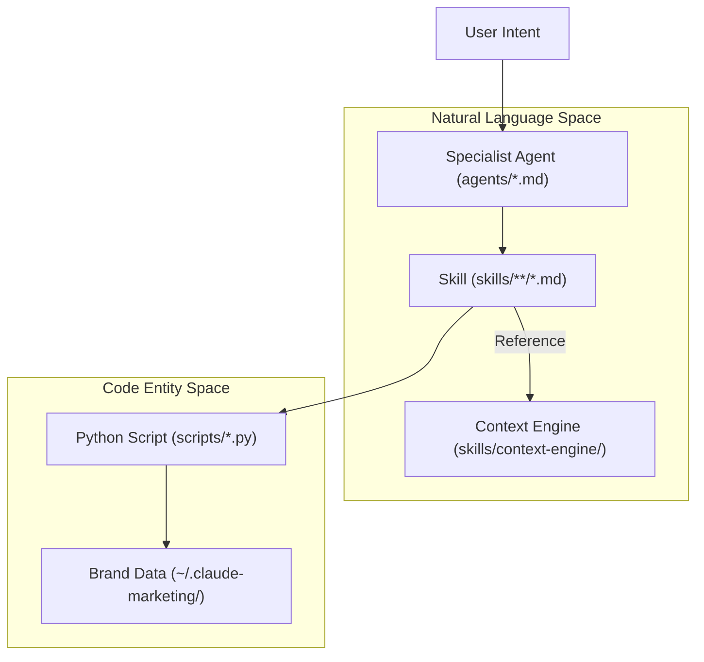
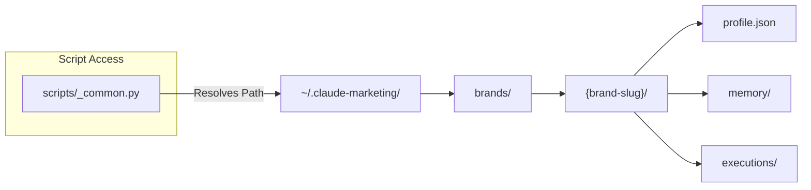

<!-- source: DeepWiki mcp.deepwiki.com · repo indranilbanerjee/digital-marketing-pro · page 1 Overview · fetched 2026-10-27 -->

# Overview

Relevant source files

The following files were used as context for generating this wiki page:

- [.claude-plugin/plugin.json](.claude-plugin/plugin.json)
- [.codex-plugin/plugin.json](.codex-plugin/plugin.json)
- [.cursor-plugin/plugin.json](.cursor-plugin/plugin.json)
- [CHANGELOG.md](CHANGELOG.md)
- [README.md](README.md)

Digital Marketing Pro is an open-source AI marketing plugin designed for agencies and in-house teams managing large portfolios of brands (50–200+). It provides a standardized, auditable framework for marketing strategy and execution, ensuring consistency across different brands and compliance with global regulations like the **EU AI Act Article 50** [README.md:1-7]().

The system is built on the **Agent Skills** open standard, allowing it to run natively across multiple AI agent harnesses including Claude Code, Cursor, GitHub Copilot CLI, and more [.claude-plugin/plugin.json:4]().

### System Architecture Overview

Digital Marketing Pro operates using a three-pillar structure: **Skills**, **Agents**, and **Scripts**. This design separates high-level AI reasoning from deterministic execution.

#### High-Level Entity Relationship
The following diagram illustrates how user intent flows through the system's core components.

**Logic Flow: Intent to Execution**

**Sources:** [README.md:51-53](), [CHANGELOG.md:13-15](), [.cursor-plugin/plugin.json:35-37]()

---

### Core Components

#### 1. The 12-Part Engagement Methodology
The centerpiece of the system is a 61-step strategy flow that produces the **Four Core Documents**: Business Analysis, Segmentation, Positioning, and DMFlow [README.md:5-7](). This methodology ensures that every brand engagement follows a rigorous, repeatable process.
*   For details, see [12-Part Engagement Methodology](#3).

#### 2. Specialist Agents & Skills
The system features **24 specialist agents** (e.g., `brand-guardian`, `seo-specialist`) and **158 skills** [README.md:51-52](). Agents use these skills to perform tasks ranging from keyword research to C2PA-compliant content generation.
*   For details, see [Specialist Agents](#2.2) and [Marketing Skills Reference](#6).

#### 3. Python Execution Layer
A library of **89 Python scripts** handles the "heavy lifting," such as data processing, API interactions via MCP connectors, and quality evaluations [CHANGELOG.md:13-18]().
*   For details, see [Python Scripts Layer](#2.3).

#### 4. Compliance & Safety
Digital Marketing Pro is "Article 50 ready," incorporating machine-readable AI disclosures and C2PA content provenance to meet EU AI Act requirements [CHANGELOG.md:15](). It also includes a `hallucination-detector.py` and `brand-voice-scorer.py` to maintain output quality [CHANGELOG.md:24]().
*   For details, see [Quality, Compliance & Safety](#7).

---

### Platform Support

The plugin registers itself via platform-specific manifests (e.g., `plugin.json`, `plugin.yaml`). It supports 8 native platforms and over 35 Agent Skills-compatible harnesses [README.md:16]().

| Platform | Manifest File |
| :--- | :--- |
| **Claude Code** | [.claude-plugin/plugin.json:1-75]() |
| **OpenAI Codex** | [.codex-plugin/plugin.json:1-47]() |
| **Cursor** | [.cursor-plugin/plugin.json:1-38]() |
| **Hermes / OpenClaw** | [plugin.yaml:1-50]() (referenced in [CHANGELOG.md:25]()) |

**Sources:** [README.md:59](), [CHANGELOG.md:25-27]()

---

### Data & State Management

The system maintains a persistent state for each brand, typically stored in the user's home directory.

**File System Mapping**

**Sources:** [CHANGELOG.md:13](), [README.md:38]()

---

### Wiki Organization

This wiki is organized to guide you from initial setup to advanced marketing automation:

*   **[Getting Started](#1.1)**: Installation and your first brand setup.
*   **[Plugin Manifests & Platform Support](#1.2)**: Deep dive into how the plugin integrates with different AI tools.
*   **[Core Architecture](#2)**: Technical breakdown of the WAT (Workflows, Agents, Tools) model.
*   **[12-Part Engagement Methodology](#3)**: The strategic heart of the system.
*   **[Brand & Data Management](#4)**: How multi-brand agency workflows function.
*   **[MCP Connectors & Execution Layer](#5)**: Connecting AI to real-world marketing tools (HubSpot, Google Ads, etc.).
*   **[Marketing Skills Reference](#6)**: A catalog of all 158 available skills.
*   **[Quality, Compliance & Safety](#7)**: Details on the evaluation engine and legal compliance.
*   **[Model Curator & AI Infrastructure](#8)**: How the system handles different LLM providers and model drift.
*   **[Testing & Release Management](#9)**: Information for contributors and developers.
*   **[Roadmap & Advanced Topics](#10)**: Future plans and complex configurations.
*   **[Glossary](#11)**: Key terms and code pointers.

---

