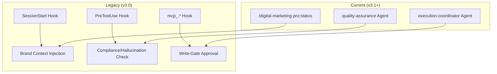
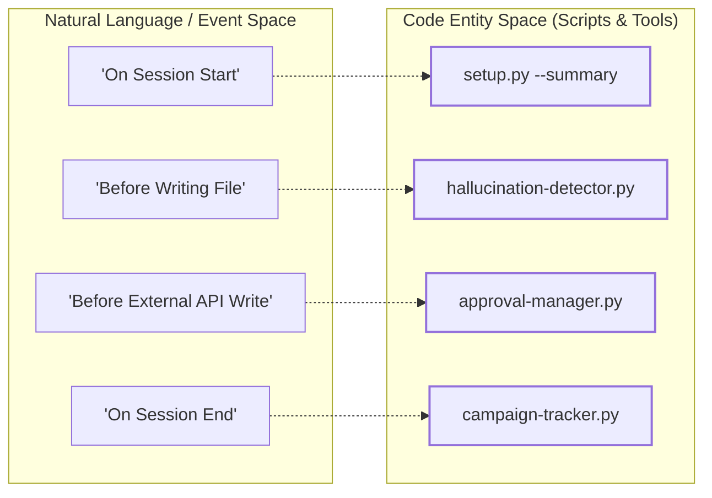
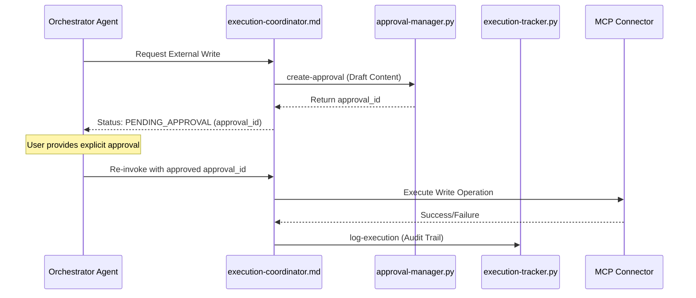

<!-- source: DeepWiki mcp.deepwiki.com · repo indranilbanerjee/digital-marketing-pro · page 10.1 Hooks Architecture · fetched 2026-10-27 -->

# Hooks Architecture

Relevant source files

The following files were used as context for generating this wiki page:

- [agents/execution-coordinator.md](agents/execution-coordinator.md)
- [docs/architecture.md](docs/architecture.md)
- [docs/claude-interfaces.md](docs/claude-interfaces.md)
- [docs/getting-started.md](docs/getting-started.md)
- [hooks/hooks-reference.example.json](hooks/hooks-reference.example.json)
- [hooks/hooks.json](hooks/hooks.json)
- [scripts/hallucination-detector.py](scripts/hallucination-detector.py)
- [skills/eval-config/SKILL.md](skills/eval-config/SKILL.md)
- [skills/eval-suite/SKILL.md](skills/eval-suite/SKILL.md)
- [skills/help/SKILL.md](skills/help/SKILL.md)

The **Hooks Architecture** in Digital Marketing Pro defines how the system automates lifecycle events such as session initialization, brand context injection, and real-time compliance gating. As of version 3.1.0, the architecture has shifted from a "global-automation" model to an "agent-led" model to ensure clean coexistence with other plugins and projects.

## 1. Evolution of the Hooks System

The hooks system has transitioned through two major architectural phases. This evolution was driven by the need to prevent "hook pollution," where marketing-specific logic would fire during non-marketing technical work.

### 1.1 The Global Hooks Model (v2.x – v3.0)
In earlier versions, the plugin utilized four primary global hooks defined in the Claude Code plugin specification. These hooks intercepted every operation within the environment:

| Hook Type | Original Purpose | Trigger |
| :--- | :--- | :--- |
| `SessionStart` | Automated dependency checks and brand summary injection. | Every time `claude` was launched. |
| `PreToolUse` (Write/Edit) | Real-time hallucination and brand voice scanning. | Every file write/edit operation. |
| `PreToolUse` (mcp_.*) | Security and compliance gating for external API writes. | Every MCP tool execution. |
| `SessionEnd` | Automated insight extraction and campaign tracking. | Every session termination. |

### 1.2 The Zero-Global-Hooks Model (v3.1+)
Current versions ship with an **empty `hooks.json`** file by default [hooks/hooks.json:1-5](). This design choice ensures that Digital Marketing Pro does not interfere with a user's other coding projects or plugins. The logic previously handled by hooks has been migrated into two distinct areas:
1.  **Agent-Led Logic**: Specialist agents like the `execution-coordinator` now handle compliance and approval workflows internally [agents/execution-coordinator.md:12-28]().
2.  **Manual Invocation**: Lifecycle tasks (like brand setup or dependency checks) are now triggered via explicit slash commands such as `/digital-marketing-pro:status` [docs/getting-started.md:112-115]().

**Hooks Transition Logic**

Sources: [hooks/hooks.json:1-5](), [hooks/hooks-reference.example.json:1-10](), [docs/architecture.md:17-20]()

## 2. Implementation Details

The hooks system relies on the interaction between the `hooks/` directory and the core Python scripts.

### 2.1 The hooks.json File
This is the active manifest read by the agent harness (Claude Code or Cowork). It remains empty to prevent global interference [hooks/hooks.json:3](). 

### 2.2 The Reference Configuration
Because some power users prefer automated injection, the plugin ships with `hooks-reference.example.json`. This file contains the "Gold Standard" hook definitions that were used in previous versions [hooks/hooks-reference.example.json:1-3]().

### 2.3 Hook to Script Mapping
When a hook is re-enabled by a user, it typically maps to a specific Python script or a prompt-based evaluator:

| Hook Event | Entity Mapping | Logic Location |
| :--- | :--- | :--- |
| `SessionStart` | `scripts/setup.py` | Performs `--check-deps` and `--summary` [hooks/hooks-reference.example.json:10](). |
| `PreToolUse` | `scripts/hallucination-detector.py` | Scans for fabricated stats and placeholder URLs [scripts/hallucination-detector.py:1-12](). |
| `PreToolUse` | `scripts/approval-manager.py` | Validates `approval_id` before allowing MCP writes [agents/execution-coordinator.md:59-60](). |
| `SessionEnd` | `scripts/campaign-tracker.py` | Persists `session_learning` to the brand profile [hooks/hooks-reference.example.json:43](). |

**Code Entity Mapping: Hooks to Execution Scripts**

Sources: [hooks/hooks-reference.example.json:4-48](), [scripts/hallucination-detector.py:1-34](), [agents/execution-coordinator.md:57-60]()

## 3. Migrated Lifecycle Logic

The functionality of the hooks has been redistributed into the **WAT (Workflows, Agents, Tools)** architecture.

### 3.1 Session Start & Context Injection
Instead of `SessionStart` firing automatically, the system now relies on the first tool call or status command to trigger `scripts/setup.py`. This script reads the active brand from `~/.claude-marketing/brands/_active-brand.json` and injects the 15-line brand summary into the session context [docs/getting-started.md:118-154]().

### 3.2 Write Interception & Quality Gates
The `PreToolUse` logic for file writes has been replaced by the `quality-assurance` agent. This agent is the sole owner of the evaluation suite, running `scripts/eval-runner.py` and logging results via `scripts/quality-tracker.py` [agents/execution-coordinator.md:50-51]().

### 3.3 External Write Gating (MCP)
The `mcp_.*` hook was the most invasive, gating every MCP tool call from any plugin [hooks/hooks-reference.example.json:27-28](). This is now handled by the `execution-coordinator` agent, which enforces a `PENDING_APPROVAL` state. It requires a valid `approval_id` generated by `scripts/approval-manager.py` before any external write is authorized [agents/execution-coordinator.md:12-28]().

**Data Flow: Agent-Led Execution (Replacing mcp_.* Hook)**

Sources: [agents/execution-coordinator.md:12-28, 53-60](), [docs/architecture.md:83-84]()

## 4. Re-enabling Hooks

Users who wish to restore v2.x-style automation can manually edit `hooks/hooks.json`.

1.  Open `hooks/hooks-reference.example.json`.
2.  Identify the desired hook (e.g., `SessionStart` for automatic brand loading).
3.  Copy the JSON object into the `hooks` array in `hooks/hooks.json` [hooks/hooks.json:2]().
4.  Restart the Claude session.

> **Warning**: Re-enabling the `mcp_.*` matcher will cause the plugin to intercept tool calls from **all** other installed plugins, which may result in unexpected compliance prompts during non-marketing tasks [hooks/hooks-reference.example.json:27-28]().

Sources: [hooks/hooks.json:1-5](), [hooks/hooks-reference.example.json:1-49]()

---

