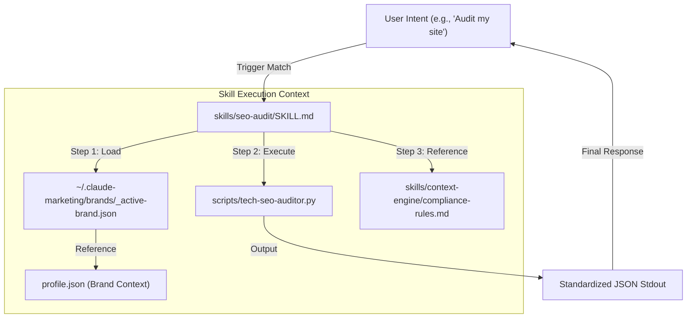
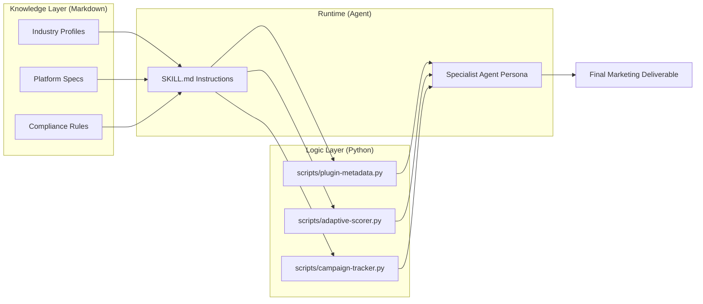

<!-- source: DeepWiki mcp.deepwiki.com · repo indranilbanerjee/digital-marketing-pro · page 2.1 Skills System · fetched 2026-10-27 -->

# Skills System

Relevant source files

The following files were used as context for generating this wiki page:

- [.github/ISSUE_TEMPLATE/bug_report.md](.github/ISSUE_TEMPLATE/bug_report.md)
- [.github/ISSUE_TEMPLATE/feature_request.md](.github/ISSUE_TEMPLATE/feature_request.md)
- [.github/ISSUE_TEMPLATE/industry_update.md](.github/ISSUE_TEMPLATE/industry_update.md)
- [CONTRIBUTING.md](CONTRIBUTING.md)
- [__init__.py](__init__.py)
- [docs/architecture.md](docs/architecture.md)
- [docs/claude-interfaces.md](docs/claude-interfaces.md)
- [docs/getting-started.md](docs/getting-started.md)
- [openclaw.plugin.json](openclaw.plugin.json)
- [plugin.yaml](plugin.yaml)
- [skills/agency-dashboard/SKILL.md](skills/agency-dashboard/SKILL.md)
- [skills/context-engine/execution-workflows.md](skills/context-engine/execution-workflows.md)
- [skills/context-engine/india-market-context.md](skills/context-engine/india-market-context.md)
- [skills/creative-testing-framework/SKILL.md](skills/creative-testing-framework/SKILL.md)
- [skills/emerging-channels/conversational-commerce.md](skills/emerging-channels/conversational-commerce.md)
- [skills/help/SKILL.md](skills/help/SKILL.md)

The Skills System is the intelligence engine of Digital Marketing Pro, comprising **158 specialized skills** [docs/architecture.md:93]() that transform a general-purpose LLM into a domain-expert marketing operative. Each skill is a self-contained unit of work defined in a `SKILL.md` file, providing the agent with specific procedures, brand context requirements, and tool access constraints.

## 1. Skill Anatomy (`SKILL.md`)

Every skill is defined within its own directory under `skills/` and follows a strict markdown structure. This structure serves as the "contract" between the plugin and the agent runtime.

### YAML Frontmatter
The frontmatter defines the skill's identity and metadata for the discovery engine.
*   **`name`**: The unique identifier used in slash commands (e.g., `/digital-marketing-pro:seo-audit`).
*   **`triggers`**: A list of natural language phrases that help the agent match user intent to this specific skill [CONTRIBUTING.md:39-43]().
*   **`allowed-tools`**: Restricted list of filesystem and shell tools the agent may use during execution [CONTRIBUTING.md:44]().
*   **`engagement-part`**: (Optional) For skills participating in the 12-Part Methodology, defines the phase (1–12) it belongs to [CONTRIBUTING.md:69]().

### Brand Context Block
All skills must implement a standard brand loading sequence as their first step. This ensures that outputs are grounded in the active brand's voice, industry, and compliance requirements [CONTRIBUTING.md:111-115]().

### Process Steps
The core of the skill is a numbered list of instructions. These are deterministic steps that guide the probabilistic reasoning of the LLM.
1.  **Context Loading**: Reading `~/.claude-marketing/brands/{slug}/profile.json` [CONTRIBUTING.md:100]().
2.  **Execution**: Calling Python scripts in `scripts/` or utilizing MCP connectors [docs/claude-interfaces.md:27-28]().
3.  **Validation**: Scoring output using scripts like `content-scorer.py` or `brand-voice-scorer.py` [docs/architecture.md:51-52]().

**Sources:** [CONTRIBUTING.md:30-62](), [docs/architecture.md:91-110](), [skills/help/SKILL.md:1-5]()

---

## 2. Discovery & Intent Matching

The system uses a decentralized discovery mechanism. Rather than a hardcoded list, the plugin walks the `skills/` directory at runtime to register capabilities.

### Registration Flow
The `__init__.py` script (used primarily by the Hermes adapter) and the platform-specific manifests (like `.claude-plugin/plugin.json`) use the following logic to expose skills:

1.  **Directory Walk**: The system scans `skills/` for subdirectories containing a `SKILL.md` [__init__.py:91-96]().
2.  **Frontmatter Parsing**: It extracts the `name` and `description` to populate the agent's toolbelt [__init__.py:51-78]().
3.  **Namespace Mapping**: Every skill is prefixed with the plugin namespace (e.g., `digital-marketing-pro:skill-name`) [__init__.py:151-152]().

### Natural Language Space to Code Entity Space
The following diagram illustrates how a user's request is routed through the architectural layers to a specific skill and its supporting code.

**Intent Resolution & Execution Pipeline**

**Sources:** [__init__.py:81-104](), [CONTRIBUTING.md:30-44](), [docs/architecture.md:73](), [skills/help/SKILL.md:19-36]()

---

## 3. Skill Contract Validation

To maintain consistency across 158 files, the system employs a "contract" pattern enforced by a linter (often run via `test_release_consistency.py`).

### The Validation Rules
| Component | Requirement | Code Reference |
| :--- | :--- | :--- |
| **Naming** | Must use kebab-case for directories and skill names. | [CONTRIBUTING.md:36]() |
| **Brand Loading** | Step 1 must always be "Load brand context". | [CONTRIBUTING.md:114]() |
| **Tool Safety** | `allowed-tools` must be explicitly defined in frontmatter. | [CONTRIBUTING.md:44]() |
| **Python I/O** | Scripts called by skills must return JSON to `stdout`. | [CONTRIBUTING.md:151]() |
| **Graceful Failure** | Skills must handle missing Python dependencies without crashing. | [CONTRIBUTING.md:159-169]() |

**Sources:** [CONTRIBUTING.md:146-169](), [docs/architecture.md:105-110](), [skills/help/SKILL.md:11-16]()

---

## 4. Data Flow: From Intent to Execution

When a skill is invoked, data flows from the static reference files to the dynamic Python execution layer.

**Data Flow Architecture**

### Key Functions in Data Flow
*   **`_parse_skill_frontmatter`**: Extracts the metadata required for the agent to understand when to use the skill [__init__.py:51-78]().
*   **`plugin-metadata.py`**: A critical script called by the `help` skill to fetch live counts of agents, skills, and connectors from the filesystem [skills/help/SKILL.md:24-31]().
*   **`_walk_skills`**: The discovery function that ensures new `SKILL.md` files are automatically registered without manual manifest updates [__init__.py:81-104]().

**Sources:** [__init__.py:51-104](), [skills/help/SKILL.md:19-36](), [docs/architecture.md:50-52]()

---

