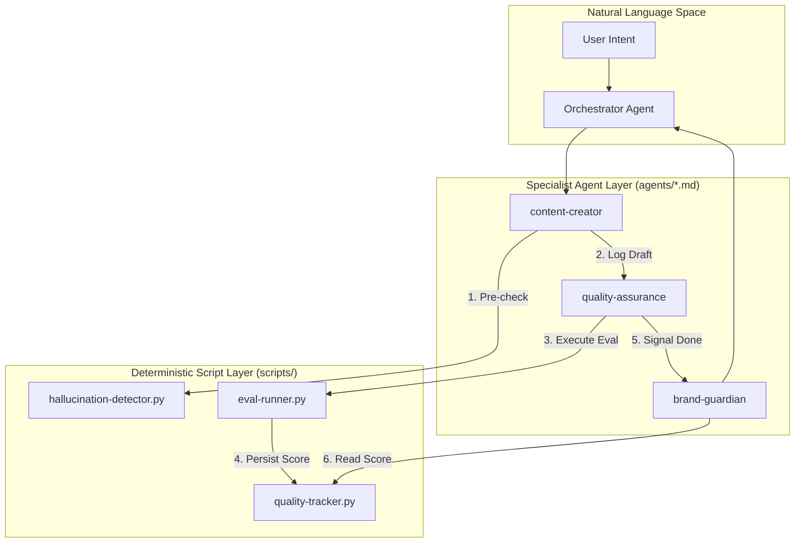
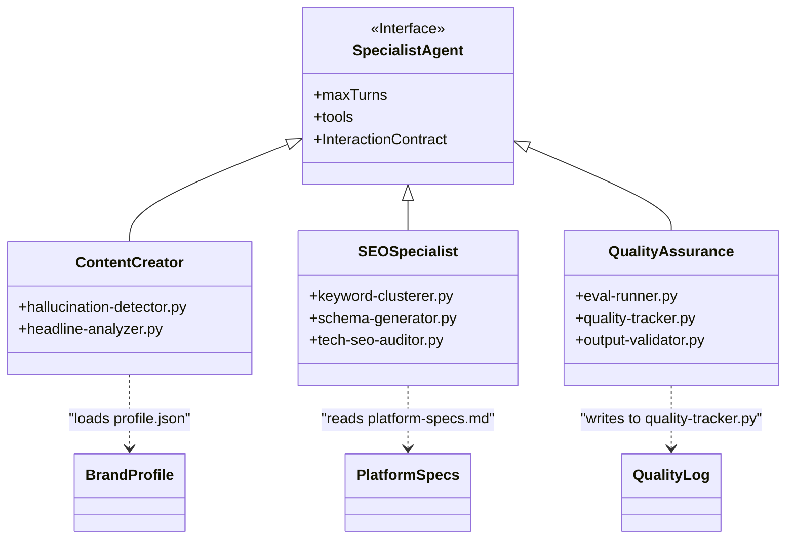

<!-- source: DeepWiki mcp.deepwiki.com · repo indranilbanerjee/digital-marketing-pro · page 2.2 Specialist Agents · fetched 2026-10-27 -->

# Specialist Agents

Relevant source files

The following files were used as context for generating this wiki page:

- [agents/agency-operations.md](agents/agency-operations.md)
- [agents/analytics-analyst.md](agents/analytics-analyst.md)
- [agents/brand-guardian.md](agents/brand-guardian.md)
- [agents/competitive-intel.md](agents/competitive-intel.md)
- [agents/content-creator.md](agents/content-creator.md)
- [agents/crm-manager.md](agents/crm-manager.md)
- [agents/cro-specialist.md](agents/cro-specialist.md)
- [agents/email-specialist.md](agents/email-specialist.md)
- [agents/growth-engineer.md](agents/growth-engineer.md)
- [agents/influencer-manager.md](agents/influencer-manager.md)
- [agents/intelligence-curator.md](agents/intelligence-curator.md)
- [agents/journey-orchestrator.md](agents/journey-orchestrator.md)
- [agents/localization-specialist.md](agents/localization-specialist.md)
- [agents/market-intelligence.md](agents/market-intelligence.md)
- [agents/marketing-scientist.md](agents/marketing-scientist.md)
- [agents/marketing-strategist.md](agents/marketing-strategist.md)
- [agents/media-buyer.md](agents/media-buyer.md)
- [agents/memory-manager.md](agents/memory-manager.md)
- [agents/performance-monitor-agent.md](agents/performance-monitor-agent.md)
- [agents/pr-outreach.md](agents/pr-outreach.md)
- [agents/quality-assurance.md](agents/quality-assurance.md)
- [agents/seo-specialist.md](agents/seo-specialist.md)
- [agents/social-media-manager.md](agents/social-media-manager.md)
- [skills/anomaly-scan/SKILL.md](skills/anomaly-scan/SKILL.md)
- [skills/context-engine/custom-mcp-guide.md](skills/context-engine/custom-mcp-guide.md)

Specialist Agents are the domain-specific intelligence layer of the Digital Marketing Pro system. The codebase defines 24 distinct specialist personas [agents/*.md]() that function as **subagents**. These agents operate under a strict interaction contract, meaning they do not communicate with the end-user directly; instead, they provide structured outputs to an orchestrator [agents/content-creator.md:12-14]().

## Interaction Contract & Coordination

Every specialist agent follows a "subagent-only" pattern. They are prohibited from asking the user for clarification. If a task requires more data or a human decision, the agent must exit with a specific JSON structure.

### The NEEDS_INPUT / PENDING_APPROVAL Pattern
When an agent encounters a blocker (e.g., missing brand assets or a failed hallucination check), it returns a structured block:
*   **`NEEDS_INPUT`**: Used when required context is missing [agents/content-creator.md:14]().
*   **`PENDING_APPROVAL`**: Used when a draft is ready but requires a human gate before execution [agents/social-media-manager.md:14]().

### Multi-Agent Handoffs
Agents coordinate by consuming each other's logged outputs rather than calling each other recursively. This is primarily managed through the `quality-tracker.py` script [agents/quality-assurance.md:11]().

1.  **Creation**: `content-creator` or `social-media-manager` drafts content.
2.  **Validation**: The agent runs a mandatory internal check using `hallucination-detector.py` [agents/content-creator.md:39-44]().
3.  **Authoritative Scoring**: The content is handed to `quality-assurance`, which runs the full `eval-runner.py` suite [agents/quality-assurance.md:15]().
4.  **Consumption**: Downstream agents like `brand-guardian` or `execution-coordinator` read the score from `quality-tracker.py --action get-summary` [agents/brand-guardian.md:31]().

**Agent Coordination Flow**

Sources: [agents/content-creator.md:39-49](), [agents/quality-assurance.md:11-22](), [agents/brand-guardian.md:31-36]()

---

## Core Specialist Personas

### 1. Content Creator
Responsible for all marketing copy (blogs, ads, email). It is **SEO-aware by default** and must load brand voice dimensions (formality, energy, humor, authority) before generating any text [agents/content-creator.md:18-28]().
*   **Key Tool**: `hallucination-detector.py` (Mandatory pre-delivery check) [agents/content-creator.md:45-48]().

### 2. Brand Guardian
Acts as the final quality gate. It enforces regulatory compliance (GDPR, CCPA, FTC) and accessibility standards (WCAG 2.2) [agents/brand-guardian.md:10-16]().
*   **Logic**: It does *not* re-run quality scores; it consumes the `quality-assurance` log and layers compliance judgment on top [agents/brand-guardian.md:31]().

### 3. SEO Specialist
Optimizes for three distinct surfaces: Traditional SEO, Answer Engine Optimization (AEO), and Generative Engine Optimization (GEO) [agents/seo-specialist.md:10-25]().
*   **Key Tool**: `keyword-clusterer.py` and `schema-generator.py` [agents/seo-specialist.md:41-47]().

### 4. Quality Assurance (QA)
The **single owner** of the evaluation pipeline. It orchestrates `eval-runner.py` across six dimensions: quality, voice, hallucination, claims, structure, and readability [agents/quality-assurance.md:11-15]().

### 5. Analytics Analyst
Bridges raw data to strategic decisions. It uses `roi-calculator.py` and `clv-calculator.py` to interpret performance [agents/analytics-analyst.md:10-15]().

---

## Technical Implementation: Agent-to-Script Mapping

The following diagram maps high-level agent roles to the underlying Python execution layer and the data entities they manipulate.

**Agent-to-Code Entity Mapping**

Sources: [agents/content-creator.md:1-6](), [agents/seo-specialist.md:1-6](), [agents/quality-assurance.md:1-7](), [agents/brand-guardian.md:22-31]()

---

## Agent Capabilities Matrix

| Agent | Primary Tools / Scripts | Interaction Contract Constraint | Key Responsibility |
| :--- | :--- | :--- | :--- |
| **Content Creator** | `hallucination-detector.py`, `readability-analyzer.py` | Must return `NEEDS_INPUT` if brand context is missing. | Multi-format copy generation. |
| **SEO Specialist** | `keyword-clusterer.py`, `ai-visibility-checker.py` | Must distinguish between SEO, AEO, and GEO. | Search & AI visibility. |
| **Quality Assurance** | `eval-runner.py`, `quality-tracker.py` | Single authoritative owner of the eval suite. | Scoring & Hallucination detection. |
| **Brand Guardian** | `guidelines-manager.py`, `quality-tracker.py` | Cannot approve if critical flags exist. | Compliance & Brand Safety. |
| **Email Specialist** | `email-preview.py`, `content-scorer.py` | Prioritizes deliverability over creative. | Lifecycle & Automation. |
| **Social Media Mgr** | `social-post-formatter.py`, `campaign-tracker.py` | Must optimize for platform-native signals. | Community & Engagement. |

Sources: [agents/content-creator.md:55-65](), [agents/seo-specialist.md:39-71](), [agents/quality-assurance.md:42-75](), [agents/brand-guardian.md:42-46](), [agents/email-specialist.md:30-36](), [agents/social-media-manager.md:30-40]()

## Behavior Rules & Guardrails

### 1. The "Brand-First" Rule
Every agent must load the brand profile (`profile.json`) and guidelines (`guidelines/_manifest.json`) as its first action [agents/content-creator.md:28](), [agents/marketing-strategist.md:26]().

### 2. Hallucination Thresholds (v3.2+)
Agents are required to enforce specific severity thresholds for content delivery:
*   **High Severity**: (e.g., fabricated stats) → Block delivery; return `NEEDS_INPUT` [agents/content-creator.md:40]().
*   **Medium Severity**: (e.g., unverified claims) → Deliver with inline warnings [agents/content-creator.md:41]().
*   **PR Exception**: For `pr-outreach`, medium severity is also blocking [agents/pr-outreach.md:41]().

### 3. Language Awareness
Agents check `profile.json` for `language.primary_language`. If set to a non-English locale, agents default to that language for all content creation [agents/content-creator.md:38](), [agents/localization-specialist.md:71-73]().

Sources: [agents/content-creator.md:28-44](), [agents/pr-outreach.md:38-46](), [agents/localization-specialist.md:1-23]()

---

