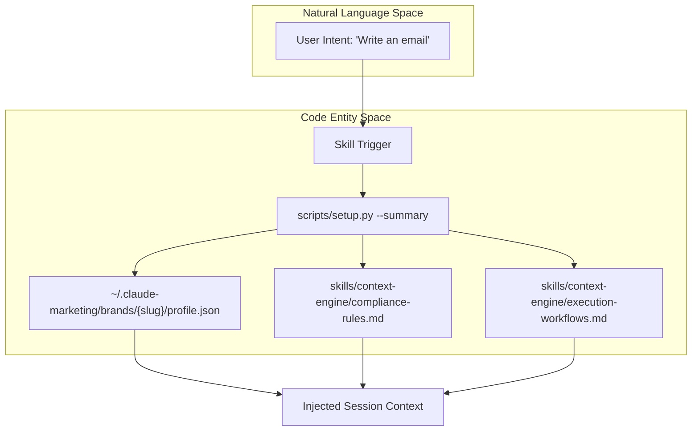
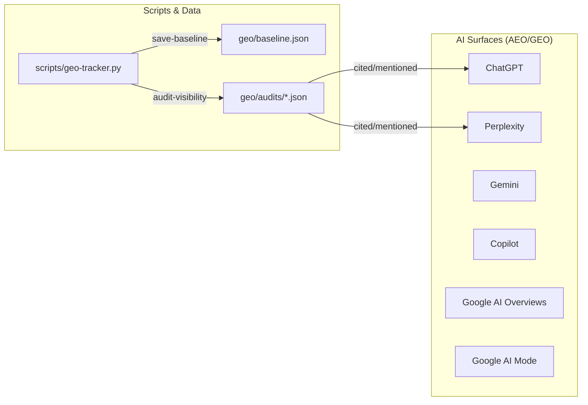

<!-- source: DeepWiki mcp.deepwiki.com · repo indranilbanerjee/digital-marketing-pro · page 2.4 Context Engine & Reference Data · fetched 2026-10-27 -->

# Context Engine & Reference Data

Relevant source files

The following files were used as context for generating this wiki page:

- [docs/architecture.md](docs/architecture.md)
- [docs/claude-interfaces.md](docs/claude-interfaces.md)
- [docs/getting-started.md](docs/getting-started.md)
- [scripts/geo-tracker.py](scripts/geo-tracker.py)
- [skills/agency-dashboard/SKILL.md](skills/agency-dashboard/SKILL.md)
- [skills/context-engine/agency-operations-guide.md](skills/context-engine/agency-operations-guide.md)
- [skills/context-engine/compliance-rules.md](skills/context-engine/compliance-rules.md)
- [skills/context-engine/crm-integration-guide.md](skills/context-engine/crm-integration-guide.md)
- [skills/context-engine/execution-workflows.md](skills/context-engine/execution-workflows.md)
- [skills/context-engine/india-market-context.md](skills/context-engine/india-market-context.md)
- [skills/context-engine/memory-architecture.md](skills/context-engine/memory-architecture.md)
- [skills/creative-testing-framework/SKILL.md](skills/creative-testing-framework/SKILL.md)
- [skills/emerging-channels/conversational-commerce.md](skills/emerging-channels/conversational-commerce.md)
- [skills/geo-monitor/SKILL.md](skills/geo-monitor/SKILL.md)
- [skills/help/SKILL.md](skills/help/SKILL.md)

The **Context Engine** is the shared intelligence layer of Digital Marketing Pro. It consists of 57 reference files and specialized skills that ground every agent action in industry-specific knowledge, regulatory compliance, and brand-specific parameters. All 158 skills in the system are architected to load brand context as their primary step, ensuring that probabilistic AI generation is constrained by deterministic brand and regulatory data [docs/architecture.md:5-7]().

## 1. Shared Intelligence Architecture

The Context Engine operates as a "Strategic Spine" for the plugin. It separates static reference data (like the EU AI Act or India's DPDP Act) from dynamic brand data (stored in `~/.claude-marketing/`) [docs/architecture.md:28-29]().

### Context Loading Data Flow
The following diagram illustrates how the `context-engine` skills and `scripts/setup.py` hydrate the session context before any marketing task is executed.

**Diagram: Context Hydration Pipeline**

**Sources:** [docs/getting-started.md:110-118](), [skills/context-engine/execution-workflows.md:1-3](), [docs/architecture.md:48-50]()

## 2. Core Reference Components

### 2.1. Compliance Rules & Jurisdictions
The system maintains a canonical ruleset in `skills/context-engine/compliance-rules.md`. This file is structured for programmatic consumption, allowing the `Brand Guardian` agent to verify outputs against specific regional laws [skills/context-engine/compliance-rules.md:1-3]().

| Jurisdiction | Key Law | Marketing Impact |
| :--- | :--- | :--- |
| **EU/EEA** | GDPR & AI Act Art. 50 | Mandatory C2PA metadata for AI content; opt-in consent [skills/context-engine/compliance-rules.md:9-33]() |
| **India** | DPDP Act (2023) | Specific consent; 72-hour breach notification; vernacular focus [skills/context-engine/india-market-context.md:9-20]() |
| **Global** | C2PA Standards | Machine-readable provenance for AI-generated assets [skills/context-engine/compliance-rules.md:30]() |

### 2.2. Standard Operating Procedures (SOPs)
Execution is governed by `skills/context-engine/execution-workflows.md`. These are deterministic step-by-step procedures that agents must follow.
*   **Blog Publishing:** Includes 16 steps covering format checks, word count (800-1500 words), and SEO placement [skills/context-engine/execution-workflows.md:7-45]().
*   **Email Campaigns:** Mandates spam score checks (Target < 5.0) and mobile-first tap targets (44x44 px) [skills/context-engine/execution-workflows.md:49-87]().
*   **Ad Platforms:** Includes May 2026 updates for Google PMax and Meta Advantage+ [skills/context-engine/execution-workflows.md:91-99]().

**Sources:** [skills/context-engine/compliance-rules.md:1-47](), [skills/context-engine/execution-workflows.md:1-99]()

## 3. Market & Platform Intelligence

### 3.1. Regional Context Modules
The engine includes deep-dive references for specific markets. For example, `skills/context-engine/india-market-context.md` provides intelligence on:
*   **Mobile-First Reality:** 75-80% of traffic is mobile; focus on mid-range Android optimization [skills/context-engine/india-market-context.md:43-48]().
*   **Seasonality:** Detailed patterns for Diwali (Sept-Nov) and IPL (Mar-May) [skills/context-engine/india-market-context.md:67-76]().
*   **Payment Rails:** UPI dominance and the necessity of Cash on Delivery (COD) [skills/context-engine/india-market-context.md:78-83]().

### 3.2. GEO/AEO Visibility Tracking
The `scripts/geo-tracker.py` script manages the brand's presence across 6 AI surfaces (ChatGPT, Perplexity, Gemini, Copilot, Google AI Mode, and AI Overviews) [scripts/geo-tracker.py:5-14]().

**Diagram: GEO/AEO Intelligence Mapping**

**Sources:** [scripts/geo-tracker.py:1-65](), [skills/context-engine/india-market-context.md:1-101]()

## 4. Agency & Multi-Client Logic

The Context Engine enables agency-scale operations via the `agency-dashboard` skill and the `Agency Operations Guide`.

*   **Client Health Scoring:** A composite 0-100 score based on Campaign Activity (25%), Budget Pacing (25%), KPI Attainment (25%), Content Pipeline (15%), and Engagement (10%) [skills/context-engine/agency-operations-guide.md:38-49]().
*   **Portfolio Aggregation:** The `agency-dashboard` skill iterates through all brand directories in `~/.claude-marketing/brands/` to generate a cross-client health report [skills/agency-dashboard/SKILL.md:38-46]().
*   **CRM Preparation:** `skills/context-engine/crm-integration-guide.md` defines how `crm-sync.py` prepares data for write-operations via MCP connectors [skills/context-engine/crm-integration-guide.md:25-27]().

**Sources:** [skills/agency-dashboard/SKILL.md:16-62](), [skills/context-engine/agency-operations-guide.md:1-58](), [skills/context-engine/crm-integration-guide.md:1-27]()

---

