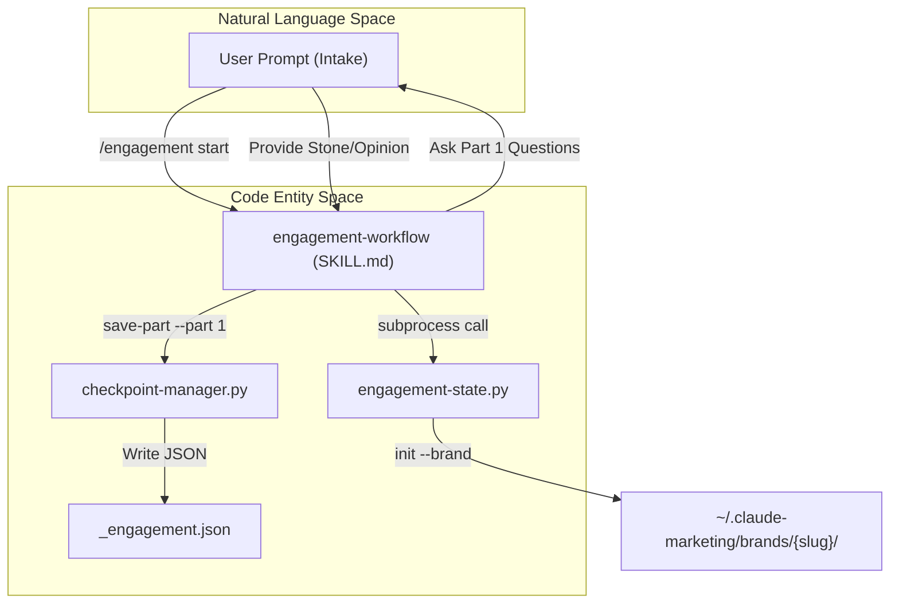
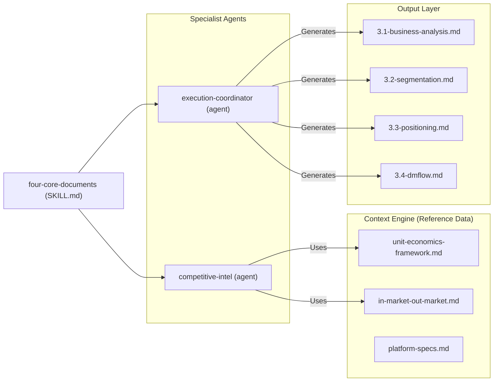

<!-- source: DeepWiki mcp.deepwiki.com · repo indranilbanerjee/digital-marketing-pro · page 3.1 Intake, Research & Four Core Documents (Parts 1–4) · fetched 2026-10-27 -->

# Intake, Research & Four Core Documents (Parts 1–4)

<details>
<summary>Relevant source files</summary>

The following files were used as context for generating this wiki page:

- [TESTING-GUIDE.md](TESTING-GUIDE.md)
- [docs/competitor-intelligence.md](docs/competitor-intelligence.md)
- [docs/cross-channel-sync.md](docs/cross-channel-sync.md)
- [docs/data-and-insights.md](docs/data-and-insights.md)
- [docs/engagement-methodology.md](docs/engagement-methodology.md)
- [docs/historical-data.md](docs/historical-data.md)
- [docs/integrations-guide.md](docs/integrations-guide.md)
- [docs/multi-brand-guide.md](docs/multi-brand-guide.md)
- [docs/strategy-and-kpis.md](docs/strategy-and-kpis.md)
- [skills/client-validation-document/SKILL.md](skills/client-validation-document/SKILL.md)
- [skills/continuous-improvement-loop/SKILL.md](skills/continuous-improvement-loop/SKILL.md)
- [skills/engagement-workflow/SKILL.md](skills/engagement-workflow/SKILL.md)
- [skills/four-core-documents/SKILL.md](skills/four-core-documents/SKILL.md)
- [skills/growth-plan/SKILL.md](skills/growth-plan/SKILL.md)

</details>


This page details the first phase of the 12-Part Engagement Methodology (v3.0). This phase transitions a brand from initial setup into a structured strategic engine. It covers the capture of client knowledge (Part 1), unbiased market discovery (Part 2), the creation of the strategic "spine" via the Four Core Documents (Part 3), and deep-dive competitive/market analysis (Part 4).

## 1. Part 1: Stone vs. Opinion Intake

The engagement begins with a rigorous intake process that separates "Stone" facts (verified data) from "Opinion" (client beliefs/assumptions). This distinction is critical for the **Two-Views Model**, ensuring the AI can distinguish between objective constraints and subjective preferences.

### Implementation & Data Flow
The `engagement-workflow` skill orchestrates this by invoking `engagement-state.py` to initialize the directory structure and then prompts the user for five batches of questions.

| Category | Data Points Captured |
| :--- | :--- |
| **Company Basics** | Founded year, headcount, HQ, geography. |
| **Business Model** | Revenue streams, pricing, product categories. |
| **Current Marketing** | Active channels, monthly spend, current KPIs. |
| **Tech Stack** | CRM, ESP, Analytics, Ad accounts. |
| **Customer Scale** | Customer count, AOV, key named accounts. |

For every fact, the system captures the **Source** and a **Confidence Score (1–10)**.

**Sources:**
- `skills/engagement-workflow/SKILL.md:115-135`
- `skills/engagement-workflow/SKILL.md:37-43`
- `docs/engagement-methodology.md:51-51`

---

## 2. Part 2: External Research (Unbiased View)

Part 2 generates an "unbiased" view of the market, independent of client opinions. This research is conducted by the `competitive-intel` agent and the `seo-specialist` agent.

### Research Deliverables
The system produces three primary documents:
1. **Industry Scan:** Macro trends and regulatory environment.
2. **Customer Demand Signals:** Search volume, social sentiment, and intent data.
3. **Ecosystem Scan:** Partnerships, influencers, and platform shifts.

**Sources:**
- `docs/engagement-methodology.md:52-52`
- `docs/competitor-intelligence.md:104-113`

---

## 3. Part 3: The Four Core Documents (The Strategic Spine)

The Four Core Documents represent the most critical technical output of the strategy phase. They consist of 61 explicit steps that define the brand's operating logic.

### 3.1 Document Architecture
| Document | Code Identifier | Purpose |
| :--- | :--- | :--- |
| **Business Analysis** | `3.1-business-analysis.md` | SBU separation, unit economics, and growth levers. |
| **Segmentation** | `3.2-segmentation.md` | Persona priority and decision-making units (DMU). |
| **Positioning** | `3.3-positioning.md` | Messaging pillars, brand promise, and tone-of-voice. |
| **DMFlow** | `3.4-dmflow.md` | The Digital Marketing Flow: channel selection and budget. |

### 3.2 Technical Execution Flow
The `four-core-documents` skill manages the generation of these files. It leverages the `context-engine` reference data to ensure compliance with frameworks like `unit-economics-framework.md` and `in-market-out-market.md`.

**Sources:**
- `docs/engagement-methodology.md:53-53`
- `skills/growth-plan/SKILL.md:60-69`
- `skills/four-core-documents/SKILL.md` (Referenced)

---

## 4. Part 4: Competitive & Market Analysis

Part 4 expands the unbiased research into four specialized deep-dives. This phase utilizes the `competitor-scraper.py` script and MCP connectors (SEMrush/Ahrefs) if available.

### Part 4 Deliverables
- **4.1 Competitor Ad Analysis:** Creative strategies and spend estimates.
- **4.2 Competitor Positioning:** The "Three-Question" output (What they do well/poorly/not at all).
- **4.3 Customer Analysis:** Behavioral patterns and friction points.
- **4.4 Market Analysis:** Sizing and addressable market (TAM/SAM/SOM).

**Sources:**
- `docs/engagement-methodology.md:54-54`
- `docs/competitor-intelligence.md:104-113`

---

## 5. System Architecture Diagrams

### 5.1 Intake & Research Data Flow
This diagram bridges the Natural Language intake to the persistent state managed by Python scripts.


**Sources:**
- `skills/engagement-workflow/SKILL.md:37-58`
- `docs/data-and-insights.md:28-46`

### 5.2 Strategy Generation Logic
This diagram shows how the Four Core Documents are synthesized using specialist agents and reference data.


**Sources:**
- `skills/growth-plan/SKILL.md:21-25`
- `skills/growth-plan/SKILL.md:58-69`
- `docs/strategy-and-kpis.md:38-46`

---

## 6. Key Functions and State Management

### State Validation
Before advancing from Part 4 to Part 5 (Client Validation), the system executes `validate-part` via `engagement-state.py`.

```bash
python scripts/engagement-state.py validate-part --brand "{brand}" --id "{id}" --part 4
```
This function diffs the files in the `engagements/{id}/` directory against the `PART_DEFINITIONS` manifest to ensure no strategic gaps exist before the "One True Stop" in Part 5.

### Checkpointing
The `checkpoint-manager.py` script is used after each part to ensure the engagement is resumable. This prevents loss of work during long-running strategic sessions.

**Sources:**
- `skills/engagement-workflow/SKILL.md:45-68`
- `skills/engagement-workflow/SKILL.md:97-102`
- `docs/historical-data.md:39-41`

---

