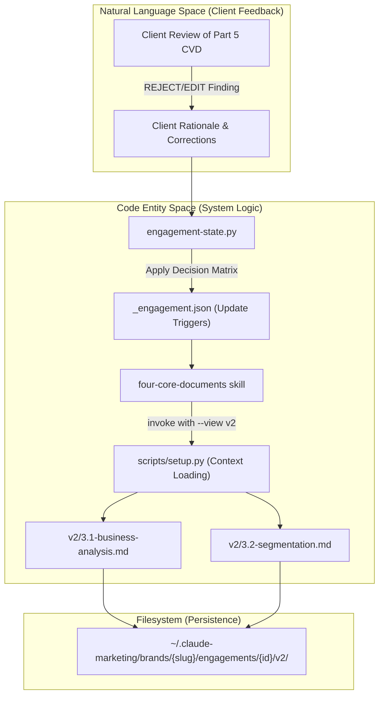
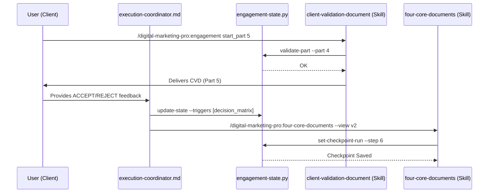

<!-- source: DeepWiki mcp.deepwiki.com · repo indranilbanerjee/digital-marketing-pro · page 3.2 Client Validation & Two-Views Model (Parts 5–6) · fetched 2026-10-27 -->

# Client Validation & Two-Views Model (Parts 5–6)

Relevant source files

The following files were used as context for generating this wiki page:

- [TESTING-GUIDE.md](TESTING-GUIDE.md)
- [docs/architecture.md](docs/architecture.md)
- [docs/claude-interfaces.md](docs/claude-interfaces.md)
- [docs/engagement-methodology.md](docs/engagement-methodology.md)
- [docs/getting-started.md](docs/getting-started.md)
- [docs/integrations-guide.md](docs/integrations-guide.md)
- [docs/multi-brand-guide.md](docs/multi-brand-guide.md)
- [skills/client-validation-document/SKILL.md](skills/client-validation-document/SKILL.md)
- [skills/continuous-improvement-loop/SKILL.md](skills/continuous-improvement-loop/SKILL.md)
- [skills/engagement-workflow/SKILL.md](skills/engagement-workflow/SKILL.md)
- [skills/four-core-documents/SKILL.md](skills/four-core-documents/SKILL.md)
- [skills/growth-plan/SKILL.md](skills/growth-plan/SKILL.md)
- [skills/help/SKILL.md](skills/help/SKILL.md)

This page explains the transition from the unbiased research phase to the client-validated strategy phase (Parts 5 and 6 of the 12-Part Engagement Methodology). It covers the **One True Stop** (Part 5), the **Decision Matrix** for selective v2 re-runs, and the **Two-Views Model** which maintains both v1 (unbiased) and v2 (client-validated) perspectives.

## 1. Overview of the Two-Views Model

The Two-Views Model is a core architectural principle of the v3.0 methodology. It ensures that the system preserves the "unbiased market view" (v1) while incorporating the "client reality" (v2).

*   **v1 (Unbiased View):** Produced in Parts 2, 3, and 4. Grounded in Stone facts and external market research. It represents what the data says without client internal bias.
*   **v2 (Client-Validated View):** Produced in Part 6. This is the v1 strategy modified by the client's explicit ACCEPT/REJECT/EDIT decisions from Part 5.

The system maintains both views to allow for "Update-Back" and to ensure that strategic decisions can always be traced back to their original unbiased source.

**Sources:** [docs/engagement-methodology.md:31-42](), [skills/client-validation-document/SKILL.md:14-15]()

---

## 2. Part 5: The One True Stop (Client Validation)

Part 5 is the formal checkpoint where the client reviews the findings from the first four parts. No work in Parts 6–12 proceeds until this document is signed off.

### The Client Validation Document (CVD)
The CVD organizes findings into categories (Business, Audience, Positioning, etc.) and requires the client to make a formal decision on each.

| Component | Description |
| :--- | :--- |
| **Finding Block** | Contains the finding, evidence/sources, and proposed implication. |
| **Decision Framework** | Every finding must be marked as **ACCEPT**, **REJECT**, **EDIT**, or **DEFER**. |
| **Materiality** | Findings are rated **High**, **Medium**, or **Low** based on their strategic impact. |

### CVD Generation Logic
The `client-validation-document` skill pulls from the Four Core Documents (3.1–3.4) and Part 4 research to build these blocks.

**Sources:** [skills/client-validation-document/SKILL.md:17-45](), [skills/client-validation-document/SKILL.md:107-152]()

---

## 3. Part 6: Selective v2 Re-runs & The Decision Matrix

Part 6 uses the **Decision Matrix** to determine which v1 documents need to be regenerated as v2 based on the client's feedback in Part 5.

### The Decision Matrix
The system does not re-run everything. It uses a trigger-based logic to target specific documents for updates.

| Trigger Event | Documents Targeted for v2 Re-run |
| :--- | :--- |
| `competitors_changed` | 4.1, 4.2, 3.3, 3.4 |
| `audiences_changed` | 3.2, 3.3, 3.4, 4.3 |
| `positioning_changed` | 3.3, 3.4 |
| `budget_or_scope_changed` | 3.4, 3.1 |
| `minor_corrections_only` | No re-runs (Update-Back only) |

### Implementation in Code
The `engagement-workflow` skill orchestrates this by calling `engagement-state.py` to evaluate the matrix and then invoking `four-core-documents` with the `--view v2` flag.

**Sources:** [skills/engagement-workflow/SKILL.md:10-11](), [skills/client-validation-document/SKILL.md:153-166](), [skills/four-core-documents/SKILL.md:60-66]()

---

## 4. Technical Data Flow: Validation to Re-run

The following diagram illustrates how natural language client feedback is transformed into structured v2 documents.

**Diagram: Validation Data Flow**

**Sources:** [skills/engagement-workflow/SKILL.md:35-43](), [skills/four-core-documents/SKILL.md:121-124](), [docs/architecture.md:11-46]()

---

## 5. The Update-Back Rule & LIF

To maintain consistency across the engagement, the system uses two mechanisms to synchronize data: the **Update-Back Rule** and the **Living Project Instruction File (LIF)**.

### The Update-Back Rule
When a finding is corrected in Part 5, that correction must "update back" to the source document (e.g., a correction to a competitor must be reflected in the v2 version of the 4.1 Competitor Analysis). This ensures that Part 8 (Growth Plan) is built on a consistent foundation.

### The Living Project Instruction File (LIF)
The LIF is a JSON/Markdown file that acts as the "active memory" for the engagement. It stores the current validated strategic facts.

*   **Role:** The `growth-plan` skill reads the LIF as its first step to ensure it uses the latest validated data.
*   **Maintenance:** Updated by the `engagement-workflow` skill whenever a part is marked complete or a v2 re-run is finalized.

**Sources:** [skills/engagement-workflow/SKILL.md:32-33](), [skills/growth-plan/SKILL.md:27-36](), [docs/engagement-methodology.md:21-23]()

---

## 6. System Interaction Diagram

This diagram shows the relationship between the specialist agents and the methodology scripts during the validation phase.

**Diagram: Methodology Orchestration**

**Sources:** [agents/execution-coordinator.md:36](), [skills/engagement-workflow/SKILL.md:45-58](), [skills/client-validation-document/SKILL.md:153-166](), [scripts/engagement-state.py:1-100]()

---

