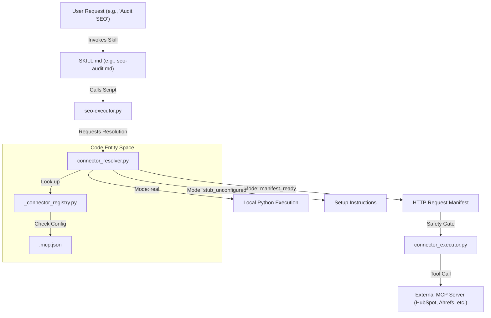
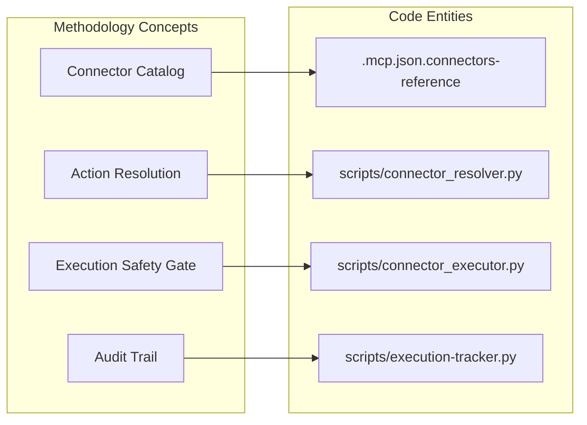

<!-- source: DeepWiki mcp.deepwiki.com · repo indranilbanerjee/digital-marketing-pro · page 5 MCP Connectors & Execution Layer · fetched 2026-10-27 -->

# MCP Connectors & Execution Layer

Relevant source files

The following files were used as context for generating this wiki page:

- [.mcp.json.connectors-reference](.mcp.json.connectors-reference)
- [CONNECTORS.md](CONNECTORS.md)
- [SUBMISSION.md](SUBMISSION.md)
- [commands/competitor-analysis.md](commands/competitor-analysis.md)
- [commands/doctor.md](commands/doctor.md)
- [commands/execute-action.md](commands/execute-action.md)
- [commands/seo-audit.md](commands/seo-audit.md)
- [scripts/_connector_registry.py](scripts/_connector_registry.py)
- [scripts/action-doctor.py](scripts/action-doctor.py)
- [scripts/connector-status.py](scripts/connector-status.py)
- [scripts/connector_executor.py](scripts/connector_executor.py)
- [scripts/connector_resolver.py](scripts/connector_resolver.py)
- [scripts/crm-sync.py](scripts/crm-sync.py)
- [scripts/embed-c2pa.py](scripts/embed-c2pa.py)
- [scripts/execution-tracker.py](scripts/execution-tracker.py)
- [scripts/performance-monitor.py](scripts/performance-monitor.py)
- [scripts/seo-executor.py](scripts/seo-executor.py)
- [skills/c2pa-metadata/SKILL.md](skills/c2pa-metadata/SKILL.md)

The **Model Context Protocol (MCP)** integration in Digital Marketing Pro serves as the bridge between high-level marketing strategy and deterministic technical execution. This layer allows the system to remain tool-agnostic while providing deep integration with over 68 marketing platforms, CRMs, and analytics suites.

The architecture is designed with a "security-first, opt-in" philosophy. The system ships with no active connectors by default to prevent unauthorized data access or accidental execution. Users must explicitly activate connectors via the [Connector Catalog & Setup](#5.1) and pass through [Action Execution & Safety Gates](#5.2) for any "write" operations.

## Architecture Overview: Natural Language to Code Execution

The following diagram illustrates how a natural language request from a user is resolved into a specific code entity and eventually executed via an MCP server.

**Action Resolution & Execution Flow**

**Sources:** [scripts/connector_resolver.py:1-35](), [scripts/seo-executor.py:1-22](), [CONNECTORS.md:1-24]()

## Resolution Modes

Every action in the system is processed by `connector_resolver.py` and resolved into one of three distinct execution modes. This ensures that the agent knows exactly whether it can perform a task, needs a manifest to show the user, or needs to guide the user through setup.

| Mode | Description | Code Behavior |
| :--- | :--- | :--- |
| **`real`** | Connector is configured and the call is safe for local execution. | Runs the Python function directly in the script. |
| **`manifest_ready`** | Connector is configured but involves a "write" or "launch" operation. | Returns a JSON manifest (URL, headers, body template) for the agent to execute. |
| **`stub_unconfigured`** | No matching connector is found in `.mcp.json`. | Returns the original stub plus copy-paste instructions for the user. |

**Sources:** [scripts/connector_resolver.py:8-26](), [scripts/connector_resolver.py:58-73]()

## System Component Mapping

This diagram bridges the functional names used in the methodology with the specific Python classes and files that handle the MCP logic.

**Component Association Map**

**Sources:** [scripts/connector_resolver.py:28-35](), [scripts/execution-tracker.py:1-17](), [scripts/action-doctor.py:1-23]()

## Connector Catalog & Setup (#5.1)

The system maintains a reference of 68+ servers categorized by marketing function (CRM, SEO, Ads, etc.). Users can activate these by moving entries from `.mcp.json.connectors-reference` into their active `.mcp.json` file.

*   **Transport Types:** Supports both `http` (Cowork/Cloud compatible) and `npx` (Claude Code/Local only) transports.
*   **Unified Ads MCPs:** Supports specialized aggregators like `synter-media-ai` and `ryze-ai` to manage multiple ad platforms through a single interface.
*   **Discovery:** The `/digital-marketing-pro:integrations` command provides a real-time dashboard of connected vs. available tools.

For setup instructions and the full list of supported vendors, see [Connector Catalog & Setup](#5.1).

**Sources:** [CONNECTORS.md:1-62](), [scripts/connector-status.py:46-100]()

## Action Execution & Safety Gates (#5.2)

Execution is never silent for operations that affect external state (e.g., posting to Slack, launching Google Ads).

*   **Manifest Building:** `connector_resolver.py` uses `ACTION_SPECS` to map internal IDs (like `launch-ads`) to specific API shapes for platforms like HubSpot or LinkedIn.
*   **Safety Gate:** The `connector_executor.py` script acts as a final gate, requiring explicit user confirmation before sending payloads to an MCP server.
*   **Audit Logging:** Every successful or failed execution is logged by `execution-tracker.py` into the brand's `executions/` directory, creating a permanent record for agency reporting.

For details on the execution pipeline and safety protocols, see [Action Execution & Safety Gates](#5.2).

**Sources:** [scripts/connector_resolver.py:133-170](), [scripts/execution-tracker.py:79-138](), [scripts/connector_executor.py:1-15]()

---

