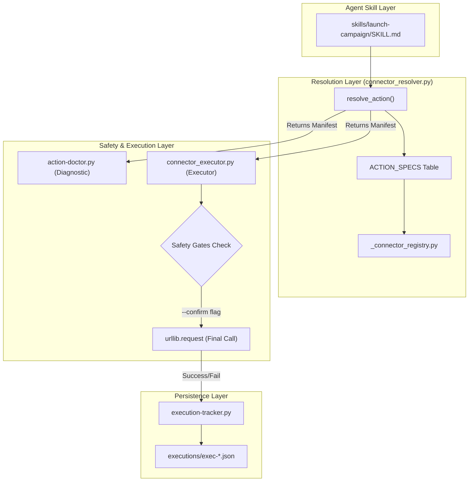
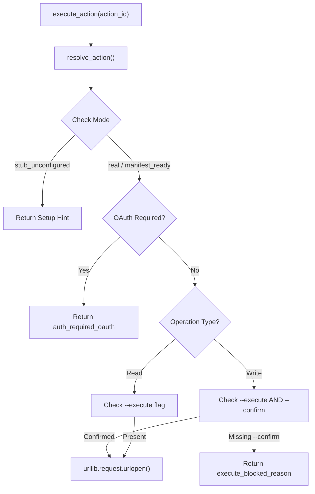

<!-- source: DeepWiki mcp.deepwiki.com · repo indranilbanerjee/digital-marketing-pro · page 5.2 Action Execution & Safety Gates · fetched 2026-10-27 -->

# Action Execution & Safety Gates

Relevant source files

The following files were used as context for generating this wiki page:

- [commands/doctor.md](commands/doctor.md)
- [commands/execute-action.md](commands/execute-action.md)
- [scripts/_connector_registry.py](scripts/_connector_registry.py)
- [scripts/action-doctor.py](scripts/action-doctor.py)
- [scripts/connector-status.py](scripts/connector-status.py)
- [scripts/connector_executor.py](scripts/connector_executor.py)
- [scripts/connector_resolver.py](scripts/connector_resolver.py)
- [scripts/crm-sync.py](scripts/crm-sync.py)
- [scripts/execution-tracker.py](scripts/execution-tracker.py)
- [scripts/performance-monitor.py](scripts/performance-monitor.py)
- [scripts/seo-executor.py](scripts/seo-executor.py)
- [skills/launch-campaign/SKILL.md](skills/launch-campaign/SKILL.md)
- [skills/launch-plan/SKILL.md](skills/launch-plan/SKILL.md)
- [skills/validate-profile/SKILL.md](skills/validate-profile/SKILL.md)

This section details the **Action Execution Pipeline**, the deterministic bridge between an agent's strategic intent and the live execution of marketing operations. The system uses a multi-layered resolution and execution strategy to ensure that "write" operations (launches, sends, posts) are governed by explicit safety gates, audit trails, and platform-specific authentication constraints.

## Execution Pipeline Overview

The transition from a natural language request (e.g., "Launch the Q1 campaign") to a successful API call follows a structured path through three primary components:

1.  **Resolution (`connector_resolver.py`)**: Determines if the required connector is configured and maps the action to a specific execution mode [scripts/connector_resolver.py:1-35]().
2.  **Validation & Diagnostic (`action-doctor.py`)**: A pre-flight check that reports readiness, missing credentials, and environment-specific constraints [scripts/action-doctor.py:7-15]().
3.  **Execution (`connector_executor.py`)**: Performs the final HTTP request using a standard-library-only implementation, enforcing safety flags for write operations [scripts/connector_executor.py:9-21]().

### Action Execution Data Flow

The following diagram illustrates the flow from an agent skill to the final API execution.

Title: Action Resolution and Execution Flow

Sources: [scripts/connector_resolver.py:5-35](), [scripts/connector_executor.py:9-21](), [scripts/execution-tracker.py:5-10](), [commands/execute-action.md:12-18]()

---

## Action Resolution Modes

Every action defined in the `ACTION_SPECS` table [scripts/connector_resolver.py:62-73]() resolves to one of three operational modes. This resolution is based on the contents of the local `.mcp.json` file and environment variables.

| Mode | Technical Description | Implementation Detail |
| :--- | :--- | :--- |
| `real` | Connector is configured and safe to execute locally via Python stdlib. | Used for Slack notifications or local config writes [scripts/connector_resolver.py:10-13](). |
| `manifest_ready` | Connector is configured, but the operation requires an MCP-mediated tool call or user approval. | Returns an HTTP manifest (Method, URL, Headers, Body Template) [scripts/connector_resolver.py:15-20](). |
| `stub_unconfigured` | No matching connector found in `.mcp.json` or environment. | Returns a structured stub with a `setup_hint` for the user [scripts/connector_resolver.py:22-26](). |

Sources: [scripts/connector_resolver.py:8-27](), [commands/doctor.md:11-16]()

---

## Safety Gates and Write Restrictions

To prevent accidental spends or unauthorized data modifications, the `connector_executor.py` script enforces strict safety gates.

### The --confirm Flag
For any operation classified as a "write" (e.g., `create-campaign`, `schedule-posts`, `send-email`), the executor requires two explicit flags:
*   `--execute`: Initiates the request logic.
*   `--confirm`: Required for write operations. Without this flag, the executor returns an `execute_blocked_reason` [commands/execute-action.md:14-18](), [scripts/connector_executor.py:11-13]().

### OAuth-Only Restrictions
The system distinguishes between "Private Key/Token" auth and "OAuth" flows. Because the Python execution layer is designed to be dependency-free (stdlib only), it cannot perform complex OAuth handshakes.
*   **Direct Execution**: Supported for HubSpot (Private App), Slack (Bot Token), Klaviyo, SendGrid, Brevo, and Mailchimp [commands/execute-action.md:22-33]().
*   **MCP-Only (Blocked)**: Google Ads, Meta, LinkedIn, and Salesforce are flagged as `auth_required_oauth`. These return a manifest that the agent must execute through its native MCP tool interface [scripts/connector_executor.py:15-17](), [commands/execute-action.md:35-41]().

Title: Execution Logic Gate (connector_executor.py)

Sources: [scripts/connector_executor.py:63-151](), [commands/execute-action.md:64-72]()

---

## Audit Trail and Tracking

Every action that reaches the execution stage is logged by `execution-tracker.py`. This creates a persistent history in the brand's local directory: `~/.claude-marketing/brands/{slug}/executions/` [scripts/execution-tracker.py:10]().

### Execution Log Anatomy
Each log entry is saved as a unique JSON file (`exec-{platform}-{timestamp}.json`) and indexed in `_index.json` [scripts/execution-tracker.py:101-131]().

| Field | Description |
| :--- | :--- |
| `execution_id` | Unique identifier (e.g., `exec-hubspot-20260213-143000`) [scripts/execution-tracker.py:103](). |
| `action_type` | The ID of the action performed (e.g., `create-campaign`). |
| `result` | `success` or `failure` [scripts/execution-tracker.py:95](). |
| `details` | The raw API response (with secrets redacted) [scripts/execution-tracker.py:112](). |
| `approval_id` | Links the execution to a specific agent approval workflow [scripts/execution-tracker.py:113](). |

Sources: [scripts/execution-tracker.py:79-137]()

---

## Readiness Diagnostics (The /doctor Command)

The `action-doctor.py` script serves as the primary diagnostic tool for developers and users to verify their execution environment.

### Key Checks performed by action-doctor.py:
1.  **Connector Mapping**: Identifies which connectors (e.g., `google-ads`, `hubspot`) are needed to unlock specific actions [scripts/action-doctor.py:7-11]().
2.  **Model Curator Freshness**: Checks the age of the `model_registry.json`. If older than 60 days, it issues a warning; if older than 120 days, it marks it as `urgent` [scripts/action-doctor.py:126-144]().
3.  **Environment Probe**: Detects if the system is running in `claude-code` (Mac/Windows/Linux) or a `cowork-sandbox` [scripts/action-doctor.py:79-98]().
4.  **Cowork Persistence**: In sandbox environments, it verifies that Google Drive routing is active so that brand state persists across sessions [scripts/action-doctor.py:156-185]().

Sources: [scripts/action-doctor.py:1-23](), [commands/doctor.md:33-40]()

---

