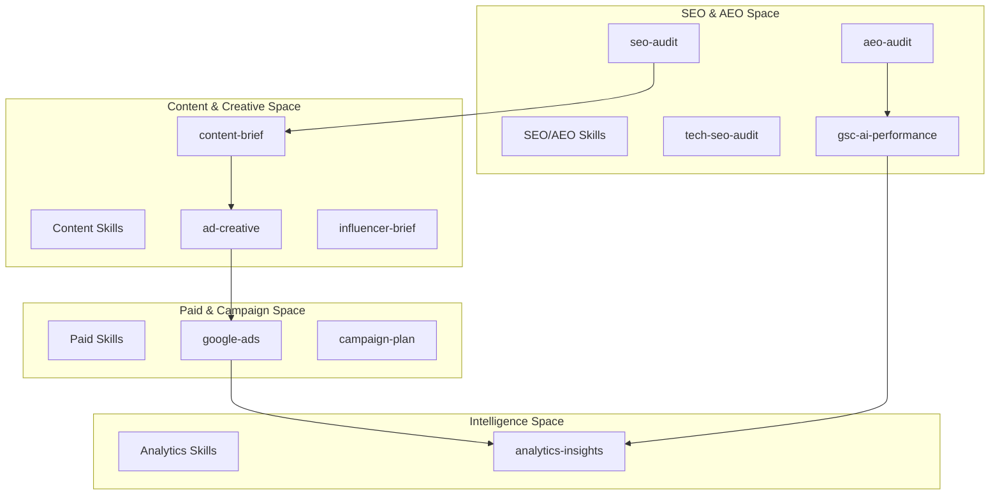
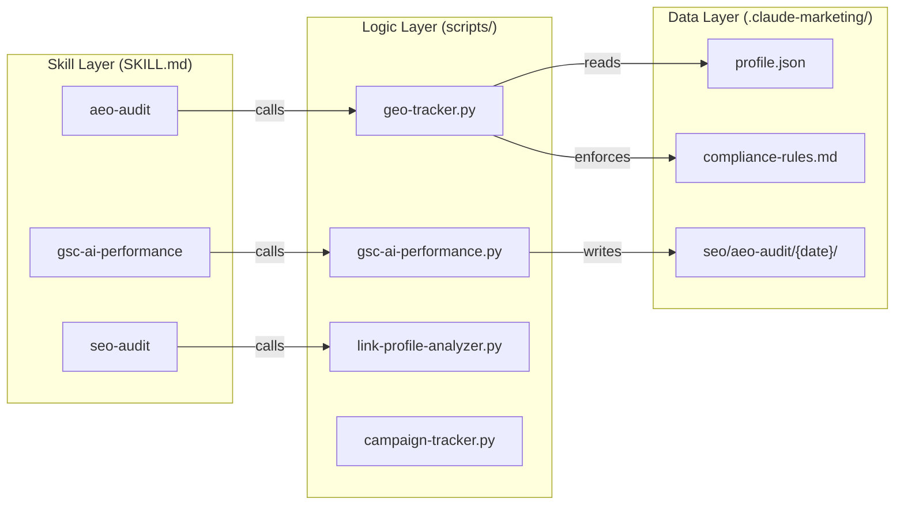

<!-- source: DeepWiki mcp.deepwiki.com · repo indranilbanerjee/digital-marketing-pro · page 6 Marketing Skills Reference · fetched 2026-10-27 -->

# Marketing Skills Reference

Relevant source files

The following files were used as context for generating this wiki page:

- [skills/ad-creative/SKILL.md](skills/ad-creative/SKILL.md)
- [skills/aeo-audit/SKILL.md](skills/aeo-audit/SKILL.md)
- [skills/aeo-geo/SKILL.md](skills/aeo-geo/SKILL.md)
- [skills/analytics-insights/SKILL.md](skills/analytics-insights/SKILL.md)
- [skills/audience-profile/SKILL.md](skills/audience-profile/SKILL.md)
- [skills/campaign-plan/SKILL.md](skills/campaign-plan/SKILL.md)
- [skills/competitor-analysis/SKILL.md](skills/competitor-analysis/SKILL.md)
- [skills/content-brief/SKILL.md](skills/content-brief/SKILL.md)
- [skills/content-calendar/SKILL.md](skills/content-calendar/SKILL.md)
- [skills/content-engine/SKILL.md](skills/content-engine/SKILL.md)
- [skills/context-engine/eu-code-of-practice.md](skills/context-engine/eu-code-of-practice.md)
- [skills/crisis-response/SKILL.md](skills/crisis-response/SKILL.md)
- [skills/funnel-audit/SKILL.md](skills/funnel-audit/SKILL.md)
- [skills/gsc-ai-performance/SKILL.md](skills/gsc-ai-performance/SKILL.md)
- [skills/influencer-brief/SKILL.md](skills/influencer-brief/SKILL.md)
- [skills/paid-advertising/SKILL.md](skills/paid-advertising/SKILL.md)
- [skills/paid-advertising/google-ads.md](skills/paid-advertising/google-ads.md)
- [skills/seo-audit/SKILL.md](skills/seo-audit/SKILL.md)
- [skills/seo-plan/SKILL.md](skills/seo-plan/SKILL.md)
- [skills/tech-seo-audit/SKILL.md](skills/tech-seo-audit/SKILL.md)

The **Digital Marketing Pro** skills library consists of 158 specialized `SKILL.md` files that provide the execution logic for the system's agents. These skills are organized into four primary domains: SEO/AEO, Content & Creative, Paid Advertising, and Analytics. Each skill follows a standardized contract, including YAML frontmatter for discovery, brand context loading, and a multi-step process for deterministic output generation [skills/aeo-audit/SKILL.md:1-5]().

## Skill Domain Architecture

The skills are designed to work together in a "chain" pattern where the output of one skill (e.g., an audit) becomes the input for another (e.g., a strategy or implementation plan). All skills automatically load the active brand's profile, voice settings, and compliance rules before execution [skills/aeo-audit/SKILL.md:33-33]().

### Marketing Skills Hierarchy

Sources: [skills/aeo-audit/SKILL.md:73-75](), [skills/seo-audit/SKILL.md:96-103](), [skills/gsc-ai-performance/SKILL.md:69-76]()

---

## 6.1 SEO & AEO/GEO Skills
This domain covers traditional search engine optimization and the emerging field of **Answer Engine Optimization (AEO)** and **Generative Engine Optimization (GEO)**. 

As of May 2026, the system treats **Google AI Mode** as a distinct surface from standard AI Overviews, requiring independent auditing due to divergent citation patterns [skills/aeo-audit/SKILL.md:13-13](). Key capabilities include technical audits for Core Web Vitals, E-E-A-T evaluation, and tracking visibility across 6 canonical AI platforms: ChatGPT, Perplexity, Google AI Mode, Google AI Overviews, Gemini, and Microsoft Copilot [skills/aeo-audit/SKILL.md:90-90]().

For details, see [SEO & AEO/GEO Skills](#6.1).

Sources: [skills/aeo-audit/SKILL.md:11-15](), [skills/aeo-geo/SKILL.md:12-22](), [skills/tech-seo-audit/SKILL.md:13-22]()

---

## 6.2 Content & Creative Skills
The content domain facilitates the creation of production-ready briefs, ad copy, and influencer strategies. It utilizes a "Visual/Media Spec" framework to recommend specific AI models for asset generation, such as **Google Nano Banana Pro** for high-fidelity stills and **Gemini Veo 3.1** for social video [skills/ad-creative/SKILL.md:52-53]().

A critical component of this domain is compliance with **EU AI Act Article 50**, ensuring all AI-generated content carries necessary C2PA metadata and deepfake disclosures where required [skills/context-engine/eu-code-of-practice.md:16-25]().

For details, see [Content & Creative Skills](#6.2).

Sources: [skills/content-brief/SKILL.md:48-55](), [skills/ad-creative/SKILL.md:46-55](), [skills/influencer-brief/SKILL.md:51-57]()

---

## 6.3 Paid Advertising & Campaign Skills
This domain manages the full lifecycle of paid media, with deep integration for **Google Ads API v24.2** (June 2026). It supports advanced campaign types like **Performance Max** and the **AI Max** rollout, including specific `ADOPT_AI_MAX` experiment types to measure lift [skills/paid-advertising/google-ads.md:23-23]().

The system provides bidding strategy decision trees and modern account structure principles that favor consolidation and smart bidding over granular manual management [skills/paid-advertising/google-ads.md:61-81]().

For details, see [Paid Advertising & Campaign Skills](#6.3).

Sources: [skills/paid-advertising/SKILL.md:8-18](), [skills/paid-advertising/google-ads.md:1-39]()

---

## 6.4 Analytics, Reporting & Intelligence Skills
The analytics domain focuses on the **GA4 "AI Assistant" channel group** (added May 2026) to attribute traffic from LLMs [skills/analytics-insights/SKILL.md:8-15](). It reconciles synthetic probe data from `aeo-audit` with actual impression data from the **GSC AI Performance Report** [skills/gsc-ai-performance/SKILL.md:11-25]().

Skills in this category generate KPI trees tailored to business models (SaaS, E-commerce, Lead Gen) and provide structured frameworks for anomaly detection and root cause diagnosis [skills/analytics-insights/SKILL.md:81-83]().

For details, see [Analytics, Reporting & Intelligence Skills](#6.4).

Sources: [skills/analytics-insights/SKILL.md:8-28](), [skills/gsc-ai-performance/SKILL.md:11-27]()

---

### Code Entity Mapping: Skills to Execution

The following diagram bridges the high-level marketing skills to the underlying Python scripts and data structures used for execution.

Sources: [skills/aeo-audit/SKILL.md:33-33](), [skills/aeo-audit/SKILL.md:90-90](), [skills/gsc-ai-performance/SKILL.md:83-89](), [skills/seo-audit/SKILL.md:43-47]()

---

