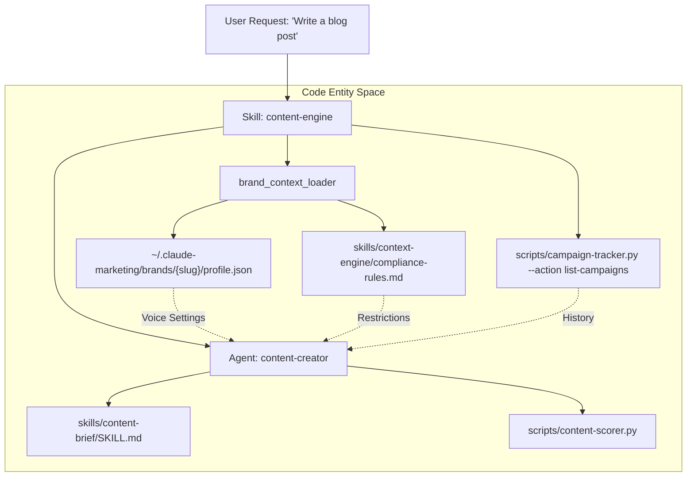
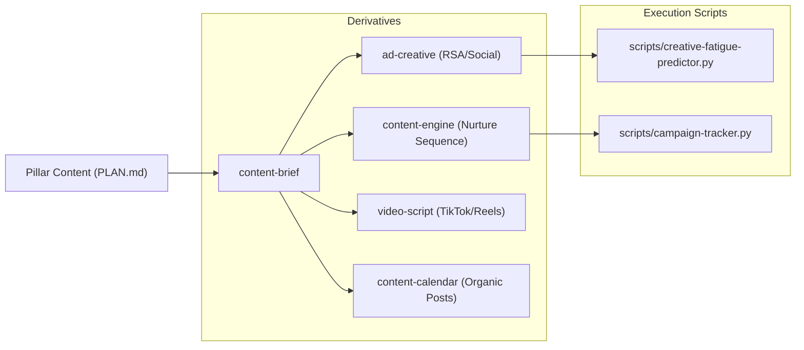

<!-- source: DeepWiki mcp.deepwiki.com · repo indranilbanerjee/digital-marketing-pro · page 6.2 Content & Creative Skills · fetched 2026-10-27 -->

# Content & Creative Skills

Relevant source files

The following files were used as context for generating this wiki page:

- [.github/workflows/skill-review.yml](.github/workflows/skill-review.yml)
- [skills/ad-creative/SKILL.md](skills/ad-creative/SKILL.md)
- [skills/audience-profile/SKILL.md](skills/audience-profile/SKILL.md)
- [skills/campaign-plan/SKILL.md](skills/campaign-plan/SKILL.md)
- [skills/case-study-plan/SKILL.md](skills/case-study-plan/SKILL.md)
- [skills/competitor-analysis/SKILL.md](skills/competitor-analysis/SKILL.md)
- [skills/content-brief/SKILL.md](skills/content-brief/SKILL.md)
- [skills/content-calendar/SKILL.md](skills/content-calendar/SKILL.md)
- [skills/content-decay-scan/SKILL.md](skills/content-decay-scan/SKILL.md)
- [skills/content-engine/SKILL.md](skills/content-engine/SKILL.md)
- [skills/crisis-response/SKILL.md](skills/crisis-response/SKILL.md)
- [skills/eval-content/SKILL.md](skills/eval-content/SKILL.md)
- [skills/funnel-audit/SKILL.md](skills/funnel-audit/SKILL.md)
- [skills/influencer-brief/SKILL.md](skills/influencer-brief/SKILL.md)
- [skills/intelligence-report/SKILL.md](skills/intelligence-report/SKILL.md)
- [skills/localize-campaign/SKILL.md](skills/localize-campaign/SKILL.md)
- [skills/media-plan/SKILL.md](skills/media-plan/SKILL.md)
- [skills/performance-check/SKILL.md](skills/performance-check/SKILL.md)
- [skills/seo-audit/SKILL.md](skills/seo-audit/SKILL.md)
- [skills/seo-plan/SKILL.md](skills/seo-plan/SKILL.md)
- [skills/tech-seo-audit/SKILL.md](skills/tech-seo-audit/SKILL.md)
- [skills/translate-content/SKILL.md](skills/translate-content/SKILL.md)
- [skills/verify-claims/SKILL.md](skills/verify-claims/SKILL.md)
- [skills/video-script/SKILL.md](skills/video-script/SKILL.md)

The Content & Creative Skills module provides a high-fidelity engine for generating, optimizing, and repurposing marketing assets. It bridges strategic intent with production-ready output, covering the full lifecycle from content decay detection and brief creation to multi-platform ad creative and video scripting.

## Overview & Lifecycle

The content engine operates on a data-driven lifecycle where performance data informs creation, and existing assets are continuously scanned for decay to trigger refreshes or repurposing.

### The Content Repurposing Lifecycle
1.  **Detection**: `content-decay-scan` identifies falling traffic or stale data [skills/content-decay-scan/SKILL.md:18-21]().
2.  **Strategy**: `content-brief` or `seo-plan` defines the new angle and keyword targets [skills/content-brief/SKILL.md:9-11]().
3.  **Creation**: `content-engine` or `ad-creative` generates platform-specific variants [skills/content-engine/SKILL.md:1-5]().
4.  **Distribution**: `media-plan` and `content-calendar` schedule the assets across channels [skills/media-plan/SKILL.md:9-11]().

## Technical Implementation: Content Engine

The `content-engine` is the primary orchestrator for creative tasks. It is designed to be "brand-aware" by default, automatically loading context before execution.

### Data Flow: Natural Language to Code Entity
The following diagram illustrates how a user request (Natural Language Space) is resolved into specific scripts and reference data (Code Entity Space).

**Diagram: Content Engine Resolution**

**Sources:** [skills/content-engine/SKILL.md:28-40](), [skills/content-brief/SKILL.md:57-61](), [skills/content-decay-scan/SKILL.md:32-34]()

## Specialist Skills

### 1. Content Decay & Refresh
The `content-decay-scan` skill uses the `creative-fatigue-predictor.py` script to identify "invisible revenue loss" [skills/content-decay-scan/SKILL.md:18-21](). It calculates a **Business Impact Score** by multiplying current traffic by conversion rate and revenue per conversion [skills/content-decay-scan/SKILL.md:43-44]().

**Key Functionality:**
*   **Decay Thresholds**: Defaults to 15% traffic decline over 3 months or 10+ position drop in keywords [skills/content-decay-scan/SKILL.md:28-30]().
*   **Automation**: Invokes `creative-fatigue-predictor.py --action decay-scan` [skills/content-decay-scan/SKILL.md:38-41]().

### 2. Ad Creative & AI Guidance
The `ad-creative` skill generates copy for Google RSA, Meta, LinkedIn, and TikTok [skills/ad-creative/SKILL.md:1-5](). As of May 2026, it includes specific guidance for AI asset generation.

| Asset Type | Recommended Model | Compliance Requirement |
| :--- | :--- | :--- |
| Product Stills | **Nano Banana Pro** | C2PA signing via `/c2pa-metadata` |
| Short Video | **Gemini Veo 3.1** | EU Article 50 Deepfake disclosure |
| Long-form | **Gemini Omni** | SynthID + C2PA provenance |

**Sources:** [skills/ad-creative/SKILL.md:50-55](), [skills/content-brief/SKILL.md:48-55]()

### 3. Video Scripting
The `video-script` skill produces a "production-ready" package including hook variants, timestamps, and visual/audio direction columns [skills/video-script/SKILL.md:9-11]().

**Script Structure Options:**
*   **AIDA**: Attention, Interest, Desire, Action.
*   **PAS**: Problem, Agitate, Solution.
*   **Storytelling Arc**: Setup, Tension, Resolution.

**Sources:** [skills/video-script/SKILL.md:32-33](), [skills/video-script/SKILL.md:45-50]()

## Multi-Format Derivative Matrix

The system is designed to turn a single core asset (e.g., a Case Study or Pillar Page) into a suite of derivative content.

**Diagram: Derivative Generation Flow**

**Sources:** [skills/seo-plan/SKILL.md:86-101](), [skills/content-engine/SKILL.md:63-74](), [skills/media-plan/SKILL.md:44-53]()

## Technical Controls & Quality Gates

The Content Engine enforces quality via the `content-scorer.py` and specialist agent reviews.

*   **Pillar Scoring**: The `seo-plan` skill scores the brand across four pillars: Technical, Content, Topical, and AI Search [skills/seo-plan/SKILL.md:55-66]().
*   **Lead Theme**: The lowest-scoring pillar automatically becomes the "Lead Theme" for the next quarter's content roadmap [skills/seo-plan/SKILL.md:66-67]().
*   **EU Compliance Gate**: The `/check` command (integrated into `brand-guardian`) blocks any AI-generated assets for EU-targeted campaigns if they lack C2PA metadata [skills/ad-creative/SKILL.md:61]().

**Sources:** [skills/seo-plan/SKILL.md:55-84](), [skills/ad-creative/SKILL.md:57-61](), [skills/performance-check/SKILL.md:59-60]()

---

