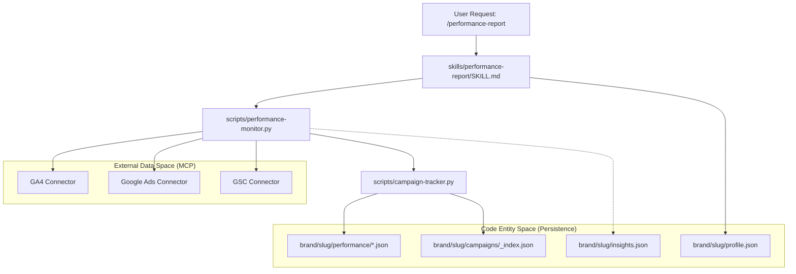
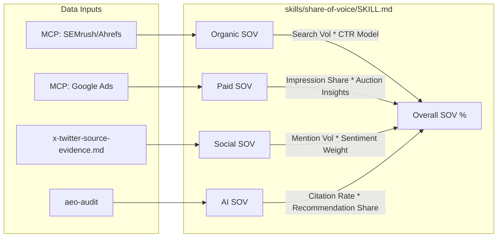

<!-- source: DeepWiki mcp.deepwiki.com · repo indranilbanerjee/digital-marketing-pro · page 6.4 Analytics, Reporting & Intelligence Skills · fetched 2026-10-27 -->

# Analytics, Reporting & Intelligence Skills

Relevant source files

The following files were used as context for generating this wiki page:

- [.github/workflows/skill-review.yml](.github/workflows/skill-review.yml)
- [docs/competitor-intelligence.md](docs/competitor-intelligence.md)
- [docs/cross-channel-sync.md](docs/cross-channel-sync.md)
- [docs/data-and-insights.md](docs/data-and-insights.md)
- [docs/historical-data.md](docs/historical-data.md)
- [docs/strategy-and-kpis.md](docs/strategy-and-kpis.md)
- [skills/aeo-audit/SKILL.md](skills/aeo-audit/SKILL.md)
- [skills/aeo-geo/SKILL.md](skills/aeo-geo/SKILL.md)
- [skills/analytics-insights/SKILL.md](skills/analytics-insights/SKILL.md)
- [skills/attribution-report/SKILL.md](skills/attribution-report/SKILL.md)
- [skills/campaign-audit/SKILL.md](skills/campaign-audit/SKILL.md)
- [skills/check/SKILL.md](skills/check/SKILL.md)
- [skills/content-decay-scan/SKILL.md](skills/content-decay-scan/SKILL.md)
- [skills/context-engine/eu-code-of-practice.md](skills/context-engine/eu-code-of-practice.md)
- [skills/executive-dashboard/SKILL.md](skills/executive-dashboard/SKILL.md)
- [skills/gsc-ai-performance/SKILL.md](skills/gsc-ai-performance/SKILL.md)
- [skills/intelligence-report/SKILL.md](skills/intelligence-report/SKILL.md)
- [skills/paid-advertising/SKILL.md](skills/paid-advertising/SKILL.md)
- [skills/paid-advertising/google-ads.md](skills/paid-advertising/google-ads.md)
- [skills/performance-check/SKILL.md](skills/performance-check/SKILL.md)
- [skills/share-of-voice/SKILL.md](skills/share-of-voice/SKILL.md)
- [skills/share-of-voice/x-twitter-source-evidence.md](skills/share-of-voice/x-twitter-source-evidence.md)
- [skills/status/SKILL.md](skills/status/SKILL.md)

The Analytics, Reporting & Intelligence suite provides the deterministic measurement layer of the Digital Marketing Pro system. It bridges high-level business objectives to granular channel performance through a hierarchical KPI tree, adaptive scoring, and AI-native visibility tracking. This module handles everything from raw data extraction via MCP connectors to executive-level intelligence synthesis and anomaly detection.

## 1. Intelligence Architecture & Data Flow

The system operates on a "Compound Intelligence" loop where data flows from external sources, through specialist agents for analysis, and into persistent local storage to inform future strategic cycles [docs/data-and-insights.md:24-45]().

### Data Flow Diagram: Natural Language to Code Entities

The following diagram illustrates how a user's natural language request for a performance report triggers specific Python scripts and updates persistent JSON storage.

"Data Flow: Analysis to Persistence"

**Sources:** [docs/data-and-insights.md:28-45](), [skills/campaign-audit/SKILL.md:73-96](), [skills/status/SKILL.md:93-98]()

## 2. KPI Tree & Adaptive Scoring

The system rejects flat metric lists in favor of a four-level **KPI Tree** hierarchy [docs/strategy-and-kpis.md:96-103](). This structure ensures that tactical metrics (e.g., CTR) are always mapped to business outcomes (e.g., ARR).

| Level | Definition | Example |
| :--- | :--- | :--- |
| **North Star** | The single most important business outcome. | 90-Day Repeat Purchase Rate |
| **Primary Metrics** | Leading indicators of the North Star. | Customer LTV, Email Revenue % |
| **Secondary Metrics** | Channel-specific performance drivers. | Open Rate, CAC, Conversion Rate |
| **Tactical Metrics** | Granular execution data. | CPM, CPC, Ad Frequency |

**Adaptive Scoring** uses these weights to calculate a composite health score. If a North Star metric underperforms, the system triggers a "Decision Matrix" for selective re-runs of marketing strategy [docs/strategy-and-kpis.md:40-48]().

**Sources:** [docs/strategy-and-kpis.md:96-115](), [docs/data-and-insights.md:7-20]()

## 3. AI Visibility & AEO/GEO Intelligence

A unique capability of the platform is the **AEO/GEO (Answer/Generative Engine Optimization)** audit system. It treats AI surfaces as distinct search channels with their own citation patterns [skills/aeo-audit/SKILL.md:11-19]().

### Canonical AI Surfaces
The system tracks visibility across 6 canonical platforms defined in `scripts/geo-tracker.py` [skills/aeo-audit/SKILL.md:90-91]():
1. **Google AI Mode**: The conversational search default (Gemini 3.5 Flash) [skills/aeo-geo/SKILL.md:22-29]().
2. **Google AI Overviews**: The summary block in classic SERPs.
3. **ChatGPT**: OpenAI's conversational search.
4. **Perplexity**: Real-time answer engine.
5. **Gemini**: Google's standalone assistant.
6. **Microsoft Copilot**: Bing-integrated AI.

### GSC AI Performance Integration
Launched in June 2026, the `gsc-ai-performance` skill reconciles synthetic probe results (what AI *could* surface) with actual Google Search Console impressions (what it *actually* surfaced) [skills/aeo-audit/SKILL.md:15-17]().

**Sources:** [skills/aeo-audit/SKILL.md:11-20](), [skills/aeo-geo/SKILL.md:22-40]()

## 4. Share of Voice (SOV) & Competitive Intelligence

The `share-of-voice` skill aggregates visibility data across four dimensions to produce a market dominance percentage [skills/share-of-voice/SKILL.md:10-11]().

"SOV Dimension Mapping"

**Sources:** [skills/share-of-voice/SKILL.md:25-28](), [skills/share-of-voice/x-twitter-source-evidence.md:21-39]()

### Social Evidence Normalization
When connectors lack traceable coverage for X/Twitter, the system uses `x-twitter-source-evidence.md` to normalize public posts into "Evidence Packets" [skills/share-of-voice/x-twitter-source-evidence.md:21-25](). These packets include fields like `dedupe_key`, `sentiment_weighting`, and `confidence` (high/medium/low) to ensure auditable SOV reporting [skills/share-of-voice/x-twitter-source-evidence.md:37-38]().

## 5. Reporting & Executive Dashboards

The suite provides three levels of reporting depth:

1.  **Performance Check (`/performance-check`)**: A rapid scan for anomalies and budget leaks [skills/performance-check/SKILL.md]().
2.  **Executive Dashboard (`/executive-dashboard`)**: A high-level summary for stakeholders focusing on North Star metrics and LTV [skills/executive-dashboard/SKILL.md]().
3.  **Intelligence Report (`/intelligence-report`)**: A deep-dive document that synthesizes performance data with competitive moves and market trends [skills/intelligence-report/SKILL.md]().

### Unified Status Snapshot
The `status` skill (`/digital-marketing-pro:status`) provides a technical overview of the current brand state, including active engagements, recent insights, and Python dependency health [skills/status/SKILL.md:27-38]().

**Sources:** [skills/status/SKILL.md:17-38](), [skills/campaign-audit/SKILL.md:37-53]()

## 6. Technical Implementation Details

### Data Storage & Retention
*   **Insights**: Stored in `insights.json` as a rolling 200-entry array [docs/data-and-insights.md:53]().
*   **Performance Snapshots**: Saved as timestamped JSON in `brand/slug/performance/` [docs/data-and-insights.md:52]().
*   **Campaign Index**: A lightweight `_index.json` allows fast lookup of historical campaign metadata without loading full plan files [docs/data-and-insights.md:103-112]().

### Python Script Interfaces
*   `performance-monitor.py`: Handles raw data extraction from MCP connectors with a `--read-only` flag for audits [skills/campaign-audit/SKILL.md:73-89]().
*   `campaign-tracker.py`: Manages the lifecycle of campaign state and insight persistence [docs/data-and-insights.md:38-41]().
*   `dm-status.py`: Orchestrates the unified status view across brand, engagement, and system dimensions [skills/status/SKILL.md:93-95]().

**Sources:** [docs/data-and-insights.md:49-56](), [skills/status/SKILL.md:89-101](), [skills/campaign-audit/SKILL.md:54-70]()

---

