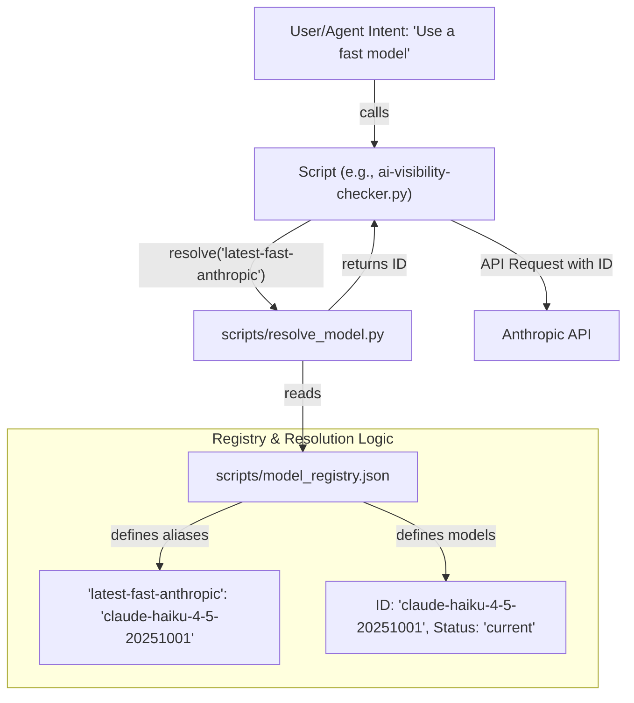
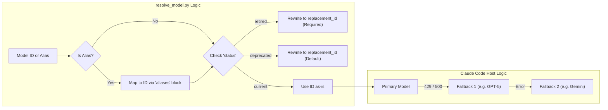

<!-- source: DeepWiki mcp.deepwiki.com · repo indranilbanerjee/digital-marketing-pro · page 8 Model Curator & AI Infrastructure · fetched 2026-10-27 -->

# Model Curator & AI Infrastructure

Relevant source files

The following files were used as context for generating this wiki page:

- [docs/MODEL-CURATOR.md](docs/MODEL-CURATOR.md)
- [scripts/model_registry.json](scripts/model_registry.json)
- [scripts/refresh_models.py](scripts/refresh_models.py)
- [scripts/resolve_model.py](scripts/resolve_model.py)
- [settings.json.example](settings.json.example)
- [tests/test_resolve_model.py](tests/test_resolve_model.py)

The Model Curator is the centralized intelligence layer responsible for abstracting AI model identifiers from the functional logic of the plugin. By utilizing a single source of truth for model metadata, the system prevents hardcoded string rot and provides a robust fail-forward mechanism when providers deprecate or retire specific model versions.

### System Purpose and Design Philosophy
The infrastructure is built to solve the "grep-and-replace" problem inherent in multi-agent systems using dozens of specialized scripts [docs/MODEL-CURATOR.md:13-17](). Instead of scripts requesting specific versions like `claude-sonnet-4-5-20250929`, they request high-level aliases such as `latest-balanced-anthropic` [docs/MODEL-CURATOR.md:3-7](). This allows the platform to stay current with the frontier model landscape—which shifts roughly every 6 weeks—without modifying the core execution logic [scripts/model_registry.json:7-7]().

### Natural Language to Code Entity Mapping: Resolution Flow
The following diagram illustrates how a human-readable request for a "fast model" is translated into a concrete API identifier by the curator.

**Diagram: Model Alias Resolution Pipeline**

Sources: [docs/MODEL-CURATOR.md:3-7](), [scripts/resolve_model.py:95-133](), [scripts/model_registry.json:139-150]()

---

## Core Components

### Model Registry (`model_registry.json`)
The `model_registry.json` file is the canonical source of truth for all AI model metadata [scripts/model_registry.json:2-2](). It categorizes models into tiers (Frontier, Balanced, Fast, Multimodal) and tracks their lifecycle status [scripts/model_registry.json:11-20]().
- **For details on the schema and vendor families, see [Model Registry & Alias Resolution](#8.1).**

### Model Resolver (`resolve_model.py`)
This utility provides the functional interface for the registry. It handles three primary tasks:
1.  **Alias Resolution**: Mapping semantic names to concrete IDs [scripts/resolve_model.py:108-109]().
2.  **Fall-Forward Substitution**: If a script requests a `deprecated` or `retired` ID, the resolver automatically substitutes it with the `replacement_id` defined in the registry [scripts/resolve_model.py:114-128]().
3.  **Param Compatibility Checks**: Scanning for parameters like `temperature` that are rejected by newer models such as Claude Opus 4.7+ [scripts/resolve_model.py:196-203]().

### 3-Model Resilience Chain
For high-availability environments, the infrastructure supports a fallback chain. Users can configure a `fallbackModel` array in their `settings.json` [settings.json.example:5-9](). If the primary model returns a non-retryable error or is overloaded, the system attempts up to two additional models from different vendors to mitigate single-provider outages [settings.json.example:4-4]().

**Diagram: Resilience & Fall-Forward Logic**

Sources: [scripts/resolve_model.py:95-133](), [settings.json.example:4-9]()

---

## Maintenance & Drift Detection

The AI landscape moves faster than manual documentation can track. The infrastructure includes dedicated tooling to detect when the registry has drifted from the actual models served by providers.

### Drift Detection Workflow (`refresh_models.py`)
The `refresh_models.py` script polls the live API endpoints of Anthropic, OpenAI, Google, and Evolink [scripts/refresh_models.py:16-20](). It generates a report highlighting:
- **NEW**: Models found in the provider API but missing from the registry [scripts/refresh_models.py:173-176]().
- **STALE**: Models marked as `current` in the registry that are no longer returned by the provider [scripts/refresh_models.py:178-181]().

**Note**: Curation is a human-in-the-loop process. The script identifies drift but never automatically overwrites the registry [scripts/refresh_models.py:13-14]().

- **For details on the refresh workflow and param rejection notes, see [Model Drift Detection & Maintenance](#8.2).**

### Key Maintenance Commands
| Command | Purpose |
| :--- | :--- |
| `python scripts/resolve_model.py --list` | Lists all curated models and their statuses [scripts/resolve_model.py:13-15](). |
| `python scripts/resolve_model.py --registry-age` | Shows days since the last manual curation pass [scripts/resolve_model.py:17-17](). |
| `python scripts/refresh_models.py` | Polls providers and reports drift [scripts/refresh_models.py:23-23](). |
| `python scripts/refresh_models.py --bump-timestamp` | Updates the `last_updated` field after a review [scripts/refresh_models.py:155-160](). |

Sources: [scripts/resolve_model.py:10-18](), [scripts/refresh_models.py:116-125]()

---

