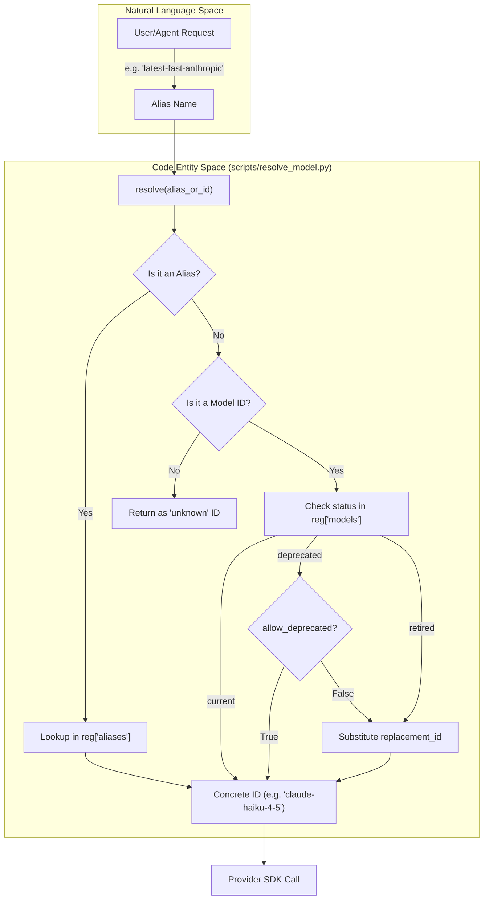
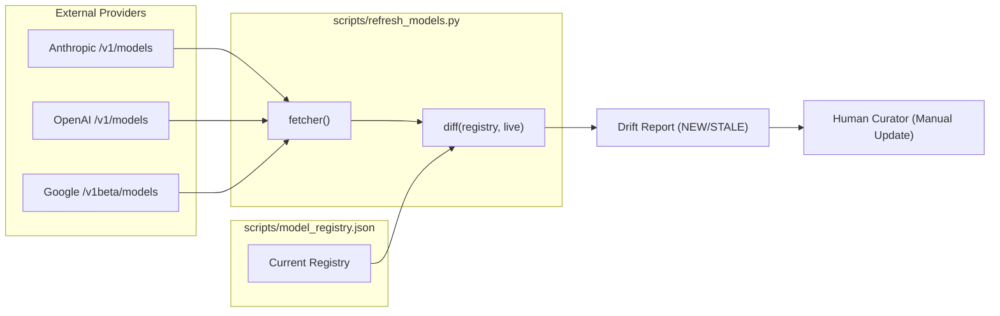

<!-- source: DeepWiki mcp.deepwiki.com · repo indranilbanerjee/digital-marketing-pro · page 8.1 Model Registry & Alias Resolution · fetched 2026-10-27 -->

# Model Registry & Alias Resolution

Relevant source files

The following files were used as context for generating this wiki page:

- [docs/MODEL-CURATOR.md](docs/MODEL-CURATOR.md)
- [scripts/model_registry.json](scripts/model_registry.json)
- [scripts/refresh_models.py](scripts/refresh_models.py)
- [scripts/requirements.txt](scripts/requirements.txt)
- [scripts/resolve_model.py](scripts/resolve_model.py)
- [settings.json.example](settings.json.example)
- [tests/test_resolve_model.py](tests/test_resolve_model.py)

The **Model Curator** system provides a centralized abstraction layer for AI model management. It ensures that Python scripts and agentic workflows do not hardcode specific model strings (e.g., `claude-3-5-sonnet-20241022`), which are prone to silent failures upon provider deprecation. Instead, the system uses a registry-backed resolver to map human-readable aliases to concrete, validated model IDs.

## Model Registry Schema (`model_registry.json`)

The `scripts/model_registry.json` file serves as the single source of truth for the entire suite [scripts/resolve_model.py:5-9](). It contains metadata for model families, tiers, and lifecycle statuses.

### Model Statuses
The registry tracks the lifecycle of every model via the `status` field [scripts/model_registry.json:29]():
*   **`current`**: The active, recommended version of a model.
*   **`deprecated`**: The model is still functional but a newer version is available. The resolver will issue a warning and substitute the `replacement_id` [docs/MODEL-CURATOR.md:24-25]().
*   **`retired`**: The model has been shut down by the provider. The resolver **must** substitute the `replacement_id` regardless of flags, as the original ID will return a 404 [scripts/resolve_model.py:101-104]().
*   **`unknown`**: The ID is not present in the registry. The system passes it through but issues a warning [docs/MODEL-CURATOR.md:25]().

### Performance Tiers
Models are categorized into tiers to allow scripts to request a specific capability level without knowing the provider's current lineup [scripts/model_registry.json:11-20]():
*   **`frontier`**: Best-in-class reasoning (e.g., Claude Opus, GPT-5).
*   **`balanced`**: Optimal trade-off between speed and intelligence (e.g., Claude Sonnet).
*   **`fast`**: Low-latency, high-volume tasks (e.g., Claude Haiku, GPT-mini).
*   **`multimodal`**: Native handling of text, image, and video.

### Vendor Families
The system supports multiple providers and gateways [docs/MODEL-CURATOR.md:48-71]():
*   **Anthropic**: Claude family (Opus, Sonnet, Haiku).
*   **OpenAI**: GPT family.
*   **Google**: Gemini and Veo families.
*   **Evolink**: A multi-provider API gateway (`evolink-auto` router and DeepSeek/Doubao models) [docs/MODEL-CURATOR.md:90-93]().
*   **WaveSpeed / Higgsfield**: Specialized video and character generation.

Sources: [scripts/model_registry.json:1-30](), [docs/MODEL-CURATOR.md:1-15](), [scripts/resolve_model.py:101-143]().

---

## Alias-to-ID Resolution Logic

The `resolve_model.py` script implements the logic for converting an alias or a potentially stale ID into a valid API target.

### Resolution Data Flow
The following diagram illustrates how a script's request for a model is processed by `resolve_model.py`.

**Model Resolution Pipeline**

Sources: [scripts/resolve_model.py:95-133](), [docs/MODEL-CURATOR.md:21-27]().

### Fall-Forward Substitution
"Fall-forward" is the mechanism where the resolver automatically upgrades a request to a newer model if the requested one is retired or deprecated.
*   **Retired Substitution**: If `status == "retired"`, the resolver unconditionally returns `replacement_id` [scripts/resolve_model.py:114-120]().
*   **Deprecated Substitution**: If `status == "deprecated"`, it returns `replacement_id` unless the `--allow-deprecated` flag is explicitly passed [scripts/resolve_model.py:121-125]().

---

## Implementation Details

### Key Functions
| Function | File | Description |
| :--- | :--- | :--- |
| `resolve()` | `resolve_model.py` | Primary entry point for mapping aliases/IDs to current targets [scripts/resolve_model.py:95](). |
| `check()` | `resolve_model.py` | Returns the `(status, replacement_id)` tuple for a given ID [scripts/resolve_model.py:136](). |
| `list_models()` | `resolve_model.py` | Filters the registry by vendor, tier, or modality [scripts/resolve_model.py:146](). |
| `get_registry()` | `resolve_model.py` | Loads and caches `model_registry.json` [scripts/resolve_model.py:77](). |

### Model Registry Maintenance
The registry is kept fresh via `scripts/refresh_models.py`, which polls provider endpoints to detect "drift" (new models released or old models removed from the API) [scripts/refresh_models.py:3-14]().

**Drift Detection Workflow**

Sources: [scripts/refresh_models.py:52-112](), [docs/MODEL-CURATOR.md:109-129]().

### Parameter Compatibility Safety Gate
Newer models like **Claude Opus 4.7+** reject legacy parameters (`temperature`, `top_p`, `top_k`) with an HTTP 400 error [scripts/model_registry.json:8-10]().
The resolver provides a safety gate:
*   `_cmd_check_params()`: Scans Python scripts for unsafe parameter usage when targeting these models [scripts/resolve_model.py:196-205]().
*   `resolve_model.py --check-params <file>`: CLI command to validate script compatibility [docs/MODEL-CURATOR.md:82]().

Sources: [scripts/model_registry.json:8-10](), [docs/MODEL-CURATOR.md:76-84](), [scripts/resolve_model.py:196-205]().

---

