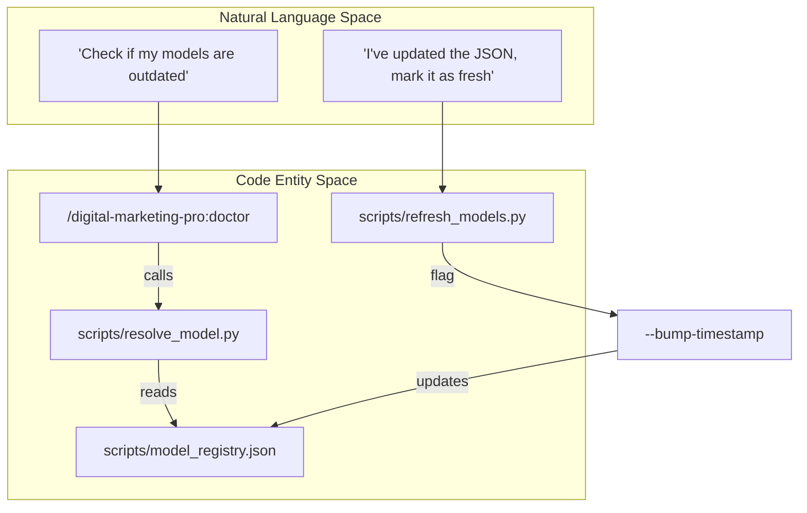
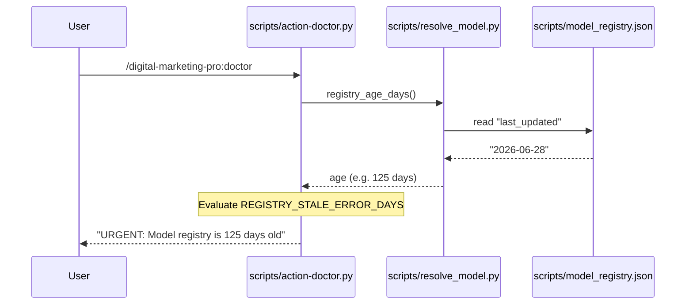

<!-- source: DeepWiki mcp.deepwiki.com · repo indranilbanerjee/digital-marketing-pro · page 8.2 Model Drift Detection & Maintenance · fetched 2026-10-27 -->

# Model Drift Detection & Maintenance

Relevant source files

The following files were used as context for generating this wiki page:

- [.github/workflows/skill-review.yml](.github/workflows/skill-review.yml)
- [commands/doctor.md](commands/doctor.md)
- [commands/execute-action.md](commands/execute-action.md)
- [docs/MODEL-CURATOR.md](docs/MODEL-CURATOR.md)
- [scripts/_connector_registry.py](scripts/_connector_registry.py)
- [scripts/action-doctor.py](scripts/action-doctor.py)
- [scripts/connector_executor.py](scripts/connector_executor.py)
- [scripts/connector_resolver.py](scripts/connector_resolver.py)
- [scripts/model_registry.json](scripts/model_registry.json)
- [scripts/refresh_models.py](scripts/refresh_models.py)
- [settings.json.example](settings.json.example)
- [skills/content-decay-scan/SKILL.md](skills/content-decay-scan/SKILL.md)
- [skills/intelligence-report/SKILL.md](skills/intelligence-report/SKILL.md)
- [skills/performance-check/SKILL.md](skills/performance-check/SKILL.md)
- [tests/test_resolve_model.py](tests/test_resolve_model.py)

The Model Curator system provides a centralized abstraction layer to manage the rapid evolution of frontier AI models. Since the AI landscape shifts approximately every 6 weeks, the system uses a drift detection workflow to ensure that scripts do not fail due to model deprecations or 404 errors. This maintenance cycle is managed primarily through `scripts/refresh_models.py` and monitored via the `/doctor` command.

## Drift Detection Workflow

The maintenance workflow follows a "Report-Only" philosophy by default. The system polls provider APIs to identify discrepancies between the live catalog and the local `scripts/model_registry.json` [scripts/refresh_models.py:3-14]().

### Provider-Specific Fetchers
`refresh_models.py` implements specialized fetchers for major AI providers using only Python standard libraries (`urllib.request`) to minimize dependencies [scripts/refresh_models.py:43-50]().

| Provider | Endpoint | Requirement |
| :--- | :--- | :--- |
| **Anthropic** | `https://api.anthropic.com/v1/models` | `ANTHROPIC_API_KEY` |
| **OpenAI** | `https://api.openai.com/v1/models` | `OPENAI_API_KEY` |
| **Google** | `https://generativelanguage.googleapis.com/v1beta/models` | `GEMINI_API_KEY` |
| **Evolink** | `https://direct.evolink.ai/v1/models` | `EVOLINK_API_KEY` |

Sources: [scripts/refresh_models.py:52-105]()

### Drift Report Categories
The `diff()` function compares `registry_ids` against `live_ids` to generate a report with two primary categories [scripts/refresh_models.py:108-112]():

1.  **NEW**: Model IDs listed by the provider that are missing from the registry. These are candidates for future triage and inclusion [scripts/refresh_models.py:173-176]().
2.  **STALE**: Model IDs marked as `current` in the registry that are no longer returned by the provider's live list [scripts/refresh_models.py:177-180]().

### The Maintenance Loop (Natural Language to Code)

This diagram illustrates how a maintainer moves from a natural language intent to the specific code entities that manage model health.

Title: Model Maintenance Lifecycle

Sources: [scripts/action-doctor.py:101-154](), [scripts/refresh_models.py:115-125](), [docs/MODEL-CURATOR.md:109-124]()

## Registry Maintenance Commands

Maintenance is performed using CLI flags to either report status or update the registry metadata.

*   **Drift Check**: `python scripts/refresh_models.py` polls all providers where an API key is present and prints the diff [scripts/refresh_models.py:23-26]().
*   **Timestamp Update**: `python scripts/refresh_models.py --bump-timestamp` updates the `last_updated` field in `model_registry.json` to the current date [scripts/refresh_models.py:155-160](). This is used after a manual curation pass to reset the "staleness" clock.
*   **Registry Age**: `python scripts/resolve_model.py --registry-age` returns the days elapsed since the last update [docs/MODEL-CURATOR.md:113-116]().

Sources: [scripts/refresh_models.py:116-125](), [docs/MODEL-CURATOR.md:109-124]()

## Parameter Compatibility: Claude Opus 4.7+

A critical maintenance requirement for the `anthropic` family involves breaking changes in the Opus 4.7 and 4.8 models.

### Temperature Rejection
Unlike previous versions, Claude Opus 4.7+ rejects `temperature`, `top_p`, and `top_k` parameters with an **HTTP 400 error** if they are set to non-default values [docs/MODEL-CURATOR.md:76-80]().

*   **Registry Enforcement**: The `model_registry.json` contains `param_compatibility_notes` specifically for these models [scripts/model_registry.json:8-10]().
*   **Validation**: Maintainers can run `python scripts/resolve_model.py --check-params <script_path>` to scan for unsafe parameter usage before deployment [docs/MODEL-CURATOR.md:82-83]().

Sources: [docs/MODEL-CURATOR.md:76-84](), [scripts/model_registry.json:35-52]()

## Health Monitoring via `/doctor`

The `/doctor` command (implemented in `scripts/action-doctor.py`) serves as the primary diagnostic for model health in the production environment.

### Registry Freshness Logic
The `_model_curator_status()` function evaluates the registry's age and assigns a severity level [scripts/action-doctor.py:101-154]():

| Age (Days) | Severity | Status |
| :--- | :--- | :--- |
| < 60 | `ok` | Within the safe refresh window. |
| 60 - 119 | `warn` | Registry is stale; drift check recommended. |
| ≥ 120 | `urgent` | Critical staleness; 404 risks are high. |

### Diagnostic Execution Flow

Title: Action Doctor Freshness Check

Sources: [scripts/action-doctor.py:75-77](), [scripts/action-doctor.py:101-154](), [commands/doctor.md:38-39]()

## Maintenance Summary Table

| Task | Code Entity | Frequency |
| :--- | :--- | :--- |
| **Check for Drift** | `refresh_models.py` | Monthly |
| **Update Aliases** | `model_registry.json` | As needed (on new releases) |
| **Verify Params** | `resolve_model.py --check-params` | During CI/CD or PR Review |
| **Reset Health Clock** | `refresh_models.py --bump-timestamp` | After every manual update |

Sources: [docs/MODEL-CURATOR.md:109-124](), [scripts/model_registry.json:1-7]()

---

