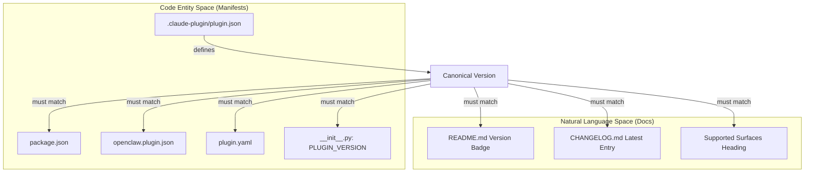
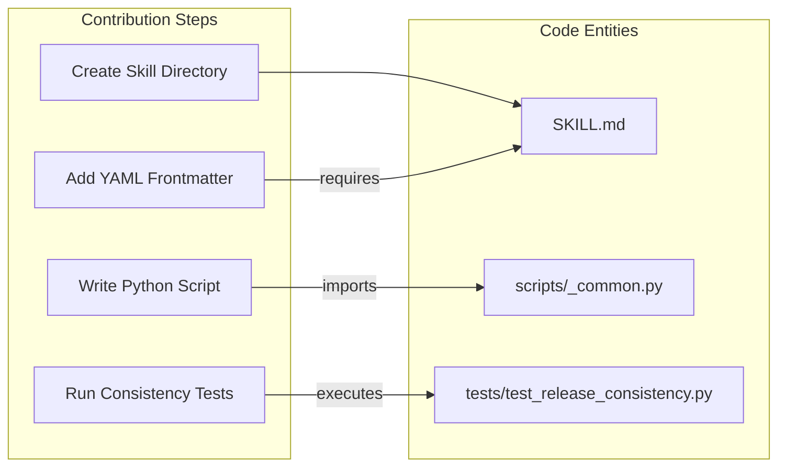

<!-- source: DeepWiki mcp.deepwiki.com · repo indranilbanerjee/digital-marketing-pro · page 9 Testing & Release Management · fetched 2026-10-27 -->

# Testing & Release Management

Relevant source files

The following files were used as context for generating this wiki page:

- [.github/ISSUE_TEMPLATE/bug_report.md](.github/ISSUE_TEMPLATE/bug_report.md)
- [.github/ISSUE_TEMPLATE/feature_request.md](.github/ISSUE_TEMPLATE/feature_request.md)
- [.github/ISSUE_TEMPLATE/industry_update.md](.github/ISSUE_TEMPLATE/industry_update.md)
- [CONTRIBUTING.md](CONTRIBUTING.md)
- [TESTING-GUIDE.md](TESTING-GUIDE.md)
- [docs/engagement-methodology.md](docs/engagement-methodology.md)
- [docs/integrations-guide.md](docs/integrations-guide.md)
- [docs/multi-brand-guide.md](docs/multi-brand-guide.md)
- [package.json](package.json)
- [tests/test_release_consistency.py](tests/test_release_consistency.py)

Digital Marketing Pro maintains a rigorous testing and release infrastructure to ensure that its 158 skills, 24 agents, and 89 scripts operate consistently across 7 different platform manifests. The system prioritizes "Version Lockstep," ensuring that a release never ships with mismatched versions between the Python runtime, the platform manifests (e.g., Claude Code, Hermes, OpenClaw), and the documentation.

## Testing Infrastructure

The testing suite is designed to catch cross-manifest drift and functional regressions before they reach production. It employs a mix of deterministic script tests and consistency checks that validate the integrity of the entire plugin bundle.

### Release Consistency Enforcement
The primary safeguard against release errors is `test_release_consistency.py`. This test suite enforces that the "Canonical Version" defined in the primary manifest is mirrored across all other manifests, badges, and documentation callouts.

**Version Lockstep Diagram**

Sources: [tests/test_release_consistency.py:36-40](), [tests/test_release_consistency.py:59-68](), [tests/test_release_consistency.py:82-87]()

### Test Suite Overview
The `tests/` directory contains several specialized test files managed by a central runner:
*   **Release Consistency**: Validates version sync, description mirroring, and anchor integrity [tests/test_release_consistency.py:1-11]().
*   **Model Resolution**: Tests the `resolve_model.py` logic for handling model aliases and fallbacks.
*   **Adapter Integrity**: Ensures platform-specific adapters like `test_hermes_adapter.py` and `test_openclaw_manifest.py` correctly translate plugin intent to host environments.
*   **Functional Logic**: Validates the `connector_resolver.py` and other core execution scripts.

For details, see [Test Suite](#9.1).

## Release Management

The release process is governed by strict synchronization requirements. Because the plugin supports multiple agent harnesses simultaneously, a single version bump requires updates to seven different JSON/YAML manifests to prevent "Host key verification" or "Plugin mismatch" errors in environments like Claude Cowork or Cursor.

### Canonical Versioning
The `_canonical_version()` is extracted from `.claude-plugin/plugin.json` [tests/test_release_consistency.py:36-40](). This version must be reflected in:
1.  **Platform Manifests**: `.codex-plugin/plugin.json`, `.cursor-plugin/plugin.json`, `gemini-extension.json`, etc [tests/test_release_consistency.py:23-31]().
2.  **Package Metadata**: `package.json` [package.json:3-3]().
3.  **Documentation**: The "Just shipped" callout and the versioned "Supported surfaces" heading in the README [tests/test_release_consistency.py:89-95](), [tests/test_release_consistency.py:103-116]().

### Contribution Standards
Contributions must adhere to specific coding patterns to maintain the "deterministic execution" pillar of the WAT architecture:
*   **Argparse CLI**: All scripts must use `argparse` for arguments [CONTRIBUTING.md:150-150]().
*   **JSON I/O**: Scripts must print structured JSON to `stdout` for agent consumption [CONTRIBUTING.md:151-151]().
*   **Graceful Degradation**: Scripts must handle missing optional dependencies (like `nltk`) by returning a JSON fallback instead of crashing [CONTRIBUTING.md:152-152]().

**Contribution Workflow to Code Mapping**

Sources: [CONTRIBUTING.md:30-44](), [CONTRIBUTING.md:146-155](), [tests/test_release_consistency.py:1-11]()

For details, see [Contributing & Release Process](#9.2).

## Quality Gates

Beyond unit tests, the system employs "Quality Gates" during execution. The `/digital-marketing-pro:check` command acts as a pre-publish gate for deliverables [docs/engagement-methodology.md:5-5](). This command triggers scripts like `hallucination-detector.py` and `brand-voice-scorer.py` to ensure that generated content meets the standards defined in the brand's `profile.json` [docs/multi-brand-guide.md:64-79]().

Sources: [docs/engagement-methodology.md:5-5](), [TESTING-GUIDE.md:210-213](), [CONTRIBUTING.md:184-185]()

---

