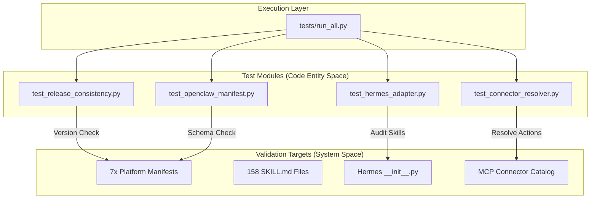
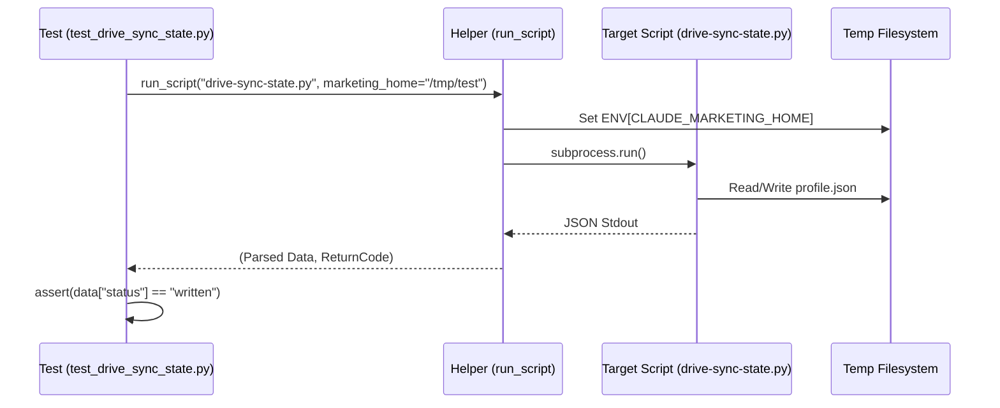

<!-- source: DeepWiki mcp.deepwiki.com · repo indranilbanerjee/digital-marketing-pro · page 9.1 Test Suite · fetched 2026-10-27 -->

# Test Suite

Relevant source files

The following files were used as context for generating this wiki page:

- [package.json](package.json)
- [tests/__init__.py](tests/__init__.py)
- [tests/_helpers.py](tests/_helpers.py)
- [tests/run_all.py](tests/run_all.py)
- [tests/test_connector_resolver.py](tests/test_connector_resolver.py)
- [tests/test_drive_sync_state.py](tests/test_drive_sync_state.py)
- [tests/test_hermes_adapter.py](tests/test_hermes_adapter.py)
- [tests/test_hermes_edge_cases.py](tests/test_hermes_edge_cases.py)
- [tests/test_openclaw_manifest.py](tests/test_openclaw_manifest.py)
- [tests/test_plugin_metadata.py](tests/test_plugin_metadata.py)
- [tests/test_release_consistency.py](tests/test_release_consistency.py)
- [tests/test_skill_line_check.py](tests/test_skill_line_check.py)

The **Test Suite** is a critical infrastructure component designed to ensure cross-platform consistency, manifest synchronization, and functional integrity across the 158 skills and 24 agents. Given that Digital Marketing Pro supports seven distinct agent harnesses (Claude Code, Codex, Cursor, Hermes, OpenClaw, etc.), the test suite focuses heavily on preventing "manifest drift" where version numbers or descriptions become desynchronized.

The suite is built using the Python standard library (`unittest`) to maintain a zero-dependency footprint, ensuring tests can run in restricted environments without installing third-party packages like `pytest`.

### Test Runner and Execution

The central entry point for the suite is `tests/run_all.py`. It utilizes `unittest.TestLoader` to discover and execute all files matching the `test_*.py` pattern within the `tests/` directory.

| Component | File Path | Role |
| :--- | :--- | :--- |
| **Runner** | `tests/run_all.py` | Discovers and runs all tests; returns non-zero exit code on failure. |
| **Helpers** | `tests/_helpers.py` | Provides `run_script` and `run_json` for subprocess testing of scripts. |
| **Consistency** | `tests/test_release_consistency.py` | Enforces version lockstep across all manifests and README. |
| **Platform Specific** | `tests/test_hermes_adapter.py` | Validates the Hermes-specific `__init__.py` and `plugin.yaml`. |
| **Platform Specific** | `tests/test_openclaw_manifest.py` | Validates the OpenClaw JSON schema and skill paths. |

**Code Entity Space to Natural Language Space: Execution Flow**

This diagram illustrates how the `run_all.py` script orchestrates the various specialized test modules to validate the system state.

"Test Suite Execution Flow"

Sources: [tests/run_all.py:15-27](), [tests/test_release_consistency.py:23-31](), [tests/test_hermes_adapter.py:95-102]()

---

### Release Consistency Enforcement

The `test_release_consistency.py` module is the most critical check in the suite. It defines a "Canonical Version" sourced from `.claude-plugin/plugin.json` and ensures that every other manifest and documentation element matches it exactly.

#### Key Functions and Checks:
*   **`_canonical_version()`**: Reads the source of truth from `.claude-plugin/plugin.json` [tests/test_release_consistency.py:36-40]().
*   **Version Lockstep**: Validates 7 JSON manifests, `plugin.yaml`, and `__init__.py` [tests/test_release_consistency.py:59-81]().
*   **Badge Integrity**: Scans `README.md` for version badges and "Just shipped" callouts to ensure documentation never lags behind code [tests/test_release_consistency.py:82-95]().
*   **Anchor Integrity**: Uses slugification logic (e.g., `v3.14.1` → `supported-surfaces-v3141`) to verify that internal README links point to valid headings [tests/test_release_consistency.py:117-135]().

Sources: [tests/test_release_consistency.py:1-11](), [tests/test_release_consistency.py:52-116]()

---

### Platform-Specific Adapters

#### Hermes Adapter (`test_hermes_adapter.py` & `test_hermes_edge_cases.py`)
The Hermes integration relies on a root `__init__.py` and `plugin.yaml`. The tests ensure that:
1.  **`audit()`**: Correctly discovers all 158 skills [tests/test_hermes_adapter.py:95-102]().
2.  **`register(ctx)`**: Successfully registers skills against a mock context without crashing [tests/test_hermes_adapter.py:103-113]().
3.  **Graceful Degradation**: The adapter handles missing `skills/` directories, malformed YAML frontmatter, and API drift in the Hermes `ctx` object without raising exceptions [tests/test_hermes_edge_cases.py:57-126]().

#### OpenClaw Manifest (`test_openclaw_manifest.py`)
Validates the `openclaw.plugin.json` against the OpenClaw specification:
*   **Config Schema**: Ensures `additionalProperties: false` is set to lock down the configuration surface [tests/test_openclaw_manifest.py:28-36]().
*   **Skill Paths**: Verifies that the `skills` array points to relative paths that exist on disk and contain the expected number of skills [tests/test_openclaw_manifest.py:37-48]().

Sources: [tests/test_hermes_adapter.py:78-130](), [tests/test_openclaw_manifest.py:15-80]()

---

### Script and Logic Validation

The suite includes tests for the Python logic layer, often using the `_helpers.py` module to run scripts in isolated environments.

**Data Flow: Script Testing via Subprocess**

This diagram shows how `_helpers.py` isolates tests by redirecting `CLAUDE_MARKETING_HOME` to a temporary directory.

"Script Isolation and Validation"

Sources: [tests/_helpers.py:15-31](), [tests/test_drive_sync_state.py:16-26]()

#### Specific Logic Checks:
*   **`test_connector_resolver.py`**: Verifies that the `ACTION_SPECS` catalog contains required fields (`operation`, `purpose`, `script`) and that the resolver correctly identifies "real" vs "stub" modes for MCP connectors [tests/test_connector_resolver.py:14-50]().
*   **`test_skill_line_check.py`**: Enforces a strict 500-line limit for `SKILL.md` files to comply with LLM context window guidelines [tests/test_skill_line_check.py:27-36]().
*   **`test_plugin_metadata.py`**: Probes the `plugin-metadata.py` script to ensure it correctly reports asset counts (skills, agents, scripts) and identifies the host environment [tests/test_plugin_metadata.py:14-42]().

Sources: [tests/test_connector_resolver.py:1-12](), [tests/test_skill_line_check.py:1-13](), [tests/test_plugin_metadata.py:1-13]()

---

