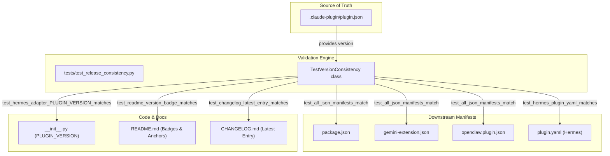
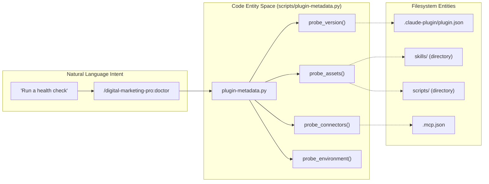

<!-- source: DeepWiki mcp.deepwiki.com · repo indranilbanerjee/digital-marketing-pro · page 9.2 Contributing & Release Process · fetched 2026-10-27 -->

# Contributing & Release Process

Relevant source files

The following files were used as context for generating this wiki page:

- [.github/ISSUE_TEMPLATE/bug_report.md](.github/ISSUE_TEMPLATE/bug_report.md)
- [.github/ISSUE_TEMPLATE/feature_request.md](.github/ISSUE_TEMPLATE/feature_request.md)
- [.github/ISSUE_TEMPLATE/industry_update.md](.github/ISSUE_TEMPLATE/industry_update.md)
- [.github/PULL_REQUEST_TEMPLATE.md](.github/PULL_REQUEST_TEMPLATE.md)
- [CODE_OF_CONDUCT.md](CODE_OF_CONDUCT.md)
- [CONTRIBUTING.md](CONTRIBUTING.md)
- [SECURITY.md](SECURITY.md)
- [package.json](package.json)
- [scripts/plugin-metadata.py](scripts/plugin-metadata.py)
- [scripts/skill-line-check.py](scripts/skill-line-check.py)
- [tests/test_release_consistency.py](tests/test_release_consistency.py)

This page details the technical standards, contribution workflows, and release synchronization requirements for the Digital Marketing Pro codebase. Maintaining consistency across 158 skills and 7 platform manifests requires strict adherence to these conventions to prevent architectural drift.

## Contribution Workflow

The project follows a standard fork-and-pull-request model. Contributors must use the provided issue and PR templates to ensure all necessary metadata is captured.

### Reporting Issues
Issues should be categorized using the appropriate template:
*   **Bug Reports**: For script crashes, incorrect output, or broken features [CONTRIBUTING.md:10-10]().
*   **Feature Requests**: For new modules, commands, or agent capabilities [CONTRIBUTING.md:11-11]().
*   **Industry/Platform Updates**: For updating outdated benchmarks, platform specs, or compliance rules [CONTRIBUTING.md:10-11]().

### Pull Request Requirements
All PRs must include:
1.  **Version Bump**: If the change constitutes a release, the version must be updated in `.claude-plugin/plugin.json` [package.json:3-3]().
2.  **README Updates**: Synchronization of the version badge and "What's new" section [tests/test_release_consistency.py:82-95]().
3.  **Smoke Testing**: Modified scripts must be verified (e.g., `python3 scripts/<script>.py --help` exits 0) [.github/PULL_REQUEST_TEMPLATE.md:27-27]().

**Sources:** [CONTRIBUTING.md:7-26](), [.github/PULL_REQUEST_TEMPLATE.md:1-48](), [tests/test_release_consistency.py:1-11]()

---

## Coding Standards

### Skill Conventions (SKILL.md)
Every skill must reside in its own directory containing a `SKILL.md` file with specific YAML frontmatter [CONTRIBUTING.md:30-32]().

| Field | Requirement |
| :--- | :--- |
| `name` | Unique identifier for the skill [CONTRIBUTING.md:36-36](). |
| `description` | Single sentence describing the trigger context [CONTRIBUTING.md:37-37](). |
| `triggers` | 6-8 natural language phrases for intent matching [CONTRIBUTING.md:39-42](). |
| `engagement-part` | Required for v3.0 methodology skills (1-12) [CONTRIBUTING.md:68-69](). |
| `view-preference` | Controls document loading (e.g., `v2-primary`) [CONTRIBUTING.md:70-79](). |

**Critical Rule**: Every skill and agent MUST load brand context as its first step [CONTRIBUTING.md:55-55](). Command skills must explicitly read `~/.claude-marketing/brands/_active-brand.json` [CONTRIBUTING.md:114-114]().

### Python Script Standards
Scripts in the `scripts/` directory act as the deterministic execution layer. They must adhere to the following:
1.  **Argparse CLI**: Mandatory use of `argparse` for all inputs [CONTRIBUTING.md:150-150]().
2.  **JSON stdout**: All programmatic output must be structured JSON [CONTRIBUTING.md:151-151]().
3.  **Graceful Degradation**: If an optional dependency (like `nltk`) is missing, scripts must output a JSON object with `"fallback": true` and `sys.exit(0)` instead of crashing [CONTRIBUTING.md:152-169]().
4.  **Path Handling**: Use `pathlib.Path.home() / ".claude-marketing"` for data persistence; never hardcode paths [CONTRIBUTING.md:154-154]().

**Sources:** [CONTRIBUTING.md:30-115](), [CONTRIBUTING.md:146-170](), [scripts/skill-line-check.py:1-26]()

---

## Release Consistency & Synchronization

The project supports 7 distinct platforms, each requiring its own manifest. The `tests/test_release_consistency.py` suite acts as a CI guard to ensure these files never drift.

### The Canonical Version
The version defined in `.claude-plugin/plugin.json` is the "One True Version" [tests/test_release_consistency.py:36-39](). All other files must match this string exactly.

### Cross-Manifest Synchronization Logic
The release process requires updating the following files in lockstep:

| File Type | Path | Version Field |
| :--- | :--- | :--- |
| **JSON Manifests** | `.claude-plugin/plugin.json`, `package.json`, `gemini-extension.json`, etc. | `"version"` [tests/test_release_consistency.py:23-31]() |
| **YAML Manifest** | `plugin.yaml` | `version:` [tests/test_release_consistency.py:71-74]() |
| **Python Adapter** | `__init__.py` | `PLUGIN_VERSION = "..."` [tests/test_release_consistency.py:75-80]() |
| **Documentation** | `README.md`, `CHANGELOG.md` | Badges, headings, and anchors [tests/test_release_consistency.py:82-116]() |

### Automated Guardrails
The `scripts/skill-line-check.py` tool enforces the "500-line limit" for `SKILL.md` files [scripts/skill-line-check.py:3-9](). This prevents skills from exceeding the 5,000-token context window during auto-compaction [scripts/skill-line-check.py:21-25]().

#### Release Consistency Data Flow
The following diagram illustrates how the `TestVersionConsistency` class validates the codebase before a release.

**Sources:** [tests/test_release_consistency.py:19-116](), [package.json:1-43](), [scripts/plugin-metadata.py:43-58]()

---

## Technical Metadata & Health Checks

The codebase includes self-diagnostic tools to assist contributors and maintainers in verifying the state of the installation.

### Metadata Resolution
The `scripts/plugin-metadata.py` script serves as the live source of truth for the plugin's internal state [scripts/plugin-metadata.py:5-7](). It is used by the `/status` and `/doctor` commands to report:
*   **Asset Counts**: Total agents, skills, and scripts [scripts/plugin-metadata.py:60-67]().
*   **Connector Status**: Available vs. active MCP connectors [scripts/plugin-metadata.py:70-113]().
*   **Environment Detection**: Identifying if the plugin is running in a local CLI or a Cowork sandbox [scripts/plugin-metadata.py:152-201]().

#### Code Entity Mapping: Metadata Discovery
This diagram bridges the natural language "Health Check" concept to the specific Python functions and filesystem entities involved.

**Sources:** [scripts/plugin-metadata.py:1-201](), [scripts/skill-line-check.py:44-64]()

---

