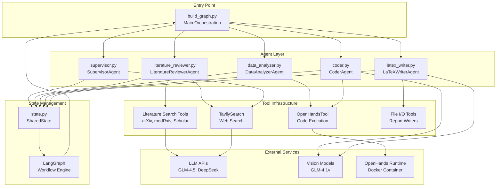
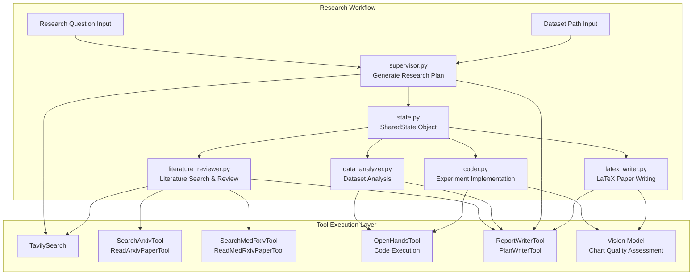

<!-- source: DeepWiki mcp.deepwiki.com · repo jarrycyx/openlens-ai · page 1 Overview · fetched 2026-10-27 -->

# Overview

<details>
<summary>Relevant source files</summary>

The following files were used as context for generating this wiki page:

- [README.md](README.md)
- [modules.md](modules.md)

</details>


This document provides a comprehensive overview of OpenLens AI, a fully autonomous research agent designed for health informatics research. The system coordinates multiple specialized agents to conduct end-to-end research workflows including literature review, data analysis, experiment design, code execution, and academic paper generation.

For detailed agent implementations, see [Multi-Agent System](#3). For setup and configuration instructions, see [Getting Started](#2). For deployment and model management details, see [LLM Router Infrastructure](#4).

## Purpose and Scope

OpenLens AI transforms a single research question and dataset into complete research outputs without manual intervention. The system autonomously:

- Conducts comprehensive literature reviews across academic databases
- Analyzes medical datasets and generates statistical reports  
- Designs and executes computational experiments
- Generates publication-ready LaTeX research papers
- Manages complex workflows through multi-agent coordination

The core workflow accepts a research question string and dataset path as inputs via [openlens_ai/build_graph.py](), then orchestrates five specialized agents through LangGraph state management to produce research deliverables.

Sources: [README.md:37-40](), [modules.md:1-13]()

## System Architecture

OpenLens AI implements a multi-agent architecture where specialized agents communicate through shared state managed by LangGraph. The system integrates with external AI services, code execution environments, and academic databases to enable autonomous research workflows.

### Core System Components



Sources: [README.md:176-197](), [modules.md:5-13](), [openlens_ai/build_graph.py]()

### Agent Workflow Orchestration

The system implements a state-driven workflow where agents operate on shared context and coordinate through LangGraph routing decisions. Each agent specializes in distinct research phases while maintaining access to accumulated knowledge and artifacts.



Sources: [modules.md:199-209](), [README.md:184-196]()

## Core Components

### Multi-Agent Coordination

The system implements five specialized agents in [openlens_ai/agents/]() that communicate through a `SharedState` object defined in [openlens_ai/state.py](). Each agent focuses on specific research tasks:

| Agent | Implementation | Primary Function |
|-------|---------------|------------------|
| `SupervisorAgent` | [supervisor.py]() | Research planning and coordination |
| `LiteratureReviewerAgent` | [literature_reviewer.py]() | Academic paper search and analysis |
| `DataAnalyzerAgent` | [data_analyzer.py]() | Dataset processing and statistical analysis |
| `CoderAgent` | [coder.py]() | Experiment implementation and validation |
| `LaTeXWriterAgent` | [latex_writer.py]() | Academic paper generation |

Sources: [modules.md:5-13](), [README.md:176-183]()

### LangGraph Workflow Engine

Workflow orchestration uses LangGraph to manage agent transitions and shared state. The main coordination logic resides in [openlens_ai/build_graph.py]() which constructs the agent graph and handles routing between specialized tasks.

The `SharedState` class maintains:
- Research question context
- Current subtask progression  
- Agent message histories
- Intermediate artifacts and reports
- Tool execution results

Sources: [modules.md:209](), [openlens_ai/state.py]()

### Tool Infrastructure

Agents access external capabilities through standardized tool interfaces in [openlens_ai/tools/](). Key tool categories include:

- **Literature Search**: `SearchArxivTool`, `SearchMedRxivTool`, `ReadArxivPaperTool`, `ReadMedRxivPaperTool`
- **Web Search**: `TavilySearch` for general information retrieval
- **Code Execution**: `OpenHandsTool` for sandboxed Python execution
- **File Operations**: `ReportWriterTool`, `PlanWriterTool` for artifact generation

Sources: [modules.md:66-73](), [modules.md:214-220](), [README.md:184-196]()

## External Service Integration

### Language Model APIs

The system integrates with multiple LLM providers configured through environment variables in [.env](). Primary models include:
- `MODEL="glm-4.5-air"` for general language tasks
- `CODE_MODEL="glm-4.5-air"` for code generation
- `VISION_MODEL="glm-4.1v-9b-thinking"` for visual analysis
- `RERANK_MODEL="bge-reranker-v2-m3"` for search result reranking

Sources: [README.md:115-125]()

### Code Execution Environment

The `OpenHandsTool` executes code in isolated Docker containers using the OpenHands runtime. The container environment is configured through `DOCKER_NAME=agent-med-cpu` and provides a sandboxed Python environment for data analysis and experiment execution.

Sources: [README.md:137](), [README.md:53]()

### Academic Database Access

Literature search capabilities connect to multiple academic databases:
- arXiv API for preprint access
- medRxiv API for medical preprints  
- Google Scholar for citation searches
- Tavily API for general web search

Sources: [README.md:189-196](), [modules.md:66-72]()

## User Interfaces

### Command Line Interface

Direct execution through [openlens_ai/build_graph.py]() accepts research questions and dataset paths:

```bash
python -m openlens_ai.build_graph --question "Your research question" --dataset-path "path/to/dataset" --thread-id "unique_job_id"
```

### Web Interface

Interactive Streamlit application launched via [start_app.py]() provides browser-based access at `http://localhost:8501` for workflow monitoring and interaction.

Sources: [README.md:155-172]()

## Configuration Management

System configuration centralizes in [.env]() with key parameters:
- `MAX_CONTEXT_TOKEN_CNT=32000` for standard context limits
- `MAX_CONTEXT_TOKEN_CNT_LARGE=96000` for extended operations  
- `OPENHANDS_MAX_ITER=100` for code execution limits
- `MAX_LATEX_POLISH_ROUND=2` for paper refinement cycles

Sources: [README.md:112-151]()

---

