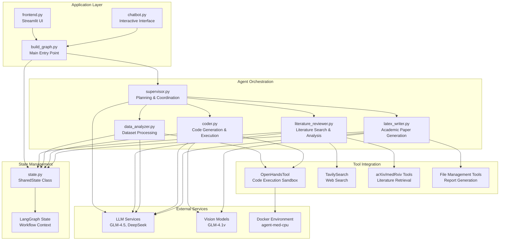
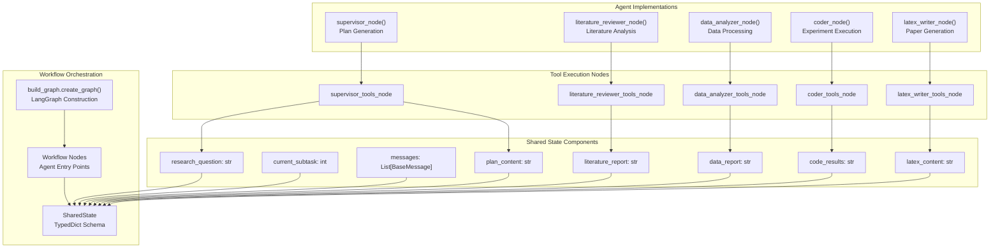
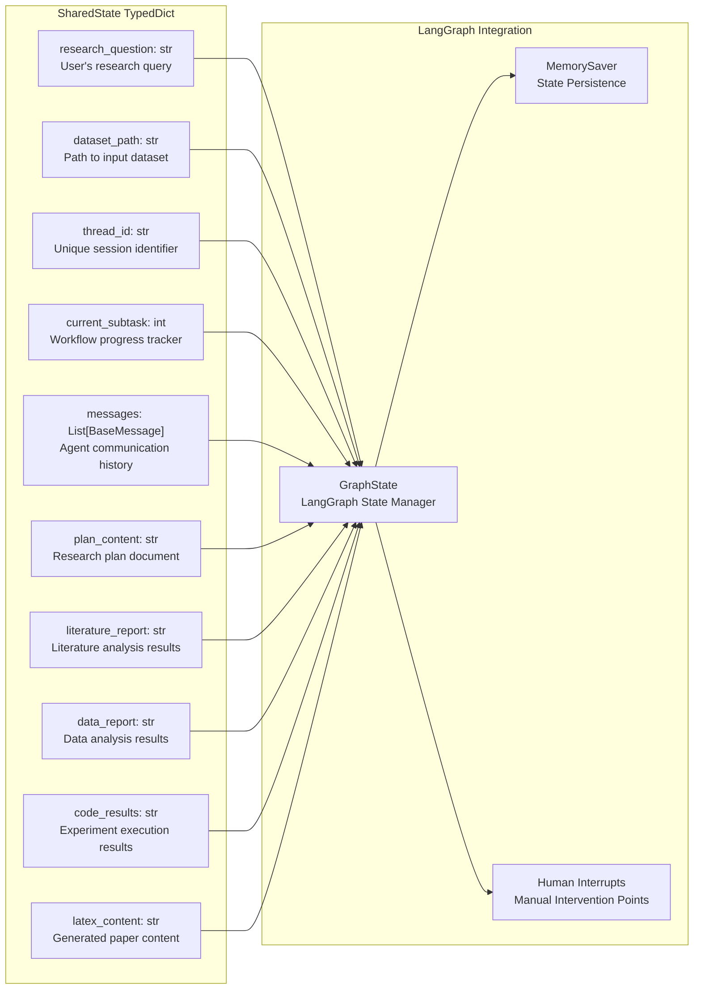

<!-- source: DeepWiki mcp.deepwiki.com · repo jarrycyx/openlens-ai · page 1.1 System Architecture · fetched 2026-10-27 -->

# System Architecture

Relevant source files

The following files were used as context for generating this wiki page:

- [README.md](README.md)
- [modules.md](modules.md)

This document provides a comprehensive technical overview of OpenLens AI's multi-agent architecture, workflow orchestration, and component integration. It covers the core system design, agent collaboration mechanisms, state management, and external service dependencies.

For implementation details of individual agents, see [Multi-Agent System](#3). For configuration and deployment specifics, see [Configuration](#2.1) and [LLM Router Infrastructure](#4).

## Architecture Overview

OpenLens AI implements a sophisticated multi-agent research automation system built on LangGraph workflow orchestration. The system coordinates five specialized agents through shared state management to conduct autonomous medical research from literature review through paper generation.

### Core System Components

**Sources:** [README.md:174-197](), [build_graph.py](), [modules.md:1-15]()

## Multi-Agent Workflow Architecture

The system implements a coordinated multi-agent workflow where each agent has specific responsibilities and communicates through the shared state managed by LangGraph.

### Agent Interaction Flow

**Sources:** [build_graph.py](), [state.py](), [modules.md:199-210]()

## Agent Specialization and Responsibilities

Each agent in the system has distinct responsibilities and utilizes specific tools to accomplish its tasks.

| Agent | Primary Function | Key Tools | Output Artifacts |
|-------|------------------|-----------|------------------|
| `supervisor.py` | Research planning and coordination | `PlanWriterTool`, `PlanReaderTool`, `TavilySearch` | `plan.md` |
| `literature_reviewer.py` | Academic literature analysis | `SearchArxivTool`, `SearchMedRxivTool`, `ReadArxivPaperTool`, `ReadMedRxivPaperTool` | `literature_report.md` |
| `data_analyzer.py` | Dataset processing and analysis | `OpenHandsTool`, `ReportWriterTool` | `data_show.md`, `data_report.md` |
| `coder.py` | Experiment code generation and execution | `OpenHandsTool`, Vision-Language Model validation | Code files, experimental results |
| `latex_writer.py` | Academic paper generation | `LatexWriterTool`, PDF quality assessment | LaTeX documents, compiled PDFs |

**Sources:** [modules.md:16-196](), [README.md:177-183]()

## State Management and Orchestration

The system uses LangGraph for workflow orchestration with a centralized state management approach that enables agent coordination and context sharing.

### State Schema Definition

The `SharedState` class in [state.py]() defines the complete state structure:

**Sources:** [state.py](), [build_graph.py]()

## Tool Integration Architecture

The system integrates multiple specialized tools that agents use to accomplish their tasks. Each tool provides specific capabilities for different aspects of the research workflow.

### Tool Ecosystem

```mermaid
graph TB
    subgraph "Literature Research Tools"
        search_arxiv["SearchArxivTool<br/>arXiv paper discovery"]
        read_arxiv["ReadArxivPaperTool<br/>arXiv content extraction"]
        search_medrxiv["SearchMedRxivTool<br/>medRxiv paper discovery"]
        read_medrxiv["ReadMedRxivPaperTool<br/>medRxiv content extraction"]
        tavily["TavilySearch<br/>General web search"]
    end
    
    subgraph "Code Execution Environment"
        openhands["OpenHandsTool<br/>Sandboxed code execution"]
        docker_runtime["Docker Container<br/>agent-med-cpu image"]
        file_ops["File Operations<br/>Code and data management"]
    end
    
    subgraph "Document Generation Tools"
        plan_writer["PlanWriterTool<br/>Research plan creation"]
        plan_reader["PlanReaderTool<br/>Plan retrieval"]
        report_writer["ReportWriterTool<br/>Report generation"]
        latex_writer["LatexWriterTool<br/>Academic paper creation"]
    end
    
    subgraph "Quality Assessment Tools"
        vlm_assess["Vision-Language Model<br/>Chart quality evaluation"]
        pdf_validator["PDF Quality Validator<br/>Document assessment"]
        rerank_service["BGE Reranker<br/>Search result optimization"]
    end
    
    search_arxiv --> lit_reviewer
    read_arxiv --> lit_reviewer
    search_medrxiv --> lit_reviewer
    read_medrxiv --> lit_reviewer
    tavily --> lit_reviewer
    tavily --> supervisor
    
    openhands --> data_analyzer
    openhands --> coder
    docker_runtime --> openhands
    file_ops --> openhands
    
    plan_writer --> supervisor
    plan_reader --> supervisor
    report_writer --> data_analyzer
    latex_writer --> latex_writer_agent["latex_writer"]
    
    vlm_assess --> coder
    vlm_assess --> latex_writer_agent
    pdf_validator --> latex_writer_agent
    rerank_service --> lit_reviewer
```

**Sources:** [README.md:184-196](), [modules.md:214-221](), [openlens_ai/tools/]()

## Workflow Execution Model

The system implements a structured workflow execution model that coordinates agent activities through defined phases and routing logic.

### Execution Flow Control

The workflow execution follows a deterministic pattern managed by LangGraph with conditional routing between agents based on task completion and quality assessment.

| Phase | Agent | Entry Point | Routing Logic | Next Phase |
|-------|-------|-------------|---------------|------------|
| Planning | `supervisor` | `supervisor_node()` | Plan exists check | Literature Review |
| Literature Review | `literature_reviewer` | `literature_reviewer_node()` | Minimum tool calls reached | Data Analysis |
| Data Analysis | `data_analyzer` | `data_analyzer_node()` | Data report generated | Code Execution |
| Code Execution | `coder` | `coder_node()` | Code validation passed | Paper Generation |
| Paper Generation | `latex_writer` | `latex_writer_node()` | Quality assessment | Completion |

**Routing Functions:**
- `supervisor_router()` - Determines planning completion
- `literature_reviewer_router()` - Controls literature review phase
- `data_analyzer_router()` - Manages data analysis workflow  
- `coder_router()` - Handles code execution routing
- `latex_writer_router()` - Controls paper generation flow

**Sources:** [build_graph.py](), [modules.md:42-49, 79-84, 116-117, 152-153, 195-196]()

## External Service Dependencies

The system relies on several external services for LLM capabilities, search functionality, and specialized processing.

### Service Integration Points

| Service Category | Provider | Configuration | Usage |
|-----------------|----------|---------------|-------|
| Language Models | Infini AI Cloud, DeepSeek | `MODEL`, `CODE_MODEL`, `OPENAI_API_KEY`, `BASE_URL` | Text generation, code generation |
| Vision Models | GLM-4.1v | `VISION_MODEL` | Chart quality assessment, PDF validation |
| Search Services | Tavily API | `TAVILY_API_KEY` | Web search, literature discovery |
| Reranking | BGE Reranker | `RERANK_MODEL`, `RERANK_API_KEY` | Search result optimization |
| Code Execution | Docker | `DOCKER_NAME` | Sandboxed code execution environment |
| Monitoring | LangSmith | `LANGSMITH_API_KEY`, `LANGSMITH_PROJECT` | Workflow tracing and debugging |

**Sources:** [README.md:112-151](), [.env.example]()

---

