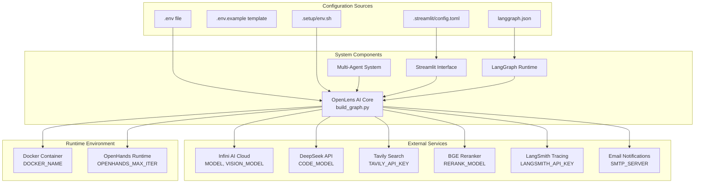
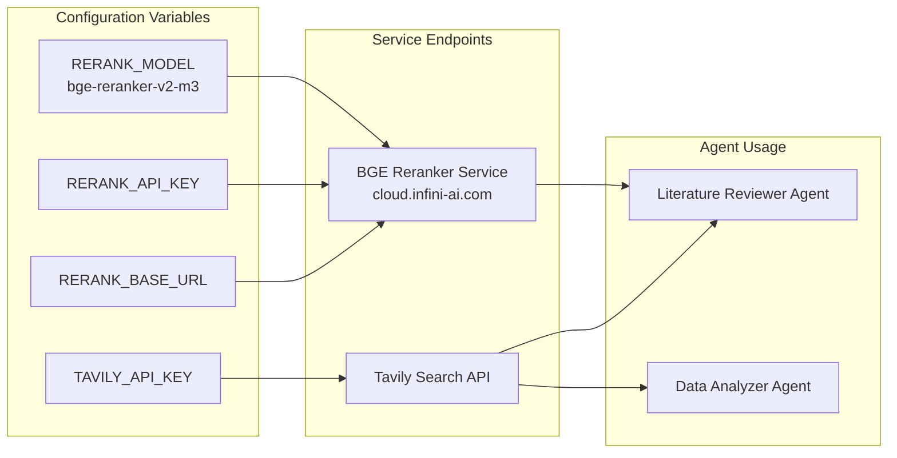
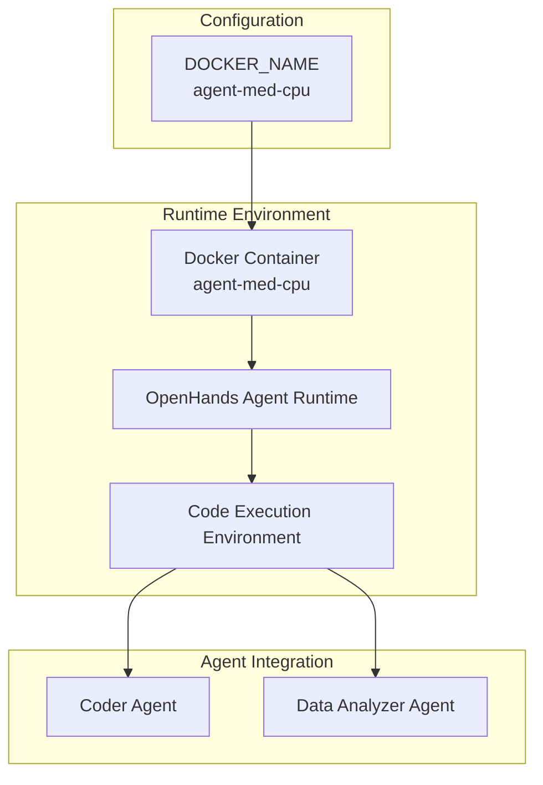

<!-- source: DeepWiki mcp.deepwiki.com · repo jarrycyx/openlens-ai · page 2.1 Configuration · fetched 2026-10-27 -->

# Configuration

<details>
<summary>Relevant source files</summary>

The following files were used as context for generating this wiki page:

- [.env.example](.env.example)
- [.setup/env.sh](.setup/env.sh)
- [.streamlit/config.toml](.streamlit/config.toml)
- [langgraph.json](langgraph.json)

</details>


This document provides comprehensive guidance for configuring OpenLens AI's environment variables, external service integrations, and system parameters. Configuration controls the system's connections to AI models, search services, monitoring tools, and execution environments.

For information about model-specific configuration files and YAML generation, see [Model Configuration](#4.1). For development environment setup details, see [Installation](#2.2).

## Configuration Overview

OpenLens AI's configuration system uses environment variables to manage connections to external services, model parameters, and system behavior. The primary configuration mechanism is through `.env` files that define API endpoints, authentication credentials, and operational parameters.

### Configuration Architecture



Sources: [.env.example:1-38](), [.setup/env.sh:1-4](), [.streamlit/config.toml:1-3](), [langgraph.json:1-9]()

## Environment Variables

### AI Model Configuration

The system requires configuration for three primary model types, each serving specific roles in the multi-agent workflow.

| Variable | Purpose | Example Value | Required |
|----------|---------|---------------|----------|
| `MODEL` | Main language model for general tasks | `glm-4.5-air` | Yes |
| `CODE_MODEL` | Model for code generation and analysis | `glm-4.5-air` | Yes |
| `VISION_MODEL` | Model for image and chart analysis | `glm-4.1v-9b-thinking` | Yes |
| `OPENAI_API_KEY` | API key for model access | `<YOUR API KEY>` | Yes |
| `BASE_URL` | Model API endpoint | `https://cloud.infini-ai.com/maas/v1/` | Yes |

The `MODEL` variable controls the primary language model used by the Supervisor Agent, Literature Reviewer Agent, Data Analyzer Agent, and LaTeX Writer Agent. The `CODE_MODEL` specifically serves the Coder Agent for code generation and execution tasks. The `VISION_MODEL` enables quality assessment of generated charts and LaTeX documents.

Sources: [.env.example:1-5]()

### Search and Reranking Services

OpenLens AI integrates with external search and reranking services to enhance literature review and information retrieval capabilities.



Sources: [.env.example:7-11]()

### System Parameters

#### Token Limits and Processing Control

| Variable | Purpose | Default Value | Description |
|----------|---------|---------------|-------------|
| `MAX_CONTEXT_TOKEN_CNT` | Normal operation token limit | 32000 | Context window for standard tasks |
| `MAX_CONTEXT_TOKEN_CNT_LARGE` | Large operation token limit | 96000 | Extended context for complex analysis |
| `MAX_TOOL_TOKEN_CNT` | Tool response token limit | 2000 | Maximum tokens in tool call responses |
| `LITERATURE_SEARCH_MIN_TOOL_CALL` | Minimum search iterations | 10 | Required tool calls for literature review |

These parameters control the system's token usage and ensure efficient resource utilization across different operation types.

Sources: [.env.example:13-17]()

#### Execution and Retry Logic

| Variable | Purpose | Default Value | Description |
|----------|---------|---------------|-------------|
| `OPENHANDS_MAX_ITER` | OpenHands iteration limit | 100 | Maximum execution steps in code sandbox |
| `MAX_SUBTASK_REDO` | Subtask retry limit | 2 | Maximum retries for failed subtasks |
| `MAX_LATEX_POLISH_ROUND` | LaTeX refinement cycles | 2 | Rounds of document quality improvement |

The `OPENHANDS_MAX_ITER` variable directly controls the execution behavior in [build_graph.py]() where the OpenHands agent operates within the Docker container specified by `DOCKER_NAME`.

Sources: [.env.example:19-23]()

### Runtime Environment

#### Docker Configuration

The `DOCKER_NAME` variable specifies the container environment for code execution:



Sources: [.env.example:23]()

## Optional Services Configuration

### Monitoring and Tracing

LangSmith integration provides comprehensive tracing and monitoring capabilities for the multi-agent workflow:

| Variable | Purpose | Example Value |
|----------|---------|---------------|
| `LANGSMITH_TRACING` | Enable tracing | `true` |
| `LANGSMITH_ENDPOINT` | Service endpoint | `https://api.smith.langchain.com` |
| `LANGSMITH_PROJECT` | Project identifier | `openlens` |
| `LANGSMITH_API_KEY` | Authentication key | `<YOUR API KEY>` |

When enabled, LangSmith traces agent interactions, tool calls, and workflow progression throughout the research process.

Sources: [.env.example:28-31]()

### Email Notifications

SMTP configuration enables automated notifications for experiment completion and system events:

| Variable | Purpose | Example Value |
|----------|---------|---------------|
| `SMTP_SERVER` | Mail server address | `smtpdm.aliyun.com` |
| `SMTP_PORT` | Server port | `25` |
| `EMAIL_USER` | Sender email address | `<YOUR EMAIL>` |
| `EMAIL_PASSWORD` | SMTP authentication | `<YOUR EMAIL SMTP PASSWORD>` |

These settings are used by the evaluation framework for experiment completion notifications and error reporting.

Sources: [.env.example:33-36]()

## Alternative Configuration Files

### DeepSeek Integration

The [.setup/env.sh:1-4]() file provides an alternative configuration for using DeepSeek models directly:

```bash
export MODEL="deepseek/deepseek-chat"
export DEEPSEEK_API_KEY="sk-e55d833c6ea540e085469a84b0b11960"
export DEEPSEEK_API_BASE="https://api.deepseek.com/"
```

This configuration bypasses the Infini AI proxy and connects directly to DeepSeek's API endpoints.

Sources: [.setup/env.sh:1-4]()

### Streamlit SSL Configuration

The [.streamlit/config.toml:1-3]() file configures SSL certificates for the web interface:

```toml
[server]
sslCertFile = '.streamlit/app.openlens.icu.pem'
sslKeyFile = '.streamlit/app.openlens.icu.key'
```

This enables HTTPS access to the Streamlit-based user interface with proper SSL encryption.

Sources: [.streamlit/config.toml:1-3]()

### LangGraph Runtime Configuration

The [langgraph.json:1-9]() file defines the LangGraph deployment configuration:

```json
{
  "dependencies": ["."],
  "graphs": {
    "agent": "./start_graph.py:graph"
  },
  "env": ".env",
  "image_distro": "wolfi"
}
```

This configuration specifies the graph entry point at `start_graph.py:graph`, the environment file location, and the base image distribution for containerized deployment.

Sources: [langgraph.json:1-9]()

## Configuration Validation

The system expects all required environment variables to be properly set before initialization. Missing or invalid configuration values will prevent the multi-agent system from starting correctly. The [.env.example:1-38]() file serves as the authoritative template for all required and optional configuration parameters.

Configuration values are loaded during system startup and used throughout the agent lifecycle for API authentication, service routing, and operational parameter enforcement.

Sources: [.env.example:1-38]()

---

