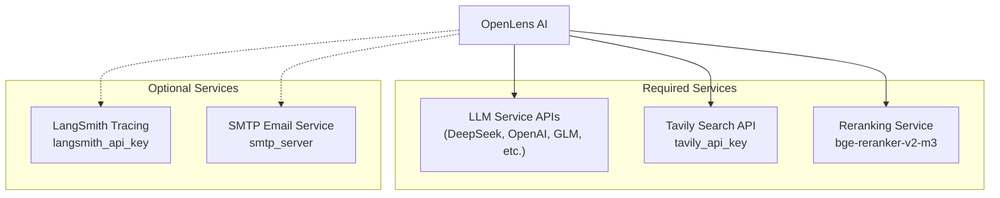
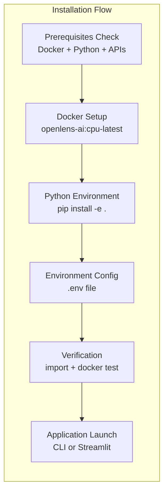

<!-- source: DeepWiki mcp.deepwiki.com · repo jarrycyx/openlens-ai · page 2.2 Installation · fetched 2026-10-27 -->

# Installation

<details>
<summary>Relevant source files</summary>

The following files were used as context for generating this wiki page:

- [README.md](README.md)
- [modules/OpenHands/.devcontainer/devcontainer.json](modules/OpenHands/.devcontainer/devcontainer.json)
- [modules/OpenHands/.devcontainer/setup.sh](modules/OpenHands/.devcontainer/setup.sh)

</details>


This document provides step-by-step instructions for installing and setting up OpenLens AI on your local development environment. It covers Docker environment configuration, Python dependency management, and API service configuration required for the multi-agent research system.

For information about configuration file details and environment variables, see [Configuration](#2.1). For setting up the development environment with OpenHands integration, see [Development Environment](#6).

## Prerequisites

OpenLens AI requires several external dependencies and services to function properly. The following components must be available before installation:

| Component | Version Requirement | Purpose |
|-----------|-------------------|---------|
| Python | 3.9 or higher | Core runtime environment |
| Docker | Latest stable | OpenHands code execution sandbox |
| API Keys | Various services | LLM services and search functionality |

### Required API Services



**Installation Prerequisites**
- LLM API access (DeepSeek, OpenAI, GLM-4.5, or compatible service)
- Tavily search API key for literature search functionality
- Docker Engine with sufficient disk space for medical dataset containers

Sources: [README.md:64-71]()

## Docker Environment Setup

OpenLens AI uses Docker containers for isolated code execution through the OpenHands integration. The system requires a specific Docker image optimized for medical data analysis tasks.

### Docker Installation Verification

```bash
docker --version
```

### OpenLens AI Docker Image Setup

The system provides two options for obtaining the required Docker image:

#### Option 1: Pull Pre-built Image (Recommended)

```bash
# Pull from Aliyun container registry
ALIYUN_REMOTE_DOCKER_NAME=crpi-hbt8nkulkjqjqkie.cn-hangzhou.personal.cr.aliyuncs.com/cyx-docker/openlens-ai:cpu-latest
docker pull $ALIYUN_REMOTE_DOCKER_NAME
docker tag $ALIYUN_REMOTE_DOCKER_NAME openlens-ai:cpu-latest
```

#### Option 2: Build Local Image

```bash
# Build Docker image from source
bash openlens_ai/tools/openhands_configs/build_docker_cpu.sh
```

The Docker container uses the name `agent-med-cpu` as specified in the `DOCKER_NAME` environment variable and provides an isolated execution environment for the `coder` agent's code generation and testing operations.

Sources: [README.md:74-85]()

## Python Environment Setup

### Repository Clone

```bash
git clone git@github.com:jarrycyx/openlens-ai.git
cd agent-med
```

### Virtual Environment Creation

OpenLens AI supports multiple Python environment managers:

```bash
# Using conda (recommended)
conda create -n py312 python=3.12
conda activate py312

# Alternative: using venv
python -m venv openlens-env
source openlens-env/bin/activate  # Linux/Mac
# openlens-env\Scripts\activate   # Windows
```

### Dependency Installation

```bash
# Upgrade pip to latest version
pip install --upgrade pip

# Install OpenLens AI in development mode
pip install -e .
```

### Optional: Graphviz Installation

For workflow visualization capabilities:

```bash
# Ubuntu/Debian
sudo apt-get install graphviz graphviz-dev

# macOS
brew install graphviz

# Windows
# Download from https://graphviz.org/download/
```

The graphviz dependency enables the system to generate visual representations of the multi-agent workflow graphs managed by the LangGraph orchestration system.

Sources: [README.md:87-102]()

## Environment Configuration

### Configuration File Setup

```bash
cp .env.example .env
# Edit .env with your API keys and model settings
```

### Core Configuration Parameters

The `.env` file contains essential configuration for the multi-agent system:

```mermaid
graph TB
    subgraph "Model Configuration"
        MODEL["MODEL=glm-4.5-air<br/>Main LLM for general tasks"]
        CODE_MODEL["CODE_MODEL=glm-4.5-air<br/>LLM for code generation"]
        VISION_MODEL["VISION_MODEL=glm-4.1v-9b-thinking<br/>VLM for image analysis"]
    end
    
    subgraph "API Configuration"
        OPENAI_API_KEY["OPENAI_API_KEY<br/>LLM service authentication"]
        BASE_URL["BASE_URL=https://cloud.infini-ai.com/maas/v1/<br/>Model API endpoint"]
        TAVILY_API_KEY["TAVILY_API_KEY<br/>Search service authentication"]
    end
    
    subgraph "Runtime Configuration"
        MAX_CONTEXT["MAX_CONTEXT_TOKEN_CNT=32000<br/>Context window limits"]
        OPENHANDS_ITER["OPENHANDS_MAX_ITER=100<br/>Code execution limits"]
        DOCKER_NAME["DOCKER_NAME=agent-med-cpu<br/>Container specification"]
    end
    
    MODEL --> supervisor_agent["supervisor.py"]
    CODE_MODEL --> coder_agent["coder.py"]
    VISION_MODEL --> latex_writer["latex_writer.py"]
    
    OPENAI_API_KEY --> llm_client["LLM Client Initialization"]
    TAVILY_API_KEY --> search_tools["Literature Search Tools"]
    DOCKER_NAME --> openhands_runtime["OpenHands Runtime"]
```



### Required Environment Variables

| Variable | Purpose | Example Value |
|----------|---------|---------------|
| `MODEL` | Primary LLM for agents | `glm-4.5-air` |
| `OPENAI_API_KEY` | LLM service authentication | `sk-xxx...` |
| `BASE_URL` | Model API endpoint | `https://cloud.infini-ai.com/maas/v1/` |
| `TAVILY_API_KEY` | Literature search service | `tvly-xxx...` |
| `DOCKER_NAME` | OpenHands container name | `agent-med-cpu` |

### Optional Configuration Parameters

| Variable | Purpose | Default |
|----------|---------|---------|
| `LANGSMITH_TRACING` | Enable workflow tracing | `false` |
| `SMTP_SERVER` | Email notification server | None |
| `MAX_CONTEXT_TOKEN_CNT` | Context window size | `32000` |
| `OPENHANDS_MAX_ITER` | Code execution iterations | `100` |

Sources: [README.md:110-151]()

## Installation Verification

### Basic System Check

Verify the installation by running a simple test:

```bash
python -c "import openlens_ai; print('Installation successful')"
```

### Docker Container Verification

```bash
# Verify Docker image is available
docker images | grep openlens-ai

# Expected output:
# openlens-ai    cpu-latest    <image-id>    <time>    <size>
```

### Environment Configuration Test

```bash
# Test environment variable loading
python -c "
from openlens_ai.utils.env import load_env_vars
config = load_env_vars()
print(f'Model: {config.get(\"MODEL\")}')
print(f'Docker: {config.get(\"DOCKER_NAME\")}')
"
```

### OpenHands Integration Test

```bash
# Verify OpenHands can access the Docker container
python -c "
import docker
client = docker.from_env()
containers = client.containers.list()
print('Docker client accessible')
"
```

## Running the Application

After successful installation, OpenLens AI can be launched in two modes:

### Command Line Interface

```bash
python -m openlens_ai.build_graph \
  --question "Your research question" \
  --dataset-path "path/to/dataset" \
  --thread-id "unique-job-id"
```

### Interactive Web Interface

```bash
streamlit run start_app.py
```

Access the web interface at `http://localhost:8501` for interactive research session management.



The installation process establishes the foundation for the multi-agent research system, including the `supervisor`, `literature_reviewer`, `data_analyzer`, `coder`, and `latex_writer` agents that collaborate through the LangGraph workflow orchestration system.

Sources: [README.md:154-172](), [README.md:87-102](), [README.md:74-85]()

---

