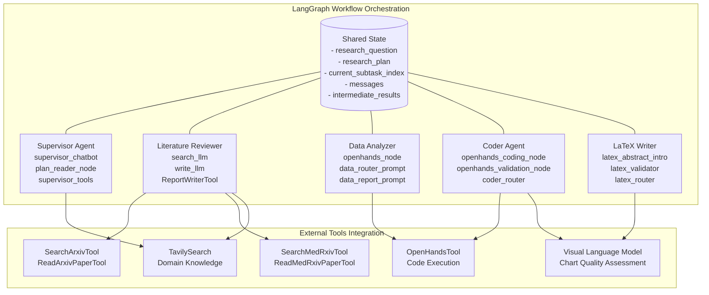
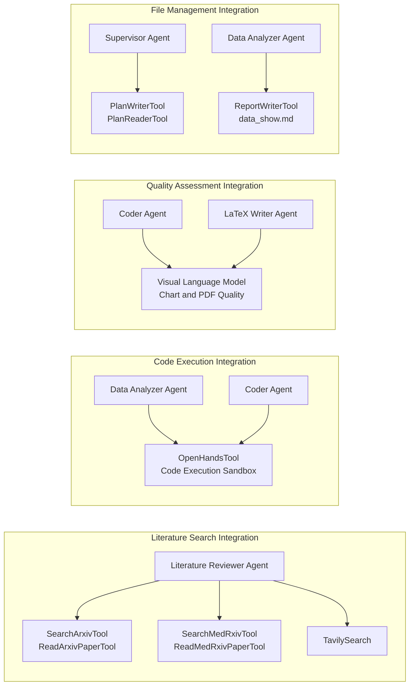

<!-- source: DeepWiki mcp.deepwiki.com · repo jarrycyx/openlens-ai · page 3 Multi-Agent System · fetched 2026-10-27 -->

# Multi-Agent System

Relevant source files

The following files were used as context for generating this wiki page:

- [modules.md](modules.md)

This document provides a comprehensive overview of OpenLens AI's multi-agent architecture, detailing how five specialized agents collaborate to conduct autonomous research. The system uses LangGraph for workflow orchestration and shared state management to coordinate complex research tasks from literature review through final paper generation.

For configuration details of individual agents, see [Configuration](#2.1). For specific agent implementation details, see the individual agent pages: [Supervisor Agent](#3.1), [Literature Reviewer Agent](#3.2), [Data Analyzer Agent](#3.3), [Coder Agent](#3.4), and [LaTeX Writer Agent](#3.5).

## Architecture Overview

The OpenLens AI multi-agent system consists of five specialized agents that work together through a shared state mechanism. Each agent has distinct responsibilities and tools, but they coordinate their activities through LangGraph's workflow orchestration.

### Agent Communication and State Management

**Sources:** [modules.md:1-221]()

The agents communicate through a centralized shared state that maintains the research context, plan, and intermediate results. This enables seamless handoffs between agents and ensures consistency across the research workflow.

## Agent Roles and Responsibilities

| Agent | Primary Function | Key Tools | Output |
|-------|------------------|-----------|---------|
| **Supervisor** | Planning and coordination | `PlanWriterTool`, `PlanReaderTool`, `TavilySearch` | Research plan (`plan.md`) |
| **Literature Reviewer** | Academic paper search and analysis | `SearchArxivTool`, `SearchMedRxivTool`, `ReportWriterTool` | Literature review report |
| **Data Analyzer** | Dataset processing and analysis | `OpenHandsTool`, data analysis prompts | Data analysis report (`data_show.md`) |
| **Coder** | Experiment code generation and execution | `OpenHandsTool`, validation prompts, VLM | Experimental results and code |
| **LaTeX Writer** | Academic paper generation | Section-specific prompts, VLM for quality assessment | Complete LaTeX paper |

**Sources:** [modules.md:5-12](), [modules.md:23-28](), [modules.md:57-62](), [modules.md:94-99](), [modules.md:124-131](), [modules.md:160-167]()

## Workflow Orchestration

### Agent Execution Flow

```mermaid
graph TD
    START["Research Question Input"] --> SUPERVISOR_CHECK{"plan.md exists?"}
    
    SUPERVISOR_CHECK -->|No| SUPERVISOR_PLAN["supervisor_chatbot<br/>supervisor_plan.md"]
    SUPERVISOR_CHECK -->|Yes| SUPERVISOR_ALTER["supervisor_chatbot<br/>supervisor_alter_plan.md"]
    
    SUPERVISOR_PLAN --> PLAN_WRITE["supervisor_tools<br/>PlanWriterTool"]
    SUPERVISOR_ALTER --> PLAN_READ["plan_reader_node<br/>PlanReaderTool"]
    
    PLAN_WRITE --> LIT_SEARCH["search_llm<br/>SearchArxivTool<br/>SearchMedRxivTool<br/>TavilySearch"]
    PLAN_READ --> LIT_SEARCH
    
    LIT_SEARCH --> LIT_REPORT["write_llm<br/>ReportWriterTool"]
    
    LIT_REPORT --> DATA_CHECK{"data_show.md exists?"}
    DATA_CHECK -->|No| DATA_ANALYZE["openhands_node<br/>data_analyzer_prompt"]
    DATA_CHECK -->|Yes| DATA_REPORT["data_report_prompt"]
    
    DATA_ANALYZE --> DATA_ROUTER["router_node<br/>data_router_prompt"]
    DATA_REPORT --> DATA_ROUTER
    
    DATA_ROUTER --> CODER_PLAN["plan reading"]
    CODER_PLAN --> CODER_CODE["openhands_coding_node<br/>coder.md"]
    CODER_CODE --> CODER_VALIDATE["openhands_validation_node<br/>coder_validator.md"]
    CODER_VALIDATE --> CODER_VLM["VLM Chart Assessment"]
    CODER_VLM --> CODER_CONCLUDE["coder_concluder.md"]
    CODER_CONCLUDE --> CODER_ROUTER["coder_router.md"]
    
    CODER_ROUTER --> LATEX_CLEAR["Clear state and collect files"]
    LATEX_CLEAR --> LATEX_INTRO["latex_abstract_intro.md"]
    LATEX_INTRO --> LATEX_RELATED["latex_related_works.md"]
    LATEX_RELATED --> LATEX_METHODS["latex_methods.md"]
    LATEX_METHODS --> LATEX_EXP["latex_experiments.md"]
    LATEX_EXP --> LATEX_VALIDATE["latex_validator.md"]
    LATEX_VALIDATE --> LATEX_VLM["VLM PDF Quality Assessment"]
    LATEX_VLM --> LATEX_ROUTER["latex_router.md"]
    
    LATEX_ROUTER -->|Continue| LATEX_RIGOR["latex_rigor_prompt.md"]
    LATEX_ROUTER -->|Finish| END["Complete LaTeX Paper"]
    LATEX_RIGOR --> LATEX_VALIDATE
```

**Sources:** [modules.md:42-48](), [modules.md:79-84](), [modules.md:111-116](), [modules.md:145-152](), [modules.md:186-195]()

### State Management and Routing

The system uses several routing mechanisms to control workflow progression:

- **Supervisor routing**: Determines when to create new plans versus modify existing ones
- **Data analyzer routing**: Controls transition between analysis and reporting phases  
- **Coder routing**: Manages code generation, validation, and improvement cycles
- **LaTeX routing**: Controls paper section generation and quality improvement iterations

Each routing decision is based on the current shared state and the completion status of specific tasks or file artifacts.

**Sources:** [modules.md:116](), [modules.md:152](), [modules.md:195]()

## Agent Integration Points

### Tool Integration Architecture

**Sources:** [modules.md:32-36](), [modules.md:67-72](), [modules.md:103-108](), [modules.md:135-142](), [modules.md:172-184]()

## Prompt Template System

Each agent uses specialized prompt templates to guide their behavior:

### Supervisor Agent Prompts
- `supervisor_plan.md`: Initial research plan generation
- `supervisor_alter_plan.md`: Plan modification and refinement

### Literature Reviewer Prompts  
- Search and analysis prompts integrated with `search_llm`
- Report generation prompts integrated with `write_llm`

### Data Analyzer Prompts
- `data_analyzer_prompt`: Guides data analysis execution
- `data_report_prompt`: Guides report generation  
- `data_router_prompt`: Controls workflow routing decisions

### Coder Agent Prompts
- `coder.md`: Code generation guidance
- `coder_validator.md`: Code validation and testing
- `coder_concluder.md`: Results conclusion generation
- `coder_router.md`: Workflow routing decisions

### LaTeX Writer Prompts
- `latex_abstract_intro.md`: Abstract and introduction generation
- `latex_related_works.md`: Related work section generation
- `latex_methods.md`: Methods section generation  
- `latex_experiments.md`: Experiments section generation
- `latex_validator.md`: Paper quality validation
- `latex_concluder.md`: Conclusion generation
- `latex_router.md`: Workflow routing decisions
- `latex_rigor_prompt.md`: Academic rigor improvement
- `latex_literature_check.md`: Reference validation
- `latex_figure_check.md`: Figure quality assessment

**Sources:** [modules.md:37-40](), [modules.md:104-107](), [modules.md:135-140](), [modules.md:171-182]()

## Error Handling and Workflow Control

The multi-agent system implements several mechanisms for robust workflow execution:

- **Minimum tool call requirements**: Literature reviewer must execute a minimum number of search operations before proceeding to report writing
- **File existence checks**: Agents check for prerequisite files (e.g., `plan.md`, `data_show.md`) before proceeding
- **Quality validation loops**: Both coder and LaTeX writer agents include validation steps with improvement iterations
- **State clearing mechanisms**: Agents clear their state at appropriate workflow transition points

The LangGraph orchestration ensures that workflow failures can be detected and handled gracefully, with the ability to retry operations or route to alternative execution paths.

**Sources:** [modules.md:79-84](), [modules.md:111-116](), [modules.md:145-152](), [modules.md:186-195]()

---

