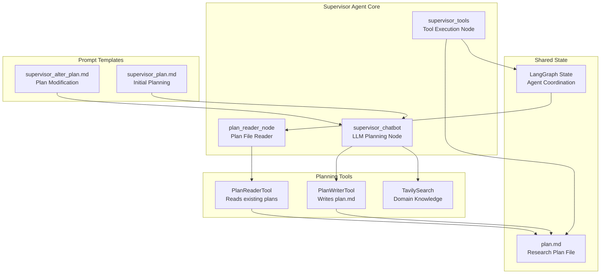
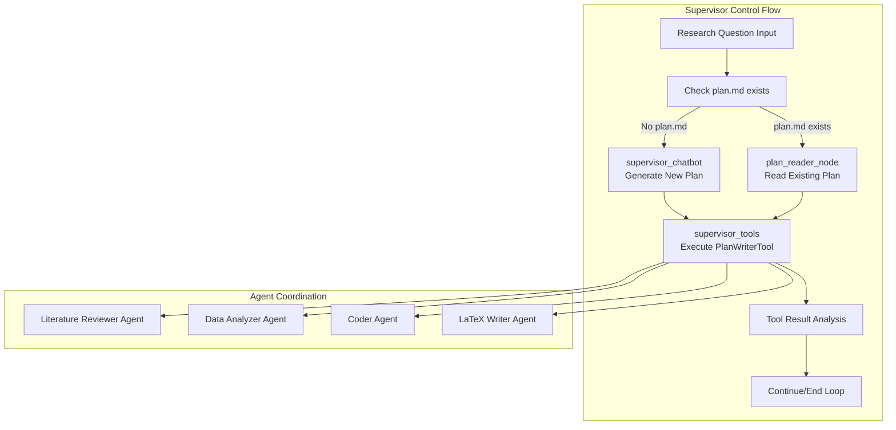

<!-- source: DeepWiki mcp.deepwiki.com · repo jarrycyx/openlens-ai · page 3.1 Supervisor Agent · fetched 2026-10-27 -->

# Supervisor Agent

Relevant source files

The following files were used as context for generating this wiki page:

- [modules.md](modules.md)

The Supervisor Agent serves as the central coordinator and planning component within the OpenLens AI multi-agent research system. This document covers the Supervisor Agent's core responsibilities, implementation architecture, workflow processes, and integration patterns with other system components.

For information about the other specialized agents that the Supervisor coordinates, see [Literature Reviewer Agent](#3.2), [Data Analyzer Agent](#3.3), [Coder Agent](#3.4), and [LaTeX Writer Agent](#3.5). For the overall multi-agent system architecture, see [Multi-Agent System](#3).

## Core Responsibilities

The Supervisor Agent functions as the orchestrator for autonomous research workflows, with four primary responsibilities:

| Responsibility | Description |
|---|---|
| **Research Planning** | Creates detailed research plans based on user research questions |
| **Agent Coordination** | Directs other agents to execute tasks according to the established plan |
| **Progress Monitoring** | Tracks workflow progress across all agents and subtasks |
| **Plan Adaptation** | Modifies research plans dynamically based on intermediate results |

The Supervisor Agent operates through a shared state mechanism managed by LangGraph, enabling coordination across the five-agent system without direct agent-to-agent communication.

Sources: [modules.md:17-29]()

## Planning and Coordination Architecture

### Supervisor Agent Workflow Components

Sources: [modules.md:32-48]()

### Agent Coordination Flow

Sources: [modules.md:42-48]()

## Implementation Architecture

### Tool Integration

The Supervisor Agent implements two specialized tools for plan management:

| Tool | Purpose | Implementation |
|---|---|---|
| `PlanWriterTool` | Creates and updates research plan files | Writes structured plans to `plan.md` |
| `PlanReaderTool` | Retrieves existing research plans | Reads and parses existing `plan.md` files |

The Supervisor Agent also integrates `TavilySearch` for gathering domain knowledge to inform research planning decisions.

Sources: [modules.md:34-36]()

### Prompt Template System

The Supervisor Agent utilizes two distinct prompt templates for different planning scenarios:

- **`supervisor_plan.md`**: Used for generating initial research plans from scratch when no existing plan is present
- **`supervisor_alter_plan.md`**: Used for modifying and updating existing research plans based on workflow progress

This dual-template approach enables the Supervisor Agent to handle both cold-start planning scenarios and iterative plan refinement during research execution.

Sources: [modules.md:37-40]()

## Workflow Process

### Plan Generation Workflow

The Supervisor Agent follows a systematic workflow for research plan creation and management:

1. **Plan Existence Check**: Determines if `plan.md` file exists in the workspace
2. **Plan Generation/Reading**: 
   - If no plan exists: Uses `supervisor_chatbot` with `supervisor_plan.md` template
   - If plan exists: Uses `plan_reader_node` with `PlanReaderTool`
3. **Tool Execution**: Executes plan writing operations via `supervisor_tools`
4. **Loop Decision**: Analyzes tool results to determine continuation or termination

This workflow ensures that research planning is both systematic and adaptive to existing work contexts.

Sources: [modules.md:42-48]()

### State Management Integration

The Supervisor Agent operates within the LangGraph state management system, which maintains:

- Current research question and objectives
- Active research plan and subtask tracking
- Agent coordination status and message history
- Intermediate results from all coordinated agents

This shared state approach enables the Supervisor Agent to maintain coordination without requiring direct inter-agent communication protocols.

Sources: [modules.md:199-208]()

## Integration with Multi-Agent System

### Agent Coordination Responsibilities

The Supervisor Agent coordinates task execution across four specialized agents:

| Agent | Coordination Role |
|---|---|
| **Literature Reviewer** | Directs literature search scope and objectives |
| **Data Analyzer** | Specifies data analysis requirements and methods |
| **Coder** | Defines experimental code generation requirements |
| **LaTeX Writer** | Coordinates paper structure and content integration |

The coordination occurs through shared state updates rather than direct agent communication, enabling loose coupling and independent agent operation.

### Workflow Orchestration

The Supervisor Agent's coordination operates through LangGraph's workflow management system, which:

- Ensures sequential task execution when dependencies exist
- Enables parallel agent operation when tasks are independent
- Provides retry and error handling capabilities
- Maintains workflow state consistency across agent boundaries

This orchestration approach enables robust research workflow execution while maintaining system modularity.

Sources: [modules.md:199-210]()

---

